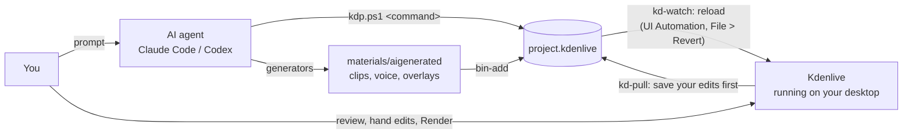

<div align="center">

# Movie Engine

**An AI agent edits your video in Kdenlive while you watch, and you can take over at any moment.**

AI coding agents (Claude Code, Codex) build and change real Kdenlive projects: films, explainers and vertical shorts. The edits show up live in the editor you have open. Portable, Windows, no editor patches.


**English** · [简体中文](docs/readme/README.zh-CN.md) · [繁體中文](docs/readme/README.zh-TW.md) · [हिन्दी](docs/readme/README.hi.md) · [Español](docs/readme/README.es.md) · [Français](docs/readme/README.fr.md) · [العربية](docs/readme/README.ar.md) · [বাংলা](docs/readme/README.bn.md) · [Português](docs/readme/README.pt.md) · [Русский](docs/readme/README.ru.md) · [اردو](docs/readme/README.ur.md) · [Bahasa Indonesia](docs/readme/README.id.md) · [Deutsch](docs/readme/README.de.md) · [日本語](docs/readme/README.ja.md) · [Türkçe](docs/readme/README.tr.md) · [한국어](docs/readme/README.ko.md) · [Українська](docs/readme/README.uk.md) · [Italiano](docs/readme/README.it.md) · [Polski](docs/readme/README.pl.md) · [Tiếng Việt](docs/readme/README.vi.md) · [فارسی](docs/readme/README.fa.md) · [ไทย](docs/readme/README.th.md) · [Kiswahili](docs/readme/README.sw.md) · [አማርኛ](docs/readme/README.am.md) · [Avañe'ẽ](docs/readme/README.gn.md) · [Setswana](docs/readme/README.tn.md) · [Shqip](docs/readme/README.sq.md) · [Беларуская](docs/readme/README.be.md) · [Български](docs/readme/README.bg.md) · [Bosanski](docs/readme/README.bs.md) · [Hrvatski](docs/readme/README.hr.md) · [Српски](docs/readme/README.sr.md) · [Crnogorski](docs/readme/README.cnr.md) · [Македонски](docs/readme/README.mk.md) · [Slovenščina](docs/readme/README.sl.md) · [Slovenčina](docs/readme/README.sk.md) · [Čeština](docs/readme/README.cs.md) · [Magyar](docs/readme/README.hu.md) · [Română](docs/readme/README.ro.md) · [Dansk](docs/readme/README.da.md) · [Norsk bokmål](docs/readme/README.nb.md) · [Norsk nynorsk](docs/readme/README.nn.md) · [Svenska](docs/readme/README.sv.md) · [Íslenska](docs/readme/README.is.md) · [Suomi](docs/readme/README.fi.md) · [Eesti](docs/readme/README.et.md) · [Latviešu](docs/readme/README.lv.md) · [Lietuvių](docs/readme/README.lt.md) · [Nederlands](docs/readme/README.nl.md) · [Lëtzebuergesch](docs/readme/README.lb.md) · [Rumantsch](docs/readme/README.rm.md) · [Ελληνικά](docs/readme/README.el.md) · [Malti](docs/readme/README.mt.md) · [Gaeilge](docs/readme/README.ga.md) · [Català](docs/readme/README.ca.md) · [ქართული](docs/readme/README.ka.md) · [Հայերեն](docs/readme/README.hy.md) · [Azərbaycanca](docs/readme/README.az.md) · [Afrikaans](docs/readme/README.af.md) · [isiZulu](docs/readme/README.zu.md) · [isiXhosa](docs/readme/README.xh.md) · [Sesotho](docs/readme/README.st.md) · [Sepedi](docs/readme/README.nso.md) · [Xitsonga](docs/readme/README.ts.md) · [Tshivenḓa](docs/readme/README.ve.md) · [siSwati](docs/readme/README.ss.md) · [isiNdebele (South Africa)](docs/readme/README.nr.md) · [isiNdebele (Zimbabwe)](docs/readme/README.nd.md) · [chiShona](docs/readme/README.sn.md) · [Chichewa](docs/readme/README.ny.md) · [Ikinyarwanda](docs/readme/README.rw.md) · [Ikirundi](docs/readme/README.rn.md) · [Malagasy](docs/readme/README.mg.md) · [Soomaali](docs/readme/README.so.md) · [Afaan Oromoo](docs/readme/README.om.md) · [Qafar af](docs/readme/README.aa.md) · [ትግርኛ](docs/readme/README.ti.md) · [Sängö](docs/readme/README.sg.md) · [Kreol Seselwa](docs/readme/README.crs.md) · [TjiKalanga](docs/readme/README.kck.md) · [ChiNdau](docs/readme/README.ndc.md)

</div>

---

## Contents

- [Why](#why)
- [How it works](#how-it-works)
- [Features](#features)
- [Requirements](#requirements)
- [Installation](#installation)
- [Quick start](#quick-start)
- [Working with the agent](#working-with-the-agent)
- [The editing command line (`kdp.ps1`)](#the-editing-command-line-kdpps1)
- [Live sync with the open editor](#live-sync-with-the-open-editor)
- [Generators: what Kdenlive cannot do](#generators-what-kdenlive-cannot-do)
- [Voice-over and sound](#voice-over-and-sound)
- [Interface language](#interface-language)
- [Folder layout](#folder-layout)
- [Tests and proofs](#tests-and-proofs)
- [Limitations](#limitations)
- [Troubleshooting](#troubleshooting)
- [FAQ](#faq)
- [Contributing](#contributing)
- [Acknowledgements](#acknowledgements)
- [License](#license)

## Why

Video editors are built for hands on a mouse. AI agents are good at structure, timing and repetition: placing 300 clips on the beat, timing every caption to the voice, redoing a scene after feedback. They cannot click through a GUI without taking over your desktop.

Kdenlive is a strong open-source editor, but on Windows it has **no automation API**: D-Bus control exists only on Linux builds, and the forks that add one are either unmaintained or unsafe. Movie Engine solves this without patching the editor:

1. The agent edits the `.kdenlive` project file through a tested command line (`engine/kdp.ps1`).
2. The running Kdenlive is told to reload the file through Windows UI Automation, with no keystrokes, no mouse and no focus stealing.
3. Your own unsaved edits are saved first and never overwritten.

So the agent edits and you review, or you edit by hand. Both of you work on the same project, in the same editor, at the same time.

## How it works



Every editing command follows the same safe cycle:

1. **Pull.** If Kdenlive has unsaved changes, it is told to save them (toolbar Save via UI Automation), and the save is confirmed.
2. **Edit.** The command changes the XML under a lock, after a hash check and with an undo snapshot. If the file changed meanwhile, nothing is written.
3. **Reload.** The watcher sees the AI's stamp and runs File > Revert in the open editor. Success counts only when the timeline widget has actually been rebuilt.
4. **Conflict.** If you started editing in between, nothing is reloaded and your work stays. The AI version is kept aside, and the agent re-applies its change on top of yours.

## Features

- **Full project editing without the GUI**: about 120 commands covering bin, timeline, effects, compositions, tracks, guides, markers, subtitles, sequences, speed and time remap, slideshows, titles, proxies, rendering and undo/redo. See the [command reference](#the-editing-command-line-kdpps1).
- **Live sync with the open editor.** AI edits appear in the Kdenlive you are looking at; your unsaved edits are saved first and never lost.
- **Never disturbs your desktop.** No focus stealing, keystrokes or mouse input. Test editors run on an invisible Windows desktop.
- **Portable.** Editor, settings, Node.js, fonts and tools live in one folder. Copy it to another PC and it works; nothing is written to Program Files or your Windows profile.
- **Generators for what Kdenlive cannot do**: per-letter kinetic text, hand-drawn annotations, 3D UI scenes, cursor animations and long interactive "explainer" films. They render on the GPU with real motion blur and are placed on the timeline as ordinary clips.
- **Voice-over with word timings** (Microsoft Edge TTS, no API key). Captions and actions fire on the exact word.
- **Synthesized sound effects** (whoosh, click, pop, riser, impact and more), generated in code.
- **Proven, not assumed.** Every command has a result check, effects and compositions are swept one by one, and the raw results are in `docs/proof/`.
- **Agent instructions included.** `AGENTS.md` and the skills in `.claude/skills/` teach Claude Code and Codex the workflow, the file format and the pitfalls.

## Requirements

| | |
|---|---|
| OS | Windows 10 or 11, x64 |
| Editor | Kdenlive **26.08.3** portable (standalone) build. Other versions are untested. |
| Node.js | 18 or newer: the Windows x64 `.zip` from nodejs.org, unpacked into `engine/node/` |
| Browser | Microsoft Edge (part of Windows); used headless by the scene renderers |
| Agent | [Claude Code](https://claude.com/claude-code) or Codex. Optional: every tool also runs by hand. |
| Disk | about 1 GB for the editor and tools, plus your media |
| GPU | any GPU with hardware H.264 encoding speeds up `film-render.mjs` (it falls back to software) |

## Installation

Everything is installed **inside the folder**. Nothing needs admin rights.

```powershell
git clone https://github.com/vladtarrow/movie-engine.git
cd movie-engine
```

**1. Node.js.** Download the Windows x64 `.zip` of Node.js 18 or newer from <https://nodejs.org/en/download> and unpack its contents into `engine\node\`, so that `engine\node\node.exe` and `engine\node\npm.cmd` are there. No installer and no system Node are needed. All scripts run through `engine\node.cmd`, never through a system Node.

**2. Node packages** for the voice tool and the renderers (versions are pinned in `engine/voice/package.json`):

```powershell
engine\node\npm.cmd install --prefix engine\voice
```

**3. Kdenlive 26.08.3 portable.** Download `kdenlive-26.08.3_standalone.exe` from <https://download.kde.org/stable/kdenlive/26.08/windows/> into `engine\installer\`, check it and unpack it:

```powershell
(Get-FileHash engine\installer\kdenlive-26.08.3_standalone.exe -Algorithm SHA256).Hash
# expected: A25427B1DFF2C17E3B0386E991BB1A719382BB3176D1A90E441CDAEB6E0A967D
engine\installer\kdenlive-26.08.3_standalone.exe -o"engine\Kdenlive" -y
```

The editor ends up in `engine\Kdenlive\kdenlive-26.08.3_standalone\bin\`. It already includes `melt.exe` and `ffmpeg.exe`.

**4. First start.**

```powershell
engine\kdenlive.cmd
```

Kdenlive keeps all its settings in `engine\profile-kdenlive\`, not in your Windows profile. On the first start it shows a one-time setup wizard.

## Quick start

### With an agent

Open the folder in Claude Code (or Codex) and ask in plain words:

> Make a new vertical 30 fps project "launch-teaser". Put the three screenshots from `materials/designers/launch/` on the timeline, 2.5 s each with a short cross-fade, add a voice-over from `script.txt` and time a kinetic caption to every line.

> Open it in Kdenlive for me.

> The second shot is too long. Cut it to 1.8 s and move the logo up a bit.

The agent follows `AGENTS.md`: it edits through `kdp.ps1`, renders only the clips the cut needs, and keeps the open editor in sync. You review in Kdenlive, edit by hand whenever you like, and press Render when you are happy.

### By hand

```powershell
# a new 1080x1920 30 fps project with 2 video and 2 audio tracks
powershell -NoProfile -ExecutionPolicy Bypass -File engine\kdp.ps1 new -Project projects\hello\hello.kdenlive -Profile vertical_hd_30

# a 3-second title and a colour background
powershell -NoProfile -ExecutionPolicy Bypass -File engine\kdp.ps1 bin-color -Project projects\hello\hello.kdenlive -Color '#203060' -Seconds 3 -Name bg
powershell -NoProfile -ExecutionPolicy Bypass -File engine\kdp.ps1 title -Project projects\hello\hello.kdenlive -Text "Hello" -Seconds 3 -Name hi

# place them: background on V1, title above it on V2
powershell -NoProfile -ExecutionPolicy Bypass -File engine\kdp.ps1 add -Project projects\hello\hello.kdenlive -Bin bg -Track V1 -At 0
powershell -NoProfile -ExecutionPolicy Bypass -File engine\kdp.ps1 add -Project projects\hello\hello.kdenlive -Bin hi -Track V2 -At 0

# a check frame, then open it in the editor
powershell -NoProfile -ExecutionPolicy Bypass -File engine\kdp.ps1 frame -Project projects\hello\hello.kdenlive -At 1.5 -Out out\hello\check.png
engine\kdenlive.cmd projects\hello\hello.kdenlive
```

To reopen the last project later, double-click `open-last-project.cmd`.

## Working with the agent

The agent reads `AGENTS.md` (Codex) or `CLAUDE.md`, which imports it (Claude Code), plus two skills:

| Skill | Teaches |
|---|---|
| `.claude/skills/kdenlive-project-file` | the `.kdenlive` / MLT XML format, `kdp.ps1`, checking with `melt` |
| `.claude/skills/kdenlive-live` | driving the running editor safely: start, pull, reload, capture its window |

Rules the agent follows, which you can rely on:

- It never takes your mouse, keyboard or focus, and never screenshots your desktop (only the editor's own window).
- It does the GUI steps itself (save, open, reload) instead of asking you to click.
- It asks before downloading anything and before deleting anything.
- It renders only what the work needs (scene clips, check frames). It renders the final film only when you ask.
- When Kdenlive cannot do something well, the agent builds it outside with code and puts the result in as a clip. It does not water the effect down.

## The editing command line (`kdp.ps1`)

```powershell
powershell -NoProfile -ExecutionPolicy Bypass -File engine\kdp.ps1 <command> -Project <file.kdenlive> [options]
```

Times are in seconds, with a dot (`2.5`). Tracks are `V1 V2 …` (V1 lowest) and `A1 A2 …`. A clip is addressed by `-Track` plus any time `-At` inside it. Effect parameters go in `-Params "name=value||name=value"`. The full list with every option is in the header of `engine/kdp.ps1`.

| Group | Commands |
|---|---|
| Project | `new`, `profiles`, `info`, `validate`, `fonts`, `profile-set`, `profile-from-clip`, `zone`, `archive`, `backups`, `rebase`, `otio-export`, `otio-import` |
| Bin | `bin-add`, `bin-color`, `title`, `title-text`, `title-save`, `title-template`, `bin-rename`, `bin-remove`, `bin-info`, `bin-set`, `bin-duplicate`, `bin-replace-file`, `bin-reload`, `folder`, `bin-folder`, `relink`, `clean`, `generator`, `playlist-clip`, `extract-audio`, `transcode` |
| Timeline | `add`, `add-av`, `move`, `copy`, `trim`, `ripple-trim`, `slip`, `split`, `remove`, `speed`, `remap`, `disable`, `enable`, `group`, `ungroup`, `mix`, `unmix`, `space-insert`, `space-remove`, `spaces-remove-all`, `track-clear`, `replace-in-timeline` |
| Effects | `effects`, `effect-info`, `effect-add`, `effect-list`, `effect-set`, `effect-remove`, `effect-copy`, `effect-clear`, `effects-all`, `bin-effect`, `effect-templates`, `effect-template` |
| Compositions | `compositions`, `comp-info`, `comp-add`, `comp-list`, `comp-set`, `comp-remove` |
| Tracks | `track-add`, `track-remove`, `track-set` |
| Guides and markers | `guide-add`, `guide-list`, `guide-remove`, `guide-set`, `guide-clear`, `guide-export`, `guide-category`, `marker`, `marker-list`, `marker-set`, `marker-remove` |
| Subtitles | `sub-add`, `sub-import`, `sub-export`, `sub-state` |
| Sequences | `sequence-add`, `sequences`, `copy-to-sequence`, `expand`; any command with `-Sequence <name>` works inside that sequence |
| Special | `slideshow`, Lottie / Glaxnimate animations via `bin-add`, `proxy`, `stabilize`, `scene-split`, `speed-job`, `subclip` |
| Output | `frame` (one PNG), `preview` (fast melt render), `render` (Kdenlive's own renderer or a preset), `presets` |
| History | `undo`, `redo`, `clear-history` (snapshots in `projects/<name>/.kdp-history`) |

Behaviour worth knowing:

- Linked audio and video halves move, trim, split and get removed together (`-Alone` for one half).
- A failing command exits with code 1 and writes nothing.
- Effects the Windows build cannot run are refused, not silently ignored (list: `docs/proof/assets.txt`).
- Every Kdenlive menu action is mapped to a command, another route, or "view only" in `engine/tools/data/kdenlive-actions.csv`. See `docs/kdenlive-coverage.md`.

## Live sync with the open editor

| Script | What it does | Exit codes |
|---|---|---|
| `engine\kd-pull.ps1 -Project <f>` | makes Kdenlive save your edits and confirms it | 0 file current, 3 not running, 4 not confirmed |
| `engine\kd-reload.ps1 -Project <f>` | File > Revert, confirmed by the rebuilt timeline | 0 confirmed, 2 you have unsaved edits (nothing discarded), 3 not running, 4 failed |
| `engine\kd-watch.ps1 -Project <f>` | background watcher: reloads after every AI write, logs conflicts | log in `engine\kd-watch.log`; delete `engine\kd-watch.run` to stop |
| `engine\kdenlive-bg.ps1 [project]` | starts Kdenlive minimized for an agent | 0 loaded, 4 not confirmed |
| `engine\kdenlive.cmd [project]` | starts Kdenlive for you | |

Start the watcher once per session:

```powershell
Start-Process powershell -WindowStyle Hidden -ArgumentList '-NoProfile','-ExecutionPolicy','Bypass','-File','engine\kd-watch.ps1','-Project','projects\hello\hello.kdenlive'
```

Big projects: a reload of a 1000-clip project takes minutes, and the tools wait for it instead of reporting early. Projects open through *File > Open Recent* on an empty editor, because opening a file directly makes Qt walk every timeline item for accessibility and was about 10 minutes slower.

## Generators: what Kdenlive cannot do

Kdenlive/MLT has no per-letter text animation, no expressions and little 3D, and heavy effects slow playback. Movie Engine renders such parts outside and puts them on the timeline as ordinary clips, usually with alpha, on a track above the pictures. The generator script and its inputs stay in the project folder, so a clip can be regenerated when the text, font or timing changes.

| Tool | Makes |
|---|---|
| `engine/tools/kinetic-text.ps1` | per-letter kinetic captions, every word timed from `voice.json`, highlight box |
| `engine/tools/annotate.ps1` | hand-drawn circles, boxes, underlines and arrows that draw on over a screenshot |
| `engine/tools/card-entrance.ps1` | a screenshot card that rises and scales in with a soft shadow |
| `engine/tools/pdf-to-png.ps1` | slides from a PDF export |
| `engine/tools/html-render.mjs` | any HTML/CSS/canvas scene to video: interface animation, cursors, 3D, masks |
| `engine/tools/film-render.mjs` + `film/` | long, interactive explainer films on a canvas: one clip per voice line, actions fire on spoken words, GPU motion blur at about 45 fps |

Both renderers drive the Microsoft Edge that ships with Windows, headless, with a throw-away profile and no network access.

### Demos

```powershell
# a 3-second 3D title card with a cursor click
engine\node.cmd engine\tools\html-render.mjs examples\demo\scene\scene.html examples\demo\out --frames 0,30,60,89
engine\node.cmd engine\tools\html-render.mjs examples\demo\scene\scene.html examples\demo\out\scene.mp4

# a 4-shot interactive film timed to two voice lines
engine\node.cmd engine\tools\film-render.mjs examples\demo\film\film.html examples\demo\out --check
engine\node.cmd engine\tools\film-render.mjs examples\demo\film\film.html examples\demo\out --shots all --width 640
engine\node.cmd engine\tools\film-render.mjs examples\demo\film\film.html examples\demo\out\clips --suffix -v01
```

A film is three small files. `data.js` holds the shots and the word times. `direction.js` has one line per shot:

```text
1 | hover 192 108 @brand | tag 300 60 Your brand @deserves | confetti 192 90 @film
2 say=A film that/*explains* it
3 | click 116 108 @before | click 268 108 @after | chips Before~After @after
4 scene=counter | count 0 120 % @count
```

`scenes.js` holds the shots that are drawn from scratch. `@word` fires an action when the voice says that word. The actions include click, hover, drag, zoom, lens, ring, arrow, chips, toggle, slider, toast, type, count and confetti; the full syntax is at the top of `engine/tools/film/film-kit.js`.

## Voice-over and sound

```powershell
engine\node.cmd engine\voice\voice.mjs lines.json materials\aigenerated\hello\voice en-US-AndrewMultilingualNeural +0%
```

`lines.json` is a list of lines. The tool writes one mp3 per line plus `voice.json`, with the duration and the start and end of every word. Lines are cached, so changing one line regenerates only that line. It uses Microsoft Edge's online text-to-speech through the `msedge-tts` package: no key is needed, but the service is unofficial and needs internet.

```powershell
engine\node.cmd engine\audio\sfx.mjs materials\aigenerated\sfx
```

This synthesizes whoosh, whoosh-long, swipe, click, pop, tick, riser, impact, ding and reveal in code; a ready set is in `materials/aigenerated/sfx/`. Pad sounds shorter than one frame with silence before placing them (`-af apad=whole_dur=0.0667`).

## Interface language

The launchers start Kdenlive in **English** by default. To use another language, set `MOVIE_ENGINE_UI_LANG` before starting:

```powershell
$env:MOVIE_ENGINE_UI_LANG = 'ru'; engine\kdenlive.cmd
```

UI Automation finds menu items by their visible names. Names for 31 interface languages are built in (`engine/tools/kd-ui.ps1`, `$KdNames`). For any other language, add its names there and check with:

```powershell
powershell -NoProfile -ExecutionPolicy Bypass -File engine\tools\kd-langcheck.ps1
```

## Folder layout

```text
movie-engine/
├─ AGENTS.md, CLAUDE.md          instructions for AI agents
├─ .claude/skills/               agent skills: project file format, live editor
├─ engine/
│  ├─ kdp.ps1                    the editing command line
│  ├─ kd-pull / kd-reload / kd-watch .ps1, kdenlive.cmd, kdenlive-bg.ps1
│  ├─ tools/                     internals, generators, tests, data (action map)
│  ├─ voice/  audio/  fonts/     TTS, synthesized SFX, Poppins (OFL)
│  ├─ Kdenlive/  node/           portable editor and Node.js (not in git)
│  └─ profile-kdenlive/          the editor's settings (not in git)
├─ projects/<name>/<name>.kdenlive
├─ materials/
│  ├─ download/                  stock and downloaded files (not in git)
│  ├─ aigenerated/               everything the AI made (sfx/ and test-kit/ ship with the engine)
│  ├─ designers/  brand/         files from your team, brand assets
├─ examples/demo/                demos of the scene and film renderers
├─ out/                          renders (not in git)
└─ docs/                         proofs, coverage, translations of this README
```

Media paths inside projects are relative. If you move or copy the folder, `kdp.ps1 rebase` (also run automatically by `kdenlive.cmd`) writes the new location into the project.

## Tests and proofs

Claims about what works are backed by result checks, not by "the function ran". The summary is in [`docs/kdenlive-proof.md`](docs/kdenlive-proof.md), and the raw output is in `docs/proof/`.

| Test | Checks |
|---|---|
| `engine\tools\kdp-clitest.ps1` | every `kdp.ps1` command, through the command line, comparing the resulting project |
| `engine\tools\kd-livetest.ps1` | pull, reload, watcher, conflicts and races against a real Kdenlive on an invisible desktop |
| `engine\tools\kdp-assetsweep.ps1` | every effect and composition: renders and compares frames |
| `engine\tools\kdp-portabletest.ps1` | copies the folder elsewhere and works from the copy |
| `engine\tools\kd-langcheck.ps1` | the interface language and that UI Automation finds the menu |
| `engine\tools\kdp-coverage-check.ps1` | every menu action is mapped, and no proof is older than the code |

```powershell
powershell -NoProfile -ExecutionPolicy Bypass -File engine\tools\kdp-clitest.ps1 -Report docs\proof\clitest.txt
powershell -NoProfile -ExecutionPolicy Bypass -File engine\tools\kd-livetest.ps1 -Report docs\proof\live-en.txt
```

Test editors run only on a hidden desktop with their own profile, so tests never touch your open Kdenlive or your focus.

## Limitations

- **Windows only**, Kdenlive **26.08.3** only. Linux has D-Bus and would need a different bridge.
- Starting the editor takes the keyboard focus for about 3 seconds while the empty window appears. Agents ask before starting it while you work. Reloads and edits do not take focus.
- The Windows build lacks the sox, ladspa and movit MLT modules and some frei0r/avfilter effects; `kdp.ps1` refuses them (`docs/proof/assets.txt`).
- OpenTimelineIO export and import carry clips and gaps only. Multicam has no live angle switching (cuts are made with split/remove/hide).
- "Save As…" through UI Automation on a minimized window opens no dialog; the agent uses `archive` or file copies instead.
- Speech recognition (auto-subtitles) needs Whisper or Vosk, which are not bundled.
- Titles made with Kdenlive's title tool use fonts installed in Windows. For guaranteed typography, render text with the generators, which load fonts from `engine/fonts/`.
- Edge TTS is an unofficial online service and may change or stop working.

## Troubleshooting

| Symptom | Cause and fix |
|---|---|
| Kdenlive is running, but clicking it on the taskbar shows nothing | Its saved window position is off-screen. Close it and delete the `kdockLayout` entries in `engine\profile-kdenlive\AppData\Local\kdenliverc`, or move the window with `SetWindowPos` (see `AGENTS.md`). |
| `kd-reload.ps1` exits 2 | You have unsaved edits. Nothing was discarded. Run `kd-pull.ps1`, then apply the change again (`kdp.ps1` does this itself). |
| `CONFLICT` in `engine\kd-watch.log` | You and the agent edited at the same moment. Your version stays in the editor, and the AI version is in `projects\<name>\.kdp-history\<name>\conflict\`. Ask the agent to re-apply its change. |
| A command exits 1 with "pull not confirmed" | Kdenlive is busy or showing a dialog. Close the dialog or wait for loading to finish, then repeat. |
| A PowerShell script fails to parse | Scripts with non-ASCII text must be saved as UTF-8 **with BOM** for Windows PowerShell 5.1. |
| `voice.mjs` stops with "Stream closed before the synthesis completed" | Usually a network problem, or unescaped SSML in older copies. `voice.mjs` escapes `& < >` itself. |
| Opening a big project takes many minutes | Open it through `kdenlive.cmd` / `kdenlive-bg.ps1`, never as `kdenlive.exe project.kdenlive`. |

## FAQ

**Do I need Claude Code or Codex?**
No. Every tool is a plain script you can run by hand. The agent is what makes it fast: it plans the cut, runs the tools and keeps the editor in sync.

**Will the agent overwrite my manual edits?**
No. Before any write, your unsaved edits are saved and confirmed. If you edit while the agent is writing, the write is refused or kept aside as a conflict, never applied over your work.

**Can I keep using Kdenlive normally?**
Yes. It is the stock Kdenlive with its own settings folder. Edit, preview and render as usual.

**Does it work with a Kdenlive I already have installed?**
It uses its own portable copy in `engine\Kdenlive\`, so your installed Kdenlive and its settings are untouched.

**Why not a Kdenlive fork with an API, or another editor?**
On Windows, no maintained and safe fork exists (survey of 2026-11). OpenShot, Blender VSE, DaVinci Resolve, Shotcut and web editors were evaluated; Kdenlive gave the best editing depth. An upstream REST API proposal (merge request !902) is being watched.

**Can it render the final video?**
Yes, with `kdp.ps1 render` (Kdenlive's own renderer, hidden), or you press Render in the editor yourself.

**Is my media uploaded anywhere?**
No. Only the voice-over text is sent to the Edge TTS service when you generate voice. The scene renderers run with networking disabled.

## Contributing

Contributions are welcome. See [CONTRIBUTING.md](CONTRIBUTING.md). In short:

- Every new or changed `kdp.ps1` operation needs a result check in `kdp-clitest.ps1`, an entry in the action map, and a fresh run of `kdp-coverage-check.ps1`.
- Never start a test Kdenlive on the visible desktop; use `engine/tools/kd-hidden.ps1`.
- Keep everything portable: no installs outside the folder, no absolute paths in projects.
- Write down verified quirks in `AGENTS.md` or the matching skill.

## Acknowledgements

- [Kdenlive](https://kdenlive.org) and [MLT](https://www.mltframework.org): the editor and the engine underneath.
- [FFmpeg](https://ffmpeg.org), bundled with Kdenlive.
- [msedge-tts](https://www.npmjs.com/package/msedge-tts) for the voice-over.
- [Poppins](https://fonts.google.com/specimen/Poppins) by Indian Type Foundry, SIL Open Font License (`engine/fonts/OFL.txt`).
- `engine/tools/data/kdenliveui-26.08.3.rc`: Kdenlive's menu file, taken from the Kdenlive 26.08.3 source; used only by the coverage check. It stays under Kdenlive's GPL license, not the MIT License.

## License

Movie Engine's own code is released under the [MIT License](LICENSE). Kdenlive, MLT, FFmpeg, Node.js packages and the Poppins font keep their own licenses.
