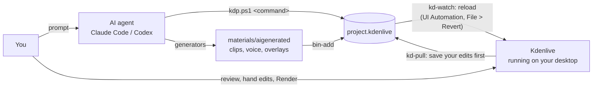

<div align="center">

# Movie Engine

**AI agent ku video Kdenlivel massossa, atu ubulta; uddur inkih taama gabat culsam duudda.**

Koodu yaktube AI agentwa (Claude Code, Codex) nummah Kdenlive projectwa abaanaah baddalaanah: filmwa, explainer videowa kee shorts vertical (ulsuk soolta). Massoysiyya fakkimeh tan ku editoril sissikuk ubullimta. Portable (tu kaa culsam male), Windows, editor patch male.


[English](../../README.md) · [简体中文](README.zh-CN.md) · [繁體中文](README.zh-TW.md) · [हिन्दी](README.hi.md) · [Español](README.es.md) · [Français](README.fr.md) · [العربية](README.ar.md) · [বাংলা](README.bn.md) · [Português](README.pt.md) · [Русский](README.ru.md) · [اردو](README.ur.md) · [Bahasa Indonesia](README.id.md) · [Deutsch](README.de.md) · [日本語](README.ja.md) · [Türkçe](README.tr.md) · [한국어](README.ko.md) · [Українська](README.uk.md) · [Italiano](README.it.md) · [Polski](README.pl.md) · [Tiếng Việt](README.vi.md) · [فارسی](README.fa.md) · [ไทย](README.th.md) · [Kiswahili](README.sw.md) · [አማርኛ](README.am.md) · [Avañe'ẽ](README.gn.md) · [Setswana](README.tn.md) · [Shqip](README.sq.md) · [Беларуская](README.be.md) · [Български](README.bg.md) · [Bosanski](README.bs.md) · [Hrvatski](README.hr.md) · [Српски](README.sr.md) · [Crnogorski](README.cnr.md) · [Македонски](README.mk.md) · [Slovenščina](README.sl.md) · [Slovenčina](README.sk.md) · [Čeština](README.cs.md) · [Magyar](README.hu.md) · [Română](README.ro.md) · [Dansk](README.da.md) · [Norsk bokmål](README.nb.md) · [Norsk nynorsk](README.nn.md) · [Svenska](README.sv.md) · [Íslenska](README.is.md) · [Suomi](README.fi.md) · [Eesti](README.et.md) · [Latviešu](README.lv.md) · [Lietuvių](README.lt.md) · [Nederlands](README.nl.md) · [Lëtzebuergesch](README.lb.md) · [Rumantsch](README.rm.md) · [Ελληνικά](README.el.md) · [Malti](README.mt.md) · [Gaeilge](README.ga.md) · [Català](README.ca.md) · [ქართული](README.ka.md) · [Հայերեն](README.hy.md) · [Azərbaycanca](README.az.md) · [Afrikaans](README.af.md) · [isiZulu](README.zu.md) · [isiXhosa](README.xh.md) · [Sesotho](README.st.md) · [Sepedi](README.nso.md) · [Xitsonga](README.ts.md) · [Tshivenḓa](README.ve.md) · [siSwati](README.ss.md) · [isiNdebele (South Africa)](README.nr.md) · [isiNdebele (Zimbabwe)](README.nd.md) · [chiShona](README.sn.md) · [Chichewa](README.ny.md) · [Ikinyarwanda](README.rw.md) · [Ikirundi](README.rn.md) · [Malagasy](README.mg.md) · [Soomaali](README.so.md) · [Afaan Oromoo](README.om.md) · **Qafar af** · [ትግርኛ](README.ti.md) · [Sängö](README.sg.md) · [Kreol Seselwa](README.crs.md) · [TjiKalanga](README.kck.md) · [ChiNdau](README.ndc.md)

*Ah turjumaana kinni. Ingiliiz afal tan README asli (reference) kinni.*

</div>

---

## Addal tanim

- [Macah](#macah)
- [Taamah gita](#taamah-gita)
- [Duddaa](#duddaa)
- [Faxximta](#faxximta)
- [Installation](#installation)
- [Sissikuk qimbo](#sissikuk-qimbo)
- [Agentih lih taamitto](#agentih-lih-taamitto)
- [Massoysiyyih amri-layn (`kdp.ps1`)](#massoysiyyih-amri-layn-kdpps1)
- [Live sync: fakkimeh tan editorih lih](#live-sync-fakkimeh-tan-editorih-lih)
- [Generator: Kdenlive maduudu tu](#generator-kdenlive-maduudu-tu)
- [Voice-over kee sound](#voice-over-kee-sound)
- [Interfaceh af](#interfaceh-af)
- [Folderih addal tanim](#folderih-addal-tanim)
- [Test kee nummasso](#test-kee-nummasso)
- [Duddam male tu](#duddam-male-tu)
- [Gibdi massosso](#gibdi-massosso)
- [Essero kee jawaab](#essero-kee-jawaab)
- [Catto](#catto)
- [Galatah](#galatah)
- [License](#license)

## Macah

Video editorwa mouse gabat oobbiyyah abtiinimih. AI agentwa qafiyyo (structure), uddur (timing) kee qeegisak gacta taamal maqaane: 300 clip beatih lih dimisiyya, caption inkih yabti codih lih uddur, feedback lakal scene gaddaliyya. Kinnih ku desktop beyaanam male GUI-l click abaanam maduudan.

Kdenlive xaagu le open-source editor kinni, kinnih Windowsil **automation API male**: D-Bus control Linux buildil inkittoh yan, API osissa forkwa hinnay massoysinnaanim male hinnay amaan hinna. Movie Engine editor patch maabinnaah ah gibdi massossa:

1. Agent `.kdenlive` project file test le amri-layn (command line, `engine/kdp.ps1`) lih massossa.
2. Taama tan Kdenlive Windows UI Automation lih file qagisaah akriyu iyyaanamah amri yaceeh; keyboard, mouse kee focus beya male.
3. Save maabinna ku massoysiyya awwal save abtimta, uddur inkih ken amol maktubinna.

Tokkel agent massossa, atu ubulta; hinnay atu gabat massossa. Nammayak inkih teyna project, teyna editor, teyna uddur taamittan.

## Taamah gita



Massoysiyyih amri inkih teyna amaan le gita (cycle) kataata:

1. **Pull.** Kdenlive save maabinna baddalo lih tanik, save abaanamah amri yaceeh (toolbar Save, UI Automation lih), save abtem nummassimta.
2. **Massosso.** Amri XML lock (cufo) lih baddala, hash check lakal, undo snapshot lih. Ellek file baddaltek, tu maktubinna.
3. **Reload.** Watcher AI calaamat yuble, fakkimeh tan editoril File > Revert aba. Timeline widget nummah qagisaah ginnimtek inkittoh guulut taysa.
4. **Conflict.** Ellek atu massosso qimbisteek, tu reload mabaanah ku taama tan. AI version addal heemita, agent isi baddalo ku massoysiyyih amol qagisaah aba.

## Duddaa

- **GUI male project inkih massosso**: 120 amri hayto: bin (clip kuusaa), timeline, effectwa, compositionwa, trackwa, guidewa, markerwa, subtitlewa, sequencewa, speed kee time remap, slideshowwa, titlewa, proxywa, render kee undo/redo. [Amrih reference](#massoysiyyih-amri-layn-kdpps1) ubul.
- **Fakkimeh tan editorih lih live sync.** AI massoysiyya atu ubulta Kdenlivel ubullimta; save maabinna ku massoysiyya awwal save abtimta, uddur inkih maybaytan.
- **Uddur inkih ku desktop maqaqassu.** Focus beya, keyboard key kee mouse culsa male. Test editorwa ubullimta male Windows desktopil taamitan.
- **Portable.** Editor, settings, Node.js, fontwa kee toolwa teyna folderil tan. Aka PC-l copy ab, taamita; Program Files hinnay ku Windows profilel tu maktubinna.
- **Kdenlive maduudu tuh generatorwa**: qangarak qangarat kinetic text, gabat xaaxagime annotationwa, 3D UI scenewa, cursor animationwa kee xer le interactive "explainer" filmwa. GPU-l nummah motion blur lih render abtimtaah timelinel caddo clip kinnuk dimisimtan.
- **Yabtih uddur le voice-over** (Microsoft Edge TTS, API key male). Captionwa kee actionwa nummah yabtil gactan.
- **Synthesize abtime sound effectwa** (whoosh, click, pop, riser, impact kee kaak tanim), koodul abtime.
- **Nummassime, ceemime hinna.** Amri inkih result check le, effectwa kee compositionwa inkih teyni teyni ubullimeenih, raw resultwa `docs/proof/` addal tan.
- **Agentih aydaadu edde tan.** `AGENTS.md` kee `.claude/skills/` addal tan skillwa Claude Code kee Codex taamah gita, file format kee gibdi barsiisan.

## Faxximta

| | |
|---|---|
| OS | Windows 10 hinnay 11, x64 |
| Editor | Kdenlive **26.08.3** portable (standalone) build. Aka versionwa test maabinnimeenih. |
| Node.js | 18 hinnay kaak ugtuk tan: nodejs.org-k Windows x64 `.zip`, `engine/node/` addal fakime |
| Browser | Microsoft Edge (Windowsih gufta); scene rendererwa headless (window male) gacsitan |
| Agent | [Claude Code](https://claude.com/claude-code) hinnay Codex. Faxximta hinna: tool inkih gabatuk taamitam duuda. |
| Disk | editor kee toolwah 1 GB hayto, ku media osisak |
| GPU | hardware H.264 encoding le GPU inkih `film-render.mjs` sissikuk abta (male tekek software gacsita) |

## Installation

Inkih **folderih addal** install abtimta. Admin xaqqi tuh faxximta male.

```powershell
git clone https://github.com/vladtarrow/movie-engine.git
cd movie-engine
```

**1. Node.js.** Node.js 18 hinnay kaak ugtuk tan Windows x64 `.zip` <https://nodejs.org/en/download>-k download ab, addal tanim `engine\node\` addal fak, `engine\node\node.exe` kee `engine\node\npm.cmd` elle tanih. Installer kee system Node faxximta male. Scriptwa inkih `engine\node.cmd` lih taamitan, uddur inkih system Node lih hinna.

**2. Node packagewa** voice tool kee rendererwah (versionwa `engine/voice/package.json` addal kassime):

```powershell
engine\node\npm.cmd install --prefix engine\voice
```

**3. Kdenlive 26.08.3 portable.** `kdenlive-26.08.3_standalone.exe` <https://download.kde.org/stable/kdenlive/26.08/windows/>-k `engine\installer\` addal download ab, check ab, fak:

```powershell
(Get-FileHash engine\installer\kdenlive-26.08.3_standalone.exe -Algorithm SHA256).Hash
# expected: A25427B1DFF2C17E3B0386E991BB1A719382BB3176D1A90E441CDAEB6E0A967D
engine\installer\kdenlive-26.08.3_standalone.exe -o"engine\Kdenlive" -y
```

Editor `engine\Kdenlive\kdenlive-26.08.3_standalone\bin\` addal tan. `melt.exe` kee `ffmpeg.exe` duma edde tan.

**4. Awwal qimbo.**

```powershell
engine\kdenlive.cmd
```

Kdenlive isi settings inkih `engine\profile-kdenlive\` addal heela, ku Windows profilel hinna. Awwal qimbol inki adda setup wizard yaybulle.

## Sissikuk qimbo

### Agentih lih

Folder Claude Code (hinnay Codex) addal fak, caddo yabtil esser:

> "launch-teaser" deqsitta vertical 30 fps project haaya ab. `materials/designers/launch/` addal tan sidiica screenshot timelinel dimis, inkih 2.5 s, dago cross-fade lih; `script.txt`-k voice-over osis, line inkih kinetic caption uddur lih dimis.

> Kdenlivel yoh fak.

> Nammeyhayto shot xer kinni. 1.8 s ab, logo dago amol fayis.

Agent `AGENTS.md` kataata: `kdp.ps1` lih massossa, cut faxa clipwa inkittoh render aba, fakkimeh tan editor sync aba. Atu Kdenlivel ubulta, faxxeh uddur inkih gabat massossa, maqaane tekkek Render culsa.

### Gabat

```powershell
# a new 1080x1920 30 fps project with 2 video and 2 audio tracks
powershell -NoProfile -ExecutionPolicy Bypass -File engine\kdp.ps1 new -Project projects\hello\hello.kdenlive -Profile vertical_hd_30

# a 3-second title and a colour background
powershell -NoProfile -ExecutionPolicy Bypass -File engine\kdp.ps1 bin-color -Project projects\hello\hello.kdenlive -Color '#203060' -Seconds 3 -Name bg
powershell -NoProfile -ExecutionPolicy Bypass -File engine\kdp.ps1 title -Project projects\hello\hello.kdenlive -Text "Hello" -Seconds 3 -Name hi

# place them: background on V1, title above it on V2
powershell -NoProfile -ExecutionPolicy Bypass -File engine\kdp.ps1 add -Project projects\hello\hello.kdenlive -Bin bg -Track V1 -At 0
powershell -NoProfile -ExecutionPolicy Bypass -File engine\kdp.ps1 add -Project projects\hello\hello.kdenlive -Bin hi -Track V2 -At 0

# a check frame, then open it in the editor
powershell -NoProfile -ExecutionPolicy Bypass -File engine\kdp.ps1 frame -Project projects\hello\hello.kdenlive -At 1.5 -Out out\hello\check.png
engine\kdenlive.cmd projects\hello\hello.kdenlive
```

Sarra ellecaboh tan project qagisaah fakeh, `open-last-project.cmd` nammay adda click ab.

## Agentih lih taamitto

Agent `AGENTS.md` (Codex) hinnay kaa import abta `CLAUDE.md` (Claude Code) kee nammay skill akriya:

| Skill | Barsiisa |
|---|---|
| `.claude/skills/kdenlive-project-file` | `.kdenlive` / MLT XML format, `kdp.ps1`, `melt` lih check |
| `.claude/skills/kdenlive-live` | taama tan editor amaanal gacsiyya: qimbo, pull, reload, window suura |

Agent kataatah atu elle amaanatta qaanuunwa:

- Ku mouse, keyboard hinnay focus uddur inkih mabeya, ku desktop screenshot uddur inkih maaba (editorih window inkittoh).
- GUI tallaabowa (save, fakiyya, reload) click abtam kok esserinnaah isi aba.
- Tu download abaanam kee tu tirtiriyya (delete) dumaa kok esserta.
- Taama faxa tu inkittoh render aba (scene clipwa, check framewa). Ellecaboh film atu esserteeh inkittoh render aba.
- Kdenlive tu maqaanat abaanam maduuduk, agent koodul gubal abaah resulti clip kinnuk culsa. Effect maqaanat hinnaamam mabaddala.

## Massoysiyyih amri-layn (`kdp.ps1`)

```powershell
powershell -NoProfile -ExecutionPolicy Bypass -File engine\kdp.ps1 <command> -Project <file.kdenlive> [options]
```

Uddur secondil tan, dot lih (`2.5`). Trackwa `V1 V2 …` (V1 kaxxa hoosa) kee `A1 A2 …` kinnon. Clip `-Track` kee kaa addal tan `-At` uddur inkih lih doorimta. Effect parameterwa `-Params "name=value||name=value"` addal culan. Option inkih le xaagu list `engine/kdp.ps1` header addal tan.

| Garab | Amriwa |
|---|---|
| Project | `new`, `profiles`, `info`, `validate`, `fonts`, `profile-set`, `profile-from-clip`, `zone`, `archive`, `backups`, `rebase`, `otio-export`, `otio-import` |
| Bin | `bin-add`, `bin-color`, `title`, `title-text`, `title-save`, `title-template`, `bin-rename`, `bin-remove`, `bin-info`, `bin-set`, `bin-duplicate`, `bin-replace-file`, `bin-reload`, `folder`, `bin-folder`, `relink`, `clean`, `generator`, `playlist-clip`, `extract-audio`, `transcode` |
| Timeline | `add`, `add-av`, `move`, `copy`, `trim`, `ripple-trim`, `slip`, `split`, `remove`, `speed`, `remap`, `disable`, `enable`, `group`, `ungroup`, `mix`, `unmix`, `space-insert`, `space-remove`, `spaces-remove-all`, `track-clear`, `replace-in-timeline` |
| Effectwa | `effects`, `effect-info`, `effect-add`, `effect-list`, `effect-set`, `effect-remove`, `effect-copy`, `effect-clear`, `effects-all`, `bin-effect`, `effect-templates`, `effect-template` |
| Compositionwa | `compositions`, `comp-info`, `comp-add`, `comp-list`, `comp-set`, `comp-remove` |
| Trackwa | `track-add`, `track-remove`, `track-set` |
| Guidewa kee markerwa | `guide-add`, `guide-list`, `guide-remove`, `guide-set`, `guide-clear`, `guide-export`, `guide-category`, `marker`, `marker-list`, `marker-set`, `marker-remove` |
| Subtitlewa | `sub-add`, `sub-import`, `sub-export`, `sub-state` |
| Sequencewa | `sequence-add`, `sequences`, `copy-to-sequence`, `expand`; `-Sequence <name>` le amri inkih tah sequenceh addal taamita |
| Addaa | `slideshow`, `bin-add` lih Lottie / Glaxnimate animationwa, `proxy`, `stabilize`, `scene-split`, `speed-job`, `subclip` |
| Output | `frame` (teyna PNG), `preview` (sissikuk melt render), `render` (Kdenliveh isi renderer hinnay preset), `presets` |
| Taarikh | `undo`, `redo`, `clear-history` (`projects/<name>/.kdp-history` addal tan snapshotwa) |

Aaxagam faxximta gacta:

- Itta-xagime audio kee video garabwa inkih tibbeh gaddaltan, trim abtimtan, split abtimtan, tirtirimtan (`-Alone` teyna garabah).
- Gufte amri code 1 lih yawqa, tu maktuba.
- Windows build taamisam maduudu effectwa diidimtan, cagaagal mafarrimtan (list: `docs/proof/assets.txt`).
- Kdenlive menu action inkih amri, aka gita, hinnay "ubullo inkittoh" kinnuk `engine/tools/data/kdenlive-actions.csv` addal itta-xagime. `docs/kdenlive-coverage.md` ubul.

## Live sync: fakkimeh tan editorih lih

| Script | Abam | Exit codewa |
|---|---|---|
| `engine\kd-pull.ps1 -Project <f>` | Kdenlive ku massoysiyya save abaanamah aba, nummassa | 0 file haaya kinni, 3 taamita male, 4 nummassime male |
| `engine\kd-reload.ps1 -Project <f>` | File > Revert, qagisaah gine timelinel nummassimta | 0 nummassime, 2 save maabinna massoysiyya lih tanto (tu maybayinna), 3 taamita male, 4 gufte |
| `engine\kd-watch.ps1 -Project <f>` | backgroundil taamita watcher: AI ktubo inkih lakal reload aba, conflictwa log aba | log `engine\kd-watch.log` addal; soolisaah `engine\kd-watch.run` tirtir |
| `engine\kdenlive-bg.ps1 [project]` | agentih Kdenlive minimized kinnuk qimbisa | 0 load abtime, 4 nummassime male |
| `engine\kdenlive.cmd [project]` | Kdenlive kooh qimbisa | |

Session inkih watcher inki adda qimbis:

```powershell
Start-Process powershell -WindowStyle Hidden -ArgumentList '-NoProfile','-ExecutionPolicy','Bypass','-File','engine\kd-watch.ps1','-Project','projects\hello\hello.kdenlive'
```

Kaxxa projectwa: 1000 clip le project reload daqiiqawa beya, toolwa dumaa report abaanam akkewaytaah kaa qambalan. Projectwa mudum editoril *File > Open Recent* lih fakimtan; file toolih fakiyya Qt timeline item inkih accessibility (gacsiyyah duddaa) kinnuk gexsissa, tohuk 10 daqiiqa hayto xer ture.

## Generator: Kdenlive maduudu tu

Kdenlive/MLT qangarak qangarat text animation male, expressions male, 3D dago kinni, kaxxa effectwa playback garaysissan. Movie Engine tah garabwa gubal render abaah timelinel caddo clip kinnuk dimisa, ayyaaqah alpha (transparency) lih, suurawah amol tan trackil. Generator script kee kaa culta inputwa project folderil raaqan, tokkel text, font hinnay timing baddaltek clip qagisaah abtam duuda.

| Tool | Aba |
|---|---|
| `engine/tools/kinetic-text.ps1` | qangarak qangarat kinetic captionwa, yabti inkih `voice.json`-k uddur yaabe, highlight box |
| `engine/tools/annotate.ps1` | screenshot amol isi xaaxagitta, gabat xaaxagime circlewa, boxwa, underlinewa kee arrowwa |
| `engine/tools/card-entrance.ps1` | amol yewqeeh kaxxa tekke screenshot card, xabbabaa sayaq lih |
| `engine/tools/pdf-to-png.ps1` | PDF exportik slidewa |
| `engine/tools/html-render.mjs` | HTML/CSS/canvas scene inkih videol: interface animation, cursorwa, 3D, maskwa |
| `engine/tools/film-render.mjs` + `film/` | canvasil xer kee interactive explainer filmwa: voice line inkih teyna clip, actionwa yabbime yabtil gactan, 45 fps hayto GPU motion blur |

Renderer nammayak inkih Windows lih yemeete Microsoft Edge headless, yigdifte profile lih kee network male gacsitan.

### Ceelallo

```powershell
# a 3-second 3D title card with a cursor click
engine\node.cmd engine\tools\html-render.mjs examples\demo\scene\scene.html examples\demo\out --frames 0,30,60,89
engine\node.cmd engine\tools\html-render.mjs examples\demo\scene\scene.html examples\demo\out\scene.mp4

# a 4-shot interactive film timed to two voice lines
engine\node.cmd engine\tools\film-render.mjs examples\demo\film\film.html examples\demo\out --check
engine\node.cmd engine\tools\film-render.mjs examples\demo\film\film.html examples\demo\out --shots all --width 640
engine\node.cmd engine\tools\film-render.mjs examples\demo\film\film.html examples\demo\out\clips --suffix -v01
```

Film sidoh dago file kinni. `data.js` shotwa kee yabtih uddur heela. `direction.js` shot inkih teyna line le:

```text
1 | hover 192 108 @brand | tag 300 60 Your brand @deserves | confetti 192 90 @film
2 say=A film that/*explains* it
3 | click 116 108 @before | click 268 108 @after | chips Before~After @after
4 scene=counter | count 0 120 % @count
```

`scenes.js` qimbok xaaxagime shotwa heela. `@word` codi tah yabti yeceeh action qimbisa. Actionwa: click, hover, drag, zoom, lens, ring, arrow, chips, toggle, slider, toast, type, count kee confetti; xaagu syntax `engine/tools/film/film-kit.js` qimbol tan.

## Voice-over kee sound

```powershell
engine\node.cmd engine\voice\voice.mjs lines.json materials\aigenerated\hello\voice en-US-AndrewMultilingualNeural +0%
```

`lines.json` lineh list kinni. Tool line inkih teyna mp3 kee `voice.json` yaktuba: duration kee yabti inkih qimbo kee gabbaaqa. Linewa cache abtimtan, tokkel teyna line baddaltek tah line inkittoh qagisaah abtimta. Microsoft Edge online text-to-speech `msedge-tts` package lih gacsita: key faxximta male, kinnih service rasmi hinna, internet faxa.

```powershell
engine\node.cmd engine\audio\sfx.mjs materials\aigenerated\sfx
```

Ah koodul whoosh, whoosh-long, swipe, click, pop, tick, riser, impact, ding kee reveal synthesize aba; diggaluk tan set `materials/aigenerated/sfx/` addal tan. Teyna frame kak ummuxxu soundwa dimisinnaanam dumaa silencelih buuxis (`-af apad=whole_dur=0.0667`).

## Interfaceh af

Launcherwa default kinnuk Kdenlive **Ingiliiz afal** qimbisan. Aka af gacsitaanamah, qimbo dumaa `MOVIE_ENGINE_UI_LANG` dimis:

```powershell
$env:MOVIE_ENGINE_UI_LANG = 'ru'; engine\kdenlive.cmd
```

UI Automation menu itemwa ken ubullimta migaaqal geya. 31 interface afih migaaqwa duma edde tan (`engine/tools/kd-ui.ps1`, `$KdNames`). Aka af inkih, kah migaaqwa elle osisaah ahal check ab:

```powershell
powershell -NoProfile -ExecutionPolicy Bypass -File engine\tools\kd-langcheck.ps1
```

## Folderih addal tanim

```text
movie-engine/
├─ AGENTS.md, CLAUDE.md          instructions for AI agents
├─ .claude/skills/               agent skills: project file format, live editor
├─ engine/
│  ├─ kdp.ps1                    the editing command line
│  ├─ kd-pull / kd-reload / kd-watch .ps1, kdenlive.cmd, kdenlive-bg.ps1
│  ├─ tools/                     internals, generators, tests, data (action map)
│  ├─ voice/  audio/  fonts/     TTS, synthesized SFX, Poppins (OFL)
│  ├─ Kdenlive/  node/           portable editor and Node.js (not in git)
│  └─ profile-kdenlive/          the editor's settings (not in git)
├─ projects/<name>/<name>.kdenlive
├─ materials/
│  ├─ download/                  stock and downloaded files (not in git)
│  ├─ aigenerated/               everything the AI made (sfx/ and test-kit/ ship with the engine)
│  ├─ designers/  brand/         files from your team, brand assets
├─ examples/demo/                demos of the scene and film renderers
├─ out/                          renders (not in git)
└─ docs/                         proofs, coverage, translations of this README
```

Projectwah addal tan media pathwa relative kinnon. Folder gaddaliteeh hinnay copy abteek, `kdp.ps1 rebase` (`kdenlive.cmd` isi lih taamisa) haaya bagi projectil yaktuba.

## Test kee nummasso

Taamita tuh yabti result checkil xagtimta, "function taamite" kinnuk hinna. Gaabbaabu yab [`docs/kdenlive-proof.md`](../../docs/kdenlive-proof.md) addal, raw output `docs/proof/` addal tan.

| Test | Check aba |
|---|---|
| `engine\tools\kdp-clitest.ps1` | `kdp.ps1` amri inkih, amri-layn lih, yewqe project itta-xiqissaah |
| `engine\tools\kd-livetest.ps1` | pull, reload, watcher, conflictwa kee racewa, ubullimta male desktopil tan nummah Kdenlivel |
| `engine\tools\kdp-assetsweep.ps1` | effect kee composition inkih: render abaah framewa itta-xiqissa |
| `engine\tools\kdp-portabletest.ps1` | folder aka bagul copy abaah copyk taamita |
| `engine\tools\kd-langcheck.ps1` | interfaceh af kee UI Automation menu geyam |
| `engine\tools\kdp-coverage-check.ps1` | menu action inkih itta-xagime kee proof inkih koodik mafayyam |

```powershell
powershell -NoProfile -ExecutionPolicy Bypass -File engine\tools\kdp-clitest.ps1 -Report docs\proof\clitest.txt
powershell -NoProfile -ExecutionPolicy Bypass -File engine\tools\kd-livetest.ps1 -Report docs\proof\live-en.txt
```

Test editorwa isi profile le qaxxumime desktopil inkittoh taamitan, tokkel testwa ku fakkimeh tan Kdenlive hinnay ku focus uddur inkih matakkaaxan.

## Duddam male tu

- **Windows inkittoh**, Kdenlive **26.08.3** inkittoh. Linux D-Bus le, aka bridge faxximtaay ture.
- Editor qimbisiyya, mudum window yaybullek, 3 second hayto keyboard focus beya. Atu taamitta waqdi agentwa qimbisaanam dumaa kok esseran. Reload kee massoysiyya focus mabeyan.
- Windows buildil MLT sox, ladspa kee movit modulewa kee frei0r/avfilter effectwak tu male; `kdp.ps1` ken diida (`docs/proof/assets.txt`).
- OpenTimelineIO export kee import clipwa kee gapwa inkittoh beyan. Multicam live angle baddalo male (cutwa split/remove/hide lih abtimtan).
- Minimized windowil UI Automation lih "Save As…" dialog mafaka; agent tet bagul `archive` hinnay file copy gacsita.
- Speech recognition (auto-subtitles) Whisper hinnay Vosk faxa, ken edde male.
- Kdenlive title toolil abtime titlewa Windowsil install abtime fontwa gacsitan. Nummah typographyh, text generatorwa lih render ab; usun fontwa `engine/fonts/`-k load aban.
- Edge TTS rasmi hinna online service kinni, baddalaanam hinnay soolaanam duuda.

## Gibdi massosso

| Calaamat | Sabbata kee massosso |
|---|---|
| Kdenlive taamita, kinnih taskbaril click abtek tu maybulla | Save abtime window bagi screenih gubal tan. Ka dig, `engine\profile-kdenlive\AppData\Local\kdenliverc` addal tan `kdockLayout` entrywa tirtir, hinnay window `SetWindowPos` lih gaddali (`AGENTS.md` ubul). |
| `kd-reload.ps1` 2 lih yawqa | Save maabinna massoysiyya lih tanto. Tu maybayinna. `kd-pull.ps1` taamis, tohuk lakal baddalo qagisaah ab (`kdp.ps1` isi tah aba). |
| `engine\kd-watch.log` addal `CONFLICT` | Atu kee agent teyna waqdil massossiten. Ku version editoril raaqa, AI version `projects\<name>\.kdp-history\<name>\conflict\` addal tan. Agent isi baddalo qagisaah abaanamah esser. |
| Amri "pull not confirmed" lih code 1 lih yawqa | Kdenlive taamal tan hinnay dialog yaybulle. Dialog dig hinnay load gabbaaqa haytam qambal, tohuk lakal qagis. |
| PowerShell script parse matanna | ASCII hinna text le scriptwa Windows PowerShell 5.1h UTF-8 **BOM lih** save abtimtam faxximta. |
| `voice.mjs` "Stream closed before the synthesis completed" lih soolta | Ayyaaqah network gibdi, hinnay qaddiimi copywal escape maabinna SSML. `voice.mjs` isi `& < >` escape aba. |
| Kaxxa project fakiyya ayyaaqa daqiiqa beya | `kdenlive.cmd` / `kdenlive-bg.ps1` lih fak, uddur inkih `kdenlive.exe project.kdenlive` kinnuk hinna. |

## Essero kee jawaab

**Claude Code hinnay Codex yoo faxximtaa?**
Maleey. Tool inkih gabat taamisam duuddu caddo script kinni. Agent sissikuk abta: cut qaynissa, toolwa taamisa, editor sync aba.

**Agent yi gabat massoysiyya amol yaktubaa?**
Maleey. Ktubo inkih dumaa, save maabinna ku massoysiyya save abtimtaah nummassimta. Agent yaktubu waqdi atu massossek, ktubo diidimta hinnay conflict kinnuk addal heemita, uddur inkih ku taamah amol mafaddimta.

**Kdenlive caddo kinnuk gacsiyya fulsam duudaa?**
Oho. Isi settings folder le caddo Kdenlive kinni. Massos, preview ab, render ab, caddo kinnuk.

**Duma install abe Kdenlive lih taamitaa?**
`engine\Kdenlive\` addal tan isi portable copy gacsita, tokkel ku install abtime Kdenlive kee kaa settings matakkaaxan.

**Macah API le Kdenlive fork hinnay aka editor hinna?**
Windowsil massoysime kee amaan le fork male (2026-11 survey). OpenShot, Blender VSE, DaVinci Resolve, Shotcut kee web editorwa ubullimeenih; Kdenlive massoysiyyih kaxxa duddaa yeceeh. Upstream REST API qaynat (merge request !902) ubullimta.

**Ellecaboh video render abam duudaa?**
Oho, `kdp.ps1 render` lih (Kdenliveh isi renderer, qaxxumuk), hinnay atu isi editoril Render culsa.

**Yi media aaxagu bagul rubimtaa?**
Maleey. Voice abtaanam waqdi voice-overih text inkittoh Edge TTS servicel rubimta. Scene rendererwa network male taamitan.

## Catto

Cattoh angaaraw. [CONTRIBUTING.md](../../CONTRIBUTING.md) ubul. Gaabbaabuk:

- Haaya hinnay baddalime `kdp.ps1` operation inkih `kdp-clitest.ps1` addal result check, action mapil entry kee `kdp-coverage-check.ps1` haaya taamisiyya faxa.
- Test Kdenlive ubullimta desktopil uddur inkih maqimbisin; `engine/tools/kd-hidden.ps1` gacsit.
- Inkih portable kinnuk heel: folderih gubal install male, projectwal absolute path male.
- Nummassime quirkwa (addaa aaxagu) `AGENTS.md` hinnay kaa celta skillil kutub.

## Galatah

- [Kdenlive](https://kdenlive.org) kee [MLT](https://www.mltframework.org): editor kee kaa hoosa tan engine.
- [FFmpeg](https://ffmpeg.org), Kdenlive lih yemeete.
- [msedge-tts](https://www.npmjs.com/package/msedge-tts) voice-overih.
- [Poppins](https://fonts.google.com/specimen/Poppins), Indian Type Foundry abte, SIL Open Font License (`engine/fonts/OFL.txt`).
- `engine/tools/data/kdenliveui-26.08.3.rc`: Kdenlive menu file, Kdenlive 26.08.3 source codek beyime; coverage check inkittoh gacsita. Kdenliveh GPL license addal raaqa, MIT License addal hinna.

## License

Movie Engine isi kood [MIT License](../../LICENSE) addal yawqe. Kdenlive, MLT, FFmpeg, Node.js packagewa kee Poppins font isi licensewa lih raaqan.
