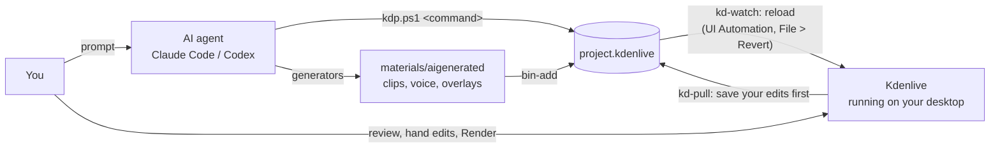

<div align="center">

# Movie Engine

**'n KI-agent redigeer jou video in Kdenlive terwyl jy kyk, en jy kan enige oomblik oorneem.**

KI-koderingsagente (Claude Code, Codex) bou en verander regte Kdenlive-projekte: films, verduidelikingsvideo's en vertikale kortvideo's ("shorts"). Die wysigings verskyn regstreeks in die redigeerder wat jy oop het. Draagbaar, Windows, geen pleisters op die redigeerder nie.


[English](../../README.md) · [简体中文](README.zh-CN.md) · [繁體中文](README.zh-TW.md) · [हिन्दी](README.hi.md) · [Español](README.es.md) · [Français](README.fr.md) · [العربية](README.ar.md) · [বাংলা](README.bn.md) · [Português](README.pt.md) · [Русский](README.ru.md) · [اردو](README.ur.md) · [Bahasa Indonesia](README.id.md) · [Deutsch](README.de.md) · [日本語](README.ja.md) · [Türkçe](README.tr.md) · [한국어](README.ko.md) · [Українська](README.uk.md) · [Italiano](README.it.md) · [Polski](README.pl.md) · [Tiếng Việt](README.vi.md) · [فارسی](README.fa.md) · [ไทย](README.th.md) · [Kiswahili](README.sw.md) · [አማርኛ](README.am.md) · [Avañe'ẽ](README.gn.md) · [Setswana](README.tn.md) · [Shqip](README.sq.md) · [Беларуская](README.be.md) · [Български](README.bg.md) · [Bosanski](README.bs.md) · [Hrvatski](README.hr.md) · [Српски](README.sr.md) · [Crnogorski](README.cnr.md) · [Македонски](README.mk.md) · [Slovenščina](README.sl.md) · [Slovenčina](README.sk.md) · [Čeština](README.cs.md) · [Magyar](README.hu.md) · [Română](README.ro.md) · [Dansk](README.da.md) · [Norsk bokmål](README.nb.md) · [Norsk nynorsk](README.nn.md) · [Svenska](README.sv.md) · [Íslenska](README.is.md) · [Suomi](README.fi.md) · [Eesti](README.et.md) · [Latviešu](README.lv.md) · [Lietuvių](README.lt.md) · [Nederlands](README.nl.md) · [Lëtzebuergesch](README.lb.md) · [Rumantsch](README.rm.md) · [Ελληνικά](README.el.md) · [Malti](README.mt.md) · [Gaeilge](README.ga.md) · [Català](README.ca.md) · [ქართული](README.ka.md) · [Հայերեն](README.hy.md) · [Azərbaycanca](README.az.md) · **Afrikaans** · [isiZulu](README.zu.md) · [isiXhosa](README.xh.md) · [Sesotho](README.st.md) · [Sepedi](README.nso.md) · [Xitsonga](README.ts.md) · [Tshivenḓa](README.ve.md) · [siSwati](README.ss.md) · [isiNdebele (South Africa)](README.nr.md) · [isiNdebele (Zimbabwe)](README.nd.md) · [chiShona](README.sn.md) · [Chichewa](README.ny.md) · [Ikinyarwanda](README.rw.md) · [Ikirundi](README.rn.md) · [Malagasy](README.mg.md) · [Soomaali](README.so.md) · [Afaan Oromoo](README.om.md) · [Qafar af](README.aa.md) · [ትግርኛ](README.ti.md) · [Sängö](README.sg.md) · [Kreol Seselwa](README.crs.md) · [TjiKalanga](README.kck.md) · [ChiNdau](README.ndc.md)

*Dit is 'n vertaling; die Engelse README is die verwysingsweergawe.*

</div>

---

## Inhoud

- [Hoekom](#hoekom)
- [Hoe dit werk](#hoe-dit-werk)
- [Kenmerke](#kenmerke)
- [Vereistes](#vereistes)
- [Installering](#installering)
- [Vinnige begin](#vinnige-begin)
- [Werk met die agent](#werk-met-die-agent)
- [Die redigeer-opdragreël (`kdp.ps1`)](#die-redigeer-opdragreël-kdpps1)
- [Regstreekse sinchronisasie met die oop redigeerder](#regstreekse-sinchronisasie-met-die-oop-redigeerder)
- [Generators: wat Kdenlive nie kan doen nie](#generators-wat-kdenlive-nie-kan-doen-nie)
- [Voice-over en klank](#voice-over-en-klank)
- [Koppelvlaktaal](#koppelvlaktaal)
- [Vouerstruktuur](#vouerstruktuur)
- [Toetse en bewyse](#toetse-en-bewyse)
- [Beperkings](#beperkings)
- [Probleemoplossing](#probleemoplossing)
- [Gereelde vrae](#gereelde-vrae)
- [Bydra](#bydra)
- [Erkennings](#erkennings)
- [Lisensie](#lisensie)

## Hoekom

Videoredigeerders is gebou vir 'n hand op die muis. KI-agente is goed met struktuur, tydsberekening en herhaling: om 300 snitte op die maat te plaas, elke onderskrif op die stem af te stem, of 'n toneel na terugvoer oor te doen. Hulle kan egter nie deur 'n grafiese koppelvlak klik sonder om jou lessenaar oor te neem nie.

Kdenlive is 'n sterk oopbronredigeerder, maar op Windows het dit **geen outomatiserings-API nie**: beheer via D-Bus bestaan net in die Linux-weergawes, en die vurke ("forks") wat een byvoeg, word óf nie meer onderhou nie óf is onveilig. Movie Engine los dit op sonder om die redigeerder te pleister:

1. Die agent redigeer die `.kdenlive`-projeklêer deur 'n getoetste opdragreël (`engine/kdp.ps1`).
2. Die lopende Kdenlive word deur Windows UI Automation aangesê om die lêer te herlaai, sonder toetsaanslae, sonder die muis en sonder om die fokus te steel.
3. Jou eie ongestoorde wysigings word eers gestoor en nooit oorskryf nie.

Die agent redigeer dus en jy hersien, of jy redigeer self met die hand. Julle albei werk aan dieselfde projek, in dieselfde redigeerder, op dieselfde tyd.

## Hoe dit werk



Elke redigeeropdrag volg dieselfde veilige siklus:

1. **Pull.** As Kdenlive ongestoorde veranderinge het, word dit aangesê om dit te stoor (die Save-knoppie op die nutsbalk via UI Automation), en die stoor word bevestig.
2. **Redigeer.** Die opdrag verander die XML onder 'n slot, ná 'n hash-kontrole en met 'n ontdoen-momentopname. As die lêer intussen verander het, word niks geskryf nie.
3. **Herlaai.** Die waghond ("watcher") sien die KI se stempel en voer File > Revert in die oop redigeerder uit. Dit tel eers as 'n sukses wanneer die tydlyn-widget werklik herbou is.
4. **Konflik.** As jy intussen begin redigeer het, word niks herlaai nie en jou werk bly. Die KI-weergawe word eenkant gehou, en die agent pas sy verandering weer bo-op joune toe.

## Kenmerke

- **Volledige projekredigering sonder die grafiese koppelvlak**: sowat 120 opdragte vir die bin, tydlyn, effekte, komposisies, snitbane, gidslyne, merkers, onderskrifte, reekse ("sequences"), spoed en tyd-herkartering, skyfievertonings, titels, gevolmagtigdes ("proxies"), lewering ("rendering") en ontdoen/herdoen. Sien die [opdragverwysing](#die-redigeer-opdragreël-kdpps1).
- **Regstreekse sinchronisasie met die oop redigeerder.** KI-wysigings verskyn in die Kdenlive waarna jy kyk; jou ongestoorde wysigings word eers gestoor en gaan nooit verlore nie.
- **Steur nooit jou lessenaar nie.** Geen fokussteel, toetsaanslae of muisinvoer nie. Toetsredigeerders loop op 'n onsigbare Windows-lessenaar.
- **Draagbaar.** Redigeerder, instellings, Node.js, lettertipes en gereedskap is almal in een vouer. Kopieer dit na 'n ander rekenaar en dit werk; niks word na Program Files of jou Windows-profiel geskryf nie.
- **Generators vir wat Kdenlive nie kan doen nie**: kinetiese teks wat letter vir letter beweeg, handgetekende aantekeninge, 3D-koppelvlaktonele, wyseranimasies en lang interaktiewe verduidelikingsfilms ("explainers"). Hulle word op die GPU gelewer met egte bewegingsvervaging en as gewone snitte op die tydlyn geplaas.
- **Voice-over met woordtye** (Microsoft Edge TTS, geen API-sleutel nie). Onderskrifte en aksies tree presies op die regte woord in werking.
- **Gesintetiseerde klankeffekte** (whoosh, click, pop, riser, impact en meer), in kode gegenereer.
- **Bewys, nie aangeneem nie.** Elke opdrag het 'n resultaatkontrole, effekte en komposisies word een vir een deurgetoets, en die rou resultate is in `docs/proof/`.
- **Agentinstruksies ingesluit.** `AGENTS.md` en die vaardighede ("skills") in `.claude/skills/` leer Claude Code en Codex die werkvloei, die lêerformaat en die slaggate.

## Vereistes

| | |
|---|---|
| Bedryfstelsel | Windows 10 of 11, x64 |
| Redigeerder | Kdenlive **26.08.3** draagbare (standalone) weergawe. Ander weergawes is nie getoets nie. |
| Node.js | 18 of nuwer: die Windows x64-`.zip` van nodejs.org, uitgepak in `engine/node/` |
| Blaaier | Microsoft Edge (deel van Windows); word koploos ("headless") deur die toneelleweraars gebruik |
| Agent | [Claude Code](https://claude.com/claude-code) of Codex. Opsioneel: elke hulpmiddel loop ook met die hand. |
| Skyf | sowat 1 GB vir die redigeerder en gereedskap, plus jou media |
| GPU | enige GPU met hardeware-H.264-enkodering versnel `film-render.mjs` (anders val dit terug op sagteware) |

## Installering

Alles word **binne die vouer** geïnstalleer. Niks het administrateursregte nodig nie.

```powershell
git clone https://github.com/vladtarrow/movie-engine.git
cd movie-engine
```

**1. Node.js.** Laai die Windows x64-`.zip` van Node.js 18 of nuwer af van <https://nodejs.org/en/download> en pak die inhoud uit in `engine\node\`, sodat `engine\node\node.exe` en `engine\node\npm.cmd` daar is. Geen installeerder en geen stelsel-Node is nodig nie. Alle skripte loop deur `engine\node.cmd`, nooit deur 'n stelsel-Node nie.

**2. Node-pakkette** vir die stemhulpmiddel en die leweraars (die weergawes is vasgepen in `engine/voice/package.json`):

```powershell
engine\node\npm.cmd install --prefix engine\voice
```

**3. Kdenlive 26.08.3 draagbaar.** Laai `kdenlive-26.08.3_standalone.exe` af van <https://download.kde.org/stable/kdenlive/26.08/windows/> na `engine\installer\`, kontroleer dit en pak dit uit:

```powershell
(Get-FileHash engine\installer\kdenlive-26.08.3_standalone.exe -Algorithm SHA256).Hash
# expected: A25427B1DFF2C17E3B0386E991BB1A719382BB3176D1A90E441CDAEB6E0A967D
engine\installer\kdenlive-26.08.3_standalone.exe -o"engine\Kdenlive" -y
```

Die redigeerder beland in `engine\Kdenlive\kdenlive-26.08.3_standalone\bin\`. Dit sluit reeds `melt.exe` en `ffmpeg.exe` in.

**4. Eerste begin.**

```powershell
engine\kdenlive.cmd
```

Kdenlive hou al sy instellings in `engine\profile-kdenlive\`, nie in jou Windows-profiel nie. By die eerste begin wys dit eenmalig 'n opstelslimmerd.

## Vinnige begin

### Met 'n agent

Maak die vouer in Claude Code (of Codex) oop en vra in gewone woorde:

> Maak 'n nuwe vertikale 30 fps-projek "launch-teaser". Plaas die drie skermskote uit `materials/designers/launch/` op die tydlyn, elk 2,5 s met 'n kort oorvloeiing, voeg 'n voice-over uit `script.txt` by en stem 'n kinetiese onderskrif af op elke reël.

> Maak dit vir my in Kdenlive oop.

> Die tweede skoot is te lank. Sny dit tot 1,8 s en skuif die logo 'n bietjie op.

Die agent volg `AGENTS.md`: dit redigeer deur `kdp.ps1`, lewer net die snitte wat die redigering nodig het, en hou die oop redigeerder gesinchroniseer. Jy hersien in Kdenlive, redigeer met die hand wanneer jy wil, en druk Render wanneer jy tevrede is.

### Met die hand

```powershell
# a new 1080x1920 30 fps project with 2 video and 2 audio tracks
powershell -NoProfile -ExecutionPolicy Bypass -File engine\kdp.ps1 new -Project projects\hello\hello.kdenlive -Profile vertical_hd_30

# a 3-second title and a colour background
powershell -NoProfile -ExecutionPolicy Bypass -File engine\kdp.ps1 bin-color -Project projects\hello\hello.kdenlive -Color '#203060' -Seconds 3 -Name bg
powershell -NoProfile -ExecutionPolicy Bypass -File engine\kdp.ps1 title -Project projects\hello\hello.kdenlive -Text "Hello" -Seconds 3 -Name hi

# place them: background on V1, title above it on V2
powershell -NoProfile -ExecutionPolicy Bypass -File engine\kdp.ps1 add -Project projects\hello\hello.kdenlive -Bin bg -Track V1 -At 0
powershell -NoProfile -ExecutionPolicy Bypass -File engine\kdp.ps1 add -Project projects\hello\hello.kdenlive -Bin hi -Track V2 -At 0

# a check frame, then open it in the editor
powershell -NoProfile -ExecutionPolicy Bypass -File engine\kdp.ps1 frame -Project projects\hello\hello.kdenlive -At 1.5 -Out out\hello\check.png
engine\kdenlive.cmd projects\hello\hello.kdenlive
```

Om die laaste projek later weer oop te maak, dubbelklik `open-last-project.cmd`.

## Werk met die agent

Die agent lees `AGENTS.md` (Codex) of `CLAUDE.md`, wat dit invoer (Claude Code), plus twee vaardighede:

| Vaardigheid | Leer |
|---|---|
| `.claude/skills/kdenlive-project-file` | die `.kdenlive` / MLT XML-formaat, `kdp.ps1`, kontrole met `melt` |
| `.claude/skills/kdenlive-live` | om die lopende redigeerder veilig te bestuur: begin, pull, herlaai, sy venster vasvang |

Reëls wat die agent volg en waarop jy kan staatmaak:

- Dit neem nooit jou muis, sleutelbord of fokus nie, en neem nooit skermskote van jou lessenaar nie (net van die redigeerder se eie venster).
- Dit doen die stappe in die grafiese koppelvlak self (stoor, oopmaak, herlaai) in plaas daarvan om jou te vra om te klik.
- Dit vra voordat dit enigiets aflaai en voordat dit enigiets uitvee.
- Dit lewer net wat die werk nodig het (toneelsnitte, kontroleraamwerke). Die finale film lewer dit net wanneer jy vra.
- Wanneer Kdenlive iets nie goed kan doen nie, bou die agent dit buite met kode en sit die resultaat as 'n snit in. Dit verwater nie die effek nie.

## Die redigeer-opdragreël (`kdp.ps1`)

```powershell
powershell -NoProfile -ExecutionPolicy Bypass -File engine\kdp.ps1 <command> -Project <file.kdenlive> [options]
```

Tye is in sekondes, met 'n punt (`2.5`). Snitbane is `V1 V2 …` (V1 die onderste) en `A1 A2 …`. 'n Snit word aangewys deur `-Track` plus enige tyd `-At` daarbinne. Effekparameters gaan in `-Params "name=value||name=value"`. Die volledige lys met elke opsie is in die kop van `engine/kdp.ps1`.

| Groep | Opdragte |
|---|---|
| Projek | `new`, `profiles`, `info`, `validate`, `fonts`, `profile-set`, `profile-from-clip`, `zone`, `archive`, `backups`, `rebase`, `otio-export`, `otio-import` |
| Bin | `bin-add`, `bin-color`, `title`, `title-text`, `title-save`, `title-template`, `bin-rename`, `bin-remove`, `bin-info`, `bin-set`, `bin-duplicate`, `bin-replace-file`, `bin-reload`, `folder`, `bin-folder`, `relink`, `clean`, `generator`, `playlist-clip`, `extract-audio`, `transcode` |
| Tydlyn | `add`, `add-av`, `move`, `copy`, `trim`, `ripple-trim`, `slip`, `split`, `remove`, `speed`, `remap`, `disable`, `enable`, `group`, `ungroup`, `mix`, `unmix`, `space-insert`, `space-remove`, `spaces-remove-all`, `track-clear`, `replace-in-timeline` |
| Effekte | `effects`, `effect-info`, `effect-add`, `effect-list`, `effect-set`, `effect-remove`, `effect-copy`, `effect-clear`, `effects-all`, `bin-effect`, `effect-templates`, `effect-template` |
| Komposisies | `compositions`, `comp-info`, `comp-add`, `comp-list`, `comp-set`, `comp-remove` |
| Snitbane | `track-add`, `track-remove`, `track-set` |
| Gidslyne en merkers | `guide-add`, `guide-list`, `guide-remove`, `guide-set`, `guide-clear`, `guide-export`, `guide-category`, `marker`, `marker-list`, `marker-set`, `marker-remove` |
| Onderskrifte | `sub-add`, `sub-import`, `sub-export`, `sub-state` |
| Reekse | `sequence-add`, `sequences`, `copy-to-sequence`, `expand`; enige opdrag met `-Sequence <name>` werk binne daardie reeks |
| Spesiaal | `slideshow`, Lottie / Glaxnimate-animasies via `bin-add`, `proxy`, `stabilize`, `scene-split`, `speed-job`, `subclip` |
| Uitvoer | `frame` (een PNG), `preview` (vinnige melt-lewering), `render` (Kdenlive se eie leweraar of 'n voorinstelling), `presets` |
| Geskiedenis | `undo`, `redo`, `clear-history` (momentopnames in `projects/<name>/.kdp-history`) |

Gedrag wat die moeite werd is om te weet:

- Gekoppelde klank- en videohelftes word saam geskuif, geknip, gesplits en verwyder (`-Alone` vir een helfte).
- 'n Opdrag wat misluk, eindig met kode 1 en skryf niks nie.
- Effekte wat die Windows-weergawe nie kan uitvoer nie, word geweier, nie stilweg geïgnoreer nie (lys: `docs/proof/assets.txt`).
- Elke Kdenlive-kieslysaksie is gekoppel aan 'n opdrag, 'n ander roete of "net besigtig" in `engine/tools/data/kdenlive-actions.csv`. Sien `docs/kdenlive-coverage.md`.

## Regstreekse sinchronisasie met die oop redigeerder

| Skrip | Wat dit doen | Uitgangskodes |
|---|---|---|
| `engine\kd-pull.ps1 -Project <f>` | laat Kdenlive jou wysigings stoor en bevestig dit | 0 lêer op datum, 3 loop nie, 4 nie bevestig nie |
| `engine\kd-reload.ps1 -Project <f>` | File > Revert, bevestig deur die herboude tydlyn | 0 bevestig, 2 jy het ongestoorde wysigings (niks weggegooi nie), 3 loop nie, 4 misluk |
| `engine\kd-watch.ps1 -Project <f>` | agtergrondwaghond: herlaai ná elke KI-skryf, teken konflikte aan | logboek in `engine\kd-watch.log`; vee `engine\kd-watch.run` uit om te stop |
| `engine\kdenlive-bg.ps1 [project]` | begin Kdenlive geminimeer vir 'n agent | 0 gelaai, 4 nie bevestig nie |
| `engine\kdenlive.cmd [project]` | begin Kdenlive vir jou | |

Begin die waghond een keer per sessie:

```powershell
Start-Process powershell -WindowStyle Hidden -ArgumentList '-NoProfile','-ExecutionPolicy','Bypass','-File','engine\kd-watch.ps1','-Project','projects\hello\hello.kdenlive'
```

Groot projekte: die herlaai van 'n projek met 1000 snitte neem minute, en die gereedskap wag daarvoor in plaas daarvan om te vroeg verslag te doen. Projekte word deur *File > Open Recent* in 'n leë redigeerder oopgemaak, want wanneer 'n lêer direk oopgemaak word, loop Qt elke tydlynitem vir toeganklikheid deur, en dit was sowat 10 minute stadiger.

## Generators: wat Kdenlive nie kan doen nie

Kdenlive/MLT het geen teksanimasie per letter nie, geen uitdrukkings ("expressions") nie en min 3D, en swaar effekte vertraag die terugspeel. Movie Engine lewer sulke dele buite en plaas hulle as gewone snitte op die tydlyn, gewoonlik met alfa, op 'n snitbaan bo die beelde. Die generatorskrip en sy invoere bly in die projekvouer, sodat 'n snit weer gegenereer kan word wanneer die teks, lettertipe of tydsberekening verander.

| Hulpmiddel | Maak |
|---|---|
| `engine/tools/kinetic-text.ps1` | kinetiese onderskrifte per letter, elke woord getimeer uit `voice.json`, uitligblok |
| `engine/tools/annotate.ps1` | handgetekende sirkels, blokke, onderstrepings en pyle wat hulself oor 'n skermskoot teken |
| `engine/tools/card-entrance.ps1` | 'n skermskootkaart wat opstyg en ingroei met 'n sagte skaduwee |
| `engine/tools/pdf-to-png.ps1` | skyfies uit 'n PDF-uitvoer |
| `engine/tools/html-render.mjs` | enige HTML/CSS/canvas-toneel na video: koppelvlakanimasie, wysers, 3D, maskers |
| `engine/tools/film-render.mjs` + `film/` | lang, interaktiewe verduidelikingsfilms op 'n canvas: een snit per stemreël, aksies tree in werking op gesproke woorde, GPU-bewegingsvervaging teen sowat 45 fps |

Albei leweraars bestuur die Microsoft Edge wat saam met Windows kom, koploos, met 'n weggooiprofiel en sonder netwerktoegang.

### Demo's

```powershell
# a 3-second 3D title card with a cursor click
engine\node.cmd engine\tools\html-render.mjs examples\demo\scene\scene.html examples\demo\out --frames 0,30,60,89
engine\node.cmd engine\tools\html-render.mjs examples\demo\scene\scene.html examples\demo\out\scene.mp4

# a 4-shot interactive film timed to two voice lines
engine\node.cmd engine\tools\film-render.mjs examples\demo\film\film.html examples\demo\out --check
engine\node.cmd engine\tools\film-render.mjs examples\demo\film\film.html examples\demo\out --shots all --width 640
engine\node.cmd engine\tools\film-render.mjs examples\demo\film\film.html examples\demo\out\clips --suffix -v01
```

'n Film bestaan uit drie klein lêers. `data.js` bevat die skote en die woordtye. `direction.js` het een reël per skoot:

```text
1 | hover 192 108 @brand | tag 300 60 Your brand @deserves | confetti 192 90 @film
2 say=A film that/*explains* it
3 | click 116 108 @before | click 268 108 @after | chips Before~After @after
4 scene=counter | count 0 120 % @count
```

`scenes.js` bevat die skote wat van nuuts af geteken word. `@word` laat 'n aksie afgaan wanneer die stem daardie woord sê. Die aksies sluit click, hover, drag, zoom, lens, ring, arrow, chips, toggle, slider, toast, type, count en confetti in; die volledige sintaksis staan bo-aan `engine/tools/film/film-kit.js`.

## Voice-over en klank

```powershell
engine\node.cmd engine\voice\voice.mjs lines.json materials\aigenerated\hello\voice en-US-AndrewMultilingualNeural +0%
```

`lines.json` is 'n lys reëls. Die hulpmiddel skryf een mp3 per reël plus `voice.json`, met die duur en die begin en einde van elke woord. Reëls word gekas, so as een reël verander, word net daardie reël weer gegenereer. Dit gebruik Microsoft Edge se aanlyn teks-na-spraak deur die `msedge-tts`-pakket: geen sleutel is nodig nie, maar die diens is nie amptelik nie en het internet nodig.

```powershell
engine\node.cmd engine\audio\sfx.mjs materials\aigenerated\sfx
```

Dit sintetiseer whoosh, whoosh-long, swipe, click, pop, tick, riser, impact, ding en reveal in kode; 'n gereedgemaakte stel is in `materials/aigenerated/sfx/`. Vul klanke wat korter as een raam is met stilte aan voordat jy hulle plaas (`-af apad=whole_dur=0.0667`).

## Koppelvlaktaal

Die lanseerders begin Kdenlive by verstek in **Engels**. Om 'n ander taal te gebruik, stel `MOVIE_ENGINE_UI_LANG` voordat jy begin:

```powershell
$env:MOVIE_ENGINE_UI_LANG = 'ru'; engine\kdenlive.cmd
```

UI Automation vind kieslysitems aan hulle sigbare name. Name vir 31 koppelvlaktale is ingebou (`engine/tools/kd-ui.ps1`, `$KdNames`). Vir enige ander taal, voeg die name daar by en kontroleer met:

```powershell
powershell -NoProfile -ExecutionPolicy Bypass -File engine\tools\kd-langcheck.ps1
```

## Vouerstruktuur

```text
movie-engine/
├─ AGENTS.md, CLAUDE.md          instructions for AI agents
├─ .claude/skills/               agent skills: project file format, live editor
├─ engine/
│  ├─ kdp.ps1                    the editing command line
│  ├─ kd-pull / kd-reload / kd-watch .ps1, kdenlive.cmd, kdenlive-bg.ps1
│  ├─ tools/                     internals, generators, tests, data (action map)
│  ├─ voice/  audio/  fonts/     TTS, synthesized SFX, Poppins (OFL)
│  ├─ Kdenlive/  node/           portable editor and Node.js (not in git)
│  └─ profile-kdenlive/          the editor's settings (not in git)
├─ projects/<name>/<name>.kdenlive
├─ materials/
│  ├─ download/                  stock and downloaded files (not in git)
│  ├─ aigenerated/               everything the AI made (sfx/ and test-kit/ ship with the engine)
│  ├─ designers/  brand/         files from your team, brand assets
├─ examples/demo/                demos of the scene and film renderers
├─ out/                          renders (not in git)
└─ docs/                         proofs, coverage, translations of this README
```

Mediapaaie binne projekte is relatief. As jy die vouer skuif of kopieer, skryf `kdp.ps1 rebase` (wat ook outomaties deur `kdenlive.cmd` uitgevoer word) die nuwe ligging in die projek.

## Toetse en bewyse

Bewerings oor wat werk, word gerugsteun deur resultaatkontroles, nie deur "die funksie het geloop" nie. Die opsomming is in [`docs/kdenlive-proof.md`](../../docs/kdenlive-proof.md), en die rou uitvoer is in `docs/proof/`.

| Toets | Kontroleer |
|---|---|
| `engine\tools\kdp-clitest.ps1` | elke `kdp.ps1`-opdrag, deur die opdragreël, deur die resulterende projek te vergelyk |
| `engine\tools\kd-livetest.ps1` | pull, herlaai, waghond, konflikte en wedlope ("races") teen 'n regte Kdenlive op 'n onsigbare lessenaar |
| `engine\tools\kdp-assetsweep.ps1` | elke effek en komposisie: lewer en vergelyk rame |
| `engine\tools\kdp-portabletest.ps1` | kopieer die vouer na elders en werk vanuit die kopie |
| `engine\tools\kd-langcheck.ps1` | die koppelvlaktaal, en dat UI Automation die kieslys vind |
| `engine\tools\kdp-coverage-check.ps1` | dat elke kieslysaksie gekoppel is, en dat geen bewys ouer as die kode is nie |

```powershell
powershell -NoProfile -ExecutionPolicy Bypass -File engine\tools\kdp-clitest.ps1 -Report docs\proof\clitest.txt
powershell -NoProfile -ExecutionPolicy Bypass -File engine\tools\kd-livetest.ps1 -Report docs\proof\live-en.txt
```

Toetsredigeerders loop net op 'n versteekte lessenaar met hul eie profiel, so toetse raak nooit jou oop Kdenlive of jou fokus nie.

## Beperkings

- **Net Windows**, net Kdenlive **26.08.3**. Linux het D-Bus en sou 'n ander brug nodig hê.
- Wanneer die redigeerder begin, neem dit vir sowat 3 sekondes die sleutelbordfokus terwyl die leë venster verskyn. Agente vra voordat hulle dit begin terwyl jy werk. Herlaaie en wysigings neem nie die fokus nie.
- Die Windows-weergawe het nie die sox-, ladspa- en movit-MLT-modules en sommige frei0r/avfilter-effekte nie; `kdp.ps1` weier hulle (`docs/proof/assets.txt`).
- OpenTimelineIO-uitvoer en -invoer dra net snitte en gapings oor. Multicam het geen regstreekse hoekwisseling nie (snitte word met split/remove/hide gemaak).
- "Save As…" deur UI Automation op 'n geminimeerde venster maak geen dialoog oop nie; die agent gebruik eerder `archive` of lêerkopieë.
- Spraakherkenning (outomatiese onderskrifte) het Whisper of Vosk nodig, wat nie ingesluit is nie.
- Titels wat met Kdenlive se titelhulpmiddel gemaak is, gebruik lettertipes wat in Windows geïnstalleer is. Vir gewaarborgde tipografie, lewer teks met die generators, wat lettertipes uit `engine/fonts/` laai.
- Edge TTS is 'n nie-amptelike aanlyn diens en kan verander of ophou werk.

## Probleemoplossing

| Simptoom | Oorsaak en oplossing |
|---|---|
| Kdenlive loop, maar as jy daarop op die taakbalk klik, wys niks | Die gestoorde vensterposisie is buite die skerm. Maak dit toe en vee die `kdockLayout`-inskrywings in `engine\profile-kdenlive\AppData\Local\kdenliverc` uit, of skuif die venster met `SetWindowPos` (sien `AGENTS.md`). |
| `kd-reload.ps1` eindig met kode 2 | Jy het ongestoorde wysigings. Niks is weggegooi nie. Voer `kd-pull.ps1` uit en pas dan die verandering weer toe (`kdp.ps1` doen dit self). |
| `CONFLICT` in `engine\kd-watch.log` | Jy en die agent het op dieselfde oomblik geredigeer. Jou weergawe bly in die redigeerder, en die KI-weergawe is in `projects\<name>\.kdp-history\<name>\conflict\`. Vra die agent om sy verandering weer toe te pas. |
| 'n Opdrag eindig met kode 1 en "pull not confirmed" | Kdenlive is besig of wys 'n dialoog. Maak die dialoog toe of wag dat die laai klaar is, en herhaal dan. |
| 'n PowerShell-skrip kan nie ontleed word nie | Skripte met nie-ASCII-teks moet vir Windows PowerShell 5.1 as UTF-8 **met BOM** gestoor word. |
| `voice.mjs` stop met "Stream closed before the synthesis completed" | Gewoonlik 'n netwerkprobleem, of ongeëskapeerde SSML in ouer kopieë. `voice.mjs` eskapeer self `& < >`. |
| 'n Groot projek neem baie minute om oop te maak | Maak dit oop deur `kdenlive.cmd` / `kdenlive-bg.ps1`, nooit as `kdenlive.exe project.kdenlive` nie. |

## Gereelde vrae

**Het ek Claude Code of Codex nodig?**
Nee. Elke hulpmiddel is 'n gewone skrip wat jy met die hand kan uitvoer. Die agent maak dit vinnig: dit beplan die redigering, voer die gereedskap uit en hou die redigeerder gesinchroniseer.

**Sal die agent my handwysigings oorskryf?**
Nee. Voor enige skryf word jou ongestoorde wysigings gestoor en bevestig. As jy redigeer terwyl die agent skryf, word die skryf geweier of as 'n konflik eenkant gehou, en nooit oor jou werk toegepas nie.

**Kan ek Kdenlive steeds normaal gebruik?**
Ja. Dit is die standaard Kdenlive met sy eie instellingsvouer. Redigeer, voorskou en lewer soos gewoonlik.

**Werk dit met 'n Kdenlive wat ek reeds geïnstalleer het?**
Dit gebruik sy eie draagbare kopie in `engine\Kdenlive\`, so jou geïnstalleerde Kdenlive en sy instellings bly onaangeraak.

**Hoekom nie 'n Kdenlive-vurk met 'n API, of 'n ander redigeerder nie?**
Op Windows bestaan daar geen onderhoude en veilige vurk nie (opname van November 2026). OpenShot, Blender VSE, DaVinci Resolve, Shotcut en webredigeerders is geëvalueer; Kdenlive het die beste redigeerdiepte gebied. 'n Voorstel vir 'n REST API in die hoofprojek (merge request !902) word dopgehou.

**Kan dit die finale video lewer?**
Ja, met `kdp.ps1 render` (Kdenlive se eie leweraar, versteek), of jy druk self Render in die redigeerder.

**Word my media êrens heen opgelaai?**
Nee. Net die voice-over-teks word na die Edge TTS-diens gestuur wanneer jy stem genereer. Die toneelleweraars loop met netwerktoegang afgeskakel.

## Bydra

Bydraes is welkom. Sien [CONTRIBUTING.md](../../CONTRIBUTING.md). Kortliks:

- Elke nuwe of veranderde `kdp.ps1`-bewerking het 'n resultaatkontrole in `kdp-clitest.ps1` nodig, 'n inskrywing in die aksiekaart en 'n vars lopie van `kdp-coverage-check.ps1`.
- Begin nooit 'n toets-Kdenlive op die sigbare lessenaar nie; gebruik `engine/tools/kd-hidden.ps1`.
- Hou alles draagbaar: geen installerings buite die vouer nie, geen absolute paaie in projekte nie.
- Skryf geverifieerde eienaardighede neer in `AGENTS.md` of die ooreenstemmende vaardigheid.

## Erkennings

- [Kdenlive](https://kdenlive.org) en [MLT](https://www.mltframework.org): die redigeerder en die enjin daaronder.
- [FFmpeg](https://ffmpeg.org), saam met Kdenlive ingesluit.
- [msedge-tts](https://www.npmjs.com/package/msedge-tts) vir die voice-over.
- [Poppins](https://fonts.google.com/specimen/Poppins) deur Indian Type Foundry, SIL Open Font License (`engine/fonts/OFL.txt`).
- `engine/tools/data/kdenliveui-26.08.3.rc`: Kdenlive se kieslyslêer, geneem uit die bronkode van Kdenlive 26.08.3; word net deur die dekkingskontrole gebruik. Dit bly onder Kdenlive se GPL-lisensie, nie onder die MIT License nie.

## Lisensie

Movie Engine se eie kode word vrygestel onder die [MIT-lisensie](../../LICENSE). Kdenlive, MLT, FFmpeg, Node.js-pakkette en die Poppins-lettertipe behou hul eie lisensies.
