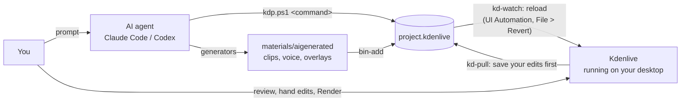

<div align="center">

# Movie Engine

**የAI ኤጀንት እርስዎ እየተመለከቱ ቪዲዮዎን በKdenlive ውስጥ ያቀናብራል፤ እርስዎም በማንኛውም ጊዜ ሥራውን መረከብ ይችላሉ።**

ኮድ የሚጽፉ AI ኤጀንቶች (Claude Code፣ Codex) እውነተኛ የKdenlive ፕሮጀክቶችን ይገነባሉ፤ ይለውጣሉም፦ ፊልሞችን፣ ገላጭ ቪዲዮዎችን እና ቁመታዊ አጫጭር ቪዲዮዎችን (shorts)። ለውጦቹ እርስዎ በከፈቱት አርታኢ ውስጥ ወዲያውኑ ይታያሉ። ተንቀሳቃሽ (portable)፣ ለWindows፣ በአርታኢው ላይ ምንም ማሻሻያ (patch) ሳይደረግ።


[English](../../README.md) · [简体中文](README.zh-CN.md) · [繁體中文](README.zh-TW.md) · [हिन्दी](README.hi.md) · [Español](README.es.md) · [Français](README.fr.md) · [العربية](README.ar.md) · [বাংলা](README.bn.md) · [Português](README.pt.md) · [Русский](README.ru.md) · [اردو](README.ur.md) · [Bahasa Indonesia](README.id.md) · [Deutsch](README.de.md) · [日本語](README.ja.md) · [Türkçe](README.tr.md) · [한국어](README.ko.md) · [Українська](README.uk.md) · [Italiano](README.it.md) · [Polski](README.pl.md) · [Tiếng Việt](README.vi.md) · [فارسی](README.fa.md) · [ไทย](README.th.md) · [Kiswahili](README.sw.md) · **አማርኛ** · [Avañe'ẽ](README.gn.md) · [Setswana](README.tn.md) · [Shqip](README.sq.md) · [Беларуская](README.be.md) · [Български](README.bg.md) · [Bosanski](README.bs.md) · [Hrvatski](README.hr.md) · [Српски](README.sr.md) · [Crnogorski](README.cnr.md) · [Македонски](README.mk.md) · [Slovenščina](README.sl.md) · [Slovenčina](README.sk.md) · [Čeština](README.cs.md) · [Magyar](README.hu.md) · [Română](README.ro.md) · [Dansk](README.da.md) · [Norsk bokmål](README.nb.md) · [Norsk nynorsk](README.nn.md) · [Svenska](README.sv.md) · [Íslenska](README.is.md) · [Suomi](README.fi.md) · [Eesti](README.et.md) · [Latviešu](README.lv.md) · [Lietuvių](README.lt.md) · [Nederlands](README.nl.md) · [Lëtzebuergesch](README.lb.md) · [Rumantsch](README.rm.md) · [Ελληνικά](README.el.md) · [Malti](README.mt.md) · [Gaeilge](README.ga.md) · [Català](README.ca.md) · [ქართული](README.ka.md) · [Հայերեն](README.hy.md) · [Azərbaycanca](README.az.md) · [Afrikaans](README.af.md) · [isiZulu](README.zu.md) · [isiXhosa](README.xh.md) · [Sesotho](README.st.md) · [Sepedi](README.nso.md) · [Xitsonga](README.ts.md) · [Tshivenḓa](README.ve.md) · [siSwati](README.ss.md) · [isiNdebele (South Africa)](README.nr.md) · [isiNdebele (Zimbabwe)](README.nd.md) · [chiShona](README.sn.md) · [Chichewa](README.ny.md) · [Ikinyarwanda](README.rw.md) · [Ikirundi](README.rn.md) · [Malagasy](README.mg.md) · [Soomaali](README.so.md) · [Afaan Oromoo](README.om.md) · [Qafar af](README.aa.md) · [ትግርኛ](README.ti.md) · [Sängö](README.sg.md) · [Kreol Seselwa](README.crs.md) · [TjiKalanga](README.kck.md) · [ChiNdau](README.ndc.md)

*ይህ ትርጉም ነው፤ ዋናው የማጣቀሻ ቅጂ የእንግሊዝኛው README ነው።*

</div>

---

## ማውጫ

- [ለምን](#ለምን)
- [እንዴት ይሠራል](#እንዴት-ይሠራል)
- [ባህሪያት](#ባህሪያት)
- [መስፈርቶች](#መስፈርቶች)
- [ጭነት](#ጭነት)
- [ፈጣን ጅምር](#ፈጣን-ጅምር)
- [ከኤጀንቱ ጋር መሥራት](#ከኤጀንቱ-ጋር-መሥራት)
- [የአርትዖት ትዕዛዝ መስመር (`kdp.ps1`)](#የአርትዖት-ትዕዛዝ-መስመር-kdpps1)
- [ከተከፈተው አርታኢ ጋር ቀጥታ ማመሳሰል](#ከተከፈተው-አርታኢ-ጋር-ቀጥታ-ማመሳሰል)
- [ጀነሬተሮች: Kdenlive የማይችለው](#ጀነሬተሮች-kdenlive-የማይችለው)
- [የድምፅ ትረካ እና ድምፅ](#የድምፅ-ትረካ-እና-ድምፅ)
- [የበይነገጽ ቋንቋ](#የበይነገጽ-ቋንቋ)
- [የአቃፊዎች አወቃቀር](#የአቃፊዎች-አወቃቀር)
- [ሙከራዎች እና ማረጋገጫዎች](#ሙከራዎች-እና-ማረጋገጫዎች)
- [ገደቦች](#ገደቦች)
- [ችግር መፍታት](#ችግር-መፍታት)
- [ተደጋግመው የሚጠየቁ ጥያቄዎች](#ተደጋግመው-የሚጠየቁ-ጥያቄዎች)
- [አስተዋጽኦ ማድረግ](#አስተዋጽኦ-ማድረግ)
- [ምስጋና](#ምስጋና)
- [ፈቃድ](#ፈቃድ)

## ለምን

የቪዲዮ አርታኢዎች የተሠሩት በመዳፊት ለሚሠሩ እጆች ነው። AI ኤጀንቶች (ራሳቸውን ችለው ሥራ የሚያከናውኑ የሰው ሰራሽ አስተውሎት ፕሮግራሞች) ደግሞ በመዋቅር፣ በጊዜ አጠባበቅ እና በተደጋጋሚ ሥራ ጎበዞች ናቸው፦ 300 ክሊፖችን ከሙዚቃው ምት ጋር ማስቀመጥ፣ እያንዳንዱን የጽሑፍ መግለጫ ከድምፁ ጋር ማጣጣም፣ አስተያየት ከተሰጠ በኋላ አንድን ትዕይንት እንደገና መሥራት። ነገር ግን የእርስዎን ዴስክቶፕ ሳይቆጣጠሩ በግራፊክ በይነገጽ (GUI) ላይ ጠቅ እያደረጉ መሥራት አይችሉም።

Kdenlive ጠንካራ የክፍት ምንጭ አርታኢ ነው፤ ነገር ግን በWindows ላይ **የአውቶሜሽን API የለውም**፦ በD-Bus መቆጣጠር የሚቻለው በLinux ግንባታዎች ብቻ ነው፤ ይህን የሚጨምሩት ፎርኮች (forks) ደግሞ ወይ የተተዉ ናቸው ወይ ደህንነታቸው የተጠበቀ አይደለም። Movie Engine ይህን ችግር አርታኢውን ሳይቀይር ይፈታል፦

1. ኤጀንቱ የ`.kdenlive` ፕሮጀክት ፋይሉን በተፈተነ የትዕዛዝ መስመር (`engine/kdp.ps1`) በኩል ያርትዓል።
2. እየሠራ ያለው Kdenlive ፋይሉን እንደገና እንዲጭን በWindows UI Automation በኩል ይነገረዋል፤ ምንም የቁልፍ ሰሌዳ ምት፣ ምንም መዳፊት፣ ምንም ትኩረት (focus) መንጠቅ የለም።
3. ያልተቀመጡ የእርስዎ ለውጦች መጀመሪያ ይቀመጣሉ፤ በፍጹም አይደረቡም (አይሰረዙም)።

ስለዚህ ኤጀንቱ ያርትዓል፣ እርስዎ ይገመግማሉ፤ ወይም እርስዎ በእጅ ያርትዓሉ። ሁለታችሁም በአንድ ፕሮጀክት ላይ፣ በአንድ አርታኢ ውስጥ፣ በአንድ ጊዜ ትሠራላችሁ።

## እንዴት ይሠራል



እያንዳንዱ የአርትዖት ትዕዛዝ ተመሳሳይ ደህንነቱ የተጠበቀ ዑደት ይከተላል፦

1. **መሳብ (Pull)።** Kdenlive ያልተቀመጡ ለውጦች ካሉት፣ እንዲያስቀምጣቸው ይነገረዋል (በመሣሪያ አሞሌው ላይ ያለው Save በUI Automation በኩል)፤ መቀመጡም ይረጋገጣል።
2. **ማርትዕ።** ትዕዛዙ XMLን በመቆለፊያ (lock) ሥር፣ የhash ፍተሻ ካደረገ በኋላ እና ለመቀልበስ (undo) የሚያገለግል ቅጽበታዊ ቅጂ ይዞ ይለውጣል። ፋይሉ በመሃሉ ከተለወጠ ምንም አይጻፍም።
3. **እንደገና መጫን።** ተመልካቹ (watcher) የAIውን ምልክት አይቶ በተከፈተው አርታኢ ውስጥ File > Revert ያሂዳል። ስኬት የሚቆጠረው የጊዜ መስመሩ (timeline) ክፍል በእርግጥ እንደገና ሲገነባ ብቻ ነው።
4. **ግጭት።** በመሃሉ እርስዎ ማርትዕ ከጀመሩ፣ ምንም እንደገና አይጫንም፤ ሥራዎም ይቆያል። የAIው ቅጂ ለብቻው ይቀመጣል፤ ኤጀንቱም ለውጡን በእርስዎ ለውጥ ላይ እንደገና ይተገብራል።

## ባህሪያት

- **ያለ GUI ሙሉ የፕሮጀክት አርትዖት**፦ ወደ 120 የሚጠጉ ትዕዛዞች፤ እነዚህም bin (የፕሮጀክቱ ሚዲያ ማከማቻ)፣ የጊዜ መስመር፣ ኢፌክቶች፣ ቅንብሮች (compositions)፣ ትራኮች፣ መመሪያዎች (guides)፣ ማርከሮች፣ የጽሑፍ ትርጉሞች (subtitles)፣ ቅደም ተከተሎች (sequences)፣ ፍጥነት እና የጊዜ ዳግም ካርታ (time remap)፣ የስላይድ ትዕይንቶች፣ ርዕሶች፣ proxyዎች፣ ማውጣት (rendering) እና መቀልበስ/መድገም ይሸፍናሉ። [የትዕዛዞች ማጣቀሻውን](#የአርትዖት-ትዕዛዝ-መስመር-kdpps1) ይመልከቱ።
- **ከተከፈተው አርታኢ ጋር ቀጥታ ማመሳሰል።** የAI ለውጦች እርስዎ እየተመለከቱት ባለው Kdenlive ውስጥ ይታያሉ፤ ያልተቀመጡ ለውጦችዎ መጀመሪያ ይቀመጣሉ፤ በፍጹም አይጠፉም።
- **ዴስክቶፕዎን በፍጹም አይረብሽም።** ትኩረት መንጠቅ፣ የቁልፍ ሰሌዳ ምት ወይም የመዳፊት ግብዓት የለም። የሙከራ አርታኢዎች በማይታይ የWindows ዴስክቶፕ ላይ ይሠራሉ።
- **ተንቀሳቃሽ።** አርታኢው፣ ቅንብሮቹ፣ Node.js፣ ፊደላቱ (fonts) እና መሣሪያዎቹ በአንድ አቃፊ ውስጥ ይገኛሉ። ወደ ሌላ ኮምፒውተር ቢገለብጡት ይሠራል፤ ወደ Program Files ወይም ወደ Windows መገለጫዎ (profile) ምንም አይጻፍም።
- **Kdenlive ለማይችለው ነገር ጀነሬተሮች**፦ ፊደል በፊደል የሚንቀሳቀስ ጽሑፍ (kinetic text)፣ በእጅ የተሳሉ የሚመስሉ ማብራሪያዎች፣ የ3D በይነገጽ ትዕይንቶች፣ የጠቋሚ (cursor) እንቅስቃሴዎች እና ረጅም በይነተገናኝ «ገላጭ» ፊልሞች። በGPU ላይ እውነተኛ የእንቅስቃሴ ብዥታ (motion blur) ይዘው ይወጣሉ፤ በጊዜ መስመሩ ላይም እንደ ተራ ክሊፖች ይቀመጣሉ።
- **የቃላት ጊዜ ያለው የድምፅ ትረካ** (Microsoft Edge TTS፣ የAPI ቁልፍ አያስፈልግም)። የጽሑፍ መግለጫዎች እና ድርጊቶች ልክ በተባለው ቃል ላይ ይነሳሉ።
- **የተቀናበሩ የድምፅ ኢፌክቶች** (whoosh፣ click፣ pop፣ riser፣ impact እና ሌሎችም)፣ በኮድ የሚፈጠሩ።
- **የተረጋገጠ እንጂ የተገመተ አይደለም።** እያንዳንዱ ትዕዛዝ የውጤት ፍተሻ አለው፤ ኢፌክቶች እና ቅንብሮች አንድ በአንድ ይፈተሻሉ፤ ጥሬ ውጤቶቹም በ`docs/proof/` ውስጥ ይገኛሉ።
- **ለኤጀንቶች መመሪያዎች ተካተዋል።** `AGENTS.md` እና በ`.claude/skills/` ውስጥ ያሉት ክህሎቶች (skills) ለClaude Code እና ለCodex የሥራ ሂደቱን፣ የፋይል ቅርጸቱን እና ወጥመዶቹን ያስተምራሉ።

## መስፈርቶች

| | |
|---|---|
| ስርዓተ ክወና | Windows 10 ወይም 11፣ x64 |
| አርታኢ | የKdenlive **26.08.3** ተንቀሳቃሽ (standalone) ግንባታ። ሌሎች ስሪቶች አልተፈተኑም። |
| Node.js | 18 ወይም ከዚያ በኋላ ያለ፦ ከnodejs.org የሚገኘው የWindows x64 `.zip`፣ ወደ `engine/node/` የተዘረጋ |
| አሳሽ | Microsoft Edge (የWindows አካል)፤ የትዕይንት ማውጫዎቹ (scene renderers) ያለ መስኮት (headless) ይጠቀሙበታል |
| ኤጀንት | [Claude Code](https://claude.com/claude-code) ወይም Codex። አማራጭ ነው፦ እያንዳንዱ መሣሪያ በእጅም ይሠራል። |
| ዲስክ | ለአርታኢው እና ለመሣሪያዎቹ ወደ 1 GB፣ በተጨማሪም የእርስዎ ሚዲያ |
| GPU | የሃርድዌር H.264 ኢንኮዲንግ ያለው ማንኛውም GPU `film-render.mjs`ን ያፋጥናል (ከሌለ ወደ ሶፍትዌር ይመለሳል) |

## ጭነት

ሁሉም ነገር የሚጫነው **በአቃፊው ውስጥ** ነው። ምንም የአስተዳዳሪ (admin) መብት አያስፈልግም።

```powershell
git clone https://github.com/vladtarrow/movie-engine.git
cd movie-engine
```

**1. Node.js።** የNode.js 18 ወይም ከዚያ በኋላ ያለውን የWindows x64 `.zip` ከ<https://nodejs.org/en/download> ያውርዱ፤ ይዘቱን ወደ `engine\node\` ይዘርጉት፤ በዚህም `engine\node\node.exe` እና `engine\node\npm.cmd` እዚያ ይገኛሉ። ጫኚ (installer) ወይም የስርዓቱ Node አያስፈልጉም። ሁሉም ስክሪፕቶች የሚሠሩት በ`engine\node.cmd` በኩል ነው፤ በፍጹም በስርዓቱ Node አይደለም።

**2. የNode ጥቅሎች** ለድምፅ መሣሪያው እና ለማውጫዎቹ (ስሪቶቹ በ`engine/voice/package.json` ውስጥ ተወስነዋል)፦

```powershell
engine\node\npm.cmd install --prefix engine\voice
```

**3. ተንቀሳቃሹ Kdenlive 26.08.3።** `kdenlive-26.08.3_standalone.exe`ን ከ<https://download.kde.org/stable/kdenlive/26.08/windows/> ወደ `engine\installer\` ያውርዱ፤ ይፈትሹት እና ይዘርጉት፦

```powershell
(Get-FileHash engine\installer\kdenlive-26.08.3_standalone.exe -Algorithm SHA256).Hash
# expected: A25427B1DFF2C17E3B0386E991BB1A719382BB3176D1A90E441CDAEB6E0A967D
engine\installer\kdenlive-26.08.3_standalone.exe -o"engine\Kdenlive" -y
```

አርታኢው በ`engine\Kdenlive\kdenlive-26.08.3_standalone\bin\` ውስጥ ይገኛል። `melt.exe` እና `ffmpeg.exe` አስቀድመው ተካተዋል።

**4. የመጀመሪያ አጀማመር።**

```powershell
engine\kdenlive.cmd
```

Kdenlive ቅንብሮቹን በሙሉ የሚያስቀምጠው በ`engine\profile-kdenlive\` ውስጥ እንጂ በWindows መገለጫዎ ውስጥ አይደለም። በመጀመሪያው አጀማመር አንድ ጊዜ ብቻ የሚታይ የማዋቀሪያ አዋቂ (setup wizard) ያሳያል።

## ፈጣን ጅምር

### ከኤጀንት ጋር

አቃፊውን በClaude Code (ወይም በCodex) ይክፈቱ እና በቀላል ቃላት ይጠይቁ፦

> "launch-teaser" የተባለ አዲስ ቁመታዊ 30 fps ፕሮጀክት ሥራ። ከ`materials/designers/launch/` ያሉትን ሦስት የስክሪን ምስሎች በጊዜ መስመሩ ላይ አስቀምጣቸው፤ እያንዳንዳቸው 2.5 ሰከንድ፣ በመካከላቸው አጭር የመሸጋገሪያ ድብዘዛ (cross-fade) ይኑር። ከ`script.txt` የድምፅ ትረካ ጨምር፤ ለእያንዳንዱ መስመርም የሚንቀሳቀስ የጽሑፍ መግለጫ ከድምፁ ጋር አጣጥም።

> በKdenlive ክፈትልኝ።

> ሁለተኛው ቀረጻ በጣም ረጅም ነው። ወደ 1.8 ሰከንድ ቁረጠው፤ አርማውንም ትንሽ ወደ ላይ አንሳው።

ኤጀንቱ `AGENTS.md`ን ይከተላል፦ በ`kdp.ps1` በኩል ያርትዓል፣ ቁርጡ (cut) የሚያስፈልገውን ክሊፖች ብቻ ያወጣል (render ያደርጋል)፣ የተከፈተውን አርታኢም ተመሳስሎ እንዲቆይ ያደርጋል። እርስዎ በKdenlive ውስጥ ይገመግማሉ፣ በፈለጉት ጊዜ በእጅ ያርትዓሉ፣ ሲረኩም Render ይጫናሉ።

### በእጅ

```powershell
# a new 1080x1920 30 fps project with 2 video and 2 audio tracks
powershell -NoProfile -ExecutionPolicy Bypass -File engine\kdp.ps1 new -Project projects\hello\hello.kdenlive -Profile vertical_hd_30

# a 3-second title and a colour background
powershell -NoProfile -ExecutionPolicy Bypass -File engine\kdp.ps1 bin-color -Project projects\hello\hello.kdenlive -Color '#203060' -Seconds 3 -Name bg
powershell -NoProfile -ExecutionPolicy Bypass -File engine\kdp.ps1 title -Project projects\hello\hello.kdenlive -Text "Hello" -Seconds 3 -Name hi

# place them: background on V1, title above it on V2
powershell -NoProfile -ExecutionPolicy Bypass -File engine\kdp.ps1 add -Project projects\hello\hello.kdenlive -Bin bg -Track V1 -At 0
powershell -NoProfile -ExecutionPolicy Bypass -File engine\kdp.ps1 add -Project projects\hello\hello.kdenlive -Bin hi -Track V2 -At 0

# a check frame, then open it in the editor
powershell -NoProfile -ExecutionPolicy Bypass -File engine\kdp.ps1 frame -Project projects\hello\hello.kdenlive -At 1.5 -Out out\hello\check.png
engine\kdenlive.cmd projects\hello\hello.kdenlive
```

የመጨረሻውን ፕሮጀክት በኋላ እንደገና ለመክፈት `open-last-project.cmd`ን ሁለቴ ጠቅ ያድርጉ።

## ከኤጀንቱ ጋር መሥራት

ኤጀንቱ `AGENTS.md`ን (Codex) ወይም እሱን የሚያስገባውን `CLAUDE.md`ን (Claude Code) እንዲሁም ሁለት ክህሎቶችን ያነባል፦

| ክህሎት | የሚያስተምረው |
|---|---|
| `.claude/skills/kdenlive-project-file` | የ`.kdenlive` / MLT XML ቅርጸት፣ `kdp.ps1`፣ በ`melt` መፈተሽ |
| `.claude/skills/kdenlive-live` | እየሠራ ያለውን አርታኢ በደህንነት መቆጣጠር፦ ማስጀመር፣ pull፣ እንደገና መጫን፣ መስኮቱን ምስል ማንሳት |

ኤጀንቱ የሚከተላቸው እና እርስዎ ሊተማመኑባቸው የሚችሉ ሕጎች፦

- መዳፊትዎን፣ የቁልፍ ሰሌዳዎን ወይም ትኩረትዎን በፍጹም አይወስድም፤ የዴስክቶፕዎን ምስል በፍጹም አያነሳም (የአርታኢውን የራሱን መስኮት ብቻ)።
- እርስዎን ጠቅ እንዲያደርጉ ከመጠየቅ ይልቅ የGUI እርምጃዎቹን (ማስቀመጥ፣ መክፈት፣ እንደገና መጫን) ራሱ ያከናውናል።
- ማንኛውንም ነገር ከማውረዱ እና ከመሰረዙ በፊት ይጠይቃል።
- ሥራው የሚያስፈልገውን ብቻ ያወጣል (የትዕይንት ክሊፖች፣ የፍተሻ ፍሬሞች)። የመጨረሻውን ፊልም የሚያወጣው እርስዎ ሲጠይቁ ብቻ ነው።
- Kdenlive አንድን ነገር በደንብ መሥራት ሲያቅተው፣ ኤጀንቱ ከውጭ በኮድ ይገነባዋል፤ ውጤቱንም እንደ ክሊፕ ያስገባዋል። ኢፌክቱን አያቀልለውም።

## የአርትዖት ትዕዛዝ መስመር (`kdp.ps1`)

```powershell
powershell -NoProfile -ExecutionPolicy Bypass -File engine\kdp.ps1 <command> -Project <file.kdenlive> [options]
```

ጊዜ በሰከንድ ይገለጻል፣ በነጥብ (`2.5`)። ትራኮቹ `V1 V2 …` (V1 ዝቅተኛው) እና `A1 A2 …` ናቸው። አንድ ክሊፕ የሚጠቀሰው በ`-Track` እና በውስጡ ባለ ማንኛውም ጊዜ `-At` ነው። የኢፌክት መለኪያዎች በ`-Params "name=value||name=value"` ውስጥ ይገባሉ። እያንዳንዱን አማራጭ የያዘው ሙሉ ዝርዝር በ`engine/kdp.ps1` ራስጌ ውስጥ ይገኛል።

| ቡድን | ትዕዛዞች |
|---|---|
| ፕሮጀክት | `new`, `profiles`, `info`, `validate`, `fonts`, `profile-set`, `profile-from-clip`, `zone`, `archive`, `backups`, `rebase`, `otio-export`, `otio-import` |
| Bin | `bin-add`, `bin-color`, `title`, `title-text`, `title-save`, `title-template`, `bin-rename`, `bin-remove`, `bin-info`, `bin-set`, `bin-duplicate`, `bin-replace-file`, `bin-reload`, `folder`, `bin-folder`, `relink`, `clean`, `generator`, `playlist-clip`, `extract-audio`, `transcode` |
| የጊዜ መስመር | `add`, `add-av`, `move`, `copy`, `trim`, `ripple-trim`, `slip`, `split`, `remove`, `speed`, `remap`, `disable`, `enable`, `group`, `ungroup`, `mix`, `unmix`, `space-insert`, `space-remove`, `spaces-remove-all`, `track-clear`, `replace-in-timeline` |
| ኢፌክቶች | `effects`, `effect-info`, `effect-add`, `effect-list`, `effect-set`, `effect-remove`, `effect-copy`, `effect-clear`, `effects-all`, `bin-effect`, `effect-templates`, `effect-template` |
| ቅንብሮች | `compositions`, `comp-info`, `comp-add`, `comp-list`, `comp-set`, `comp-remove` |
| ትራኮች | `track-add`, `track-remove`, `track-set` |
| መመሪያዎች እና ማርከሮች | `guide-add`, `guide-list`, `guide-remove`, `guide-set`, `guide-clear`, `guide-export`, `guide-category`, `marker`, `marker-list`, `marker-set`, `marker-remove` |
| የጽሑፍ ትርጉሞች | `sub-add`, `sub-import`, `sub-export`, `sub-state` |
| ቅደም ተከተሎች | `sequence-add`, `sequences`, `copy-to-sequence`, `expand`፤ `-Sequence <name>` ያለው ማንኛውም ትዕዛዝ በዚያ ቅደም ተከተል ውስጥ ይሠራል |
| ልዩ | `slideshow`፣ የLottie / Glaxnimate እንቅስቃሴዎች በ`bin-add` በኩል፣ `proxy`, `stabilize`, `scene-split`, `speed-job`, `subclip` |
| ውጤት | `frame` (አንድ PNG)፣ `preview` (ፈጣን የmelt ማውጣት)፣ `render` (የKdenlive የራሱ ማውጫ ወይም ቅድመ ቅንብር/preset)፣ `presets` |
| ታሪክ | `undo`, `redo`, `clear-history` (ቅጽበታዊ ቅጂዎቹ በ`projects/<name>/.kdp-history` ውስጥ) |

ማወቅ የሚገባው ባህሪ፦

- የተያያዙ የድምፅ እና የቪዲዮ ግማሾች አብረው ይንቀሳቀሳሉ፣ ይከረከማሉ፣ ይከፈላሉ፣ ይሰረዛሉም (ለአንዱ ግማሽ ብቻ `-Alone`)።
- የወደቀ ትዕዛዝ በኮድ 1 ይወጣል፤ ምንም አይጽፍም።
- የWindows ግንባታው ሊያሄዳቸው የማይችላቸው ኢፌክቶች ውድቅ ይደረጋሉ እንጂ በዝምታ አይታለፉም (ዝርዝር፦ `docs/proof/assets.txt`)።
- እያንዳንዱ የKdenlive ምናሌ ድርጊት በ`engine/tools/data/kdenlive-actions.csv` ውስጥ ከአንድ ትዕዛዝ፣ ከሌላ መንገድ ወይም ከ«ለእይታ ብቻ» ጋር ተዛምዷል። `docs/kdenlive-coverage.md`ን ይመልከቱ።

## ከተከፈተው አርታኢ ጋር ቀጥታ ማመሳሰል

| ስክሪፕት | የሚሠራው | የመውጫ ኮዶች |
|---|---|---|
| `engine\kd-pull.ps1 -Project <f>` | Kdenlive ለውጦችዎን እንዲያስቀምጥ ያደርጋል፤ ያረጋግጣልም | 0 ፋይሉ ወቅታዊ ነው፣ 3 እየሠራ አይደለም፣ 4 አልተረጋገጠም |
| `engine\kd-reload.ps1 -Project <f>` | File > Revert፣ እንደገና በተገነባው የጊዜ መስመር የተረጋገጠ | 0 ተረጋግጧል፣ 2 ያልተቀመጡ ለውጦች አሉዎት (ምንም አልተጣለም)፣ 3 እየሠራ አይደለም፣ 4 አልተሳካም |
| `engine\kd-watch.ps1 -Project <f>` | ከበስተጀርባ የሚሠራ ተመልካች፦ ከእያንዳንዱ የAI ጽሕፈት በኋላ እንደገና ይጭናል፣ ግጭቶችን ይመዘግባል | መዝገቡ በ`engine\kd-watch.log`፤ ለማቆም `engine\kd-watch.run`ን ይሰርዙ |
| `engine\kdenlive-bg.ps1 [project]` | Kdenliveን ለኤጀንት ተሳንሶ (minimized) ያስጀምራል | 0 ተጭኗል፣ 4 አልተረጋገጠም |
| `engine\kdenlive.cmd [project]` | Kdenliveን ለእርስዎ ያስጀምራል | |

ተመልካቹን በእያንዳንዱ ክፍለ ጊዜ (session) አንድ ጊዜ ያስጀምሩ፦

```powershell
Start-Process powershell -WindowStyle Hidden -ArgumentList '-NoProfile','-ExecutionPolicy','Bypass','-File','engine\kd-watch.ps1','-Project','projects\hello\hello.kdenlive'
```

ትልልቅ ፕሮጀክቶች፦ 1000 ክሊፖች ያሉትን ፕሮጀክት እንደገና መጫን ደቂቃዎችን ይወስዳል፤ መሣሪያዎቹም ቀደም ብለው ሪፖርት ከማድረግ ይልቅ እስኪጨርስ ይጠብቃሉ። ፕሮጀክቶች የሚከፈቱት ባዶ በሆነ አርታኢ ውስጥ በ*File > Open Recent* በኩል ነው፤ ምክንያቱም ፋይልን በቀጥታ መክፈት Qt ለተደራሽነት (accessibility) ሲባል እያንዳንዱን የጊዜ መስመር አካል እንዲያልፍ ያደርገዋል፤ ይህም ወደ 10 ደቂቃ ያህል ቀርፋፋ ነበር።

## ጀነሬተሮች: Kdenlive የማይችለው

Kdenlive/MLT ፊደል በፊደል የሚንቀሳቀስ ጽሑፍ፣ አገላለጾች (expressions) የሉትም፤ 3D ደግሞ ጥቂት ብቻ ነው ያለው፤ ከባድ ኢፌክቶችም መልሶ ማጫወትን ያዘገያሉ። Movie Engine እንደነዚህ ያሉትን ክፍሎች ከውጭ ያወጣቸዋል፤ በጊዜ መስመሩ ላይም እንደ ተራ ክሊፖች፣ አብዛኛውን ጊዜ ከalpha (ግልጽነት) ጋር፣ ከምስሎቹ በላይ ባለ ትራክ ላይ ያስቀምጣቸዋል። የጀነሬተሩ ስክሪፕት እና ግብዓቶቹ በፕሮጀክቱ አቃፊ ውስጥ ይቆያሉ፤ በዚህም ጽሑፉ፣ ፊደሉ ወይም ጊዜው ሲለወጥ ክሊፑ እንደገና ሊፈጠር ይችላል።

| መሣሪያ | የሚሠራው |
|---|---|
| `engine/tools/kinetic-text.ps1` | ፊደል በፊደል የሚንቀሳቀሱ የጽሑፍ መግለጫዎች፣ እያንዳንዱ ቃል ከ`voice.json` በተወሰደ ጊዜ፣ የማድመቂያ ሳጥን |
| `engine/tools/annotate.ps1` | በስክሪን ምስል ላይ ራሳቸውን እየሳሉ የሚታዩ፣ በእጅ የተሳሉ የሚመስሉ ክበቦች፣ ሳጥኖች፣ የስር መስመሮች እና ቀስቶች |
| `engine/tools/card-entrance.ps1` | ለስላሳ ጥላ ይዞ ወደ ላይ የሚነሳ እና እያደገ የሚገባ የስክሪን ምስል ካርድ |
| `engine/tools/pdf-to-png.ps1` | ከPDF ወደ ውጭ ከተላከ ፋይል የሚወጡ ስላይዶች |
| `engine/tools/html-render.mjs` | ማንኛውንም የHTML/CSS/canvas ትዕይንት ወደ ቪዲዮ፦ የበይነገጽ እንቅስቃሴ፣ ጠቋሚዎች፣ 3D፣ ማስኮች |
| `engine/tools/film-render.mjs` + `film/` | በcanvas ላይ ረጅም፣ በይነተገናኝ ገላጭ ፊልሞች፦ ለእያንዳንዱ የትረካ መስመር አንድ ክሊፕ፣ ድርጊቶች በሚነገሩ ቃላት ላይ ይነሳሉ፣ የGPU እንቅስቃሴ ብዥታ በ45 fps ገደማ |

ሁለቱም ማውጫዎች ከWindows ጋር የሚመጣውን Microsoft Edge ያለ መስኮት (headless)፣ ከአንድ ጊዜ መገለጫ ጋር እና ያለ አውታረ መረብ መዳረሻ ያንቀሳቅሳሉ።

### ማሳያዎች

```powershell
# a 3-second 3D title card with a cursor click
engine\node.cmd engine\tools\html-render.mjs examples\demo\scene\scene.html examples\demo\out --frames 0,30,60,89
engine\node.cmd engine\tools\html-render.mjs examples\demo\scene\scene.html examples\demo\out\scene.mp4

# a 4-shot interactive film timed to two voice lines
engine\node.cmd engine\tools\film-render.mjs examples\demo\film\film.html examples\demo\out --check
engine\node.cmd engine\tools\film-render.mjs examples\demo\film\film.html examples\demo\out --shots all --width 640
engine\node.cmd engine\tools\film-render.mjs examples\demo\film\film.html examples\demo\out\clips --suffix -v01
```

አንድ ፊልም ሦስት ትናንሽ ፋይሎች ነው። `data.js` ቀረጻዎቹን (shots) እና የቃላቱን ጊዜዎች ይይዛል። `direction.js` ለእያንዳንዱ ቀረጻ አንድ መስመር አለው፦

```text
1 | hover 192 108 @brand | tag 300 60 Your brand @deserves | confetti 192 90 @film
2 say=A film that/*explains* it
3 | click 116 108 @before | click 268 108 @after | chips Before~After @after
4 scene=counter | count 0 120 % @count
```

`scenes.js` ከባዶ የሚሳሉትን ቀረጻዎች ይይዛል። `@word` ድምፁ ያንን ቃል ሲናገር አንድን ድርጊት ያስነሳል። ድርጊቶቹ click፣ hover፣ drag፣ zoom፣ lens፣ ring፣ arrow፣ chips፣ toggle፣ slider፣ toast፣ type፣ count እና confetti ይገኙበታል፤ ሙሉ አገባቡ (syntax) በ`engine/tools/film/film-kit.js` መጀመሪያ ላይ ይገኛል።

## የድምፅ ትረካ እና ድምፅ

```powershell
engine\node.cmd engine\voice\voice.mjs lines.json materials\aigenerated\hello\voice en-US-AndrewMultilingualNeural +0%
```

`lines.json` የመስመሮች ዝርዝር ነው። መሣሪያው ለእያንዳንዱ መስመር አንድ mp3 እንዲሁም የቆይታ ጊዜውን እና የእያንዳንዱን ቃል መጀመሪያ እና መጨረሻ የያዘ `voice.json` ይጽፋል። መስመሮቹ በcache ይቀመጣሉ፤ ስለዚህ አንድን መስመር መለወጥ ያንን መስመር ብቻ እንደገና ይፈጥራል። በ`msedge-tts` ጥቅል በኩል የMicrosoft Edgeን የመስመር ላይ ጽሑፍ-ወደ-ንግግር (TTS) ይጠቀማል፦ ቁልፍ አያስፈልግም፤ ነገር ግን አገልግሎቱ ይፋዊ አይደለም፤ ኢንተርኔትም ያስፈልገዋል።

```powershell
engine\node.cmd engine\audio\sfx.mjs materials\aigenerated\sfx
```

ይህ whoosh፣ whoosh-long፣ swipe፣ click፣ pop፣ tick፣ riser፣ impact፣ ding እና revealን በኮድ ያቀናብራል፤ የተዘጋጀ ስብስብ በ`materials/aigenerated/sfx/` ውስጥ አለ። ከአንድ ፍሬም ያጠሩ ድምፆችን ከማስቀመጥዎ በፊት በጸጥታ ያራዝሟቸው (`-af apad=whole_dur=0.0667`)።

## የበይነገጽ ቋንቋ

አስጀማሪዎቹ (launchers) በነባሪነት Kdenliveን በ**እንግሊዝኛ** ያስጀምራሉ። ሌላ ቋንቋ ለመጠቀም ከማስጀመርዎ በፊት `MOVIE_ENGINE_UI_LANG`ን ያዘጋጁ፦

```powershell
$env:MOVIE_ENGINE_UI_LANG = 'ru'; engine\kdenlive.cmd
```

UI Automation የምናሌ ንጥሎችን የሚያገኘው በሚታዩ ስሞቻቸው ነው። የ31 የበይነገጽ ቋንቋዎች ስሞች አብረው ተካተዋል (`engine/tools/kd-ui.ps1`፣ `$KdNames`)። ለሌላ ማንኛውም ቋንቋ ስሞቹን እዚያ ይጨምሩ፤ ከዚያም በዚህ ይፈትሹ፦

```powershell
powershell -NoProfile -ExecutionPolicy Bypass -File engine\tools\kd-langcheck.ps1
```

## የአቃፊዎች አወቃቀር

```text
movie-engine/
├─ AGENTS.md, CLAUDE.md          instructions for AI agents
├─ .claude/skills/               agent skills: project file format, live editor
├─ engine/
│  ├─ kdp.ps1                    the editing command line
│  ├─ kd-pull / kd-reload / kd-watch .ps1, kdenlive.cmd, kdenlive-bg.ps1
│  ├─ tools/                     internals, generators, tests, data (action map)
│  ├─ voice/  audio/  fonts/     TTS, synthesized SFX, Poppins (OFL)
│  ├─ Kdenlive/  node/           portable editor and Node.js (not in git)
│  └─ profile-kdenlive/          the editor's settings (not in git)
├─ projects/<name>/<name>.kdenlive
├─ materials/
│  ├─ download/                  stock and downloaded files (not in git)
│  ├─ aigenerated/               everything the AI made (sfx/ and test-kit/ ship with the engine)
│  ├─ designers/  brand/         files from your team, brand assets
├─ examples/demo/                demos of the scene and film renderers
├─ out/                          renders (not in git)
└─ docs/                         proofs, coverage, translations of this README
```

በፕሮጀክቶች ውስጥ ያሉ የሚዲያ ዱካዎች (paths) አንጻራዊ ናቸው። አቃፊውን ካንቀሳቀሱት ወይም ከገለበጡት፣ `kdp.ps1 rebase` (`kdenlive.cmd`ም በራስ-ሰር ያሄደዋል) አዲሱን ቦታ በፕሮጀክቱ ውስጥ ይጽፋል።

## ሙከራዎች እና ማረጋገጫዎች

ስለሚሠራው ነገር የሚቀርቡ መግለጫዎች የሚደገፉት በውጤት ፍተሻዎች እንጂ «ተግባሩ ተሠርቷል» በሚል አይደለም። ማጠቃለያው በ[`docs/kdenlive-proof.md`](../../docs/kdenlive-proof.md) ውስጥ፣ ጥሬ ውጤቱ ደግሞ በ`docs/proof/` ውስጥ ይገኛል።

| ሙከራ | የሚፈትሸው |
|---|---|
| `engine\tools\kdp-clitest.ps1` | እያንዳንዱን የ`kdp.ps1` ትዕዛዝ፣ በትዕዛዝ መስመሩ በኩል፣ የተገኘውን ፕሮጀክት በማነጻጸር |
| `engine\tools\kd-livetest.ps1` | pull፣ እንደገና መጫን፣ ተመልካቹ፣ ግጭቶች እና የጊዜ ፉክክሮች (races)፣ በማይታይ ዴስክቶፕ ላይ በእውነተኛ Kdenlive |
| `engine\tools\kdp-assetsweep.ps1` | እያንዳንዱን ኢፌክት እና ቅንብር፦ ያወጣል፣ ፍሬሞችንም ያነጻጽራል |
| `engine\tools\kdp-portabletest.ps1` | አቃፊውን ወደ ሌላ ቦታ ይገለብጣል፣ ከቅጂውም ይሠራል |
| `engine\tools\kd-langcheck.ps1` | የበይነገጹን ቋንቋ እና UI Automation ምናሌውን ማግኘቱን |
| `engine\tools\kdp-coverage-check.ps1` | እያንዳንዱ የምናሌ ድርጊት መዛመዱን፣ የትኛውም ማረጋገጫ ከኮዱ ያልቀደመ (ያላረጀ) መሆኑን |

```powershell
powershell -NoProfile -ExecutionPolicy Bypass -File engine\tools\kdp-clitest.ps1 -Report docs\proof\clitest.txt
powershell -NoProfile -ExecutionPolicy Bypass -File engine\tools\kd-livetest.ps1 -Report docs\proof\live-en.txt
```

የሙከራ አርታኢዎች የሚሠሩት በራሳቸው መገለጫ በተደበቀ ዴስክቶፕ ላይ ብቻ ነው፤ ስለዚህ ሙከራዎቹ የተከፈተውን Kdenliveዎን ወይም ትኩረትዎን በፍጹም አይነኩም።

## ገደቦች

- **Windows ብቻ**፣ Kdenlive **26.08.3** ብቻ። Linux D-Bus አለው፤ የተለየ ድልድይም ያስፈልገዋል።
- አርታኢውን ማስጀመር ባዶው መስኮት እስኪታይ ድረስ ለ3 ሰከንድ ያህል የቁልፍ ሰሌዳ ትኩረትን ይወስዳል። እርስዎ እየሠሩ ሳሉ ኤጀንቶች ከማስጀመራቸው በፊት ይጠይቃሉ። እንደገና መጫን እና ማርትዕ ትኩረትን አይወስዱም።
- የWindows ግንባታው የsox፣ ladspa እና movit MLT ሞጁሎች እና አንዳንድ የfrei0r/avfilter ኢፌክቶች የሉትም፤ `kdp.ps1` ውድቅ ያደርጋቸዋል (`docs/proof/assets.txt`)።
- የOpenTimelineIO መላክ እና ማስገባት ክሊፖችን እና ክፍተቶችን ብቻ ያስተላልፋሉ። ባለብዙ ካሜራ (multicam) አርትዖት ቀጥታ የማዕዘን መቀያየር የለውም (ቁርጦች የሚሠሩት በsplit/remove/hide ነው)።
- በተሳነሰ መስኮት ላይ በUI Automation በኩል «Save As…» ምንም መገናኛ ሳጥን (dialog) አይከፍትም፤ ኤጀንቱ በምትኩ `archive`ን ወይም የፋይል ቅጂዎችን ይጠቀማል።
- የንግግር ማወቂያ (ራስ-ሰር የጽሑፍ ትርጉሞች) Whisper ወይም Vosk ያስፈልገዋል፤ እነዚህ አብረው አልተካተቱም።
- በKdenlive የርዕስ መሣሪያ የተሠሩ ርዕሶች በWindows ውስጥ የተጫኑ ፊደላትን ይጠቀማሉ። የተረጋገጠ የፊደል አጻጻፍ (typography) ለማግኘት ጽሑፉን ፊደላትን ከ`engine/fonts/` በሚጭኑት ጀነሬተሮች ያውጡ።
- Edge TTS ይፋዊ ያልሆነ የመስመር ላይ አገልግሎት ነው፤ ሊለወጥ ወይም መሥራት ሊያቆም ይችላል።

## ችግር መፍታት

| ምልክት | ምክንያት እና መፍትሔ |
|---|---|
| Kdenlive እየሠራ ነው፣ ነገር ግን በተግባር አሞሌው (taskbar) ላይ ጠቅ ሲያደርጉት ምንም አይታይም | የተቀመጠው የመስኮቱ ቦታ ከማያ ገጹ ውጭ ነው። ይዝጉት እና በ`engine\profile-kdenlive\AppData\Local\kdenliverc` ውስጥ ያሉትን የ`kdockLayout` ግቤቶች ይሰርዙ፤ ወይም መስኮቱን በ`SetWindowPos` ያንቀሳቅሱት (`AGENTS.md`ን ይመልከቱ)። |
| `kd-reload.ps1` በ2 ይወጣል | ያልተቀመጡ ለውጦች አሉዎት። ምንም አልተጣለም። `kd-pull.ps1`ን ያሂዱ፤ ከዚያም ለውጡን እንደገና ይተግብሩ (`kdp.ps1` ይህን ራሱ ያደርጋል)። |
| በ`engine\kd-watch.log` ውስጥ `CONFLICT` | እርስዎ እና ኤጀንቱ በተመሳሳይ ቅጽበት አርትዕታችኋል። የእርስዎ ቅጂ በአርታኢው ውስጥ ይቆያል፤ የAIው ቅጂ ደግሞ በ`projects\<name>\.kdp-history\<name>\conflict\` ውስጥ ነው። ኤጀንቱ ለውጡን እንደገና እንዲተገብር ይጠይቁት። |
| አንድ ትዕዛዝ በ1 እና በ"pull not confirmed" ይወጣል | Kdenlive ሥራ ላይ ነው ወይም መገናኛ ሳጥን እያሳየ ነው። መገናኛ ሳጥኑን ይዝጉ ወይም መጫኑ እስኪያበቃ ይጠብቁ፤ ከዚያም ይድገሙ። |
| የPowerShell ስክሪፕት መተንተን አልተቻለም (parse ያደርጋል) | ከASCII ውጭ ጽሑፍ ያላቸው ስክሪፕቶች ለWindows PowerShell 5.1 እንደ UTF-8 **ከBOM ጋር** መቀመጥ አለባቸው። |
| `voice.mjs` በ"Stream closed before the synthesis completed" ይቆማል | አብዛኛውን ጊዜ የአውታረ መረብ ችግር ነው፤ ወይም በአሮጌ ቅጂዎች ውስጥ ያልተጠበቀ (unescaped) SSML። `voice.mjs` `& < >`ን ራሱ ይጠብቃል (escape ያደርጋል)። |
| ትልቅ ፕሮጀክት መክፈት ብዙ ደቂቃዎችን ይወስዳል | በ`kdenlive.cmd` / `kdenlive-bg.ps1` በኩል ይክፈቱት፤ በፍጹም እንደ `kdenlive.exe project.kdenlive` አይክፈቱት። |

## ተደጋግመው የሚጠየቁ ጥያቄዎች

**Claude Code ወይም Codex ያስፈልገኛል?**
አያስፈልግዎትም። እያንዳንዱ መሣሪያ በእጅ ሊያሄዱት የሚችሉት ተራ ስክሪፕት ነው። ሥራውን ፈጣን የሚያደርገው ኤጀንቱ ነው፦ ቁርጡን ያቅዳል፣ መሣሪያዎቹን ያሄዳል፣ አርታኢውንም ተመሳስሎ እንዲቆይ ያደርጋል።

**ኤጀንቱ በእጅ ያደረግኋቸውን ለውጦች ይደርብባቸዋል?**
አይደርብም። ከማንኛውም ጽሕፈት በፊት ያልተቀመጡ ለውጦችዎ ይቀመጣሉ፤ ይረጋገጣሉም። ኤጀንቱ እየጻፈ ሳለ እርስዎ ካረቱ፣ ጽሕፈቱ ውድቅ ይደረጋል ወይም እንደ ግጭት ለብቻው ይቀመጣል፤ በፍጹም በሥራዎ ላይ አይተገበርም።

**Kdenliveን እንደተለመደው መጠቀሜን መቀጠል እችላለሁ?**
አዎ። የራሱ የቅንብሮች አቃፊ ያለው መደበኛው Kdenlive ነው። እንደተለመደው ያርትዑ፣ ቅድመ እይታ ይመልከቱ፣ ያውጡም።

**አስቀድሜ ከጫንኩት Kdenlive ጋር ይሠራል?**
በ`engine\Kdenlive\` ውስጥ ያለውን የራሱን ተንቀሳቃሽ ቅጂ ይጠቀማል፤ ስለዚህ የተጫነው Kdenliveዎ እና ቅንብሮቹ አይነኩም።

**ለምን API ያለው የKdenlive ፎርክ ወይም ሌላ አርታኢ አልተመረጠም?**
በWindows ላይ የሚጠበቅ (maintained) እና ደህንነቱ የተጠበቀ ፎርክ የለም (የ2026-11 ዳሰሳ)። OpenShot፣ Blender VSE፣ DaVinci Resolve፣ Shotcut እና የድር አርታኢዎች ተገምግመዋል፤ ከሁሉም የላቀ የአርትዖት ጥልቀት የሰጠው Kdenlive ነው። በዋናው ፕሮጀክት (upstream) ውስጥ የቀረበ የREST API ሐሳብ (merge request !902) በክትትል ላይ ነው።

**የመጨረሻውን ቪዲዮ ማውጣት ይችላል?**
አዎ፣ በ`kdp.ps1 render` (የKdenlive የራሱ ማውጫ፣ በተደበቀ ሁኔታ)፤ ወይም እርስዎ ራስዎ በአርታኢው ውስጥ Render ይጫኑ።

**ሚዲያዬ ወደ የትም ይሰቀላል?**
አይሰቀልም። ድምፅ ሲፈጥሩ ወደ Edge TTS አገልግሎት የሚላከው የትረካው ጽሑፍ ብቻ ነው። የትዕይንት ማውጫዎቹ አውታረ መረብ ተሰናክሎ ይሠራሉ።

## አስተዋጽኦ ማድረግ

አስተዋጽኦዎች እንኳን ደህና መጡ። [CONTRIBUTING.md](../../CONTRIBUTING.md)ን ይመልከቱ። በአጭሩ፦

- እያንዳንዱ አዲስ ወይም የተለወጠ የ`kdp.ps1` ክዋኔ በ`kdp-clitest.ps1` ውስጥ የውጤት ፍተሻ፣ በድርጊቶች ካርታ ውስጥ ግቤት እና አዲስ የ`kdp-coverage-check.ps1` ሩጫ ያስፈልገዋል።
- የሙከራ Kdenliveን በሚታየው ዴስክቶፕ ላይ በፍጹም አያስጀምሩ፤ `engine/tools/kd-hidden.ps1`ን ይጠቀሙ።
- ሁሉንም ነገር ተንቀሳቃሽ አድርገው ያቆዩ፦ ከአቃፊው ውጭ ምንም ጭነት፣ በፕሮጀክቶች ውስጥ ምንም ፍጹም (absolute) ዱካ የለም።
- የተረጋገጡ ልዩ ባህሪያትን (quirks) በ`AGENTS.md` ወይም በሚዛመደው ክህሎት ውስጥ ይጻፉ።

## ምስጋና

- [Kdenlive](https://kdenlive.org) እና [MLT](https://www.mltframework.org)፦ አርታኢው እና ከሥሩ ያለው ሞተር።
- [FFmpeg](https://ffmpeg.org)፣ ከKdenlive ጋር አብሮ የሚመጣ።
- [msedge-tts](https://www.npmjs.com/package/msedge-tts) ለድምፅ ትረካው።
- [Poppins](https://fonts.google.com/specimen/Poppins)፣ በIndian Type Foundry፣ SIL Open Font License (`engine/fonts/OFL.txt`)።
- `engine/tools/data/kdenliveui-26.08.3.rc`፦ የKdenlive ምናሌ ፋይል፣ ከKdenlive 26.08.3 ምንጭ ኮድ የተወሰደ፤ የሚጠቀመው የሽፋን ፍተሻው (coverage check) ብቻ ነው። በMIT ፈቃድ ሳይሆን በKdenlive የGPL ፈቃድ ሥር ይቆያል።

## ፈቃድ

የMovie Engine የራሱ ኮድ በ[MIT ፈቃድ](../../LICENSE) ሥር ይለቀቃል። Kdenlive፣ MLT፣ FFmpeg፣ የNode.js ጥቅሎች እና የPoppins ፊደል የየራሳቸውን ፈቃዶች ይይዛሉ።
