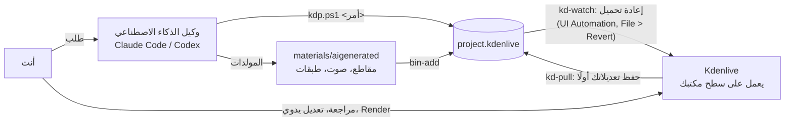

<div align="center">

# movie-engine

**وكيل ذكاء اصطناعي يحرّر الفيديو الخاص بك في Kdenlive وأنت تشاهد، ويمكنك تولّي التحرير بنفسك في أي لحظة.**

تبني وكلاء البرمجة بالذكاء الاصطناعي (Claude Code وCodex) مشاريع Kdenlive حقيقية وتعدّلها: أفلامًا ومقاطع شرح ومقاطع قصيرة عمودية. تظهر التعديلات مباشرةً في المحرر المفتوح أمامك. نسخة محمولة، على Windows، دون أي تعديل على المحرر.


[English](../../README.md) · [简体中文](README.zh-CN.md) · [हिन्दी](README.hi.md) · [Español](README.es.md) · [Français](README.fr.md) · **العربية** · [বাংলা](README.bn.md) · [Português](README.pt.md) · [Русский](README.ru.md) · [اردو](README.ur.md) · [Bahasa Indonesia](README.id.md) · [Deutsch](README.de.md) · [日本語](README.ja.md) · [Türkçe](README.tr.md) · [한국어](README.ko.md)

*هذه ترجمة؛ ملف README الإنجليزي هو النسخة المرجعية.*

</div>

---

<div dir="rtl">

## المحتويات

- [لماذا](#لماذا)
- [آلية العمل](#آلية-العمل)
- [الميزات](#الميزات)
- [المتطلبات](#المتطلبات)
- [التثبيت](#التثبيت)
- [البدء السريع](#البدء-السريع)
- [العمل مع الوكيل](#العمل-مع-الوكيل)
- [سطر أوامر التحرير (`kdp.ps1`)](#سطر-أوامر-التحرير-kdpps1)
- [المزامنة الحية مع المحرر المفتوح](#المزامنة-الحية-مع-المحرر-المفتوح)
- [المولدات: ما لا يستطيع Kdenlive فعله](#المولدات-ما-لا-يستطيع-kdenlive-فعله)
- [التعليق الصوتي والمؤثرات الصوتية](#التعليق-الصوتي-والمؤثرات-الصوتية)
- [لغة الواجهة](#لغة-الواجهة)
- [بنية المجلدات](#بنية-المجلدات)
- [الاختبارات والإثباتات](#الاختبارات-والإثباتات)
- [القيود](#القيود)
- [استكشاف الأخطاء وإصلاحها](#استكشاف-الأخطاء-وإصلاحها)
- [الأسئلة الشائعة](#الأسئلة-الشائعة)
- [المساهمة](#المساهمة)
- [شكر وتقدير](#شكر-وتقدير)
- [الترخيص](#الترخيص)

## لماذا

صُمّمت برامج تحرير الفيديو لأيدٍ تمسك الفأرة. أما وكلاء الذكاء الاصطناعي فيتقنون البنية والتوقيت والتكرار: وضع 300 مقطع على الإيقاع، وضبط توقيت كل تعليق نصي مع الصوت، وإعادة بناء مشهد بعد الملاحظات. لكنهم لا يستطيعون النقر عبر واجهة رسومية دون الاستيلاء على سطح المكتب الخاص بك.

يُعدّ Kdenlive محررًا مفتوح المصدر قويًا، لكنه على Windows **لا يملك واجهة برمجية للأتمتة**: التحكم عبر D-Bus متاح فقط في إصدارات Linux، والنسخ المشتقة (forks) التي تضيف مثل هذه الواجهة إما متوقفة عن التطوير أو غير آمنة. يحل movie-engine هذه المشكلة دون تعديل المحرر:

1. يعدّل الوكيل ملف المشروع `.kdenlive` عبر سطر أوامر مُختبَر (`engine/kdp.ps1`).
2. يُطلب من Kdenlive قيد التشغيل إعادة تحميل الملف عبر Windows UI Automation، دون ضغطات مفاتيح ولا فأرة ولا سرقة للتركيز.
3. تُحفَظ تعديلاتك غير المحفوظة أولًا ولا يُكتب فوقها أبدًا.

وهكذا يحرّر الوكيل وتراجع أنت، أو تحرّر بيدك. كلاكما يعمل على المشروع نفسه، في المحرر نفسه، وفي الوقت نفسه.

## آلية العمل



يتبع كل أمر تحرير الدورة الآمنة نفسها:

1. **السحب.** إذا كانت في Kdenlive تغييرات غير محفوظة، يُطلب منه حفظها (زر Save في شريط الأدوات عبر UI Automation)، ثم يُتحقَّق من الحفظ.
2. **التحرير.** يغيّر الأمر ملف XML تحت قفل، بعد فحص البصمة (hash) ومع لقطة للتراجع. إذا تغيّر الملف في الأثناء، لا يُكتب شيء.
3. **إعادة التحميل.** يرى المراقب ختم الذكاء الاصطناعي فينفّذ File > Revert في المحرر المفتوح. لا يُعدّ ذلك نجاحًا إلا عندما يُعاد بناء عنصر الخط الزمني فعلًا.
4. **التعارض.** إذا بدأت التحرير في الأثناء، لا يُعاد تحميل شيء ويبقى عملك كما هو. تُحفَظ نسخة الذكاء الاصطناعي جانبًا، ويعيد الوكيل تطبيق تغييره فوق تغييراتك.

## الميزات

- **تحرير كامل للمشروع دون واجهة رسومية**: نحو 120 أمرًا تغطي سلة المشروع (bin) والخط الزمني والتأثيرات والتراكيب (compositions) والمسارات والأدلة والعلامات والترجمات والتسلسلات والسرعة وإعادة تعيين الزمن والعروض التقديمية للصور والعناوين وملفات الوكيل (proxies) والتصيير والتراجع/الإعادة. راجع [مرجع الأوامر](#سطر-أوامر-التحرير-kdpps1).
- **مزامنة حية مع المحرر المفتوح.** تظهر تعديلات الذكاء الاصطناعي في Kdenlive الذي تنظر إليه؛ وتُحفَظ تعديلاتك غير المحفوظة أولًا ولا تضيع أبدًا.
- **لا يزعج سطح مكتبك أبدًا.** لا سرقة للتركيز ولا ضغطات مفاتيح ولا إدخال بالفأرة. تعمل محررات الاختبار على سطح مكتب Windows غير مرئي.
- **محمول.** المحرر والإعدادات وNode.js والخطوط والأدوات كلها في مجلد واحد. انسخه إلى حاسوب آخر وسيعمل؛ لا يُكتب شيء في Program Files ولا في ملف تعريف Windows الخاص بك.
- **مولدات لما لا يستطيع Kdenlive فعله**: نص حركي حرفًا بحرف، وتعليقات توضيحية مرسومة باليد، ومشاهد واجهات ثلاثية الأبعاد، وحركات مؤشر، وأفلام شرح تفاعلية طويلة. تُصيَّر على معالج الرسومات (GPU) مع ضبابية حركة حقيقية، وتوضع على الخط الزمني كمقاطع عادية.
- **تعليق صوتي مع توقيت لكل كلمة** (Microsoft Edge TTS، دون مفتاح API). تظهر التعليقات النصية وتنطلق الحركات عند الكلمة بالضبط.
- **مؤثرات صوتية مُركَّبة** (whoosh وclick وpop وriser وimpact وغيرها)، تُولَّد برمجيًا.
- **مُثبَت لا مُفترَض.** لكل أمر فحص للنتيجة، وتُختبر التأثيرات والتراكيب واحدًا تلو الآخر، والنتائج الخام موجودة في `docs/proof/`.
- **تعليمات الوكيل مرفقة.** يعلّم `AGENTS.md` والمهارات في `.claude/skills/` كلًّا من Claude Code وCodex سير العمل وصيغة الملف والمزالق.

## المتطلبات

| | |
|---|---|
| نظام التشغيل | Windows 10 أو 11، x64 |
| المحرر | إصدار Kdenlive **26.08.3** المحمول (standalone). الإصدارات الأخرى غير مُختبرة. |
| Node.js | الإصدار 18 أو أحدث، كملف `node.exe` عادي منسوخ إلى `engine/node/` |
| المتصفح | Microsoft Edge (جزء من Windows)؛ تستخدمه أدوات تصيير المشاهد دون واجهة (headless) |
| الوكيل | [Claude Code](https://claude.com/claude-code) أو Codex. اختياري: كل أداة تعمل يدويًا أيضًا. |
| القرص | نحو 1 GB للمحرر والأدوات، إضافةً إلى ملفات الوسائط الخاصة بك |
| معالج الرسومات | أي GPU يدعم الترميز العتادي لـ H.264 يسرّع `film-render.mjs` (ويعود إلى الترميز البرمجي عند غيابه) |

## التثبيت

يُثبَّت كل شيء **داخل المجلد**. لا شيء يحتاج إلى صلاحيات المسؤول.

```powershell
git clone <repository-url> movie-engine
cd movie-engine
```

**1. Node.js.** انسخ `node.exe` (الإصدار 18 أو أحدث) إلى `engine\node\`. لا حاجة إلى المثبّت: الملف التنفيذي وحده يكفي. تعمل جميع السكربتات عبر `engine\node.cmd`، وليس عبر Node المثبّت في النظام أبدًا.

**2. حزم Node** لأداة الصوت وأدوات التصيير (الإصدارات مثبّتة في `engine/voice/package.json`):

```powershell
npm install --prefix engine/voice
```

**3. Kdenlive 26.08.3 المحمول.** نزّل `kdenlive-26.08.3_standalone.exe` من <https://download.kde.org/stable/kdenlive/26.08/windows/> إلى `engine\installer\`، وتحقق منه ثم فكّ ضغطه:

```powershell
(Get-FileHash engine\installer\kdenlive-26.08.3_standalone.exe -Algorithm SHA256).Hash
# القيمة المتوقعة: A25427B1DFF2C17E3B0386E991BB1A719382BB3176D1A90E441CDAEB6E0A967D
engine\installer\kdenlive-26.08.3_standalone.exe -o"engine\Kdenlive" -y
```

ينتهي المحرر في `engine\Kdenlive\kdenlive-26.08.3_standalone\bin\`. وهو يتضمن مسبقًا `melt.exe` و`ffmpeg.exe`.

**4. التشغيل الأول.**

```powershell
engine\kdenlive.cmd
```

يحفظ Kdenlive جميع إعداداته في `engine\profile-kdenlive\`، وليس في ملف تعريف Windows الخاص بك. عند التشغيل الأول يعرض معالج إعداد لمرة واحدة.

## البدء السريع

### مع وكيل

افتح المجلد في Claude Code (أو Codex) واطلب بكلمات بسيطة:

> أنشئ مشروعًا عموديًا جديدًا بمعدل 30 إطارًا في الثانية باسم "launch-teaser". ضع لقطات الشاشة الثلاث من `materials/designers/launch/` على الخط الزمني، 2.5 ثانية لكل منها مع انتقال تلاشٍ متقاطع قصير، وأضف تعليقًا صوتيًا من `script.txt` واضبط توقيت تعليق نصي حركي لكل سطر.

> افتحه لي في Kdenlive.

> اللقطة الثانية طويلة جدًا. قصّرها إلى 1.8 ثانية وارفع الشعار قليلًا.

يتبع الوكيل `AGENTS.md`: يحرّر عبر `kdp.ps1`، ويصيّر فقط المقاطع التي يحتاجها المونتاج، ويُبقي المحرر المفتوح متزامنًا. تراجع أنت في Kdenlive، وتحرّر يدويًا متى شئت، وتضغط Render عندما تكون راضيًا.

### يدويًا

```powershell
# مشروع جديد بدقة 1080x1920 و30 إطارًا في الثانية مع مساري فيديو ومساري صوت
powershell -NoProfile -ExecutionPolicy Bypass -File engine\kdp.ps1 new -Project projects\hello\hello.kdenlive -Profile vertical_hd_30

# عنوان مدته 3 ثوانٍ وخلفية ملونة
powershell -NoProfile -ExecutionPolicy Bypass -File engine\kdp.ps1 bin-color -Project projects\hello\hello.kdenlive -Color '#203060' -Seconds 3 -Name bg
powershell -NoProfile -ExecutionPolicy Bypass -File engine\kdp.ps1 title -Project projects\hello\hello.kdenlive -Text "Hello" -Seconds 3 -Name hi

# وضعهما: الخلفية على V1، والعنوان فوقها على V2
powershell -NoProfile -ExecutionPolicy Bypass -File engine\kdp.ps1 add -Project projects\hello\hello.kdenlive -Bin bg -Track V1 -At 0
powershell -NoProfile -ExecutionPolicy Bypass -File engine\kdp.ps1 add -Project projects\hello\hello.kdenlive -Bin hi -Track V2 -At 0

# إطار للتحقق، ثم فتح المشروع في المحرر
powershell -NoProfile -ExecutionPolicy Bypass -File engine\kdp.ps1 frame -Project projects\hello\hello.kdenlive -At 1.5 -Out out\hello\check.png
engine\kdenlive.cmd projects\hello\hello.kdenlive
```

لإعادة فتح آخر مشروع لاحقًا، انقر نقرًا مزدوجًا على `open-last-project.cmd`.

## العمل مع الوكيل

يقرأ الوكيل `AGENTS.md` (في Codex) أو `CLAUDE.md` الذي يستورده (في Claude Code)، إضافةً إلى مهارتين:

| المهارة | ما تعلّمه |
|---|---|
| `.claude/skills/kdenlive-project-file` | صيغة `.kdenlive` / MLT XML، و`kdp.ps1`، والتحقق باستخدام `melt` |
| `.claude/skills/kdenlive-live` | التحكم الآمن في المحرر قيد التشغيل: التشغيل، والسحب، وإعادة التحميل، والتقاط نافذته |

قواعد يلتزم بها الوكيل ويمكنك الاعتماد عليها:

- لا يستولي أبدًا على الفأرة أو لوحة المفاتيح أو التركيز، ولا يلتقط صورًا لسطح مكتبك أبدًا (فقط لنافذة المحرر نفسها).
- ينفّذ خطوات الواجهة الرسومية بنفسه (الحفظ، والفتح، وإعادة التحميل) بدلًا من أن يطلب منك النقر.
- يستأذنك قبل تنزيل أي شيء وقبل حذف أي شيء.
- يصيّر فقط ما يحتاجه العمل (مقاطع المشاهد، وإطارات التحقق). ولا يصيّر الفيلم النهائي إلا عندما تطلب ذلك.
- عندما لا يستطيع Kdenlive فعل شيء ما بشكل جيد، يبنيه الوكيل خارجه بالكود ويضع النتيجة كمقطع. ولا يُضعف التأثير.

## سطر أوامر التحرير (`kdp.ps1`)

```powershell
powershell -NoProfile -ExecutionPolicy Bypass -File engine\kdp.ps1 <command> -Project <file.kdenlive> [options]
```

الأزمنة بالثواني، مع نقطة عشرية (`2.5`). المسارات هي `V1 V2 …` (‏V1 هو الأدنى) و`A1 A2 …`. يُحدَّد المقطع بواسطة `-Track` إضافةً إلى أي زمن `-At` يقع داخله. تُمرَّر معاملات التأثيرات في `-Params "name=value||name=value"`. القائمة الكاملة بكل الخيارات موجودة في ترويسة `engine/kdp.ps1`.

| المجموعة | الأوامر |
|---|---|
| المشروع | `new`، `profiles`، `info`، `validate`، `fonts`، `profile-set`، `profile-from-clip`، `zone`، `archive`، `backups`، `rebase`، `otio-export`، `otio-import` |
| سلة المشروع (Bin) | `bin-add`، `bin-color`، `title`، `title-text`، `title-save`، `title-template`، `bin-rename`، `bin-remove`، `bin-info`، `bin-set`، `bin-duplicate`، `bin-replace-file`، `bin-reload`، `folder`، `bin-folder`، `relink`، `clean`، `generator`، `playlist-clip`، `extract-audio`، `transcode` |
| الخط الزمني | `add`، `add-av`، `move`، `copy`، `trim`، `ripple-trim`، `slip`، `split`، `remove`، `speed`، `remap`، `disable`، `enable`، `group`، `ungroup`، `mix`، `unmix`، `space-insert`، `space-remove`، `spaces-remove-all`، `track-clear`، `replace-in-timeline` |
| التأثيرات | `effects`، `effect-info`، `effect-add`، `effect-list`، `effect-set`، `effect-remove`، `effect-copy`، `effect-clear`، `effects-all`، `bin-effect`، `effect-templates`، `effect-template` |
| التراكيب | `compositions`، `comp-info`، `comp-add`، `comp-list`، `comp-set`، `comp-remove` |
| المسارات | `track-add`، `track-remove`، `track-set` |
| الأدلة والعلامات | `guide-add`، `guide-list`، `guide-remove`، `guide-set`، `guide-clear`، `guide-export`، `guide-category`، `marker`، `marker-list`، `marker-set`، `marker-remove` |
| الترجمات | `sub-add`، `sub-import`، `sub-export`، `sub-state` |
| التسلسلات | `sequence-add`، `sequences`، `copy-to-sequence`، `expand`؛ أي أمر مع `-Sequence <name>` يعمل داخل ذلك التسلسل |
| أوامر خاصة | `slideshow`، وحركات Lottie / Glaxnimate عبر `bin-add`، و`proxy`، و`stabilize`، و`scene-split`، و`speed-job`، و`subclip` |
| المخرجات | `frame` (صورة PNG واحدة)، و`preview` (تصيير سريع عبر melt)، و`render` (أداة التصيير الخاصة بـ Kdenlive أو إعداد مسبق)، و`presets` |
| السجل | `undo`، `redo`، `clear-history` (اللقطات في `projects/<name>/.kdp-history`) |

سلوك يجدر معرفته:

- نصفا الصوت والفيديو المرتبطان يتحركان ويُقصّان ويُقسمان ويُحذفان معًا (`-Alone` لنصف واحد فقط).
- الأمر الذي يفشل يخرج برمز 1 ولا يكتب شيئًا.
- التأثيرات التي لا يستطيع إصدار Windows تشغيلها تُرفض، ولا تُتجاهل بصمت (القائمة: `docs/proof/assets.txt`).
- كل إجراء في قوائم Kdenlive مربوط بأمر، أو بطريق بديل، أو بوصف "للعرض فقط" في `engine/tools/data/kdenlive-actions.csv`. راجع `docs/kdenlive-coverage.md`.

## المزامنة الحية مع المحرر المفتوح

| السكربت | ما يفعله | رموز الخروج |
|---|---|---|
| `engine\kd-pull.ps1 -Project <f>` | يجعل Kdenlive يحفظ تعديلاتك ويتحقق من ذلك | 0 الملف محدَّث، 3 المحرر لا يعمل، 4 لم يُتحقَّق |
| `engine\kd-reload.ps1 -Project <f>` | File > Revert، مع التحقق عبر إعادة بناء الخط الزمني | 0 تم التحقق، 2 لديك تعديلات غير محفوظة (لم يُتجاهل شيء)، 3 المحرر لا يعمل، 4 فشل |
| `engine\kd-watch.ps1 -Project <f>` | مراقب في الخلفية: يعيد التحميل بعد كل كتابة من الذكاء الاصطناعي، ويسجّل التعارضات | السجل في `engine\kd-watch.log`؛ احذف `engine\kd-watch.run` لإيقافه |
| `engine\kdenlive-bg.ps1 [project]` | يشغّل Kdenlive مصغّرًا لصالح وكيل | 0 تم التحميل، 4 لم يُتحقَّق |
| `engine\kdenlive.cmd [project]` | يشغّل Kdenlive لك | |

شغّل المراقب مرة واحدة في كل جلسة:

```powershell
Start-Process powershell -WindowStyle Hidden -ArgumentList '-NoProfile','-ExecutionPolicy','Bypass','-File','engine\kd-watch.ps1','-Project','projects\hello\hello.kdenlive'
```

المشاريع الكبيرة: إعادة تحميل مشروع من 1000 مقطع تستغرق دقائق، والأدوات تنتظر اكتمالها بدلًا من الإبلاغ مبكرًا. تُفتح المشاريع عبر *File > Open Recent* في محرر فارغ، لأن فتح الملف مباشرةً يجعل Qt يمرّ على كل عنصر في الخط الزمني لأغراض إمكانية الوصول، وكان ذلك أبطأ بنحو 10 دقائق.

## المولدات: ما لا يستطيع Kdenlive فعله

لا يدعم Kdenlive/MLT تحريك النص حرفًا بحرف، ولا التعابير (expressions)، ويدعم القليل من الأبعاد الثلاثية، والتأثيرات الثقيلة تُبطئ التشغيل. يصيّر movie-engine هذه الأجزاء خارجه ويضعها على الخط الزمني كمقاطع عادية، غالبًا مع قناة شفافية (alpha)، على مسار فوق الصور. يبقى سكربت المولد ومدخلاته في مجلد المشروع، بحيث يمكن إعادة توليد المقطع عند تغيّر النص أو الخط أو التوقيت.

| الأداة | ما تنتجه |
|---|---|
| `engine/tools/kinetic-text.ps1` | تعليقات نصية حركية حرفًا بحرف، توقيت كل كلمة مأخوذ من `voice.json`، ومربع تمييز |
| `engine/tools/annotate.ps1` | دوائر ومربعات وخطوط سفلية وأسهم مرسومة باليد تُرسم تدريجيًا فوق لقطة شاشة |
| `engine/tools/card-entrance.ps1` | بطاقة لقطة شاشة ترتفع وتكبر عند الدخول مع ظل ناعم |
| `engine/tools/pdf-to-png.ps1` | شرائح من ملف PDF مُصدَّر |
| `engine/tools/html-render.mjs` | أي مشهد HTML/CSS/canvas إلى فيديو: تحريك الواجهات، والمؤشرات، والأبعاد الثلاثية، والأقنعة |
| `engine/tools/film-render.mjs` + `film/` | أفلام شرح تفاعلية طويلة على canvas: مقطع واحد لكل سطر صوتي، والحركات تنطلق عند الكلمات المنطوقة، وضبابية حركة على GPU بنحو 45 إطارًا في الثانية |

تتحكم أداتا التصيير كلتاهما في Microsoft Edge المرفق مع Windows، دون واجهة، بملف تعريف مؤقت يُتخلّص منه ودون وصول إلى الشبكة.

### عروض توضيحية

```powershell
# بطاقة عنوان ثلاثية الأبعاد مدتها 3 ثوانٍ مع نقرة مؤشر
engine\node.cmd engine\tools\html-render.mjs examples\demo\scene\scene.html examples\demo\out --frames 0,30,60,89
engine\node.cmd engine\tools\html-render.mjs examples\demo\scene\scene.html examples\demo\out\scene.mp4

# فيلم تفاعلي من 4 لقطات بتوقيت مضبوط على سطرين صوتيين
engine\node.cmd engine\tools\film-render.mjs examples\demo\film\film.html examples\demo\out --check
engine\node.cmd engine\tools\film-render.mjs examples\demo\film\film.html examples\demo\out --shots all --width 640
engine\node.cmd engine\tools\film-render.mjs examples\demo\film\film.html examples\demo\out\clips --suffix -v01
```

يتكوّن الفيلم من ثلاثة ملفات صغيرة. يحتوي `data.js` على اللقطات وأزمنة الكلمات. ويحتوي `direction.js` على سطر واحد لكل لقطة:

```text
1 | hover 192 108 @brand | tag 300 60 Your brand @deserves | confetti 192 90 @film
2 say=A film that/*explains* it
3 | click 116 108 @before | click 268 108 @after | chips Before~After @after
4 scene=counter | count 0 120 % @count
```

يحتوي `scenes.js` على اللقطات التي تُرسم من الصفر. يُطلق `@word` حركةً عندما ينطق الصوت تلك الكلمة. تشمل الحركات click وhover وdrag وzoom وlens وring وarrow وchips وtoggle وslider وtoast وtype وcount وconfetti؛ والصيغة الكاملة موجودة في أعلى `engine/tools/film/film-kit.js`.

## التعليق الصوتي والمؤثرات الصوتية

```powershell
engine\node.cmd engine\voice\voice.mjs lines.json materials\aigenerated\hello\voice en-US-AndrewMultilingualNeural +0%
```

الملف `lines.json` قائمة من الأسطر. تكتب الأداة ملف mp3 واحدًا لكل سطر إضافةً إلى `voice.json`، مع المدة وبداية كل كلمة ونهايتها. تُخزَّن الأسطر مؤقتًا، لذا فإن تغيير سطر واحد يعيد توليد ذلك السطر فقط. تستخدم الأداة خدمة تحويل النص إلى كلام عبر الإنترنت من Microsoft Edge من خلال الحزمة `msedge-tts`: لا حاجة إلى مفتاح، لكن الخدمة غير رسمية وتحتاج إلى اتصال بالإنترنت.

```powershell
engine\node.cmd engine\audio\sfx.mjs materials\aigenerated\sfx
```

يُركّب هذا برمجيًا المؤثرات whoosh وwhoosh-long وswipe وclick وpop وtick وriser وimpact وding وreveal؛ وتوجد مجموعة جاهزة في `materials/aigenerated/sfx/`. أضف صمتًا إلى الأصوات الأقصر من إطار واحد قبل وضعها (`-af apad=whole_dur=0.0667`).

## لغة الواجهة

تشغّل أدوات الإطلاق Kdenlive باللغة **الإنجليزية** افتراضيًا. لاستخدام لغة أخرى، اضبط `MOVIE_ENGINE_UI_LANG` قبل التشغيل:

```powershell
$env:MOVIE_ENGINE_UI_LANG = 'ru'; engine\kdenlive.cmd
```

تعثر UI Automation على عناصر القوائم بأسمائها الظاهرة. الأسماء الإنجليزية والروسية مدمجة (`engine/tools/kd-ui.ps1`، `$KdNames`). لأي لغة أخرى، أضف أسماءها هناك وتحقق باستخدام:

```powershell
powershell -NoProfile -ExecutionPolicy Bypass -File engine\tools\kd-langcheck.ps1
```

## بنية المجلدات

```text
movie-engine/
├─ AGENTS.md, CLAUDE.md          instructions for AI agents
├─ .claude/skills/               agent skills: project file format, live editor
├─ engine/
│  ├─ kdp.ps1                    the editing command line
│  ├─ kd-pull / kd-reload / kd-watch .ps1, kdenlive.cmd, kdenlive-bg.ps1
│  ├─ tools/                     internals, generators, tests, data (action map)
│  ├─ voice/  audio/  fonts/     TTS, synthesized SFX, Poppins (OFL)
│  ├─ Kdenlive/  node/           portable editor and Node.js (not in git)
│  └─ profile-kdenlive/          the editor's settings (not in git)
├─ projects/<name>/<name>.kdenlive
├─ materials/
│  ├─ download/                  stock and downloaded files (not in git)
│  ├─ aigenerated/               everything the AI made (sfx/ and test-kit/ ship with the engine)
│  ├─ designers/  brand/         files from your team, brand assets
├─ examples/demo/                demos of the scene and film renderers
├─ out/                          renders (not in git)
└─ docs/                         proofs, coverage, translations of this README
```

مسارات الوسائط داخل المشاريع نسبية. إذا نقلت المجلد أو نسخته، فإن `kdp.ps1 rebase` (الذي يشغّله `kdenlive.cmd` تلقائيًا أيضًا) يكتب الموقع الجديد في المشروع.

## الاختبارات والإثباتات

الادعاءات حول ما يعمل مدعومة بفحوصات للنتائج، لا بعبارة "الدالة نُفّذت". الملخص موجود في [`docs/kdenlive-proof.md`](../../docs/kdenlive-proof.md)، والمخرجات الخام في `docs/proof/`.

| الاختبار | ما يتحقق منه |
|---|---|
| `engine\tools\kdp-clitest.ps1` | كل أمر من أوامر `kdp.ps1`، عبر سطر الأوامر، مع مقارنة المشروع الناتج |
| `engine\tools\kd-livetest.ps1` | السحب، وإعادة التحميل، والمراقب، والتعارضات، وحالات التسابق (race conditions) مقابل Kdenlive حقيقي على سطح مكتب غير مرئي |
| `engine\tools\kdp-assetsweep.ps1` | كل تأثير وكل تركيب: يصيّر الإطارات ويقارنها |
| `engine\tools\kdp-portabletest.ps1` | ينسخ المجلد إلى مكان آخر ويعمل من النسخة |
| `engine\tools\kd-langcheck.ps1` | لغة الواجهة، وأن UI Automation تعثر على القائمة |
| `engine\tools\kdp-coverage-check.ps1` | أن كل إجراء في القوائم مربوط، وأنه لا يوجد إثبات أقدم من الكود |

```powershell
powershell -NoProfile -ExecutionPolicy Bypass -File engine\tools\kdp-clitest.ps1 -Report docs\proof\clitest.txt
powershell -NoProfile -ExecutionPolicy Bypass -File engine\tools\kd-livetest.ps1 -Report docs\proof\live-en.txt
```

تعمل محررات الاختبار فقط على سطح مكتب مخفي بملف تعريف خاص بها، لذا لا تلمس الاختبارات أبدًا Kdenlive المفتوح لديك ولا التركيز.

## القيود

- **Windows فقط**، وKdenlive **26.08.3** فقط. يملك Linux واجهة D-Bus وسيحتاج إلى جسر مختلف.
- يستحوذ تشغيل المحرر على تركيز لوحة المفاتيح لنحو 3 ثوانٍ أثناء ظهور النافذة الفارغة. يستأذنك الوكلاء قبل تشغيله أثناء عملك. أما إعادة التحميل والتعديلات فلا تأخذ التركيز.
- يفتقر إصدار Windows إلى وحدات MLT ‏sox وladspa وmovit وإلى بعض تأثيرات frei0r/avfilter؛ ويرفضها `kdp.ps1` (`docs/proof/assets.txt`).
- التصدير والاستيراد عبر OpenTimelineIO ينقلان المقاطع والفجوات فقط. لا يدعم التحرير متعدد الكاميرات (Multicam) التبديل الحي بين الزوايا (تُنفَّذ القطعات عبر split/remove/hide).
- "Save As…" عبر UI Automation على نافذة مصغّرة لا يفتح أي مربع حوار؛ لذا يستخدم الوكيل `archive` أو نسخ الملفات بدلًا من ذلك.
- يحتاج التعرف على الكلام (الترجمة التلقائية) إلى Whisper أو Vosk، وهما غير مرفقين.
- العناوين المصنوعة بأداة العناوين في Kdenlive تستخدم الخطوط المثبتة في Windows. لضمان الطباعة المطلوبة، صيّر النص بالمولدات التي تحمّل الخطوط من `engine/fonts/`.
- Edge TTS خدمة غير رسمية عبر الإنترنت وقد تتغير أو تتوقف عن العمل.

## استكشاف الأخطاء وإصلاحها

| العَرَض | السبب والحل |
|---|---|
| Kdenlive يعمل، لكن النقر عليه في شريط المهام لا يُظهر شيئًا | موضع نافذته المحفوظ خارج الشاشة. أغلقه واحذف إدخالات `kdockLayout` في `engine\profile-kdenlive\AppData\Local\kdenliverc`، أو حرّك النافذة باستخدام `SetWindowPos` (راجع `AGENTS.md`). |
| `kd-reload.ps1` يخرج بالرمز 2 | لديك تعديلات غير محفوظة. لم يُتجاهل شيء. شغّل `kd-pull.ps1`، ثم طبّق التغيير مرة أخرى (يفعل `kdp.ps1` ذلك بنفسه). |
| `CONFLICT` في `engine\kd-watch.log` | حرّرت أنت والوكيل في اللحظة نفسها. تبقى نسختك في المحرر، ونسخة الذكاء الاصطناعي موجودة في `projects\<name>\.kdp-history\<name>\conflict\`. اطلب من الوكيل إعادة تطبيق تغييره. |
| أمر يخرج بالرمز 1 مع "pull not confirmed" | Kdenlive مشغول أو يعرض مربع حوار. أغلق مربع الحوار أو انتظر انتهاء التحميل، ثم كرّر. |
| فشل تحليل سكربت PowerShell | يجب حفظ السكربتات التي تحتوي على نص غير ASCII بترميز UTF-8 **مع BOM** من أجل Windows PowerShell 5.1. |
| يتوقف `voice.mjs` مع "Stream closed before the synthesis completed" | عادةً مشكلة في الشبكة، أو SSML غير مُهرَّب في النسخ القديمة. يهرّب `voice.mjs` الرموز `& < >` بنفسه. |
| فتح مشروع كبير يستغرق دقائق كثيرة | افتحه عبر `kdenlive.cmd` / `kdenlive-bg.ps1`، ولا تفتحه أبدًا بالشكل `kdenlive.exe project.kdenlive`. |

## الأسئلة الشائعة

**هل أحتاج إلى Claude Code أو Codex؟**
لا. كل أداة سكربت عادي يمكنك تشغيله يدويًا. الوكيل هو ما يجعل العمل سريعًا: يخطط للمونتاج، ويشغّل الأدوات، ويُبقي المحرر متزامنًا.

**هل سيكتب الوكيل فوق تعديلاتي اليدوية؟**
لا. قبل أي كتابة، تُحفَظ تعديلاتك غير المحفوظة ويُتحقَّق من ذلك. إذا حرّرت بينما يكتب الوكيل، تُرفض الكتابة أو تُحفَظ جانبًا كتعارض، ولا تُطبَّق أبدًا فوق عملك.

**هل يمكنني الاستمرار في استخدام Kdenlive بشكل طبيعي؟**
نعم. إنه Kdenlive الأصلي مع مجلد إعدادات خاص به. حرّر وعاين وصيّر كالمعتاد.

**هل يعمل مع Kdenlive المثبت لديّ مسبقًا؟**
يستخدم نسخته المحمولة الخاصة في `engine\Kdenlive\`، لذا يبقى Kdenlive المثبت لديك وإعداداته دون مساس.

**لماذا لا تُستخدم نسخة مشتقة من Kdenlive تملك واجهة برمجية، أو محرر آخر؟**
على Windows، لا توجد نسخة مشتقة مُصانة وآمنة (بحسب مسح أُجري في 2026-11). جرى تقييم OpenShot وBlender VSE وDaVinci Resolve وShotcut ومحررات الويب؛ وقدّم Kdenlive أفضل عمق في التحرير. ونحن نتابع مقترحًا في المشروع الأصلي لواجهة REST API (طلب الدمج !902).

**هل يمكنه تصيير الفيديو النهائي؟**
نعم، باستخدام `kdp.ps1 render` (أداة التصيير الخاصة بـ Kdenlive، بشكل مخفي)، أو تضغط Render في المحرر بنفسك.

**هل تُرفع ملفات الوسائط الخاصة بي إلى أي مكان؟**
لا. يُرسَل فقط نص التعليق الصوتي إلى خدمة Edge TTS عند توليد الصوت. وتعمل أدوات تصيير المشاهد مع تعطيل الشبكة.

## المساهمة

المساهمات مرحّب بها. راجع [CONTRIBUTING.md](../../CONTRIBUTING.md). باختصار:

- كل عملية جديدة أو معدّلة في `kdp.ps1` تحتاج إلى فحص للنتيجة في `kdp-clitest.ps1`، وإدخال في خريطة الإجراءات، وتشغيل جديد لـ `kdp-coverage-check.ps1`.
- لا تشغّل أبدًا Kdenlive للاختبار على سطح المكتب المرئي؛ استخدم `engine/tools/kd-hidden.ps1`.
- حافظ على قابلية النقل في كل شيء: لا تثبيت خارج المجلد، ولا مسارات مطلقة في المشاريع.
- دوّن السلوكيات الغريبة التي تحققت منها في `AGENTS.md` أو في المهارة المناسبة.

## شكر وتقدير

- [Kdenlive](https://kdenlive.org) و[MLT](https://www.mltframework.org): المحرر والمحرك الذي يعمل تحته.
- [FFmpeg](https://ffmpeg.org)، المرفق مع Kdenlive.
- [msedge-tts](https://www.npmjs.com/package/msedge-tts) للتعليق الصوتي.
- [Poppins](https://fonts.google.com/specimen/Poppins) من Indian Type Foundry، بترخيص SIL Open Font License (`engine/fonts/OFL.txt`).

## الترخيص

يُنشر الكود الخاص بـ movie-engine بموجب [ترخيص MIT](../../LICENSE). يحتفظ Kdenlive وMLT وFFmpeg وحزم Node.js وخط Poppins بتراخيصها الخاصة.

</div>
