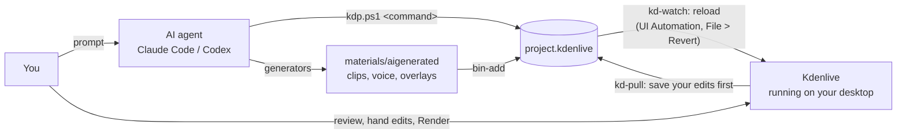

<div align="center">

# Movie Engine

**Süni intellekt agenti videonuzu siz baxa-baxa Kdenlive-da montaj edir, siz isə istənilən an işi öz əlinizə ala bilərsiniz.**

Proqramlaşdırma üçün süni intellekt agentləri (Claude Code, Codex) əsl Kdenlive layihələri yaradır və dəyişir: filmlər, izahedici videolar və şaquli qısa videolar. Dəyişikliklər açıq olan redaktorunuzda dərhal görünür. Portativ, Windows, redaktora heç bir yamaq vurulmadan.


[English](../../README.md) · [简体中文](README.zh-CN.md) · [繁體中文](README.zh-TW.md) · [हिन्दी](README.hi.md) · [Español](README.es.md) · [Français](README.fr.md) · [العربية](README.ar.md) · [বাংলা](README.bn.md) · [Português](README.pt.md) · [Русский](README.ru.md) · [اردو](README.ur.md) · [Bahasa Indonesia](README.id.md) · [Deutsch](README.de.md) · [日本語](README.ja.md) · [Türkçe](README.tr.md) · [한국어](README.ko.md) · [Українська](README.uk.md) · [Italiano](README.it.md) · [Polski](README.pl.md) · [Tiếng Việt](README.vi.md) · [فارسی](README.fa.md) · [ไทย](README.th.md) · [Kiswahili](README.sw.md) · [አማርኛ](README.am.md) · [Avañe'ẽ](README.gn.md) · [Setswana](README.tn.md) · [Shqip](README.sq.md) · [Беларуская](README.be.md) · [Български](README.bg.md) · [Bosanski](README.bs.md) · [Hrvatski](README.hr.md) · [Српски](README.sr.md) · [Crnogorski](README.cnr.md) · [Македонски](README.mk.md) · [Slovenščina](README.sl.md) · [Slovenčina](README.sk.md) · [Čeština](README.cs.md) · [Magyar](README.hu.md) · [Română](README.ro.md) · [Dansk](README.da.md) · [Norsk bokmål](README.nb.md) · [Norsk nynorsk](README.nn.md) · [Svenska](README.sv.md) · [Íslenska](README.is.md) · [Suomi](README.fi.md) · [Eesti](README.et.md) · [Latviešu](README.lv.md) · [Lietuvių](README.lt.md) · [Nederlands](README.nl.md) · [Lëtzebuergesch](README.lb.md) · [Rumantsch](README.rm.md) · [Ελληνικά](README.el.md) · [Malti](README.mt.md) · [Gaeilge](README.ga.md) · [Català](README.ca.md) · [ქართული](README.ka.md) · [Հայերեն](README.hy.md) · **Azərbaycanca** · [Afrikaans](README.af.md) · [isiZulu](README.zu.md) · [isiXhosa](README.xh.md) · [Sesotho](README.st.md) · [Sepedi](README.nso.md) · [Xitsonga](README.ts.md) · [Tshivenḓa](README.ve.md) · [siSwati](README.ss.md) · [isiNdebele (South Africa)](README.nr.md) · [isiNdebele (Zimbabwe)](README.nd.md) · [chiShona](README.sn.md) · [Chichewa](README.ny.md) · [Ikinyarwanda](README.rw.md) · [Ikirundi](README.rn.md) · [Malagasy](README.mg.md) · [Soomaali](README.so.md) · [Afaan Oromoo](README.om.md) · [Qafar af](README.aa.md) · [ትግርኛ](README.ti.md) · [Sängö](README.sg.md) · [Kreol Seselwa](README.crs.md) · [TjiKalanga](README.kck.md) · [ChiNdau](README.ndc.md)

*Bu, tərcümədir. Əsas versiya ingilis dilindəki README hesab olunur.*

</div>

---

## Mündəricat

- [Nə üçün](#nə-üçün)
- [Necə işləyir](#necə-işləyir)
- [Xüsusiyyətlər](#xüsusiyyətlər)
- [Tələblər](#tələblər)
- [Quraşdırma](#quraşdırma)
- [Sürətli başlanğıc](#sürətli-başlanğıc)
- [Agentlə iş](#agentlə-iş)
- [Montaj üçün komanda sətri (`kdp.ps1`)](#montaj-üçün-komanda-sətri-kdpps1)
- [Açıq redaktorla canlı sinxronizasiya](#açıq-redaktorla-canlı-sinxronizasiya)
- [Generatorlar: Kdenlive nəyi bacarmır](#generatorlar-kdenlive-nəyi-bacarmır)
- [Səsləndirmə və səs](#səsləndirmə-və-səs)
- [Redaktorun interfeys dili](#redaktorun-interfeys-dili)
- [Qovluq strukturu](#qovluq-strukturu)
- [Testlər və sübutlar](#testlər-və-sübutlar)
- [Məhdudiyyətlər](#məhdudiyyətlər)
- [Problemlərin həlli](#problemlərin-həlli)
- [Tez-tez verilən suallar](#tez-tez-verilən-suallar)
- [Töhfə vermək](#töhfə-vermək)
- [Təşəkkürlər](#təşəkkürlər)
- [Lisenziya](#lisenziya)

## Nə üçün

Video redaktorları siçan üzərindəki əl üçün yaradılıb. Süni intellekt agentləri isə struktur, zamanlama və təkrarlanan işlərdə güclüdür: 300 klipi ritmə uyğun düzmək, hər altyazını səsə bağlamaq, rəydən sonra səhnəni yenidən qurmaq. Lakin onlar iş masanızı ələ keçirmədən qrafik interfeysdə klikləyə bilmirlər.

Kdenlive güclü açıq mənbəli redaktordur, amma Windows-da onun **avtomatlaşdırma API-si yoxdur**: D-Bus ilə idarəetmə yalnız Linux yığımlarında mövcuddur, onu əlavə edən fork-lar isə ya baxımsız qalıb, ya da təhlükəlidir. Movie Engine bu problemi redaktora yamaq vurmadan həll edir:

1. Agent `.kdenlive` layihə faylını sınaqdan keçmiş komanda sətri (`engine/kdp.ps1`) vasitəsilə redaktə edir.
2. İşləyən Kdenlive-a Windows UI Automation vasitəsilə faylı yenidən yükləmək əmri verilir: düymə basılmadan, siçansız və fokusu oğurlamadan.
3. Sizin saxlanmamış dəyişiklikləriniz əvvəlcə saxlanılır və heç vaxt üzərinə yazılmır.

Beləliklə, agent montaj edir, siz isə baxırsınız və ya özünüz əl ilə düzəliş edirsiniz. İkiniz də eyni layihə üzərində, eyni redaktorda, eyni vaxtda işləyirsiniz.

## Necə işləyir



Hər montaj komandası eyni təhlükəsiz dövrədən keçir:

1. **Pull.** Kdenlive-da saxlanmamış dəyişikliklər varsa, ona onları saxlamaq əmri verilir (UI Automation vasitəsilə alətlər panelindəki Save düyməsi) və saxlanma təsdiqlənir.
2. **Redaktə.** Komanda XML-i kilid altında, hash yoxlamasından sonra və geri qaytarma üçün snapshot ilə dəyişir. Əgər fayl bu arada dəyişibsə, heç nə yazılmır.
3. **Yenidən yükləmə.** İzləyici süni intellektin möhürünü görür və açıq redaktorda File > Revert icra edir. Yalnız zaman xətti vidceti həqiqətən yenidən qurulduqda uğur sayılır.
4. **Münaqişə.** Əgər siz bu arada redaktəyə başlamısınızsa, heç nə yenidən yüklənmir və işiniz qalır. Süni intellektin versiyası ayrıca saxlanılır, agent isə öz dəyişikliyini sizinkinin üzərinə yenidən tətbiq edir.

## Xüsusiyyətlər

- **Qrafik interfeys olmadan layihənin tam redaktəsi**: təxminən 120 komanda; bin, zaman xətti, effektlər, kompozisiyalar, treklər, bələdçi xətlər, markerlər, altyazılar, sekvensiyalar, sürət və zamanın yenidən xəritələnməsi, slayd-şoular, titrlər, proksilər, render və geri qaytarma/təkrarlama əhatə olunur. Bax: [komanda arayışı](#montaj-üçün-komanda-sətri-kdpps1).
- **Açıq redaktorla canlı sinxronizasiya.** Süni intellektin dəyişiklikləri baxdığınız Kdenlive-da görünür; saxlanmamış dəyişiklikləriniz əvvəlcə saxlanılır və heç vaxt itmir.
- **İş masanıza heç vaxt mane olmur.** Fokus oğurlanmır, düymə basılmır, siçan hərəkət etdirilmir. Test redaktorları görünməyən Windows iş masasında işləyir.
- **Portativ.** Redaktor, parametrlər, Node.js, şriftlər və alətlər bir qovluqda yerləşir. Onu başqa kompüterə köçürün və işləyəcək; Program Files-a və ya Windows profilinizə heç nə yazılmır.
- **Kdenlive-ın bacarmadığı işlər üçün generatorlar**: hərf-hərf kinetik mətn, əllə çəkilmiş annotasiyalar, 3D interfeys səhnələri, kursor animasiyaları və uzun interaktiv izahedici filmlər. Onlar GPU-da əsl hərəkət bulanıqlığı ilə render olunur və zaman xəttinə adi kliplər kimi yerləşdirilir.
- **Söz zamanlaması ilə səsləndirmə** (Microsoft Edge TTS, API açarı tələb olunmur). Altyazılar və hərəkətlər məhz lazımi sözdə işə düşür.
- **Sintez edilmiş səs effektləri** (whoosh, click, pop, riser, impact və s.), kodla yaradılır.
- **Fərz olunmur, sübut olunur.** Hər komandanın nəticə yoxlaması var, effektlər və kompozisiyalar bir-bir yoxlanılır, xam nəticələr isə `docs/proof/` qovluğundadır.
- **Agentlər üçün təlimatlar daxildir.** `AGENTS.md` və `.claude/skills/` içindəki bacarıqlar Claude Code və Codex-ə iş qaydasını, fayl formatını və tələləri öyrədir.

## Tələblər

| | |
|---|---|
| ƏS | Windows 10 və ya 11, x64 |
| Redaktor | Kdenlive **26.08.3**, portativ (standalone) yığım. Digər versiyalar yoxlanılmayıb. |
| Node.js | 18 və ya daha yeni: nodejs.org saytından Windows x64 üçün `.zip`, `engine/node/` qovluğuna açılmış |
| Brauzer | Microsoft Edge (Windows-un tərkibindədir); səhnə renderləyiciləri onu headless rejimdə istifadə edir |
| Agent | [Claude Code](https://claude.com/claude-code) və ya Codex. Məcburi deyil: hər alət əl ilə də işə salına bilər. |
| Disk | redaktor və alətlər üçün təxminən 1 GB, üstəgəl media fayllarınız |
| GPU | aparat H.264 kodlaşdırması olan istənilən GPU `film-render.mjs`-i sürətləndirir (olmadıqda proqram kodlaşdırmasına keçir) |

## Quraşdırma

Hər şey **qovluğun daxilinə** quraşdırılır. Administrator hüquqları tələb olunmur.

```powershell
git clone https://github.com/vladtarrow/movie-engine.git
cd movie-engine
```

**1. Node.js.** Node.js 18 və ya daha yeni versiyanın Windows x64 üçün `.zip` faylını <https://nodejs.org/en/download> ünvanından endirin və məzmununu `engine\node\` qovluğuna açın ki, orada `engine\node\node.exe` və `engine\node\npm.cmd` olsun. Nə quraşdırıcı, nə də sistem Node-u lazım deyil. Bütün skriptlər `engine\node.cmd` vasitəsilə işləyir, heç vaxt sistem Node-u ilə yox.

**2. Node paketləri** səsləndirmə aləti və renderləyicilər üçün (versiyalar `engine/voice/package.json` faylında sabitlənib):

```powershell
engine\node\npm.cmd install --prefix engine\voice
```

**3. Portativ Kdenlive 26.08.3.** `kdenlive-26.08.3_standalone.exe` faylını <https://download.kde.org/stable/kdenlive/26.08/windows/> ünvanından `engine\installer\` qovluğuna endirin, yoxlayın və açın:

```powershell
(Get-FileHash engine\installer\kdenlive-26.08.3_standalone.exe -Algorithm SHA256).Hash
# expected: A25427B1DFF2C17E3B0386E991BB1A719382BB3176D1A90E441CDAEB6E0A967D
engine\installer\kdenlive-26.08.3_standalone.exe -o"engine\Kdenlive" -y
```

Redaktor `engine\Kdenlive\kdenlive-26.08.3_standalone\bin\` qovluğunda yerləşəcək. Onun tərkibində artıq `melt.exe` və `ffmpeg.exe` var.

**4. İlk işə salma.**

```powershell
engine\kdenlive.cmd
```

Kdenlive bütün parametrlərini Windows profilinizdə deyil, `engine\profile-kdenlive\` qovluğunda saxlayır. İlk işə salmada o, bir dəfəlik quraşdırma sehrbazını göstərir.

## Sürətli başlanğıc

### Agentlə

Qovluğu Claude Code-da (və ya Codex-də) açın və sadə sözlərlə xahiş edin:

> 30 fps-li yeni şaquli "launch-teaser" layihəsi yarat. `materials/designers/launch/` qovluğundakı üç ekran görüntüsünü zaman xəttinə qoy, hər biri 2,5 s, aralarında qısa keçid olsun, `script.txt` əsasında səsləndirmə əlavə et və hər sətrə kinetik altyazı bağla.

> Onu mənim üçün Kdenlive-da aç.

> İkinci kadr çox uzundur. Onu 1,8 s-yə qədər qısalt və loqonu bir az yuxarı qaldır.

Agent `AGENTS.md`-yə əməl edir: `kdp.ps1` vasitəsilə redaktə edir, yalnız montajın ehtiyac duyduğu klipləri render edir və açıq redaktoru sinxron saxlayır. Siz nəticəyə Kdenlive-da baxırsınız, istədiyiniz vaxt əl ilə düzəliş edirsiniz və razı qaldıqda Render düyməsini basırsınız.

### Əl ilə

```powershell
# a new 1080x1920 30 fps project with 2 video and 2 audio tracks
powershell -NoProfile -ExecutionPolicy Bypass -File engine\kdp.ps1 new -Project projects\hello\hello.kdenlive -Profile vertical_hd_30

# a 3-second title and a colour background
powershell -NoProfile -ExecutionPolicy Bypass -File engine\kdp.ps1 bin-color -Project projects\hello\hello.kdenlive -Color '#203060' -Seconds 3 -Name bg
powershell -NoProfile -ExecutionPolicy Bypass -File engine\kdp.ps1 title -Project projects\hello\hello.kdenlive -Text "Hello" -Seconds 3 -Name hi

# place them: background on V1, title above it on V2
powershell -NoProfile -ExecutionPolicy Bypass -File engine\kdp.ps1 add -Project projects\hello\hello.kdenlive -Bin bg -Track V1 -At 0
powershell -NoProfile -ExecutionPolicy Bypass -File engine\kdp.ps1 add -Project projects\hello\hello.kdenlive -Bin hi -Track V2 -At 0

# a check frame, then open it in the editor
powershell -NoProfile -ExecutionPolicy Bypass -File engine\kdp.ps1 frame -Project projects\hello\hello.kdenlive -At 1.5 -Out out\hello\check.png
engine\kdenlive.cmd projects\hello\hello.kdenlive
```

Sonradan son layihəni yenidən açmaq üçün `open-last-project.cmd` faylına iki dəfə klikləyin.

## Agentlə iş

Agent `AGENTS.md` (Codex) və ya onu idxal edən `CLAUDE.md` (Claude Code) faylını, həmçinin iki bacarığı oxuyur:

| Bacarıq | Nəyi öyrədir |
|---|---|
| `.claude/skills/kdenlive-project-file` | `.kdenlive` / MLT XML formatı, `kdp.ps1`, `melt` ilə yoxlama |
| `.claude/skills/kdenlive-live` | işləyən redaktorun təhlükəsiz idarə olunması: işə salma, pull, yenidən yükləmə, pəncərəsinin şəklini çəkmə |

Agentin əməl etdiyi və etibar edə biləcəyiniz qaydalar:

- O, heç vaxt siçanınızı, klaviaturanızı və ya fokusunuzu əlinizdən almır və heç vaxt iş masanızın şəklini çəkmir (yalnız redaktorun öz pəncərəsini).
- Qrafik interfeys addımlarını (saxlamaq, açmaq, yenidən yükləmək) sizdən klikləməyi xahiş etmək əvəzinə özü yerinə yetirir.
- Nəyisə endirməzdən və ya silməzdən əvvəl soruşur.
- Yalnız işin tələb etdiyini (səhnə klipləri, yoxlama kadrları) render edir. Yekun filmi yalnız siz xahiş etdikdə render edir.
- Kdenlive nəyisə yaxşı edə bilmədikdə, agent onu kənarda kodla qurur və nəticəni klip kimi əlavə edir. Effekti zəiflətmir.

## Montaj üçün komanda sətri (`kdp.ps1`)

```powershell
powershell -NoProfile -ExecutionPolicy Bypass -File engine\kdp.ps1 <command> -Project <file.kdenlive> [options]
```

Vaxt saniyələrlə, nöqtə ilə göstərilir (`2.5`). Treklər `V1 V2 …` (V1 ən aşağıdakıdır) və `A1 A2 …` adlanır. Klip `-Track` və onun daxilindəki istənilən `-At` anı ilə müəyyən edilir. Effekt parametrləri `-Params "name=value||name=value"` ilə ötürülür. Bütün seçimləri ilə tam siyahı `engine/kdp.ps1` faylının başlığındadır.

| Qrup | Komandalar |
|---|---|
| Layihə | `new`, `profiles`, `info`, `validate`, `fonts`, `profile-set`, `profile-from-clip`, `zone`, `archive`, `backups`, `rebase`, `otio-export`, `otio-import` |
| Bin | `bin-add`, `bin-color`, `title`, `title-text`, `title-save`, `title-template`, `bin-rename`, `bin-remove`, `bin-info`, `bin-set`, `bin-duplicate`, `bin-replace-file`, `bin-reload`, `folder`, `bin-folder`, `relink`, `clean`, `generator`, `playlist-clip`, `extract-audio`, `transcode` |
| Zaman xətti | `add`, `add-av`, `move`, `copy`, `trim`, `ripple-trim`, `slip`, `split`, `remove`, `speed`, `remap`, `disable`, `enable`, `group`, `ungroup`, `mix`, `unmix`, `space-insert`, `space-remove`, `spaces-remove-all`, `track-clear`, `replace-in-timeline` |
| Effektlər | `effects`, `effect-info`, `effect-add`, `effect-list`, `effect-set`, `effect-remove`, `effect-copy`, `effect-clear`, `effects-all`, `bin-effect`, `effect-templates`, `effect-template` |
| Kompozisiyalar | `compositions`, `comp-info`, `comp-add`, `comp-list`, `comp-set`, `comp-remove` |
| Treklər | `track-add`, `track-remove`, `track-set` |
| Bələdçi xətlər və markerlər | `guide-add`, `guide-list`, `guide-remove`, `guide-set`, `guide-clear`, `guide-export`, `guide-category`, `marker`, `marker-list`, `marker-set`, `marker-remove` |
| Altyazılar | `sub-add`, `sub-import`, `sub-export`, `sub-state` |
| Sekvensiyalar | `sequence-add`, `sequences`, `copy-to-sequence`, `expand`; `-Sequence <name>` ilə istənilən komanda həmin sekvensiyanın daxilində işləyir |
| Xüsusi | `slideshow`, `bin-add` vasitəsilə Lottie / Glaxnimate animasiyaları, `proxy`, `stabilize`, `scene-split`, `speed-job`, `subclip` |
| Çıxış | `frame` (bir PNG), `preview` (melt ilə sürətli render), `render` (Kdenlive-ın öz renderləyicisi və ya hazır şablon), `presets` |
| Tarixçə | `undo`, `redo`, `clear-history` (snapshot-lar `projects/<name>/.kdp-history` qovluğunda) |

Bilməyə dəyən davranışlar:

- Bir-birinə bağlı audio və video yarıları birlikdə köçürülür, kəsilir, bölünür və silinir (yalnız bir yarı üçün `-Alone`).
- Uğursuz komanda 1 kodu ilə başa çatır və heç nə yazmır.
- Windows yığımının icra edə bilmədiyi effektlər səssizcə nəzərə alınmamaq əvəzinə rədd edilir (siyahı: `docs/proof/assets.txt`).
- Kdenlive-ın hər menyu əməliyyatı `engine/tools/data/kdenlive-actions.csv` faylında bir komandaya, başqa yola və ya "yalnız baxış" qeydinə uyğunlaşdırılıb. Bax: `docs/kdenlive-coverage.md`.

## Açıq redaktorla canlı sinxronizasiya

| Skript | Nə edir | Çıxış kodları |
|---|---|---|
| `engine\kd-pull.ps1 -Project <f>` | Kdenlive-ı dəyişikliklərinizi saxlamağa məcbur edir və bunu təsdiqləyir | 0 fayl aktualdır, 3 işləmir, 4 təsdiqlənmədi |
| `engine\kd-reload.ps1 -Project <f>` | File > Revert, yenidən qurulmuş zaman xətti ilə təsdiqlənir | 0 təsdiqləndi, 2 saxlanmamış dəyişiklikləriniz var (heç nə atılmadı), 3 işləmir, 4 uğursuz oldu |
| `engine\kd-watch.ps1 -Project <f>` | fon izləyicisi: süni intellektin hər yazısından sonra yenidən yükləyir, münaqişələri jurnala yazır | jurnal `engine\kd-watch.log` faylındadır; dayandırmaq üçün `engine\kd-watch.run` faylını silin |
| `engine\kdenlive-bg.ps1 [project]` | agent üçün Kdenlive-ı kiçildilmiş vəziyyətdə işə salır | 0 yükləndi, 4 təsdiqlənmədi |
| `engine\kdenlive.cmd [project]` | Kdenlive-ı sizin üçün işə salır | |

İzləyicini hər sessiyada bir dəfə işə salın:

```powershell
Start-Process powershell -WindowStyle Hidden -ArgumentList '-NoProfile','-ExecutionPolicy','Bypass','-File','engine\kd-watch.ps1','-Project','projects\hello\hello.kdenlive'
```

Böyük layihələr: 1000 klipli layihənin yenidən yüklənməsi bir neçə dəqiqə çəkir və alətlər vaxtından əvvəl hesabat vermək əvəzinə onu gözləyir. Layihələr boş redaktorda *File > Open Recent* vasitəsilə açılır, çünki faylı birbaşa açdıqda Qt əlçatanlıq üçün zaman xəttinin hər elementini gəzir və bu, təxminən 10 dəqiqə daha yavaş idi.

## Generatorlar: Kdenlive nəyi bacarmır

Kdenlive/MLT-də hərf-hərf mətn animasiyası, ifadələr (expressions) yoxdur, 3D imkanları çox azdır, ağır effektlər isə oxutmanı yavaşladır. Movie Engine belə hissələri kənarda render edir və onları zaman xəttinə adi kliplər kimi, adətən alfa kanalı ilə, təsvirlərin üstündəki trekə qoyur. Generator skripti və onun giriş məlumatları layihə qovluğunda qalır, buna görə mətn, şrift və ya zamanlama dəyişdikdə klipi yenidən yaratmaq olar.

| Alət | Nə yaradır |
|---|---|
| `engine/tools/kinetic-text.ps1` | hərf-hərf kinetik altyazılar, hər söz `voice.json` əsasında zamanlanır, vurğulama çərçivəsi |
| `engine/tools/annotate.ps1` | ekran görüntüsünün üzərində tədricən çəkilən əl ilə çəkilmiş dairələr, çərçivələr, alt xətlər və oxlar |
| `engine/tools/card-entrance.ps1` | yumşaq kölgə ilə yuxarı qalxan və böyüyən ekran görüntüsü kartı |
| `engine/tools/pdf-to-png.ps1` | PDF ixracından slaydlar |
| `engine/tools/html-render.mjs` | istənilən HTML/CSS/canvas səhnəsini videoya çevirir: interfeys animasiyası, kursorlar, 3D, maskalar |
| `engine/tools/film-render.mjs` + `film/` | canvas üzərində uzun, interaktiv izahedici filmlər: hər səs sətri üçün bir klip, hərəkətlər tələffüz olunan sözlərdə işə düşür, təxminən 45 fps-də GPU ilə hərəkət bulanıqlığı |

Hər iki renderləyici Windows ilə gələn Microsoft Edge-i headless rejimdə, birdəfəlik profil ilə və şəbəkə girişi olmadan idarə edir.

### Demolar

```powershell
# a 3-second 3D title card with a cursor click
engine\node.cmd engine\tools\html-render.mjs examples\demo\scene\scene.html examples\demo\out --frames 0,30,60,89
engine\node.cmd engine\tools\html-render.mjs examples\demo\scene\scene.html examples\demo\out\scene.mp4

# a 4-shot interactive film timed to two voice lines
engine\node.cmd engine\tools\film-render.mjs examples\demo\film\film.html examples\demo\out --check
engine\node.cmd engine\tools\film-render.mjs examples\demo\film\film.html examples\demo\out --shots all --width 640
engine\node.cmd engine\tools\film-render.mjs examples\demo\film\film.html examples\demo\out\clips --suffix -v01
```

Film üç kiçik fayldan ibarətdir. `data.js` kadrları və sözlərin vaxtlarını saxlayır. `direction.js` hər kadr üçün bir sətirdən ibarətdir:

```text
1 | hover 192 108 @brand | tag 300 60 Your brand @deserves | confetti 192 90 @film
2 say=A film that/*explains* it
3 | click 116 108 @before | click 268 108 @after | chips Before~After @after
4 scene=counter | count 0 120 % @count
```

`scenes.js` sıfırdan çəkilən kadrları saxlayır. `@word` səs həmin sözü deyəndə hərəkəti işə salır. Hərəkətlərə click, hover, drag, zoom, lens, ring, arrow, chips, toggle, slider, toast, type, count və confetti daxildir; tam sintaksis `engine/tools/film/film-kit.js` faylının əvvəlindədir.

## Səsləndirmə və səs

```powershell
engine\node.cmd engine\voice\voice.mjs lines.json materials\aigenerated\hello\voice en-US-AndrewMultilingualNeural +0%
```

`lines.json` sətirlərin siyahısıdır. Alət hər sətir üçün bir mp3, üstəgəl müddəti və hər sözün başlanğıcı ilə sonunu saxlayan `voice.json` faylını yazır. Sətirlər keşlənir, buna görə bir sətri dəyişdikdə yalnız həmin sətir yenidən yaradılır. Alət `msedge-tts` paketi vasitəsilə Microsoft Edge-in onlayn mətndən nitqə çevirmə xidmətindən istifadə edir: açar tələb olunmur, lakin xidmət qeyri-rəsmidir və internet tələb edir.

```powershell
engine\node.cmd engine\audio\sfx.mjs materials\aigenerated\sfx
```

Bu komanda whoosh, whoosh-long, swipe, click, pop, tick, riser, impact, ding və reveal səslərini kodla sintez edir; hazır dəst `materials/aigenerated/sfx/` qovluğundadır. Bir kadrdan qısa olan səsləri yerləşdirməzdən əvvəl sükutla uzadın (`-af apad=whole_dur=0.0667`).

## Redaktorun interfeys dili

Başlatma skriptləri Kdenlive-ı defolt olaraq **ingilis dilində** işə salır. Başqa dildən istifadə etmək üçün işə salmazdan əvvəl `MOVIE_ENGINE_UI_LANG` dəyişənini təyin edin:

```powershell
$env:MOVIE_ENGINE_UI_LANG = 'ru'; engine\kdenlive.cmd
```

UI Automation menyu elementlərini görünən adlarına görə tapır. 31 interfeys dili üçün adlar artıq daxil edilib (`engine/tools/kd-ui.ps1`, `$KdNames`). İstənilən başqa dil üçün onun adlarını ora əlavə edin və bununla yoxlayın:

```powershell
powershell -NoProfile -ExecutionPolicy Bypass -File engine\tools\kd-langcheck.ps1
```

## Qovluq strukturu

```text
movie-engine/
├─ AGENTS.md, CLAUDE.md          instructions for AI agents
├─ .claude/skills/               agent skills: project file format, live editor
├─ engine/
│  ├─ kdp.ps1                    the editing command line
│  ├─ kd-pull / kd-reload / kd-watch .ps1, kdenlive.cmd, kdenlive-bg.ps1
│  ├─ tools/                     internals, generators, tests, data (action map)
│  ├─ voice/  audio/  fonts/     TTS, synthesized SFX, Poppins (OFL)
│  ├─ Kdenlive/  node/           portable editor and Node.js (not in git)
│  └─ profile-kdenlive/          the editor's settings (not in git)
├─ projects/<name>/<name>.kdenlive
├─ materials/
│  ├─ download/                  stock and downloaded files (not in git)
│  ├─ aigenerated/               everything the AI made (sfx/ and test-kit/ ship with the engine)
│  ├─ designers/  brand/         files from your team, brand assets
├─ examples/demo/                demos of the scene and film renderers
├─ out/                          renders (not in git)
└─ docs/                         proofs, coverage, translations of this README
```

Layihələrin daxilindəki media yolları nisbidir. Qovluğu köçürsəniz və ya kopyalasanız, `kdp.ps1 rebase` (onu `kdenlive.cmd` də avtomatik işə salır) yeni yeri layihəyə yazır.

## Testlər və sübutlar

Nəyin işlədiyi barədə iddialar "funksiya icra olundu" faktına deyil, nəticə yoxlamalarına əsaslanır. Xülasə [`docs/kdenlive-proof.md`](../../docs/kdenlive-proof.md) faylında, xam çıxış isə `docs/proof/` qovluğundadır.

| Test | Nəyi yoxlayır |
|---|---|
| `engine\tools\kdp-clitest.ps1` | hər `kdp.ps1` komandasını komanda sətri vasitəsilə, alınan layihəni müqayisə edərək |
| `engine\tools\kd-livetest.ps1` | görünməyən iş masasında əsl Kdenlive üzərində pull, yenidən yükləmə, izləyici, münaqişələr və yarış vəziyyətləri |
| `engine\tools\kdp-assetsweep.ps1` | hər effekt və kompozisiya: kadrları render edir və müqayisə edir |
| `engine\tools\kdp-portabletest.ps1` | qovluğu başqa yerə kopyalayır və kopyadan işləyir |
| `engine\tools\kd-langcheck.ps1` | interfeys dili və UI Automation-ın menyunu tapması |
| `engine\tools\kdp-coverage-check.ps1` | hər menyu əməliyyatının uyğunlaşdırıldığı və heç bir sübutun koddan köhnə olmadığı |

```powershell
powershell -NoProfile -ExecutionPolicy Bypass -File engine\tools\kdp-clitest.ps1 -Report docs\proof\clitest.txt
powershell -NoProfile -ExecutionPolicy Bypass -File engine\tools\kd-livetest.ps1 -Report docs\proof\live-en.txt
```

Test redaktorları yalnız öz profili olan gizli iş masasında işləyir, buna görə testlər heç vaxt açıq Kdenlive-ınıza və ya fokusunuza toxunmur.

## Məhdudiyyətlər

- **Yalnız Windows** və yalnız Kdenlive **26.08.3**. Linux-da D-Bus var və orada fərqli körpü lazım olardı.
- İşə salınarkən redaktor boş pəncərə görünənə qədər təxminən 3 saniyəlik klaviatura fokusunu alır. Siz işləyərkən agentlər onu işə salmazdan əvvəl soruşur. Yenidən yükləmələr və redaktələr fokusu almır.
- Windows yığımında sox, ladspa və movit MLT modulları və bəzi frei0r/avfilter effektləri yoxdur; `kdp.ps1` onları rədd edir (`docs/proof/assets.txt`).
- OpenTimelineIO ixracı və idxalı yalnız klipləri və boşluqları ötürür. Multicam-da canlı bucaq dəyişdirmə yoxdur (kəsimlər split/remove/hide ilə edilir).
- Kiçildilmiş pəncərədə UI Automation vasitəsilə "Save As…" heç bir dialoq açmır; agent bunun əvəzinə `archive` və ya fayl kopyalarından istifadə edir.
- Nitqin tanınması (avtomatik altyazılar) üçün Whisper və ya Vosk lazımdır, onlar paketə daxil deyil.
- Kdenlive-ın titr aləti ilə yaradılmış titrlər Windows-da quraşdırılmış şriftlərdən istifadə edir. Zəmanətli tipoqrafiya üçün mətni şriftləri `engine/fonts/` qovluğundan yükləyən generatorlarla render edin.
- Edge TTS qeyri-rəsmi onlayn xidmətdir və dəyişə və ya işləməyi dayandıra bilər.

## Problemlərin həlli

| Əlamət | Səbəb və həll |
|---|---|
| Kdenlive işləyir, amma tapşırıqlar panelində ona kliklədikdə heç nə görünmür | Onun saxlanmış pəncərə mövqeyi ekrandan kənardadır. Onu bağlayın və `engine\profile-kdenlive\AppData\Local\kdenliverc` faylındakı `kdockLayout` qeydlərini silin, ya da pəncərəni `SetWindowPos` ilə köçürün (bax: `AGENTS.md`). |
| `kd-reload.ps1` 2 kodu ilə başa çatır | Saxlanmamış dəyişiklikləriniz var. Heç nə atılmayıb. `kd-pull.ps1`-i işə salın, sonra dəyişikliyi yenidən tətbiq edin (`kdp.ps1` bunu özü edir). |
| `engine\kd-watch.log` faylında `CONFLICT` | Siz və agent eyni anda redaktə etmisiniz. Sizin versiyanız redaktorda qalır, süni intellektin versiyası isə `projects\<name>\.kdp-history\<name>\conflict\` qovluğundadır. Agentdən dəyişikliyini yenidən tətbiq etməsini xahiş edin. |
| Komanda 1 kodu və "pull not confirmed" mesajı ilə başa çatır | Kdenlive məşğuldur və ya dialoq göstərir. Dialoqu bağlayın və ya yükləmənin bitməsini gözləyin, sonra təkrarlayın. |
| PowerShell skripti təhlil olunmur | Windows PowerShell 5.1 üçün ASCII olmayan mətnli skriptlər UTF-8 **BOM ilə** saxlanmalıdır. |
| `voice.mjs` "Stream closed before the synthesis completed" ilə dayanır | Adətən şəbəkə problemidir, ya da köhnə nüsxələrdə ekranlaşdırılmamış SSML. `voice.mjs` `& < >` simvollarını özü ekranlaşdırır. |
| Böyük layihənin açılması çox dəqiqə çəkir | Onu `kdenlive.cmd` / `kdenlive-bg.ps1` vasitəsilə açın, heç vaxt `kdenlive.exe project.kdenlive` kimi yox. |

## Tez-tez verilən suallar

**Mənə Claude Code və ya Codex lazımdırmı?**
Xeyr. Hər alət əl ilə işə sala biləcəyiniz adi skriptdir. İşi sürətli edən agentdir: o, montajı planlaşdırır, alətləri işə salır və redaktoru sinxron saxlayır.

**Agent mənim əl ilə etdiyim dəyişikliklərin üzərinə yazacaqmı?**
Xeyr. İstənilən yazıdan əvvəl saxlanmamış dəyişiklikləriniz saxlanılır və təsdiqlənir. Agent yazarkən siz redaktə etsəniz, yazı rədd edilir və ya münaqişə kimi ayrıca saxlanılır, lakin heç vaxt işinizin üzərinə tətbiq olunmur.

**Kdenlive-dan adi qaydada istifadə etməyə davam edə bilərəmmi?**
Bəli. Bu, öz parametrlər qovluğu olan standart Kdenlive-dır. Həmişəki kimi montaj edin, önizləyin və render edin.

**Bu, artıq quraşdırdığım Kdenlive ilə işləyirmi?**
O, `engine\Kdenlive\` qovluğundakı öz portativ nüsxəsindən istifadə edir, buna görə quraşdırılmış Kdenlive-ınız və onun parametrləri toxunulmaz qalır.

**Niyə API-si olan Kdenlive fork-u və ya başqa redaktor yox?**
Windows-da dəstəklənən və təhlükəsiz fork yoxdur (2026-cı ilin noyabr ayına aid araşdırma). OpenShot, Blender VSE, DaVinci Resolve, Shotcut və veb redaktorlar qiymətləndirildi; ən dərin montaj imkanlarını Kdenlive verdi. Əsas layihədəki REST API təklifi (merge request !902) izlənilir.

**O, yekun videonu render edə bilərmi?**
Bəli, `kdp.ps1 render` ilə (Kdenlive-ın öz renderləyicisi, gizli rejimdə), ya da Render düyməsini redaktorda özünüz basırsınız.

**Media fayllarım haradasa yüklənirmi?**
Xeyr. Səsləndirmə yaratdığınız zaman Edge TTS xidmətinə yalnız səsləndirmənin mətni göndərilir. Səhnə renderləyiciləri şəbəkə söndürülmüş halda işləyir.

## Töhfə vermək

Töhfələr məmnuniyyətlə qəbul olunur. Bax: [CONTRIBUTING.md](../../CONTRIBUTING.md). Qısaca:

- Hər yeni və ya dəyişdirilmiş `kdp.ps1` əməliyyatı üçün `kdp-clitest.ps1`-də nəticə yoxlaması, əməliyyatlar xəritəsində qeyd və `kdp-coverage-check.ps1`-in yenidən icrası lazımdır.
- Test Kdenlive-ını heç vaxt görünən iş masasında işə salmayın; `engine/tools/kd-hidden.ps1`-dən istifadə edin.
- Hər şeyi portativ saxlayın: qovluqdan kənarda quraşdırma yoxdur, layihələrdə mütləq yollar yoxdur.
- Yoxlanılmış xüsusiyyətləri `AGENTS.md`-yə və ya müvafiq bacarığa yazın.

## Təşəkkürlər

- [Kdenlive](https://kdenlive.org) və [MLT](https://www.mltframework.org): redaktor və onun altındakı mühərrik.
- [FFmpeg](https://ffmpeg.org), Kdenlive ilə birlikdə gəlir.
- [msedge-tts](https://www.npmjs.com/package/msedge-tts) səsləndirmə üçün.
- [Poppins](https://fonts.google.com/specimen/Poppins), Indian Type Foundry tərəfindən, SIL Open Font License (`engine/fonts/OFL.txt`).
- `engine/tools/data/kdenliveui-26.08.3.rc`: Kdenlive-ın menyu faylı, Kdenlive 26.08.3 mənbə kodundan götürülüb; yalnız əhatə yoxlaması tərəfindən istifadə olunur. O, MIT License altında deyil, Kdenlive-ın GPL lisenziyası altında qalır.

## Lisenziya

Movie Engine-in öz kodu [MIT lisenziyası](../../LICENSE) altında yayımlanır. Kdenlive, MLT, FFmpeg, Node.js paketləri və Poppins şrifti öz lisenziyalarını saxlayır.
