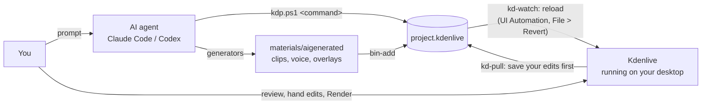

<div align="center">

# Movie Engine

**ШІ-агент мантуе ваша відэа ў Kdenlive у вас на вачах, а вы можаце перахапіць працу ў любы момант.**

ШІ-агенты для праграмавання (Claude Code, Codex) ствараюць і змяняюць сапраўдныя праекты Kdenlive: фільмы, тлумачальныя ролікі і вертыкальныя шортсы. Праўкі адразу з'яўляюцца ў адкрытым у вас рэдактары. Партатыўна, Windows, без патчаў рэдактара.


[English](../../README.md) · [简体中文](README.zh-CN.md) · [繁體中文](README.zh-TW.md) · [हिन्दी](README.hi.md) · [Español](README.es.md) · [Français](README.fr.md) · [العربية](README.ar.md) · [বাংলা](README.bn.md) · [Português](README.pt.md) · [Русский](README.ru.md) · [اردو](README.ur.md) · [Bahasa Indonesia](README.id.md) · [Deutsch](README.de.md) · [日本語](README.ja.md) · [Türkçe](README.tr.md) · [한국어](README.ko.md) · [Українська](README.uk.md) · [Italiano](README.it.md) · [Polski](README.pl.md) · [Tiếng Việt](README.vi.md) · [فارسی](README.fa.md) · [ไทย](README.th.md) · [Kiswahili](README.sw.md) · [አማርኛ](README.am.md) · [Avañe'ẽ](README.gn.md) · [Setswana](README.tn.md) · [Shqip](README.sq.md) · **Беларуская** · [Български](README.bg.md) · [Bosanski](README.bs.md) · [Hrvatski](README.hr.md) · [Српски](README.sr.md) · [Crnogorski](README.cnr.md) · [Македонски](README.mk.md) · [Slovenščina](README.sl.md) · [Slovenčina](README.sk.md) · [Čeština](README.cs.md) · [Magyar](README.hu.md) · [Română](README.ro.md) · [Dansk](README.da.md) · [Norsk bokmål](README.nb.md) · [Norsk nynorsk](README.nn.md) · [Svenska](README.sv.md) · [Íslenska](README.is.md) · [Suomi](README.fi.md) · [Eesti](README.et.md) · [Latviešu](README.lv.md) · [Lietuvių](README.lt.md) · [Nederlands](README.nl.md) · [Lëtzebuergesch](README.lb.md) · [Rumantsch](README.rm.md) · [Ελληνικά](README.el.md) · [Malti](README.mt.md) · [Gaeilge](README.ga.md) · [Català](README.ca.md) · [ქართული](README.ka.md) · [Հայերեն](README.hy.md) · [Azərbaycanca](README.az.md) · [Afrikaans](README.af.md) · [isiZulu](README.zu.md) · [isiXhosa](README.xh.md) · [Sesotho](README.st.md) · [Sepedi](README.nso.md) · [Xitsonga](README.ts.md) · [Tshivenḓa](README.ve.md) · [siSwati](README.ss.md) · [isiNdebele (South Africa)](README.nr.md) · [isiNdebele (Zimbabwe)](README.nd.md) · [chiShona](README.sn.md) · [Chichewa](README.ny.md) · [Ikinyarwanda](README.rw.md) · [Ikirundi](README.rn.md) · [Malagasy](README.mg.md) · [Soomaali](README.so.md) · [Afaan Oromoo](README.om.md) · [Qafar af](README.aa.md) · [ትግርኛ](README.ti.md) · [Sängö](README.sg.md) · [Kreol Seselwa](README.crs.md) · [TjiKalanga](README.kck.md) · [ChiNdau](README.ndc.md)

*Гэта пераклад. Асноўнай лічыцца англійская версія README.*

</div>

---

## Змест

- [Навошта](#навошта)
- [Як гэта працуе](#як-гэта-працуе)
- [Магчымасці](#магчымасці)
- [Патрабаванні](#патрабаванні)
- [Усталяванне](#усталяванне)
- [Хуткі старт](#хуткі-старт)
- [Праца з агентам](#праца-з-агентам)
- [Камандны радок для мантажу (`kdp.ps1`)](#камандны-радок-для-мантажу-kdpps1)
- [Сінхранізацыя з адкрытым рэдактарам](#сінхранізацыя-з-адкрытым-рэдактарам)
- [Генератары: тое, чаго не ўмее Kdenlive](#генератары-тое-чаго-не-ўмее-kdenlive)
- [Агучванне і гук](#агучванне-і-гук)
- [Мова інтэрфейсу](#мова-інтэрфейсу)
- [Структура папак](#структура-папак)
- [Тэсты і доказы](#тэсты-і-доказы)
- [Абмежаванні](#абмежаванні)
- [Вырашэнне праблем](#вырашэнне-праблем)
- [Частыя пытанні](#частыя-пытанні)
- [Удзел у распрацоўцы](#удзел-у-распрацоўцы)
- [Падзякі](#падзякі)
- [Ліцэнзія](#ліцэнзія)

## Навошта

Відэарэдактары створаны для рукі на мышы. ШІ-агенты добра спраўляюцца са структурай, таймінгам і паўтаральнай працай: расставіць 300 кліпаў у такт музыцы, прывязаць кожны субтытр да голасу, перарабіць сцэну паводле заўваг. Але пстрыкаць па інтэрфейсе яны не могуць, не захапіўшы ваш працоўны стол.

Kdenlive — моцны рэдактар з адкрытым кодам, але пад Windows у яго **няма API для аўтаматызацыі**: кіраванне праз D-Bus ёсць толькі ў зборках для Linux, а форкі, якія яго дадаюць, альбо закінутыя, альбо небяспечныя. Movie Engine вырашае гэта без патчаў рэдактара:

1. Агент змяняе файл праекта `.kdenlive` праз правераны тэстамі камандны радок (`engine/kdp.ps1`).
2. Запушчаны Kdenlive праз Windows UI Automation атрымлівае каманду перачытаць файл — без націскання клавіш, без мышы і без перахопу фокусу.
3. Вашы незахаваныя праўкі спачатку захоўваюцца і ніколі не перазапісваюцца.

Такім чынам, агент мантуе, а вы праглядаеце — або правіце самі. Вы абодва працуеце над адным праектам, у адным рэдактары, адначасова.

## Як гэта працуе



Кожная каманда мантажу праходзіць адзін і той жа бяспечны цыкл:

1. **Pull.** Калі ў Kdenlive ёсць незахаваныя змены, яму даюць каманду іх захаваць (кнопка «Захаваць» на панэлі інструментаў праз UI Automation), і захаванне пацвярджаецца.
2. **Праўка.** Каманда змяняе XML пад блакіроўкай, пасля праверкі хэша і са здымкам для адмены. Калі файл тым часам змяніўся, нічога не запісваецца.
3. **Перазагрузка.** Назіральнік бачыць пазнаку ШІ і выконвае ў адкрытым рэдактары File > Revert. Поспехам лічыцца толькі сапраўдная перабудова віджэта таймлайна.
4. **Канфлікт.** Калі вы тым часам пачалі правіць, нічога не перазагружаецца, і ваша праца застаецца. Версія ШІ адкладаецца асобна, а агент наноў прымяняе сваю праўку паверх вашай.

## Магчымасці

- **Паўнавартасны мантаж праекта без інтэрфейсу**: каля 120 каманд — кошык праекта, таймлайн, эфекты, кампазіцыі, дарожкі, накіравальныя, маркеры, субтытры, секвенцыі, хуткасць і пераразмеркаванне часу, слайд-шоў, тытры, проксі, рэндэр і адмена/паўтор. Гл. [даведнік каманд](#камандны-радок-для-мантажу-kdpps1).
- **Сінхранізацыя з адкрытым рэдактарам.** Праўкі ШІ з'яўляюцца ў тым Kdenlive, на які вы глядзіце; вашы незахаваныя праўкі спачатку захоўваюцца і ніколі не губляюцца.
- **Ніколі не перашкаджае працаваць за камп'ютарам.** Ніякага перахопу фокусу, націскання клавіш ці рухаў мышы. Тэставыя асобнікі рэдактара запускаюцца на нябачным працоўным стале Windows.
- **Партатыўнасць.** Рэдактар, налады, Node.js, шрыфты і інструменты ляжаць у адной папцы. Скапіюйце яе на іншы камп'ютар — і ўсё запрацуе; нічога не запісваецца ў Program Files ці ў ваш профіль Windows.
- **Генератары для таго, чаго не ўмее Kdenlive**: кінетычны тэкст з анімацыяй па літарах, намаляваныя ад рукі пазнакі, 3D-сцэны інтэрфейсу, анімацыя курсора і доўгія інтэрактыўныя тлумачальныя фільмы. Яны рэндэрацца на GPU з сапраўдным размыццём руху і ставяцца на таймлайн як звычайныя кліпы.
- **Агучванне з таймінгам слоў** (Microsoft Edge TTS, без ключа API). Субтытры і дзеянні спрацоўваюць дакладна на патрэбным слове.
- **Сінтэзаваныя гукавыя эфекты** (whoosh, click, pop, riser, impact і іншыя), створаныя кодам.
- **Праверана, а не меркавана.** Кожная каманда мае праверку выніку, эфекты і кампазіцыі правяраюцца па адным, а сырыя вынікі ляжаць у `docs/proof/`.
- **Інструкцыі для агентаў у камплекце.** `AGENTS.md` і навыкі ў `.claude/skills/` вучаць Claude Code і Codex парадку працы, фармату файла і падводным камяням.

## Патрабаванні

| | |
|---|---|
| АС | Windows 10 або 11, x64 |
| Рэдактар | Kdenlive **26.08.3**, партатыўная зборка (standalone). Іншыя версіі не правяраліся. |
| Node.js | 18 або навейшы: `.zip` для Windows x64 з nodejs.org, распакаваны ў `engine/node/` |
| Браўзер | Microsoft Edge (уваходзіць у Windows); рэндэрары сцэн выкарыстоўваюць яго ў headless-рэжыме |
| Агент | [Claude Code](https://claude.com/claude-code) або Codex. Неабавязкова: кожны інструмент можна запусціць і ўручную. |
| Дыск | каля 1 ГБ на рэдактар і інструменты плюс вашы медыяфайлы |
| GPU | любая відэакарта з апаратным кадаваннем H.264 паскарае `film-render.mjs` (без яе выкарыстоўваецца праграмнае кадаванне) |

## Усталяванне

Усё ўсталёўваецца **ўнутр папкі**. Правы адміністратара не патрэбныя.

```powershell
git clone https://github.com/vladtarrow/movie-engine.git
cd movie-engine
```

**1. Node.js.** Спампуйце `.zip` для Windows x64 з Node.js 18 або навейшым з <https://nodejs.org/en/download> і распакуйце яго змесціва ў `engine\node\`, каб там апынуліся `engine\node\node.exe` і `engine\node\npm.cmd`. Ні ўсталёўшчык, ні сістэмны Node не патрэбныя. Усе скрыпты запускаюцца праз `engine\node.cmd`, ніколі не праз сістэмны Node.

**2. Пакеты Node** для інструмента агучвання і рэндэрараў (версіі зафіксаваныя ў `engine/voice/package.json`):

```powershell
engine\node\npm.cmd install --prefix engine\voice
```

**3. Партатыўны Kdenlive 26.08.3.** Спампуйце `kdenlive-26.08.3_standalone.exe` з <https://download.kde.org/stable/kdenlive/26.08/windows/> у `engine\installer\`, праверце і распакуйце:

```powershell
(Get-FileHash engine\installer\kdenlive-26.08.3_standalone.exe -Algorithm SHA256).Hash
# expected: A25427B1DFF2C17E3B0386E991BB1A719382BB3176D1A90E441CDAEB6E0A967D
engine\installer\kdenlive-26.08.3_standalone.exe -o"engine\Kdenlive" -y
```

Рэдактар апынецца ў `engine\Kdenlive\kdenlive-26.08.3_standalone\bin\`. У ім ужо ёсць `melt.exe` і `ffmpeg.exe`.

**4. Першы запуск.**

```powershell
engine\kdenlive.cmd
```

Kdenlive захоўвае ўсе свае налады ў `engine\profile-kdenlive\`, а не ў вашым профілі Windows. Пры першым запуску ён адзін раз пакажа майстар налад.

## Хуткі старт

### З агентам

Адкрыйце папку ў Claude Code (або Codex) і папрасіце звычайнымі словамі:

> Зрабі новы вертыкальны праект «launch-teaser» на 30 fps. Пастаў на таймлайн тры скрыншоты з `materials/designers/launch/`, па 2,5 с кожны з кароткімі пераходамі, дадай агучванне з `script.txt` і прывяжы да кожнага радка кінетычны подпіс.

> Адкрый яго мне ў Kdenlive.

> Другі план занадта доўгі. Скароці яго да 1,8 с і падымі лагатып крыху вышэй.

Агент прытрымліваецца `AGENTS.md`: правіць праз `kdp.ps1`, рэндэрыць толькі тыя кліпы, якія патрэбныя мантажу, і трымае адкрыты рэдактар у актуальным стане. Вы праглядаеце вынік у Kdenlive, правіце ўручную калі заўгодна і націскаеце «Рэндэр», калі ўсё задавальняе.

### Уручную

```powershell
# a new 1080x1920 30 fps project with 2 video and 2 audio tracks
powershell -NoProfile -ExecutionPolicy Bypass -File engine\kdp.ps1 new -Project projects\hello\hello.kdenlive -Profile vertical_hd_30

# a 3-second title and a colour background
powershell -NoProfile -ExecutionPolicy Bypass -File engine\kdp.ps1 bin-color -Project projects\hello\hello.kdenlive -Color '#203060' -Seconds 3 -Name bg
powershell -NoProfile -ExecutionPolicy Bypass -File engine\kdp.ps1 title -Project projects\hello\hello.kdenlive -Text "Hello" -Seconds 3 -Name hi

# place them: background on V1, title above it on V2
powershell -NoProfile -ExecutionPolicy Bypass -File engine\kdp.ps1 add -Project projects\hello\hello.kdenlive -Bin bg -Track V1 -At 0
powershell -NoProfile -ExecutionPolicy Bypass -File engine\kdp.ps1 add -Project projects\hello\hello.kdenlive -Bin hi -Track V2 -At 0

# a check frame, then open it in the editor
powershell -NoProfile -ExecutionPolicy Bypass -File engine\kdp.ps1 frame -Project projects\hello\hello.kdenlive -At 1.5 -Out out\hello\check.png
engine\kdenlive.cmd projects\hello\hello.kdenlive
```

Каб пазней зноў адкрыць апошні праект, двойчы пстрыкніце `open-last-project.cmd`.

## Праца з агентам

Агент чытае `AGENTS.md` (Codex) або `CLAUDE.md`, які яго імпартуе (Claude Code), а таксама два навыкі:

| Навык | Чаму вучыць |
|---|---|
| `.claude/skills/kdenlive-project-file` | фармат `.kdenlive` / MLT XML, `kdp.ps1`, праверка праз `melt` |
| `.claude/skills/kdenlive-live` | бяспечнае кіраванне запушчаным рэдактарам: запуск, pull, перазагрузка, здымак яго акна |

Правілы, якіх прытрымліваецца агент і на якія можна спадзявацца:

- Ён ніколі не забірае мыш, клавіятуру ці фокус і ніколі не робіць здымкаў вашага працоўнага стала (толькі акна самога рэдактара).
- Крокі ў інтэрфейсе (захаваць, адкрыць, перазагрузіць) ён выконвае сам, а не просіць вас пстрыкнуць.
- Ён пытаецца, перш чым нешта спампаваць і перш чым нешта выдаліць.
- Ён рэндэрыць толькі тое, што патрэбна для працы (кліпы сцэн, кантрольныя кадры). Гатовы фільм ён рэндэрыць, толькі калі вы папросіце.
- Калі Kdenlive нешта не ўмее рабіць добра, агент збірае гэта звонку кодам і ўстаўляе вынік як кліп. Ён не спрашчае эфект.

## Камандны радок для мантажу (`kdp.ps1`)

```powershell
powershell -NoProfile -ExecutionPolicy Bypass -File engine\kdp.ps1 <command> -Project <file.kdenlive> [options]
```

Час задаецца ў секундах, праз кропку (`2.5`). Дарожкі называюцца `V1 V2 …` (V1 — ніжняя) і `A1 A2 …`. Кліп вызначаецца праз `-Track` плюс любы момант `-At` унутры яго. Параметры эфектаў перадаюцца ў `-Params "name=value||name=value"`. Поўны спіс з усімі опцыямі — у загалоўку `engine/kdp.ps1`.

| Група | Каманды |
|---|---|
| Праект | `new`, `profiles`, `info`, `validate`, `fonts`, `profile-set`, `profile-from-clip`, `zone`, `archive`, `backups`, `rebase`, `otio-export`, `otio-import` |
| Кошык праекта | `bin-add`, `bin-color`, `title`, `title-text`, `title-save`, `title-template`, `bin-rename`, `bin-remove`, `bin-info`, `bin-set`, `bin-duplicate`, `bin-replace-file`, `bin-reload`, `folder`, `bin-folder`, `relink`, `clean`, `generator`, `playlist-clip`, `extract-audio`, `transcode` |
| Таймлайн | `add`, `add-av`, `move`, `copy`, `trim`, `ripple-trim`, `slip`, `split`, `remove`, `speed`, `remap`, `disable`, `enable`, `group`, `ungroup`, `mix`, `unmix`, `space-insert`, `space-remove`, `spaces-remove-all`, `track-clear`, `replace-in-timeline` |
| Эфекты | `effects`, `effect-info`, `effect-add`, `effect-list`, `effect-set`, `effect-remove`, `effect-copy`, `effect-clear`, `effects-all`, `bin-effect`, `effect-templates`, `effect-template` |
| Кампазіцыі | `compositions`, `comp-info`, `comp-add`, `comp-list`, `comp-set`, `comp-remove` |
| Дарожкі | `track-add`, `track-remove`, `track-set` |
| Накіравальныя і маркеры | `guide-add`, `guide-list`, `guide-remove`, `guide-set`, `guide-clear`, `guide-export`, `guide-category`, `marker`, `marker-list`, `marker-set`, `marker-remove` |
| Субтытры | `sub-add`, `sub-import`, `sub-export`, `sub-state` |
| Секвенцыі | `sequence-add`, `sequences`, `copy-to-sequence`, `expand`; любая каманда з `-Sequence <name>` працуе ўнутры гэтай секвенцыі |
| Асаблівыя | `slideshow`, анімацыі Lottie / Glaxnimate праз `bin-add`, `proxy`, `stabilize`, `scene-split`, `speed-job`, `subclip` |
| Вывад | `frame` (адзін PNG), `preview` (хуткі рэндэр праз melt), `render` (уласны рэндэрар Kdenlive або прэсэт), `presets` |
| Гісторыя | `undo`, `redo`, `clear-history` (здымкі ў `projects/<name>/.kdp-history`) |

Што карысна ведаць пра паводзіны:

- Звязаныя палавіны аўдыя і відэа перамяшчаюцца, абразаюцца, разразаюцца і выдаляюцца разам (`-Alone` — толькі адна палавіна).
- Каманда з памылкай завяршаецца з кодам 1 і нічога не запісвае.
- Эфекты, якія зборка пад Windows не можа выканаць, адхіляюцца, а не моўчкі прапускаюцца (спіс: `docs/proof/assets.txt`).
- Кожнае дзеянне з меню Kdenlive супастаўлена з камандай, іншым спосабам або пазнакай «толькі прагляд» у `engine/tools/data/kdenlive-actions.csv`. Гл. `docs/kdenlive-coverage.md`.

## Сінхранізацыя з адкрытым рэдактарам

| Скрыпт | Што робіць | Коды выхаду |
|---|---|---|
| `engine\kd-pull.ps1 -Project <f>` | прымушае Kdenlive захаваць вашы праўкі і пацвярджае гэта | 0 файл актуальны, 3 не запушчаны, 4 не пацверджана |
| `engine\kd-reload.ps1 -Project <f>` | File > Revert, пацвярджаецца перабудаваным таймлайнам | 0 пацверджана, 2 у вас ёсць незахаваныя праўкі (нічога не адкінута), 3 не запушчаны, 4 памылка |
| `engine\kd-watch.ps1 -Project <f>` | фонавы назіральнік: перазагружае пасля кожнага запісу ШІ, запісвае канфлікты ў журнал | журнал у `engine\kd-watch.log`; каб спыніць, выдаліце `engine\kd-watch.run` |
| `engine\kdenlive-bg.ps1 [project]` | запускае Kdenlive згорнутым для агента | 0 загружана, 4 не пацверджана |
| `engine\kdenlive.cmd [project]` | запускае Kdenlive для вас | |

Запускайце назіральнік адзін раз за сеанс:

```powershell
Start-Process powershell -WindowStyle Hidden -ArgumentList '-NoProfile','-ExecutionPolicy','Bypass','-File','engine\kd-watch.ps1','-Project','projects\hello\hello.kdenlive'
```

Вялікія праекты: перазагрузка праекта на 1000 кліпаў доўжыцца хвіліны, і інструменты чакаюць яе, а не паведамляюць пра вынік загадзя. Праекты адкрываюцца праз *File > Open Recent* у пустым рэдактары, бо пры непасрэдным адкрыцці файла Qt абыходзіць кожны элемент таймлайна для спецыяльных магчымасцей, і гэта было прыкладна на 10 хвілін даўжэй.

## Генератары: тое, чаго не ўмее Kdenlive

У Kdenlive/MLT няма анімацыі тэксту па літарах, няма выразаў (expressions) і амаль няма 3D, а цяжкія эфекты тармозяць прайграванне. Movie Engine рэндэрыць такія часткі звонку і ставіць іх на таймлайн як звычайныя кліпы, звычайна з альфа-каналам, на дарожку над выявай. Скрыпт генератара і яго ўваходныя даныя застаюцца ў папцы праекта, таму кліп можна стварыць наноў, калі змяніўся тэкст, шрыфт ці таймінг.

| Інструмент | Што стварае |
|---|---|
| `engine/tools/kinetic-text.ps1` | кінетычныя подпісы з анімацыяй па літарах, кожнае слова прывязана да `voice.json`, плашка-вылучэнне |
| `engine/tools/annotate.ps1` | намаляваныя ад рукі кругі, рамкі, падкрэсліванні і стрэлкі, якія прамалёўваюцца паверх скрыншота |
| `engine/tools/card-entrance.ps1` | картка са скрыншотам, якая ўсплывае і павялічваецца з мяккім ценем |
| `engine/tools/pdf-to-png.ps1` | слайды з экспарту ў PDF |
| `engine/tools/html-render.mjs` | любая сцэна на HTML/CSS/canvas у відэа: анімацыя інтэрфейсу, курсоры, 3D, маскі |
| `engine/tools/film-render.mjs` + `film/` | доўгія інтэрактыўныя тлумачальныя фільмы на canvas: адзін кліп на рэпліку агучвання, дзеянні спрацоўваюць на вымаўленых словах, размыццё руху на GPU прыкладна пры 45 fps |

Абодва рэндэрары кіруюць убудаваным у Windows Microsoft Edge у headless-рэжыме, з аднаразовым профілем і без доступу да сеткі.

### Дэма

```powershell
# a 3-second 3D title card with a cursor click
engine\node.cmd engine\tools\html-render.mjs examples\demo\scene\scene.html examples\demo\out --frames 0,30,60,89
engine\node.cmd engine\tools\html-render.mjs examples\demo\scene\scene.html examples\demo\out\scene.mp4

# a 4-shot interactive film timed to two voice lines
engine\node.cmd engine\tools\film-render.mjs examples\demo\film\film.html examples\demo\out --check
engine\node.cmd engine\tools\film-render.mjs examples\demo\film\film.html examples\demo\out --shots all --width 640
engine\node.cmd engine\tools\film-render.mjs examples\demo\film\film.html examples\demo\out\clips --suffix -v01
```

Фільм — гэта тры невялікія файлы. У `data.js` ляжаць планы і час слоў. У `direction.js` — па адным радку на план:

```text
1 | hover 192 108 @brand | tag 300 60 Your brand @deserves | confetti 192 90 @film
2 say=A film that/*explains* it
3 | click 116 108 @before | click 268 108 @after | chips Before~After @after
4 scene=counter | count 0 120 % @count
```

У `scenes.js` ляжаць планы, якія малююцца з нуля. `@word` запускае дзеянне, калі голас вымаўляе гэтае слова. Сярод дзеянняў: click, hover, drag, zoom, lens, ring, arrow, chips, toggle, slider, toast, type, count і confetti; поўны сінтаксіс — у пачатку `engine/tools/film/film-kit.js`.

## Агучванне і гук

```powershell
engine\node.cmd engine\voice\voice.mjs lines.json materials\aigenerated\hello\voice en-US-AndrewMultilingualNeural +0%
```

`lines.json` — гэта спіс рэплік. Інструмент запісвае па адным mp3 на рэпліку і файл `voice.json` з працягласцю, а таксама пачаткам і канцом кожнага слова. Рэплікі кэшуюцца, таму пры змене адной рэплікі наноў ствараецца толькі яна. Выкарыстоўваецца анлайн-сінтэз маўлення Microsoft Edge праз пакет `msedge-tts`: ключ не патрэбны, але сэрвіс неафіцыйны і патрабуе інтэрнэту.

```powershell
engine\node.cmd engine\audio\sfx.mjs materials\aigenerated\sfx
```

Гэтая каманда сінтэзуе кодам whoosh, whoosh-long, swipe, click, pop, tick, riser, impact, ding і reveal; гатовы набор ляжыць у `materials/aigenerated/sfx/`. Гукі, карацейшыя за адзін кадр, перад размяшчэннем дапоўніце цішынёй (`-af apad=whole_dur=0.0667`).

## Мова інтэрфейсу

Па змаўчанні лаўнчары запускаюць Kdenlive **на англійскай**. Каб выбраць іншую мову, перад запускам задайце `MOVIE_ENGINE_UI_LANG`:

```powershell
$env:MOVIE_ENGINE_UI_LANG = 'ru'; engine\kdenlive.cmd
```

UI Automation знаходзіць пункты меню па іх бачных назвах. Назвы для 31 мовы інтэрфейсу ўжо ўбудаваныя (`engine/tools/kd-ui.ps1`, `$KdNames`). Для любой іншай мовы дадайце туды яе назвы і праверце камандай:

```powershell
powershell -NoProfile -ExecutionPolicy Bypass -File engine\tools\kd-langcheck.ps1
```

## Структура папак

```text
movie-engine/
├─ AGENTS.md, CLAUDE.md          instructions for AI agents
├─ .claude/skills/               agent skills: project file format, live editor
├─ engine/
│  ├─ kdp.ps1                    the editing command line
│  ├─ kd-pull / kd-reload / kd-watch .ps1, kdenlive.cmd, kdenlive-bg.ps1
│  ├─ tools/                     internals, generators, tests, data (action map)
│  ├─ voice/  audio/  fonts/     TTS, synthesized SFX, Poppins (OFL)
│  ├─ Kdenlive/  node/           portable editor and Node.js (not in git)
│  └─ profile-kdenlive/          the editor's settings (not in git)
├─ projects/<name>/<name>.kdenlive
├─ materials/
│  ├─ download/                  stock and downloaded files (not in git)
│  ├─ aigenerated/               everything the AI made (sfx/ and test-kit/ ship with the engine)
│  ├─ designers/  brand/         files from your team, brand assets
├─ examples/demo/                demos of the scene and film renderers
├─ out/                          renders (not in git)
└─ docs/                         proofs, coverage, translations of this README
```

Шляхі да медыяфайлаў унутры праектаў адносныя. Калі вы пераносіце або капіюеце папку, `kdp.ps1 rebase` (яго таксама аўтаматычна запускае `kdenlive.cmd`) запісвае ў праект новае размяшчэнне.

## Тэсты і доказы

Сцвярджэнні пра тое, што працуе, падмацаваныя праверкамі выніку, а не тым, што «функцыя выканалася». Падсумаванне — у [`docs/kdenlive-proof.md`](../../docs/kdenlive-proof.md), сыры вывад — у `docs/proof/`.

| Тэст | Што правярае |
|---|---|
| `engine\tools\kdp-clitest.ps1` | кожную каманду `kdp.ps1` праз камандны радок, параўноўваючы атрыманы праект |
| `engine\tools\kd-livetest.ps1` | pull, перазагрузку, назіральнік, канфлікты і гонкі на сапраўдным Kdenlive на нябачным працоўным стале |
| `engine\tools\kdp-assetsweep.ps1` | кожны эфект і кожную кампазіцыю: рэндэрыць і параўноўвае кадры |
| `engine\tools\kdp-portabletest.ps1` | капіюе папку ў іншае месца і працуе з копіі |
| `engine\tools\kd-langcheck.ps1` | мову інтэрфейсу і тое, што UI Automation знаходзіць меню |
| `engine\tools\kdp-coverage-check.ps1` | што кожнае дзеянне меню супастаўлена і ніводзін доказ не старэйшы за код |

```powershell
powershell -NoProfile -ExecutionPolicy Bypass -File engine\tools\kdp-clitest.ps1 -Report docs\proof\clitest.txt
powershell -NoProfile -ExecutionPolicy Bypass -File engine\tools\kd-livetest.ps1 -Report docs\proof\live-en.txt
```

Тэставыя асобнікі рэдактара запускаюцца толькі на схаваным працоўным стале з уласным профілем, таму тэсты ніколі не чапаюць ваш адкрыты Kdenlive і ваш фокус.

## Абмежаванні

- **Толькі Windows** і толькі Kdenlive **26.08.3**. У Linux ёсць D-Bus, і там спатрэбіўся б іншы мост.
- Пры запуску рэдактар забірае фокус клавіятуры прыкладна на 3 секунды, пакуль з'яўляецца пустое акно. Агенты пытаюцца, перш чым запускаць яго, пакуль вы працуеце. Перазагрузкі і праўкі фокус не забіраюць.
- У зборцы пад Windows няма модуляў MLT sox, ladspa і movit і часткі эфектаў frei0r/avfilter; `kdp.ps1` іх адхіляе (`docs/proof/assets.txt`).
- Экспарт і імпарт OpenTimelineIO пераносяць толькі кліпы і прамежкі. У мультыкамеры няма пераключэння ракурсаў у рэальным часе (склейкі робяцца праз split/remove/hide).
- «Захаваць як…» праз UI Automation у згорнутым акне не адкрывае дыялог; замест гэтага агент выкарыстоўвае `archive` або капіяванне файлаў.
- Для распазнавання маўлення (аўтаматычных субтытраў) патрэбны Whisper або Vosk, яны не ўваходзяць у камплект.
- Тытры, зробленыя ў рэдактары тытраў Kdenlive, выкарыстоўваюць шрыфты, усталяваныя ў Windows. Для гарантаванай тыпаграфікі рэндэрце тэкст генератарамі — яны загружаюць шрыфты з `engine/fonts/`.
- Edge TTS — неафіцыйны анлайн-сэрвіс, ён можа змяніцца або перастаць працаваць.

## Вырашэнне праблем

| Сімптом | Прычына і рашэнне |
|---|---|
| Kdenlive запушчаны, але пстрычка па ім на панэлі задач нічога не паказвае | Захаванае становішча акна знаходзіцца па-за межамі экрана. Закрыйце яго і выдаліце запісы `kdockLayout` у `engine\profile-kdenlive\AppData\Local\kdenliverc` або перамясціце акно праз `SetWindowPos` (гл. `AGENTS.md`). |
| `kd-reload.ps1` завяршаецца з кодам 2 | У вас ёсць незахаваныя праўкі. Нічога не адкінута. Запусціце `kd-pull.ps1`, потым прымяніце змену наноў (`kdp.ps1` робіць гэта сам). |
| `CONFLICT` у `engine\kd-watch.log` | Вы і агент правілі ў адзін і той жа момант. Ваша версія застаецца ў рэдактары, а версія ШІ ляжыць у `projects\<name>\.kdp-history\<name>\conflict\`. Папрасіце агента прымяніць сваю праўку наноў. |
| Каманда завяршаецца з кодам 1 і паведамленнем «pull not confirmed» | Kdenlive заняты або паказвае дыялог. Закрыйце дыялог або дачакайцеся заканчэння загрузкі, потым паўтарыце. |
| Скрыпт PowerShell не разбіраецца | Скрыпты з тэкстам не ў ASCII трэба захоўваць у UTF-8 **з BOM** для Windows PowerShell 5.1. |
| `voice.mjs` спыняецца з «Stream closed before the synthesis completed» | Звычайна гэта праблема сеткі або неэкранаваны SSML у старых копіях. `voice.mjs` сам экрануе `& < >`. |
| Вялікі праект адкрываецца шмат хвілін | Адкрывайце яго праз `kdenlive.cmd` / `kdenlive-bg.ps1`, ніколі не як `kdenlive.exe project.kdenlive`. |

## Частыя пытанні

**Ці патрэбны мне Claude Code або Codex?**
Не. Кожны інструмент — звычайны скрыпт, які можна запусціць уручную. Агент робіць працу хуткай: ён плануе мантаж, запускае інструменты і трымае рэдактар у актуальным стане.

**Ці перазапіша агент мае ручныя праўкі?**
Не. Перад любым запісам вашы незахаваныя праўкі захоўваюцца, і гэта пацвярджаецца. Калі вы правіце, пакуль агент запісвае, запіс адхіляецца або адкладаецца як канфлікт, але ніколі не прымяняецца паверх вашай працы.

**Ці можна і далей карыстацца Kdenlive як звычайна?**
Так. Гэта стандартны Kdenlive з уласнай папкай налад. Мантуйце, праглядайце і рэндэрце як звычайна.

**Ці будзе гэта працаваць з ужо ўсталяваным у мяне Kdenlive?**
Выкарыстоўваецца ўласная партатыўная копія ў `engine\Kdenlive\`, таму ўсталяваны Kdenlive і яго налады застаюцца некранутымі.

**Чаму не форк Kdenlive з API ці іншы рэдактар?**
Пад Windows няма падтрымліваемага і бяспечнага форка (агляд ад лістапада 2026 года). Былі разгледжаныя OpenShot, Blender VSE, DaVinci Resolve, Shotcut і вэб-рэдактары; Kdenlive даў найлепшыя магчымасці мантажу. За прапановай REST API у асноўным праекце (merge request !902) мы сочым.

**Ці можа ён адрэндэрыць гатовае відэа?**
Так, камандай `kdp.ps1 render` (уласны рэндэрар Kdenlive, у схаваным рэжыме), або вы самі націскаеце «Рэндэр» у рэдактары.

**Ці загружаюцца кудысьці мае медыяфайлы?**
Не. Пры стварэнні агучвання ў сэрвіс Edge TTS адпраўляецца толькі яго тэкст. Рэндэрары сцэн працуюць з адключанай сеткай.

## Удзел у распрацоўцы

Мы рады ўнёску ў праект. Гл. [CONTRIBUTING.md](../../CONTRIBUTING.md). Коратка:

- Кожная новая ці змененая аперацыя `kdp.ps1` патрабуе праверкі выніку ў `kdp-clitest.ps1`, запісу ў карце дзеянняў і свежага прагону `kdp-coverage-check.ps1`.
- Ніколі не запускайце тэставы Kdenlive на бачным працоўным стале; выкарыстоўвайце `engine/tools/kd-hidden.ps1`.
- Захоўвайце партатыўнасць: ніякіх усталяванняў па-за папкай, ніякіх абсалютных шляхоў у праектах.
- Запісвайце правераныя асаблівасці ў `AGENTS.md` або ў адпаведны навык.

## Падзякі

- [Kdenlive](https://kdenlive.org) і [MLT](https://www.mltframework.org): рэдактар і рухавік пад ім.
- [FFmpeg](https://ffmpeg.org), пастаўляецца разам з Kdenlive.
- [msedge-tts](https://www.npmjs.com/package/msedge-tts) для агучвання.
- [Poppins](https://fonts.google.com/specimen/Poppins) ад Indian Type Foundry, SIL Open Font License (`engine/fonts/OFL.txt`).
- `engine/tools/data/kdenliveui-26.08.3.rc`: файл меню Kdenlive, узяты з зыходнага кода Kdenlive 26.08.3; выкарыстоўваецца толькі праверкай пакрыцця. Ён застаецца пад ліцэнзіяй GPL Kdenlive, а не пад MIT License.

## Ліцэнзія

Уласны код Movie Engine распаўсюджваецца пад [ліцэнзіяй MIT](../../LICENSE). Kdenlive, MLT, FFmpeg, пакеты Node.js і шрыфт Poppins распаўсюджваюцца пад сваімі ліцэнзіямі.
