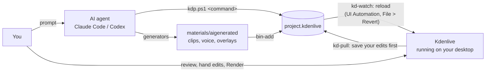

<div align="center">

# Movie Engine

**ИИ агент монтира вашето видео в Kdenlive, докато гледате, а вие можете да поемете управлението във всеки момент.**

ИИ агентите за програмиране (Claude Code, Codex) създават и променят истински проекти на Kdenlive: филми, обяснителни видеа и вертикални кратки клипове. Промените се появяват на живо в редактора, който сте отворили. Преносимо, Windows, без пачове на редактора.


[English](../../README.md) · [简体中文](README.zh-CN.md) · [繁體中文](README.zh-TW.md) · [हिन्दी](README.hi.md) · [Español](README.es.md) · [Français](README.fr.md) · [العربية](README.ar.md) · [বাংলা](README.bn.md) · [Português](README.pt.md) · [Русский](README.ru.md) · [اردو](README.ur.md) · [Bahasa Indonesia](README.id.md) · [Deutsch](README.de.md) · [日本語](README.ja.md) · [Türkçe](README.tr.md) · [한국어](README.ko.md) · [Українська](README.uk.md) · [Italiano](README.it.md) · [Polski](README.pl.md) · [Tiếng Việt](README.vi.md) · [فارسی](README.fa.md) · [ไทย](README.th.md) · [Kiswahili](README.sw.md) · [አማርኛ](README.am.md) · [Avañe'ẽ](README.gn.md) · [Setswana](README.tn.md) · [Shqip](README.sq.md) · [Беларуская](README.be.md) · **Български** · [Bosanski](README.bs.md) · [Hrvatski](README.hr.md) · [Српски](README.sr.md) · [Crnogorski](README.cnr.md) · [Македонски](README.mk.md) · [Slovenščina](README.sl.md) · [Slovenčina](README.sk.md) · [Čeština](README.cs.md) · [Magyar](README.hu.md) · [Română](README.ro.md) · [Dansk](README.da.md) · [Norsk bokmål](README.nb.md) · [Norsk nynorsk](README.nn.md) · [Svenska](README.sv.md) · [Íslenska](README.is.md) · [Suomi](README.fi.md) · [Eesti](README.et.md) · [Latviešu](README.lv.md) · [Lietuvių](README.lt.md) · [Nederlands](README.nl.md) · [Lëtzebuergesch](README.lb.md) · [Rumantsch](README.rm.md) · [Ελληνικά](README.el.md) · [Malti](README.mt.md) · [Gaeilge](README.ga.md) · [Català](README.ca.md) · [ქართული](README.ka.md) · [Հայերեն](README.hy.md) · [Azərbaycanca](README.az.md) · [Afrikaans](README.af.md) · [isiZulu](README.zu.md) · [isiXhosa](README.xh.md) · [Sesotho](README.st.md) · [Sepedi](README.nso.md) · [Xitsonga](README.ts.md) · [Tshivenḓa](README.ve.md) · [siSwati](README.ss.md) · [isiNdebele (South Africa)](README.nr.md) · [isiNdebele (Zimbabwe)](README.nd.md) · [chiShona](README.sn.md) · [Chichewa](README.ny.md) · [Ikinyarwanda](README.rw.md) · [Ikirundi](README.rn.md) · [Malagasy](README.mg.md) · [Soomaali](README.so.md) · [Afaan Oromoo](README.om.md) · [Qafar af](README.aa.md) · [ትግርኛ](README.ti.md) · [Sängö](README.sg.md) · [Kreol Seselwa](README.crs.md) · [TjiKalanga](README.kck.md) · [ChiNdau](README.ndc.md)

*Това е превод. Основната версия е английският README.*

</div>

---

## Съдържание

- [Защо](#защо)
- [Как работи](#как-работи)
- [Възможности](#възможности)
- [Изисквания](#изисквания)
- [Инсталиране](#инсталиране)
- [Бърз старт](#бърз-старт)
- [Работа с агента](#работа-с-агента)
- [Команден ред за монтаж (`kdp.ps1`)](#команден-ред-за-монтаж-kdpps1)
- [Синхронизация на живо с отворения редактор](#синхронизация-на-живо-с-отворения-редактор)
- [Генератори: това, което Kdenlive не може](#генератори-това-което-kdenlive-не-може)
- [Озвучаване и звук](#озвучаване-и-звук)
- [Език на интерфейса](#език-на-интерфейса)
- [Структура на папките](#структура-на-папките)
- [Тестове и доказателства](#тестове-и-доказателства)
- [Ограничения](#ограничения)
- [Отстраняване на проблеми](#отстраняване-на-проблеми)
- [Често задавани въпроси](#често-задавани-въпроси)
- [Принос](#принос)
- [Благодарности](#благодарности)
- [Лиценз](#лиценз)

## Защо

Видеоредакторите са създадени за ръка върху мишката. ИИ агентите са добри в структурата, тайминга и повторението: да подредят 300 клипа в ритъма на музиката, да синхронизират всеки субтитър с гласа, да преработят сцена след забележки. Но не могат да кликат из графичния интерфейс, без да превземат работния ви плот.

Kdenlive е мощен редактор с отворен код, но под Windows **няма API за автоматизация**: управлението чрез D-Bus съществува само във версиите за Linux, а форковете, които го добавят, са или изоставени, или небезопасни. Movie Engine решава това, без да променя редактора:

1. Агентът променя проектния файл `.kdenlive` чрез тестван команден ред (`engine/kdp.ps1`).
2. На работещия Kdenlive се казва да прочете файла наново чрез Windows UI Automation, без натискане на клавиши, без мишка и без отнемане на фокуса.
3. Вашите незапазени промени първо се запазват и никога не се презаписват.

Така агентът монтира, а вие преглеждате, или монтирате ръчно. И двамата работите по един и същ проект, в един и същ редактор, по едно и също време.

## Как работи



Всяка команда за монтаж минава през един и същ безопасен цикъл:

1. **Pull.** Ако Kdenlive има незапазени промени, му се казва да ги запази (бутона Save в лентата с инструменти чрез UI Automation), и запазването се потвърждава.
2. **Редакция.** Командата променя XML под заключване, след проверка на хеша и със снимка на състоянието за отмяна. Ако файлът междувременно се е променил, нищо не се записва.
3. **Презареждане.** Наблюдателят вижда печата на ИИ и изпълнява File > Revert в отворения редактор. Успех е само когато уиджетът на времевата линия действително е изграден наново.
4. **Конфликт.** Ако междувременно сте започнали да редактирате, нищо не се презарежда и вашата работа остава. Версията на ИИ се отделя настрана, а агентът прилага промяната си наново върху вашата.

## Възможности

- **Пълен монтаж на проекта без графичен интерфейс**: около 120 команди, обхващащи коша на проекта, времевата линия, ефектите, композициите, пистите, водещите линии, маркерите, субтитрите, секвенциите, скоростта и преразпределението на времето (time remap), слайдшоутата, надписите, проксита, рендерирането и отмяната/повторението. Вижте [справочника на командите](#команден-ред-за-монтаж-kdpps1).
- **Синхронизация на живо с отворения редактор.** Промените на ИИ се появяват в Kdenlive, който гледате; незапазените ви промени първо се запазват и никога не се губят.
- **Никога не пречи на работния ви плот.** Без отнемане на фокуса, натискане на клавиши или движение на мишката. Тестовите редактори работят на невидим работен плот на Windows.
- **Преносимо.** Редакторът, настройките, Node.js, шрифтовете и инструментите са в една папка. Копирайте я на друг компютър и работи; нищо не се записва в Program Files или във вашия профил в Windows.
- **Генератори за това, което Kdenlive не може**: кинетичен текст, анимиран буква по буква, ръчно нарисувани анотации, 3D сцени на интерфейс, анимации на курсора и дълги интерактивни „обяснителни“ филми. Рендерират се на GPU с истинско размазване при движение (motion blur) и се поставят на времевата линия като обикновени клипове.
- **Озвучаване с тайминг на думите** (Microsoft Edge TTS, без API ключ). Субтитрите и действията се задействат точно на думата.
- **Синтезирани звукови ефекти** (whoosh, click, pop, riser, impact и други), генерирани с код.
- **Доказано, а не предполагано.** Всяка команда има проверка на резултата, ефектите и композициите се проверяват един по един, а суровите резултати са в `docs/proof/`.
- **Включени инструкции за агентите.** `AGENTS.md` и уменията в `.claude/skills/` учат Claude Code и Codex на работния процес, файловия формат и капаните.

## Изисквания

| | |
|---|---|
| ОС | Windows 10 или 11, x64 |
| Редактор | Kdenlive **26.08.3**, преносима версия (standalone). Другите версии не са тествани. |
| Node.js | 18 или по-нова: `.zip` за Windows x64 от nodejs.org, разархивиран в `engine/node/` |
| Браузър | Microsoft Edge (част от Windows); използва се в headless режим от рендерерите на сцени |
| Агент | [Claude Code](https://claude.com/claude-code) или Codex. По избор: всеки инструмент може да се стартира и ръчно. |
| Диск | около 1 GB за редактора и инструментите, плюс вашите медийни файлове |
| GPU | всеки GPU с хардуерно кодиране на H.264 ускорява `film-render.mjs` (иначе се използва софтуерно кодиране) |

## Инсталиране

Всичко се инсталира **вътре в папката**. Не са нужни администраторски права.

```powershell
git clone https://github.com/vladtarrow/movie-engine.git
cd movie-engine
```

**1. Node.js.** Изтеглете `.zip` за Windows x64 на Node.js 18 или по-нова от <https://nodejs.org/en/download> и разархивирайте съдържанието му в `engine\node\`, така че `engine\node\node.exe` и `engine\node\npm.cmd` да са там. Не са нужни нито инсталатор, нито системен Node. Всички скриптове се изпълняват чрез `engine\node.cmd`, никога чрез системен Node.

**2. Пакети за Node** за инструмента за глас и рендерерите (версиите са фиксирани в `engine/voice/package.json`):

```powershell
engine\node\npm.cmd install --prefix engine\voice
```

**3. Преносим Kdenlive 26.08.3.** Изтеглете `kdenlive-26.08.3_standalone.exe` от <https://download.kde.org/stable/kdenlive/26.08/windows/> в `engine\installer\`, проверете го и го разархивирайте:

```powershell
(Get-FileHash engine\installer\kdenlive-26.08.3_standalone.exe -Algorithm SHA256).Hash
# expected: A25427B1DFF2C17E3B0386E991BB1A719382BB3176D1A90E441CDAEB6E0A967D
engine\installer\kdenlive-26.08.3_standalone.exe -o"engine\Kdenlive" -y
```

Редакторът се озовава в `engine\Kdenlive\kdenlive-26.08.3_standalone\bin\`. Той вече съдържа `melt.exe` и `ffmpeg.exe`.

**4. Първо стартиране.**

```powershell
engine\kdenlive.cmd
```

Kdenlive пази всичките си настройки в `engine\profile-kdenlive\`, а не във вашия профил в Windows. При първото стартиране еднократно показва съветник за настройка.

## Бърз старт

### С агент

Отворете папката в Claude Code (или Codex) и помолете с обикновени думи:

> Направи нов вертикален проект „launch-teaser“ с 30 fps. Сложи на времевата линия трите екранни снимки от `materials/designers/launch/`, по 2,5 s всяка с кратък преход, добави озвучаване от `script.txt` и синхронизирай кинетичен надпис с всеки ред.

> Отвори ми го в Kdenlive.

> Вторият кадър е твърде дълъг. Съкрати го до 1,8 s и вдигни логото малко по-нагоре.

Агентът следва `AGENTS.md`: редактира чрез `kdp.ps1`, рендерира само клиповете, нужни на монтажа, и поддържа отворения редактор синхронизиран. Вие преглеждате в Kdenlive, редактирате ръчно, когато пожелаете, и натискате Render, когато сте доволни.

### Ръчно

```powershell
# a new 1080x1920 30 fps project with 2 video and 2 audio tracks
powershell -NoProfile -ExecutionPolicy Bypass -File engine\kdp.ps1 new -Project projects\hello\hello.kdenlive -Profile vertical_hd_30

# a 3-second title and a colour background
powershell -NoProfile -ExecutionPolicy Bypass -File engine\kdp.ps1 bin-color -Project projects\hello\hello.kdenlive -Color '#203060' -Seconds 3 -Name bg
powershell -NoProfile -ExecutionPolicy Bypass -File engine\kdp.ps1 title -Project projects\hello\hello.kdenlive -Text "Hello" -Seconds 3 -Name hi

# place them: background on V1, title above it on V2
powershell -NoProfile -ExecutionPolicy Bypass -File engine\kdp.ps1 add -Project projects\hello\hello.kdenlive -Bin bg -Track V1 -At 0
powershell -NoProfile -ExecutionPolicy Bypass -File engine\kdp.ps1 add -Project projects\hello\hello.kdenlive -Bin hi -Track V2 -At 0

# a check frame, then open it in the editor
powershell -NoProfile -ExecutionPolicy Bypass -File engine\kdp.ps1 frame -Project projects\hello\hello.kdenlive -At 1.5 -Out out\hello\check.png
engine\kdenlive.cmd projects\hello\hello.kdenlive
```

За да отворите отново последния проект по-късно, щракнете два пъти върху `open-last-project.cmd`.

## Работа с агента

Агентът чете `AGENTS.md` (Codex) или `CLAUDE.md`, който го импортира (Claude Code), плюс две умения:

| Умение | Какво учи |
|---|---|
| `.claude/skills/kdenlive-project-file` | формата `.kdenlive` / MLT XML, `kdp.ps1`, проверка с `melt` |
| `.claude/skills/kdenlive-live` | безопасно управление на работещия редактор: стартиране, pull, презареждане, заснемане на прозореца му |

Правила, които агентът спазва и на които можете да разчитате:

- Никога не взема мишката, клавиатурата или фокуса ви и никога не прави снимки на работния ви плот (само на собствения прозорец на редактора).
- Стъпките в интерфейса (запазване, отваряне, презареждане) прави сам, вместо да ви моли да кликнете.
- Пита, преди да изтегли каквото и да е и преди да изтрие каквото и да е.
- Рендерира само това, което е нужно за работата (клипове на сцени, контролни кадри). Финалния филм рендерира само когато поискате.
- Когато Kdenlive не може да направи нещо добре, агентът го изгражда отвън с код и вмъква резултата като клип. Не опростява ефекта.

## Команден ред за монтаж (`kdp.ps1`)

```powershell
powershell -NoProfile -ExecutionPolicy Bypass -File engine\kdp.ps1 <command> -Project <file.kdenlive> [options]
```

Времената са в секунди, с точка (`2.5`). Пистите са `V1 V2 …` (V1 е най-долната) и `A1 A2 …`. Клипът се посочва с `-Track` плюс произволен момент `-At` в него. Параметрите на ефектите се подават в `-Params "name=value||name=value"`. Пълният списък с всички опции е в заглавната част на `engine/kdp.ps1`.

| Група | Команди |
|---|---|
| Проект | `new`, `profiles`, `info`, `validate`, `fonts`, `profile-set`, `profile-from-clip`, `zone`, `archive`, `backups`, `rebase`, `otio-export`, `otio-import` |
| Кош на проекта | `bin-add`, `bin-color`, `title`, `title-text`, `title-save`, `title-template`, `bin-rename`, `bin-remove`, `bin-info`, `bin-set`, `bin-duplicate`, `bin-replace-file`, `bin-reload`, `folder`, `bin-folder`, `relink`, `clean`, `generator`, `playlist-clip`, `extract-audio`, `transcode` |
| Времева линия | `add`, `add-av`, `move`, `copy`, `trim`, `ripple-trim`, `slip`, `split`, `remove`, `speed`, `remap`, `disable`, `enable`, `group`, `ungroup`, `mix`, `unmix`, `space-insert`, `space-remove`, `spaces-remove-all`, `track-clear`, `replace-in-timeline` |
| Ефекти | `effects`, `effect-info`, `effect-add`, `effect-list`, `effect-set`, `effect-remove`, `effect-copy`, `effect-clear`, `effects-all`, `bin-effect`, `effect-templates`, `effect-template` |
| Композиции | `compositions`, `comp-info`, `comp-add`, `comp-list`, `comp-set`, `comp-remove` |
| Писти | `track-add`, `track-remove`, `track-set` |
| Водещи линии и маркери | `guide-add`, `guide-list`, `guide-remove`, `guide-set`, `guide-clear`, `guide-export`, `guide-category`, `marker`, `marker-list`, `marker-set`, `marker-remove` |
| Субтитри | `sub-add`, `sub-import`, `sub-export`, `sub-state` |
| Секвенции | `sequence-add`, `sequences`, `copy-to-sequence`, `expand`; всяка команда с `-Sequence <name>` работи в тази секвенция |
| Специални | `slideshow`, анимации Lottie / Glaxnimate чрез `bin-add`, `proxy`, `stabilize`, `scene-split`, `speed-job`, `subclip` |
| Изход | `frame` (един PNG), `preview` (бързо рендериране с melt), `render` (собственият рендерер на Kdenlive или предварителна настройка), `presets` |
| История | `undo`, `redo`, `clear-history` (снимки на състоянието в `projects/<name>/.kdp-history`) |

Поведение, което е добре да знаете:

- Свързаните аудио и видео половини се местят, подрязват, разрязват и премахват заедно (`-Alone` само за едната половина).
- Неуспешна команда завършва с код 1 и не записва нищо.
- Ефектите, които версията за Windows не може да изпълни, се отхвърлят, а не се пренебрегват мълчаливо (списък: `docs/proof/assets.txt`).
- Всяко действие от менюто на Kdenlive е съпоставено с команда, с друг път или със „само преглед“ в `engine/tools/data/kdenlive-actions.csv`. Вижте `docs/kdenlive-coverage.md`.

## Синхронизация на живо с отворения редактор

| Скрипт | Какво прави | Изходни кодове |
|---|---|---|
| `engine\kd-pull.ps1 -Project <f>` | кара Kdenlive да запази промените ви и го потвърждава | 0 файлът е актуален, 3 не работи, 4 не е потвърдено |
| `engine\kd-reload.ps1 -Project <f>` | File > Revert, потвърдено от изградената наново времева линия | 0 потвърдено, 2 имате незапазени промени (нищо не е изхвърлено), 3 не работи, 4 неуспех |
| `engine\kd-watch.ps1 -Project <f>` | фонов наблюдател: презарежда след всеки запис на ИИ, записва конфликтите в дневник | дневник в `engine\kd-watch.log`; изтрийте `engine\kd-watch.run`, за да го спрете |
| `engine\kdenlive-bg.ps1 [project]` | стартира Kdenlive минимизиран за агент | 0 заредено, 4 не е потвърдено |
| `engine\kdenlive.cmd [project]` | стартира Kdenlive за вас | |

Стартирайте наблюдателя веднъж за сесия:

```powershell
Start-Process powershell -WindowStyle Hidden -ArgumentList '-NoProfile','-ExecutionPolicy','Bypass','-File','engine\kd-watch.ps1','-Project','projects\hello\hello.kdenlive'
```

Големи проекти: презареждането на проект с 1000 клипа отнема минути, а инструментите го изчакват, вместо да докладват преждевременно. Проектите се отварят чрез *File > Open Recent* в празен редактор, защото директното отваряне на файл кара Qt да обходи всеки елемент от времевата линия заради достъпността и беше около 10 минути по-бавно.

## Генератори: това, което Kdenlive не може

Kdenlive/MLT няма анимация на текст буква по буква, няма изрази (expressions) и има малко 3D, а тежките ефекти забавят възпроизвеждането. Movie Engine рендерира такива части отвън и ги поставя на времевата линия като обикновени клипове, обикновено с алфа канал, на писта над картината. Скриптът на генератора и входните му данни остават в папката на проекта, така че клипът може да се генерира наново, когато се смени текстът, шрифтът или таймингът.

| Инструмент | Какво създава |
|---|---|
| `engine/tools/kinetic-text.ps1` | кинетични надписи буква по буква, всяка дума синхронизирана по `voice.json`, рамка за открояване |
| `engine/tools/annotate.ps1` | ръчно нарисувани кръгове, рамки, подчертавания и стрелки, които постепенно се изрисуват върху екранна снимка |
| `engine/tools/card-entrance.ps1` | карта с екранна снимка, която се издига и уголемява с мека сянка |
| `engine/tools/pdf-to-png.ps1` | слайдове от PDF експорт |
| `engine/tools/html-render.mjs` | всяка HTML/CSS/canvas сцена във видео: анимация на интерфейс, курсори, 3D, маски |
| `engine/tools/film-render.mjs` + `film/` | дълги интерактивни обяснителни филми на canvas: по един клип за всяка реплика на гласа, действията се задействат при изговорените думи, размазване при движение на GPU с около 45 fps |

И двата рендерера управляват вградения в Windows Microsoft Edge в headless режим, с временен профил и без достъп до мрежата.

### Демонстрации

```powershell
# a 3-second 3D title card with a cursor click
engine\node.cmd engine\tools\html-render.mjs examples\demo\scene\scene.html examples\demo\out --frames 0,30,60,89
engine\node.cmd engine\tools\html-render.mjs examples\demo\scene\scene.html examples\demo\out\scene.mp4

# a 4-shot interactive film timed to two voice lines
engine\node.cmd engine\tools\film-render.mjs examples\demo\film\film.html examples\demo\out --check
engine\node.cmd engine\tools\film-render.mjs examples\demo\film\film.html examples\demo\out --shots all --width 640
engine\node.cmd engine\tools\film-render.mjs examples\demo\film\film.html examples\demo\out\clips --suffix -v01
```

Филмът се състои от три малки файла. `data.js` съдържа кадрите и времената на думите. `direction.js` има по един ред за всеки кадър:

```text
1 | hover 192 108 @brand | tag 300 60 Your brand @deserves | confetti 192 90 @film
2 say=A film that/*explains* it
3 | click 116 108 @before | click 268 108 @after | chips Before~After @after
4 scene=counter | count 0 120 % @count
```

`scenes.js` съдържа кадрите, които се рисуват от нулата. `@word` задейства действие, когато гласът изговори тази дума. Действията включват click, hover, drag, zoom, lens, ring, arrow, chips, toggle, slider, toast, type, count и confetti; пълният синтаксис е в началото на `engine/tools/film/film-kit.js`.

## Озвучаване и звук

```powershell
engine\node.cmd engine\voice\voice.mjs lines.json materials\aigenerated\hello\voice en-US-AndrewMultilingualNeural +0%
```

`lines.json` е списък с реплики. Инструментът записва по един mp3 за всяка реплика плюс `voice.json` с продължителността и началото и края на всяка дума. Репликите се кешират, така че промяната на една реплика генерира наново само нея. Използва онлайн синтеза на реч на Microsoft Edge чрез пакета `msedge-tts`: не е нужен ключ, но услугата е неофициална и изисква интернет.

```powershell
engine\node.cmd engine\audio\sfx.mjs materials\aigenerated\sfx
```

Това синтезира с код whoosh, whoosh-long, swipe, click, pop, tick, riser, impact, ding и reveal; готов набор има в `materials/aigenerated/sfx/`. Звуците, по-къси от един кадър, допълнете с тишина, преди да ги поставите (`-af apad=whole_dur=0.0667`).

## Език на интерфейса

По подразбиране стартерите пускат Kdenlive на **английски**. За да използвате друг език, задайте `MOVIE_ENGINE_UI_LANG` преди стартиране:

```powershell
$env:MOVIE_ENGINE_UI_LANG = 'ru'; engine\kdenlive.cmd
```

UI Automation намира елементите на менюто по видимите им имена. Имената за 31 езика на интерфейса са вградени (`engine/tools/kd-ui.ps1`, `$KdNames`). За всеки друг език добавете имената му там и проверете с:

```powershell
powershell -NoProfile -ExecutionPolicy Bypass -File engine\tools\kd-langcheck.ps1
```

## Структура на папките

```text
movie-engine/
├─ AGENTS.md, CLAUDE.md          instructions for AI agents
├─ .claude/skills/               agent skills: project file format, live editor
├─ engine/
│  ├─ kdp.ps1                    the editing command line
│  ├─ kd-pull / kd-reload / kd-watch .ps1, kdenlive.cmd, kdenlive-bg.ps1
│  ├─ tools/                     internals, generators, tests, data (action map)
│  ├─ voice/  audio/  fonts/     TTS, synthesized SFX, Poppins (OFL)
│  ├─ Kdenlive/  node/           portable editor and Node.js (not in git)
│  └─ profile-kdenlive/          the editor's settings (not in git)
├─ projects/<name>/<name>.kdenlive
├─ materials/
│  ├─ download/                  stock and downloaded files (not in git)
│  ├─ aigenerated/               everything the AI made (sfx/ and test-kit/ ship with the engine)
│  ├─ designers/  brand/         files from your team, brand assets
├─ examples/demo/                demos of the scene and film renderers
├─ out/                          renders (not in git)
└─ docs/                         proofs, coverage, translations of this README
```

Пътищата до медийните файлове в проектите са относителни. Ако преместите или копирате папката, `kdp.ps1 rebase` (който `kdenlive.cmd` също пуска автоматично) записва новото местоположение в проекта.

## Тестове и доказателства

Твърденията за това какво работи са подкрепени с проверки на резултата, а не с „функцията се изпълни“. Обобщението е в [`docs/kdenlive-proof.md`](../../docs/kdenlive-proof.md), а суровият изход е в `docs/proof/`.

| Тест | Какво проверява |
|---|---|
| `engine\tools\kdp-clitest.ps1` | всяка команда на `kdp.ps1` през командния ред, като сравнява получения проект |
| `engine\tools\kd-livetest.ps1` | pull, презареждане, наблюдател, конфликти и състезания (race conditions) с истински Kdenlive на невидим работен плот |
| `engine\tools\kdp-assetsweep.ps1` | всеки ефект и всяка композиция: рендерира и сравнява кадри |
| `engine\tools\kdp-portabletest.ps1` | копира папката на друго място и работи от копието |
| `engine\tools\kd-langcheck.ps1` | езика на интерфейса и това, че UI Automation намира менюто |
| `engine\tools\kdp-coverage-check.ps1` | че всяко действие от менюто е съпоставено и нито едно доказателство не е по-старо от кода |

```powershell
powershell -NoProfile -ExecutionPolicy Bypass -File engine\tools\kdp-clitest.ps1 -Report docs\proof\clitest.txt
powershell -NoProfile -ExecutionPolicy Bypass -File engine\tools\kd-livetest.ps1 -Report docs\proof\live-en.txt
```

Тестовите редактори работят само на скрит работен плот със собствен профил, така че тестовете никога не докосват отворения ви Kdenlive или фокуса ви.

## Ограничения

- **Само Windows**, само Kdenlive **26.08.3**. Linux има D-Bus и би изисквал друг мост.
- Стартирането на редактора отнема фокуса на клавиатурата за около 3 секунди, докато се появи празният прозорец. Агентите питат, преди да го стартират, докато работите. Презарежданията и редакциите не отнемат фокуса.
- Във версията за Windows липсват MLT модулите sox, ladspa и movit и някои ефекти на frei0r/avfilter; `kdp.ps1` ги отхвърля (`docs/proof/assets.txt`).
- Експортът и импортът на OpenTimelineIO пренасят само клипове и празнини. Multicam няма превключване на ъглите на живо (срезовете се правят със split/remove/hide).
- „Save As…“ чрез UI Automation в минимизиран прозорец не отваря диалог; вместо това агентът използва `archive` или копия на файлове.
- Разпознаването на реч (автоматични субтитри) изисква Whisper или Vosk, които не са включени.
- Надписите, създадени с инструмента за надписи на Kdenlive, използват шрифтове, инсталирани в Windows. За гарантирана типография рендерирайте текста с генераторите, които зареждат шрифтове от `engine/fonts/`.
- Edge TTS е неофициална онлайн услуга и може да се промени или да спре да работи.

## Отстраняване на проблеми

| Симптом | Причина и решение |
|---|---|
| Kdenlive работи, но щракването върху него в лентата на задачите не показва нищо | Запазената позиция на прозореца му е извън екрана. Затворете го и изтрийте записите `kdockLayout` в `engine\profile-kdenlive\AppData\Local\kdenliverc`, или преместете прозореца със `SetWindowPos` (вижте `AGENTS.md`). |
| `kd-reload.ps1` завършва с код 2 | Имате незапазени промени. Нищо не е изхвърлено. Изпълнете `kd-pull.ps1`, след това приложете промяната отново (`kdp.ps1` прави това сам). |
| `CONFLICT` в `engine\kd-watch.log` | Вие и агентът сте редактирали в един и същ момент. Вашата версия остава в редактора, а версията на ИИ е в `projects\<name>\.kdp-history\<name>\conflict\`. Помолете агента да приложи промяната си наново. |
| Команда завършва с код 1 и съобщението „pull not confirmed“ | Kdenlive е зает или показва диалог. Затворете диалога или изчакайте зареждането да приключи, след това повторете. |
| Скрипт на PowerShell не може да се анализира | Скриптовете с текст извън ASCII трябва да се запазват като UTF-8 **с BOM** за Windows PowerShell 5.1. |
| `voice.mjs` спира с „Stream closed before the synthesis completed“ | Обикновено проблем с мрежата или неекраниран SSML в по-стари копия. `voice.mjs` сам екранира `& < >`. |
| Отварянето на голям проект отнема много минути | Отваряйте го чрез `kdenlive.cmd` / `kdenlive-bg.ps1`, никога като `kdenlive.exe project.kdenlive`. |

## Често задавани въпроси

**Нужен ли ми е Claude Code или Codex?**
Не. Всеки инструмент е обикновен скрипт, който можете да изпълните ръчно. Агентът е това, което прави работата бърза: планира монтажа, изпълнява инструментите и поддържа редактора синхронизиран.

**Ще презапише ли агентът ръчните ми промени?**
Не. Преди всеки запис незапазените ви промени се запазват и потвърждават. Ако редактирате, докато агентът записва, записът се отхвърля или се отделя настрана като конфликт, но никога не се прилага върху вашата работа.

**Мога ли да продължа да използвам Kdenlive нормално?**
Да. Това е стандартният Kdenlive със собствена папка за настройки. Монтирайте, преглеждайте и рендерирайте както обикновено.

**Работи ли с Kdenlive, който вече съм инсталирал?**
Използва собствено преносимо копие в `engine\Kdenlive\`, така че инсталираният ви Kdenlive и неговите настройки остават незасегнати.

**Защо не форк на Kdenlive с API или друг редактор?**
Под Windows не съществува поддържан и безопасен форк (проучване от ноември 2026 г.). Бяха оценени OpenShot, Blender VSE, DaVinci Resolve, Shotcut и уеб редактори; Kdenlive даде най-голяма дълбочина на монтажа. Следим предложение за REST API в основния проект (merge request !902).

**Може ли да рендерира финалното видео?**
Да, с `kdp.ps1 render` (собственият рендерер на Kdenlive, скрито), или сами натискате Render в редактора.

**Качват ли се някъде медийните ми файлове?**
Не. Само текстът на озвучаването се изпраща до услугата Edge TTS, когато генерирате глас. Рендерерите на сцени работят с изключена мрежа.

## Принос

Приносите са добре дошли. Вижте [CONTRIBUTING.md](../../CONTRIBUTING.md). Накратко:

- Всяка нова или променена операция на `kdp.ps1` изисква проверка на резултата в `kdp-clitest.ps1`, запис в картата на действията и ново изпълнение на `kdp-coverage-check.ps1`.
- Никога не стартирайте тестов Kdenlive на видимия работен плот; използвайте `engine/tools/kd-hidden.ps1`.
- Поддържайте всичко преносимо: без инсталации извън папката, без абсолютни пътища в проектите.
- Записвайте проверените особености в `AGENTS.md` или в съответното умение.

## Благодарности

- [Kdenlive](https://kdenlive.org) и [MLT](https://www.mltframework.org): редакторът и двигателят под него.
- [FFmpeg](https://ffmpeg.org), включен в Kdenlive.
- [msedge-tts](https://www.npmjs.com/package/msedge-tts) за озвучаването.
- [Poppins](https://fonts.google.com/specimen/Poppins) от Indian Type Foundry, SIL Open Font License (`engine/fonts/OFL.txt`).
- `engine/tools/data/kdenliveui-26.08.3.rc`: файлът с менюто на Kdenlive, взет от изходния код на Kdenlive 26.08.3; използва се само от проверката на покритието. Той остава под лиценза GPL на Kdenlive, а не под MIT License.

## Лиценз

Собственият код на Movie Engine е публикуван под [лиценза MIT](../../LICENSE). Kdenlive, MLT, FFmpeg, пакетите на Node.js и шрифтът Poppins запазват собствените си лицензи.
