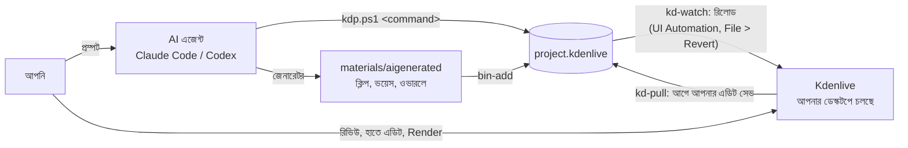

<div align="center">

# Movie Engine

**আপনার চোখের সামনেই একটি AI এজেন্ট Kdenlive-এ আপনার ভিডিও এডিট করে, আর আপনি যেকোনো মুহূর্তে নিয়ন্ত্রণ নিজের হাতে নিতে পারেন।**

AI কোডিং এজেন্ট (Claude Code, Codex) আসল Kdenlive প্রজেক্ট তৈরি করে ও বদলায়: ফিল্ম, explainer ভিডিও আর ভার্টিক্যাল শর্টস। পরিবর্তনগুলো লাইভ দেখা যায় সেই এডিটরেই, যেটা আপনার সামনে খোলা আছে। পোর্টেবল, Windows, এডিটরে কোনো প্যাচ ছাড়াই।


[English](../../README.md) · [简体中文](README.zh-CN.md) · [繁體中文](README.zh-TW.md) · [हिन्दी](README.hi.md) · [Español](README.es.md) · [Français](README.fr.md) · [العربية](README.ar.md) · **বাংলা** · [Português](README.pt.md) · [Русский](README.ru.md) · [اردو](README.ur.md) · [Bahasa Indonesia](README.id.md) · [Deutsch](README.de.md) · [日本語](README.ja.md) · [Türkçe](README.tr.md) · [한국어](README.ko.md) · [Українська](README.uk.md) · [Italiano](README.it.md) · [Polski](README.pl.md) · [Tiếng Việt](README.vi.md) · [فارسی](README.fa.md) · [ไทย](README.th.md) · [Kiswahili](README.sw.md) · [አማርኛ](README.am.md) · [Avañe'ẽ](README.gn.md) · [Setswana](README.tn.md) · [Shqip](README.sq.md) · [Беларуская](README.be.md) · [Български](README.bg.md) · [Bosanski](README.bs.md) · [Hrvatski](README.hr.md) · [Српски](README.sr.md) · [Crnogorski](README.cnr.md) · [Македонски](README.mk.md) · [Slovenščina](README.sl.md) · [Slovenčina](README.sk.md) · [Čeština](README.cs.md) · [Magyar](README.hu.md) · [Română](README.ro.md) · [Dansk](README.da.md) · [Norsk bokmål](README.nb.md) · [Norsk nynorsk](README.nn.md) · [Svenska](README.sv.md) · [Íslenska](README.is.md) · [Suomi](README.fi.md) · [Eesti](README.et.md) · [Latviešu](README.lv.md) · [Lietuvių](README.lt.md) · [Nederlands](README.nl.md) · [Lëtzebuergesch](README.lb.md) · [Rumantsch](README.rm.md) · [Ελληνικά](README.el.md) · [Malti](README.mt.md) · [Gaeilge](README.ga.md) · [Català](README.ca.md) · [ქართული](README.ka.md) · [Հայերեն](README.hy.md) · [Azərbaycanca](README.az.md) · [Afrikaans](README.af.md) · [isiZulu](README.zu.md) · [isiXhosa](README.xh.md) · [Sesotho](README.st.md) · [Sepedi](README.nso.md) · [Xitsonga](README.ts.md) · [Tshivenḓa](README.ve.md) · [siSwati](README.ss.md) · [isiNdebele (South Africa)](README.nr.md) · [isiNdebele (Zimbabwe)](README.nd.md) · [chiShona](README.sn.md) · [Chichewa](README.ny.md) · [Ikinyarwanda](README.rw.md) · [Ikirundi](README.rn.md) · [Malagasy](README.mg.md) · [Soomaali](README.so.md) · [Afaan Oromoo](README.om.md) · [Qafar af](README.aa.md) · [ትግርኛ](README.ti.md) · [Sängö](README.sg.md) · [Kreol Seselwa](README.crs.md) · [TjiKalanga](README.kck.md) · [ChiNdau](README.ndc.md)

*এটি একটি অনুবাদ; ইংরেজি README-ই হলো মূল (রেফারেন্স) সংস্করণ।*

</div>

---

## সূচিপত্র

- [কেন](#কেন)
- [এটি কীভাবে কাজ করে](#এটি-কীভাবে-কাজ-করে)
- [বৈশিষ্ট্য](#বৈশিষ্ট্য)
- [প্রয়োজনীয়তা](#প্রয়োজনীয়তা)
- [ইনস্টলেশন](#ইনস্টলেশন)
- [দ্রুত শুরু](#দ্রুত-শুরু)
- [এজেন্টের সঙ্গে কাজ](#এজেন্টের-সঙ্গে-কাজ)
- [এডিটিং কমান্ড লাইন (`kdp.ps1`)](#এডিটিং-কমান্ড-লাইন-kdpps1)
- [খোলা এডিটরের সঙ্গে লাইভ সিঙ্ক](#খোলা-এডিটরের-সঙ্গে-লাইভ-সিঙ্ক)
- [জেনারেটর: Kdenlive যা পারে না](#জেনারেটর-kdenlive-যা-পারে-না)
- [ভয়েস-ওভার ও সাউন্ড](#ভয়েস-ওভার-ও-সাউন্ড)
- [ইন্টারফেসের ভাষা](#ইন্টারফেসের-ভাষা)
- [ফোল্ডার কাঠামো](#ফোল্ডার-কাঠামো)
- [টেস্ট ও প্রমাণ](#টেস্ট-ও-প্রমাণ)
- [সীমাবদ্ধতা](#সীমাবদ্ধতা)
- [সমস্যা সমাধান](#সমস্যা-সমাধান)
- [সাধারণ প্রশ্ন (FAQ)](#সাধারণ-প্রশ্ন-faq)
- [অবদান](#অবদান)
- [কৃতজ্ঞতা](#কৃতজ্ঞতা)
- [লাইসেন্স](#লাইসেন্স)

## কেন

ভিডিও এডিটর বানানো হয় মাউসে রাখা হাতের জন্য। AI এজেন্ট ভালো কাঠামো, টাইমিং আর পুনরাবৃত্তির কাজে: বিটের সঙ্গে মিলিয়ে ৩০০টি ক্লিপ বসানো, প্রতিটি ক্যাপশন ভয়েসের সঙ্গে মেলানো, ফিডব্যাকের পর একটি সিন নতুন করে বানানো। কিন্তু আপনার ডেস্কটপ দখল না করে তারা GUI-তে ক্লিক করতে পারে না।

Kdenlive একটি শক্তিশালী ওপেন-সোর্স এডিটর, কিন্তু Windows-এ এর **কোনো অটোমেশন API নেই**: D-Bus নিয়ন্ত্রণ আছে শুধু Linux বিল্ডে, আর যেসব ফর্ক এটা যোগ করে সেগুলো হয় রক্ষণাবেক্ষণ করা হয় না, নয়তো অনিরাপদ। Movie Engine এডিটর প্যাচ না করেই এই সমস্যার সমাধান করে:

1. এজেন্ট একটি পরীক্ষিত কমান্ড লাইন (`engine/kdp.ps1`) দিয়ে `.kdenlive` প্রজেক্ট ফাইল এডিট করে।
2. চলমান Kdenlive-কে Windows UI Automation-এর মাধ্যমে ফাইলটি আবার লোড করতে বলা হয়, কোনো কীস্ট্রোক, মাউস বা ফোকস কেড়ে নেওয়া ছাড়াই।
3. আপনার নিজের সেভ না করা পরিবর্তন আগে সেভ হয় এবং কখনো ওভাররাইট হয় না।

অর্থাৎ এজেন্ট এডিট করে আর আপনি রিভিউ করেন, অথবা আপনি নিজের হাতে এডিট করেন। আপনারা দুজনেই একই প্রজেক্টে, একই এডিটরে, একই সময়ে কাজ করেন।

## এটি কীভাবে কাজ করে



প্রতিটি এডিটিং কমান্ড একই নিরাপদ চক্র মেনে চলে:

1. **Pull.** Kdenlive-এ সেভ না করা পরিবর্তন থাকলে, সেগুলো সেভ করতে বলা হয় (UI Automation দিয়ে টুলবারের Save), এবং সেভ নিশ্চিত করা হয়।
2. **Edit.** কমান্ড একটি লকের ভেতরে, হ্যাশ যাচাইয়ের পরে এবং undo স্ন্যাপশট নিয়ে XML বদলায়। এর মধ্যে ফাইল বদলে গেলে কিছুই লেখা হয় না।
3. **Reload.** ওয়াচার AI-এর স্ট্যাম্প দেখে এবং খোলা এডিটরে File > Revert চালায়। সাফল্য ধরা হয় তখনই, যখন টাইমলাইন উইজেট সত্যিই নতুন করে তৈরি হয়েছে।
4. **Conflict.** মাঝখানে আপনি এডিট শুরু করলে কিছুই রিলোড হয় না এবং আপনার কাজ থেকে যায়। AI-এর সংস্করণ আলাদা করে রাখা হয়, আর এজেন্ট তার পরিবর্তন আপনার পরিবর্তনের ওপর আবার প্রয়োগ করে।

## বৈশিষ্ট্য

- **GUI ছাড়াই পুরো প্রজেক্ট এডিটিং**: প্রায় ১২০টি কমান্ড, যা bin, টাইমলাইন, ইফেক্ট, কম্পোজিশন, ট্র্যাক, গাইড, মার্কার, সাবটাইটেল, সিকোয়েন্স, স্পিড ও টাইম রিম্যাপ, স্লাইডশো, টাইটেল, প্রক্সি, রেন্ডারিং এবং undo/redo কভার করে। দেখুন [কমান্ড রেফারেন্স](#এডিটিং-কমান্ড-লাইন-kdpps1)।
- **খোলা এডিটরের সঙ্গে লাইভ সিঙ্ক।** AI-এর পরিবর্তন দেখা যায় সেই Kdenlive-এ, যেটা আপনি দেখছেন; আপনার সেভ না করা পরিবর্তন আগে সেভ হয় এবং কখনো হারায় না।
- **আপনার ডেস্কটপে কখনো বিঘ্ন ঘটায় না।** ফোকস কেড়ে নেওয়া, কীস্ট্রোক বা মাউস ইনপুট কিছুই নেই। টেস্ট এডিটর চলে একটি অদৃশ্য Windows ডেস্কটপে।
- **পোর্টেবল।** এডিটর, সেটিংস, Node.js, ফন্ট এবং টুল সব একটি ফোল্ডারে থাকে। অন্য PC-তে কপি করলেই কাজ করে; Program Files বা আপনার Windows প্রোফাইলে কিছুই লেখা হয় না।
- **Kdenlive যা পারে না, তার জন্য জেনারেটর**: অক্ষর-ধরে-ধরে কাইনেটিক টেক্সট, হাতে আঁকা অ্যানোটেশন, 3D UI সিন, কার্সর অ্যানিমেশন এবং দীর্ঘ ইন্টারঅ্যাক্টিভ "explainer" ফিল্ম। এগুলো আসল মোশন ব্লারসহ GPU-তে রেন্ডার হয় এবং টাইমলাইনে সাধারণ ক্লিপ হিসেবে বসানো হয়।
- **শব্দের টাইমিংসহ ভয়েস-ওভার** (Microsoft Edge TTS, কোনো API key লাগে না)। ক্যাপশন আর অ্যাকশন ঠিক সেই শব্দেই চালু হয়।
- **সিন্থেসাইজ করা সাউন্ড ইফেক্ট** (whoosh, click, pop, riser, impact এবং আরও অনেক), কোডে তৈরি।
- **অনুমান নয়, প্রমাণিত।** প্রতিটি কমান্ডের ফলাফল যাচাই করা হয়, ইফেক্ট ও কম্পোজিশন একে একে পরীক্ষা করা হয়, আর কাঁচা ফলাফল আছে `docs/proof/`-এ।
- **এজেন্টের নির্দেশনা সঙ্গেই।** `AGENTS.md` এবং `.claude/skills/`-এর স্কিলগুলো Claude Code ও Codex-কে ওয়ার্কফ্লো, ফাইল ফরম্যাট আর সাধারণ ফাঁদগুলো শেখায়।

## প্রয়োজনীয়তা

| | |
|---|---|
| OS | Windows 10 বা 11, x64 |
| এডিটর | Kdenlive **26.08.3** পোর্টেবল (standalone) বিল্ড। অন্য সংস্করণ পরীক্ষা করা হয়নি। |
| Node.js | 18 বা নতুন: nodejs.org থেকে Windows x64 `.zip`, `engine/node/`-এ আনপ্যাক করা |
| ব্রাউজার | Microsoft Edge (Windows-এর অংশ); সিন রেন্ডারার এটিকে headless মোডে ব্যবহার করে |
| এজেন্ট | [Claude Code](https://claude.com/claude-code) বা Codex। ঐচ্ছিক: প্রতিটি টুল হাতেও চালানো যায়। |
| ডিস্ক | এডিটর ও টুলের জন্য প্রায় 1 GB, সঙ্গে আপনার মিডিয়া |
| GPU | হার্ডওয়্যার H.264 এনকোডিং আছে এমন যেকোনো GPU `film-render.mjs`-কে দ্রুত করে (না থাকলে এটি সফটওয়্যার এনকোডিংয়ে চলে যায়) |

## ইনস্টলেশন

সবকিছু ইনস্টল হয় **ফোল্ডারের ভেতরেই**। কোনো কিছুর জন্য admin অধিকার লাগে না।

```powershell
git clone https://github.com/vladtarrow/movie-engine.git
cd movie-engine
```

**1. Node.js.** <https://nodejs.org/en/download> থেকে Node.js 18 বা নতুনের Windows x64 `.zip` ডাউনলোড করে তার ভেতরের সবকিছু `engine\node\`-এ আনপ্যাক করুন, যাতে `engine\node\node.exe` এবং `engine\node\npm.cmd` থাকে। ইনস্টলার বা সিস্টেমের Node লাগে না। সব স্ক্রিপ্ট চলে `engine\node.cmd` দিয়ে, কখনো সিস্টেমের Node দিয়ে নয়।

**2. Node প্যাকেজ**, ভয়েস টুল ও রেন্ডারারের জন্য (সংস্করণগুলো `engine/voice/package.json`-এ নির্দিষ্ট করা আছে):

```powershell
engine\node\npm.cmd install --prefix engine\voice
```

**3. Kdenlive 26.08.3 পোর্টেবল।** <https://download.kde.org/stable/kdenlive/26.08/windows/> থেকে `kdenlive-26.08.3_standalone.exe` ডাউনলোড করে `engine\installer\`-এ রাখুন, যাচাই করুন এবং আনপ্যাক করুন:

```powershell
(Get-FileHash engine\installer\kdenlive-26.08.3_standalone.exe -Algorithm SHA256).Hash
# প্রত্যাশিত: A25427B1DFF2C17E3B0386E991BB1A719382BB3176D1A90E441CDAEB6E0A967D
engine\installer\kdenlive-26.08.3_standalone.exe -o"engine\Kdenlive" -y
```

এডিটরটি থাকবে `engine\Kdenlive\kdenlive-26.08.3_standalone\bin\`-এ। এতে আগে থেকেই `melt.exe` আর `ffmpeg.exe` আছে।

**4. প্রথমবার চালু করা।**

```powershell
engine\kdenlive.cmd
```

Kdenlive তার সব সেটিংস রাখে `engine\profile-kdenlive\`-এ, আপনার Windows প্রোফাইলে নয়। প্রথমবার চালু হলে এটি একবারের একটি সেটআপ উইজার্ড দেখায়।

## দ্রুত শুরু

### এজেন্টের মাধ্যমে

ফোল্ডারটি Claude Code (বা Codex)-এ খুলুন এবং সহজ ভাষায় বলুন:

> একটি নতুন ভার্টিক্যাল 30 fps প্রজেক্ট "launch-teaser" বানাও। `materials/designers/launch/` থেকে তিনটি স্ক্রিনশট টাইমলাইনে বসাও, প্রতিটি 2.5 s, ছোট একটা cross-fade দিয়ে, `script.txt` থেকে ভয়েস-ওভার যোগ করো আর প্রতিটি লাইনের সঙ্গে একটি কাইনেটিক ক্যাপশন টাইম করো।

> আমার জন্য এটা Kdenlive-এ খুলে দাও।

> দ্বিতীয় শটটা বেশি লম্বা। ওটা কেটে 1.8 s করো আর লোগোটা একটু ওপরে তোলো।

এজেন্ট `AGENTS.md` মেনে চলে: সে `kdp.ps1` দিয়ে এডিট করে, কাটের জন্য যে ক্লিপগুলো দরকার শুধু সেগুলোই রেন্ডার করে, এবং খোলা এডিটরকে সিঙ্কে রাখে। আপনি Kdenlive-এ রিভিউ করেন, যখন খুশি হাতে এডিট করেন, আর সন্তুষ্ট হলে Render চাপেন।

### হাতে

```powershell
# 2টি ভিডিও ও 2টি অডিও ট্র্যাকসহ একটি নতুন 1080x1920 30 fps প্রজেক্ট
powershell -NoProfile -ExecutionPolicy Bypass -File engine\kdp.ps1 new -Project projects\hello\hello.kdenlive -Profile vertical_hd_30

# 3 সেকেন্ডের একটি টাইটেল ও একটি রঙিন ব্যাকগ্রাউন্ড
powershell -NoProfile -ExecutionPolicy Bypass -File engine\kdp.ps1 bin-color -Project projects\hello\hello.kdenlive -Color '#203060' -Seconds 3 -Name bg
powershell -NoProfile -ExecutionPolicy Bypass -File engine\kdp.ps1 title -Project projects\hello\hello.kdenlive -Text "Hello" -Seconds 3 -Name hi

# এগুলো বসান: ব্যাকগ্রাউন্ড V1-এ, টাইটেল তার ওপরে V2-এ
powershell -NoProfile -ExecutionPolicy Bypass -File engine\kdp.ps1 add -Project projects\hello\hello.kdenlive -Bin bg -Track V1 -At 0
powershell -NoProfile -ExecutionPolicy Bypass -File engine\kdp.ps1 add -Project projects\hello\hello.kdenlive -Bin hi -Track V2 -At 0

# একটি যাচাই ফ্রেম, তারপর এডিটরে খুলুন
powershell -NoProfile -ExecutionPolicy Bypass -File engine\kdp.ps1 frame -Project projects\hello\hello.kdenlive -At 1.5 -Out out\hello\check.png
engine\kdenlive.cmd projects\hello\hello.kdenlive
```

পরে শেষ প্রজেক্টটি আবার খুলতে `open-last-project.cmd`-এ ডাবল-ক্লিক করুন।

## এজেন্টের সঙ্গে কাজ

এজেন্ট পড়ে `AGENTS.md` (Codex) অথবা `CLAUDE.md`, যা সেটিকে ইমপোর্ট করে (Claude Code), সঙ্গে দুটি স্কিল:

| স্কিল | যা শেখায় |
|---|---|
| `.claude/skills/kdenlive-project-file` | `.kdenlive` / MLT XML ফরম্যাট, `kdp.ps1`, `melt` দিয়ে যাচাই |
| `.claude/skills/kdenlive-live` | চলমান এডিটর নিরাপদে চালানো: চালু করা, pull, reload, তার উইন্ডো ক্যাপচার |

এজেন্ট যে নিয়মগুলো মেনে চলে, এবং যেগুলোর ওপর আপনি ভরসা করতে পারেন:

- সে কখনো আপনার মাউস, কীবোর্ড বা ফোকস নেয় না, এবং কখনো আপনার ডেস্কটপের স্ক্রিনশট নেয় না (শুধু এডিটরের নিজের উইন্ডোর)।
- GUI-এর ধাপগুলো (সেভ, খোলা, রিলোড) সে নিজেই করে, আপনাকে ক্লিক করতে বলে না।
- কিছু ডাউনলোড করার আগে এবং কিছু মুছে ফেলার আগে সে জিজ্ঞেস করে।
- কাজের জন্য যা দরকার শুধু তাই রেন্ডার করে (সিন ক্লিপ, যাচাই ফ্রেম)। ফাইনাল ফিল্ম রেন্ডার করে শুধু আপনি বললে।
- Kdenlive কোনো কিছু ভালোভাবে করতে না পারলে, এজেন্ট সেটা বাইরে কোড দিয়ে তৈরি করে এবং ফলাফল ক্লিপ হিসেবে বসায়। সে ইফেক্টকে দুর্বল করে না।

## এডিটিং কমান্ড লাইন (`kdp.ps1`)

```powershell
powershell -NoProfile -ExecutionPolicy Bypass -File engine\kdp.ps1 <command> -Project <file.kdenlive> [options]
```

সময় সেকেন্ডে, দশমিকের জন্য বিন্দু দিয়ে (`2.5`)। ট্র্যাকগুলো `V1 V2 …` (V1 সবচেয়ে নিচে) এবং `A1 A2 …`। একটি ক্লিপকে চিহ্নিত করা হয় `-Track` আর তার ভেতরের যেকোনো সময় `-At` দিয়ে। ইফেক্টের প্যারামিটার যায় `-Params "name=value||name=value"`-এ। প্রতিটি অপশনসহ পুরো তালিকা আছে `engine/kdp.ps1`-এর হেডারে।

| গ্রুপ | কমান্ড |
|---|---|
| প্রজেক্ট | `new`, `profiles`, `info`, `validate`, `fonts`, `profile-set`, `profile-from-clip`, `zone`, `archive`, `backups`, `rebase`, `otio-export`, `otio-import` |
| Bin | `bin-add`, `bin-color`, `title`, `title-text`, `title-save`, `title-template`, `bin-rename`, `bin-remove`, `bin-info`, `bin-set`, `bin-duplicate`, `bin-replace-file`, `bin-reload`, `folder`, `bin-folder`, `relink`, `clean`, `generator`, `playlist-clip`, `extract-audio`, `transcode` |
| টাইমলাইন | `add`, `add-av`, `move`, `copy`, `trim`, `ripple-trim`, `slip`, `split`, `remove`, `speed`, `remap`, `disable`, `enable`, `group`, `ungroup`, `mix`, `unmix`, `space-insert`, `space-remove`, `spaces-remove-all`, `track-clear`, `replace-in-timeline` |
| ইফেক্ট | `effects`, `effect-info`, `effect-add`, `effect-list`, `effect-set`, `effect-remove`, `effect-copy`, `effect-clear`, `effects-all`, `bin-effect`, `effect-templates`, `effect-template` |
| কম্পোজিশন | `compositions`, `comp-info`, `comp-add`, `comp-list`, `comp-set`, `comp-remove` |
| ট্র্যাক | `track-add`, `track-remove`, `track-set` |
| গাইড ও মার্কার | `guide-add`, `guide-list`, `guide-remove`, `guide-set`, `guide-clear`, `guide-export`, `guide-category`, `marker`, `marker-list`, `marker-set`, `marker-remove` |
| সাবটাইটেল | `sub-add`, `sub-import`, `sub-export`, `sub-state` |
| সিকোয়েন্স | `sequence-add`, `sequences`, `copy-to-sequence`, `expand`; `-Sequence <name>` দিলে যেকোনো কমান্ড সেই সিকোয়েন্সের ভেতরে কাজ করে |
| বিশেষ | `slideshow`, `bin-add` দিয়ে Lottie / Glaxnimate অ্যানিমেশন, `proxy`, `stabilize`, `scene-split`, `speed-job`, `subclip` |
| আউটপুট | `frame` (একটি PNG), `preview` (দ্রুত melt রেন্ডার), `render` (Kdenlive-এর নিজস্ব রেন্ডারার বা একটি প্রিসেট), `presets` |
| ইতিহাস | `undo`, `redo`, `clear-history` (স্ন্যাপশট থাকে `projects/<name>/.kdp-history`-এ) |

যে আচরণগুলো জানা দরকার:

- লিঙ্ক করা অডিও ও ভিডিও অংশ একসঙ্গে মুভ, ট্রিম, স্প্লিট এবং রিমুভ হয় (একটি অংশের জন্য `-Alone`)।
- ব্যর্থ কমান্ড কোড 1 দিয়ে বের হয় এবং কিছুই লেখে না।
- Windows বিল্ড যে ইফেক্ট চালাতে পারে না, সেগুলো প্রত্যাখ্যান করা হয়, নীরবে উপেক্ষা করা হয় না (তালিকা: `docs/proof/assets.txt`)।
- Kdenlive-এর প্রতিটি মেনু অ্যাকশন `engine/tools/data/kdenlive-actions.csv`-এ একটি কমান্ড, অন্য কোনো পথ, অথবা "শুধু দেখার জন্য"-এর সঙ্গে ম্যাপ করা আছে। দেখুন `docs/kdenlive-coverage.md`।

## খোলা এডিটরের সঙ্গে লাইভ সিঙ্ক

| স্ক্রিপ্ট | কী করে | এক্সিট কোড |
|---|---|---|
| `engine\kd-pull.ps1 -Project <f>` | Kdenlive-কে দিয়ে আপনার এডিট সেভ করায় এবং তা নিশ্চিত করে | 0 ফাইল হালনাগাদ, 3 চলছে না, 4 নিশ্চিত হয়নি |
| `engine\kd-reload.ps1 -Project <f>` | File > Revert, নতুন করে তৈরি টাইমলাইন দিয়ে নিশ্চিত | 0 নিশ্চিত, 2 আপনার সেভ না করা এডিট আছে (কিছুই বাদ দেওয়া হয়নি), 3 চলছে না, 4 ব্যর্থ |
| `engine\kd-watch.ps1 -Project <f>` | ব্যাকগ্রাউন্ড ওয়াচার: AI-এর প্রতিটি লেখার পর রিলোড করে, কনফ্লিক্ট লগ করে | লগ `engine\kd-watch.log`-এ; থামাতে `engine\kd-watch.run` মুছে দিন |
| `engine\kdenlive-bg.ps1 [project]` | এজেন্টের জন্য Kdenlive মিনিমাইজ অবস্থায় চালু করে | 0 লোড হয়েছে, 4 নিশ্চিত হয়নি |
| `engine\kdenlive.cmd [project]` | আপনার জন্য Kdenlive চালু করে | |

প্রতি সেশনে একবার ওয়াচার চালু করুন:

```powershell
Start-Process powershell -WindowStyle Hidden -ArgumentList '-NoProfile','-ExecutionPolicy','Bypass','-File','engine\kd-watch.ps1','-Project','projects\hello\hello.kdenlive'
```

বড় প্রজেক্ট: ১০০০ ক্লিপের একটি প্রজেক্ট রিলোড হতে কয়েক মিনিট লাগে, আর টুলগুলো আগেভাগে রিপোর্ট না করে সেটার জন্য অপেক্ষা করে। প্রজেক্ট খোলা হয় ফাঁকা এডিটরে *File > Open Recent* দিয়ে, কারণ সরাসরি ফাইল খুললে Qt অ্যাক্সেসিবিলিটির জন্য টাইমলাইনের প্রতিটি আইটেম ঘুরে দেখে, আর তাতে প্রায় ১০ মিনিট বেশি লাগত।

## জেনারেটর: Kdenlive যা পারে না

Kdenlive/MLT-এ অক্ষর-ধরে-ধরে টেক্সট অ্যানিমেশন নেই, expressions নেই, 3D খুবই কম, আর ভারী ইফেক্ট প্লেব্যাক ধীর করে দেয়। Movie Engine এমন অংশগুলো বাইরে রেন্ডার করে এবং টাইমলাইনে সাধারণ ক্লিপ হিসেবে বসায়, সাধারণত alpha-সহ, ছবির ওপরের একটি ট্র্যাকে। জেনারেটর স্ক্রিপ্ট আর তার ইনপুট প্রজেক্ট ফোল্ডারেই থাকে, যাতে টেক্সট, ফন্ট বা টাইমিং বদলালে ক্লিপটি আবার তৈরি করা যায়।

| টুল | যা তৈরি করে |
|---|---|
| `engine/tools/kinetic-text.ps1` | অক্ষর-ধরে-ধরে কাইনেটিক ক্যাপশন, প্রতিটি শব্দের টাইমিং `voice.json` থেকে, হাইলাইট বক্স |
| `engine/tools/annotate.ps1` | হাতে আঁকা বৃত্ত, বক্স, আন্ডারলাইন আর তীর, যা স্ক্রিনশটের ওপর ধীরে ধীরে আঁকা হয় |
| `engine/tools/card-entrance.ps1` | একটি স্ক্রিনশট কার্ড, যা নরম ছায়াসহ ওপরে উঠে বড় হয়ে আসে |
| `engine/tools/pdf-to-png.ps1` | PDF এক্সপোর্ট থেকে স্লাইড |
| `engine/tools/html-render.mjs` | যেকোনো HTML/CSS/canvas সিন থেকে ভিডিও: ইন্টারফেস অ্যানিমেশন, কার্সর, 3D, মাস্ক |
| `engine/tools/film-render.mjs` + `film/` | canvas-এ দীর্ঘ, ইন্টারঅ্যাক্টিভ explainer ফিল্ম: প্রতিটি ভয়েস লাইনের জন্য একটি ক্লিপ, অ্যাকশন চালু হয় উচ্চারিত শব্দে, প্রায় 45 fps-এ GPU মোশন ব্লার |

দুটি রেন্ডারারই Windows-এর সঙ্গে আসা Microsoft Edge-কে headless মোডে চালায়, একটি অস্থায়ী প্রোফাইল দিয়ে এবং কোনো নেটওয়ার্ক অ্যাক্সেস ছাড়া।

### ডেমো

```powershell
# কার্সর ক্লিকসহ 3 সেকেন্ডের একটি 3D টাইটেল কার্ড
engine\node.cmd engine\tools\html-render.mjs examples\demo\scene\scene.html examples\demo\out --frames 0,30,60,89
engine\node.cmd engine\tools\html-render.mjs examples\demo\scene\scene.html examples\demo\out\scene.mp4

# দুটি ভয়েস লাইনের সঙ্গে টাইম করা 4 শটের একটি ইন্টারঅ্যাক্টিভ ফিল্ম
engine\node.cmd engine\tools\film-render.mjs examples\demo\film\film.html examples\demo\out --check
engine\node.cmd engine\tools\film-render.mjs examples\demo\film\film.html examples\demo\out --shots all --width 640
engine\node.cmd engine\tools\film-render.mjs examples\demo\film\film.html examples\demo\out\clips --suffix -v01
```

একটি ফিল্ম তিনটি ছোট ফাইল। `data.js`-এ থাকে শট আর শব্দের সময়। `direction.js`-এ প্রতিটি শটের জন্য একটি করে লাইন:

```text
1 | hover 192 108 @brand | tag 300 60 Your brand @deserves | confetti 192 90 @film
2 say=A film that/*explains* it
3 | click 116 108 @before | click 268 108 @after | chips Before~After @after
4 scene=counter | count 0 120 % @count
```

`scenes.js`-এ থাকে সেই শটগুলো, যেগুলো শূন্য থেকে আঁকা হয়। ভয়েস যখন কোনো শব্দ বলে, `@word` তখন একটি অ্যাকশন চালু করে। অ্যাকশনগুলোর মধ্যে আছে click, hover, drag, zoom, lens, ring, arrow, chips, toggle, slider, toast, type, count এবং confetti; পুরো সিনট্যাক্স আছে `engine/tools/film/film-kit.js`-এর শুরুতে।

## ভয়েস-ওভার ও সাউন্ড

```powershell
engine\node.cmd engine\voice\voice.mjs lines.json materials\aigenerated\hello\voice en-US-AndrewMultilingualNeural +0%
```

`lines.json` হলো লাইনের একটি তালিকা। টুলটি প্রতিটি লাইনের জন্য একটি mp3 লেখে, সঙ্গে `voice.json`, যাতে থাকে দৈর্ঘ্য এবং প্রতিটি শব্দের শুরু ও শেষ। লাইনগুলো ক্যাশ করা হয়, তাই একটি লাইন বদলালে শুধু সেই লাইনটিই আবার তৈরি হয়। এটি `msedge-tts` প্যাকেজের মাধ্যমে Microsoft Edge-এর অনলাইন text-to-speech ব্যবহার করে: কোনো key লাগে না, কিন্তু সার্ভিসটি অনানুষ্ঠানিক এবং ইন্টারনেট লাগে।

```powershell
engine\node.cmd engine\audio\sfx.mjs materials\aigenerated\sfx
```

এটি কোডে whoosh, whoosh-long, swipe, click, pop, tick, riser, impact, ding এবং reveal সিন্থেসাইজ করে; একটি তৈরি সেট আছে `materials/aigenerated/sfx/`-এ। এক ফ্রেমের চেয়ে ছোট সাউন্ড বসানোর আগে নীরবতা দিয়ে লম্বা করে নিন (`-af apad=whole_dur=0.0667`)।

## ইন্টারফেসের ভাষা

লঞ্চারগুলো ডিফল্টভাবে Kdenlive **ইংরেজিতে** চালু করে। অন্য ভাষা ব্যবহার করতে, চালু করার আগে `MOVIE_ENGINE_UI_LANG` সেট করুন:

```powershell
$env:MOVIE_ENGINE_UI_LANG = 'ru'; engine\kdenlive.cmd
```

UI Automation মেনু আইটেম খোঁজে তাদের দৃশ্যমান নাম দিয়ে। ৩১টি ইন্টারফেস ভাষার নাম আগে থেকেই যুক্ত আছে (`engine/tools/kd-ui.ps1`, `$KdNames`)। অন্য যেকোনো ভাষার জন্য সেখানে তার নামগুলো যোগ করুন এবং এটি দিয়ে যাচাই করুন:

```powershell
powershell -NoProfile -ExecutionPolicy Bypass -File engine\tools\kd-langcheck.ps1
```

## ফোল্ডার কাঠামো

```text
movie-engine/
├─ AGENTS.md, CLAUDE.md          instructions for AI agents
├─ .claude/skills/               agent skills: project file format, live editor
├─ engine/
│  ├─ kdp.ps1                    the editing command line
│  ├─ kd-pull / kd-reload / kd-watch .ps1, kdenlive.cmd, kdenlive-bg.ps1
│  ├─ tools/                     internals, generators, tests, data (action map)
│  ├─ voice/  audio/  fonts/     TTS, synthesized SFX, Poppins (OFL)
│  ├─ Kdenlive/  node/           portable editor and Node.js (not in git)
│  └─ profile-kdenlive/          the editor's settings (not in git)
├─ projects/<name>/<name>.kdenlive
├─ materials/
│  ├─ download/                  stock and downloaded files (not in git)
│  ├─ aigenerated/               everything the AI made (sfx/ and test-kit/ ship with the engine)
│  ├─ designers/  brand/         files from your team, brand assets
├─ examples/demo/                demos of the scene and film renderers
├─ out/                          renders (not in git)
└─ docs/                         proofs, coverage, translations of this README
```

প্রজেক্টের ভেতরের মিডিয়া পাথগুলো relative। ফোল্ডারটি সরালে বা কপি করলে `kdp.ps1 rebase` (যা `kdenlive.cmd` স্বয়ংক্রিয়ভাবেও চালায়) নতুন অবস্থান প্রজেক্টে লিখে দেয়।

## টেস্ট ও প্রমাণ

কী কাজ করে, সেই দাবিগুলো দাঁড়িয়ে আছে ফলাফল যাচাইয়ের ওপর, "ফাংশনটা চলেছে"-এর ওপর নয়। সারসংক্ষেপ আছে [`docs/kdenlive-proof.md`](../../docs/kdenlive-proof.md)-এ, আর কাঁচা আউটপুট `docs/proof/`-এ।

| টেস্ট | যা যাচাই করে |
|---|---|
| `engine\tools\kdp-clitest.ps1` | প্রতিটি `kdp.ps1` কমান্ড, কমান্ড লাইনের মাধ্যমে, ফলাফলের প্রজেক্ট তুলনা করে |
| `engine\tools\kd-livetest.ps1` | অদৃশ্য ডেস্কটপে আসল Kdenlive-এর বিপরীতে pull, reload, ওয়াচার, কনফ্লিক্ট আর race condition |
| `engine\tools\kdp-assetsweep.ps1` | প্রতিটি ইফেক্ট ও কম্পোজিশন: ফ্রেম রেন্ডার করে তুলনা করে |
| `engine\tools\kdp-portabletest.ps1` | ফোল্ডারটি অন্য কোথাও কপি করে এবং সেই কপি থেকে কাজ করে |
| `engine\tools\kd-langcheck.ps1` | ইন্টারফেসের ভাষা, এবং UI Automation মেনু খুঁজে পায় কি না |
| `engine\tools\kdp-coverage-check.ps1` | প্রতিটি মেনু অ্যাকশন ম্যাপ করা আছে, এবং কোনো প্রমাণ কোডের চেয়ে পুরোনো নয় |

```powershell
powershell -NoProfile -ExecutionPolicy Bypass -File engine\tools\kdp-clitest.ps1 -Report docs\proof\clitest.txt
powershell -NoProfile -ExecutionPolicy Bypass -File engine\tools\kd-livetest.ps1 -Report docs\proof\live-en.txt
```

টেস্ট এডিটর চলে শুধু একটি লুকানো ডেস্কটপে, নিজস্ব প্রোফাইল নিয়ে, তাই টেস্ট কখনো আপনার খোলা Kdenlive বা আপনার ফোকসে হাত দেয় না।

## সীমাবদ্ধতা

- **শুধু Windows**, শুধু Kdenlive **26.08.3**। Linux-এ D-Bus আছে, সেখানে আলাদা একটি ব্রিজ লাগবে।
- এডিটর চালু হওয়ার সময়, ফাঁকা উইন্ডোটি দেখা দেওয়ার মুহূর্তে, এটি প্রায় 3 সেকেন্ডের জন্য কীবোর্ড ফোকস নিয়ে নেয়। আপনি কাজ করার সময় এজেন্ট এটি চালু করার আগে জিজ্ঞেস করে। রিলোড আর এডিট ফোকস নেয় না।
- Windows বিল্ডে sox, ladspa ও movit MLT মডিউল এবং কিছু frei0r/avfilter ইফেক্ট নেই; `kdp.ps1` সেগুলো প্রত্যাখ্যান করে (`docs/proof/assets.txt`)।
- OpenTimelineIO এক্সপোর্ট ও ইমপোর্ট শুধু ক্লিপ আর গ্যাপ বহন করে। Multicam-এ লাইভ অ্যাঙ্গেল সুইচিং নেই (কাট করা হয় split/remove/hide দিয়ে)।
- মিনিমাইজ করা উইন্ডোতে UI Automation দিয়ে "Save As…" কোনো ডায়ালগ খোলে না; এজেন্ট এর বদলে `archive` বা ফাইল কপি ব্যবহার করে।
- স্পিচ রিকগনিশন (অটো-সাবটাইটেল)-এর জন্য Whisper বা Vosk লাগে, যা সঙ্গে দেওয়া নেই।
- Kdenlive-এর টাইটেল টুলে তৈরি টাইটেল Windows-এ ইনস্টল করা ফন্ট ব্যবহার করে। নিশ্চিত টাইপোগ্রাফির জন্য টেক্সট রেন্ডার করুন জেনারেটর দিয়ে, যা ফন্ট লোড করে `engine/fonts/` থেকে।
- Edge TTS একটি অনানুষ্ঠানিক অনলাইন সার্ভিস এবং এটি বদলে যেতে বা কাজ করা বন্ধ করতে পারে।

## সমস্যা সমাধান

| লক্ষণ | কারণ ও সমাধান |
|---|---|
| Kdenlive চলছে, কিন্তু টাস্কবারে ক্লিক করলে কিছুই দেখা যায় না | এর সেভ করা উইন্ডো অবস্থান স্ক্রিনের বাইরে। এটি বন্ধ করে `engine\profile-kdenlive\AppData\Local\kdenliverc`-এ `kdockLayout` এন্ট্রিগুলো মুছে দিন, অথবা `SetWindowPos` দিয়ে উইন্ডোটি সরান (দেখুন `AGENTS.md`)। |
| `kd-reload.ps1` কোড 2 দিয়ে বের হয় | আপনার সেভ না করা এডিট আছে। কিছুই বাদ দেওয়া হয়নি। `kd-pull.ps1` চালান, তারপর পরিবর্তনটি আবার প্রয়োগ করুন (`kdp.ps1` এটি নিজেই করে)। |
| `engine\kd-watch.log`-এ `CONFLICT` | আপনি আর এজেন্ট একই মুহূর্তে এডিট করেছেন। আপনার সংস্করণ এডিটরে থাকে, আর AI-এর সংস্করণ আছে `projects\<name>\.kdp-history\<name>\conflict\`-এ। এজেন্টকে তার পরিবর্তন আবার প্রয়োগ করতে বলুন। |
| কোনো কমান্ড "pull not confirmed" বলে কোড 1 দিয়ে বের হয় | Kdenlive ব্যস্ত অথবা কোনো ডায়ালগ দেখাচ্ছে। ডায়ালগটি বন্ধ করুন বা লোডিং শেষ হওয়া পর্যন্ত অপেক্ষা করুন, তারপর আবার চেষ্টা করুন। |
| কোনো PowerShell স্ক্রিপ্ট পার্স হয় না | non-ASCII টেক্সটসহ স্ক্রিপ্ট Windows PowerShell 5.1-এর জন্য UTF-8 **BOM-সহ** সেভ করতে হবে। |
| `voice.mjs` "Stream closed before the synthesis completed" বলে থেমে যায় | সাধারণত নেটওয়ার্কের সমস্যা, অথবা পুরোনো কপিতে escape না করা SSML। `voice.mjs` নিজেই `& < >` escape করে। |
| বড় প্রজেক্ট খুলতে অনেক মিনিট লাগে | এটি `kdenlive.cmd` / `kdenlive-bg.ps1` দিয়ে খুলুন, কখনো `kdenlive.exe project.kdenlive` হিসেবে নয়। |

## সাধারণ প্রশ্ন (FAQ)

**আমার কি Claude Code বা Codex লাগবে?**
না। প্রতিটি টুল একটি সাধারণ স্ক্রিপ্ট, যা আপনি হাতে চালাতে পারেন। এজেন্ট এটিকে দ্রুত করে তোলে: সে কাটের পরিকল্পনা করে, টুল চালায় এবং এডিটরকে সিঙ্কে রাখে।

**এজেন্ট কি আমার হাতে করা এডিট ওভাররাইট করবে?**
না। যেকোনো লেখার আগে আপনার সেভ না করা এডিট সেভ ও নিশ্চিত করা হয়। এজেন্ট লেখার সময় আপনি এডিট করলে, লেখাটি প্রত্যাখ্যান করা হয় বা কনফ্লিক্ট হিসেবে আলাদা রাখা হয়, কখনো আপনার কাজের ওপর প্রয়োগ করা হয় না।

**আমি কি স্বাভাবিকভাবে Kdenlive ব্যবহার চালিয়ে যেতে পারব?**
হ্যাঁ। এটি স্টক Kdenlive, নিজস্ব সেটিংস ফোল্ডারসহ। আগের মতোই এডিট, প্রিভিউ আর রেন্ডার করুন।

**আমার আগে থেকে ইনস্টল করা Kdenlive-এর সঙ্গে কি এটি কাজ করে?**
এটি `engine\Kdenlive\`-এ নিজস্ব পোর্টেবল কপি ব্যবহার করে, তাই আপনার ইনস্টল করা Kdenlive ও তার সেটিংস অক্ষত থাকে।

**API-সহ কোনো Kdenlive ফর্ক বা অন্য কোনো এডিটর কেন নয়?**
Windows-এ রক্ষণাবেক্ষণ করা ও নিরাপদ কোনো ফর্ক নেই (2026-11-এর সমীক্ষা)। OpenShot, Blender VSE, DaVinci Resolve, Shotcut এবং ওয়েব এডিটর পরীক্ষা করা হয়েছে; Kdenlive এডিটিংয়ে সবচেয়ে বেশি গভীরতা দিয়েছে। upstream-এ একটি REST API প্রস্তাবের (merge request !902) ওপর নজর রাখা হচ্ছে।

**এটি কি ফাইনাল ভিডিও রেন্ডার করতে পারে?**
হ্যাঁ, `kdp.ps1 render` দিয়ে (Kdenlive-এর নিজস্ব রেন্ডারার, লুকানো অবস্থায়), অথবা আপনি নিজেই এডিটরে Render চাপুন।

**আমার মিডিয়া কি কোথাও আপলোড হয়?**
না। ভয়েস তৈরির সময় শুধু ভয়েস-ওভারের টেক্সট Edge TTS সার্ভিসে পাঠানো হয়। সিন রেন্ডারার নেটওয়ার্ক বন্ধ রেখে চলে।

## অবদান

অবদান স্বাগত। দেখুন [CONTRIBUTING.md](../../CONTRIBUTING.md)। সংক্ষেপে:

- প্রতিটি নতুন বা পরিবর্তিত `kdp.ps1` অপারেশনের জন্য দরকার `kdp-clitest.ps1`-এ একটি ফলাফল যাচাই, অ্যাকশন ম্যাপে একটি এন্ট্রি, এবং `kdp-coverage-check.ps1`-এর একটি নতুন রান।
- দৃশ্যমান ডেস্কটপে কখনো টেস্ট Kdenlive চালু করবেন না; `engine/tools/kd-hidden.ps1` ব্যবহার করুন।
- সবকিছু পোর্টেবল রাখুন: ফোল্ডারের বাইরে কোনো ইনস্টল নয়, প্রজেক্টে কোনো absolute পাথ নয়।
- যাচাই করা অদ্ভুত আচরণগুলো (quirks) লিখে রাখুন `AGENTS.md`-এ বা সংশ্লিষ্ট স্কিলে।

## কৃতজ্ঞতা

- [Kdenlive](https://kdenlive.org) এবং [MLT](https://www.mltframework.org): এডিটর এবং তার নিচের ইঞ্জিন।
- [FFmpeg](https://ffmpeg.org), যা Kdenlive-এর সঙ্গে আসে।
- ভয়েস-ওভারের জন্য [msedge-tts](https://www.npmjs.com/package/msedge-tts)।
- Indian Type Foundry-র [Poppins](https://fonts.google.com/specimen/Poppins), SIL Open Font License (`engine/fonts/OFL.txt`)।
- `engine/tools/data/kdenliveui-26.08.3.rc`: Kdenlive-এর মেনু ফাইল, Kdenlive 26.08.3-এর সোর্স থেকে নেওয়া; শুধু কভারেজ চেকে ব্যবহৃত। এটি MIT নয়, Kdenlive-এর GPL লাইসেন্সের অধীনে থাকে।

## লাইসেন্স

Movie Engine-এর নিজস্ব কোড [MIT লাইসেন্সের](../../LICENSE) অধীনে প্রকাশিত। Kdenlive, MLT, FFmpeg, Node.js প্যাকেজ এবং Poppins ফন্ট তাদের নিজস্ব লাইসেন্সের অধীনে থাকে।
