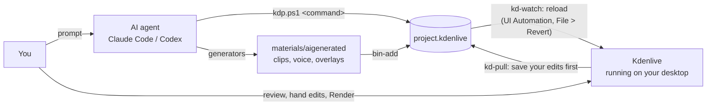

<div align="center">

# Movie Engine

**AI agent montira vaš video u Kdenliveu dok vi gledate, a vi u svakom trenutku možete preuzeti kontrolu.**

AI agenti za programiranje (Claude Code, Codex) prave i mijenjaju stvarne Kdenlive projekte: filmove, videe s objašnjenjima i vertikalne kratke videe. Izmjene se odmah pojavljuju u editoru koji imate otvoren. Prenosivo, Windows, bez zakrpa editora.


[English](../../README.md) · [简体中文](README.zh-CN.md) · [繁體中文](README.zh-TW.md) · [हिन्दी](README.hi.md) · [Español](README.es.md) · [Français](README.fr.md) · [العربية](README.ar.md) · [বাংলা](README.bn.md) · [Português](README.pt.md) · [Русский](README.ru.md) · [اردو](README.ur.md) · [Bahasa Indonesia](README.id.md) · [Deutsch](README.de.md) · [日本語](README.ja.md) · [Türkçe](README.tr.md) · [한국어](README.ko.md) · [Українська](README.uk.md) · [Italiano](README.it.md) · [Polski](README.pl.md) · [Tiếng Việt](README.vi.md) · [فارسی](README.fa.md) · [ไทย](README.th.md) · [Kiswahili](README.sw.md) · [አማርኛ](README.am.md) · [Avañe'ẽ](README.gn.md) · [Setswana](README.tn.md) · [Shqip](README.sq.md) · [Беларуская](README.be.md) · [Български](README.bg.md) · **Bosanski** · [Hrvatski](README.hr.md) · [Српски](README.sr.md) · [Crnogorski](README.cnr.md) · [Македонски](README.mk.md) · [Slovenščina](README.sl.md) · [Slovenčina](README.sk.md) · [Čeština](README.cs.md) · [Magyar](README.hu.md) · [Română](README.ro.md) · [Dansk](README.da.md) · [Norsk bokmål](README.nb.md) · [Norsk nynorsk](README.nn.md) · [Svenska](README.sv.md) · [Íslenska](README.is.md) · [Suomi](README.fi.md) · [Eesti](README.et.md) · [Latviešu](README.lv.md) · [Lietuvių](README.lt.md) · [Nederlands](README.nl.md) · [Lëtzebuergesch](README.lb.md) · [Rumantsch](README.rm.md) · [Ελληνικά](README.el.md) · [Malti](README.mt.md) · [Gaeilge](README.ga.md) · [Català](README.ca.md) · [ქართული](README.ka.md) · [Հայերեն](README.hy.md) · [Azərbaycanca](README.az.md) · [Afrikaans](README.af.md) · [isiZulu](README.zu.md) · [isiXhosa](README.xh.md) · [Sesotho](README.st.md) · [Sepedi](README.nso.md) · [Xitsonga](README.ts.md) · [Tshivenḓa](README.ve.md) · [siSwati](README.ss.md) · [isiNdebele (South Africa)](README.nr.md) · [isiNdebele (Zimbabwe)](README.nd.md) · [chiShona](README.sn.md) · [Chichewa](README.ny.md) · [Ikinyarwanda](README.rw.md) · [Ikirundi](README.rn.md) · [Malagasy](README.mg.md) · [Soomaali](README.so.md) · [Afaan Oromoo](README.om.md) · [Qafar af](README.aa.md) · [ትግርኛ](README.ti.md) · [Sängö](README.sg.md) · [Kreol Seselwa](README.crs.md) · [TjiKalanga](README.kck.md) · [ChiNdau](README.ndc.md)

*Ovo je prevod; referentna verzija je README na engleskom jeziku.*

</div>

---

## Sadržaj

- [Zašto](#zašto)
- [Kako radi](#kako-radi)
- [Mogućnosti](#mogućnosti)
- [Zahtjevi](#zahtjevi)
- [Instalacija](#instalacija)
- [Brzi start](#brzi-start)
- [Rad s agentom](#rad-s-agentom)
- [Komandna linija za montažu (`kdp.ps1`)](#komandna-linija-za-montažu-kdpps1)
- [Sinhronizacija uživo s otvorenim editorom](#sinhronizacija-uživo-s-otvorenim-editorom)
- [Generatori: ono što Kdenlive ne može](#generatori-ono-što-kdenlive-ne-može)
- [Naracija i zvuk](#naracija-i-zvuk)
- [Jezik interfejsa](#jezik-interfejsa)
- [Raspored foldera](#raspored-foldera)
- [Testovi i dokazi](#testovi-i-dokazi)
- [Ograničenja](#ograničenja)
- [Rješavanje problema](#rješavanje-problema)
- [Često postavljana pitanja](#često-postavljana-pitanja)
- [Doprinos projektu](#doprinos-projektu)
- [Zahvalnice](#zahvalnice)
- [Licenca](#licenca)

## Zašto

Programi za montažu videa napravljeni su za ruku na mišu. AI agenti su dobri u strukturi, tajmingu i ponavljanju: postaviti 300 klipova u ritam muzike, vremenski uskladiti svaki natpis s glasom, ponovo napraviti scenu nakon povratnih informacija. Ali ne mogu klikati po grafičkom interfejsu, a da ne preuzmu vašu radnu površinu.

Kdenlive je snažan editor otvorenog koda, ali na Windowsu **nema API za automatizaciju**: upravljanje preko D-Busa postoji samo u verzijama za Linux, a forkovi koji ga dodaju ili se više ne održavaju ili nisu sigurni. Movie Engine to rješava bez krpljenja editora:

1. Agent mijenja datoteku projekta `.kdenlive` pomoću testirane komandne linije (`engine/kdp.ps1`).
2. Pokrenutom Kdenliveu se preko Windows UI Automationa poručuje da ponovo učita datoteku, bez pritiskanja tipki, bez miša i bez otimanja fokusa.
3. Vaše nesačuvane izmjene se prvo sačuvaju i nikada se ne prepisuju.

Dakle, agent montira, a vi pregledate, ili sami montirate ručno. Oboje radite na istom projektu, u istom editoru, u isto vrijeme.

## Kako radi



Svaka komanda za montažu prolazi kroz isti sigurni ciklus:

1. **Pull.** Ako Kdenlive ima nesačuvane promjene, dobija nalog da ih sačuva (dugme Save na traci s alatima preko UI Automationa), a čuvanje se potvrđuje.
2. **Izmjena.** Komanda mijenja XML pod zaključavanjem, nakon provjere heša i sa snimkom stanja za poništavanje. Ako se datoteka u međuvremenu promijenila, ništa se ne upisuje.
3. **Ponovno učitavanje.** Posmatrač prepoznaje oznaku koju ostavlja AI i u otvorenom editoru pokreće File > Revert. Uspjehom se smatra samo kada je widget vremenske linije zaista ponovo izgrađen.
4. **Konflikt.** Ako ste u međuvremenu počeli mijenjati projekt, ništa se ne učitava ponovo i vaš rad ostaje. AI verzija se ostavlja po strani, a agent ponovo primjenjuje svoju izmjenu preko vaše.

## Mogućnosti

- **Potpuna montaža projekta bez grafičkog interfejsa**: oko 120 komandi koje pokrivaju korpu projekta, vremensku liniju, efekte, kompozicije, trake, vodilice, markere, titlove, sekvence, brzinu i remapiranje vremena (time remap), slajdšou, naslove, proksi klipove, renderovanje te poništavanje i ponavljanje. Pogledajte [pregled komandi](#komandna-linija-za-montažu-kdpps1).
- **Sinhronizacija uživo s otvorenim editorom.** AI izmjene se pojavljuju u Kdenliveu u koji gledate; vaše nesačuvane izmjene se prvo sačuvaju i nikada se ne gube.
- **Nikada ne ometa vašu radnu površinu.** Bez otimanja fokusa, pritiskanja tipki i unosa mišem. Testni editori rade na nevidljivoj radnoj površini Windowsa.
- **Prenosivo.** Editor, postavke, Node.js, fontovi i alati nalaze se u jednom folderu. Kopirajte ga na drugi računar i radit će; ništa se ne upisuje u Program Files niti u vaš Windows profil.
- **Generatori za ono što Kdenlive ne može**: kinetički tekst animiran slovo po slovo, ručno crtane anotacije, 3D scene interfejsa, animacije kursora i dugi interaktivni filmovi s objašnjenjima. Renderuju se na GPU-u sa stvarnim zamućenjem pokreta i postavljaju na vremensku liniju kao obični klipovi.
- **Naracija s vremenskim oznakama riječi** (Microsoft Edge TTS, bez API ključa). Natpisi i akcije se aktiviraju tačno na zadanoj riječi.
- **Sintetizirani zvučni efekti** (whoosh, click, pop, riser, impact i drugi), generisani kodom.
- **Dokazano, ne pretpostavljeno.** Svaka komanda ima provjeru rezultata, efekti i kompozicije se provjeravaju jedan po jedan, a sirovi rezultati su u `docs/proof/`.
- **Uputstva za agente su uključena.** `AGENTS.md` i vještine u `.claude/skills/` uče Claude Code i Codex toku rada, formatu datoteke i zamkama.

## Zahtjevi

| | |
|---|---|
| Operativni sistem | Windows 10 ili 11, x64 |
| Editor | Kdenlive **26.08.3**, prenosiva (standalone) verzija. Ostale verzije nisu testirane. |
| Node.js | 18 ili noviji: Windows x64 `.zip` sa nodejs.org, raspakovan u `engine/node/` |
| Pretraživač | Microsoft Edge (dio Windowsa); rendereri scena ga koriste u headless režimu |
| Agent | [Claude Code](https://claude.com/claude-code) ili Codex. Nije obavezno: svaki alat se može pokrenuti i ručno. |
| Disk | oko 1 GB za editor i alate, plus vaši mediji |
| GPU | bilo koji GPU s hardverskim kodiranjem H.264 ubrzava `film-render.mjs` (bez njega se koristi softversko kodiranje) |

## Instalacija

Sve se instalira **unutar foldera**. Administratorska prava nisu potrebna.

```powershell
git clone https://github.com/vladtarrow/movie-engine.git
cd movie-engine
```

**1. Node.js.** Preuzmite Windows x64 `.zip` Node.js-a 18 ili novijeg sa <https://nodejs.org/en/download> i raspakujte njegov sadržaj u `engine\node\`, tako da se tamo nalaze `engine\node\node.exe` i `engine\node\npm.cmd`. Nisu potrebni ni instalacioni program ni Node instaliran na sistemu. Sve skripte se pokreću preko `engine\node.cmd`, nikada preko sistemskog Nodea.

**2. Node paketi** za alat za naraciju i renderere (verzije su fiksirane u `engine/voice/package.json`):

```powershell
engine\node\npm.cmd install --prefix engine\voice
```

**3. Prenosivi Kdenlive 26.08.3.** Preuzmite `kdenlive-26.08.3_standalone.exe` sa <https://download.kde.org/stable/kdenlive/26.08/windows/> u `engine\installer\`, provjerite ga i raspakujte:

```powershell
(Get-FileHash engine\installer\kdenlive-26.08.3_standalone.exe -Algorithm SHA256).Hash
# expected: A25427B1DFF2C17E3B0386E991BB1A719382BB3176D1A90E441CDAEB6E0A967D
engine\installer\kdenlive-26.08.3_standalone.exe -o"engine\Kdenlive" -y
```

Editor se nakon toga nalazi u `engine\Kdenlive\kdenlive-26.08.3_standalone\bin\`. Već sadrži `melt.exe` i `ffmpeg.exe`.

**4. Prvo pokretanje.**

```powershell
engine\kdenlive.cmd
```

Kdenlive sve svoje postavke čuva u `engine\profile-kdenlive\`, a ne u vašem Windows profilu. Pri prvom pokretanju jednom prikazuje čarobnjak za podešavanje.

## Brzi start

### S agentom

Otvorite folder u Claude Codeu (ili Codexu) i zatražite običnim riječima:

> Napravi novi vertikalni projekt „launch-teaser” sa 30 fps. Stavi na vremensku liniju tri snimka ekrana iz `materials/designers/launch/`, svaki po 2,5 s s kratkim pretapanjem, dodaj naraciju iz `script.txt` i vremenski uskladi kinetički natpis sa svakim redom.

> Otvori mi ga u Kdenliveu.

> Drugi kadar je predug. Skrati ga na 1,8 s i pomjeri logo malo gore.

Agent prati `AGENTS.md`: mijenja projekt preko `kdp.ps1`, renderuje samo klipove koji su potrebni montaži i drži otvoreni editor sinhronizovanim. Vi pregledate u Kdenliveu, ručno mijenjate kad god želite i pritisnete Render kada ste zadovoljni.

### Ručno

```powershell
# a new 1080x1920 30 fps project with 2 video and 2 audio tracks
powershell -NoProfile -ExecutionPolicy Bypass -File engine\kdp.ps1 new -Project projects\hello\hello.kdenlive -Profile vertical_hd_30

# a 3-second title and a colour background
powershell -NoProfile -ExecutionPolicy Bypass -File engine\kdp.ps1 bin-color -Project projects\hello\hello.kdenlive -Color '#203060' -Seconds 3 -Name bg
powershell -NoProfile -ExecutionPolicy Bypass -File engine\kdp.ps1 title -Project projects\hello\hello.kdenlive -Text "Hello" -Seconds 3 -Name hi

# place them: background on V1, title above it on V2
powershell -NoProfile -ExecutionPolicy Bypass -File engine\kdp.ps1 add -Project projects\hello\hello.kdenlive -Bin bg -Track V1 -At 0
powershell -NoProfile -ExecutionPolicy Bypass -File engine\kdp.ps1 add -Project projects\hello\hello.kdenlive -Bin hi -Track V2 -At 0

# a check frame, then open it in the editor
powershell -NoProfile -ExecutionPolicy Bypass -File engine\kdp.ps1 frame -Project projects\hello\hello.kdenlive -At 1.5 -Out out\hello\check.png
engine\kdenlive.cmd projects\hello\hello.kdenlive
```

Da kasnije ponovo otvorite posljednji projekt, dvaput kliknite na `open-last-project.cmd`.

## Rad s agentom

Agent čita `AGENTS.md` (Codex) ili `CLAUDE.md`, koji ga uvozi (Claude Code), kao i dvije vještine:

| Vještina | Šta uči |
|---|---|
| `.claude/skills/kdenlive-project-file` | format `.kdenlive` / MLT XML, `kdp.ps1`, provjeru pomoću `melt` |
| `.claude/skills/kdenlive-live` | sigurno upravljanje pokrenutim editorom: pokretanje, pull, ponovno učitavanje, snimanje njegovog prozora |

Pravila kojih se agent drži i na koja se možete osloniti:

- Nikada ne preuzima vaš miš, tastaturu ili fokus i nikada ne snima vašu radnu površinu (samo vlastiti prozor editora).
- Korake u grafičkom interfejsu (čuvanje, otvaranje, ponovno učitavanje) obavlja sam, umjesto da od vas traži da kliknete.
- Pita prije nego što bilo šta preuzme i prije nego što bilo šta obriše.
- Renderuje samo ono što je potrebno za posao (klipove scena, kontrolne frejmove). Konačni film renderuje samo kada vi to zatražite.
- Kada Kdenlive nešto ne može dobro uraditi, agent to pravi izvan njega pomoću koda i ubacuje rezultat kao klip. Ne razvodnjava efekat.

## Komandna linija za montažu (`kdp.ps1`)

```powershell
powershell -NoProfile -ExecutionPolicy Bypass -File engine\kdp.ps1 <command> -Project <file.kdenlive> [options]
```

Vrijeme se zadaje u sekundama, s tačkom (`2.5`). Trake su `V1 V2 …` (V1 je najniža) i `A1 A2 …`. Klip se određuje pomoću `-Track` i bilo kojeg trenutka `-At` unutar njega. Parametri efekata navode se u `-Params "name=value||name=value"`. Kompletna lista sa svim opcijama nalazi se u zaglavlju datoteke `engine/kdp.ps1`.

| Grupa | Komande |
|---|---|
| Projekt | `new`, `profiles`, `info`, `validate`, `fonts`, `profile-set`, `profile-from-clip`, `zone`, `archive`, `backups`, `rebase`, `otio-export`, `otio-import` |
| Korpa projekta | `bin-add`, `bin-color`, `title`, `title-text`, `title-save`, `title-template`, `bin-rename`, `bin-remove`, `bin-info`, `bin-set`, `bin-duplicate`, `bin-replace-file`, `bin-reload`, `folder`, `bin-folder`, `relink`, `clean`, `generator`, `playlist-clip`, `extract-audio`, `transcode` |
| Vremenska linija | `add`, `add-av`, `move`, `copy`, `trim`, `ripple-trim`, `slip`, `split`, `remove`, `speed`, `remap`, `disable`, `enable`, `group`, `ungroup`, `mix`, `unmix`, `space-insert`, `space-remove`, `spaces-remove-all`, `track-clear`, `replace-in-timeline` |
| Efekti | `effects`, `effect-info`, `effect-add`, `effect-list`, `effect-set`, `effect-remove`, `effect-copy`, `effect-clear`, `effects-all`, `bin-effect`, `effect-templates`, `effect-template` |
| Kompozicije | `compositions`, `comp-info`, `comp-add`, `comp-list`, `comp-set`, `comp-remove` |
| Trake | `track-add`, `track-remove`, `track-set` |
| Vodilice i markeri | `guide-add`, `guide-list`, `guide-remove`, `guide-set`, `guide-clear`, `guide-export`, `guide-category`, `marker`, `marker-list`, `marker-set`, `marker-remove` |
| Titlovi | `sub-add`, `sub-import`, `sub-export`, `sub-state` |
| Sekvence | `sequence-add`, `sequences`, `copy-to-sequence`, `expand`; svaka komanda sa `-Sequence <name>` radi unutar te sekvence |
| Posebno | `slideshow`, Lottie / Glaxnimate animacije preko `bin-add`, `proxy`, `stabilize`, `scene-split`, `speed-job`, `subclip` |
| Izlaz | `frame` (jedan PNG), `preview` (brzo renderovanje melt-om), `render` (vlastiti renderer Kdenlivea ili šablon), `presets` |
| Historija | `undo`, `redo`, `clear-history` (snimci stanja u `projects/<name>/.kdp-history`) |

Ponašanje koje je dobro znati:

- Povezane audio i video polovine se zajedno pomjeraju, skraćuju, dijele i uklanjaju (`-Alone` za samo jednu polovinu).
- Komanda koja ne uspije završava s kodom 1 i ništa ne upisuje.
- Efekti koje Windows verzija ne može izvršiti se odbijaju, a ne prešutno ignorišu (lista: `docs/proof/assets.txt`).
- Svaka akcija iz menija Kdenlivea povezana je s komandom, drugim putem ili oznakom „samo prikaz” u `engine/tools/data/kdenlive-actions.csv`. Pogledajte `docs/kdenlive-coverage.md`.

## Sinhronizacija uživo s otvorenim editorom

| Skripta | Šta radi | Izlazni kodovi |
|---|---|---|
| `engine\kd-pull.ps1 -Project <f>` | navodi Kdenlive da sačuva vaše izmjene i to potvrđuje | 0 datoteka je ažurna, 3 nije pokrenut, 4 nije potvrđeno |
| `engine\kd-reload.ps1 -Project <f>` | File > Revert, potvrđeno ponovo izgrađenom vremenskom linijom | 0 potvrđeno, 2 imate nesačuvane izmjene (ništa nije odbačeno), 3 nije pokrenut, 4 neuspjeh |
| `engine\kd-watch.ps1 -Project <f>` | posmatrač u pozadini: ponovo učitava nakon svakog AI upisa, bilježi konflikte | log u `engine\kd-watch.log`; za zaustavljanje obrišite `engine\kd-watch.run` |
| `engine\kdenlive-bg.ps1 [project]` | pokreće Kdenlive minimiziran, za agenta | 0 učitano, 4 nije potvrđeno |
| `engine\kdenlive.cmd [project]` | pokreće Kdenlive za vas | |

Pokrenite posmatrača jednom po sesiji:

```powershell
Start-Process powershell -WindowStyle Hidden -ArgumentList '-NoProfile','-ExecutionPolicy','Bypass','-File','engine\kd-watch.ps1','-Project','projects\hello\hello.kdenlive'
```

Veliki projekti: ponovno učitavanje projekta sa 1000 klipova traje nekoliko minuta, a alati čekaju na njega umjesto da prerano prijave rezultat. Projekti se otvaraju preko *File > Open Recent* u praznom editoru, jer pri direktnom otvaranju datoteke Qt zbog pristupačnosti prolazi kroz svaki element vremenske linije, što je bilo oko 10 minuta sporije.

## Generatori: ono što Kdenlive ne može

Kdenlive/MLT nema animaciju teksta slovo po slovo, nema izraze (expressions) i ima malo 3D-a, a zahtjevni efekti usporavaju reprodukciju. Movie Engine takve dijelove renderuje izvan editora i stavlja ih na vremensku liniju kao obične klipove, obično s alfa-kanalom, na traku iznad slike. Skripta generatora i njeni ulazni podaci ostaju u folderu projekta, tako da se klip može ponovo generisati kada se promijeni tekst, font ili tajming.

| Alat | Šta pravi |
|---|---|
| `engine/tools/kinetic-text.ps1` | kinetičke natpise animirane slovo po slovo, svaka riječ vremenski usklađena prema `voice.json`, okvir za isticanje |
| `engine/tools/annotate.ps1` | ručno crtane krugove, okvire, podvlake i strelice koje se iscrtavaju preko snimka ekrana |
| `engine/tools/card-entrance.ps1` | karticu sa snimkom ekrana koja se podiže i uvećava uz meku sjenku |
| `engine/tools/pdf-to-png.ps1` | slajdove iz PDF izvoza |
| `engine/tools/html-render.mjs` | video iz bilo koje HTML/CSS/canvas scene: animacija interfejsa, kursori, 3D, maske |
| `engine/tools/film-render.mjs` + `film/` | duge interaktivne filmove s objašnjenjima na canvasu: jedan klip po rečenici naracije, akcije se aktiviraju na izgovorenim riječima, zamućenje pokreta na GPU-u pri oko 45 fps |

Oba renderera upravljaju Microsoft Edgeom koji dolazi uz Windows, u headless režimu, s jednokratnim profilom i bez pristupa mreži.

### Demo primjeri

```powershell
# a 3-second 3D title card with a cursor click
engine\node.cmd engine\tools\html-render.mjs examples\demo\scene\scene.html examples\demo\out --frames 0,30,60,89
engine\node.cmd engine\tools\html-render.mjs examples\demo\scene\scene.html examples\demo\out\scene.mp4

# a 4-shot interactive film timed to two voice lines
engine\node.cmd engine\tools\film-render.mjs examples\demo\film\film.html examples\demo\out --check
engine\node.cmd engine\tools\film-render.mjs examples\demo\film\film.html examples\demo\out --shots all --width 640
engine\node.cmd engine\tools\film-render.mjs examples\demo\film\film.html examples\demo\out\clips --suffix -v01
```

Film čine tri male datoteke. `data.js` sadrži kadrove i vremena riječi. `direction.js` ima jedan red po kadru:

```text
1 | hover 192 108 @brand | tag 300 60 Your brand @deserves | confetti 192 90 @film
2 say=A film that/*explains* it
3 | click 116 108 @before | click 268 108 @after | chips Before~After @after
4 scene=counter | count 0 120 % @count
```

`scenes.js` sadrži kadrove koji se crtaju od nule. `@word` pokreće akciju kada glas izgovori tu riječ. Među akcijama su click, hover, drag, zoom, lens, ring, arrow, chips, toggle, slider, toast, type, count i confetti; kompletna sintaksa nalazi se na početku datoteke `engine/tools/film/film-kit.js`.

## Naracija i zvuk

```powershell
engine\node.cmd engine\voice\voice.mjs lines.json materials\aigenerated\hello\voice en-US-AndrewMultilingualNeural +0%
```

`lines.json` je lista rečenica. Alat upisuje po jedan mp3 za svaku rečenicu, plus `voice.json` s trajanjem te početkom i krajem svake riječi. Rečenice se keširaju, pa promjena jedne rečenice ponovo generiše samo nju. Alat koristi online sintezu govora Microsoft Edgea preko paketa `msedge-tts`: ključ nije potreban, ali servis je nezvaničan i zahtijeva internet.

```powershell
engine\node.cmd engine\audio\sfx.mjs materials\aigenerated\sfx
```

Ovo pomoću koda sintetizira whoosh, whoosh-long, swipe, click, pop, tick, riser, impact, ding i reveal; gotov set se nalazi u `materials/aigenerated/sfx/`. Zvukove kraće od jednog frejma prije postavljanja dopunite tišinom (`-af apad=whole_dur=0.0667`).

## Jezik interfejsa

Pokretači po defaultu pokreću Kdenlive na **engleskom**. Za drugi jezik postavite `MOVIE_ENGINE_UI_LANG` prije pokretanja:

```powershell
$env:MOVIE_ENGINE_UI_LANG = 'ru'; engine\kdenlive.cmd
```

UI Automation pronalazi stavke menija po njihovim vidljivim nazivima. Nazivi za 31 jezik interfejsa su već ugrađeni (`engine/tools/kd-ui.ps1`, `$KdNames`). Za bilo koji drugi jezik dodajte tamo njegove nazive i provjerite komandom:

```powershell
powershell -NoProfile -ExecutionPolicy Bypass -File engine\tools\kd-langcheck.ps1
```

## Raspored foldera

```text
movie-engine/
├─ AGENTS.md, CLAUDE.md          instructions for AI agents
├─ .claude/skills/               agent skills: project file format, live editor
├─ engine/
│  ├─ kdp.ps1                    the editing command line
│  ├─ kd-pull / kd-reload / kd-watch .ps1, kdenlive.cmd, kdenlive-bg.ps1
│  ├─ tools/                     internals, generators, tests, data (action map)
│  ├─ voice/  audio/  fonts/     TTS, synthesized SFX, Poppins (OFL)
│  ├─ Kdenlive/  node/           portable editor and Node.js (not in git)
│  └─ profile-kdenlive/          the editor's settings (not in git)
├─ projects/<name>/<name>.kdenlive
├─ materials/
│  ├─ download/                  stock and downloaded files (not in git)
│  ├─ aigenerated/               everything the AI made (sfx/ and test-kit/ ship with the engine)
│  ├─ designers/  brand/         files from your team, brand assets
├─ examples/demo/                demos of the scene and film renderers
├─ out/                          renders (not in git)
└─ docs/                         proofs, coverage, translations of this README
```

Putanje do medija unutar projekata su relativne. Ako premjestite ili kopirate folder, `kdp.ps1 rebase` (koji `kdenlive.cmd` također pokreće automatski) upisuje novu lokaciju u projekt.

## Testovi i dokazi

Tvrdnje o tome šta radi potkrijepljene su provjerama rezultata, a ne time što se „funkcija izvršila”. Sažetak je u [`docs/kdenlive-proof.md`](../../docs/kdenlive-proof.md), a sirovi izlaz u `docs/proof/`.

| Test | Šta provjerava |
|---|---|
| `engine\tools\kdp-clitest.ps1` | svaku komandu `kdp.ps1`, preko komandne linije, poredeći dobijeni projekt |
| `engine\tools\kd-livetest.ps1` | pull, ponovno učitavanje, posmatrača, konflikte i utrkivanja (race conditions) sa stvarnim Kdenliveom na nevidljivoj radnoj površini |
| `engine\tools\kdp-assetsweep.ps1` | svaki efekat i svaku kompoziciju: renderuje i poredi frejmove |
| `engine\tools\kdp-portabletest.ps1` | kopira folder na drugo mjesto i radi iz kopije |
| `engine\tools\kd-langcheck.ps1` | jezik interfejsa i to da UI Automation pronalazi meni |
| `engine\tools\kdp-coverage-check.ps1` | da je svaka akcija iz menija povezana i da nijedan dokaz nije stariji od koda |

```powershell
powershell -NoProfile -ExecutionPolicy Bypass -File engine\tools\kdp-clitest.ps1 -Report docs\proof\clitest.txt
powershell -NoProfile -ExecutionPolicy Bypass -File engine\tools\kd-livetest.ps1 -Report docs\proof\live-en.txt
```

Testni editori rade samo na skrivenoj radnoj površini s vlastitim profilom, tako da testovi nikada ne diraju vaš otvoreni Kdenlive niti vaš fokus.

## Ograničenja

- **Samo Windows**, samo Kdenlive **26.08.3**. Linux ima D-Bus i za njega bi bio potreban drugačiji most.
- Pokretanje editora preuzima fokus tastature na oko 3 sekunde dok se pojavljuje prazan prozor. Agenti pitaju prije nego što ga pokrenu dok vi radite. Ponovna učitavanja i izmjene ne preuzimaju fokus.
- Windows verziji nedostaju MLT moduli sox, ladspa i movit te neki frei0r/avfilter efekti; `kdp.ps1` ih odbija (`docs/proof/assets.txt`).
- Izvoz i uvoz OpenTimelineIO prenose samo klipove i praznine. Multicam nema prebacivanje uglova kamere uživo (rezovi se prave pomoću split/remove/hide).
- „Save As…” preko UI Automationa na minimiziranom prozoru ne otvara dijalog; agent umjesto toga koristi `archive` ili kopije datoteka.
- Prepoznavanje govora (automatski titlovi) zahtijeva Whisper ili Vosk, koji nisu uključeni.
- Naslovi napravljeni alatom za naslove u Kdenliveu koriste fontove instalirane u Windowsu. Za zagarantovanu tipografiju renderujte tekst generatorima, koji učitavaju fontove iz `engine/fonts/`.
- Edge TTS je nezvanični online servis i može se promijeniti ili prestati raditi.

## Rješavanje problema

| Simptom | Uzrok i rješenje |
|---|---|
| Kdenlive je pokrenut, ali klik na njega na traci zadataka ništa ne prikazuje | Njegova sačuvana pozicija prozora je izvan ekrana. Zatvorite ga i obrišite unose `kdockLayout` u `engine\profile-kdenlive\AppData\Local\kdenliverc` ili pomjerite prozor pomoću `SetWindowPos` (pogledajte `AGENTS.md`). |
| `kd-reload.ps1` završava s kodom 2 | Imate nesačuvane izmjene. Ništa nije odbačeno. Pokrenite `kd-pull.ps1`, a zatim ponovo primijenite promjenu (`kdp.ps1` to radi sam). |
| `CONFLICT` u `engine\kd-watch.log` | Vi i agent ste mijenjali projekt u istom trenutku. Vaša verzija ostaje u editoru, a AI verzija je u `projects\<name>\.kdp-history\<name>\conflict\`. Zamolite agenta da ponovo primijeni svoju izmjenu. |
| Komanda završava s kodom 1 i porukom „pull not confirmed” | Kdenlive je zauzet ili prikazuje dijalog. Zatvorite dijalog ili sačekajte da se učitavanje završi, pa ponovite. |
| PowerShell skripta se ne može parsirati | Skripte s tekstom koji nije ASCII moraju za Windows PowerShell 5.1 biti sačuvane kao UTF-8 **sa BOM-om**. |
| `voice.mjs` se zaustavlja porukom „Stream closed before the synthesis completed” | Obično problem s mrežom ili neescapovan SSML u starijim kopijama. `voice.mjs` sam escapuje `& < >`. |
| Otvaranje velikog projekta traje mnogo minuta | Otvorite ga preko `kdenlive.cmd` / `kdenlive-bg.ps1`, nikada kao `kdenlive.exe project.kdenlive`. |

## Često postavljana pitanja

**Da li mi treba Claude Code ili Codex?**
Ne. Svaki alat je obična skripta koju možete pokrenuti ručno. Agent je ono što posao čini brzim: planira montažu, pokreće alate i drži editor sinhronizovanim.

**Hoće li agent prepisati moje ručne izmjene?**
Ne. Prije svakog upisa vaše nesačuvane izmjene se sačuvaju i to se potvrdi. Ako mijenjate projekt dok agent upisuje, upis se odbija ili ostavlja po strani kao konflikt, a nikada se ne primjenjuje preko vašeg rada.

**Mogu li i dalje normalno koristiti Kdenlive?**
Da. To je standardni Kdenlive s vlastitim folderom postavki. Montirajte, pregledajte i renderujte kao i obično.

**Radi li s Kdenliveom koji već imam instaliran?**
Koristi vlastitu prenosivu kopiju u `engine\Kdenlive\`, tako da vaš instalirani Kdenlive i njegove postavke ostaju netaknuti.

**Zašto ne fork Kdenlivea s API-jem ili neki drugi editor?**
Za Windows ne postoji održavan i siguran fork (pregled iz novembra 2026.). Razmotreni su OpenShot, Blender VSE, DaVinci Resolve, Shotcut i web editori; Kdenlive je pružio najveću dubinu montaže. Pratimo prijedlog REST API-ja u glavnom projektu (merge request !902).

**Može li renderovati konačni video?**
Da, pomoću `kdp.ps1 render` (vlastiti renderer Kdenlivea, skriveno), ili sami pritisnete Render u editoru.

**Da li se moji mediji negdje šalju?**
Ne. Kada generišete glas, servisu Edge TTS šalje se samo tekst naracije. Rendereri scena rade s isključenom mrežom.

## Doprinos projektu

Doprinosi su dobrodošli. Pogledajte [CONTRIBUTING.md](../../CONTRIBUTING.md). Ukratko:

- Svaka nova ili izmijenjena operacija `kdp.ps1` zahtijeva provjeru rezultata u `kdp-clitest.ps1`, unos u mapi akcija i novo pokretanje `kdp-coverage-check.ps1`.
- Nikada ne pokrećite testni Kdenlive na vidljivoj radnoj površini; koristite `engine/tools/kd-hidden.ps1`.
- Neka sve ostane prenosivo: bez instalacija izvan foldera, bez apsolutnih putanja u projektima.
- Provjerene posebnosti zapišite u `AGENTS.md` ili u odgovarajuću vještinu.

## Zahvalnice

- [Kdenlive](https://kdenlive.org) i [MLT](https://www.mltframework.org): editor i pogon ispod njega.
- [FFmpeg](https://ffmpeg.org), isporučuje se uz Kdenlive.
- [msedge-tts](https://www.npmjs.com/package/msedge-tts) za naraciju.
- [Poppins](https://fonts.google.com/specimen/Poppins) kompanije Indian Type Foundry, SIL Open Font License (`engine/fonts/OFL.txt`).
- `engine/tools/data/kdenliveui-26.08.3.rc`: datoteka menija Kdenlivea, preuzeta iz izvornog koda Kdenlivea 26.08.3; koristi je samo provjera pokrivenosti. Ona i dalje podliježe GPL licenci Kdenlivea, a ne MIT licenci.

## Licenca

Vlastiti kod Movie Enginea objavljen je pod [MIT licencom](../../LICENSE). Kdenlive, MLT, FFmpeg, Node.js paketi i font Poppins zadržavaju vlastite licence.
