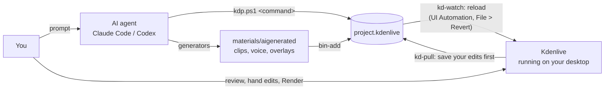

<div align="center">

# Movie Engine

**Un agent d'IA munta el teu vídeo a Kdenlive mentre tu ho mires, i pots prendre el control en qualsevol moment.**

Els agents d'IA de programació (Claude Code, Codex) creen i modifiquen projectes reals de Kdenlive: pel·lícules, vídeos explicatius i curts verticals. Els canvis apareixen en directe a l'editor que tens obert. Portable, Windows, sense pedaços a l'editor.


[English](../../README.md) · [简体中文](README.zh-CN.md) · [繁體中文](README.zh-TW.md) · [हिन्दी](README.hi.md) · [Español](README.es.md) · [Français](README.fr.md) · [العربية](README.ar.md) · [বাংলা](README.bn.md) · [Português](README.pt.md) · [Русский](README.ru.md) · [اردو](README.ur.md) · [Bahasa Indonesia](README.id.md) · [Deutsch](README.de.md) · [日本語](README.ja.md) · [Türkçe](README.tr.md) · [한국어](README.ko.md) · [Українська](README.uk.md) · [Italiano](README.it.md) · [Polski](README.pl.md) · [Tiếng Việt](README.vi.md) · [فارسی](README.fa.md) · [ไทย](README.th.md) · [Kiswahili](README.sw.md) · [አማርኛ](README.am.md) · [Avañe'ẽ](README.gn.md) · [Setswana](README.tn.md) · [Shqip](README.sq.md) · [Беларуская](README.be.md) · [Български](README.bg.md) · [Bosanski](README.bs.md) · [Hrvatski](README.hr.md) · [Српски](README.sr.md) · [Crnogorski](README.cnr.md) · [Македонски](README.mk.md) · [Slovenščina](README.sl.md) · [Slovenčina](README.sk.md) · [Čeština](README.cs.md) · [Magyar](README.hu.md) · [Română](README.ro.md) · [Dansk](README.da.md) · [Norsk bokmål](README.nb.md) · [Norsk nynorsk](README.nn.md) · [Svenska](README.sv.md) · [Íslenska](README.is.md) · [Suomi](README.fi.md) · [Eesti](README.et.md) · [Latviešu](README.lv.md) · [Lietuvių](README.lt.md) · [Nederlands](README.nl.md) · [Lëtzebuergesch](README.lb.md) · [Rumantsch](README.rm.md) · [Ελληνικά](README.el.md) · [Malti](README.mt.md) · [Gaeilge](README.ga.md) · **Català** · [ქართული](README.ka.md) · [Հայերեն](README.hy.md) · [Azərbaycanca](README.az.md) · [Afrikaans](README.af.md) · [isiZulu](README.zu.md) · [isiXhosa](README.xh.md) · [Sesotho](README.st.md) · [Sepedi](README.nso.md) · [Xitsonga](README.ts.md) · [Tshivenḓa](README.ve.md) · [siSwati](README.ss.md) · [isiNdebele (South Africa)](README.nr.md) · [isiNdebele (Zimbabwe)](README.nd.md) · [chiShona](README.sn.md) · [Chichewa](README.ny.md) · [Ikinyarwanda](README.rw.md) · [Ikirundi](README.rn.md) · [Malagasy](README.mg.md) · [Soomaali](README.so.md) · [Afaan Oromoo](README.om.md) · [Qafar af](README.aa.md) · [ትግርኛ](README.ti.md) · [Sängö](README.sg.md) · [Kreol Seselwa](README.crs.md) · [TjiKalanga](README.kck.md) · [ChiNdau](README.ndc.md)

*Això és una traducció. La versió de referència és el README en anglès.*

</div>

---

## Contingut

- [Per què](#per-què)
- [Com funciona](#com-funciona)
- [Funcionalitats](#funcionalitats)
- [Requisits](#requisits)
- [Instal·lació](#installació)
- [Inici ràpid](#inici-ràpid)
- [Treballar amb l'agent](#treballar-amb-lagent)
- [La línia d'ordres d'edició (`kdp.ps1`)](#la-línia-dordres-dedició-kdpps1)
- [Sincronització en directe amb l'editor obert](#sincronització-en-directe-amb-leditor-obert)
- [Generadors: el que Kdenlive no pot fer](#generadors-el-que-kdenlive-no-pot-fer)
- [Veu en off i so](#veu-en-off-i-so)
- [Idioma de la interfície](#idioma-de-la-interfície)
- [Estructura de carpetes](#estructura-de-carpetes)
- [Proves i demostracions](#proves-i-demostracions)
- [Limitacions](#limitacions)
- [Resolució de problemes](#resolució-de-problemes)
- [Preguntes freqüents](#preguntes-freqüents)
- [Contribucions](#contribucions)
- [Agraïments](#agraïments)
- [Llicència](#llicència)

## Per què

Els editors de vídeo estan pensats per a una mà sobre el ratolí. Els agents d'IA són bons amb l'estructura, el ritme i la repetició: col·locar 300 clips al compàs, sincronitzar cada subtítol amb la veu, refer una escena després de rebre comentaris. El que no poden fer és clicar per una interfície gràfica sense apoderar-se del teu escriptori.

Kdenlive és un editor de codi obert molt potent, però a Windows **no té cap API d'automatització**: el control per D-Bus només existeix a les versions per a Linux, i les bifurcacions que n'afegeixen una estan abandonades o no són segures. Movie Engine ho resol sense modificar l'editor:

1. L'agent edita el fitxer de projecte `.kdenlive` mitjançant una línia d'ordres provada (`engine/kdp.ps1`).
2. Al Kdenlive en execució se li indica que torni a carregar el fitxer mitjançant Windows UI Automation, sense pulsacions de tecles, sense ratolí i sense robar el focus.
3. Els teus canvis sense desar es desen primer i mai no se sobreescriuen.

Així, l'agent edita i tu revises, o edites a mà. Tots dos treballeu en el mateix projecte, al mateix editor i al mateix temps.

## Com funciona



Cada ordre d'edició segueix el mateix cicle segur:

1. **Pull.** Si Kdenlive té canvis sense desar, se li indica que els desi (el botó Desa de la barra d'eines, via UI Automation), i es confirma que s'han desat.
2. **Edició.** L'ordre modifica l'XML sota un bloqueig, després de comprovar un hash i amb una instantània per poder desfer. Si el fitxer ha canviat mentrestant, no s'escriu res.
3. **Recàrrega.** El vigilant detecta la marca de la IA i executa File > Revert a l'editor obert. Només es considera un èxit quan el giny de la línia de temps s'ha reconstruït de debò.
4. **Conflicte.** Si mentrestant has començat a editar, no es recarrega res i la teva feina es manté. La versió de la IA es guarda a part, i l'agent torna a aplicar el seu canvi a sobre del teu.

## Funcionalitats

- **Edició completa del projecte sense interfície gràfica**: unes 120 ordres que cobreixen la safata, la línia de temps, els efectes, les composicions, les pistes, les guies, els marcadors, els subtítols, les seqüències, la velocitat i el remapatge del temps, les presentacions de diapositives, els títols, els intermediaris (proxies), la renderització i desfer/refer. Consulta la [referència d'ordres](#la-línia-dordres-dedició-kdpps1).
- **Sincronització en directe amb l'editor obert.** Els canvis de la IA apareixen al Kdenlive que estàs mirant; els teus canvis sense desar es desen primer i no es perden mai.
- **No molesta mai el teu escriptori.** Sense robar el focus, sense pulsacions de tecles ni moviments del ratolí. Els editors de prova s'executen en un escriptori de Windows invisible.
- **Portable.** L'editor, la configuració, Node.js, les fonts tipogràfiques i les eines viuen en una sola carpeta. Copia-la a un altre PC i funciona; no s'escriu res a Program Files ni al teu perfil de Windows.
- **Generadors per al que Kdenlive no pot fer**: text cinètic lletra per lletra, anotacions dibuixades a mà, escenes d'interfície en 3D, animacions del cursor i pel·lícules explicatives interactives llargues. Es renderitzen a la GPU amb desenfocament de moviment real i es col·loquen a la línia de temps com a clips normals.
- **Veu en off amb temps per paraula** (Microsoft Edge TTS, sense clau d'API). Els subtítols i les accions s'activen exactament a la paraula.
- **Efectes de so sintetitzats** (whoosh, click, pop, riser, impact i més), generats amb codi.
- **Demostrat, no suposat.** Cada ordre té una comprovació del resultat, els efectes i les composicions es proven un per un, i els resultats en brut són a `docs/proof/`.
- **Instruccions per als agents incloses.** `AGENTS.md` i les habilitats de `.claude/skills/` ensenyen a Claude Code i a Codex el flux de treball, el format del fitxer i els paranys.

## Requisits

| | |
|---|---|
| SO | Windows 10 o 11, x64 |
| Editor | Kdenlive **26.08.3**, versió portable (standalone). Les altres versions no s'han provat. |
| Node.js | 18 o posterior: el `.zip` per a Windows x64 de nodejs.org, descomprimit a `engine/node/` |
| Navegador | Microsoft Edge (inclòs a Windows); els renderitzadors d'escenes l'utilitzen sense interfície (headless) |
| Agent | [Claude Code](https://claude.com/claude-code) o Codex. Opcional: totes les eines també es poden executar a mà. |
| Disc | aproximadament 1 GB per a l'editor i les eines, més els teus fitxers multimèdia |
| GPU | qualsevol GPU amb codificació H.264 per maquinari accelera `film-render.mjs` (si no n'hi ha, fa servir codificació per programari) |

## Instal·lació

Tot s'instal·la **dins de la carpeta**. No cal cap permís d'administrador.

```powershell
git clone https://github.com/vladtarrow/movie-engine.git
cd movie-engine
```

**1. Node.js.** Baixa el `.zip` per a Windows x64 de Node.js 18 o posterior des de <https://nodejs.org/en/download> i descomprimeix-ne el contingut a `engine\node\`, de manera que hi hagi `engine\node\node.exe` i `engine\node\npm.cmd`. No calen ni instal·lador ni Node del sistema. Tots els scripts s'executen amb `engine\node.cmd`, mai amb un Node del sistema.

**2. Paquets de Node** per a l'eina de veu i els renderitzadors (les versions estan fixades a `engine/voice/package.json`):

```powershell
engine\node\npm.cmd install --prefix engine\voice
```

**3. Kdenlive 26.08.3 portable.** Baixa `kdenlive-26.08.3_standalone.exe` des de <https://download.kde.org/stable/kdenlive/26.08/windows/> a `engine\installer\`, comprova'l i descomprimeix-lo:

```powershell
(Get-FileHash engine\installer\kdenlive-26.08.3_standalone.exe -Algorithm SHA256).Hash
# expected: A25427B1DFF2C17E3B0386E991BB1A719382BB3176D1A90E441CDAEB6E0A967D
engine\installer\kdenlive-26.08.3_standalone.exe -o"engine\Kdenlive" -y
```

L'editor queda a `engine\Kdenlive\kdenlive-26.08.3_standalone\bin\`. Ja inclou `melt.exe` i `ffmpeg.exe`.

**4. Primer inici.**

```powershell
engine\kdenlive.cmd
```

Kdenlive desa tota la seva configuració a `engine\profile-kdenlive\`, no al teu perfil de Windows. En el primer inici mostra un assistent de configuració una sola vegada.

## Inici ràpid

### Amb un agent

Obre la carpeta a Claude Code (o Codex) i demana-ho amb paraules senzilles:

> Crea un projecte vertical nou a 30 fps anomenat "launch-teaser". Posa a la línia de temps les tres captures de pantalla de `materials/designers/launch/`, de 2,5 s cadascuna amb una fosa encadenada curta, afegeix una veu en off a partir de `script.txt` i sincronitza un subtítol cinètic amb cada línia.

> Obre-me'l a Kdenlive.

> El segon pla és massa llarg. Retalla'l a 1,8 s i puja una mica el logotip.

L'agent segueix `AGENTS.md`: edita amb `kdp.ps1`, renderitza només els clips que necessita el muntatge i manté sincronitzat l'editor obert. Tu revises a Kdenlive, edites a mà quan vulguis i prems Renderitza quan n'estiguis satisfet.

### A mà

```powershell
# a new 1080x1920 30 fps project with 2 video and 2 audio tracks
powershell -NoProfile -ExecutionPolicy Bypass -File engine\kdp.ps1 new -Project projects\hello\hello.kdenlive -Profile vertical_hd_30

# a 3-second title and a colour background
powershell -NoProfile -ExecutionPolicy Bypass -File engine\kdp.ps1 bin-color -Project projects\hello\hello.kdenlive -Color '#203060' -Seconds 3 -Name bg
powershell -NoProfile -ExecutionPolicy Bypass -File engine\kdp.ps1 title -Project projects\hello\hello.kdenlive -Text "Hello" -Seconds 3 -Name hi

# place them: background on V1, title above it on V2
powershell -NoProfile -ExecutionPolicy Bypass -File engine\kdp.ps1 add -Project projects\hello\hello.kdenlive -Bin bg -Track V1 -At 0
powershell -NoProfile -ExecutionPolicy Bypass -File engine\kdp.ps1 add -Project projects\hello\hello.kdenlive -Bin hi -Track V2 -At 0

# a check frame, then open it in the editor
powershell -NoProfile -ExecutionPolicy Bypass -File engine\kdp.ps1 frame -Project projects\hello\hello.kdenlive -At 1.5 -Out out\hello\check.png
engine\kdenlive.cmd projects\hello\hello.kdenlive
```

Per tornar a obrir més tard l'últim projecte, fes doble clic a `open-last-project.cmd`.

## Treballar amb l'agent

L'agent llegeix `AGENTS.md` (Codex) o `CLAUDE.md`, que l'importa (Claude Code), a més de dues habilitats:

| Habilitat | Què ensenya |
|---|---|
| `.claude/skills/kdenlive-project-file` | el format `.kdenlive` / MLT XML, `kdp.ps1`, la comprovació amb `melt` |
| `.claude/skills/kdenlive-live` | controlar de manera segura l'editor en execució: iniciar, pull, recarregar, capturar la seva finestra |

Normes que segueix l'agent i en què pots confiar:

- Mai no et pren el ratolí, el teclat ni el focus, i mai no fa captures del teu escriptori (només de la finestra de l'editor).
- Fa ell mateix els passos de la interfície (desar, obrir, recarregar) en lloc de demanar-te que cliquis.
- Pregunta abans de baixar res i abans d'esborrar res.
- Renderitza només el que la feina necessita (clips d'escena, fotogrames de comprovació). La pel·lícula final només la renderitza si tu ho demanes.
- Quan Kdenlive no pot fer bé alguna cosa, l'agent la construeix fora amb codi i n'insereix el resultat com a clip. No rebaixa l'efecte.

## La línia d'ordres d'edició (`kdp.ps1`)

```powershell
powershell -NoProfile -ExecutionPolicy Bypass -File engine\kdp.ps1 <command> -Project <file.kdenlive> [options]
```

Els temps s'indiquen en segons, amb punt (`2.5`). Les pistes són `V1 V2 …` (V1 la més baixa) i `A1 A2 …`. Un clip s'identifica amb `-Track` més qualsevol instant `-At` dins seu. Els paràmetres dels efectes van a `-Params "name=value||name=value"`. La llista completa amb totes les opcions és a la capçalera de `engine/kdp.ps1`.

| Grup | Ordres |
|---|---|
| Projecte | `new`, `profiles`, `info`, `validate`, `fonts`, `profile-set`, `profile-from-clip`, `zone`, `archive`, `backups`, `rebase`, `otio-export`, `otio-import` |
| Safata | `bin-add`, `bin-color`, `title`, `title-text`, `title-save`, `title-template`, `bin-rename`, `bin-remove`, `bin-info`, `bin-set`, `bin-duplicate`, `bin-replace-file`, `bin-reload`, `folder`, `bin-folder`, `relink`, `clean`, `generator`, `playlist-clip`, `extract-audio`, `transcode` |
| Línia de temps | `add`, `add-av`, `move`, `copy`, `trim`, `ripple-trim`, `slip`, `split`, `remove`, `speed`, `remap`, `disable`, `enable`, `group`, `ungroup`, `mix`, `unmix`, `space-insert`, `space-remove`, `spaces-remove-all`, `track-clear`, `replace-in-timeline` |
| Efectes | `effects`, `effect-info`, `effect-add`, `effect-list`, `effect-set`, `effect-remove`, `effect-copy`, `effect-clear`, `effects-all`, `bin-effect`, `effect-templates`, `effect-template` |
| Composicions | `compositions`, `comp-info`, `comp-add`, `comp-list`, `comp-set`, `comp-remove` |
| Pistes | `track-add`, `track-remove`, `track-set` |
| Guies i marcadors | `guide-add`, `guide-list`, `guide-remove`, `guide-set`, `guide-clear`, `guide-export`, `guide-category`, `marker`, `marker-list`, `marker-set`, `marker-remove` |
| Subtítols | `sub-add`, `sub-import`, `sub-export`, `sub-state` |
| Seqüències | `sequence-add`, `sequences`, `copy-to-sequence`, `expand`; qualsevol ordre amb `-Sequence <name>` funciona dins d'aquella seqüència |
| Especials | `slideshow`, animacions Lottie / Glaxnimate amb `bin-add`, `proxy`, `stabilize`, `scene-split`, `speed-job`, `subclip` |
| Sortida | `frame` (un PNG), `preview` (renderització ràpida amb melt), `render` (el renderitzador propi de Kdenlive o un perfil predefinit), `presets` |
| Historial | `undo`, `redo`, `clear-history` (instantànies a `projects/<name>/.kdp-history`) |

Comportament que convé conèixer:

- Les meitats d'àudio i vídeo enllaçades es mouen, es retallen, es divideixen i s'eliminen juntes (`-Alone` per a una sola meitat).
- Una ordre que falla acaba amb el codi 1 i no escriu res.
- Els efectes que la versió de Windows no pot executar es rebutgen, no s'ignoren en silenci (llista: `docs/proof/assets.txt`).
- Cada acció dels menús de Kdenlive està associada a una ordre, a una altra via o a "només visualització" a `engine/tools/data/kdenlive-actions.csv`. Consulta `docs/kdenlive-coverage.md`.

## Sincronització en directe amb l'editor obert

| Script | Què fa | Codis de sortida |
|---|---|---|
| `engine\kd-pull.ps1 -Project <f>` | fa que Kdenlive desi els teus canvis i ho confirma | 0 fitxer actualitzat, 3 no s'està executant, 4 no confirmat |
| `engine\kd-reload.ps1 -Project <f>` | File > Revert, confirmat per la línia de temps reconstruïda | 0 confirmat, 2 tens canvis sense desar (no s'ha descartat res), 3 no s'està executant, 4 ha fallat |
| `engine\kd-watch.ps1 -Project <f>` | vigilant en segon pla: recarrega després de cada escriptura de la IA i registra els conflictes | registre a `engine\kd-watch.log`; esborra `engine\kd-watch.run` per aturar-lo |
| `engine\kdenlive-bg.ps1 [project]` | inicia Kdenlive minimitzat per a un agent | 0 carregat, 4 no confirmat |
| `engine\kdenlive.cmd [project]` | inicia Kdenlive per a tu | |

Inicia el vigilant una vegada per sessió:

```powershell
Start-Process powershell -WindowStyle Hidden -ArgumentList '-NoProfile','-ExecutionPolicy','Bypass','-File','engine\kd-watch.ps1','-Project','projects\hello\hello.kdenlive'
```

Projectes grans: la recàrrega d'un projecte de 1000 clips triga minuts, i les eines l'esperen en lloc d'informar abans d'hora. Els projectes s'obren amb *File > Open Recent* sobre un editor buit, perquè obrir un fitxer directament fa que Qt recorri cada element de la línia de temps per a l'accessibilitat, i era uns 10 minuts més lent.

## Generadors: el que Kdenlive no pot fer

Kdenlive/MLT no té animació de text lletra per lletra, ni expressions, i gairebé no té 3D, i els efectes pesats alenteixen la reproducció. Movie Engine renderitza aquestes parts fora i les posa a la línia de temps com a clips normals, normalment amb canal alfa, en una pista per sobre de les imatges. L'script del generador i les seves dades d'entrada es queden a la carpeta del projecte, de manera que un clip es pot tornar a generar quan canvien el text, la font o els temps.

| Eina | Què genera |
|---|---|
| `engine/tools/kinetic-text.ps1` | subtítols cinètics lletra per lletra, cada paraula sincronitzada a partir de `voice.json`, requadre de ressaltat |
| `engine/tools/annotate.ps1` | cercles, requadres, subratllats i fletxes dibuixats a mà que es van traçant sobre una captura de pantalla |
| `engine/tools/card-entrance.ps1` | una targeta amb una captura de pantalla que puja i s'amplia amb una ombra suau |
| `engine/tools/pdf-to-png.ps1` | diapositives a partir d'una exportació en PDF |
| `engine/tools/html-render.mjs` | qualsevol escena HTML/CSS/canvas a vídeo: animació d'interfície, cursors, 3D, màscares |
| `engine/tools/film-render.mjs` + `film/` | pel·lícules explicatives llargues i interactives sobre un canvas: un clip per línia de veu, les accions s'activen amb les paraules pronunciades, desenfocament de moviment a la GPU a uns 45 fps |

Tots dos renderitzadors controlen el Microsoft Edge que ve amb Windows, sense interfície, amb un perfil d'un sol ús i sense accés a la xarxa.

### Demos

```powershell
# a 3-second 3D title card with a cursor click
engine\node.cmd engine\tools\html-render.mjs examples\demo\scene\scene.html examples\demo\out --frames 0,30,60,89
engine\node.cmd engine\tools\html-render.mjs examples\demo\scene\scene.html examples\demo\out\scene.mp4

# a 4-shot interactive film timed to two voice lines
engine\node.cmd engine\tools\film-render.mjs examples\demo\film\film.html examples\demo\out --check
engine\node.cmd engine\tools\film-render.mjs examples\demo\film\film.html examples\demo\out --shots all --width 640
engine\node.cmd engine\tools\film-render.mjs examples\demo\film\film.html examples\demo\out\clips --suffix -v01
```

Una pel·lícula són tres fitxers petits. `data.js` conté els plans i els temps de les paraules. `direction.js` té una línia per pla:

```text
1 | hover 192 108 @brand | tag 300 60 Your brand @deserves | confetti 192 90 @film
2 say=A film that/*explains* it
3 | click 116 108 @before | click 268 108 @after | chips Before~After @after
4 scene=counter | count 0 120 % @count
```

`scenes.js` conté els plans que es dibuixen des de zero. `@word` activa una acció quan la veu diu aquella paraula. Les accions inclouen click, hover, drag, zoom, lens, ring, arrow, chips, toggle, slider, toast, type, count i confetti; la sintaxi completa és al principi de `engine/tools/film/film-kit.js`.

## Veu en off i so

```powershell
engine\node.cmd engine\voice\voice.mjs lines.json materials\aigenerated\hello\voice en-US-AndrewMultilingualNeural +0%
```

`lines.json` és una llista de línies. L'eina escriu un mp3 per línia més `voice.json`, amb la durada i l'inici i el final de cada paraula. Les línies es desen a la memòria cau, de manera que si en canvies una només es regenera aquella. Fa servir la síntesi de veu en línia de Microsoft Edge mitjançant el paquet `msedge-tts`: no cal cap clau, però el servei no és oficial i necessita internet.

```powershell
engine\node.cmd engine\audio\sfx.mjs materials\aigenerated\sfx
```

Això sintetitza amb codi whoosh, whoosh-long, swipe, click, pop, tick, riser, impact, ding i reveal; hi ha un joc ja fet a `materials/aigenerated/sfx/`. Els sons més curts que un fotograma s'han d'allargar amb silenci abans de col·locar-los (`-af apad=whole_dur=0.0667`).

## Idioma de la interfície

Per defecte, els llançadors inicien Kdenlive en **anglès**. Per fer servir un altre idioma, defineix `MOVIE_ENGINE_UI_LANG` abans d'iniciar-lo:

```powershell
$env:MOVIE_ENGINE_UI_LANG = 'ru'; engine\kdenlive.cmd
```

UI Automation troba els elements dels menús pel seu nom visible. Els noms de 31 idiomes de la interfície ja hi són inclosos (`engine/tools/kd-ui.ps1`, `$KdNames`). Per a qualsevol altre idioma, afegeix-hi els seus noms i comprova-ho amb:

```powershell
powershell -NoProfile -ExecutionPolicy Bypass -File engine\tools\kd-langcheck.ps1
```

## Estructura de carpetes

```text
movie-engine/
├─ AGENTS.md, CLAUDE.md          instructions for AI agents
├─ .claude/skills/               agent skills: project file format, live editor
├─ engine/
│  ├─ kdp.ps1                    the editing command line
│  ├─ kd-pull / kd-reload / kd-watch .ps1, kdenlive.cmd, kdenlive-bg.ps1
│  ├─ tools/                     internals, generators, tests, data (action map)
│  ├─ voice/  audio/  fonts/     TTS, synthesized SFX, Poppins (OFL)
│  ├─ Kdenlive/  node/           portable editor and Node.js (not in git)
│  └─ profile-kdenlive/          the editor's settings (not in git)
├─ projects/<name>/<name>.kdenlive
├─ materials/
│  ├─ download/                  stock and downloaded files (not in git)
│  ├─ aigenerated/               everything the AI made (sfx/ and test-kit/ ship with the engine)
│  ├─ designers/  brand/         files from your team, brand assets
├─ examples/demo/                demos of the scene and film renderers
├─ out/                          renders (not in git)
└─ docs/                         proofs, coverage, translations of this README
```

Els camins dels fitxers multimèdia dins dels projectes són relatius. Si mous o copies la carpeta, `kdp.ps1 rebase` (que `kdenlive.cmd` també executa automàticament) escriu la nova ubicació al projecte.

## Proves i demostracions

Les afirmacions sobre què funciona es basen en comprovacions del resultat, no en "la funció s'ha executat". El resum és a [`docs/kdenlive-proof.md`](../../docs/kdenlive-proof.md), i la sortida en brut és a `docs/proof/`.

| Prova | Què comprova |
|---|---|
| `engine\tools\kdp-clitest.ps1` | cada ordre de `kdp.ps1`, a través de la línia d'ordres, comparant el projecte resultant |
| `engine\tools\kd-livetest.ps1` | pull, recàrrega, vigilant, conflictes i condicions de cursa contra un Kdenlive real en un escriptori invisible |
| `engine\tools\kdp-assetsweep.ps1` | cada efecte i cada composició: renderitza i compara fotogrames |
| `engine\tools\kdp-portabletest.ps1` | copia la carpeta a un altre lloc i treballa des de la còpia |
| `engine\tools\kd-langcheck.ps1` | l'idioma de la interfície i que UI Automation troba el menú |
| `engine\tools\kdp-coverage-check.ps1` | que cada acció dels menús està associada i que cap demostració és més antiga que el codi |

```powershell
powershell -NoProfile -ExecutionPolicy Bypass -File engine\tools\kdp-clitest.ps1 -Report docs\proof\clitest.txt
powershell -NoProfile -ExecutionPolicy Bypass -File engine\tools\kd-livetest.ps1 -Report docs\proof\live-en.txt
```

Els editors de prova només s'executen en un escriptori ocult amb el seu propi perfil, de manera que les proves mai no toquen el Kdenlive que tens obert ni el teu focus.

## Limitacions

- **Només Windows**, i només Kdenlive **26.08.3**. Linux té D-Bus i necessitaria un pont diferent.
- En iniciar-se, l'editor pren el focus del teclat durant uns 3 segons mentre apareix la finestra buida. Els agents pregunten abans d'iniciar-lo mentre treballes. Les recàrregues i les edicions no prenen el focus.
- A la versió de Windows hi falten els mòduls MLT sox, ladspa i movit i alguns efectes frei0r/avfilter; `kdp.ps1` els rebutja (`docs/proof/assets.txt`).
- L'exportació i la importació d'OpenTimelineIO només transfereixen clips i buits. La multicàmera no té canvi d'angle en directe (els talls es fan amb split/remove/hide).
- "Desa com a…" mitjançant UI Automation en una finestra minimitzada no obre cap diàleg; en lloc d'això, l'agent fa servir `archive` o còpies de fitxers.
- El reconeixement de veu (subtítols automàtics) necessita Whisper o Vosk, que no s'hi inclouen.
- Els títols fets amb l'eina de títols de Kdenlive fan servir les fonts instal·lades a Windows. Per tenir una tipografia garantida, renderitza el text amb els generadors, que carreguen les fonts de `engine/fonts/`.
- Edge TTS és un servei en línia no oficial i pot canviar o deixar de funcionar.

## Resolució de problemes

| Símptoma | Causa i solució |
|---|---|
| Kdenlive s'està executant, però en clicar-lo a la barra de tasques no es mostra res | La posició desada de la finestra és fora de la pantalla. Tanca'l i esborra les entrades `kdockLayout` de `engine\profile-kdenlive\AppData\Local\kdenliverc`, o mou la finestra amb `SetWindowPos` (vegeu `AGENTS.md`). |
| `kd-reload.ps1` acaba amb el codi 2 | Tens canvis sense desar. No s'ha descartat res. Executa `kd-pull.ps1` i després torna a aplicar el canvi (`kdp.ps1` ho fa ell mateix). |
| `CONFLICT` a `engine\kd-watch.log` | Tu i l'agent heu editat al mateix moment. La teva versió es queda a l'editor, i la versió de la IA és a `projects\<name>\.kdp-history\<name>\conflict\`. Demana a l'agent que torni a aplicar el seu canvi. |
| Una ordre acaba amb el codi 1 i el missatge "pull not confirmed" | Kdenlive està ocupat o mostra un diàleg. Tanca el diàleg o espera que acabi la càrrega, i després torna-ho a provar. |
| Un script de PowerShell no es pot analitzar | Els scripts amb text no ASCII s'han de desar en UTF-8 **amb BOM** per a Windows PowerShell 5.1. |
| `voice.mjs` s'atura amb "Stream closed before the synthesis completed" | Normalment és un problema de xarxa, o SSML sense escapar en còpies antigues. `voice.mjs` escapa `& < >` ell mateix. |
| Obrir un projecte gran triga molts minuts | Obre'l amb `kdenlive.cmd` / `kdenlive-bg.ps1`, mai com a `kdenlive.exe project.kdenlive`. |

## Preguntes freqüents

**Necessito Claude Code o Codex?**
No. Cada eina és un script normal que pots executar a mà. L'agent és el que ho fa ràpid: planifica el muntatge, executa les eines i manté l'editor sincronitzat.

**L'agent sobreescriurà els meus canvis manuals?**
No. Abans de qualsevol escriptura, els teus canvis sense desar es desen i es confirmen. Si edites mentre l'agent escriu, l'escriptura es rebutja o es guarda a part com a conflicte, però mai no s'aplica a sobre de la teva feina.

**Puc continuar fent servir Kdenlive amb normalitat?**
Sí. És el Kdenlive estàndard amb la seva pròpia carpeta de configuració. Edita, previsualitza i renderitza com sempre.

**Funciona amb un Kdenlive que ja tinc instal·lat?**
Fa servir la seva pròpia còpia portable a `engine\Kdenlive\`, de manera que el Kdenlive que tens instal·lat i la seva configuració no es toquen.

**Per què no una bifurcació de Kdenlive amb API, o un altre editor?**
A Windows no hi ha cap bifurcació mantinguda i segura (estudi de novembre de 2026). Es van avaluar OpenShot, Blender VSE, DaVinci Resolve, Shotcut i editors web; Kdenlive és el que oferia més profunditat d'edició. Se segueix de prop una proposta d'API REST al projecte original (merge request !902).

**Pot renderitzar el vídeo final?**
Sí, amb `kdp.ps1 render` (el renderitzador propi de Kdenlive, ocult), o prems tu mateix Renderitza a l'editor.

**Es pugen els meus fitxers multimèdia a algun lloc?**
No. Només s'envia el text de la veu en off al servei Edge TTS quan generes la veu. Els renderitzadors d'escenes s'executen amb la xarxa desactivada.

## Contribucions

Les contribucions són benvingudes. Consulta [CONTRIBUTING.md](../../CONTRIBUTING.md). En resum:

- Cada operació nova o modificada de `kdp.ps1` necessita una comprovació del resultat a `kdp-clitest.ps1`, una entrada al mapa d'accions i una execució nova de `kdp-coverage-check.ps1`.
- No iniciïs mai un Kdenlive de prova a l'escriptori visible; fes servir `engine/tools/kd-hidden.ps1`.
- Mantén-ho tot portable: cap instal·lació fora de la carpeta, cap camí absolut als projectes.
- Anota les particularitats verificades a `AGENTS.md` o a l'habilitat corresponent.

## Agraïments

- [Kdenlive](https://kdenlive.org) i [MLT](https://www.mltframework.org): l'editor i el motor que hi ha a sota.
- [FFmpeg](https://ffmpeg.org), inclòs amb Kdenlive.
- [msedge-tts](https://www.npmjs.com/package/msedge-tts) per a la veu en off.
- [Poppins](https://fonts.google.com/specimen/Poppins) d'Indian Type Foundry, SIL Open Font License (`engine/fonts/OFL.txt`).
- `engine/tools/data/kdenliveui-26.08.3.rc`: el fitxer de menús de Kdenlive, extret del codi font de Kdenlive 26.08.3; només el fa servir la comprovació de cobertura. Continua sota la llicència GPL de Kdenlive, no sota la MIT License.

## Llicència

El codi propi de Movie Engine es publica sota la [llicència MIT](../../LICENSE). Kdenlive, MLT, FFmpeg, els paquets de Node.js i la font Poppins mantenen les seves pròpies llicències.
