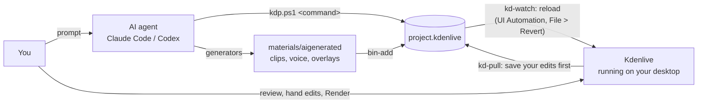

<div align="center">

# Movie Engine

**En azan AI i edit ou video dan Kdenlive pandan ki ou pe gete, e ou kapab pran kontrol nenport ki moman.**

Bann azan AI ki ekri kod (Claude Code, Codex) i konstri e sanz vre proze Kdenlive: fim, video eksplikatif (explainers) ek bann ti video vertikal (shorts). Bann modifikasyon i paret an direk dan editer ki ou in ouver. Portab, Windows, okenn patch lo editer.


[English](../../README.md) · [简体中文](README.zh-CN.md) · [繁體中文](README.zh-TW.md) · [हिन्दी](README.hi.md) · [Español](README.es.md) · [Français](README.fr.md) · [العربية](README.ar.md) · [বাংলা](README.bn.md) · [Português](README.pt.md) · [Русский](README.ru.md) · [اردو](README.ur.md) · [Bahasa Indonesia](README.id.md) · [Deutsch](README.de.md) · [日本語](README.ja.md) · [Türkçe](README.tr.md) · [한국어](README.ko.md) · [Українська](README.uk.md) · [Italiano](README.it.md) · [Polski](README.pl.md) · [Tiếng Việt](README.vi.md) · [فارسی](README.fa.md) · [ไทย](README.th.md) · [Kiswahili](README.sw.md) · [አማርኛ](README.am.md) · [Avañe'ẽ](README.gn.md) · [Setswana](README.tn.md) · [Shqip](README.sq.md) · [Беларуская](README.be.md) · [Български](README.bg.md) · [Bosanski](README.bs.md) · [Hrvatski](README.hr.md) · [Српски](README.sr.md) · [Crnogorski](README.cnr.md) · [Македонски](README.mk.md) · [Slovenščina](README.sl.md) · [Slovenčina](README.sk.md) · [Čeština](README.cs.md) · [Magyar](README.hu.md) · [Română](README.ro.md) · [Dansk](README.da.md) · [Norsk bokmål](README.nb.md) · [Norsk nynorsk](README.nn.md) · [Svenska](README.sv.md) · [Íslenska](README.is.md) · [Suomi](README.fi.md) · [Eesti](README.et.md) · [Latviešu](README.lv.md) · [Lietuvių](README.lt.md) · [Nederlands](README.nl.md) · [Lëtzebuergesch](README.lb.md) · [Rumantsch](README.rm.md) · [Ελληνικά](README.el.md) · [Malti](README.mt.md) · [Gaeilge](README.ga.md) · [Català](README.ca.md) · [ქართული](README.ka.md) · [Հայերեն](README.hy.md) · [Azərbaycanca](README.az.md) · [Afrikaans](README.af.md) · [isiZulu](README.zu.md) · [isiXhosa](README.xh.md) · [Sesotho](README.st.md) · [Sepedi](README.nso.md) · [Xitsonga](README.ts.md) · [Tshivenḓa](README.ve.md) · [siSwati](README.ss.md) · [isiNdebele (South Africa)](README.nr.md) · [isiNdebele (Zimbabwe)](README.nd.md) · [chiShona](README.sn.md) · [Chichewa](README.ny.md) · [Ikinyarwanda](README.rw.md) · [Ikirundi](README.rn.md) · [Malagasy](README.mg.md) · [Soomaali](README.so.md) · [Afaan Oromoo](README.om.md) · [Qafar af](README.aa.md) · [ትግርኛ](README.ti.md) · [Sängö](README.sg.md) · **Kreol Seselwa** · [TjiKalanga](README.kck.md) · [ChiNdau](README.ndc.md)

*Sa i en tradiksyon; README an Angle i vèrsyon referans.*

</div>

---

## Konteni

- [Akoz](#akoz)
- [Ki manyer i marse](#ki-manyer-i-marse)
- [Fonksyonalite](#fonksyonalite)
- [Bezwen](#bezwen)
- [Enstalasyon](#enstalasyon)
- [Konmansman rapid](#konmansman-rapid)
- [Travay avek lazan](#travay-avek-lazan)
- [Lalign komann pour edit (`kdp.ps1`)](#lalign-komann-pour-edit-kdpps1)
- [Sinkronizasyon an direk avek editer ki ouver](#sinkronizasyon-an-direk-avek-editer-ki-ouver)
- [Zenerater: sa ki Kdenlive pa kapab fer](#zenerater-sa-ki-kdenlive-pa-kapab-fer)
- [Vwa-off ek son](#vwa-off-ek-son)
- [Langaz lenterfas](#langaz-lenterfas)
- [Lorganizasyon bann dosye](#lorganizasyon-bann-dosye)
- [Tes ek prev](#tes-ek-prev)
- [Limitasyon](#limitasyon)
- [Rezourd problenm](#rezourd-problenm)
- [Kestyon ki dimoun i demann souvan](#kestyon-ki-dimoun-i-demann-souvan)
- [Kontribisyon](#kontribisyon)
- [Remersiman](#remersiman)
- [Lisans](#lisans)

## Akoz

Bann editer video in ganny fer pour en lanmen lo en souri. Bann azan AI i bon avek striktir, timing ek repetisyon: met 300 klip lo bit mizik, aliny sak sou-tit avek lavwa, refer en sen apre en komanter. Me zot pa kapab klik partou dan en GUI san pran kontrol ou desktop.

Kdenlive i en bon editer open-source, me lo Windows i **napa okenn API pour lotomasyon**: kontrol par D-Bus i egziste zis lo bann build Linux, e bann fork ki azout sa swa napa personn ki pe mentenir zot, swa zot pa sekirize. Movie Engine i rezourd sa san patch editer:

1. Lazan i edit fisye proze `.kdenlive` atraver en lalign komann ki'n ganny teste (`engine/kdp.ps1`).
2. Kdenlive ki pe marse i ganny dir pour reload fisye atraver Windows UI Automation, san okenn tap lo klavye, san souri e san vol fokis.
3. Ou prop modifikasyon ki pa ankor sove i ganny sove avan, e zot pa zanmen ganny ekraze.

Alor lazan i edit e ou revwar, oubyen ou edit alamen. Zot de i travay lo menm proze, dan menm editer, an menm tan.

## Ki manyer i marse



Sak komann edisyon i swiv menm sik sekirize:

1. **Pull.** Si Kdenlive i annan modifikasyon ki pa sove, i ganny dir pour sov zot (bouton Save lo toolbar atraver UI Automation), e sovgard i ganny konfirmen.
2. **Edit.** Komann i sanz XML anba en lock, apre en verifikasyon hash e avek en snapshot pour undo. Si fisye in sanze antretan, nanryen pa ganny ekri.
3. **Reload.** Watcher i war stanp AI e i lans File > Revert dan editer ki ouver. Siksè i konte selman kan widget timeline in vreman ganny rekonstri.
4. **Konfli.** Si ou'n konmans edit antretan, nanryen pa ganny reload e ou travay i reste. Vèrsyon AI i ganny gard akote, e lazan i re-aplik son modifikasyon par lao ou bann modifikasyon.

## Fonksyonalite

- **Edisyon konplet proze san GUI**: apepre 120 komann ki kouver bin, timeline, efe, kompozisyon, trak, gid, marker, sou-tit, sekans, vites ek time remap, slideshow, tit, proxy, render ek undo/redo. Gete [referans komann](#lalign-komann-pour-edit-kdpps1).
- **Sinkronizasyon an direk avek editer ki ouver.** Bann modifikasyon AI i paret dan Kdenlive ki ou pe gete; ou modifikasyon ki pa sove i ganny sove avan e zot pa zanmen ganny perdi.
- **I pa zanmen deranz ou desktop.** Okenn vol fokis, tap klavye ouswa mouvman souri. Bann editer tes i marse lo en desktop Windows envizib.
- **Portab.** Editer, paramet, Node.js, font ek zouti i reste dan en sel dosye. Kopye li lo en lot PC e i marse; nanryen pa ganny ekri dan Program Files ouswa dan ou profil Windows.
- **Zenerater pour sa ki Kdenlive pa kapab fer**: teks kinetik let par let, anotasyon desinen alamen, sen 3D lenterfas, animasyon kirser ek long fim "explainer" interaktif. Zot render lo GPU avek vre motion blur e zot ganny mete lo timeline konman bann klip ordiner.
- **Vwa-off avek timing sak mo** (Microsoft Edge TTS, pa bezwen API key). Bann sou-tit ek aksyon i deklans lo mo egzakt.
- **Efe sonor sentetize** (whoosh, click, pop, riser, impact e lezot), zenere dan kod.
- **Prouve, pa sipoze.** Sak komann i annan en verifikasyon rezilta, efe ek kompozisyon i ganny teste enn par enn, e bann rezilta brit i dan `docs/proof/`.
- **Enstriksyon pour lazan i enkli.** `AGENTS.md` ek bann skill dan `.claude/skills/` i aprann Claude Code ek Codex fason travay, format fisye ek bann pyez pour evite.

## Bezwen

| | |
|---|---|
| OS | Windows 10 ouswa 11, x64 |
| Editer | Kdenlive **26.08.3**, build portab (standalone). Lezot vèrsyon pa'n ganny teste. |
| Node.js | 18 ouswa pli resan: `.zip` Windows x64 depi nodejs.org, dekonprese dan `engine/node/` |
| Navigater | Microsoft Edge (i fer parti Windows); bann renderer sen i servi li headless (san fenet) |
| Azan | [Claude Code](https://claude.com/claude-code) ouswa Codex. Opsyonnel: sak zouti i osi marse alamen. |
| Disk | apepre 1 GB pour editer ek zouti, plis ou medya |
| GPU | nenport GPU avek lankodaz H.264 materyel i akselere `film-render.mjs` (sinon i servi software) |

## Enstalasyon

Tou keksoz i ganny enstale **anndan dosye**. Nanryen pa bezwen drwa admin.

```powershell
git clone https://github.com/vladtarrow/movie-engine.git
cd movie-engine
```

**1. Node.js.** Downloud `.zip` Windows x64 Node.js 18 ouswa pli resan depi <https://nodejs.org/en/download> e dekonpres son kontni dan `engine\node\`, pour ki `engine\node\node.exe` ek `engine\node\npm.cmd` i la. Pa bezwen okenn installer ni Node sistenm. Tou bann script i marse atraver `engine\node.cmd`, zanmen atraver en Node sistenm.

**2. Pake Node** pour zouti vwa ek bann renderer (vèrsyon i fikse dan `engine/voice/package.json`):

```powershell
engine\node\npm.cmd install --prefix engine\voice
```

**3. Kdenlive 26.08.3 portab.** Downloud `kdenlive-26.08.3_standalone.exe` depi <https://download.kde.org/stable/kdenlive/26.08/windows/> dan `engine\installer\`, verifye li e dekonpres li:

```powershell
(Get-FileHash engine\installer\kdenlive-26.08.3_standalone.exe -Algorithm SHA256).Hash
# expected: A25427B1DFF2C17E3B0386E991BB1A719382BB3176D1A90E441CDAEB6E0A967D
engine\installer\kdenlive-26.08.3_standalone.exe -o"engine\Kdenlive" -y
```

Editer i ariv dan `engine\Kdenlive\kdenlive-26.08.3_standalone\bin\`. I deza enkli `melt.exe` ek `ffmpeg.exe`.

**4. Premye demaraz.**

```powershell
engine\kdenlive.cmd
```

Kdenlive i gard tou son paramet dan `engine\profile-kdenlive\`, pa dan ou profil Windows. Premye fwa ki i demare, i montre en wizard konfigirasyon zis en fwa.

## Konmansman rapid

### Avek en azan

Ouver dosye dan Claude Code (ouswa Codex) e demann avek mo senp:

> Fer en nouvo proze vertikal 30 fps "launch-teaser". Met sa trwa screenshot depi `materials/designers/launch/` lo timeline, 2.5 s sakenn avek en kourt cross-fade, azout en vwa-off depi `script.txt` e aliny en caption kinetik lo sak lalign.

> Ouver li pour mwan dan Kdenlive.

> Dezyenm shot i tro long. Koup li a 1.8 s e mont logo enpe.

Lazan i swiv `AGENTS.md`: i edit atraver `kdp.ps1`, i render zis bann klip ki edisyon i bezwen, e i gard editer ki ouver an sinkronizasyon. Ou revwar dan Kdenlive, ou edit alamen nenport ki ler ou anvi, e ou pes Render kan ou kontan.

### Alamen

```powershell
# a new 1080x1920 30 fps project with 2 video and 2 audio tracks
powershell -NoProfile -ExecutionPolicy Bypass -File engine\kdp.ps1 new -Project projects\hello\hello.kdenlive -Profile vertical_hd_30

# a 3-second title and a colour background
powershell -NoProfile -ExecutionPolicy Bypass -File engine\kdp.ps1 bin-color -Project projects\hello\hello.kdenlive -Color '#203060' -Seconds 3 -Name bg
powershell -NoProfile -ExecutionPolicy Bypass -File engine\kdp.ps1 title -Project projects\hello\hello.kdenlive -Text "Hello" -Seconds 3 -Name hi

# place them: background on V1, title above it on V2
powershell -NoProfile -ExecutionPolicy Bypass -File engine\kdp.ps1 add -Project projects\hello\hello.kdenlive -Bin bg -Track V1 -At 0
powershell -NoProfile -ExecutionPolicy Bypass -File engine\kdp.ps1 add -Project projects\hello\hello.kdenlive -Bin hi -Track V2 -At 0

# a check frame, then open it in the editor
powershell -NoProfile -ExecutionPolicy Bypass -File engine\kdp.ps1 frame -Project projects\hello\hello.kdenlive -At 1.5 -Out out\hello\check.png
engine\kdenlive.cmd projects\hello\hello.kdenlive
```

Pour reouver dernyen proze pli tar, double-klik lo `open-last-project.cmd`.

## Travay avek lazan

Lazan i lir `AGENTS.md` (Codex) ouswa `CLAUDE.md`, ki enporte li (Claude Code), plis de skill:

| Skill | I aprann |
|---|---|
| `.claude/skills/kdenlive-project-file` | format `.kdenlive` / MLT XML, `kdp.ps1`, verifikasyon avek `melt` |
| `.claude/skills/kdenlive-live` | kontrol editer ki pe marse an sekirite: demare, pull, reload, kaptir son fenet |

Reg ki lazan i swiv, e ki ou kapab fye lo la:

- I pa zanmen pran ou souri, klavye ouswa fokis, e i pa zanmen pran screenshot ou desktop (zis fenet editer limenm).
- I fer bann etap GUI limenm (sove, ouver, reload) olye demann ou klik.
- I demann avan downloud nenport keksoz e avan efas nenport keksoz.
- I render zis sa ki travay i bezwen (klip sen, imaz verifikasyon). I render fim final zis kan ou demande.
- Kan Kdenlive pa kapab fer en keksoz byen, lazan i konstri li deor avek kod e i met rezilta konman en klip. I pa febli efe.

## Lalign komann pour edit (`kdp.ps1`)

```powershell
powershell -NoProfile -ExecutionPolicy Bypass -File engine\kdp.ps1 <command> -Project <file.kdenlive> [options]
```

Letan i an segonn, avek en pwen (`2.5`). Trak i `V1 V2 …` (V1 pli ba) ek `A1 A2 …`. En klip i ganny idantifye par `-Track` plis nenport letan `-At` anndan li. Paramet efe i al dan `-Params "name=value||name=value"`. Lis konplet avek tou bann opsyon i dan antet `engine/kdp.ps1`.

| Group | Komann |
|---|---|
| Proze | `new`, `profiles`, `info`, `validate`, `fonts`, `profile-set`, `profile-from-clip`, `zone`, `archive`, `backups`, `rebase`, `otio-export`, `otio-import` |
| Bin | `bin-add`, `bin-color`, `title`, `title-text`, `title-save`, `title-template`, `bin-rename`, `bin-remove`, `bin-info`, `bin-set`, `bin-duplicate`, `bin-replace-file`, `bin-reload`, `folder`, `bin-folder`, `relink`, `clean`, `generator`, `playlist-clip`, `extract-audio`, `transcode` |
| Timeline | `add`, `add-av`, `move`, `copy`, `trim`, `ripple-trim`, `slip`, `split`, `remove`, `speed`, `remap`, `disable`, `enable`, `group`, `ungroup`, `mix`, `unmix`, `space-insert`, `space-remove`, `spaces-remove-all`, `track-clear`, `replace-in-timeline` |
| Efe | `effects`, `effect-info`, `effect-add`, `effect-list`, `effect-set`, `effect-remove`, `effect-copy`, `effect-clear`, `effects-all`, `bin-effect`, `effect-templates`, `effect-template` |
| Kompozisyon | `compositions`, `comp-info`, `comp-add`, `comp-list`, `comp-set`, `comp-remove` |
| Trak | `track-add`, `track-remove`, `track-set` |
| Gid ek marker | `guide-add`, `guide-list`, `guide-remove`, `guide-set`, `guide-clear`, `guide-export`, `guide-category`, `marker`, `marker-list`, `marker-set`, `marker-remove` |
| Sou-tit | `sub-add`, `sub-import`, `sub-export`, `sub-state` |
| Sekans | `sequence-add`, `sequences`, `copy-to-sequence`, `expand`; nenport komann avek `-Sequence <name>` i marse anndan sa sekans |
| Spesyal | `slideshow`, animasyon Lottie / Glaxnimate atraver `bin-add`, `proxy`, `stabilize`, `scene-split`, `speed-job`, `subclip` |
| Sorti | `frame` (en PNG), `preview` (render rapid avek melt), `render` (renderer Kdenlive limenm ouswa en preset), `presets` |
| Listwar | `undo`, `redo`, `clear-history` (snapshot dan `projects/<name>/.kdp-history`) |

Konportman ki bon pour konnen:

- Bann mwatye odyo ek video ki lye i deplase, trim, split e ganny retire ansanm (`-Alone` pour en sel mwatye).
- En komann ki fail i sorti avek kod 1 e i pa ekri nanryen.
- Efe ki build Windows pa kapab lans i ganny refize, zot pa ganny ignore san dir nanryen (lis: `docs/proof/assets.txt`).
- Sak aksyon menu Kdenlive i mape avek en komann, en lot fason, ouswa "zis pour gete" dan `engine/tools/data/kdenlive-actions.csv`. Gete `docs/kdenlive-coverage.md`.

## Sinkronizasyon an direk avek editer ki ouver

| Script | Sa ki i fer | Kod sorti |
|---|---|---|
| `engine\kd-pull.ps1 -Project <f>` | i fer Kdenlive sov ou modifikasyon e i konfirm sa | 0 fisye azour, 3 pa pe marse, 4 pa konfirmen |
| `engine\kd-reload.ps1 -Project <f>` | File > Revert, konfirmen par timeline rekonstri | 0 konfirmen, 2 ou annan modifikasyon ki pa sove (nanryen pa'n ganny zete), 3 pa pe marse, 4 fail |
| `engine\kd-watch.ps1 -Project <f>` | watcher an aryer-plan: i reload apre sak lekritir AI, i ekri konfli dan log | log dan `engine\kd-watch.log`; efas `engine\kd-watch.run` pour aret li |
| `engine\kdenlive-bg.ps1 [project]` | i demar Kdenlive minimize pour en azan | 0 sarze, 4 pa konfirmen |
| `engine\kdenlive.cmd [project]` | i demar Kdenlive pour ou | |

Demar watcher en fwa par sesyon:

```powershell
Start-Process powershell -WindowStyle Hidden -ArgumentList '-NoProfile','-ExecutionPolicy','Bypass','-File','engine\kd-watch.ps1','-Project','projects\hello\hello.kdenlive'
```

Gro proze: en reload en proze 1000 klip i pran plizyer minit, e bann zouti i esper li olye raport tro bonner. Bann proze i ouver atraver *File > Open Recent* lo en editer vid, akoz ouver en fisye direkteman i fer Qt pas lo sak item timeline pour aksesibilite, e sa ti apepre 10 minit pli lant.

## Zenerater: sa ki Kdenlive pa kapab fer

Kdenlive/MLT napa animasyon teks let par let, napa expressions e pe 3D, e efe lour i ralanti playback. Movie Engine i render sa bann parti deor e i met zot lo timeline konman klip ordiner, souvan avek alpha, lo en trak par lao bann imaz. Script zenerater ek son bann input i reste dan dosye proze, alor en klip i kapab ganny rezenere kan teks, font ouswa timing i sanze.

| Zouti | I fer |
|---|---|
| `engine/tools/kinetic-text.ps1` | caption kinetik let par let, timing sak mo depi `voice.json`, bwat highlight |
| `engine/tools/annotate.ps1` | serk, bwat, souligne ek fles desinen alamen ki desin lizot par lao en screenshot |
| `engine/tools/card-entrance.ps1` | en kart screenshot ki monte e grandi avek en lonbraz dou |
| `engine/tools/pdf-to-png.ps1` | slide depi en export PDF |
| `engine/tools/html-render.mjs` | nenport sen HTML/CSS/canvas an video: animasyon lenterfas, kirser, 3D, mask |
| `engine/tools/film-render.mjs` + `film/` | long fim explainer interaktif lo en canvas: en klip par lalign vwa, aksyon i deklans lo mo ki ganny dir, motion blur GPU a apepre 45 fps |

Toude renderer i kontrol Microsoft Edge ki vin avek Windows, headless, avek en profil zetab e san akse rezo.

### Demo

```powershell
# a 3-second 3D title card with a cursor click
engine\node.cmd engine\tools\html-render.mjs examples\demo\scene\scene.html examples\demo\out --frames 0,30,60,89
engine\node.cmd engine\tools\html-render.mjs examples\demo\scene\scene.html examples\demo\out\scene.mp4

# a 4-shot interactive film timed to two voice lines
engine\node.cmd engine\tools\film-render.mjs examples\demo\film\film.html examples\demo\out --check
engine\node.cmd engine\tools\film-render.mjs examples\demo\film\film.html examples\demo\out --shots all --width 640
engine\node.cmd engine\tools\film-render.mjs examples\demo\film\film.html examples\demo\out\clips --suffix -v01
```

En fim i trwa ti fisye. `data.js` i gard bann shot ek letan bann mo. `direction.js` i annan en lalign par shot:

```text
1 | hover 192 108 @brand | tag 300 60 Your brand @deserves | confetti 192 90 @film
2 say=A film that/*explains* it
3 | click 116 108 @before | click 268 108 @after | chips Before~After @after
4 scene=counter | count 0 120 % @count
```

`scenes.js` i gard bann shot ki ganny desinen depi zero. `@word` i deklans en aksyon kan lavwa i dir sa mo. Bann aksyon i enkli click, hover, drag, zoom, lens, ring, arrow, chips, toggle, slider, toast, type, count ek confetti; sintaks konplet i an o `engine/tools/film/film-kit.js`.

## Vwa-off ek son

```powershell
engine\node.cmd engine\voice\voice.mjs lines.json materials\aigenerated\hello\voice en-US-AndrewMultilingualNeural +0%
```

`lines.json` i en lis lalign. Zouti i ekri en mp3 par lalign plis `voice.json`, avek dire ek konmansman ek lafen sak mo. Bann lalign i ganny mete an cache, alor si ou sanz en lalign, zis sa lalign i ganny rezenere. I servi text-to-speech an lign Microsoft Edge atraver pake `msedge-tts`: pa bezwen okenn key, me servis i pa ofisyel e i bezwen internet.

```powershell
engine\node.cmd engine\audio\sfx.mjs materials\aigenerated\sfx
```

Sa i sentetiz whoosh, whoosh-long, swipe, click, pop, tick, riser, impact, ding ek reveal dan kod; en set pare i dan `materials/aigenerated/sfx/`. Bann son ki pli kourt ki en frame, ranpli zot avek silans avan met zot (`-af apad=whole_dur=0.0667`).

## Langaz lenterfas

Bann lanser i demar Kdenlive an **Angle** par defo. Pour servi en lot langaz, met `MOVIE_ENGINE_UI_LANG` avan demare:

```powershell
$env:MOVIE_ENGINE_UI_LANG = 'ru'; engine\kdenlive.cmd
```

UI Automation i trouv bann item menu par zot non vizib. Bann non pour 31 langaz lenterfas i deza enkli (`engine/tools/kd-ui.ps1`, `$KdNames`). Pour nenport lot langaz, azout son bann non laba e verifye avek:

```powershell
powershell -NoProfile -ExecutionPolicy Bypass -File engine\tools\kd-langcheck.ps1
```

## Lorganizasyon bann dosye

```text
movie-engine/
├─ AGENTS.md, CLAUDE.md          instructions for AI agents
├─ .claude/skills/               agent skills: project file format, live editor
├─ engine/
│  ├─ kdp.ps1                    the editing command line
│  ├─ kd-pull / kd-reload / kd-watch .ps1, kdenlive.cmd, kdenlive-bg.ps1
│  ├─ tools/                     internals, generators, tests, data (action map)
│  ├─ voice/  audio/  fonts/     TTS, synthesized SFX, Poppins (OFL)
│  ├─ Kdenlive/  node/           portable editor and Node.js (not in git)
│  └─ profile-kdenlive/          the editor's settings (not in git)
├─ projects/<name>/<name>.kdenlive
├─ materials/
│  ├─ download/                  stock and downloaded files (not in git)
│  ├─ aigenerated/               everything the AI made (sfx/ and test-kit/ ship with the engine)
│  ├─ designers/  brand/         files from your team, brand assets
├─ examples/demo/                demos of the scene and film renderers
├─ out/                          renders (not in git)
└─ docs/                         proofs, coverage, translations of this README
```

Semen medya anndan bann proze i relatif. Si ou deplas ouswa kopye dosye, `kdp.ps1 rebase` (ki `kdenlive.cmd` i osi lans otomatikman) i ekri nouvo landrwa dan proze.

## Tes ek prev

Sa ki nou dir i marse i ganny siporte par verifikasyon rezilta, pa par "fonksyon in marse". Rezime i dan [`docs/kdenlive-proof.md`](../../docs/kdenlive-proof.md), e sorti brit i dan `docs/proof/`.

| Tes | I verifye |
|---|---|
| `engine\tools\kdp-clitest.ps1` | sak komann `kdp.ps1`, atraver lalign komann, par konpar proze ki sorti |
| `engine\tools\kd-livetest.ps1` | pull, reload, watcher, konfli ek races kont en vre Kdenlive lo en desktop envizib |
| `engine\tools\kdp-assetsweep.ps1` | sak efe ek kompozisyon: i render e konpar bann frame |
| `engine\tools\kdp-portabletest.ps1` | i kopye dosye en lot landrwa e i travay depi kopi |
| `engine\tools\kd-langcheck.ps1` | langaz lenterfas, e ki UI Automation i trouv menu |
| `engine\tools\kdp-coverage-check.ps1` | sak aksyon menu i mape, e okenn prev pa pli vye ki kod |

```powershell
powershell -NoProfile -ExecutionPolicy Bypass -File engine\tools\kdp-clitest.ps1 -Report docs\proof\clitest.txt
powershell -NoProfile -ExecutionPolicy Bypass -File engine\tools\kd-livetest.ps1 -Report docs\proof\live-en.txt
```

Bann editer tes i marse zis lo en desktop kase avek zot prop profil, alor bann tes pa zanmen tous ou Kdenlive ki ouver ouswa ou fokis.

## Limitasyon

- **Windows selman**, Kdenlive **26.08.3** selman. Linux i annan D-Bus e i ti a bezwen en lot pon.
- Kan editer i demare, i pran fokis klavye pour apepre 3 segonn pandan ki fenet vid i paret. Bann azan i demann avan demar li pandan ki ou pe travay. Reload ek edisyon pa pran fokis.
- Build Windows napa bann modil MLT sox, ladspa ek movit ek serten efe frei0r/avfilter; `kdp.ps1` i refiz zot (`docs/proof/assets.txt`).
- Export ek import OpenTimelineIO i transport zis klip ek lespas vid (gaps). Multicam napa sanzman lang an direk (bann koupir i ganny fer avek split/remove/hide).
- "Save As…" atraver UI Automation lo en fenet minimize pa ouver okenn dyalog; lazan i servi `archive` ouswa kopi fisye olye.
- Rekonesans lavwa (sou-tit otomatik) i bezwen Whisper ouswa Vosk, ki pa enkli.
- Tit ki fer avek zouti tit Kdenlive i servi font ki enstale dan Windows. Pour en tipografi garanti, render teks avek bann zenerater, ki sarz font depi `engine/fonts/`.
- Edge TTS i en servis an lign ki pa ofisyel e i kapab sanze ouswa aret marse.

## Rezourd problenm

| Sentonm | Koz ek solisyon |
|---|---|
| Kdenlive pe marse, me kan ou klik lo li dan taskbar, nanryen pa paret | Pozisyon son fenet ki'n ganny sove i an deor lekran. Fermen li e efas bann antre `kdockLayout` dan `engine\profile-kdenlive\AppData\Local\kdenliverc`, ouswa deplas fenet avek `SetWindowPos` (gete `AGENTS.md`). |
| `kd-reload.ps1` i sorti avek 2 | Ou annan modifikasyon ki pa sove. Nanryen pa'n ganny zete. Lans `kd-pull.ps1`, apre aplik modifikasyon ankor (`kdp.ps1` i fer sa limenm). |
| `CONFLICT` dan `engine\kd-watch.log` | Ou ek lazan in edit an menm moman. Ou vèrsyon i reste dan editer, e vèrsyon AI i dan `projects\<name>\.kdp-history\<name>\conflict\`. Demann lazan pour re-aplik son modifikasyon. |
| En komann i sorti avek 1 e "pull not confirmed" | Kdenlive i okipe ouswa i pe montre en dyalog. Fermen dyalog ouswa esper ki sarzman i fini, apre esey ankor. |
| En script PowerShell pa kapab ganny parse | Pour Windows PowerShell 5.1, bann script avek teks ki pa ASCII i bezwen ganny sove an UTF-8 **avek BOM**. |
| `voice.mjs` i arete avek "Stream closed before the synthesis completed" | Souvan en problenm rezo, ouswa SSML ki pa'n ganny escape dan bann vye kopi. `voice.mjs` i escape `& < >` limenm. |
| Ouver en gro proze i pran bokou minit | Ouver li atraver `kdenlive.cmd` / `kdenlive-bg.ps1`, zanmen konman `kdenlive.exe project.kdenlive`. |

## Kestyon ki dimoun i demann souvan

**Eski mon bezwen Claude Code ouswa Codex?**
Non. Sak zouti i en senp script ki ou kapab lans alamen. Lazan i sa ki fer li vit: i plan edisyon, i lans bann zouti e i gard editer an sinkronizasyon.

**Eski lazan pou ekraz mon modifikasyon manyel?**
Non. Avan nenport lekritir, ou modifikasyon ki pa sove i ganny sove e konfirmen. Si ou edit pandan ki lazan pe ekri, lekritir i ganny refize ouswa gard akote konman en konfli, zanmen aplike par lao ou travay.

**Eski mon kapab kontinyen servi Kdenlive normalman?**
Wi. I Kdenlive standar avek son prop dosye paramet. Edit, preview e render konman dabitid.

**Eski i marse avek en Kdenlive ki mon'n deza enstale?**
I servi son prop kopi portab dan `engine\Kdenlive\`, alor ou Kdenlive enstale ek son paramet pa ganny tous.

**Akoz pa en fork Kdenlive avek en API, ouswa en lot editer?**
Lo Windows, napa okenn fork ki ganny mentenir e ki sekirize (lanket 2026-11). OpenShot, Blender VSE, DaVinci Resolve, Shotcut ek bann editer web in ganny evalye; Kdenlive ti donn pli bon profonder edisyon. En propozisyon REST API upstream (merge request !902) pe ganny swiv.

**Eski i kapab render video final?**
Wi, avek `kdp.ps1 render` (renderer Kdenlive limenm, kase), ouswa ou menm ou pes Render dan editer.

**Eski mon medya i ganny avoye okenn landrwa?**
Non. Zis teks vwa-off i ganny avoye kot servis Edge TTS kan ou zenere lavwa. Bann renderer sen i marse avek rezo dezaktive.

## Kontribisyon

Kontribisyon i byenveni. Gete [CONTRIBUTING.md](../../CONTRIBUTING.md). An bref:

- Sak operasyon `kdp.ps1` ki nouvo ouswa sanze i bezwen en verifikasyon rezilta dan `kdp-clitest.ps1`, en antre dan action map, ek en nouvo lansman `kdp-coverage-check.ps1`.
- Pa zanmen demar en Kdenlive tes lo desktop vizib; servi `engine/tools/kd-hidden.ps1`.
- Gard tou keksoz portab: okenn enstalasyon deor dosye, okenn semen absoli dan bann proze.
- Ekri bann quirk verifye dan `AGENTS.md` ouswa dan skill ki koresponn.

## Remersiman

- [Kdenlive](https://kdenlive.org) ek [MLT](https://www.mltframework.org): editer ek lanzin anba li.
- [FFmpeg](https://ffmpeg.org), ki vin avek Kdenlive.
- [msedge-tts](https://www.npmjs.com/package/msedge-tts) pour vwa-off.
- [Poppins](https://fonts.google.com/specimen/Poppins) par Indian Type Foundry, SIL Open Font License (`engine/fonts/OFL.txt`).
- `engine/tools/data/kdenliveui-26.08.3.rc`: fisye menu Kdenlive, pran depi sours Kdenlive 26.08.3; servi zis par verifikasyon kouvertir (coverage check). I reste anba lisans GPL Kdenlive, pa anba MIT License.

## Lisans

Prop kod Movie Engine i ganny pibliye anba [MIT License](../../LICENSE). Kdenlive, MLT, FFmpeg, bann pake Node.js ek font Poppins i gard zot prop lisans.
