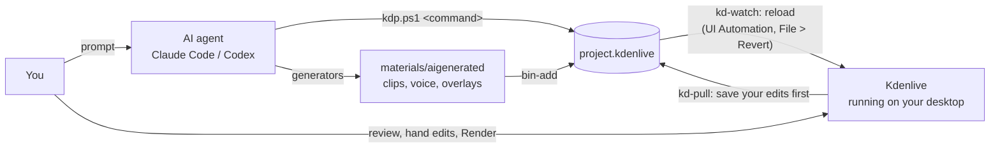

<div align="center">

# Movie Engine

**AI agent stříhá vaše video v Kdenlive přímo před vašima očima a vy můžete kdykoli převzít řízení.**

AI agenti pro programování (Claude Code, Codex) vytvářejí a upravují skutečné projekty Kdenlive: filmy, vysvětlující videa a vertikální shorts. Úpravy se živě objevují v editoru, který máte otevřený. Přenosné, Windows, bez úprav editoru.


[English](../../README.md) · [简体中文](README.zh-CN.md) · [繁體中文](README.zh-TW.md) · [हिन्दी](README.hi.md) · [Español](README.es.md) · [Français](README.fr.md) · [العربية](README.ar.md) · [বাংলা](README.bn.md) · [Português](README.pt.md) · [Русский](README.ru.md) · [اردو](README.ur.md) · [Bahasa Indonesia](README.id.md) · [Deutsch](README.de.md) · [日本語](README.ja.md) · [Türkçe](README.tr.md) · [한국어](README.ko.md) · [Українська](README.uk.md) · [Italiano](README.it.md) · [Polski](README.pl.md) · [Tiếng Việt](README.vi.md) · [فارسی](README.fa.md) · [ไทย](README.th.md) · [Kiswahili](README.sw.md) · [አማርኛ](README.am.md) · [Avañe'ẽ](README.gn.md) · [Setswana](README.tn.md) · [Shqip](README.sq.md) · [Беларуская](README.be.md) · [Български](README.bg.md) · [Bosanski](README.bs.md) · [Hrvatski](README.hr.md) · [Српски](README.sr.md) · [Crnogorski](README.cnr.md) · [Македонски](README.mk.md) · [Slovenščina](README.sl.md) · [Slovenčina](README.sk.md) · **Čeština** · [Magyar](README.hu.md) · [Română](README.ro.md) · [Dansk](README.da.md) · [Norsk bokmål](README.nb.md) · [Norsk nynorsk](README.nn.md) · [Svenska](README.sv.md) · [Íslenska](README.is.md) · [Suomi](README.fi.md) · [Eesti](README.et.md) · [Latviešu](README.lv.md) · [Lietuvių](README.lt.md) · [Nederlands](README.nl.md) · [Lëtzebuergesch](README.lb.md) · [Rumantsch](README.rm.md) · [Ελληνικά](README.el.md) · [Malti](README.mt.md) · [Gaeilge](README.ga.md) · [Català](README.ca.md) · [ქართული](README.ka.md) · [Հայերեն](README.hy.md) · [Azərbaycanca](README.az.md) · [Afrikaans](README.af.md) · [isiZulu](README.zu.md) · [isiXhosa](README.xh.md) · [Sesotho](README.st.md) · [Sepedi](README.nso.md) · [Xitsonga](README.ts.md) · [Tshivenḓa](README.ve.md) · [siSwati](README.ss.md) · [isiNdebele (South Africa)](README.nr.md) · [isiNdebele (Zimbabwe)](README.nd.md) · [chiShona](README.sn.md) · [Chichewa](README.ny.md) · [Ikinyarwanda](README.rw.md) · [Ikirundi](README.rn.md) · [Malagasy](README.mg.md) · [Soomaali](README.so.md) · [Afaan Oromoo](README.om.md) · [Qafar af](README.aa.md) · [ትግርኛ](README.ti.md) · [Sängö](README.sg.md) · [Kreol Seselwa](README.crs.md) · [TjiKalanga](README.kck.md) · [ChiNdau](README.ndc.md)

*Toto je překlad. Referenční verzí je anglické README.*

</div>

---

## Obsah

- [Proč](#proč)
- [Jak to funguje](#jak-to-funguje)
- [Funkce](#funkce)
- [Požadavky](#požadavky)
- [Instalace](#instalace)
- [Rychlý start](#rychlý-start)
- [Práce s agentem](#práce-s-agentem)
- [Příkazový řádek pro střih (`kdp.ps1`)](#příkazový-řádek-pro-střih-kdpps1)
- [Živá synchronizace s otevřeným editorem](#živá-synchronizace-s-otevřeným-editorem)
- [Generátory: co Kdenlive neumí](#generátory-co-kdenlive-neumí)
- [Namlouvání a zvuk](#namlouvání-a-zvuk)
- [Jazyk rozhraní](#jazyk-rozhraní)
- [Struktura složek](#struktura-složek)
- [Testy a důkazy](#testy-a-důkazy)
- [Omezení](#omezení)
- [Řešení problémů](#řešení-problémů)
- [Časté dotazy](#časté-dotazy)
- [Přispívání](#přispívání)
- [Poděkování](#poděkování)
- [Licence](#licence)

## Proč

Video editory jsou stavěné pro ruku na myši. AI agenti jsou dobří ve struktuře, časování a opakování: rozmístit 300 klipů do rytmu, načasovat každý titulek podle hlasu, předělat scénu podle připomínek. Klikat v grafickém rozhraní ale nemohou, aniž by vám zabrali plochu.

Kdenlive je silný open-source editor, ale ve Windows **nemá žádné API pro automatizaci**: ovládání přes D-Bus existuje jen v sestaveních pro Linux a forky, které ho přidávají, jsou buď neudržované, nebo nebezpečné. Movie Engine to řeší bez úprav editoru:

1. Agent upravuje soubor projektu `.kdenlive` přes otestovaný příkazový řádek (`engine/kdp.ps1`).
2. Spuštěný Kdenlive dostane přes Windows UI Automation pokyn soubor znovu načíst, bez stisků kláves, bez myši a bez kradení fokusu.
3. Vaše vlastní neuložené úpravy se nejprve uloží a nikdy se nepřepíšou.

Agent tedy stříhá a vy kontrolujete, nebo upravujete ručně. Oba pracujete na stejném projektu, ve stejném editoru, ve stejnou chvíli.

## Jak to funguje



Každý příkaz pro úpravu prochází stejným bezpečným cyklem:

1. **Pull.** Pokud má Kdenlive neuložené změny, dostane pokyn je uložit (tlačítko Save na panelu nástrojů přes UI Automation) a uložení se potvrdí.
2. **Úprava.** Příkaz změní XML pod zámkem, po kontrole hashe a se snímkem pro vrácení zpět. Pokud se soubor mezitím změnil, nic se nezapíše.
3. **Znovunačtení.** Hlídač pozná značku, kterou zanechává AI, a v otevřeném editoru spustí File > Revert. Za úspěch se počítá jen to, že widget časové osy byl skutečně znovu sestaven.
4. **Konflikt.** Pokud jste mezitím začali upravovat, nic se znovu nenačte a vaše práce zůstane. Verze AI se uloží stranou a agent svou změnu znovu použije nad vaší.

## Funkce

- **Úplné úpravy projektu bez grafického rozhraní**: asi 120 příkazů pokrývajících koš projektu, časovou osu, efekty, kompozice, stopy, vodítka, značky, titulky, sekvence, rychlost a přemapování času, prezentace, titulkové klipy, proxy klipy, renderování a zpět/znovu. Viz [přehled příkazů](#příkazový-řádek-pro-střih-kdpps1).
- **Živá synchronizace s otevřeným editorem.** Úpravy AI se objeví v Kdenlive, na který se díváte; vaše neuložené úpravy se nejprve uloží a nikdy se neztratí.
- **Nikdy neruší vaši plochu.** Žádné kradení fokusu, stisky kláves ani pohyby myši. Testovací editory běží na neviditelné ploše Windows.
- **Přenosné.** Editor, nastavení, Node.js, písma a nástroje jsou v jedné složce. Zkopírujte ji na jiný počítač a funguje; nic se nezapisuje do Program Files ani do vašeho profilu Windows.
- **Generátory pro to, co Kdenlive neumí**: kinetický text animovaný po písmenech, ručně kreslené poznámky, 3D scény rozhraní, animace kurzoru a dlouhé interaktivní vysvětlující filmy. Renderují se na GPU se skutečným rozmazáním pohybu a na časovou osu se vkládají jako obyčejné klipy.
- **Namlouvání s časováním slov** (Microsoft Edge TTS, bez API klíče). Titulky a akce se spouštějí přesně na daném slově.
- **Syntetizované zvukové efekty** (whoosh, click, pop, riser, impact a další), generované kódem.
- **Ověřeno, ne předpokládáno.** Každý příkaz má kontrolu výsledku, efekty a kompozice se procházejí jeden po druhém a surové výsledky jsou v `docs/proof/`.
- **Včetně instrukcí pro agenty.** `AGENTS.md` a dovednosti v `.claude/skills/` učí Claude Code a Codex pracovní postup, formát souboru a úskalí.

## Požadavky

| | |
|---|---|
| OS | Windows 10 nebo 11, x64 |
| Editor | Kdenlive **26.08.3**, přenosné sestavení (standalone). Jiné verze nejsou otestované. |
| Node.js | 18 nebo novější: `.zip` pro Windows x64 z nodejs.org, rozbalený do `engine/node/` |
| Prohlížeč | Microsoft Edge (součást Windows); renderery scén ho používají v režimu headless |
| Agent | [Claude Code](https://claude.com/claude-code) nebo Codex. Volitelné: každý nástroj lze spustit i ručně. |
| Disk | asi 1 GB pro editor a nástroje, plus vaše média |
| GPU | jakákoli GPU s hardwarovým kódováním H.264 zrychlí `film-render.mjs` (bez ní se použije softwarové kódování) |

## Instalace

Vše se instaluje **dovnitř složky**. Nic nepotřebuje práva správce.

```powershell
git clone https://github.com/vladtarrow/movie-engine.git
cd movie-engine
```

**1. Node.js.** Stáhněte `.zip` pro Windows x64 s Node.js 18 nebo novějším z <https://nodejs.org/en/download> a jeho obsah rozbalte do `engine\node\` tak, aby tam byly `engine\node\node.exe` a `engine\node\npm.cmd`. Není potřeba instalátor ani systémový Node. Všechny skripty se spouštějí přes `engine\node.cmd`, nikdy přes systémový Node.

**2. Balíčky Node** pro hlasový nástroj a renderery (verze jsou zafixované v `engine/voice/package.json`):

```powershell
engine\node\npm.cmd install --prefix engine\voice
```

**3. Přenosný Kdenlive 26.08.3.** Stáhněte `kdenlive-26.08.3_standalone.exe` z <https://download.kde.org/stable/kdenlive/26.08/windows/> do `engine\installer\`, ověřte ho a rozbalte:

```powershell
(Get-FileHash engine\installer\kdenlive-26.08.3_standalone.exe -Algorithm SHA256).Hash
# expected: A25427B1DFF2C17E3B0386E991BB1A719382BB3176D1A90E441CDAEB6E0A967D
engine\installer\kdenlive-26.08.3_standalone.exe -o"engine\Kdenlive" -y
```

Editor skončí v `engine\Kdenlive\kdenlive-26.08.3_standalone\bin\`. Už obsahuje `melt.exe` a `ffmpeg.exe`.

**4. První spuštění.**

```powershell
engine\kdenlive.cmd
```

Kdenlive si všechna nastavení ukládá do `engine\profile-kdenlive\`, ne do vašeho profilu Windows. Při prvním spuštění jednou zobrazí průvodce nastavením.

## Rychlý start

### S agentem

Otevřete složku v Claude Code (nebo Codexu) a požádejte běžnými slovy:

> Vytvoř nový vertikální projekt „launch-teaser“ s 30 fps. Dej na časovou osu tři snímky obrazovky z `materials/designers/launch/`, každý na 2,5 s s krátkým prolínáním, přidej namluvený komentář ze `script.txt` a ke každému řádku načasuj kinetický titulek.

> Otevři mi ho v Kdenlive.

> Druhý záběr je moc dlouhý. Zkrať ho na 1,8 s a posuň logo trochu nahoru.

Agent se řídí `AGENTS.md`: upravuje přes `kdp.ps1`, renderuje jen klipy, které střih potřebuje, a udržuje otevřený editor synchronizovaný. Vy kontrolujete v Kdenlive, kdykoli chcete, upravujete ručně, a když jste spokojeni, stisknete Render.

### Ručně

```powershell
# a new 1080x1920 30 fps project with 2 video and 2 audio tracks
powershell -NoProfile -ExecutionPolicy Bypass -File engine\kdp.ps1 new -Project projects\hello\hello.kdenlive -Profile vertical_hd_30

# a 3-second title and a colour background
powershell -NoProfile -ExecutionPolicy Bypass -File engine\kdp.ps1 bin-color -Project projects\hello\hello.kdenlive -Color '#203060' -Seconds 3 -Name bg
powershell -NoProfile -ExecutionPolicy Bypass -File engine\kdp.ps1 title -Project projects\hello\hello.kdenlive -Text "Hello" -Seconds 3 -Name hi

# place them: background on V1, title above it on V2
powershell -NoProfile -ExecutionPolicy Bypass -File engine\kdp.ps1 add -Project projects\hello\hello.kdenlive -Bin bg -Track V1 -At 0
powershell -NoProfile -ExecutionPolicy Bypass -File engine\kdp.ps1 add -Project projects\hello\hello.kdenlive -Bin hi -Track V2 -At 0

# a check frame, then open it in the editor
powershell -NoProfile -ExecutionPolicy Bypass -File engine\kdp.ps1 frame -Project projects\hello\hello.kdenlive -At 1.5 -Out out\hello\check.png
engine\kdenlive.cmd projects\hello\hello.kdenlive
```

Chcete-li později znovu otevřít poslední projekt, dvakrát klikněte na `open-last-project.cmd`.

## Práce s agentem

Agent čte `AGENTS.md` (Codex) nebo `CLAUDE.md`, který ho importuje (Claude Code), a k tomu dvě dovednosti:

| Dovednost | Co učí |
|---|---|
| `.claude/skills/kdenlive-project-file` | formát `.kdenlive` / MLT XML, `kdp.ps1`, kontrolu pomocí `melt` |
| `.claude/skills/kdenlive-live` | bezpečné ovládání běžícího editoru: spuštění, pull, znovunačtení, zachycení jeho okna |

Pravidla, která agent dodržuje a na která se můžete spolehnout:

- Nikdy vám nebere myš, klávesnici ani fokus a nikdy nepořizuje snímky vaší plochy (jen vlastního okna editoru).
- Kroky v grafickém rozhraní (uložit, otevřít, znovu načíst) dělá sám, místo aby vás žádal o kliknutí.
- Před jakýmkoli stahováním a před jakýmkoli mazáním se zeptá.
- Renderuje jen to, co práce potřebuje (klipy scén, kontrolní snímky). Finální film renderuje, jen když o to požádáte.
- Když Kdenlive něco neumí dobře, agent to sestaví mimo něj kódem a výsledek vloží jako klip. Efekt neoslabuje.

## Příkazový řádek pro střih (`kdp.ps1`)

```powershell
powershell -NoProfile -ExecutionPolicy Bypass -File engine\kdp.ps1 <command> -Project <file.kdenlive> [options]
```

Časy jsou v sekundách, s tečkou (`2.5`). Stopy jsou `V1 V2 …` (V1 nejníže) a `A1 A2 …`. Klip se určuje pomocí `-Track` a libovolného času `-At` uvnitř něj. Parametry efektů se zadávají v `-Params "name=value||name=value"`. Úplný seznam se všemi volbami je v hlavičce `engine/kdp.ps1`.

| Skupina | Příkazy |
|---|---|
| Projekt | `new`, `profiles`, `info`, `validate`, `fonts`, `profile-set`, `profile-from-clip`, `zone`, `archive`, `backups`, `rebase`, `otio-export`, `otio-import` |
| Koš projektu | `bin-add`, `bin-color`, `title`, `title-text`, `title-save`, `title-template`, `bin-rename`, `bin-remove`, `bin-info`, `bin-set`, `bin-duplicate`, `bin-replace-file`, `bin-reload`, `folder`, `bin-folder`, `relink`, `clean`, `generator`, `playlist-clip`, `extract-audio`, `transcode` |
| Časová osa | `add`, `add-av`, `move`, `copy`, `trim`, `ripple-trim`, `slip`, `split`, `remove`, `speed`, `remap`, `disable`, `enable`, `group`, `ungroup`, `mix`, `unmix`, `space-insert`, `space-remove`, `spaces-remove-all`, `track-clear`, `replace-in-timeline` |
| Efekty | `effects`, `effect-info`, `effect-add`, `effect-list`, `effect-set`, `effect-remove`, `effect-copy`, `effect-clear`, `effects-all`, `bin-effect`, `effect-templates`, `effect-template` |
| Kompozice | `compositions`, `comp-info`, `comp-add`, `comp-list`, `comp-set`, `comp-remove` |
| Stopy | `track-add`, `track-remove`, `track-set` |
| Vodítka a značky | `guide-add`, `guide-list`, `guide-remove`, `guide-set`, `guide-clear`, `guide-export`, `guide-category`, `marker`, `marker-list`, `marker-set`, `marker-remove` |
| Titulky | `sub-add`, `sub-import`, `sub-export`, `sub-state` |
| Sekvence | `sequence-add`, `sequences`, `copy-to-sequence`, `expand`; jakýkoli příkaz s `-Sequence <name>` funguje uvnitř dané sekvence |
| Speciální | `slideshow`, animace Lottie / Glaxnimate přes `bin-add`, `proxy`, `stabilize`, `scene-split`, `speed-job`, `subclip` |
| Výstup | `frame` (jeden PNG), `preview` (rychlý render přes melt), `render` (vlastní renderer Kdenlive nebo předvolba), `presets` |
| Historie | `undo`, `redo`, `clear-history` (snímky v `projects/<name>/.kdp-history`) |

Co je dobré vědět o chování:

- Propojené zvukové a obrazové poloviny se přesouvají, ořezávají, dělí a odstraňují společně (`-Alone` pro jednu polovinu).
- Příkaz, který selže, skončí s kódem 1 a nic nezapíše.
- Efekty, které sestavení pro Windows nedokáže spustit, se odmítnou, a ne potichu ignorují (seznam: `docs/proof/assets.txt`).
- Každá akce z nabídek Kdenlive je v `engine/tools/data/kdenlive-actions.csv` přiřazena k příkazu, k jiné cestě nebo označena „jen zobrazení“. Viz `docs/kdenlive-coverage.md`.

## Živá synchronizace s otevřeným editorem

| Skript | Co dělá | Návratové kódy |
|---|---|---|
| `engine\kd-pull.ps1 -Project <f>` | přiměje Kdenlive uložit vaše úpravy a potvrdí to | 0 soubor je aktuální, 3 neběží, 4 nepotvrzeno |
| `engine\kd-reload.ps1 -Project <f>` | File > Revert, potvrzeno znovu sestavenou časovou osou | 0 potvrzeno, 2 máte neuložené úpravy (nic se nezahodilo), 3 neběží, 4 selhalo |
| `engine\kd-watch.ps1 -Project <f>` | hlídač na pozadí: znovu načte po každém zápisu AI, zapisuje konflikty do logu | log v `engine\kd-watch.log`; pro zastavení smažte `engine\kd-watch.run` |
| `engine\kdenlive-bg.ps1 [project]` | spustí Kdenlive minimalizovaný pro agenta | 0 načteno, 4 nepotvrzeno |
| `engine\kdenlive.cmd [project]` | spustí Kdenlive pro vás | |

Hlídač spusťte jednou za relaci:

```powershell
Start-Process powershell -WindowStyle Hidden -ArgumentList '-NoProfile','-ExecutionPolicy','Bypass','-File','engine\kd-watch.ps1','-Project','projects\hello\hello.kdenlive'
```

Velké projekty: znovunačtení projektu s 1000 klipy trvá minuty a nástroje na něj čekají, místo aby hlásily výsledek předčasně. Projekty se otevírají přes *File > Open Recent* v prázdném editoru, protože při přímém otevření souboru Qt kvůli přístupnosti prochází každou položku časové osy a bylo to asi o 10 minut pomalejší.

## Generátory: co Kdenlive neumí

Kdenlive/MLT nemá animaci textu po písmenech, nemá výrazy (expressions) a jen málo 3D, a náročné efekty zpomalují přehrávání. Movie Engine takové části renderuje mimo editor a vkládá je na časovou osu jako obyčejné klipy, obvykle s alfa kanálem, na stopu nad obrazem. Skript generátoru a jeho vstupy zůstávají ve složce projektu, takže klip lze znovu vygenerovat, když se změní text, písmo nebo časování.

| Nástroj | Vytváří |
|---|---|
| `engine/tools/kinetic-text.ps1` | kinetické titulky animované po písmenech, každé slovo načasované podle `voice.json`, zvýrazňovací rámeček |
| `engine/tools/annotate.ps1` | ručně kreslené kruhy, rámečky, podtržení a šipky, které se postupně kreslí přes snímek obrazovky |
| `engine/tools/card-entrance.ps1` | kartu se snímkem obrazovky, která vyjede nahoru a zvětší se s jemným stínem |
| `engine/tools/pdf-to-png.ps1` | slajdy z exportu do PDF |
| `engine/tools/html-render.mjs` | libovolnou scénu v HTML/CSS/canvas jako video: animace rozhraní, kurzory, 3D, masky |
| `engine/tools/film-render.mjs` + `film/` | dlouhé interaktivní vysvětlující filmy na canvasu: jeden klip na každou namluvenou repliku, akce se spouštějí na vyslovených slovech, rozmazání pohybu na GPU zhruba při 45 fps |

Oba renderery ovládají Microsoft Edge dodávaný s Windows, v režimu headless, s jednorázovým profilem a bez přístupu k síti.

### Ukázky

```powershell
# a 3-second 3D title card with a cursor click
engine\node.cmd engine\tools\html-render.mjs examples\demo\scene\scene.html examples\demo\out --frames 0,30,60,89
engine\node.cmd engine\tools\html-render.mjs examples\demo\scene\scene.html examples\demo\out\scene.mp4

# a 4-shot interactive film timed to two voice lines
engine\node.cmd engine\tools\film-render.mjs examples\demo\film\film.html examples\demo\out --check
engine\node.cmd engine\tools\film-render.mjs examples\demo\film\film.html examples\demo\out --shots all --width 640
engine\node.cmd engine\tools\film-render.mjs examples\demo\film\film.html examples\demo\out\clips --suffix -v01
```

Film tvoří tři malé soubory. `data.js` obsahuje záběry a časy slov. `direction.js` má jeden řádek na záběr:

```text
1 | hover 192 108 @brand | tag 300 60 Your brand @deserves | confetti 192 90 @film
2 say=A film that/*explains* it
3 | click 116 108 @before | click 268 108 @after | chips Before~After @after
4 scene=counter | count 0 120 % @count
```

`scenes.js` obsahuje záběry, které se kreslí od nuly. `@word` spustí akci, když hlas vysloví dané slovo. Mezi akce patří click, hover, drag, zoom, lens, ring, arrow, chips, toggle, slider, toast, type, count a confetti; úplná syntaxe je na začátku `engine/tools/film/film-kit.js`.

## Namlouvání a zvuk

```powershell
engine\node.cmd engine\voice\voice.mjs lines.json materials\aigenerated\hello\voice en-US-AndrewMultilingualNeural +0%
```

`lines.json` je seznam replik. Nástroj zapíše jeden mp3 na každou repliku a k tomu `voice.json` s délkou a se začátkem a koncem každého slova. Repliky se ukládají do mezipaměti, takže změna jedné repliky znovu vygeneruje jen tuto repliku. Nástroj používá online převod textu na řeč od Microsoft Edge přes balíček `msedge-tts`: klíč není potřeba, ale služba je neoficiální a vyžaduje internet.

```powershell
engine\node.cmd engine\audio\sfx.mjs materials\aigenerated\sfx
```

Tento příkaz kódem syntetizuje whoosh, whoosh-long, swipe, click, pop, tick, riser, impact, ding a reveal; hotová sada je v `materials/aigenerated/sfx/`. Zvuky kratší než jeden snímek před umístěním doplňte tichem (`-af apad=whole_dur=0.0667`).

## Jazyk rozhraní

Spouštěče ve výchozím stavu spouštějí Kdenlive v **angličtině**. Chcete-li jiný jazyk, nastavte před spuštěním `MOVIE_ENGINE_UI_LANG`:

```powershell
$env:MOVIE_ENGINE_UI_LANG = 'ru'; engine\kdenlive.cmd
```

UI Automation hledá položky nabídek podle jejich viditelných názvů. Názvy pro 31 jazyků rozhraní jsou vestavěné (`engine/tools/kd-ui.ps1`, `$KdNames`). Pro jakýkoli jiný jazyk tam přidejte jeho názvy a ověřte to příkazem:

```powershell
powershell -NoProfile -ExecutionPolicy Bypass -File engine\tools\kd-langcheck.ps1
```

## Struktura složek

```text
movie-engine/
├─ AGENTS.md, CLAUDE.md          instructions for AI agents
├─ .claude/skills/               agent skills: project file format, live editor
├─ engine/
│  ├─ kdp.ps1                    the editing command line
│  ├─ kd-pull / kd-reload / kd-watch .ps1, kdenlive.cmd, kdenlive-bg.ps1
│  ├─ tools/                     internals, generators, tests, data (action map)
│  ├─ voice/  audio/  fonts/     TTS, synthesized SFX, Poppins (OFL)
│  ├─ Kdenlive/  node/           portable editor and Node.js (not in git)
│  └─ profile-kdenlive/          the editor's settings (not in git)
├─ projects/<name>/<name>.kdenlive
├─ materials/
│  ├─ download/                  stock and downloaded files (not in git)
│  ├─ aigenerated/               everything the AI made (sfx/ and test-kit/ ship with the engine)
│  ├─ designers/  brand/         files from your team, brand assets
├─ examples/demo/                demos of the scene and film renderers
├─ out/                          renders (not in git)
└─ docs/                         proofs, coverage, translations of this README
```

Cesty k médiím uvnitř projektů jsou relativní. Pokud složku přesunete nebo zkopírujete, `kdp.ps1 rebase` (spouští ho také automaticky `kdenlive.cmd`) zapíše do projektu nové umístění.

## Testy a důkazy

Tvrzení o tom, co funguje, jsou podložena kontrolami výsledků, ne tím, že „funkce proběhla“. Shrnutí je v [`docs/kdenlive-proof.md`](../../docs/kdenlive-proof.md) a surový výstup v `docs/proof/`.

| Test | Kontroluje |
|---|---|
| `engine\tools\kdp-clitest.ps1` | každý příkaz `kdp.ps1`, přes příkazový řádek, s porovnáním výsledného projektu |
| `engine\tools\kd-livetest.ps1` | pull, znovunačtení, hlídač, konflikty a souběhy proti skutečnému Kdenlive na neviditelné ploše |
| `engine\tools\kdp-assetsweep.ps1` | každý efekt a každou kompozici: renderuje a porovnává snímky |
| `engine\tools\kdp-portabletest.ps1` | zkopíruje složku jinam a pracuje z kopie |
| `engine\tools\kd-langcheck.ps1` | jazyk rozhraní a to, že UI Automation najde nabídku |
| `engine\tools\kdp-coverage-check.ps1` | že každá akce z nabídek je přiřazena a žádný důkaz není starší než kód |

```powershell
powershell -NoProfile -ExecutionPolicy Bypass -File engine\tools\kdp-clitest.ps1 -Report docs\proof\clitest.txt
powershell -NoProfile -ExecutionPolicy Bypass -File engine\tools\kd-livetest.ps1 -Report docs\proof\live-en.txt
```

Testovací editory běží jen na skryté ploše s vlastním profilem, takže testy nikdy nesahají na váš otevřený Kdenlive ani na váš fokus.

## Omezení

- **Jen Windows**, jen Kdenlive **26.08.3**. Linux má D-Bus a potřeboval by jiný most.
- Spuštění editoru zabere fokus klávesnice asi na 3 sekundy, než se objeví prázdné okno. Pokud zrovna pracujete, agenti se před jeho spuštěním zeptají. Znovunačtení a úpravy fokus neberou.
- Sestavení pro Windows nemá moduly MLT sox, ladspa a movit ani některé efekty frei0r/avfilter; `kdp.ps1` je odmítá (`docs/proof/assets.txt`).
- Export a import OpenTimelineIO přenáší jen klipy a mezery. Multicam nemá živé přepínání úhlů (střihy se dělají pomocí split/remove/hide).
- „Save As…“ přes UI Automation v minimalizovaném okně neotevře žádný dialog; agent místo toho používá `archive` nebo kopírování souborů.
- Rozpoznávání řeči (automatické titulky) potřebuje Whisper nebo Vosk, které nejsou přibalené.
- Titulkové klipy vytvořené nástrojem pro titulky v Kdenlive používají písma nainstalovaná ve Windows. Pro zaručenou typografii renderujte text generátory, které načítají písma z `engine/fonts/`.
- Edge TTS je neoficiální online služba a může se změnit nebo přestat fungovat.

## Řešení problémů

| Příznak | Příčina a řešení |
|---|---|
| Kdenlive běží, ale kliknutí na něj na hlavním panelu nic nezobrazí | Jeho uložená pozice okna je mimo obrazovku. Zavřete ho a smažte položky `kdockLayout` v `engine\profile-kdenlive\AppData\Local\kdenliverc`, nebo okno přesuňte pomocí `SetWindowPos` (viz `AGENTS.md`). |
| `kd-reload.ps1` skončí s kódem 2 | Máte neuložené úpravy. Nic se nezahodilo. Spusťte `kd-pull.ps1` a pak změnu použijte znovu (`kdp.ps1` to dělá sám). |
| `CONFLICT` v `engine\kd-watch.log` | Vy i agent jste upravovali ve stejnou chvíli. Vaše verze zůstává v editoru a verze AI je v `projects\<name>\.kdp-history\<name>\conflict\`. Požádejte agenta, aby svou změnu použil znovu. |
| Příkaz skončí s kódem 1 a hlášením „pull not confirmed“ | Kdenlive je zaneprázdněný nebo zobrazuje dialog. Zavřete dialog nebo počkejte na dokončení načítání a pak to zopakujte. |
| Skript PowerShellu nejde zpracovat (chyba parsování) | Skripty s textem mimo ASCII musí být pro Windows PowerShell 5.1 uložené v UTF-8 **s BOM**. |
| `voice.mjs` skončí s hlášením „Stream closed before the synthesis completed“ | Obvykle jde o problém se sítí, nebo o neescapované SSML ve starších kopiích. `voice.mjs` escapuje `& < >` sám. |
| Otevření velkého projektu trvá mnoho minut | Otevírejte ho přes `kdenlive.cmd` / `kdenlive-bg.ps1`, nikdy jako `kdenlive.exe project.kdenlive`. |

## Časté dotazy

**Potřebuji Claude Code nebo Codex?**
Ne. Každý nástroj je obyčejný skript, který můžete spustit ručně. Rychlost přináší agent: naplánuje střih, spouští nástroje a udržuje editor synchronizovaný.

**Přepíše agent moje ruční úpravy?**
Ne. Před každým zápisem se vaše neuložené úpravy uloží a uložení se potvrdí. Pokud upravujete, zatímco agent zapisuje, zápis se odmítne nebo se uloží stranou jako konflikt, nikdy se nepoužije přes vaši práci.

**Mohu dál normálně používat Kdenlive?**
Ano. Je to standardní Kdenlive s vlastní složkou nastavení. Upravujte, prohlížejte a renderujte jako obvykle.

**Funguje to s Kdenlive, který už mám nainstalovaný?**
Používá vlastní přenosnou kopii v `engine\Kdenlive\`, takže váš nainstalovaný Kdenlive a jeho nastavení zůstanou nedotčené.

**Proč ne fork Kdenlive s API nebo jiný editor?**
Ve Windows neexistuje žádný udržovaný a bezpečný fork (průzkum z listopadu 2026). Vyzkoušeny byly OpenShot, Blender VSE, DaVinci Resolve, Shotcut a webové editory; Kdenlive nabídl největší hloubku střihu. Sledujeme návrh REST API v hlavním projektu Kdenlive (merge request !902).

**Umí vyrenderovat finální video?**
Ano, pomocí `kdp.ps1 render` (vlastní renderer Kdenlive, skrytě), nebo sami stisknete Render v editoru.

**Nahrávají se moje média někam?**
Ne. Při generování hlasu se službě Edge TTS posílá jen text namlouvání. Renderery scén běží s vypnutou sítí.

## Přispívání

Příspěvky jsou vítány. Viz [CONTRIBUTING.md](../../CONTRIBUTING.md). Ve zkratce:

- Každá nová nebo změněná operace `kdp.ps1` potřebuje kontrolu výsledku v `kdp-clitest.ps1`, záznam v mapě akcí a nový běh `kdp-coverage-check.ps1`.
- Nikdy nespouštějte testovací Kdenlive na viditelné ploše; použijte `engine/tools/kd-hidden.ps1`.
- Udržujte vše přenosné: žádné instalace mimo složku, žádné absolutní cesty v projektech.
- Ověřené zvláštnosti zapisujte do `AGENTS.md` nebo do příslušné dovednosti.

## Poděkování

- [Kdenlive](https://kdenlive.org) a [MLT](https://www.mltframework.org): editor a engine pod ním.
- [FFmpeg](https://ffmpeg.org), přibalený ke Kdenlive.
- [msedge-tts](https://www.npmjs.com/package/msedge-tts) pro namlouvání.
- [Poppins](https://fonts.google.com/specimen/Poppins) od Indian Type Foundry, SIL Open Font License (`engine/fonts/OFL.txt`).
- `engine/tools/data/kdenliveui-26.08.3.rc`: soubor nabídek Kdenlive převzatý ze zdrojového kódu Kdenlive 26.08.3; používá ho jen kontrola pokrytí. Zůstává pod licencí GPL Kdenlive, nikoli pod MIT License.

## Licence

Vlastní kód Movie Engine je vydán pod [licencí MIT](../../LICENSE). Kdenlive, MLT, FFmpeg, balíčky Node.js a písmo Poppins si ponechávají své vlastní licence.
