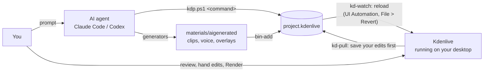

<div align="center">

# Movie Engine

**En AI-agent klipper din video i Kdenlive, mens du ser på, og du kan tage over når som helst.**

AI-kodeagenter (Claude Code, Codex) bygger og ændrer rigtige Kdenlive-projekter: film, forklaringsvideoer og lodrette shorts. Ændringerne dukker op med det samme i den editor, du har åben. Portabel, Windows, ingen patches af editoren.


[English](../../README.md) · [简体中文](README.zh-CN.md) · [繁體中文](README.zh-TW.md) · [हिन्दी](README.hi.md) · [Español](README.es.md) · [Français](README.fr.md) · [العربية](README.ar.md) · [বাংলা](README.bn.md) · [Português](README.pt.md) · [Русский](README.ru.md) · [اردو](README.ur.md) · [Bahasa Indonesia](README.id.md) · [Deutsch](README.de.md) · [日本語](README.ja.md) · [Türkçe](README.tr.md) · [한국어](README.ko.md) · [Українська](README.uk.md) · [Italiano](README.it.md) · [Polski](README.pl.md) · [Tiếng Việt](README.vi.md) · [فارسی](README.fa.md) · [ไทย](README.th.md) · [Kiswahili](README.sw.md) · [አማርኛ](README.am.md) · [Avañe'ẽ](README.gn.md) · [Setswana](README.tn.md) · [Shqip](README.sq.md) · [Беларуская](README.be.md) · [Български](README.bg.md) · [Bosanski](README.bs.md) · [Hrvatski](README.hr.md) · [Српски](README.sr.md) · [Crnogorski](README.cnr.md) · [Македонски](README.mk.md) · [Slovenščina](README.sl.md) · [Slovenčina](README.sk.md) · [Čeština](README.cs.md) · [Magyar](README.hu.md) · [Română](README.ro.md) · **Dansk** · [Norsk bokmål](README.nb.md) · [Norsk nynorsk](README.nn.md) · [Svenska](README.sv.md) · [Íslenska](README.is.md) · [Suomi](README.fi.md) · [Eesti](README.et.md) · [Latviešu](README.lv.md) · [Lietuvių](README.lt.md) · [Nederlands](README.nl.md) · [Lëtzebuergesch](README.lb.md) · [Rumantsch](README.rm.md) · [Ελληνικά](README.el.md) · [Malti](README.mt.md) · [Gaeilge](README.ga.md) · [Català](README.ca.md) · [ქართული](README.ka.md) · [Հայերեն](README.hy.md) · [Azərbaycanca](README.az.md) · [Afrikaans](README.af.md) · [isiZulu](README.zu.md) · [isiXhosa](README.xh.md) · [Sesotho](README.st.md) · [Sepedi](README.nso.md) · [Xitsonga](README.ts.md) · [Tshivenḓa](README.ve.md) · [siSwati](README.ss.md) · [isiNdebele (South Africa)](README.nr.md) · [isiNdebele (Zimbabwe)](README.nd.md) · [chiShona](README.sn.md) · [Chichewa](README.ny.md) · [Ikinyarwanda](README.rw.md) · [Ikirundi](README.rn.md) · [Malagasy](README.mg.md) · [Soomaali](README.so.md) · [Afaan Oromoo](README.om.md) · [Qafar af](README.aa.md) · [ትግርኛ](README.ti.md) · [Sängö](README.sg.md) · [Kreol Seselwa](README.crs.md) · [TjiKalanga](README.kck.md) · [ChiNdau](README.ndc.md)

*Dette er en oversættelse. Den engelske README er referenceversionen.*

</div>

---

## Indhold

- [Hvorfor](#hvorfor)
- [Sådan virker det](#sådan-virker-det)
- [Funktioner](#funktioner)
- [Krav](#krav)
- [Installation](#installation)
- [Kom hurtigt i gang](#kom-hurtigt-i-gang)
- [Arbejdet med agenten](#arbejdet-med-agenten)
- [Kommandolinjen til redigering (`kdp.ps1`)](#kommandolinjen-til-redigering-kdpps1)
- [Live-synkronisering med den åbne editor](#live-synkronisering-med-den-åbne-editor)
- [Generatorer: det, Kdenlive ikke kan](#generatorer-det-kdenlive-ikke-kan)
- [Speak og lyd](#speak-og-lyd)
- [Brugerfladens sprog](#brugerfladens-sprog)
- [Mappestruktur](#mappestruktur)
- [Tests og beviser](#tests-og-beviser)
- [Begrænsninger](#begrænsninger)
- [Fejlfinding](#fejlfinding)
- [Ofte stillede spørgsmål](#ofte-stillede-spørgsmål)
- [Bidrag](#bidrag)
- [Tak](#tak)
- [Licens](#licens)

## Hvorfor

Videoeditorer er bygget til en hånd på musen. AI-agenter er gode til struktur, timing og gentagelser: at lægge 300 klip på beatet, at time hver undertekst til stemmen, at lave en scene om efter feedback. Men de kan ikke klikke sig gennem en grafisk brugerflade uden at overtage dit skrivebord.

Kdenlive er en stærk open source-editor, men på Windows har den **intet API til automatisering**: styring via D-Bus findes kun i Linux-builds, og de forks, der tilføjer et, er enten uvedligeholdte eller usikre. Movie Engine løser det uden at patche editoren:

1. Agenten redigerer projektfilen `.kdenlive` gennem en testet kommandolinje (`engine/kdp.ps1`).
2. Den kørende Kdenlive får besked på at genindlæse filen via Windows UI Automation, uden tastetryk, uden mus og uden at stjæle fokus.
3. Dine egne ugemte ændringer gemmes først og overskrives aldrig.

Så agenten klipper, og du gennemser, eller du redigerer selv i hånden. I arbejder begge på det samme projekt, i den samme editor, på samme tid.

## Sådan virker det



Hver redigeringskommando følger den samme sikre cyklus:

1. **Pull.** Hvis Kdenlive har ugemte ændringer, får den besked på at gemme dem (Gem-knappen på værktøjslinjen via UI Automation), og gemningen bekræftes.
2. **Redigering.** Kommandoen ændrer XML'en under en lås, efter et hashtjek og med et snapshot til fortrydelse. Hvis filen er ændret i mellemtiden, skrives der ingenting.
3. **Genindlæsning.** Overvågeren ser AI'ens stempel og kører File > Revert i den åbne editor. Det tæller kun som en succes, når tidslinje-widgetten faktisk er bygget op på ny.
4. **Konflikt.** Hvis du er begyndt at redigere i mellemtiden, genindlæses intet, og dit arbejde bliver. AI-versionen lægges til side, og agenten anvender sin ændring igen oven på din.

## Funktioner

- **Fuld projektredigering uden grafisk brugerflade**: omkring 120 kommandoer, der dækker projektkurv, tidslinje, effekter, kompositioner, spor, hjælpelinjer, markører, undertekster, sekvenser, hastighed og tidsomlægning, diasshows, titler, proxyer, rendering og fortryd/gentag. Se [kommandooversigten](#kommandolinjen-til-redigering-kdpps1).
- **Live-synkronisering med den åbne editor.** AI-ændringer vises i den Kdenlive, du kigger på; dine ugemte ændringer gemmes først og går aldrig tabt.
- **Forstyrrer aldrig dit skrivebord.** Intet fokustyveri, ingen tastetryk eller musebevægelser. Testeditorer kører på et usynligt Windows-skrivebord.
- **Portabel.** Editor, indstillinger, Node.js, skrifttyper og værktøjer ligger i én mappe. Kopiér den til en anden pc, så virker den; intet skrives til Program Files eller din Windows-profil.
- **Generatorer til det, Kdenlive ikke kan**: kinetisk tekst animeret bogstav for bogstav, håndtegnede markeringer, 3D-scener af brugerflader, markøranimationer og lange interaktive forklaringsfilm. De renderes på GPU'en med ægte bevægelsessløring og placeres på tidslinjen som almindelige klip.
- **Speak med ordtiming** (Microsoft Edge TTS, ingen API-nøgle). Undertekster og handlinger udløses præcis på det rigtige ord.
- **Syntetiserede lydeffekter** (whoosh, click, pop, riser, impact og flere), genereret i kode.
- **Bevist, ikke antaget.** Hver kommando har et tjek af resultatet, effekter og kompositioner gennemgås én for én, og de rå resultater ligger i `docs/proof/`.
- **Instruktioner til agenter følger med.** `AGENTS.md` og skills i `.claude/skills/` lærer Claude Code og Codex arbejdsgangen, filformatet og faldgruberne.

## Krav

| | |
|---|---|
| OS | Windows 10 eller 11, x64 |
| Editor | Kdenlive **26.08.3**, portabelt (standalone) build. Andre versioner er ikke testet. |
| Node.js | 18 eller nyere: Windows x64-`.zip` fra nodejs.org, pakket ud i `engine/node/` |
| Browser | Microsoft Edge (en del af Windows); bruges headless af scenerenderne |
| Agent | [Claude Code](https://claude.com/claude-code) eller Codex. Valgfrit: alle værktøjer kan også køres i hånden. |
| Disk | omkring 1 GB til editoren og værktøjerne plus dine mediefiler |
| GPU | ethvert grafikkort med hardwarekodning af H.264 gør `film-render.mjs` hurtigere (ellers bruges softwarekodning) |

## Installation

Alt installeres **inde i mappen**. Intet kræver administratorrettigheder.

```powershell
git clone https://github.com/vladtarrow/movie-engine.git
cd movie-engine
```

**1. Node.js.** Hent Windows x64-`.zip` med Node.js 18 eller nyere fra <https://nodejs.org/en/download>, og pak indholdet ud i `engine\node\`, så `engine\node\node.exe` og `engine\node\npm.cmd` ligger der. Der kræves hverken installationsprogram eller en Node installeret i systemet. Alle scripts køres gennem `engine\node.cmd`, aldrig gennem systemets Node.

**2. Node-pakker** til stemmeværktøjet og renderne (versionerne er låst i `engine/voice/package.json`):

```powershell
engine\node\npm.cmd install --prefix engine\voice
```

**3. Portabel Kdenlive 26.08.3.** Hent `kdenlive-26.08.3_standalone.exe` fra <https://download.kde.org/stable/kdenlive/26.08/windows/> til `engine\installer\`, kontrollér den, og pak den ud:

```powershell
(Get-FileHash engine\installer\kdenlive-26.08.3_standalone.exe -Algorithm SHA256).Hash
# expected: A25427B1DFF2C17E3B0386E991BB1A719382BB3176D1A90E441CDAEB6E0A967D
engine\installer\kdenlive-26.08.3_standalone.exe -o"engine\Kdenlive" -y
```

Editoren havner i `engine\Kdenlive\kdenlive-26.08.3_standalone\bin\`. Den indeholder allerede `melt.exe` og `ffmpeg.exe`.

**4. Første start.**

```powershell
engine\kdenlive.cmd
```

Kdenlive gemmer alle sine indstillinger i `engine\profile-kdenlive\`, ikke i din Windows-profil. Ved første start viser den en opsætningsguide én gang.

## Kom hurtigt i gang

### Med en agent

Åbn mappen i Claude Code (eller Codex), og spørg med almindelige ord:

> Lav et nyt lodret projekt "launch-teaser" med 30 fps. Læg de tre skærmbilleder fra `materials/designers/launch/` på tidslinjen, 2,5 s hver med en kort overtoning, tilføj et speak fra `script.txt`, og time en kinetisk billedtekst til hver linje.

> Åbn det i Kdenlive for mig.

> Det andet billede er for langt. Skær det ned til 1,8 s, og flyt logoet lidt op.

Agenten følger `AGENTS.md`: den redigerer gennem `kdp.ps1`, renderer kun de klip, klippet har brug for, og holder den åbne editor synkroniseret. Du gennemser i Kdenlive, redigerer i hånden, når du har lyst, og trykker på Render, når du er tilfreds.

### I hånden

```powershell
# a new 1080x1920 30 fps project with 2 video and 2 audio tracks
powershell -NoProfile -ExecutionPolicy Bypass -File engine\kdp.ps1 new -Project projects\hello\hello.kdenlive -Profile vertical_hd_30

# a 3-second title and a colour background
powershell -NoProfile -ExecutionPolicy Bypass -File engine\kdp.ps1 bin-color -Project projects\hello\hello.kdenlive -Color '#203060' -Seconds 3 -Name bg
powershell -NoProfile -ExecutionPolicy Bypass -File engine\kdp.ps1 title -Project projects\hello\hello.kdenlive -Text "Hello" -Seconds 3 -Name hi

# place them: background on V1, title above it on V2
powershell -NoProfile -ExecutionPolicy Bypass -File engine\kdp.ps1 add -Project projects\hello\hello.kdenlive -Bin bg -Track V1 -At 0
powershell -NoProfile -ExecutionPolicy Bypass -File engine\kdp.ps1 add -Project projects\hello\hello.kdenlive -Bin hi -Track V2 -At 0

# a check frame, then open it in the editor
powershell -NoProfile -ExecutionPolicy Bypass -File engine\kdp.ps1 frame -Project projects\hello\hello.kdenlive -At 1.5 -Out out\hello\check.png
engine\kdenlive.cmd projects\hello\hello.kdenlive
```

For at åbne det seneste projekt igen senere skal du dobbeltklikke på `open-last-project.cmd`.

## Arbejdet med agenten

Agenten læser `AGENTS.md` (Codex) eller `CLAUDE.md`, som importerer den (Claude Code), plus to skills:

| Skill | Lærer |
|---|---|
| `.claude/skills/kdenlive-project-file` | formatet `.kdenlive` / MLT XML, `kdp.ps1`, kontrol med `melt` |
| `.claude/skills/kdenlive-live` | sikker styring af den kørende editor: start, pull, genindlæsning, optagelse af dens vindue |

Regler, som agenten følger, og som du kan regne med:

- Den tager aldrig din mus, dit tastatur eller dit fokus og tager aldrig skærmbilleder af dit skrivebord (kun af editorens eget vindue).
- Den udfører selv trinnene i brugerfladen (gem, åbn, genindlæs) i stedet for at bede dig om at klikke.
- Den spørger, før den henter noget, og før den sletter noget.
- Den renderer kun det, arbejdet kræver (sceneklip, kontrolbilleder). Den færdige film renderer den kun, når du beder om det.
- Når Kdenlive ikke kan gøre noget godt, bygger agenten det udenfor med kode og sætter resultatet ind som et klip. Den udvander ikke effekten.

## Kommandolinjen til redigering (`kdp.ps1`)

```powershell
powershell -NoProfile -ExecutionPolicy Bypass -File engine\kdp.ps1 <command> -Project <file.kdenlive> [options]
```

Tider angives i sekunder med punktum (`2.5`). Spor hedder `V1 V2 …` (V1 nederst) og `A1 A2 …`. Et klip angives med `-Track` plus et vilkårligt tidspunkt `-At` inden i det. Effektparametre angives i `-Params "name=value||name=value"`. Den fulde liste med alle tilvalg står i hovedet af `engine/kdp.ps1`.

| Gruppe | Kommandoer |
|---|---|
| Projekt | `new`, `profiles`, `info`, `validate`, `fonts`, `profile-set`, `profile-from-clip`, `zone`, `archive`, `backups`, `rebase`, `otio-export`, `otio-import` |
| Projektkurv | `bin-add`, `bin-color`, `title`, `title-text`, `title-save`, `title-template`, `bin-rename`, `bin-remove`, `bin-info`, `bin-set`, `bin-duplicate`, `bin-replace-file`, `bin-reload`, `folder`, `bin-folder`, `relink`, `clean`, `generator`, `playlist-clip`, `extract-audio`, `transcode` |
| Tidslinje | `add`, `add-av`, `move`, `copy`, `trim`, `ripple-trim`, `slip`, `split`, `remove`, `speed`, `remap`, `disable`, `enable`, `group`, `ungroup`, `mix`, `unmix`, `space-insert`, `space-remove`, `spaces-remove-all`, `track-clear`, `replace-in-timeline` |
| Effekter | `effects`, `effect-info`, `effect-add`, `effect-list`, `effect-set`, `effect-remove`, `effect-copy`, `effect-clear`, `effects-all`, `bin-effect`, `effect-templates`, `effect-template` |
| Kompositioner | `compositions`, `comp-info`, `comp-add`, `comp-list`, `comp-set`, `comp-remove` |
| Spor | `track-add`, `track-remove`, `track-set` |
| Hjælpelinjer og markører | `guide-add`, `guide-list`, `guide-remove`, `guide-set`, `guide-clear`, `guide-export`, `guide-category`, `marker`, `marker-list`, `marker-set`, `marker-remove` |
| Undertekster | `sub-add`, `sub-import`, `sub-export`, `sub-state` |
| Sekvenser | `sequence-add`, `sequences`, `copy-to-sequence`, `expand`; enhver kommando med `-Sequence <name>` virker inde i den sekvens |
| Særlige | `slideshow`, Lottie- / Glaxnimate-animationer via `bin-add`, `proxy`, `stabilize`, `scene-split`, `speed-job`, `subclip` |
| Output | `frame` (én PNG), `preview` (hurtig rendering med melt), `render` (Kdenlives egen renderer eller en forudindstilling), `presets` |
| Historik | `undo`, `redo`, `clear-history` (snapshots i `projects/<name>/.kdp-history`) |

Opførsel, der er værd at kende:

- Sammenkædede lyd- og videohalvdele flyttes, trimmes, deles og fjernes sammen (`-Alone` for kun den ene halvdel).
- En kommando, der fejler, afslutter med kode 1 og skriver ingenting.
- Effekter, som Windows-buildet ikke kan køre, afvises i stedet for at blive ignoreret i stilhed (liste: `docs/proof/assets.txt`).
- Hver menuhandling i Kdenlive er knyttet til en kommando, en anden vej eller "kun visning" i `engine/tools/data/kdenlive-actions.csv`. Se `docs/kdenlive-coverage.md`.

## Live-synkronisering med den åbne editor

| Script | Hvad det gør | Exitkoder |
|---|---|---|
| `engine\kd-pull.ps1 -Project <f>` | får Kdenlive til at gemme dine ændringer og bekræfter det | 0 filen er aktuel, 3 kører ikke, 4 ikke bekræftet |
| `engine\kd-reload.ps1 -Project <f>` | File > Revert, bekræftet af den genopbyggede tidslinje | 0 bekræftet, 2 du har ugemte ændringer (intet kasseret), 3 kører ikke, 4 mislykkedes |
| `engine\kd-watch.ps1 -Project <f>` | overvåger i baggrunden: genindlæser efter hver AI-skrivning, logger konflikter | log i `engine\kd-watch.log`; slet `engine\kd-watch.run` for at stoppe |
| `engine\kdenlive-bg.ps1 [project]` | starter Kdenlive minimeret til en agent | 0 indlæst, 4 ikke bekræftet |
| `engine\kdenlive.cmd [project]` | starter Kdenlive til dig | |

Start overvågeren én gang pr. session:

```powershell
Start-Process powershell -WindowStyle Hidden -ArgumentList '-NoProfile','-ExecutionPolicy','Bypass','-File','engine\kd-watch.ps1','-Project','projects\hello\hello.kdenlive'
```

Store projekter: en genindlæsning af et projekt med 1000 klip tager minutter, og værktøjerne venter på den i stedet for at melde for tidligt. Projekter åbnes via *File > Open Recent* i en tom editor, fordi direkte åbning af en fil får Qt til at gennemgå hvert element på tidslinjen for tilgængelighed og var omkring 10 minutter langsommere.

## Generatorer: det, Kdenlive ikke kan

Kdenlive/MLT har ingen tekstanimation bogstav for bogstav, ingen udtryk (expressions) og kun lidt 3D, og tunge effekter gør afspilningen langsom. Movie Engine renderer sådanne dele udenfor og lægger dem på tidslinjen som almindelige klip, som regel med alfakanal, på et spor over billederne. Generatorscriptet og dets input bliver i projektmappen, så et klip kan genereres igen, når teksten, skrifttypen eller timingen ændres.

| Værktøj | Laver |
|---|---|
| `engine/tools/kinetic-text.ps1` | kinetiske billedtekster bogstav for bogstav, hvert ord timet fra `voice.json`, fremhævningsboks |
| `engine/tools/annotate.ps1` | håndtegnede cirkler, bokse, understregninger og pile, der tegner sig selv oven på et skærmbillede |
| `engine/tools/card-entrance.ps1` | et kort med et skærmbillede, der glider op og skaleres ind med en blød skygge |
| `engine/tools/pdf-to-png.ps1` | dias fra en PDF-eksport |
| `engine/tools/html-render.mjs` | enhver HTML/CSS/canvas-scene til video: animation af brugerflader, markører, 3D, masker |
| `engine/tools/film-render.mjs` + `film/` | lange, interaktive forklaringsfilm på et canvas: ét klip pr. speaklinje, handlinger udløses på de udtalte ord, bevægelsessløring på GPU'en ved omkring 45 fps |

Begge renderere styrer den Microsoft Edge, der følger med Windows, headless, med en engangsprofil og uden netværksadgang.

### Demoer

```powershell
# a 3-second 3D title card with a cursor click
engine\node.cmd engine\tools\html-render.mjs examples\demo\scene\scene.html examples\demo\out --frames 0,30,60,89
engine\node.cmd engine\tools\html-render.mjs examples\demo\scene\scene.html examples\demo\out\scene.mp4

# a 4-shot interactive film timed to two voice lines
engine\node.cmd engine\tools\film-render.mjs examples\demo\film\film.html examples\demo\out --check
engine\node.cmd engine\tools\film-render.mjs examples\demo\film\film.html examples\demo\out --shots all --width 640
engine\node.cmd engine\tools\film-render.mjs examples\demo\film\film.html examples\demo\out\clips --suffix -v01
```

En film består af tre små filer. `data.js` indeholder indstillingerne og ordenes tider. `direction.js` har én linje pr. indstilling:

```text
1 | hover 192 108 @brand | tag 300 60 Your brand @deserves | confetti 192 90 @film
2 say=A film that/*explains* it
3 | click 116 108 @before | click 268 108 @after | chips Before~After @after
4 scene=counter | count 0 120 % @count
```

`scenes.js` indeholder de indstillinger, der tegnes fra bunden. `@word` udløser en handling, når stemmen siger det ord. Handlingerne omfatter click, hover, drag, zoom, lens, ring, arrow, chips, toggle, slider, toast, type, count og confetti; den fulde syntaks står øverst i `engine/tools/film/film-kit.js`.

## Speak og lyd

```powershell
engine\node.cmd engine\voice\voice.mjs lines.json materials\aigenerated\hello\voice en-US-AndrewMultilingualNeural +0%
```

`lines.json` er en liste af replikker. Værktøjet skriver én mp3 pr. replik plus `voice.json` med varigheden og start og slut for hvert ord. Replikkerne caches, så ændrer du én replik, genereres kun den igen. Det bruger Microsoft Edges online tekst-til-tale via pakken `msedge-tts`: der kræves ingen nøgle, men tjenesten er uofficiel og kræver internet.

```powershell
engine\node.cmd engine\audio\sfx.mjs materials\aigenerated\sfx
```

Dette syntetiserer whoosh, whoosh-long, swipe, click, pop, tick, riser, impact, ding og reveal i kode; et færdigt sæt ligger i `materials/aigenerated/sfx/`. Fyld lyde, der er kortere end ét billede, op med stilhed, før du placerer dem (`-af apad=whole_dur=0.0667`).

## Brugerfladens sprog

Startprogrammerne starter som standard Kdenlive på **engelsk**. Sæt `MOVIE_ENGINE_UI_LANG` før start for at bruge et andet sprog:

```powershell
$env:MOVIE_ENGINE_UI_LANG = 'ru'; engine\kdenlive.cmd
```

UI Automation finder menupunkter ud fra deres synlige navne. Navne for 31 brugerfladesprog er indbygget (`engine/tools/kd-ui.ps1`, `$KdNames`). For ethvert andet sprog skal du tilføje dets navne der og kontrollere med:

```powershell
powershell -NoProfile -ExecutionPolicy Bypass -File engine\tools\kd-langcheck.ps1
```

## Mappestruktur

```text
movie-engine/
├─ AGENTS.md, CLAUDE.md          instructions for AI agents
├─ .claude/skills/               agent skills: project file format, live editor
├─ engine/
│  ├─ kdp.ps1                    the editing command line
│  ├─ kd-pull / kd-reload / kd-watch .ps1, kdenlive.cmd, kdenlive-bg.ps1
│  ├─ tools/                     internals, generators, tests, data (action map)
│  ├─ voice/  audio/  fonts/     TTS, synthesized SFX, Poppins (OFL)
│  ├─ Kdenlive/  node/           portable editor and Node.js (not in git)
│  └─ profile-kdenlive/          the editor's settings (not in git)
├─ projects/<name>/<name>.kdenlive
├─ materials/
│  ├─ download/                  stock and downloaded files (not in git)
│  ├─ aigenerated/               everything the AI made (sfx/ and test-kit/ ship with the engine)
│  ├─ designers/  brand/         files from your team, brand assets
├─ examples/demo/                demos of the scene and film renderers
├─ out/                          renders (not in git)
└─ docs/                         proofs, coverage, translations of this README
```

Mediestier inde i projekterne er relative. Hvis du flytter eller kopierer mappen, skriver `kdp.ps1 rebase` (som også køres automatisk af `kdenlive.cmd`) den nye placering ind i projektet.

## Tests og beviser

Påstande om, hvad der virker, er underbygget af tjek af resultatet, ikke af at "funktionen kørte". Opsummeringen står i [`docs/kdenlive-proof.md`](../../docs/kdenlive-proof.md), og det rå output ligger i `docs/proof/`.

| Test | Kontrollerer |
|---|---|
| `engine\tools\kdp-clitest.ps1` | hver `kdp.ps1`-kommando gennem kommandolinjen ved at sammenligne det resulterende projekt |
| `engine\tools\kd-livetest.ps1` | pull, genindlæsning, overvåger, konflikter og kapløb mod en rigtig Kdenlive på et usynligt skrivebord |
| `engine\tools\kdp-assetsweep.ps1` | hver effekt og komposition: renderer og sammenligner billeder |
| `engine\tools\kdp-portabletest.ps1` | kopierer mappen et andet sted hen og arbejder ud fra kopien |
| `engine\tools\kd-langcheck.ps1` | brugerfladens sprog og at UI Automation finder menuen |
| `engine\tools\kdp-coverage-check.ps1` | at hver menuhandling er knyttet til noget, og at intet bevis er ældre end koden |

```powershell
powershell -NoProfile -ExecutionPolicy Bypass -File engine\tools\kdp-clitest.ps1 -Report docs\proof\clitest.txt
powershell -NoProfile -ExecutionPolicy Bypass -File engine\tools\kd-livetest.ps1 -Report docs\proof\live-en.txt
```

Testeditorer kører kun på et skjult skrivebord med deres egen profil, så testene rører aldrig din åbne Kdenlive eller dit fokus.

## Begrænsninger

- **Kun Windows**, kun Kdenlive **26.08.3**. Linux har D-Bus og ville kræve en anden bro.
- Når editoren starter, tager den tastaturfokus i omkring 3 sekunder, mens det tomme vindue dukker op. Agenter spørger, før de starter den, mens du arbejder. Genindlæsninger og redigeringer tager ikke fokus.
- Windows-buildet mangler MLT-modulerne sox, ladspa og movit samt nogle frei0r/avfilter-effekter; `kdp.ps1` afviser dem (`docs/proof/assets.txt`).
- Eksport og import med OpenTimelineIO overfører kun klip og mellemrum. Multicam har intet live-skift mellem vinkler (klip laves med split/remove/hide).
- "Gem som…" via UI Automation i et minimeret vindue åbner ingen dialog; agenten bruger i stedet `archive` eller filkopier.
- Talegenkendelse (automatiske undertekster) kræver Whisper eller Vosk, som ikke følger med.
- Titler lavet med Kdenlives titelværktøj bruger skrifttyper, der er installeret i Windows. For garanteret typografi skal du rendere teksten med generatorerne, som indlæser skrifttyper fra `engine/fonts/`.
- Edge TTS er en uofficiel onlinetjeneste og kan ændre sig eller holde op med at virke.

## Fejlfinding

| Symptom | Årsag og løsning |
|---|---|
| Kdenlive kører, men et klik på den i proceslinjen viser ingenting | Den gemte vinduesposition ligger uden for skærmen. Luk den, og slet `kdockLayout`-posterne i `engine\profile-kdenlive\AppData\Local\kdenliverc`, eller flyt vinduet med `SetWindowPos` (se `AGENTS.md`). |
| `kd-reload.ps1` afslutter med 2 | Du har ugemte ændringer. Intet blev kasseret. Kør `kd-pull.ps1`, og anvend derefter ændringen igen (`kdp.ps1` gør dette selv). |
| `CONFLICT` i `engine\kd-watch.log` | Du og agenten redigerede i samme øjeblik. Din version bliver i editoren, og AI-versionen ligger i `projects\<name>\.kdp-history\<name>\conflict\`. Bed agenten om at anvende sin ændring igen. |
| En kommando afslutter med 1 og "pull not confirmed" | Kdenlive er optaget eller viser en dialog. Luk dialogen, eller vent på, at indlæsningen bliver færdig, og gentag derefter. |
| Et PowerShell-script kan ikke fortolkes | Scripts med tekst uden for ASCII skal gemmes som UTF-8 **med BOM** til Windows PowerShell 5.1. |
| `voice.mjs` stopper med "Stream closed before the synthesis completed" | Som regel et netværksproblem eller SSML uden escaping i ældre kopier. `voice.mjs` escaper selv `& < >`. |
| Det tager mange minutter at åbne et stort projekt | Åbn det gennem `kdenlive.cmd` / `kdenlive-bg.ps1`, aldrig som `kdenlive.exe project.kdenlive`. |

## Ofte stillede spørgsmål

**Har jeg brug for Claude Code eller Codex?**
Nej. Hvert værktøj er et almindeligt script, som du kan køre i hånden. Det er agenten, der gør det hurtigt: den planlægger klippet, kører værktøjerne og holder editoren synkroniseret.

**Vil agenten overskrive mine manuelle ændringer?**
Nej. Før hver skrivning gemmes og bekræftes dine ugemte ændringer. Hvis du redigerer, mens agenten skriver, bliver skrivningen afvist eller lagt til side som en konflikt, men aldrig anvendt oven på dit arbejde.

**Kan jeg fortsat bruge Kdenlive som normalt?**
Ja. Det er den almindelige Kdenlive med sin egen indstillingsmappe. Redigér, se forhåndsvisning og render som sædvanligt.

**Virker det med en Kdenlive, jeg allerede har installeret?**
Det bruger sin egen portable kopi i `engine\Kdenlive\`, så din installerede Kdenlive og dens indstillinger forbliver urørte.

**Hvorfor ikke en Kdenlive-fork med et API eller en anden editor?**
På Windows findes der ingen vedligeholdt og sikker fork (undersøgelse fra november 2026). OpenShot, Blender VSE, DaVinci Resolve, Shotcut og webeditorer blev vurderet; Kdenlive gav den største redigeringsdybde. Et forslag til et REST API i upstream-projektet (merge request !902) bliver fulgt.

**Kan den rendere den færdige video?**
Ja, med `kdp.ps1 render` (Kdenlives egen renderer, skjult), eller du trykker selv på Render i editoren.

**Bliver mine medier uploadet nogen steder?**
Nej. Kun speakteksten sendes til Edge TTS-tjenesten, når du genererer stemme. Scenerenderne kører med netværket slået fra.

## Bidrag

Bidrag er velkomne. Se [CONTRIBUTING.md](../../CONTRIBUTING.md). Kort fortalt:

- Hver ny eller ændret `kdp.ps1`-operation kræver et tjek af resultatet i `kdp-clitest.ps1`, en post i handlingskortet og en frisk kørsel af `kdp-coverage-check.ps1`.
- Start aldrig en test-Kdenlive på det synlige skrivebord; brug `engine/tools/kd-hidden.ps1`.
- Hold alt portabelt: ingen installationer uden for mappen, ingen absolutte stier i projekter.
- Skriv verificerede særheder ned i `AGENTS.md` eller i den tilsvarende skill.

## Tak

- [Kdenlive](https://kdenlive.org) og [MLT](https://www.mltframework.org): editoren og motoren nedenunder.
- [FFmpeg](https://ffmpeg.org), der følger med Kdenlive.
- [msedge-tts](https://www.npmjs.com/package/msedge-tts) til speak.
- [Poppins](https://fonts.google.com/specimen/Poppins) fra Indian Type Foundry, SIL Open Font License (`engine/fonts/OFL.txt`).
- `engine/tools/data/kdenliveui-26.08.3.rc`: Kdenlives menufil, taget fra kildekoden til Kdenlive 26.08.3; bruges kun af dækningstjekket. Den forbliver under Kdenlives GPL-licens, ikke under MIT License.

## Licens

Movie Engines egen kode er udgivet under [MIT-licensen](../../LICENSE). Kdenlive, MLT, FFmpeg, Node.js-pakker og skrifttypen Poppins beholder deres egne licenser.
