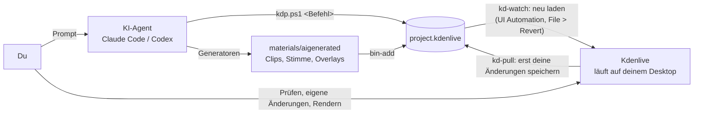

<div align="center">

# Movie Engine

**Ein KI-Agent schneidet dein Video in Kdenlive, während du zusiehst, und du kannst jederzeit übernehmen.**

KI-Coding-Agenten (Claude Code, Codex) erstellen und ändern echte Kdenlive-Projekte: Filme, Erklärvideos und vertikale Shorts. Die Änderungen erscheinen live in dem Editor, den du geöffnet hast. Portabel, Windows, keine Patches am Editor.


[English](../../README.md) · [简体中文](README.zh-CN.md) · [繁體中文](README.zh-TW.md) · [हिन्दी](README.hi.md) · [Español](README.es.md) · [Français](README.fr.md) · [العربية](README.ar.md) · [বাংলা](README.bn.md) · [Português](README.pt.md) · [Русский](README.ru.md) · [اردو](README.ur.md) · [Bahasa Indonesia](README.id.md) · **Deutsch** · [日本語](README.ja.md) · [Türkçe](README.tr.md) · [한국어](README.ko.md) · [Українська](README.uk.md) · [Italiano](README.it.md) · [Polski](README.pl.md) · [Tiếng Việt](README.vi.md) · [فارسی](README.fa.md) · [ไทย](README.th.md) · [Kiswahili](README.sw.md) · [አማርኛ](README.am.md) · [Avañe'ẽ](README.gn.md) · [Setswana](README.tn.md) · [Shqip](README.sq.md) · [Беларуская](README.be.md) · [Български](README.bg.md) · [Bosanski](README.bs.md) · [Hrvatski](README.hr.md) · [Српски](README.sr.md) · [Crnogorski](README.cnr.md) · [Македонски](README.mk.md) · [Slovenščina](README.sl.md) · [Slovenčina](README.sk.md) · [Čeština](README.cs.md) · [Magyar](README.hu.md) · [Română](README.ro.md) · [Dansk](README.da.md) · [Norsk bokmål](README.nb.md) · [Norsk nynorsk](README.nn.md) · [Svenska](README.sv.md) · [Íslenska](README.is.md) · [Suomi](README.fi.md) · [Eesti](README.et.md) · [Latviešu](README.lv.md) · [Lietuvių](README.lt.md) · [Nederlands](README.nl.md) · [Lëtzebuergesch](README.lb.md) · [Rumantsch](README.rm.md) · [Ελληνικά](README.el.md) · [Malti](README.mt.md) · [Gaeilge](README.ga.md) · [Català](README.ca.md) · [ქართული](README.ka.md) · [Հայերեն](README.hy.md) · [Azərbaycanca](README.az.md) · [Afrikaans](README.af.md) · [isiZulu](README.zu.md) · [isiXhosa](README.xh.md) · [Sesotho](README.st.md) · [Sepedi](README.nso.md) · [Xitsonga](README.ts.md) · [Tshivenḓa](README.ve.md) · [siSwati](README.ss.md) · [isiNdebele (South Africa)](README.nr.md) · [isiNdebele (Zimbabwe)](README.nd.md) · [chiShona](README.sn.md) · [Chichewa](README.ny.md) · [Ikinyarwanda](README.rw.md) · [Ikirundi](README.rn.md) · [Malagasy](README.mg.md) · [Soomaali](README.so.md) · [Afaan Oromoo](README.om.md) · [Qafar af](README.aa.md) · [ትግርኛ](README.ti.md) · [Sängö](README.sg.md) · [Kreol Seselwa](README.crs.md) · [TjiKalanga](README.kck.md) · [ChiNdau](README.ndc.md)

*Dies ist eine Übersetzung. Maßgeblich ist die englische README.*

</div>

---

## Inhalt

- [Warum](#warum)
- [Wie es funktioniert](#wie-es-funktioniert)
- [Funktionen](#funktionen)
- [Voraussetzungen](#voraussetzungen)
- [Installation](#installation)
- [Schnellstart](#schnellstart)
- [Arbeiten mit dem Agenten](#arbeiten-mit-dem-agenten)
- [Die Bearbeitungs-Kommandozeile (`kdp.ps1`)](#die-bearbeitungs-kommandozeile-kdpps1)
- [Live-Synchronisierung mit dem geöffneten Editor](#live-synchronisierung-mit-dem-geöffneten-editor)
- [Generatoren: was Kdenlive nicht kann](#generatoren-was-kdenlive-nicht-kann)
- [Voiceover und Ton](#voiceover-und-ton)
- [Sprache der Oberfläche](#sprache-der-oberfläche)
- [Ordnerstruktur](#ordnerstruktur)
- [Tests und Nachweise](#tests-und-nachweise)
- [Einschränkungen](#einschränkungen)
- [Fehlerbehebung](#fehlerbehebung)
- [FAQ](#faq)
- [Mitwirken](#mitwirken)
- [Danksagungen](#danksagungen)
- [Lizenz](#lizenz)

## Warum

Videoeditoren sind für Hände an der Maus gebaut. KI-Agenten sind stark bei Struktur, Timing und Wiederholung: 300 Clips auf den Beat setzen, jede Untertitelzeile auf die Stimme timen, eine Szene nach Feedback neu schneiden. Durch eine GUI klicken können sie aber nicht, ohne deinen Desktop zu übernehmen.

Kdenlive ist ein leistungsfähiger Open-Source-Editor, hat unter Windows aber **keine Automatisierungs-API**: Die Steuerung über D-Bus gibt es nur in Linux-Builds, und die Forks, die eine API nachrüsten, werden entweder nicht gepflegt oder sind unsicher. Movie Engine löst das Problem, ohne den Editor zu patchen:

1. Der Agent bearbeitet die `.kdenlive`-Projektdatei über eine getestete Kommandozeile (`engine/kdp.ps1`).
2. Das laufende Kdenlive wird über Windows UI Automation angewiesen, die Datei neu zu laden – ohne Tastatureingaben, ohne Maus und ohne den Fokus zu stehlen.
3. Deine eigenen ungespeicherten Änderungen werden zuerst gespeichert und nie überschrieben.

Der Agent schneidet also, und du prüfst – oder du schneidest selbst. Ihr arbeitet beide gleichzeitig am selben Projekt im selben Editor.

## Wie es funktioniert



Jeder Bearbeitungsbefehl durchläuft denselben sicheren Zyklus:

1. **Pull.** Hat Kdenlive ungespeicherte Änderungen, wird es angewiesen, sie zu speichern (Speichern in der Werkzeugleiste per UI Automation), und das Speichern wird bestätigt.
2. **Bearbeiten.** Der Befehl ändert das XML unter einer Sperre, nach einer Hash-Prüfung und mit einem Undo-Snapshot. Hat sich die Datei in der Zwischenzeit geändert, wird nichts geschrieben.
3. **Neu laden.** Der Watcher erkennt den Stempel der KI und führt im geöffneten Editor File > Revert aus. Als Erfolg zählt nur, wenn das Timeline-Widget tatsächlich neu aufgebaut wurde.
4. **Konflikt.** Hast du zwischendurch angefangen zu bearbeiten, wird nichts neu geladen, und deine Arbeit bleibt erhalten. Die KI-Version wird beiseitegelegt, und der Agent wendet seine Änderung erneut auf deine an.

## Funktionen

- **Vollständige Projektbearbeitung ohne GUI**: rund 120 Befehle für Projekt-Ablage, Timeline, Effekte, Kompositionen, Spuren, Hilfslinien, Marker, Untertitel, Sequenzen, Geschwindigkeit und Time Remapping, Diashows, Titel, Proxys, Rendern sowie Rückgängig/Wiederholen. Siehe die [Befehlsreferenz](#die-bearbeitungs-kommandozeile-kdpps1).
- **Live-Synchronisierung mit dem geöffneten Editor.** KI-Änderungen erscheinen in dem Kdenlive, das du gerade ansiehst; deine ungespeicherten Änderungen werden zuerst gespeichert und gehen nie verloren.
- **Stört nie deinen Desktop.** Kein Fokusdiebstahl, keine Tastatur- oder Mauseingaben. Test-Editoren laufen auf einem unsichtbaren Windows-Desktop.
- **Portabel.** Editor, Einstellungen, Node.js, Schriften und Werkzeuge liegen in einem Ordner. Kopiere ihn auf einen anderen PC, und alles funktioniert; nichts wird nach Program Files oder in dein Windows-Profil geschrieben.
- **Generatoren für das, was Kdenlive nicht kann**: buchstabenweise animierte Kinetic Typography, handgezeichnete Annotationen, 3D-UI-Szenen, Cursor-Animationen und lange interaktive Erklärfilme. Sie werden auf der GPU mit echter Bewegungsunschärfe gerendert und als gewöhnliche Clips auf die Timeline gelegt.
- **Voiceover mit Wort-Timings** (Microsoft Edge TTS, kein API-Schlüssel). Untertitel und Aktionen setzen genau auf dem Wort ein.
- **Synthetisierte Soundeffekte** (Whoosh, Klick, Pop, Riser, Impact und mehr), im Code erzeugt.
- **Nachgewiesen, nicht angenommen.** Jeder Befehl hat eine Ergebnisprüfung, Effekte und Kompositionen werden einzeln durchgetestet, und die Rohergebnisse liegen in `docs/proof/`.
- **Anweisungen für Agenten inklusive.** `AGENTS.md` und die Skills in `.claude/skills/` bringen Claude Code und Codex den Arbeitsablauf, das Dateiformat und die Fallstricke bei.

## Voraussetzungen

| | |
|---|---|
| Betriebssystem | Windows 10 oder 11, x64 |
| Editor | Kdenlive **26.08.3**, portabler Build (standalone). Andere Versionen sind ungetestet. |
| Node.js | 18 oder neuer: das Windows-x64-`.zip` von nodejs.org, entpackt nach `engine/node/` |
| Browser | Microsoft Edge (Teil von Windows); wird von den Szenen-Renderern headless verwendet |
| Agent | [Claude Code](https://claude.com/claude-code) oder Codex. Optional: Jedes Werkzeug lässt sich auch von Hand ausführen. |
| Speicherplatz | etwa 1 GB für Editor und Werkzeuge, plus deine Medien |
| GPU | jede GPU mit H.264-Hardwarekodierung beschleunigt `film-render.mjs` (sonst wird auf Software-Kodierung ausgewichen) |

## Installation

Alles wird **innerhalb des Ordners** installiert. Nichts benötigt Administratorrechte.

```powershell
git clone https://github.com/vladtarrow/movie-engine.git
cd movie-engine
```

**1. Node.js.** Lade das Windows-x64-`.zip` von Node.js 18 oder neuer von <https://nodejs.org/en/download> herunter und entpacke seinen Inhalt nach `engine\node\`, sodass dort `engine\node\node.exe` und `engine\node\npm.cmd` liegen. Weder Installer noch ein systemweites Node werden benötigt. Alle Skripte laufen über `engine\node.cmd`, nie über ein systemweites Node.

**2. Node-Pakete** für das Sprachwerkzeug und die Renderer (die Versionen sind in `engine/voice/package.json` festgelegt):

```powershell
engine\node\npm.cmd install --prefix engine\voice
```

**3. Kdenlive 26.08.3 portabel.** Lade `kdenlive-26.08.3_standalone.exe` von <https://download.kde.org/stable/kdenlive/26.08/windows/> nach `engine\installer\` herunter, prüfe die Datei und entpacke sie:

```powershell
(Get-FileHash engine\installer\kdenlive-26.08.3_standalone.exe -Algorithm SHA256).Hash
# erwartet: A25427B1DFF2C17E3B0386E991BB1A719382BB3176D1A90E441CDAEB6E0A967D
engine\installer\kdenlive-26.08.3_standalone.exe -o"engine\Kdenlive" -y
```

Der Editor landet in `engine\Kdenlive\kdenlive-26.08.3_standalone\bin\`. Er enthält bereits `melt.exe` und `ffmpeg.exe`.

**4. Erster Start.**

```powershell
engine\kdenlive.cmd
```

Kdenlive speichert alle Einstellungen in `engine\profile-kdenlive\`, nicht in deinem Windows-Profil. Beim ersten Start zeigt es einmalig einen Einrichtungsassistenten.

## Schnellstart

### Mit einem Agenten

Öffne den Ordner in Claude Code (oder Codex) und formuliere deinen Wunsch in normalen Worten:

> Erstelle ein neues vertikales Projekt „launch-teaser“ mit 30 fps. Lege die drei Screenshots aus `materials/designers/launch/` auf die Timeline, je 2,5 s mit einer kurzen Überblendung, füge ein Voiceover aus `script.txt` hinzu und lege zu jeder Zeile eine exakt getimte Kinetic-Typography-Einblendung an.

> Öffne es für mich in Kdenlive.

> Die zweite Einstellung ist zu lang. Kürze sie auf 1,8 s und schiebe das Logo etwas nach oben.

Der Agent folgt `AGENTS.md`: Er bearbeitet über `kdp.ps1`, rendert nur die Clips, die der Schnitt braucht, und hält den geöffneten Editor synchron. Du prüfst in Kdenlive, bearbeitest von Hand, wann immer du willst, und klickst auf Rendern, wenn du zufrieden bist.

### Von Hand

```powershell
# ein neues Projekt 1080x1920 mit 30 fps, 2 Video- und 2 Audiospuren
powershell -NoProfile -ExecutionPolicy Bypass -File engine\kdp.ps1 new -Project projects\hello\hello.kdenlive -Profile vertical_hd_30

# ein 3-Sekunden-Titel und ein farbiger Hintergrund
powershell -NoProfile -ExecutionPolicy Bypass -File engine\kdp.ps1 bin-color -Project projects\hello\hello.kdenlive -Color '#203060' -Seconds 3 -Name bg
powershell -NoProfile -ExecutionPolicy Bypass -File engine\kdp.ps1 title -Project projects\hello\hello.kdenlive -Text "Hello" -Seconds 3 -Name hi

# platzieren: Hintergrund auf V1, Titel darüber auf V2
powershell -NoProfile -ExecutionPolicy Bypass -File engine\kdp.ps1 add -Project projects\hello\hello.kdenlive -Bin bg -Track V1 -At 0
powershell -NoProfile -ExecutionPolicy Bypass -File engine\kdp.ps1 add -Project projects\hello\hello.kdenlive -Bin hi -Track V2 -At 0

# ein Prüf-Frame, dann im Editor öffnen
powershell -NoProfile -ExecutionPolicy Bypass -File engine\kdp.ps1 frame -Project projects\hello\hello.kdenlive -At 1.5 -Out out\hello\check.png
engine\kdenlive.cmd projects\hello\hello.kdenlive
```

Um später das zuletzt verwendete Projekt wieder zu öffnen, doppelklicke auf `open-last-project.cmd`.

## Arbeiten mit dem Agenten

Der Agent liest `AGENTS.md` (Codex) bzw. `CLAUDE.md`, das diese Datei importiert (Claude Code), sowie zwei Skills:

| Skill | Vermittelt |
|---|---|
| `.claude/skills/kdenlive-project-file` | das Format `.kdenlive` / MLT-XML, `kdp.ps1`, Prüfen mit `melt` |
| `.claude/skills/kdenlive-live` | sicheres Steuern des laufenden Editors: Starten, Pull, Neuladen, Aufnahme seines Fensters |

Regeln, an die sich der Agent hält und auf die du dich verlassen kannst:

- Er übernimmt nie deine Maus, Tastatur oder deinen Fokus und macht nie Screenshots deines Desktops (nur vom eigenen Fenster des Editors).
- Er erledigt die GUI-Schritte selbst (Speichern, Öffnen, Neuladen), statt dich klicken zu lassen.
- Er fragt, bevor er etwas herunterlädt und bevor er etwas löscht.
- Er rendert nur, was die Arbeit erfordert (Szenen-Clips, Prüf-Frames). Den fertigen Film rendert er nur, wenn du darum bittest.
- Wenn Kdenlive etwas nicht gut kann, baut der Agent es außerhalb mit Code und fügt das Ergebnis als Clip ein. Er verwässert den Effekt nicht.

## Die Bearbeitungs-Kommandozeile (`kdp.ps1`)

```powershell
powershell -NoProfile -ExecutionPolicy Bypass -File engine\kdp.ps1 <command> -Project <file.kdenlive> [options]
```

Zeiten werden in Sekunden mit Punkt angegeben (`2.5`). Spuren heißen `V1 V2 …` (V1 ist die unterste) und `A1 A2 …`. Ein Clip wird über `-Track` plus einen beliebigen Zeitpunkt `-At` innerhalb des Clips adressiert. Effektparameter stehen in `-Params "name=value||name=value"`. Die vollständige Liste mit allen Optionen steht im Kopf von `engine/kdp.ps1`.

| Gruppe | Befehle |
|---|---|
| Projekt | `new`, `profiles`, `info`, `validate`, `fonts`, `profile-set`, `profile-from-clip`, `zone`, `archive`, `backups`, `rebase`, `otio-export`, `otio-import` |
| Projekt-Ablage | `bin-add`, `bin-color`, `title`, `title-text`, `title-save`, `title-template`, `bin-rename`, `bin-remove`, `bin-info`, `bin-set`, `bin-duplicate`, `bin-replace-file`, `bin-reload`, `folder`, `bin-folder`, `relink`, `clean`, `generator`, `playlist-clip`, `extract-audio`, `transcode` |
| Timeline | `add`, `add-av`, `move`, `copy`, `trim`, `ripple-trim`, `slip`, `split`, `remove`, `speed`, `remap`, `disable`, `enable`, `group`, `ungroup`, `mix`, `unmix`, `space-insert`, `space-remove`, `spaces-remove-all`, `track-clear`, `replace-in-timeline` |
| Effekte | `effects`, `effect-info`, `effect-add`, `effect-list`, `effect-set`, `effect-remove`, `effect-copy`, `effect-clear`, `effects-all`, `bin-effect`, `effect-templates`, `effect-template` |
| Kompositionen | `compositions`, `comp-info`, `comp-add`, `comp-list`, `comp-set`, `comp-remove` |
| Spuren | `track-add`, `track-remove`, `track-set` |
| Hilfslinien und Marker | `guide-add`, `guide-list`, `guide-remove`, `guide-set`, `guide-clear`, `guide-export`, `guide-category`, `marker`, `marker-list`, `marker-set`, `marker-remove` |
| Untertitel | `sub-add`, `sub-import`, `sub-export`, `sub-state` |
| Sequenzen | `sequence-add`, `sequences`, `copy-to-sequence`, `expand`; jeder Befehl mit `-Sequence <name>` arbeitet innerhalb dieser Sequenz |
| Spezial | `slideshow`, Lottie-/Glaxnimate-Animationen über `bin-add`, `proxy`, `stabilize`, `scene-split`, `speed-job`, `subclip` |
| Ausgabe | `frame` (ein PNG), `preview` (schneller melt-Render), `render` (Kdenlives eigener Renderer oder ein Preset), `presets` |
| Verlauf | `undo`, `redo`, `clear-history` (Snapshots in `projects/<name>/.kdp-history`) |

Wissenswertes zum Verhalten:

- Verknüpfte Audio- und Videohälften werden gemeinsam verschoben, getrimmt, geteilt und entfernt (`-Alone` für nur eine Hälfte).
- Ein fehlschlagender Befehl endet mit Code 1 und schreibt nichts.
- Effekte, die der Windows-Build nicht ausführen kann, werden abgelehnt statt stillschweigend ignoriert (Liste: `docs/proof/assets.txt`).
- Jede Menüaktion von Kdenlive ist in `engine/tools/data/kdenlive-actions.csv` einem Befehl, einem anderen Weg oder „nur Ansicht“ zugeordnet. Siehe `docs/kdenlive-coverage.md`.

## Live-Synchronisierung mit dem geöffneten Editor

| Skript | Was es tut | Exit-Codes |
|---|---|---|
| `engine\kd-pull.ps1 -Project <f>` | lässt Kdenlive deine Änderungen speichern und bestätigt das | 0 Datei aktuell, 3 läuft nicht, 4 nicht bestätigt |
| `engine\kd-reload.ps1 -Project <f>` | File > Revert, bestätigt durch die neu aufgebaute Timeline | 0 bestätigt, 2 du hast ungespeicherte Änderungen (nichts verworfen), 3 läuft nicht, 4 fehlgeschlagen |
| `engine\kd-watch.ps1 -Project <f>` | Hintergrund-Watcher: lädt nach jedem Schreibvorgang der KI neu, protokolliert Konflikte | Log in `engine\kd-watch.log`; zum Beenden `engine\kd-watch.run` löschen |
| `engine\kdenlive-bg.ps1 [project]` | startet Kdenlive minimiert für einen Agenten | 0 geladen, 4 nicht bestätigt |
| `engine\kdenlive.cmd [project]` | startet Kdenlive für dich | |

Starte den Watcher einmal pro Sitzung:

```powershell
Start-Process powershell -WindowStyle Hidden -ArgumentList '-NoProfile','-ExecutionPolicy','Bypass','-File','engine\kd-watch.ps1','-Project','projects\hello\hello.kdenlive'
```

Große Projekte: Das Neuladen eines Projekts mit 1000 Clips dauert Minuten, und die Werkzeuge warten darauf, statt vorzeitig Erfolg zu melden. Projekte werden über *File > Open Recent* in einem leeren Editor geöffnet, weil Qt beim direkten Öffnen einer Datei jedes Timeline-Element für die Barrierefreiheit durchläuft, was etwa 10 Minuten langsamer war.

## Generatoren: was Kdenlive nicht kann

Kdenlive/MLT hat keine buchstabenweise Textanimation, keine Expressions und kaum 3D, und aufwendige Effekte bremsen die Wiedergabe. Movie Engine rendert solche Teile außerhalb und legt sie als gewöhnliche Clips auf die Timeline, meist mit Alphakanal, auf eine Spur über den Bildern. Das Generator-Skript und seine Eingaben bleiben im Projektordner, sodass ein Clip neu erzeugt werden kann, wenn sich Text, Schrift oder Timing ändern.

| Werkzeug | Erzeugt |
|---|---|
| `engine/tools/kinetic-text.ps1` | buchstabenweise animierte Untertitel, jedes Wort aus `voice.json` getimt, Hervorhebungsbox |
| `engine/tools/annotate.ps1` | handgezeichnete Kreise, Rahmen, Unterstreichungen und Pfeile, die sich über einem Screenshot aufzeichnen |
| `engine/tools/card-entrance.ps1` | eine Screenshot-Karte, die mit weichem Schatten aufsteigt und hineinskaliert |
| `engine/tools/pdf-to-png.ps1` | Folien aus einem PDF-Export |
| `engine/tools/html-render.mjs` | jede HTML/CSS/Canvas-Szene als Video: Interface-Animation, Cursor, 3D, Masken |
| `engine/tools/film-render.mjs` + `film/` | lange, interaktive Erklärfilme auf einem Canvas: ein Clip pro Sprecherzeile, Aktionen setzen auf gesprochenen Wörtern ein, GPU-Bewegungsunschärfe bei etwa 45 fps |

Beide Renderer steuern das mit Windows ausgelieferte Microsoft Edge headless, mit einem Wegwerfprofil und ohne Netzwerkzugriff.

### Demos

```powershell
# eine 3 Sekunden lange 3D-Titelkarte mit einem Cursor-Klick
engine\node.cmd engine\tools\html-render.mjs examples\demo\scene\scene.html examples\demo\out --frames 0,30,60,89
engine\node.cmd engine\tools\html-render.mjs examples\demo\scene\scene.html examples\demo\out\scene.mp4

# ein interaktiver Film aus 4 Einstellungen, getimt auf zwei Sprecherzeilen
engine\node.cmd engine\tools\film-render.mjs examples\demo\film\film.html examples\demo\out --check
engine\node.cmd engine\tools\film-render.mjs examples\demo\film\film.html examples\demo\out --shots all --width 640
engine\node.cmd engine\tools\film-render.mjs examples\demo\film\film.html examples\demo\out\clips --suffix -v01
```

Ein Film besteht aus drei kleinen Dateien. `data.js` enthält die Einstellungen und die Wortzeiten. `direction.js` hat eine Zeile pro Einstellung:

```text
1 | hover 192 108 @brand | tag 300 60 Your brand @deserves | confetti 192 90 @film
2 say=A film that/*explains* it
3 | click 116 108 @before | click 268 108 @after | chips Before~After @after
4 scene=counter | count 0 120 % @count
```

`scenes.js` enthält die Einstellungen, die von Grund auf gezeichnet werden. `@word` löst eine Aktion aus, wenn die Stimme dieses Wort spricht. Zu den Aktionen gehören click, hover, drag, zoom, lens, ring, arrow, chips, toggle, slider, toast, type, count und confetti; die vollständige Syntax steht am Anfang von `engine/tools/film/film-kit.js`.

## Voiceover und Ton

```powershell
engine\node.cmd engine\voice\voice.mjs lines.json materials\aigenerated\hello\voice en-US-AndrewMultilingualNeural +0%
```

`lines.json` ist eine Liste von Zeilen. Das Werkzeug schreibt pro Zeile eine mp3 sowie `voice.json` mit der Dauer und dem Beginn und Ende jedes Wortes. Zeilen werden zwischengespeichert, sodass beim Ändern einer Zeile nur diese neu erzeugt wird. Es nutzt die Online-Sprachsynthese von Microsoft Edge über das Paket `msedge-tts`: Ein Schlüssel ist nicht nötig, aber der Dienst ist inoffiziell und benötigt Internet.

```powershell
engine\node.cmd engine\audio\sfx.mjs materials\aigenerated\sfx
```

Dies synthetisiert im Code whoosh, whoosh-long, swipe, click, pop, tick, riser, impact, ding und reveal; ein fertiges Set liegt in `materials/aigenerated/sfx/`. Klänge, die kürzer als ein Frame sind, vor dem Platzieren mit Stille auffüllen (`-af apad=whole_dur=0.0667`).

## Sprache der Oberfläche

Die Starter öffnen Kdenlive standardmäßig auf **Englisch**. Für eine andere Sprache setze vor dem Start `MOVIE_ENGINE_UI_LANG`:

```powershell
$env:MOVIE_ENGINE_UI_LANG = 'ru'; engine\kdenlive.cmd
```

UI Automation findet Menüeinträge anhand ihrer sichtbaren Namen. Namen für 31 Oberflächensprachen sind eingebaut (`engine/tools/kd-ui.ps1`, `$KdNames`). Für jede andere Sprache trage dort ihre Namen ein und prüfe mit:

```powershell
powershell -NoProfile -ExecutionPolicy Bypass -File engine\tools\kd-langcheck.ps1
```

## Ordnerstruktur

```text
movie-engine/
├─ AGENTS.md, CLAUDE.md          instructions for AI agents
├─ .claude/skills/               agent skills: project file format, live editor
├─ engine/
│  ├─ kdp.ps1                    the editing command line
│  ├─ kd-pull / kd-reload / kd-watch .ps1, kdenlive.cmd, kdenlive-bg.ps1
│  ├─ tools/                     internals, generators, tests, data (action map)
│  ├─ voice/  audio/  fonts/     TTS, synthesized SFX, Poppins (OFL)
│  ├─ Kdenlive/  node/           portable editor and Node.js (not in git)
│  └─ profile-kdenlive/          the editor's settings (not in git)
├─ projects/<name>/<name>.kdenlive
├─ materials/
│  ├─ download/                  stock and downloaded files (not in git)
│  ├─ aigenerated/               everything the AI made (sfx/ and test-kit/ ship with the engine)
│  ├─ designers/  brand/         files from your team, brand assets
├─ examples/demo/                demos of the scene and film renderers
├─ out/                          renders (not in git)
└─ docs/                         proofs, coverage, translations of this README
```

Medienpfade in Projekten sind relativ. Wenn du den Ordner verschiebst oder kopierst, schreibt `kdp.ps1 rebase` (wird auch automatisch von `kdenlive.cmd` ausgeführt) den neuen Speicherort ins Projekt.

## Tests und Nachweise

Aussagen darüber, was funktioniert, stützen sich auf Ergebnisprüfungen, nicht darauf, dass „die Funktion lief“. Die Zusammenfassung steht in [`docs/kdenlive-proof.md`](../../docs/kdenlive-proof.md), die Rohausgaben liegen in `docs/proof/`.

| Test | Prüft |
|---|---|
| `engine\tools\kdp-clitest.ps1` | jeden `kdp.ps1`-Befehl über die Kommandozeile und vergleicht das resultierende Projekt |
| `engine\tools\kd-livetest.ps1` | Pull, Neuladen, Watcher, Konflikte und Race Conditions gegen ein echtes Kdenlive auf einem unsichtbaren Desktop |
| `engine\tools\kdp-assetsweep.ps1` | jeden Effekt und jede Komposition: rendert und vergleicht Frames |
| `engine\tools\kdp-portabletest.ps1` | kopiert den Ordner an einen anderen Ort und arbeitet mit der Kopie |
| `engine\tools\kd-langcheck.ps1` | die Sprache der Oberfläche und dass UI Automation das Menü findet |
| `engine\tools\kdp-coverage-check.ps1` | dass jede Menüaktion zugeordnet ist und kein Nachweis älter als der Code ist |

```powershell
powershell -NoProfile -ExecutionPolicy Bypass -File engine\tools\kdp-clitest.ps1 -Report docs\proof\clitest.txt
powershell -NoProfile -ExecutionPolicy Bypass -File engine\tools\kd-livetest.ps1 -Report docs\proof\live-en.txt
```

Test-Editoren laufen nur auf einem versteckten Desktop mit eigenem Profil, daher berühren Tests nie dein geöffnetes Kdenlive oder deinen Fokus.

## Einschränkungen

- **Nur Windows**, nur Kdenlive **26.08.3**. Linux hat D-Bus und bräuchte eine andere Brücke.
- Der Start des Editors nimmt für etwa 3 Sekunden den Tastaturfokus, während das leere Fenster erscheint. Agenten fragen nach, bevor sie ihn starten, während du arbeitest. Neuladen und Bearbeiten nehmen den Fokus nicht.
- Dem Windows-Build fehlen die MLT-Module sox, ladspa und movit sowie einige frei0r-/avfilter-Effekte; `kdp.ps1` lehnt sie ab (`docs/proof/assets.txt`).
- Export und Import über OpenTimelineIO übertragen nur Clips und Lücken. Multicam bietet kein Live-Umschalten der Perspektiven (Schnitte entstehen mit split/remove/hide).
- „Speichern unter…“ über UI Automation öffnet bei einem minimierten Fenster keinen Dialog; der Agent nutzt stattdessen `archive` oder Dateikopien.
- Spracherkennung (automatische Untertitel) benötigt Whisper oder Vosk, die nicht mitgeliefert werden.
- Titel aus dem Titelwerkzeug von Kdenlive verwenden in Windows installierte Schriften. Für garantierte Typografie rendere Text mit den Generatoren, die Schriften aus `engine/fonts/` laden.
- Edge TTS ist ein inoffizieller Online-Dienst und kann sich ändern oder den Betrieb einstellen.

## Fehlerbehebung

| Symptom | Ursache und Lösung |
|---|---|
| Kdenlive läuft, aber ein Klick in der Taskleiste zeigt nichts an | Die gespeicherte Fensterposition liegt außerhalb des Bildschirms. Schließe Kdenlive und lösche die `kdockLayout`-Einträge in `engine\profile-kdenlive\AppData\Local\kdenliverc`, oder verschiebe das Fenster mit `SetWindowPos` (siehe `AGENTS.md`). |
| `kd-reload.ps1` endet mit 2 | Du hast ungespeicherte Änderungen. Nichts wurde verworfen. Führe `kd-pull.ps1` aus und wende die Änderung dann erneut an (`kdp.ps1` macht das selbst). |
| `CONFLICT` in `engine\kd-watch.log` | Du und der Agent habt im selben Moment bearbeitet. Deine Version bleibt im Editor, die KI-Version liegt in `projects\<name>\.kdp-history\<name>\conflict\`. Bitte den Agenten, seine Änderung erneut anzuwenden. |
| Ein Befehl endet mit 1 und „pull not confirmed“ | Kdenlive ist beschäftigt oder zeigt einen Dialog. Schließe den Dialog oder warte, bis das Laden abgeschlossen ist, und wiederhole den Befehl. |
| Ein PowerShell-Skript lässt sich nicht parsen | Skripte mit Nicht-ASCII-Text müssen für Windows PowerShell 5.1 als UTF-8 **mit BOM** gespeichert sein. |
| `voice.mjs` bricht mit „Stream closed before the synthesis completed“ ab | Meist ein Netzwerkproblem oder nicht maskiertes SSML in älteren Kopien. `voice.mjs` maskiert `& < >` selbst. |
| Das Öffnen eines großen Projekts dauert viele Minuten | Öffne es über `kdenlive.cmd` / `kdenlive-bg.ps1`, nie als `kdenlive.exe project.kdenlive`. |

## FAQ

**Brauche ich Claude Code oder Codex?**
Nein. Jedes Werkzeug ist ein einfaches Skript, das du von Hand ausführen kannst. Der Agent macht es schnell: Er plant den Schnitt, führt die Werkzeuge aus und hält den Editor synchron.

**Überschreibt der Agent meine manuellen Änderungen?**
Nein. Vor jedem Schreibvorgang werden deine ungespeicherten Änderungen gespeichert und bestätigt. Bearbeitest du, während der Agent schreibt, wird der Schreibvorgang abgelehnt oder als Konflikt beiseitegelegt, aber nie über deine Arbeit angewendet.

**Kann ich Kdenlive ganz normal weiterverwenden?**
Ja. Es ist das unveränderte Kdenlive mit eigenem Einstellungsordner. Bearbeite, sieh dir die Vorschau an und rendere wie gewohnt.

**Funktioniert es mit einem bereits installierten Kdenlive?**
Es verwendet seine eigene portable Kopie in `engine\Kdenlive\`, dein installiertes Kdenlive und dessen Einstellungen bleiben also unberührt.

**Warum kein Kdenlive-Fork mit API oder ein anderer Editor?**
Unter Windows gibt es keinen gepflegten und sicheren Fork (Recherche vom November 2026). OpenShot, Blender VSE, DaVinci Resolve, Shotcut und Web-Editoren wurden geprüft; Kdenlive bot die größte Schnitttiefe. Ein Upstream-Vorschlag für eine REST-API (Merge Request !902) wird beobachtet.

**Kann es das fertige Video rendern?**
Ja, mit `kdp.ps1 render` (Kdenlives eigener Renderer, versteckt), oder du klickst selbst im Editor auf Rendern.

**Werden meine Medien irgendwohin hochgeladen?**
Nein. Nur der Voiceover-Text wird an den Edge-TTS-Dienst gesendet, wenn du eine Stimme erzeugst. Die Szenen-Renderer laufen mit deaktiviertem Netzwerk.

## Mitwirken

Beiträge sind willkommen. Siehe [CONTRIBUTING.md](../../CONTRIBUTING.md). Kurz gesagt:

- Jede neue oder geänderte `kdp.ps1`-Operation braucht eine Ergebnisprüfung in `kdp-clitest.ps1`, einen Eintrag in der Aktionszuordnung und einen frischen Lauf von `kdp-coverage-check.ps1`.
- Starte nie ein Test-Kdenlive auf dem sichtbaren Desktop; verwende `engine/tools/kd-hidden.ps1`.
- Halte alles portabel: keine Installationen außerhalb des Ordners, keine absoluten Pfade in Projekten.
- Halte verifizierte Eigenheiten in `AGENTS.md` oder im passenden Skill fest.

## Danksagungen

- [Kdenlive](https://kdenlive.org) und [MLT](https://www.mltframework.org): der Editor und die Engine darunter.
- [FFmpeg](https://ffmpeg.org), mit Kdenlive gebündelt.
- [msedge-tts](https://www.npmjs.com/package/msedge-tts) für das Voiceover.
- [Poppins](https://fonts.google.com/specimen/Poppins) von der Indian Type Foundry, SIL Open Font License (`engine/fonts/OFL.txt`).
- `engine/tools/data/kdenliveui-26.08.3.rc`: die Menüdatei von Kdenlive, aus dem Quellcode von Kdenlive 26.08.3 übernommen; nur die Abdeckungsprüfung nutzt sie. Sie steht weiter unter der GPL-Lizenz von Kdenlive, nicht unter der MIT-Lizenz.

## Lizenz

Der eigene Code von Movie Engine steht unter der [MIT-Lizenz](../../LICENSE). Kdenlive, MLT, FFmpeg, die Node.js-Pakete und die Schrift Poppins behalten ihre eigenen Lizenzen.
