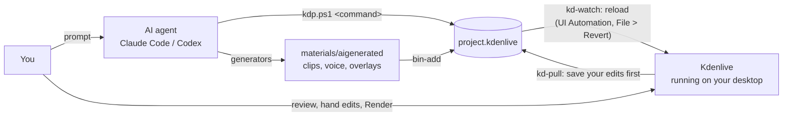

<div align="center">

# Movie Engine

**Ένας πράκτορας τεχνητής νοημοσύνης μοντάρει το βίντεό σας στο Kdenlive ενώ εσείς παρακολουθείτε, και μπορείτε να αναλάβετε εσείς οποιαδήποτε στιγμή.**

Πράκτορες ΤΝ για προγραμματισμό (Claude Code, Codex) δημιουργούν και αλλάζουν πραγματικά έργα Kdenlive: ταινίες, επεξηγηματικά βίντεο και κάθετα shorts. Οι αλλαγές εμφανίζονται ζωντανά στον επεξεργαστή που έχετε ανοιχτό. Φορητό, για Windows, χωρίς τροποποιήσεις του επεξεργαστή.


[English](../../README.md) · [简体中文](README.zh-CN.md) · [繁體中文](README.zh-TW.md) · [हिन्दी](README.hi.md) · [Español](README.es.md) · [Français](README.fr.md) · [العربية](README.ar.md) · [বাংলা](README.bn.md) · [Português](README.pt.md) · [Русский](README.ru.md) · [اردو](README.ur.md) · [Bahasa Indonesia](README.id.md) · [Deutsch](README.de.md) · [日本語](README.ja.md) · [Türkçe](README.tr.md) · [한국어](README.ko.md) · [Українська](README.uk.md) · [Italiano](README.it.md) · [Polski](README.pl.md) · [Tiếng Việt](README.vi.md) · [فارسی](README.fa.md) · [ไทย](README.th.md) · [Kiswahili](README.sw.md) · [አማርኛ](README.am.md) · [Avañe'ẽ](README.gn.md) · [Setswana](README.tn.md) · [Shqip](README.sq.md) · [Беларуская](README.be.md) · [Български](README.bg.md) · [Bosanski](README.bs.md) · [Hrvatski](README.hr.md) · [Српски](README.sr.md) · [Crnogorski](README.cnr.md) · [Македонски](README.mk.md) · [Slovenščina](README.sl.md) · [Slovenčina](README.sk.md) · [Čeština](README.cs.md) · [Magyar](README.hu.md) · [Română](README.ro.md) · [Dansk](README.da.md) · [Norsk bokmål](README.nb.md) · [Norsk nynorsk](README.nn.md) · [Svenska](README.sv.md) · [Íslenska](README.is.md) · [Suomi](README.fi.md) · [Eesti](README.et.md) · [Latviešu](README.lv.md) · [Lietuvių](README.lt.md) · [Nederlands](README.nl.md) · [Lëtzebuergesch](README.lb.md) · [Rumantsch](README.rm.md) · **Ελληνικά** · [Malti](README.mt.md) · [Gaeilge](README.ga.md) · [Català](README.ca.md) · [ქართული](README.ka.md) · [Հայերեն](README.hy.md) · [Azərbaycanca](README.az.md) · [Afrikaans](README.af.md) · [isiZulu](README.zu.md) · [isiXhosa](README.xh.md) · [Sesotho](README.st.md) · [Sepedi](README.nso.md) · [Xitsonga](README.ts.md) · [Tshivenḓa](README.ve.md) · [siSwati](README.ss.md) · [isiNdebele (South Africa)](README.nr.md) · [isiNdebele (Zimbabwe)](README.nd.md) · [chiShona](README.sn.md) · [Chichewa](README.ny.md) · [Ikinyarwanda](README.rw.md) · [Ikirundi](README.rn.md) · [Malagasy](README.mg.md) · [Soomaali](README.so.md) · [Afaan Oromoo](README.om.md) · [Qafar af](README.aa.md) · [ትግርኛ](README.ti.md) · [Sängö](README.sg.md) · [Kreol Seselwa](README.crs.md) · [TjiKalanga](README.kck.md) · [ChiNdau](README.ndc.md)

*Αυτή είναι μετάφραση· η αγγλική έκδοση του README είναι η έκδοση αναφοράς.*

</div>

---

## Περιεχόμενα

- [Γιατί](#γιατί)
- [Πώς λειτουργεί](#πώς-λειτουργεί)
- [Δυνατότητες](#δυνατότητες)
- [Απαιτήσεις](#απαιτήσεις)
- [Εγκατάσταση](#εγκατάσταση)
- [Γρήγορη εκκίνηση](#γρήγορη-εκκίνηση)
- [Εργασία με τον πράκτορα](#εργασία-με-τον-πράκτορα)
- [Η γραμμή εντολών μοντάζ (`kdp.ps1`)](#η-γραμμή-εντολών-μοντάζ-kdpps1)
- [Ζωντανός συγχρονισμός με τον ανοιχτό επεξεργαστή](#ζωντανός-συγχρονισμός-με-τον-ανοιχτό-επεξεργαστή)
- [Γεννήτριες: όσα δεν μπορεί να κάνει το Kdenlive](#γεννήτριες-όσα-δεν-μπορεί-να-κάνει-το-kdenlive)
- [Αφήγηση και ήχος](#αφήγηση-και-ήχος)
- [Γλώσσα διεπαφής](#γλώσσα-διεπαφής)
- [Δομή φακέλων](#δομή-φακέλων)
- [Δοκιμές και αποδείξεις](#δοκιμές-και-αποδείξεις)
- [Περιορισμοί](#περιορισμοί)
- [Αντιμετώπιση προβλημάτων](#αντιμετώπιση-προβλημάτων)
- [Συχνές ερωτήσεις](#συχνές-ερωτήσεις)
- [Συνεισφορά](#συνεισφορά)
- [Ευχαριστίες](#ευχαριστίες)
- [Άδεια χρήσης](#άδεια-χρήσης)

## Γιατί

Οι επεξεργαστές βίντεο είναι φτιαγμένοι για χέρια πάνω στο ποντίκι. Οι πράκτορες ΤΝ τα πάνε καλά με τη δομή, τον συγχρονισμό και την επανάληψη: να τοποθετήσουν 300 κλιπ στον ρυθμό, να συγχρονίσουν κάθε υπότιτλο με τη φωνή, να ξαναφτιάξουν μια σκηνή μετά από σχόλια. Δεν μπορούν όμως να κάνουν κλικ σε ένα γραφικό περιβάλλον χωρίς να καταλάβουν την επιφάνεια εργασίας σας.

Το Kdenlive είναι ένας ισχυρός επεξεργαστής ανοιχτού κώδικα, αλλά στα Windows **δεν έχει API αυτοματοποίησης**: ο έλεγχος μέσω D-Bus υπάρχει μόνο στις εκδόσεις για Linux, και τα forks που προσθέτουν κάτι τέτοιο είτε δεν συντηρούνται είτε δεν είναι ασφαλή. Το Movie Engine το λύνει αυτό χωρίς να τροποποιεί τον επεξεργαστή:

1. Ο πράκτορας αλλάζει το αρχείο έργου `.kdenlive` μέσω μιας δοκιμασμένης γραμμής εντολών (`engine/kdp.ps1`).
2. Στο Kdenlive που εκτελείται δίνεται η εντολή να ξαναφορτώσει το αρχείο μέσω του Windows UI Automation, χωρίς πατήματα πλήκτρων, χωρίς ποντίκι και χωρίς να κλέβει την εστίαση.
3. Οι δικές σας μη αποθηκευμένες αλλαγές αποθηκεύονται πρώτα και δεν αντικαθίστανται ποτέ.

Έτσι ο πράκτορας μοντάρει κι εσείς ελέγχετε, ή μοντάρετε εσείς με το χέρι. Δουλεύετε και οι δύο στο ίδιο έργο, στον ίδιο επεξεργαστή, την ίδια στιγμή.

## Πώς λειτουργεί



Κάθε εντολή μοντάζ ακολουθεί τον ίδιο ασφαλή κύκλο:

1. **Pull.** Αν το Kdenlive έχει μη αποθηκευμένες αλλαγές, του δίνεται η εντολή να τις αποθηκεύσει (το κουμπί «Αποθήκευση» της γραμμής εργαλείων μέσω UI Automation), και η αποθήκευση επιβεβαιώνεται.
2. **Αλλαγή.** Η εντολή αλλάζει το XML υπό κλείδωμα, μετά από έλεγχο hash και με στιγμιότυπο για αναίρεση. Αν το αρχείο άλλαξε στο μεταξύ, δεν γράφεται τίποτα.
3. **Επαναφόρτωση.** Ο παρατηρητής βλέπει τη σφραγίδα της ΤΝ και εκτελεί File > Revert στον ανοιχτό επεξεργαστή. Επιτυχία θεωρείται μόνο όταν το γραφικό στοιχείο της χρονογραμμής έχει πράγματι ξαναχτιστεί.
4. **Σύγκρουση.** Αν στο μεταξύ αρχίσατε να μοντάρετε, δεν γίνεται επαναφόρτωση και η δουλειά σας παραμένει. Η έκδοση της ΤΝ φυλάσσεται χωριστά, και ο πράκτορας εφαρμόζει ξανά την αλλαγή του πάνω στη δική σας.

## Δυνατότητες

- **Πλήρες μοντάζ έργου χωρίς γραφικό περιβάλλον**: περίπου 120 εντολές που καλύπτουν bin, χρονογραμμή, εφέ, συνθέσεις, κανάλια, οδηγούς, δείκτες, υπότιτλους, ακολουθίες, ταχύτητα και ανακατανομή χρόνου, προβολές διαφανειών, τίτλους, proxy, απόδοση (render) και αναίρεση/επανάληψη. Δείτε τον [οδηγό εντολών](#η-γραμμή-εντολών-μοντάζ-kdpps1).
- **Ζωντανός συγχρονισμός με τον ανοιχτό επεξεργαστή.** Οι αλλαγές της ΤΝ εμφανίζονται στο Kdenlive που κοιτάζετε· οι μη αποθηκευμένες αλλαγές σας αποθηκεύονται πρώτα και δεν χάνονται ποτέ.
- **Δεν ενοχλεί ποτέ την επιφάνεια εργασίας σας.** Καμία κλοπή εστίασης, κανένα πάτημα πλήκτρου ή κίνηση ποντικιού. Οι δοκιμαστικοί επεξεργαστές εκτελούνται σε μια αόρατη επιφάνεια εργασίας των Windows.
- **Φορητό.** Ο επεξεργαστής, οι ρυθμίσεις, το Node.js, οι γραμματοσειρές και τα εργαλεία βρίσκονται σε έναν φάκελο. Αντιγράψτε τον σε άλλον υπολογιστή και λειτουργεί· τίποτα δεν γράφεται στο Program Files ή στο προφίλ σας στα Windows.
- **Γεννήτριες για όσα δεν μπορεί να κάνει το Kdenlive**: κινητικό κείμενο με κίνηση ανά γράμμα, σημειώσεις σαν ζωγραφισμένες με το χέρι, τρισδιάστατες σκηνές διεπαφής, κινήσεις κέρσορα και μεγάλες διαδραστικές επεξηγηματικές ταινίες. Αποδίδονται στη GPU με πραγματικό θάμπωμα κίνησης και τοποθετούνται στη χρονογραμμή ως συνηθισμένα κλιπ.
- **Αφήγηση με χρονισμό λέξεων** (Microsoft Edge TTS, χωρίς κλειδί API). Οι υπότιτλοι και οι ενέργειες ενεργοποιούνται ακριβώς στη σωστή λέξη.
- **Συνθετικά ηχητικά εφέ** (whoosh, click, pop, riser, impact και άλλα), που παράγονται με κώδικα.
- **Αποδεδειγμένο, όχι υποθετικό.** Κάθε εντολή έχει έλεγχο αποτελέσματος, τα εφέ και οι συνθέσεις ελέγχονται ένα προς ένα, και τα ακατέργαστα αποτελέσματα βρίσκονται στο `docs/proof/`.
- **Περιλαμβάνονται οδηγίες για πράκτορες.** Το `AGENTS.md` και οι δεξιότητες στο `.claude/skills/` διδάσκουν στο Claude Code και στο Codex τη ροή εργασίας, τη μορφή αρχείου και τις παγίδες.

## Απαιτήσεις

| | |
|---|---|
| Λειτουργικό σύστημα | Windows 10 ή 11, x64 |
| Επεξεργαστής | Kdenlive **26.08.3**, φορητή έκδοση (standalone). Άλλες εκδόσεις δεν έχουν δοκιμαστεί. |
| Node.js | 18 ή νεότερο: το `.zip` για Windows x64 από το nodejs.org, αποσυμπιεσμένο στο `engine/node/` |
| Πρόγραμμα περιήγησης | Microsoft Edge (μέρος των Windows)· οι αποδόσεις σκηνών το χρησιμοποιούν σε λειτουργία headless |
| Πράκτορας | [Claude Code](https://claude.com/claude-code) ή Codex. Προαιρετικό: κάθε εργαλείο τρέχει και με το χέρι. |
| Δίσκος | περίπου 1 GB για τον επεξεργαστή και τα εργαλεία, συν τα πολυμέσα σας |
| GPU | οποιαδήποτε GPU με κωδικοποίηση H.264 σε υλικό επιταχύνει το `film-render.mjs` (χωρίς αυτήν χρησιμοποιείται κωδικοποίηση λογισμικού) |

## Εγκατάσταση

Όλα εγκαθίστανται **μέσα στον φάκελο**. Δεν χρειάζονται δικαιώματα διαχειριστή.

```powershell
git clone https://github.com/vladtarrow/movie-engine.git
cd movie-engine
```

**1. Node.js.** Κατεβάστε το `.zip` για Windows x64 του Node.js 18 ή νεότερου από το <https://nodejs.org/en/download> και αποσυμπιέστε το περιεχόμενό του στο `engine\node\`, ώστε να υπάρχουν εκεί τα `engine\node\node.exe` και `engine\node\npm.cmd`. Δεν χρειάζεται ούτε πρόγραμμα εγκατάστασης ούτε Node συστήματος. Όλα τα scripts εκτελούνται μέσω του `engine\node.cmd`, ποτέ μέσω του Node του συστήματος.

**2. Πακέτα Node** για το εργαλείο αφήγησης και τις αποδόσεις (οι εκδόσεις είναι κλειδωμένες στο `engine/voice/package.json`):

```powershell
engine\node\npm.cmd install --prefix engine\voice
```

**3. Φορητό Kdenlive 26.08.3.** Κατεβάστε το `kdenlive-26.08.3_standalone.exe` από το <https://download.kde.org/stable/kdenlive/26.08/windows/> στο `engine\installer\`, ελέγξτε το και αποσυμπιέστε το:

```powershell
(Get-FileHash engine\installer\kdenlive-26.08.3_standalone.exe -Algorithm SHA256).Hash
# expected: A25427B1DFF2C17E3B0386E991BB1A719382BB3176D1A90E441CDAEB6E0A967D
engine\installer\kdenlive-26.08.3_standalone.exe -o"engine\Kdenlive" -y
```

Ο επεξεργαστής καταλήγει στο `engine\Kdenlive\kdenlive-26.08.3_standalone\bin\`. Περιλαμβάνει ήδη τα `melt.exe` και `ffmpeg.exe`.

**4. Πρώτη εκκίνηση.**

```powershell
engine\kdenlive.cmd
```

Το Kdenlive κρατά όλες τις ρυθμίσεις του στο `engine\profile-kdenlive\`, όχι στο προφίλ σας στα Windows. Στην πρώτη εκκίνηση εμφανίζει μία φορά έναν οδηγό ρύθμισης.

## Γρήγορη εκκίνηση

### Με πράκτορα

Ανοίξτε τον φάκελο στο Claude Code (ή στο Codex) και ζητήστε με απλά λόγια:

> Φτιάξε ένα νέο κάθετο έργο 30 fps «launch-teaser». Βάλε στη χρονογραμμή τα τρία στιγμιότυπα οθόνης από το `materials/designers/launch/`, 2,5 δευτ. το καθένα με μια σύντομη διάλυση, πρόσθεσε αφήγηση από το `script.txt` και συγχρόνισε έναν κινητικό υπότιτλο με κάθε γραμμή.

> Άνοιξέ το μου στο Kdenlive.

> Το δεύτερο πλάνο είναι πολύ μεγάλο. Κόψ' το στα 1,8 δευτ. και ανέβασε λίγο το λογότυπο.

Ο πράκτορας ακολουθεί το `AGENTS.md`: αλλάζει μέσω του `kdp.ps1`, αποδίδει μόνο τα κλιπ που χρειάζεται το μοντάζ και κρατά τον ανοιχτό επεξεργαστή συγχρονισμένο. Εσείς ελέγχετε στο Kdenlive, μοντάρετε με το χέρι όποτε θέλετε και πατάτε «Απόδοση» (Render) όταν είστε ικανοποιημένοι.

### Χειροκίνητα

```powershell
# a new 1080x1920 30 fps project with 2 video and 2 audio tracks
powershell -NoProfile -ExecutionPolicy Bypass -File engine\kdp.ps1 new -Project projects\hello\hello.kdenlive -Profile vertical_hd_30

# a 3-second title and a colour background
powershell -NoProfile -ExecutionPolicy Bypass -File engine\kdp.ps1 bin-color -Project projects\hello\hello.kdenlive -Color '#203060' -Seconds 3 -Name bg
powershell -NoProfile -ExecutionPolicy Bypass -File engine\kdp.ps1 title -Project projects\hello\hello.kdenlive -Text "Hello" -Seconds 3 -Name hi

# place them: background on V1, title above it on V2
powershell -NoProfile -ExecutionPolicy Bypass -File engine\kdp.ps1 add -Project projects\hello\hello.kdenlive -Bin bg -Track V1 -At 0
powershell -NoProfile -ExecutionPolicy Bypass -File engine\kdp.ps1 add -Project projects\hello\hello.kdenlive -Bin hi -Track V2 -At 0

# a check frame, then open it in the editor
powershell -NoProfile -ExecutionPolicy Bypass -File engine\kdp.ps1 frame -Project projects\hello\hello.kdenlive -At 1.5 -Out out\hello\check.png
engine\kdenlive.cmd projects\hello\hello.kdenlive
```

Για να ανοίξετε ξανά αργότερα το τελευταίο έργο, κάντε διπλό κλικ στο `open-last-project.cmd`.

## Εργασία με τον πράκτορα

Ο πράκτορας διαβάζει το `AGENTS.md` (Codex) ή το `CLAUDE.md`, που το εισάγει (Claude Code), καθώς και δύο δεξιότητες:

| Δεξιότητα | Τι διδάσκει |
|---|---|
| `.claude/skills/kdenlive-project-file` | τη μορφή `.kdenlive` / MLT XML, το `kdp.ps1`, τον έλεγχο με το `melt` |
| `.claude/skills/kdenlive-live` | τον ασφαλή χειρισμό του επεξεργαστή που εκτελείται: εκκίνηση, pull, επαναφόρτωση, λήψη του παραθύρου του |

Κανόνες που ακολουθεί ο πράκτορας και στους οποίους μπορείτε να βασιστείτε:

- Δεν παίρνει ποτέ το ποντίκι, το πληκτρολόγιο ή την εστίασή σας και δεν τραβά ποτέ στιγμιότυπα της επιφάνειας εργασίας σας (μόνο του παραθύρου του ίδιου του επεξεργαστή).
- Κάνει μόνος του τα βήματα στο γραφικό περιβάλλον (αποθήκευση, άνοιγμα, επαναφόρτωση) αντί να σας ζητά να κάνετε κλικ.
- Ρωτά πριν κατεβάσει οτιδήποτε και πριν διαγράψει οτιδήποτε.
- Αποδίδει μόνο ό,τι χρειάζεται η δουλειά (κλιπ σκηνών, καρέ ελέγχου). Την τελική ταινία την αποδίδει μόνο όταν το ζητήσετε.
- Όταν το Kdenlive δεν μπορεί να κάνει κάτι καλά, ο πράκτορας το φτιάχνει εξωτερικά με κώδικα και βάζει το αποτέλεσμα ως κλιπ. Δεν υποβαθμίζει το εφέ.

## Η γραμμή εντολών μοντάζ (`kdp.ps1`)

```powershell
powershell -NoProfile -ExecutionPolicy Bypass -File engine\kdp.ps1 <command> -Project <file.kdenlive> [options]
```

Οι χρόνοι δίνονται σε δευτερόλεπτα, με τελεία (`2.5`). Τα κανάλια είναι `V1 V2 …` (το V1 είναι το χαμηλότερο) και `A1 A2 …`. Ένα κλιπ προσδιορίζεται με το `-Track` συν οποιονδήποτε χρόνο `-At` μέσα σε αυτό. Οι παράμετροι εφέ μπαίνουν στο `-Params "name=value||name=value"`. Η πλήρης λίστα με όλες τις επιλογές βρίσκεται στην κεφαλίδα του `engine/kdp.ps1`.

| Ομάδα | Εντολές |
|---|---|
| Έργο | `new`, `profiles`, `info`, `validate`, `fonts`, `profile-set`, `profile-from-clip`, `zone`, `archive`, `backups`, `rebase`, `otio-export`, `otio-import` |
| Bin | `bin-add`, `bin-color`, `title`, `title-text`, `title-save`, `title-template`, `bin-rename`, `bin-remove`, `bin-info`, `bin-set`, `bin-duplicate`, `bin-replace-file`, `bin-reload`, `folder`, `bin-folder`, `relink`, `clean`, `generator`, `playlist-clip`, `extract-audio`, `transcode` |
| Χρονογραμμή | `add`, `add-av`, `move`, `copy`, `trim`, `ripple-trim`, `slip`, `split`, `remove`, `speed`, `remap`, `disable`, `enable`, `group`, `ungroup`, `mix`, `unmix`, `space-insert`, `space-remove`, `spaces-remove-all`, `track-clear`, `replace-in-timeline` |
| Εφέ | `effects`, `effect-info`, `effect-add`, `effect-list`, `effect-set`, `effect-remove`, `effect-copy`, `effect-clear`, `effects-all`, `bin-effect`, `effect-templates`, `effect-template` |
| Συνθέσεις | `compositions`, `comp-info`, `comp-add`, `comp-list`, `comp-set`, `comp-remove` |
| Κανάλια | `track-add`, `track-remove`, `track-set` |
| Οδηγοί και δείκτες | `guide-add`, `guide-list`, `guide-remove`, `guide-set`, `guide-clear`, `guide-export`, `guide-category`, `marker`, `marker-list`, `marker-set`, `marker-remove` |
| Υπότιτλοι | `sub-add`, `sub-import`, `sub-export`, `sub-state` |
| Ακολουθίες | `sequence-add`, `sequences`, `copy-to-sequence`, `expand`· οποιαδήποτε εντολή με `-Sequence <name>` λειτουργεί μέσα σε εκείνη την ακολουθία |
| Ειδικές | `slideshow`, κινούμενα σχέδια Lottie / Glaxnimate μέσω `bin-add`, `proxy`, `stabilize`, `scene-split`, `speed-job`, `subclip` |
| Έξοδος | `frame` (ένα PNG), `preview` (γρήγορη απόδοση με melt), `render` (ο ίδιος ο αποδότης του Kdenlive ή μια προρρύθμιση), `presets` |
| Ιστορικό | `undo`, `redo`, `clear-history` (στιγμιότυπα στο `projects/<name>/.kdp-history`) |

Συμπεριφορά που αξίζει να γνωρίζετε:

- Τα συνδεδεμένα μισά ήχου και εικόνας μετακινούνται, περικόπτονται, διαχωρίζονται και αφαιρούνται μαζί (`-Alone` για το ένα μισό).
- Μια εντολή που αποτυγχάνει τερματίζει με κωδικό 1 και δεν γράφει τίποτα.
- Τα εφέ που η έκδοση για Windows δεν μπορεί να εκτελέσει απορρίπτονται, δεν αγνοούνται σιωπηλά (λίστα: `docs/proof/assets.txt`).
- Κάθε ενέργεια μενού του Kdenlive αντιστοιχίζεται σε μια εντολή, σε άλλη οδό ή σε «μόνο προβολή» στο `engine/tools/data/kdenlive-actions.csv`. Δείτε το `docs/kdenlive-coverage.md`.

## Ζωντανός συγχρονισμός με τον ανοιχτό επεξεργαστή

| Script | Τι κάνει | Κωδικοί εξόδου |
|---|---|---|
| `engine\kd-pull.ps1 -Project <f>` | κάνει το Kdenlive να αποθηκεύσει τις αλλαγές σας και το επιβεβαιώνει | 0 αρχείο ενημερωμένο, 3 δεν εκτελείται, 4 δεν επιβεβαιώθηκε |
| `engine\kd-reload.ps1 -Project <f>` | File > Revert, επιβεβαιωμένο από την ξαναχτισμένη χρονογραμμή | 0 επιβεβαιώθηκε, 2 έχετε μη αποθηκευμένες αλλαγές (δεν απορρίφθηκε τίποτα), 3 δεν εκτελείται, 4 απέτυχε |
| `engine\kd-watch.ps1 -Project <f>` | παρατηρητής στο παρασκήνιο: επαναφορτώνει μετά από κάθε εγγραφή της ΤΝ, καταγράφει τις συγκρούσεις | αρχείο καταγραφής στο `engine\kd-watch.log`· διαγράψτε το `engine\kd-watch.run` για να σταματήσει |
| `engine\kdenlive-bg.ps1 [project]` | εκκινεί το Kdenlive ελαχιστοποιημένο για έναν πράκτορα | 0 φορτώθηκε, 4 δεν επιβεβαιώθηκε |
| `engine\kdenlive.cmd [project]` | εκκινεί το Kdenlive για εσάς | |

Εκκινήστε τον παρατηρητή μία φορά ανά συνεδρία:

```powershell
Start-Process powershell -WindowStyle Hidden -ArgumentList '-NoProfile','-ExecutionPolicy','Bypass','-File','engine\kd-watch.ps1','-Project','projects\hello\hello.kdenlive'
```

Μεγάλα έργα: η επαναφόρτωση ενός έργου με 1000 κλιπ διαρκεί λεπτά, και τα εργαλεία την περιμένουν αντί να αναφέρουν πρόωρα. Τα έργα ανοίγουν μέσω *File > Open Recent* σε έναν κενό επεξεργαστή, επειδή με το απευθείας άνοιγμα ενός αρχείου το Qt διατρέχει κάθε στοιχείο της χρονογραμμής για την προσβασιμότητα, κάτι που ήταν περίπου 10 λεπτά πιο αργό.

## Γεννήτριες: όσα δεν μπορεί να κάνει το Kdenlive

Το Kdenlive/MLT δεν έχει κίνηση κειμένου ανά γράμμα, ούτε εκφράσεις (expressions), έχει ελάχιστο 3D, και τα βαριά εφέ επιβραδύνουν την αναπαραγωγή. Το Movie Engine αποδίδει τέτοια μέρη εξωτερικά και τα βάζει στη χρονογραμμή ως συνηθισμένα κλιπ, συνήθως με κανάλι άλφα, σε ένα κανάλι πάνω από τις εικόνες. Το script της γεννήτριας και τα δεδομένα εισόδου του μένουν στον φάκελο του έργου, ώστε ένα κλιπ να μπορεί να παραχθεί ξανά όταν αλλάξει το κείμενο, η γραμματοσειρά ή ο χρονισμός.

| Εργαλείο | Τι φτιάχνει |
|---|---|
| `engine/tools/kinetic-text.ps1` | κινητικούς υπότιτλους με κίνηση ανά γράμμα, κάθε λέξη χρονισμένη από το `voice.json`, πλαίσιο επισήμανσης |
| `engine/tools/annotate.ps1` | κύκλους, πλαίσια, υπογραμμίσεις και βέλη σαν ζωγραφισμένα με το χέρι, που σχεδιάζονται σταδιακά πάνω σε ένα στιγμιότυπο οθόνης |
| `engine/tools/card-entrance.ps1` | μια κάρτα με στιγμιότυπο οθόνης που ανεβαίνει και μεγαλώνει με απαλή σκιά |
| `engine/tools/pdf-to-png.ps1` | διαφάνειες από εξαγωγή PDF |
| `engine/tools/html-render.mjs` | οποιαδήποτε σκηνή HTML/CSS/canvas σε βίντεο: κίνηση διεπαφής, κέρσορες, 3D, μάσκες |
| `engine/tools/film-render.mjs` + `film/` | μεγάλες, διαδραστικές επεξηγηματικές ταινίες σε canvas: ένα κλιπ ανά γραμμή αφήγησης, οι ενέργειες ενεργοποιούνται στις λέξεις που ακούγονται, θάμπωμα κίνησης στη GPU με περίπου 45 fps |

Και οι δύο αποδότες χειρίζονται το Microsoft Edge που συνοδεύει τα Windows, σε λειτουργία headless, με προφίλ μιας χρήσης και χωρίς πρόσβαση στο δίκτυο.

### Επιδείξεις

```powershell
# a 3-second 3D title card with a cursor click
engine\node.cmd engine\tools\html-render.mjs examples\demo\scene\scene.html examples\demo\out --frames 0,30,60,89
engine\node.cmd engine\tools\html-render.mjs examples\demo\scene\scene.html examples\demo\out\scene.mp4

# a 4-shot interactive film timed to two voice lines
engine\node.cmd engine\tools\film-render.mjs examples\demo\film\film.html examples\demo\out --check
engine\node.cmd engine\tools\film-render.mjs examples\demo\film\film.html examples\demo\out --shots all --width 640
engine\node.cmd engine\tools\film-render.mjs examples\demo\film\film.html examples\demo\out\clips --suffix -v01
```

Μια ταινία αποτελείται από τρία μικρά αρχεία. Το `data.js` περιέχει τα πλάνα και τους χρόνους των λέξεων. Το `direction.js` έχει μία γραμμή ανά πλάνο:

```text
1 | hover 192 108 @brand | tag 300 60 Your brand @deserves | confetti 192 90 @film
2 say=A film that/*explains* it
3 | click 116 108 @before | click 268 108 @after | chips Before~After @after
4 scene=counter | count 0 120 % @count
```

Το `scenes.js` περιέχει τα πλάνα που σχεδιάζονται από το μηδέν. Το `@word` ενεργοποιεί μια ενέργεια όταν η φωνή λέει εκείνη τη λέξη. Οι ενέργειες περιλαμβάνουν click, hover, drag, zoom, lens, ring, arrow, chips, toggle, slider, toast, type, count και confetti· η πλήρης σύνταξη βρίσκεται στην αρχή του `engine/tools/film/film-kit.js`.

## Αφήγηση και ήχος

```powershell
engine\node.cmd engine\voice\voice.mjs lines.json materials\aigenerated\hello\voice en-US-AndrewMultilingualNeural +0%
```

Το `lines.json` είναι μια λίστα γραμμών. Το εργαλείο γράφει ένα mp3 ανά γραμμή καθώς και το `voice.json`, με τη διάρκεια και την αρχή και το τέλος κάθε λέξης. Οι γραμμές αποθηκεύονται προσωρινά (cache), οπότε αν αλλάξει μία γραμμή, παράγεται ξανά μόνο εκείνη. Χρησιμοποιεί τη διαδικτυακή μετατροπή κειμένου σε ομιλία του Microsoft Edge μέσω του πακέτου `msedge-tts`: δεν χρειάζεται κλειδί, αλλά η υπηρεσία είναι ανεπίσημη και χρειάζεται σύνδεση στο διαδίκτυο.

```powershell
engine\node.cmd engine\audio\sfx.mjs materials\aigenerated\sfx
```

Αυτό συνθέτει με κώδικα τα whoosh, whoosh-long, swipe, click, pop, tick, riser, impact, ding και reveal· ένα έτοιμο σετ βρίσκεται στο `materials/aigenerated/sfx/`. Συμπληρώστε με σιωπή τους ήχους που είναι μικρότεροι από ένα καρέ πριν τους τοποθετήσετε (`-af apad=whole_dur=0.0667`).

## Γλώσσα διεπαφής

Οι εκκινητές ξεκινούν το Kdenlive στα **αγγλικά** από προεπιλογή. Για να χρησιμοποιήσετε άλλη γλώσσα, ορίστε το `MOVIE_ENGINE_UI_LANG` πριν από την εκκίνηση:

```powershell
$env:MOVIE_ENGINE_UI_LANG = 'ru'; engine\kdenlive.cmd
```

Το UI Automation βρίσκει τα στοιχεία μενού από τα ορατά ονόματά τους. Τα ονόματα για 31 γλώσσες διεπαφής είναι ήδη ενσωματωμένα (`engine/tools/kd-ui.ps1`, `$KdNames`). Για οποιαδήποτε άλλη γλώσσα, προσθέστε εκεί τα ονόματά της και ελέγξτε με:

```powershell
powershell -NoProfile -ExecutionPolicy Bypass -File engine\tools\kd-langcheck.ps1
```

## Δομή φακέλων

```text
movie-engine/
├─ AGENTS.md, CLAUDE.md          instructions for AI agents
├─ .claude/skills/               agent skills: project file format, live editor
├─ engine/
│  ├─ kdp.ps1                    the editing command line
│  ├─ kd-pull / kd-reload / kd-watch .ps1, kdenlive.cmd, kdenlive-bg.ps1
│  ├─ tools/                     internals, generators, tests, data (action map)
│  ├─ voice/  audio/  fonts/     TTS, synthesized SFX, Poppins (OFL)
│  ├─ Kdenlive/  node/           portable editor and Node.js (not in git)
│  └─ profile-kdenlive/          the editor's settings (not in git)
├─ projects/<name>/<name>.kdenlive
├─ materials/
│  ├─ download/                  stock and downloaded files (not in git)
│  ├─ aigenerated/               everything the AI made (sfx/ and test-kit/ ship with the engine)
│  ├─ designers/  brand/         files from your team, brand assets
├─ examples/demo/                demos of the scene and film renderers
├─ out/                          renders (not in git)
└─ docs/                         proofs, coverage, translations of this README
```

Οι διαδρομές πολυμέσων μέσα στα έργα είναι σχετικές. Αν μετακινήσετε ή αντιγράψετε τον φάκελο, το `kdp.ps1 rebase` (που εκτελείται και αυτόματα από το `kdenlive.cmd`) γράφει τη νέα θέση στο έργο.

## Δοκιμές και αποδείξεις

Οι ισχυρισμοί για το τι λειτουργεί στηρίζονται σε ελέγχους αποτελέσματος, όχι στο ότι «η συνάρτηση εκτελέστηκε». Η σύνοψη βρίσκεται στο [`docs/kdenlive-proof.md`](../../docs/kdenlive-proof.md) και η ακατέργαστη έξοδος στο `docs/proof/`.

| Δοκιμή | Τι ελέγχει |
|---|---|
| `engine\tools\kdp-clitest.ps1` | κάθε εντολή του `kdp.ps1`, μέσω της γραμμής εντολών, συγκρίνοντας το έργο που προκύπτει |
| `engine\tools\kd-livetest.ps1` | pull, επαναφόρτωση, παρατηρητή, συγκρούσεις και συνθήκες ανταγωνισμού σε πραγματικό Kdenlive σε αόρατη επιφάνεια εργασίας |
| `engine\tools\kdp-assetsweep.ps1` | κάθε εφέ και κάθε σύνθεση: αποδίδει και συγκρίνει καρέ |
| `engine\tools\kdp-portabletest.ps1` | αντιγράφει τον φάκελο αλλού και δουλεύει από το αντίγραφο |
| `engine\tools\kd-langcheck.ps1` | τη γλώσσα διεπαφής και ότι το UI Automation βρίσκει το μενού |
| `engine\tools\kdp-coverage-check.ps1` | ότι κάθε ενέργεια μενού έχει αντιστοιχιστεί και καμία απόδειξη δεν είναι παλαιότερη από τον κώδικα |

```powershell
powershell -NoProfile -ExecutionPolicy Bypass -File engine\tools\kdp-clitest.ps1 -Report docs\proof\clitest.txt
powershell -NoProfile -ExecutionPolicy Bypass -File engine\tools\kd-livetest.ps1 -Report docs\proof\live-en.txt
```

Οι δοκιμαστικοί επεξεργαστές εκτελούνται μόνο σε κρυφή επιφάνεια εργασίας με δικό τους προφίλ, οπότε οι δοκιμές δεν αγγίζουν ποτέ το ανοιχτό σας Kdenlive ή την εστίασή σας.

## Περιορισμοί

- **Μόνο Windows**, μόνο Kdenlive **26.08.3**. Το Linux έχει D-Bus και θα χρειαζόταν διαφορετική γέφυρα.
- Η εκκίνηση του επεξεργαστή παίρνει την εστίαση του πληκτρολογίου για περίπου 3 δευτερόλεπτα, όσο εμφανίζεται το κενό παράθυρο. Οι πράκτορες ρωτούν πριν τον εκκινήσουν ενώ εργάζεστε. Οι επαναφορτώσεις και οι αλλαγές δεν παίρνουν την εστίαση.
- Στην έκδοση για Windows λείπουν τα αρθρώματα MLT sox, ladspa και movit και ορισμένα εφέ frei0r/avfilter· το `kdp.ps1` τα απορρίπτει (`docs/proof/assets.txt`).
- Η εξαγωγή και η εισαγωγή OpenTimelineIO μεταφέρουν μόνο κλιπ και κενά. Το multicam δεν έχει ζωντανή εναλλαγή γωνιών λήψης (οι περικοπές γίνονται με split/remove/hide).
- Το «Αποθήκευση ως…» μέσω UI Automation σε ελαχιστοποιημένο παράθυρο δεν ανοίγει διάλογο· ο πράκτορας χρησιμοποιεί αντί γι' αυτό το `archive` ή αντίγραφα αρχείων.
- Η αναγνώριση ομιλίας (αυτόματοι υπότιτλοι) χρειάζεται Whisper ή Vosk, που δεν περιλαμβάνονται.
- Οι τίτλοι που φτιάχνονται με το εργαλείο τίτλων του Kdenlive χρησιμοποιούν γραμματοσειρές εγκατεστημένες στα Windows. Για εγγυημένη τυπογραφία, αποδώστε το κείμενο με τις γεννήτριες, που φορτώνουν γραμματοσειρές από το `engine/fonts/`.
- Το Edge TTS είναι ανεπίσημη διαδικτυακή υπηρεσία και μπορεί να αλλάξει ή να σταματήσει να λειτουργεί.

## Αντιμετώπιση προβλημάτων

| Σύμπτωμα | Αιτία και λύση |
|---|---|
| Το Kdenlive εκτελείται, αλλά με κλικ πάνω του στη γραμμή εργασιών δεν εμφανίζεται τίποτα | Η αποθηκευμένη θέση του παραθύρου του είναι εκτός οθόνης. Κλείστε το και διαγράψτε τις καταχωρίσεις `kdockLayout` στο `engine\profile-kdenlive\AppData\Local\kdenliverc`, ή μετακινήστε το παράθυρο με `SetWindowPos` (δείτε το `AGENTS.md`). |
| Το `kd-reload.ps1` τερματίζει με 2 | Έχετε μη αποθηκευμένες αλλαγές. Δεν απορρίφθηκε τίποτα. Εκτελέστε το `kd-pull.ps1` και μετά εφαρμόστε ξανά την αλλαγή (το `kdp.ps1` το κάνει αυτό μόνο του). |
| `CONFLICT` στο `engine\kd-watch.log` | Εσείς και ο πράκτορας αλλάξατε το έργο την ίδια στιγμή. Η δική σας έκδοση μένει στον επεξεργαστή και η έκδοση της ΤΝ βρίσκεται στο `projects\<name>\.kdp-history\<name>\conflict\`. Ζητήστε από τον πράκτορα να εφαρμόσει ξανά την αλλαγή του. |
| Μια εντολή τερματίζει με 1 και το μήνυμα «pull not confirmed» | Το Kdenlive είναι απασχολημένο ή δείχνει έναν διάλογο. Κλείστε τον διάλογο ή περιμένετε να τελειώσει η φόρτωση και μετά επαναλάβετε. |
| Ένα script του PowerShell αποτυγχάνει στην ανάλυση | Τα scripts με κείμενο εκτός ASCII πρέπει να αποθηκεύονται ως UTF-8 **με BOM** για το Windows PowerShell 5.1. |
| Το `voice.mjs` σταματά με «Stream closed before the synthesis completed» | Συνήθως πρόβλημα δικτύου, ή SSML χωρίς διαφυγή χαρακτήρων σε παλαιότερα αντίγραφα. Το `voice.mjs` κάνει μόνο του διαφυγή στα `& < >`. |
| Το άνοιγμα ενός μεγάλου έργου διαρκεί πολλά λεπτά | Ανοίξτε το μέσω `kdenlive.cmd` / `kdenlive-bg.ps1`, ποτέ ως `kdenlive.exe project.kdenlive`. |

## Συχνές ερωτήσεις

**Χρειάζομαι το Claude Code ή το Codex;**
Όχι. Κάθε εργαλείο είναι ένα απλό script που μπορείτε να εκτελέσετε με το χέρι. Ο πράκτορας είναι αυτό που το κάνει γρήγορο: σχεδιάζει το μοντάζ, εκτελεί τα εργαλεία και κρατά τον επεξεργαστή συγχρονισμένο.

**Θα αντικαταστήσει ο πράκτορας τις χειροκίνητες αλλαγές μου;**
Όχι. Πριν από κάθε εγγραφή, οι μη αποθηκευμένες αλλαγές σας αποθηκεύονται και επιβεβαιώνονται. Αν μοντάρετε ενώ ο πράκτορας γράφει, η εγγραφή απορρίπτεται ή φυλάσσεται χωριστά ως σύγκρουση, και ποτέ δεν εφαρμόζεται πάνω στη δουλειά σας.

**Μπορώ να συνεχίσω να χρησιμοποιώ το Kdenlive κανονικά;**
Ναι. Είναι το κανονικό Kdenlive με δικό του φάκελο ρυθμίσεων. Μοντάρετε, κάντε προεπισκόπηση και απόδοση όπως πάντα.

**Λειτουργεί με ένα Kdenlive που έχω ήδη εγκατεστημένο;**
Χρησιμοποιεί το δικό του φορητό αντίγραφο στο `engine\Kdenlive\`, οπότε το εγκατεστημένο σας Kdenlive και οι ρυθμίσεις του μένουν ανέγγιχτα.

**Γιατί όχι ένα fork του Kdenlive με API, ή κάποιος άλλος επεξεργαστής;**
Στα Windows δεν υπάρχει fork που να συντηρείται και να είναι ασφαλές (έρευνα του Νοεμβρίου 2026). Αξιολογήθηκαν τα OpenShot, Blender VSE, DaVinci Resolve, Shotcut και επεξεργαστές στο διαδίκτυο· το Kdenlive έδωσε το μεγαλύτερο βάθος μοντάζ. Παρακολουθούμε μια πρόταση REST API στο κύριο έργο (merge request !902).

**Μπορεί να αποδώσει το τελικό βίντεο;**
Ναι, με το `kdp.ps1 render` (ο ίδιος ο αποδότης του Kdenlive, κρυφά), ή πατάτε εσείς «Απόδοση» (Render) στον επεξεργαστή.

**Ανεβαίνουν κάπου τα πολυμέσα μου;**
Όχι. Μόνο το κείμενο της αφήγησης στέλνεται στην υπηρεσία Edge TTS όταν παράγετε φωνή. Οι αποδότες σκηνών εκτελούνται με απενεργοποιημένο το δίκτυο.

## Συνεισφορά

Οι συνεισφορές είναι ευπρόσδεκτες. Δείτε το [CONTRIBUTING.md](../../CONTRIBUTING.md). Εν συντομία:

- Κάθε νέα ή αλλαγμένη λειτουργία του `kdp.ps1` χρειάζεται έλεγχο αποτελέσματος στο `kdp-clitest.ps1`, μια καταχώριση στον χάρτη ενεργειών και μια νέα εκτέλεση του `kdp-coverage-check.ps1`.
- Μην εκκινείτε ποτέ δοκιμαστικό Kdenlive στην ορατή επιφάνεια εργασίας· χρησιμοποιήστε το `engine/tools/kd-hidden.ps1`.
- Κρατήστε τα πάντα φορητά: καμία εγκατάσταση έξω από τον φάκελο, καμία απόλυτη διαδρομή στα έργα.
- Καταγράψτε τις επαληθευμένες ιδιαιτερότητες στο `AGENTS.md` ή στην αντίστοιχη δεξιότητα.

## Ευχαριστίες

- [Kdenlive](https://kdenlive.org) και [MLT](https://www.mltframework.org): ο επεξεργαστής και η μηχανή από κάτω.
- [FFmpeg](https://ffmpeg.org), που συνοδεύει το Kdenlive.
- [msedge-tts](https://www.npmjs.com/package/msedge-tts) για την αφήγηση.
- [Poppins](https://fonts.google.com/specimen/Poppins) από την Indian Type Foundry, SIL Open Font License (`engine/fonts/OFL.txt`).
- `engine/tools/data/kdenliveui-26.08.3.rc`: το αρχείο μενού του Kdenlive, παρμένο από τον πηγαίο κώδικα του Kdenlive 26.08.3· χρησιμοποιείται μόνο από τον έλεγχο κάλυψης. Παραμένει υπό την άδεια GPL του Kdenlive, όχι υπό την MIT License.

## Άδεια χρήσης

Ο δικός κώδικας του Movie Engine διατίθεται υπό την [άδεια MIT](../../LICENSE). Τα Kdenlive, MLT, FFmpeg, τα πακέτα Node.js και η γραμματοσειρά Poppins διατηρούν τις δικές τους άδειες.
