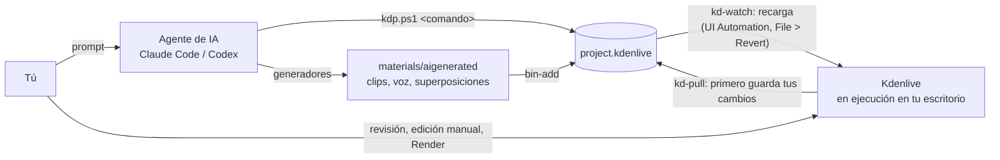

<div align="center">

# movie-engine

**Un agente de IA edita tu vídeo en Kdenlive mientras miras, y puedes tomar el control en cualquier momento.**

Los agentes de programación con IA (Claude Code, Codex) crean y modifican proyectos reales de Kdenlive: películas, vídeos explicativos y shorts verticales. Los cambios aparecen en directo en el editor que tienes abierto. Portable, para Windows, sin parches al editor.


[English](../../README.md) · [简体中文](README.zh-CN.md) · [हिन्दी](README.hi.md) · **Español** · [Français](README.fr.md) · [العربية](README.ar.md) · [বাংলা](README.bn.md) · [Português](README.pt.md) · [Русский](README.ru.md) · [اردو](README.ur.md) · [Bahasa Indonesia](README.id.md) · [Deutsch](README.de.md) · [日本語](README.ja.md) · [Türkçe](README.tr.md) · [한국어](README.ko.md)

*Esta es una traducción; la versión de referencia es el README en inglés.*

</div>

---

## Contenido

- [Por qué](#por-qué)
- [Cómo funciona](#cómo-funciona)
- [Características](#características)
- [Requisitos](#requisitos)
- [Instalación](#instalación)
- [Inicio rápido](#inicio-rápido)
- [Trabajar con el agente](#trabajar-con-el-agente)
- [La línea de comandos de edición (`kdp.ps1`)](#la-línea-de-comandos-de-edición-kdpps1)
- [Sincronización en directo con el editor abierto](#sincronización-en-directo-con-el-editor-abierto)
- [Generadores: lo que Kdenlive no puede hacer](#generadores-lo-que-kdenlive-no-puede-hacer)
- [Locución y sonido](#locución-y-sonido)
- [Idioma de la interfaz](#idioma-de-la-interfaz)
- [Estructura de carpetas](#estructura-de-carpetas)
- [Pruebas y evidencias](#pruebas-y-evidencias)
- [Limitaciones](#limitaciones)
- [Solución de problemas](#solución-de-problemas)
- [Preguntas frecuentes](#preguntas-frecuentes)
- [Cómo contribuir](#cómo-contribuir)
- [Agradecimientos](#agradecimientos)
- [Licencia](#licencia)

## Por qué

Los editores de vídeo están pensados para manejarse con el ratón. A los agentes de IA se les dan bien la estructura, la sincronización y las tareas repetitivas: colocar 300 clips al ritmo de la música, sincronizar cada subtítulo con la voz, rehacer una escena tras recibir comentarios. Pero no pueden ir haciendo clic por una interfaz gráfica sin adueñarse de tu escritorio.

Kdenlive es un editor de código abierto muy completo, pero en Windows **no tiene API de automatización**: el control por D-Bus solo existe en las compilaciones para Linux, y los forks que añaden uno están abandonados o no son seguros. movie-engine resuelve esto sin parchear el editor:

1. El agente edita el archivo de proyecto `.kdenlive` mediante una línea de comandos probada (`engine/kdp.ps1`).
2. Se indica al Kdenlive en ejecución que recargue el archivo a través de Windows UI Automation, sin pulsaciones de teclado, sin ratón y sin robar el foco.
3. Tus propios cambios sin guardar se guardan primero y nunca se sobrescriben.

Así, el agente edita y tú revisas, o editas a mano. Ambos trabajáis en el mismo proyecto, en el mismo editor y al mismo tiempo.

## Cómo funciona



Cada comando de edición sigue el mismo ciclo seguro:

1. **Pull.** Si Kdenlive tiene cambios sin guardar, se le indica que los guarde (el botón Guardar de la barra de herramientas mediante UI Automation) y se confirma el guardado.
2. **Edición.** El comando modifica el XML bajo un bloqueo, tras comprobar un hash y con una instantánea para deshacer. Si el archivo cambió entretanto, no se escribe nada.
3. **Recarga.** El watcher detecta la marca de la IA y ejecuta File > Revert en el editor abierto. Solo se considera un éxito cuando el widget de la línea de tiempo se ha reconstruido de verdad.
4. **Conflicto.** Si empezaste a editar entre medias, no se recarga nada y tu trabajo se conserva. La versión de la IA se guarda aparte y el agente vuelve a aplicar su cambio encima del tuyo.

## Características

- **Edición completa del proyecto sin la interfaz gráfica**: unos 120 comandos que cubren el bin, la línea de tiempo, efectos, composiciones, pistas, guías, marcadores, subtítulos, secuencias, velocidad y reasignación de tiempo, presentaciones, títulos, proxies, renderizado y deshacer/rehacer. Consulta la [referencia de comandos](#la-línea-de-comandos-de-edición-kdpps1).
- **Sincronización en directo con el editor abierto.** Los cambios de la IA aparecen en el Kdenlive que estás mirando; tus cambios sin guardar se guardan primero y nunca se pierden.
- **Nunca interfiere con tu escritorio.** Sin robo de foco, pulsaciones de teclado ni entradas de ratón. Los editores de prueba se ejecutan en un escritorio de Windows invisible.
- **Portable.** El editor, la configuración, Node.js, las fuentes y las herramientas viven en una sola carpeta. Cópiala a otro PC y funciona; no se escribe nada en Program Files ni en tu perfil de Windows.
- **Generadores para lo que Kdenlive no puede hacer**: texto cinético letra a letra, anotaciones dibujadas a mano, escenas de interfaz en 3D, animaciones de cursor y largas películas explicativas interactivas. Se renderizan en la GPU con desenfoque de movimiento real y se colocan en la línea de tiempo como clips normales.
- **Locución con tiempos por palabra** (Microsoft Edge TTS, sin clave de API). Los subtítulos y las acciones se disparan en la palabra exacta.
- **Efectos de sonido sintetizados** (whoosh, clic, pop, riser, impacto y más), generados por código.
- **Demostrado, no supuesto.** Cada comando tiene una comprobación del resultado, los efectos y las composiciones se prueban uno a uno, y los resultados sin procesar están en `docs/proof/`.
- **Instrucciones para agentes incluidas.** `AGENTS.md` y las skills de `.claude/skills/` enseñan a Claude Code y a Codex el flujo de trabajo, el formato de archivo y los errores habituales.

## Requisitos

| | |
|---|---|
| Sistema operativo | Windows 10 u 11, x64 |
| Editor | Compilación portable (standalone) de Kdenlive **26.08.3**. Otras versiones no se han probado. |
| Node.js | 18 o posterior, como un simple `node.exe` copiado en `engine/node/` |
| Navegador | Microsoft Edge (incluido en Windows); los renderizadores de escenas lo usan en modo headless |
| Agente | [Claude Code](https://claude.com/claude-code) o Codex. Opcional: todas las herramientas se pueden ejecutar también a mano. |
| Disco | alrededor de 1 GB para el editor y las herramientas, más tus archivos multimedia |
| GPU | cualquier GPU con codificación H.264 por hardware acelera `film-render.mjs` (si no, recurre al software) |

## Instalación

Todo se instala **dentro de la carpeta**. No se necesitan permisos de administrador.

```powershell
git clone <repository-url> movie-engine
cd movie-engine
```

**1. Node.js.** Copia `node.exe` (18 o posterior) en `engine\node\`. No hace falta el instalador: basta con el exe. Todos los scripts se ejecutan a través de `engine\node.cmd`, nunca con un Node del sistema.

**2. Paquetes de Node** para la herramienta de voz y los renderizadores (las versiones están fijadas en `engine/voice/package.json`):

```powershell
npm install --prefix engine/voice
```

**3. Kdenlive 26.08.3 portable.** Descarga `kdenlive-26.08.3_standalone.exe` desde <https://download.kde.org/stable/kdenlive/26.08/windows/> en `engine\installer\`, verifícalo y descomprímelo:

```powershell
(Get-FileHash engine\installer\kdenlive-26.08.3_standalone.exe -Algorithm SHA256).Hash
# esperado: A25427B1DFF2C17E3B0386E991BB1A719382BB3176D1A90E441CDAEB6E0A967D
engine\installer\kdenlive-26.08.3_standalone.exe -o"engine\Kdenlive" -y
```

El editor queda en `engine\Kdenlive\kdenlive-26.08.3_standalone\bin\`. Ya incluye `melt.exe` y `ffmpeg.exe`.

**4. Primer inicio.**

```powershell
engine\kdenlive.cmd
```

Kdenlive guarda toda su configuración en `engine\profile-kdenlive\`, no en tu perfil de Windows. En el primer inicio muestra un asistente de configuración que solo aparece una vez.

## Inicio rápido

### Con un agente

Abre la carpeta en Claude Code (o Codex) y pide lo que necesites con tus propias palabras:

> Crea un proyecto vertical nuevo a 30 fps llamado "launch-teaser". Pon en la línea de tiempo las tres capturas de pantalla de `materials/designers/launch/`, de 2,5 s cada una con un fundido cruzado corto, añade una locución a partir de `script.txt` y sincroniza un subtítulo cinético con cada frase.

> Ábremelo en Kdenlive.

> La segunda toma es demasiado larga. Recórtala a 1,8 s y sube un poco el logotipo.

El agente sigue `AGENTS.md`: edita a través de `kdp.ps1`, renderiza solo los clips que necesita el montaje y mantiene sincronizado el editor abierto. Tú revisas en Kdenlive, editas a mano cuando quieras y pulsas Render cuando estés satisfecho.

### A mano

```powershell
# un proyecto nuevo de 1080x1920 a 30 fps con 2 pistas de vídeo y 2 de audio
powershell -NoProfile -ExecutionPolicy Bypass -File engine\kdp.ps1 new -Project projects\hello\hello.kdenlive -Profile vertical_hd_30

# un título de 3 segundos y un fondo de color
powershell -NoProfile -ExecutionPolicy Bypass -File engine\kdp.ps1 bin-color -Project projects\hello\hello.kdenlive -Color '#203060' -Seconds 3 -Name bg
powershell -NoProfile -ExecutionPolicy Bypass -File engine\kdp.ps1 title -Project projects\hello\hello.kdenlive -Text "Hello" -Seconds 3 -Name hi

# colocarlos: el fondo en V1, el título encima en V2
powershell -NoProfile -ExecutionPolicy Bypass -File engine\kdp.ps1 add -Project projects\hello\hello.kdenlive -Bin bg -Track V1 -At 0
powershell -NoProfile -ExecutionPolicy Bypass -File engine\kdp.ps1 add -Project projects\hello\hello.kdenlive -Bin hi -Track V2 -At 0

# un fotograma de comprobación y, después, abrirlo en el editor
powershell -NoProfile -ExecutionPolicy Bypass -File engine\kdp.ps1 frame -Project projects\hello\hello.kdenlive -At 1.5 -Out out\hello\check.png
engine\kdenlive.cmd projects\hello\hello.kdenlive
```

Para volver a abrir más tarde el último proyecto, haz doble clic en `open-last-project.cmd`.

## Trabajar con el agente

El agente lee `AGENTS.md` (Codex) o `CLAUDE.md`, que lo importa (Claude Code), además de dos skills:

| Skill | Enseña |
|---|---|
| `.claude/skills/kdenlive-project-file` | el formato `.kdenlive` / MLT XML, `kdp.ps1` y la comprobación con `melt` |
| `.claude/skills/kdenlive-live` | a controlar el editor en ejecución de forma segura: iniciarlo, hacer pull, recargar y capturar su ventana |

Reglas que sigue el agente y en las que puedes confiar:

- Nunca toma tu ratón, tu teclado ni el foco, y nunca hace capturas de tu escritorio (solo de la propia ventana del editor).
- Realiza él mismo los pasos en la interfaz gráfica (guardar, abrir, recargar) en lugar de pedirte que hagas clic.
- Pregunta antes de descargar o eliminar cualquier cosa.
- Renderiza solo lo que el trabajo necesita (clips de escena, fotogramas de comprobación). Renderiza la película final solo cuando se lo pides.
- Cuando Kdenlive no puede hacer algo bien, el agente lo construye fuera con código e inserta el resultado como un clip. No rebaja el efecto.

## La línea de comandos de edición (`kdp.ps1`)

```powershell
powershell -NoProfile -ExecutionPolicy Bypass -File engine\kdp.ps1 <command> -Project <file.kdenlive> [options]
```

Los tiempos se expresan en segundos, con punto decimal (`2.5`). Las pistas son `V1 V2 …` (V1 es la más baja) y `A1 A2 …`. Un clip se identifica con `-Track` más cualquier instante `-At` dentro de él. Los parámetros de los efectos van en `-Params "name=value||name=value"`. La lista completa con todas las opciones está en la cabecera de `engine/kdp.ps1`.

| Grupo | Comandos |
|---|---|
| Proyecto | `new`, `profiles`, `info`, `validate`, `fonts`, `profile-set`, `profile-from-clip`, `zone`, `archive`, `backups`, `rebase`, `otio-export`, `otio-import` |
| Bin | `bin-add`, `bin-color`, `title`, `title-text`, `title-save`, `title-template`, `bin-rename`, `bin-remove`, `bin-info`, `bin-set`, `bin-duplicate`, `bin-replace-file`, `bin-reload`, `folder`, `bin-folder`, `relink`, `clean`, `generator`, `playlist-clip`, `extract-audio`, `transcode` |
| Línea de tiempo | `add`, `add-av`, `move`, `copy`, `trim`, `ripple-trim`, `slip`, `split`, `remove`, `speed`, `remap`, `disable`, `enable`, `group`, `ungroup`, `mix`, `unmix`, `space-insert`, `space-remove`, `spaces-remove-all`, `track-clear`, `replace-in-timeline` |
| Efectos | `effects`, `effect-info`, `effect-add`, `effect-list`, `effect-set`, `effect-remove`, `effect-copy`, `effect-clear`, `effects-all`, `bin-effect`, `effect-templates`, `effect-template` |
| Composiciones | `compositions`, `comp-info`, `comp-add`, `comp-list`, `comp-set`, `comp-remove` |
| Pistas | `track-add`, `track-remove`, `track-set` |
| Guías y marcadores | `guide-add`, `guide-list`, `guide-remove`, `guide-set`, `guide-clear`, `guide-export`, `guide-category`, `marker`, `marker-list`, `marker-set`, `marker-remove` |
| Subtítulos | `sub-add`, `sub-import`, `sub-export`, `sub-state` |
| Secuencias | `sequence-add`, `sequences`, `copy-to-sequence`, `expand`; cualquier comando con `-Sequence <name>` actúa dentro de esa secuencia |
| Especiales | `slideshow`, animaciones Lottie / Glaxnimate mediante `bin-add`, `proxy`, `stabilize`, `scene-split`, `speed-job`, `subclip` |
| Salida | `frame` (un PNG), `preview` (render rápido con melt), `render` (el renderizador propio de Kdenlive o un preset), `presets` |
| Historial | `undo`, `redo`, `clear-history` (instantáneas en `projects/<name>/.kdp-history`) |

Comportamiento que conviene conocer:

- Las mitades de audio y vídeo enlazadas se mueven, recortan, dividen y eliminan juntas (`-Alone` para una sola mitad).
- Un comando que falla termina con código 1 y no escribe nada.
- Los efectos que la compilación de Windows no puede ejecutar se rechazan, no se ignoran en silencio (lista: `docs/proof/assets.txt`).
- Cada acción de menú de Kdenlive está asignada a un comando, a otra vía o a "solo visualización" en `engine/tools/data/kdenlive-actions.csv`. Consulta `docs/kdenlive-coverage.md`.

## Sincronización en directo con el editor abierto

| Script | Qué hace | Códigos de salida |
|---|---|---|
| `engine\kd-pull.ps1 -Project <f>` | hace que Kdenlive guarde tus cambios y lo confirma | 0 archivo actualizado, 3 no está en ejecución, 4 sin confirmar |
| `engine\kd-reload.ps1 -Project <f>` | File > Revert, confirmado por la línea de tiempo reconstruida | 0 confirmado, 2 tienes cambios sin guardar (no se descarta nada), 3 no está en ejecución, 4 fallo |
| `engine\kd-watch.ps1 -Project <f>` | watcher en segundo plano: recarga tras cada escritura de la IA y registra los conflictos | registro en `engine\kd-watch.log`; borra `engine\kd-watch.run` para detenerlo |
| `engine\kdenlive-bg.ps1 [project]` | inicia Kdenlive minimizado para un agente | 0 cargado, 4 sin confirmar |
| `engine\kdenlive.cmd [project]` | inicia Kdenlive para ti | |

Inicia el watcher una vez por sesión:

```powershell
Start-Process powershell -WindowStyle Hidden -ArgumentList '-NoProfile','-ExecutionPolicy','Bypass','-File','engine\kd-watch.ps1','-Project','projects\hello\hello.kdenlive'
```

Proyectos grandes: recargar un proyecto de 1000 clips lleva minutos, y las herramientas esperan a que termine en lugar de informar antes de tiempo. Los proyectos se abren mediante *File > Open Recent* en un editor vacío, porque abrir un archivo directamente hace que Qt recorra cada elemento de la línea de tiempo para la accesibilidad, y era unos 10 minutos más lento.

## Generadores: lo que Kdenlive no puede hacer

Kdenlive/MLT no tiene animación de texto letra a letra, ni expresiones, y apenas 3D; además, los efectos pesados ralentizan la reproducción. movie-engine renderiza esas partes fuera y las coloca en la línea de tiempo como clips normales, normalmente con canal alfa, en una pista por encima de las imágenes. El script generador y sus datos de entrada se quedan en la carpeta del proyecto, de modo que un clip se puede regenerar cuando cambian el texto, la fuente o los tiempos.

| Herramienta | Genera |
|---|---|
| `engine/tools/kinetic-text.ps1` | subtítulos cinéticos letra a letra, con cada palabra sincronizada a partir de `voice.json` y recuadro de resaltado |
| `engine/tools/annotate.ps1` | círculos, recuadros, subrayados y flechas dibujados a mano que se trazan sobre una captura de pantalla |
| `engine/tools/card-entrance.ps1` | una tarjeta con una captura de pantalla que sube y aparece escalándose, con una sombra suave |
| `engine/tools/pdf-to-png.ps1` | diapositivas a partir de una exportación en PDF |
| `engine/tools/html-render.mjs` | cualquier escena HTML/CSS/canvas a vídeo: animación de interfaces, cursores, 3D, máscaras |
| `engine/tools/film-render.mjs` + `film/` | películas explicativas largas e interactivas sobre un canvas: un clip por frase de locución, acciones que se disparan con las palabras habladas y desenfoque de movimiento por GPU a unos 45 fps |

Ambos renderizadores controlan el Microsoft Edge incluido en Windows, en modo headless, con un perfil desechable y sin acceso a la red.

### Demos

```powershell
# una cabecera de título en 3D de 3 segundos con un clic de cursor
engine\node.cmd engine\tools\html-render.mjs examples\demo\scene\scene.html examples\demo\out --frames 0,30,60,89
engine\node.cmd engine\tools\html-render.mjs examples\demo\scene\scene.html examples\demo\out\scene.mp4

# una película interactiva de 4 tomas sincronizada con dos frases de locución
engine\node.cmd engine\tools\film-render.mjs examples\demo\film\film.html examples\demo\out --check
engine\node.cmd engine\tools\film-render.mjs examples\demo\film\film.html examples\demo\out --shots all --width 640
engine\node.cmd engine\tools\film-render.mjs examples\demo\film\film.html examples\demo\out\clips --suffix -v01
```

Una película son tres archivos pequeños. `data.js` contiene las tomas y los tiempos de las palabras. `direction.js` tiene una línea por toma:

```text
1 | hover 192 108 @brand | tag 300 60 Your brand @deserves | confetti 192 90 @film
2 say=A film that/*explains* it
3 | click 116 108 @before | click 268 108 @after | chips Before~After @after
4 scene=counter | count 0 120 % @count
```

`scenes.js` contiene las tomas que se dibujan desde cero. `@word` dispara una acción cuando la voz dice esa palabra. Entre las acciones están click, hover, drag, zoom, lens, ring, arrow, chips, toggle, slider, toast, type, count y confetti; la sintaxis completa está al principio de `engine/tools/film/film-kit.js`.

## Locución y sonido

```powershell
engine\node.cmd engine\voice\voice.mjs lines.json materials\aigenerated\hello\voice en-US-AndrewMultilingualNeural +0%
```

`lines.json` es una lista de frases. La herramienta escribe un mp3 por frase más `voice.json`, con la duración y el inicio y el final de cada palabra. Las frases se guardan en caché, así que al cambiar una frase solo se regenera esa. Usa la síntesis de voz en línea de Microsoft Edge a través del paquete `msedge-tts`: no hace falta ninguna clave, pero el servicio no es oficial y requiere conexión a internet.

```powershell
engine\node.cmd engine\audio\sfx.mjs materials\aigenerated\sfx
```

Esto sintetiza por código whoosh, whoosh-long, swipe, click, pop, tick, riser, impact, ding y reveal; hay un conjunto listo en `materials/aigenerated/sfx/`. Rellena con silencio los sonidos de menos de un fotograma antes de colocarlos (`-af apad=whole_dur=0.0667`).

## Idioma de la interfaz

Los lanzadores inician Kdenlive en **inglés** de forma predeterminada. Para usar otro idioma, define `MOVIE_ENGINE_UI_LANG` antes de iniciarlo:

```powershell
$env:MOVIE_ENGINE_UI_LANG = 'ru'; engine\kdenlive.cmd
```

UI Automation localiza los elementos de menú por sus nombres visibles. Los nombres en inglés y en ruso vienen incluidos (`engine/tools/kd-ui.ps1`, `$KdNames`). Para cualquier otro idioma, añade allí sus nombres y compruébalo con:

```powershell
powershell -NoProfile -ExecutionPolicy Bypass -File engine\tools\kd-langcheck.ps1
```

## Estructura de carpetas

```text
movie-engine/
├─ AGENTS.md, CLAUDE.md          instrucciones para los agentes de IA
├─ .claude/skills/               skills del agente: formato del archivo de proyecto, editor en directo
├─ engine/
│  ├─ kdp.ps1                    la línea de comandos de edición
│  ├─ kd-pull / kd-reload / kd-watch .ps1, kdenlive.cmd, kdenlive-bg.ps1
│  ├─ tools/                     componentes internos, generadores, pruebas, datos (mapa de acciones)
│  ├─ voice/  audio/  fonts/     TTS, efectos de sonido sintetizados, Poppins (OFL)
│  ├─ Kdenlive/  node/           editor portable y Node.js (no están en git)
│  └─ profile-kdenlive/          la configuración del editor (no está en git)
├─ projects/<name>/<name>.kdenlive
├─ materials/
│  ├─ download/                  archivos de stock y descargados (no están en git)
│  ├─ aigenerated/               todo lo que ha creado la IA (sfx/ y test-kit/ vienen con el motor)
│  ├─ designers/  brand/         archivos de tu equipo, recursos de marca
├─ examples/demo/                demos de los renderizadores de escenas y películas
├─ out/                          renders (no están en git)
└─ docs/                         evidencias, cobertura, traducciones de este README
```

Las rutas de los archivos multimedia dentro de los proyectos son relativas. Si mueves o copias la carpeta, `kdp.ps1 rebase` (que `kdenlive.cmd` también ejecuta automáticamente) escribe la nueva ubicación en el proyecto.

## Pruebas y evidencias

Las afirmaciones sobre lo que funciona se respaldan con comprobaciones del resultado, no con "la función se ejecutó". El resumen está en [`docs/kdenlive-proof.md`](../../docs/kdenlive-proof.md), y la salida sin procesar, en `docs/proof/`.

| Prueba | Comprueba |
|---|---|
| `engine\tools\kdp-clitest.ps1` | cada comando de `kdp.ps1`, a través de la línea de comandos, comparando el proyecto resultante |
| `engine\tools\kd-livetest.ps1` | pull, recarga, watcher, conflictos y condiciones de carrera con un Kdenlive real en un escritorio invisible |
| `engine\tools\kdp-assetsweep.ps1` | cada efecto y composición: renderiza y compara fotogramas |
| `engine\tools\kdp-portabletest.ps1` | copia la carpeta a otro lugar y trabaja desde la copia |
| `engine\tools\kd-langcheck.ps1` | el idioma de la interfaz y que UI Automation encuentra el menú |
| `engine\tools\kdp-coverage-check.ps1` | que cada acción de menú está asignada y que ninguna evidencia es más antigua que el código |

```powershell
powershell -NoProfile -ExecutionPolicy Bypass -File engine\tools\kdp-clitest.ps1 -Report docs\proof\clitest.txt
powershell -NoProfile -ExecutionPolicy Bypass -File engine\tools\kd-livetest.ps1 -Report docs\proof\live-en.txt
```

Los editores de prueba se ejecutan solo en un escritorio oculto y con su propio perfil, así que las pruebas nunca tocan tu Kdenlive abierto ni tu foco.

## Limitaciones

- **Solo Windows** y solo Kdenlive **26.08.3**. Linux tiene D-Bus y necesitaría un puente distinto.
- Al iniciar el editor, este toma el foco del teclado durante unos 3 segundos mientras aparece la ventana vacía. Los agentes preguntan antes de iniciarlo mientras trabajas. Las recargas y las ediciones no toman el foco.
- La compilación de Windows carece de los módulos MLT sox, ladspa y movit y de algunos efectos de frei0r/avfilter; `kdp.ps1` los rechaza (`docs/proof/assets.txt`).
- La exportación e importación de OpenTimelineIO solo transfieren clips y huecos. La edición multicámara no tiene cambio de ángulo en directo (los cortes se hacen con split/remove/hide).
- "Guardar como…" mediante UI Automation en una ventana minimizada no abre ningún cuadro de diálogo; en su lugar, el agente usa `archive` o copias de archivos.
- El reconocimiento de voz (subtítulos automáticos) necesita Whisper o Vosk, que no vienen incluidos.
- Los títulos creados con la herramienta de títulos de Kdenlive usan las fuentes instaladas en Windows. Para garantizar la tipografía, renderiza el texto con los generadores, que cargan las fuentes desde `engine/fonts/`.
- Edge TTS es un servicio en línea no oficial y puede cambiar o dejar de funcionar.

## Solución de problemas

| Síntoma | Causa y solución |
|---|---|
| Kdenlive está en ejecución, pero al hacer clic en él en la barra de tareas no se ve nada | Su posición de ventana guardada está fuera de la pantalla. Ciérralo y borra las entradas `kdockLayout` de `engine\profile-kdenlive\AppData\Local\kdenliverc`, o mueve la ventana con `SetWindowPos` (consulta `AGENTS.md`). |
| `kd-reload.ps1` termina con 2 | Tienes cambios sin guardar. No se ha descartado nada. Ejecuta `kd-pull.ps1` y vuelve a aplicar el cambio (`kdp.ps1` lo hace por sí mismo). |
| `CONFLICT` en `engine\kd-watch.log` | Tú y el agente editasteis en el mismo momento. Tu versión se queda en el editor y la versión de la IA está en `projects\<name>\.kdp-history\<name>\conflict\`. Pide al agente que vuelva a aplicar su cambio. |
| Un comando termina con 1 y "pull not confirmed" | Kdenlive está ocupado o muestra un cuadro de diálogo. Cierra el diálogo o espera a que termine la carga y repite. |
| Un script de PowerShell no se puede analizar | Los scripts con texto no ASCII deben guardarse como UTF-8 **con BOM** para Windows PowerShell 5.1. |
| `voice.mjs` se detiene con "Stream closed before the synthesis completed" | Suele ser un problema de red, o SSML sin escapar en copias antiguas. `voice.mjs` escapa `& < >` por sí mismo. |
| Abrir un proyecto grande lleva muchos minutos | Ábrelo mediante `kdenlive.cmd` / `kdenlive-bg.ps1`, nunca como `kdenlive.exe project.kdenlive`. |

## Preguntas frecuentes

**¿Necesito Claude Code o Codex?**
No. Cada herramienta es un script normal que puedes ejecutar a mano. El agente es lo que lo hace rápido: planifica el montaje, ejecuta las herramientas y mantiene el editor sincronizado.

**¿Sobrescribirá el agente mis cambios manuales?**
No. Antes de cualquier escritura, tus cambios sin guardar se guardan y se confirman. Si editas mientras el agente está escribiendo, la escritura se rechaza o se guarda aparte como conflicto, nunca se aplica sobre tu trabajo.

**¿Puedo seguir usando Kdenlive con normalidad?**
Sí. Es el Kdenlive original con su propia carpeta de configuración. Edita, previsualiza y renderiza como siempre.

**¿Funciona con un Kdenlive que ya tengo instalado?**
Usa su propia copia portable en `engine\Kdenlive\`, así que tu Kdenlive instalado y su configuración no se tocan.

**¿Por qué no un fork de Kdenlive con API, u otro editor?**
En Windows no existe ningún fork mantenido y seguro (estudio de 2026-11). Se evaluaron OpenShot, Blender VSE, DaVinci Resolve, Shotcut y editores web; Kdenlive ofreció la mayor profundidad de edición. Se sigue de cerca una propuesta de API REST en el proyecto original (merge request !902).

**¿Puede renderizar el vídeo final?**
Sí, con `kdp.ps1 render` (el renderizador propio de Kdenlive, oculto), o puedes pulsar Render tú mismo en el editor.

**¿Se sube mi material a algún sitio?**
No. Solo el texto de la locución se envía al servicio Edge TTS cuando generas la voz. Los renderizadores de escenas se ejecutan con la red desactivada.

## Cómo contribuir

Las contribuciones son bienvenidas. Consulta [CONTRIBUTING.md](../../CONTRIBUTING.md). En resumen:

- Cada operación nueva o modificada de `kdp.ps1` necesita una comprobación del resultado en `kdp-clitest.ps1`, una entrada en el mapa de acciones y una nueva ejecución de `kdp-coverage-check.ps1`.
- Nunca inicies un Kdenlive de prueba en el escritorio visible; usa `engine/tools/kd-hidden.ps1`.
- Mantén todo portable: nada de instalaciones fuera de la carpeta ni rutas absolutas en los proyectos.
- Documenta las peculiaridades verificadas en `AGENTS.md` o en la skill correspondiente.

## Agradecimientos

- [Kdenlive](https://kdenlive.org) y [MLT](https://www.mltframework.org): el editor y el motor que hay debajo.
- [FFmpeg](https://ffmpeg.org), incluido con Kdenlive.
- [msedge-tts](https://www.npmjs.com/package/msedge-tts) para la locución.
- [Poppins](https://fonts.google.com/specimen/Poppins), de Indian Type Foundry, SIL Open Font License (`engine/fonts/OFL.txt`).

## Licencia

Todavía no se ha elegido la licencia del código propio de movie-engine. Hasta que se añada un archivo `LICENSE`, todos los derechos están reservados por los autores. Kdenlive, MLT, FFmpeg, los paquetes de Node.js y la fuente Poppins conservan sus propias licencias.
