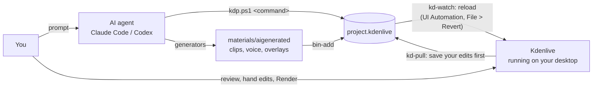

<div align="center">

# Movie Engine

**Tehisintellekti agent monteerib sinu videot Kdenlive'is sinu silme all ja sina võid töö igal hetkel üle võtta.**

Tehisintellektil põhinevad programmeerimisagendid (Claude Code, Codex) loovad ja muudavad päris Kdenlive'i projekte: filme, selgitusvideoid ja vertikaalseid lühivideoid. Muudatused ilmuvad kohe sinu avatud redaktorisse. Kaasaskantav, Windows, redaktorit ei paigata.


[English](../../README.md) · [简体中文](README.zh-CN.md) · [繁體中文](README.zh-TW.md) · [हिन्दी](README.hi.md) · [Español](README.es.md) · [Français](README.fr.md) · [العربية](README.ar.md) · [বাংলা](README.bn.md) · [Português](README.pt.md) · [Русский](README.ru.md) · [اردو](README.ur.md) · [Bahasa Indonesia](README.id.md) · [Deutsch](README.de.md) · [日本語](README.ja.md) · [Türkçe](README.tr.md) · [한국어](README.ko.md) · [Українська](README.uk.md) · [Italiano](README.it.md) · [Polski](README.pl.md) · [Tiếng Việt](README.vi.md) · [فارسی](README.fa.md) · [ไทย](README.th.md) · [Kiswahili](README.sw.md) · [አማርኛ](README.am.md) · [Avañe'ẽ](README.gn.md) · [Setswana](README.tn.md) · [Shqip](README.sq.md) · [Беларуская](README.be.md) · [Български](README.bg.md) · [Bosanski](README.bs.md) · [Hrvatski](README.hr.md) · [Српски](README.sr.md) · [Crnogorski](README.cnr.md) · [Македонски](README.mk.md) · [Slovenščina](README.sl.md) · [Slovenčina](README.sk.md) · [Čeština](README.cs.md) · [Magyar](README.hu.md) · [Română](README.ro.md) · [Dansk](README.da.md) · [Norsk bokmål](README.nb.md) · [Norsk nynorsk](README.nn.md) · [Svenska](README.sv.md) · [Íslenska](README.is.md) · [Suomi](README.fi.md) · **Eesti** · [Latviešu](README.lv.md) · [Lietuvių](README.lt.md) · [Nederlands](README.nl.md) · [Lëtzebuergesch](README.lb.md) · [Rumantsch](README.rm.md) · [Ελληνικά](README.el.md) · [Malti](README.mt.md) · [Gaeilge](README.ga.md) · [Català](README.ca.md) · [ქართული](README.ka.md) · [Հայերեն](README.hy.md) · [Azərbaycanca](README.az.md) · [Afrikaans](README.af.md) · [isiZulu](README.zu.md) · [isiXhosa](README.xh.md) · [Sesotho](README.st.md) · [Sepedi](README.nso.md) · [Xitsonga](README.ts.md) · [Tshivenḓa](README.ve.md) · [siSwati](README.ss.md) · [isiNdebele (South Africa)](README.nr.md) · [isiNdebele (Zimbabwe)](README.nd.md) · [chiShona](README.sn.md) · [Chichewa](README.ny.md) · [Ikinyarwanda](README.rw.md) · [Ikirundi](README.rn.md) · [Malagasy](README.mg.md) · [Soomaali](README.so.md) · [Afaan Oromoo](README.om.md) · [Qafar af](README.aa.md) · [ትግርኛ](README.ti.md) · [Sängö](README.sg.md) · [Kreol Seselwa](README.crs.md) · [TjiKalanga](README.kck.md) · [ChiNdau](README.ndc.md)

*See on tõlge. Põhiversiooniks loetakse ingliskeelset README-d.*

</div>

---

## Sisukord

- [Miks](#miks)
- [Kuidas see töötab](#kuidas-see-töötab)
- [Võimalused](#võimalused)
- [Nõuded](#nõuded)
- [Paigaldamine](#paigaldamine)
- [Kiirstart](#kiirstart)
- [Töö agendiga](#töö-agendiga)
- [Monteerimise käsurida (`kdp.ps1`)](#monteerimise-käsurida-kdpps1)
- [Reaalajas sünkroonimine avatud redaktoriga](#reaalajas-sünkroonimine-avatud-redaktoriga)
- [Generaatorid: mida Kdenlive ei oska](#generaatorid-mida-kdenlive-ei-oska)
- [Pealelugemine ja heli](#pealelugemine-ja-heli)
- [Liidese keel](#liidese-keel)
- [Kaustade struktuur](#kaustade-struktuur)
- [Testid ja tõendid](#testid-ja-tõendid)
- [Piirangud](#piirangud)
- [Tõrkeotsing](#tõrkeotsing)
- [KKK](#kkk)
- [Kaasaaitamine](#kaasaaitamine)
- [Tänuavaldused](#tänuavaldused)
- [Litsents](#litsents)

## Miks

Videoredaktorid on loodud hiirt hoidvale käele. Tehisintellekti agendid on head struktuuri, ajastuse ja korduva töö alal: 300 klippi rütmi järgi paigutada, iga subtiiter hääle järgi ajastada, stseen pärast tagasisidet uuesti teha. Graafilises liideses klõpsida nad aga ei saa, ilma et nad sinu töölauda üle võtaksid.

Kdenlive on võimekas avatud lähtekoodiga redaktor, kuid Windowsis puudub sel **automatiseerimise API**: D-Busi kaudu juhtimine on olemas ainult Linuxi järkudes ning harud (forgid), mis selle lisavad, on kas hooldamata või ebaturvalised. Movie Engine lahendab selle redaktorit paikamata:

1. Agent muudab projektifaili `.kdenlive` testitud käsurea kaudu (`engine/kdp.ps1`).
2. Töötavale Kdenlive'ile antakse Windows UI Automationi kaudu käsk fail uuesti laadida, ilma klahvivajutuste, hiire ja fookuse äravõtmiseta.
3. Sinu salvestamata muudatused salvestatakse esmalt ja neid ei kirjutata kunagi üle.

Nii et agent monteerib ja sina vaatad üle või muudad ise käsitsi. Te mõlemad töötate samal ajal sama projekti kallal samas redaktoris.

## Kuidas see töötab



Iga monteerimiskäsk läbib sama turvalise tsükli:

1. **Pull.** Kui Kdenlive'is on salvestamata muudatusi, antakse talle käsk need salvestada (tööriistariba nupp Save UI Automationi kaudu) ja salvestamine kinnitatakse.
2. **Muutmine.** Käsk muudab XML-i luku all, pärast räsikontrolli ja koos tagasivõtmise hetktõmmisega. Kui fail on vahepeal muutunud, ei kirjutata midagi.
3. **Uuesti laadimine.** Jälgija näeb tehisintellekti märgist ja käivitab avatud redaktoris File > Revert. Õnnestumiseks loetakse ainult seda, kui ajajoone vidin on tegelikult uuesti üles ehitatud.
4. **Konflikt.** Kui hakkasid vahepeal ise muutma, ei laadita midagi uuesti ja sinu töö jääb alles. Tehisintellekti versioon pannakse kõrvale ning agent rakendab oma muudatuse uuesti sinu omade peale.

## Võimalused

- **Täielik projekti monteerimine ilma graafilise liideseta**: umbes 120 käsku, mis katavad projektisalve (bin), ajajoone, efektid, kompositsioonid, rajad, juhtjooned, markerid, subtiitrid, jadad, kiiruse ja ajaümberkaardistuse, slaidiseansid, tiitrid, puhverfailid (proxy), renderdamise ning tagasivõtmise ja uuestitegemise. Vaata [käskude teatmikku](#monteerimise-käsurida-kdpps1).
- **Reaalajas sünkroonimine avatud redaktoriga.** Tehisintellekti muudatused ilmuvad Kdenlive'i, mida sa vaatad; sinu salvestamata muudatused salvestatakse esmalt ega lähe kunagi kaotsi.
- **Ei sega kunagi sinu töölauda.** Fookust ei võeta ära, klahve ei vajutata ega hiirt liigutata. Testredaktorid töötavad nähtamatul Windowsi töölaual.
- **Kaasaskantav.** Redaktor, seaded, Node.js, fondid ja tööriistad asuvad ühes kaustas. Kopeeri see teise arvutisse ja kõik töötab; midagi ei kirjutata kausta Program Files ega sinu Windowsi profiili.
- **Generaatorid selle jaoks, mida Kdenlive ei oska**: tähthaaval animeeritud kineetiline tekst, käsitsi joonistatud märkused, 3D-liidesestseenid, kursorianimatsioonid ja pikad interaktiivsed selgitusfilmid. Need renderdatakse GPU-l päris liikumishägususega ja paigutatakse ajajoonele tavaliste klippidena.
- **Pealelugemine sõnade ajastusega** (Microsoft Edge TTS, API-võtit pole vaja). Subtiitrid ja toimingud käivituvad täpselt õigel sõnal.
- **Sünteesitud heliefektid** (whoosh, click, pop, riser, impact ja muud), loodud koodiga.
- **Tõestatud, mitte oletatud.** Igal käsul on tulemuse kontroll, efektid ja kompositsioonid on ükshaaval läbi proovitud ning toored tulemused on kaustas `docs/proof/`.
- **Agentide juhised kaasas.** `AGENTS.md` ja oskused kaustas `.claude/skills/` õpetavad Claude Code'ile ja Codexile töövoogu, failivormingut ja lõkse.

## Nõuded

| | |
|---|---|
| OS | Windows 10 või 11, x64 |
| Redaktor | Kdenlive **26.08.3** kaasaskantav (standalone) järk. Teisi versioone pole testitud. |
| Node.js | 18 või uuem: Windows x64 `.zip` saidilt nodejs.org, lahti pakitud kausta `engine/node/` |
| Brauser | Microsoft Edge (Windowsi osa); stseenirenderdajad kasutavad seda peata (headless) režiimis |
| Agent | [Claude Code](https://claude.com/claude-code) või Codex. Valikuline: iga tööriista saab käivitada ka käsitsi. |
| Ketas | umbes 1 GB redaktori ja tööriistade jaoks, lisaks sinu meediafailid |
| GPU | iga riistvaralise H.264 kodeerimisega GPU kiirendab `film-render.mjs`-i (selle puudumisel kasutatakse tarkvaralist kodeerimist) |

## Paigaldamine

Kõik paigaldatakse **kausta sisse**. Administraatoriõigusi pole vaja.

```powershell
git clone https://github.com/vladtarrow/movie-engine.git
cd movie-engine
```

**1. Node.js.** Laadi aadressilt <https://nodejs.org/en/download> alla Node.js 18 või uuema Windows x64 `.zip` ja paki selle sisu lahti kausta `engine\node\`, nii et seal oleksid `engine\node\node.exe` ja `engine\node\npm.cmd`. Paigaldusprogrammi ega süsteemset Node'i pole vaja. Kõik skriptid käivitatakse `engine\node.cmd` kaudu, mitte kunagi süsteemse Node'iga.

**2. Node'i paketid** pealelugemise tööriista ja renderdajate jaoks (versioonid on fikseeritud failis `engine/voice/package.json`):

```powershell
engine\node\npm.cmd install --prefix engine\voice
```

**3. Kaasaskantav Kdenlive 26.08.3.** Laadi `kdenlive-26.08.3_standalone.exe` aadressilt <https://download.kde.org/stable/kdenlive/26.08/windows/> kausta `engine\installer\`, kontrolli seda ja paki lahti:

```powershell
(Get-FileHash engine\installer\kdenlive-26.08.3_standalone.exe -Algorithm SHA256).Hash
# expected: A25427B1DFF2C17E3B0386E991BB1A719382BB3176D1A90E441CDAEB6E0A967D
engine\installer\kdenlive-26.08.3_standalone.exe -o"engine\Kdenlive" -y
```

Redaktor satub kausta `engine\Kdenlive\kdenlive-26.08.3_standalone\bin\`. Selles on juba olemas `melt.exe` ja `ffmpeg.exe`.

**4. Esimene käivitamine.**

```powershell
engine\kdenlive.cmd
```

Kdenlive hoiab kõiki oma seadeid kaustas `engine\profile-kdenlive\`, mitte sinu Windowsi profiilis. Esimesel käivitamisel näitab see ühekordset seadistusviisardit.

## Kiirstart

### Agendiga

Ava kaust Claude Code'is (või Codexis) ja palu tavaliste sõnadega:

> Tee uus vertikaalne 30 fps projekt „launch-teaser“. Pane kolm ekraanipilti kaustast `materials/designers/launch/` ajajoonele, igaüks 2,5 s lühikese sujuva üleminekuga, lisa pealelugemine failist `script.txt` ja ajasta igale reale kineetiline pealdis.

> Ava see mulle Kdenlive'is.

> Teine kaader on liiga pikk. Lõika see 1,8 s pikkuseks ja tõsta logo veidi kõrgemale.

Agent järgib faili `AGENTS.md`: ta muudab `kdp.ps1` kaudu, renderdab ainult need klipid, mida montaaž vajab, ja hoiab avatud redaktori ajakohasena. Sina vaatad tulemuse Kdenlive'is üle, muudad käsitsi millal iganes tahad ja vajutad Render, kui oled rahul.

### Käsitsi

```powershell
# a new 1080x1920 30 fps project with 2 video and 2 audio tracks
powershell -NoProfile -ExecutionPolicy Bypass -File engine\kdp.ps1 new -Project projects\hello\hello.kdenlive -Profile vertical_hd_30

# a 3-second title and a colour background
powershell -NoProfile -ExecutionPolicy Bypass -File engine\kdp.ps1 bin-color -Project projects\hello\hello.kdenlive -Color '#203060' -Seconds 3 -Name bg
powershell -NoProfile -ExecutionPolicy Bypass -File engine\kdp.ps1 title -Project projects\hello\hello.kdenlive -Text "Hello" -Seconds 3 -Name hi

# place them: background on V1, title above it on V2
powershell -NoProfile -ExecutionPolicy Bypass -File engine\kdp.ps1 add -Project projects\hello\hello.kdenlive -Bin bg -Track V1 -At 0
powershell -NoProfile -ExecutionPolicy Bypass -File engine\kdp.ps1 add -Project projects\hello\hello.kdenlive -Bin hi -Track V2 -At 0

# a check frame, then open it in the editor
powershell -NoProfile -ExecutionPolicy Bypass -File engine\kdp.ps1 frame -Project projects\hello\hello.kdenlive -At 1.5 -Out out\hello\check.png
engine\kdenlive.cmd projects\hello\hello.kdenlive
```

Viimase projekti hiljem uuesti avamiseks tee topeltklõps failil `open-last-project.cmd`.

## Töö agendiga

Agent loeb faili `AGENTS.md` (Codex) või `CLAUDE.md`, mis selle impordib (Claude Code), ning lisaks kahte oskust:

| Oskus | Mida õpetab |
|---|---|
| `.claude/skills/kdenlive-project-file` | vorming `.kdenlive` / MLT XML, `kdp.ps1`, kontrollimine `melt`-iga |
| `.claude/skills/kdenlive-live` | töötava redaktori turvaline juhtimine: käivitamine, pull, uuesti laadimine, selle akna jäädvustamine |

Reeglid, mida agent järgib ja millele võid kindel olla:

- Ta ei võta kunagi sinu hiirt, klaviatuuri ega fookust ega tee kunagi ekraanipilti sinu töölauast (ainult redaktori enda aknast).
- Graafilise liidese sammud (salvestamine, avamine, uuesti laadimine) teeb ta ise, selle asemel et paluda sul klõpsata.
- Ta küsib enne, kui midagi alla laadib või kustutab.
- Ta renderdab ainult seda, mida töö vajab (stseeniklipid, kontrollkaadrid). Valmis filmi renderdab ta ainult siis, kui sa palud.
- Kui Kdenlive ei oska midagi hästi teha, ehitab agent selle väljaspool koodiga ja paneb tulemuse klipina sisse. Ta ei lahjenda efekti.

## Monteerimise käsurida (`kdp.ps1`)

```powershell
powershell -NoProfile -ExecutionPolicy Bypass -File engine\kdp.ps1 <command> -Project <file.kdenlive> [options]
```

Ajad on sekundites, punktiga (`2.5`). Rajad on `V1 V2 …` (V1 on alumine) ja `A1 A2 …`. Klipile viidatakse `-Track` ja mis tahes sellesse jääva ajahetkega `-At`. Efekti parameetrid antakse kujul `-Params "name=value||name=value"`. Täielik loend koos kõigi valikutega on faili `engine/kdp.ps1` päises.

| Rühm | Käsud |
|---|---|
| Projekt | `new`, `profiles`, `info`, `validate`, `fonts`, `profile-set`, `profile-from-clip`, `zone`, `archive`, `backups`, `rebase`, `otio-export`, `otio-import` |
| Projektisalv (bin) | `bin-add`, `bin-color`, `title`, `title-text`, `title-save`, `title-template`, `bin-rename`, `bin-remove`, `bin-info`, `bin-set`, `bin-duplicate`, `bin-replace-file`, `bin-reload`, `folder`, `bin-folder`, `relink`, `clean`, `generator`, `playlist-clip`, `extract-audio`, `transcode` |
| Ajajoon | `add`, `add-av`, `move`, `copy`, `trim`, `ripple-trim`, `slip`, `split`, `remove`, `speed`, `remap`, `disable`, `enable`, `group`, `ungroup`, `mix`, `unmix`, `space-insert`, `space-remove`, `spaces-remove-all`, `track-clear`, `replace-in-timeline` |
| Efektid | `effects`, `effect-info`, `effect-add`, `effect-list`, `effect-set`, `effect-remove`, `effect-copy`, `effect-clear`, `effects-all`, `bin-effect`, `effect-templates`, `effect-template` |
| Kompositsioonid | `compositions`, `comp-info`, `comp-add`, `comp-list`, `comp-set`, `comp-remove` |
| Rajad | `track-add`, `track-remove`, `track-set` |
| Juhtjooned ja markerid | `guide-add`, `guide-list`, `guide-remove`, `guide-set`, `guide-clear`, `guide-export`, `guide-category`, `marker`, `marker-list`, `marker-set`, `marker-remove` |
| Subtiitrid | `sub-add`, `sub-import`, `sub-export`, `sub-state` |
| Jadad | `sequence-add`, `sequences`, `copy-to-sequence`, `expand`; iga käsk koos `-Sequence <name>`-iga töötab selle jada sees |
| Eriotstarbelised | `slideshow`, Lottie / Glaxnimate animatsioonid `bin-add` kaudu, `proxy`, `stabilize`, `scene-split`, `speed-job`, `subclip` |
| Väljund | `frame` (üks PNG), `preview` (kiire renderdus melt'iga), `render` (Kdenlive'i enda renderdaja või eelseadistus), `presets` |
| Ajalugu | `undo`, `redo`, `clear-history` (hetktõmmised kaustas `projects/<name>/.kdp-history`) |

Käitumine, mida tasub teada:

- Seotud heli- ja videopooled liiguvad, kärbitakse, lõigatakse ja eemaldatakse koos (`-Alone` ühe poole jaoks).
- Ebaõnnestunud käsk lõpetab koodiga 1 ega kirjuta midagi.
- Efektid, mida Windowsi järk käivitada ei suuda, lükatakse tagasi, mitte ei jäeta vaikselt vahele (loend: `docs/proof/assets.txt`).
- Iga Kdenlive'i menüütoiming on failis `engine/tools/data/kdenlive-actions.csv` vastendatud käsu, muu tee või märkega „ainult vaatamiseks“. Vaata `docs/kdenlive-coverage.md`.

## Reaalajas sünkroonimine avatud redaktoriga

| Skript | Mida teeb | Väljumiskoodid |
|---|---|---|
| `engine\kd-pull.ps1 -Project <f>` | paneb Kdenlive'i sinu muudatused salvestama ja kinnitab selle | 0 fail ajakohane, 3 ei tööta, 4 kinnitamata |
| `engine\kd-reload.ps1 -Project <f>` | File > Revert, kinnitatakse uuesti üles ehitatud ajajoonega | 0 kinnitatud, 2 sul on salvestamata muudatusi (midagi ei visatud ära), 3 ei tööta, 4 ebaõnnestus |
| `engine\kd-watch.ps1 -Project <f>` | taustal töötav jälgija: laadib uuesti pärast iga tehisintellekti kirjutust, logib konfliktid | logi failis `engine\kd-watch.log`; peatamiseks kustuta `engine\kd-watch.run` |
| `engine\kdenlive-bg.ps1 [project]` | käivitab Kdenlive'i agendi jaoks minimeerituna | 0 laaditud, 4 kinnitamata |
| `engine\kdenlive.cmd [project]` | käivitab Kdenlive'i sinu jaoks | |

Käivita jälgija üks kord seansi kohta:

```powershell
Start-Process powershell -WindowStyle Hidden -ArgumentList '-NoProfile','-ExecutionPolicy','Bypass','-File','engine\kd-watch.ps1','-Project','projects\hello\hello.kdenlive'
```

Suured projektid: 1000 klipiga projekti uuesti laadimine võtab minuteid ja tööriistad ootavad selle ära, selle asemel et liiga vara teatada. Projektid avatakse tühjas redaktoris menüü *File > Open Recent* kaudu, sest faili otse avamisel käib Qt hõlbustusfunktsioonide jaoks läbi iga ajajoone elemendi ja see oli umbes 10 minutit aeglasem.

## Generaatorid: mida Kdenlive ei oska

Kdenlive/MLT-l puudub tähthaaval tekstianimatsioon, puuduvad avaldised (expressions) ja 3D-d on vähe, ning rasked efektid aeglustavad taasesitust. Movie Engine renderdab sellised osad väljaspool ja paneb need ajajoonele tavaliste klippidena, tavaliselt alfakanaliga, piltidest kõrgemale rajale. Generaatori skript ja selle sisendid jäävad projekti kausta, nii et klipi saab uuesti genereerida, kui tekst, font või ajastus muutub.

| Tööriist | Mida teeb |
|---|---|
| `engine/tools/kinetic-text.ps1` | tähthaaval animeeritud kineetilised pealdised, iga sõna ajastatud `voice.json`-i järgi, esiletõstukast |
| `engine/tools/annotate.ps1` | käsitsi joonistatud ringid, kastid, allajoonimised ja nooled, mis joonistuvad ekraanipildi peale |
| `engine/tools/card-entrance.ps1` | ekraanipildikaart, mis tõuseb ja suureneb pehme varjuga |
| `engine/tools/pdf-to-png.ps1` | slaidid PDF-ekspordist |
| `engine/tools/html-render.mjs` | mis tahes HTML/CSS/canvas-stseen videoks: liidese animatsioon, kursorid, 3D, maskid |
| `engine/tools/film-render.mjs` + `film/` | pikad interaktiivsed selgitusfilmid canvas'el: üks klipp pealeloetud repliigi kohta, toimingud käivituvad öeldud sõnadel, GPU liikumishägusus umbes 45 kaadrit sekundis |

Mõlemad renderdajad juhivad Windowsiga kaasas olevat Microsoft Edge'i peata režiimis, ühekordse profiiliga ja ilma võrgujuurdepääsuta.

### Demod

```powershell
# a 3-second 3D title card with a cursor click
engine\node.cmd engine\tools\html-render.mjs examples\demo\scene\scene.html examples\demo\out --frames 0,30,60,89
engine\node.cmd engine\tools\html-render.mjs examples\demo\scene\scene.html examples\demo\out\scene.mp4

# a 4-shot interactive film timed to two voice lines
engine\node.cmd engine\tools\film-render.mjs examples\demo\film\film.html examples\demo\out --check
engine\node.cmd engine\tools\film-render.mjs examples\demo\film\film.html examples\demo\out --shots all --width 640
engine\node.cmd engine\tools\film-render.mjs examples\demo\film\film.html examples\demo\out\clips --suffix -v01
```

Film koosneb kolmest väikesest failist. `data.js` sisaldab kaadreid ja sõnade aegu. `direction.js`-is on üks rida kaadri kohta:

```text
1 | hover 192 108 @brand | tag 300 60 Your brand @deserves | confetti 192 90 @film
2 say=A film that/*explains* it
3 | click 116 108 @before | click 268 108 @after | chips Before~After @after
4 scene=counter | count 0 120 % @count
```

`scenes.js` sisaldab kaadreid, mis joonistatakse nullist. `@word` käivitab toimingu, kui hääl selle sõna ütleb. Toimingute hulka kuuluvad click, hover, drag, zoom, lens, ring, arrow, chips, toggle, slider, toast, type, count ja confetti; täielik süntaks on faili `engine/tools/film/film-kit.js` alguses.

## Pealelugemine ja heli

```powershell
engine\node.cmd engine\voice\voice.mjs lines.json materials\aigenerated\hello\voice en-US-AndrewMultilingualNeural +0%
```

`lines.json` on repliikide loend. Tööriist kirjutab ühe mp3 repliigi kohta ning faili `voice.json`, milles on kestus ning iga sõna algus ja lõpp. Repliigid salvestatakse vahemällu, nii et ühe repliigi muutmisel genereeritakse uuesti ainult see. Kasutatakse Microsoft Edge'i veebipõhist kõnesünteesi paketi `msedge-tts` kaudu: võtit pole vaja, kuid teenus on mitteametlik ja vajab internetiühendust.

```powershell
engine\node.cmd engine\audio\sfx.mjs materials\aigenerated\sfx
```

See sünteesib koodiga helid whoosh, whoosh-long, swipe, click, pop, tick, riser, impact, ding ja reveal; valmis komplekt on kaustas `materials/aigenerated/sfx/`. Ühest kaadrist lühemad helid täida enne paigutamist vaikusega (`-af apad=whole_dur=0.0667`).

## Liidese keel

Käivitajad avavad Kdenlive'i vaikimisi **inglise keeles**. Muu keele kasutamiseks määra enne käivitamist `MOVIE_ENGINE_UI_LANG`:

```powershell
$env:MOVIE_ENGINE_UI_LANG = 'ru'; engine\kdenlive.cmd
```

UI Automation leiab menüüelemendid nende nähtavate nimede järgi. Nimed 31 liidesekeele jaoks on sisse ehitatud (`engine/tools/kd-ui.ps1`, `$KdNames`). Mõne muu keele jaoks lisa selle nimed sinna ja kontrolli käsuga:

```powershell
powershell -NoProfile -ExecutionPolicy Bypass -File engine\tools\kd-langcheck.ps1
```

## Kaustade struktuur

```text
movie-engine/
├─ AGENTS.md, CLAUDE.md          instructions for AI agents
├─ .claude/skills/               agent skills: project file format, live editor
├─ engine/
│  ├─ kdp.ps1                    the editing command line
│  ├─ kd-pull / kd-reload / kd-watch .ps1, kdenlive.cmd, kdenlive-bg.ps1
│  ├─ tools/                     internals, generators, tests, data (action map)
│  ├─ voice/  audio/  fonts/     TTS, synthesized SFX, Poppins (OFL)
│  ├─ Kdenlive/  node/           portable editor and Node.js (not in git)
│  └─ profile-kdenlive/          the editor's settings (not in git)
├─ projects/<name>/<name>.kdenlive
├─ materials/
│  ├─ download/                  stock and downloaded files (not in git)
│  ├─ aigenerated/               everything the AI made (sfx/ and test-kit/ ship with the engine)
│  ├─ designers/  brand/         files from your team, brand assets
├─ examples/demo/                demos of the scene and film renderers
├─ out/                          renders (not in git)
└─ docs/                         proofs, coverage, translations of this README
```

Meediafailide teed projektides on suhtelised. Kui teisaldad või kopeerid kausta, kirjutab `kdp.ps1 rebase` (mida `kdenlive.cmd` käivitab ka automaatselt) uue asukoha projekti.

## Testid ja tõendid

Väited selle kohta, mis töötab, põhinevad tulemuste kontrollidel, mitte sellel, et „funktsioon käivitus“. Kokkuvõte on failis [`docs/kdenlive-proof.md`](../../docs/kdenlive-proof.md) ja toores väljund kaustas `docs/proof/`.

| Test | Mida kontrollib |
|---|---|
| `engine\tools\kdp-clitest.ps1` | iga `kdp.ps1` käsku käsurea kaudu, võrreldes tulemuseks saadud projekti |
| `engine\tools\kd-livetest.ps1` | pull, uuesti laadimine, jälgija, konfliktid ja võidujooksud päris Kdenlive'iga nähtamatul töölaual |
| `engine\tools\kdp-assetsweep.ps1` | iga efekt ja kompositsioon: renderdab ja võrdleb kaadreid |
| `engine\tools\kdp-portabletest.ps1` | kopeerib kausta mujale ja töötab koopiast |
| `engine\tools\kd-langcheck.ps1` | liidese keel ja see, et UI Automation leiab menüü |
| `engine\tools\kdp-coverage-check.ps1` | iga menüütoiming on vastendatud ja ükski tõend pole koodist vanem |

```powershell
powershell -NoProfile -ExecutionPolicy Bypass -File engine\tools\kdp-clitest.ps1 -Report docs\proof\clitest.txt
powershell -NoProfile -ExecutionPolicy Bypass -File engine\tools\kd-livetest.ps1 -Report docs\proof\live-en.txt
```

Testredaktorid töötavad ainult peidetud töölaual oma profiiliga, nii et testid ei puuduta kunagi sinu avatud Kdenlive'i ega sinu fookust.

## Piirangud

- **Ainult Windows**, ainult Kdenlive **26.08.3**. Linuxis on D-Bus ja seal oleks vaja teistsugust silda.
- Redaktori käivitamine võtab klaviatuurifookuse umbes 3 sekundiks, kuni tühi aken ilmub. Agendid küsivad enne selle käivitamist, kui sa parajasti töötad. Uuesti laadimised ja muudatused fookust ei võta.
- Windowsi järgul puuduvad MLT moodulid sox, ladspa ja movit ning osa frei0r/avfilter efekte; `kdp.ps1` lükkab need tagasi (`docs/proof/assets.txt`).
- OpenTimelineIO eksport ja import kannavad üle ainult klipid ja tühimikud. Mitme kaameraga montaažis puudub reaalajas nurga vahetamine (lõiked tehakse split/remove/hide abil).
- „Save As…“ UI Automationi kaudu minimeeritud aknas ei ava dialoogi; agent kasutab selle asemel käsku `archive` või failikoopiaid.
- Kõnetuvastus (automaatsed subtiitrid) vajab Whisperit või Voski, mis ei ole kaasas.
- Kdenlive'i tiitritööriistaga tehtud tiitrid kasutavad Windowsi paigaldatud fonte. Garanteeritud tüpograafia jaoks renderda tekst generaatoritega, mis laadivad fondid kaustast `engine/fonts/`.
- Edge TTS on mitteametlik veebiteenus ning võib muutuda või lakata töötamast.

## Tõrkeotsing

| Sümptom | Põhjus ja lahendus |
|---|---|
| Kdenlive töötab, kuid tegumiribal sellel klõpsamine ei näita midagi | Selle salvestatud akna asukoht on väljaspool ekraani. Sulge see ja kustuta kirjed `kdockLayout` failis `engine\profile-kdenlive\AppData\Local\kdenliverc` või liiguta akent käsuga `SetWindowPos` (vaata `AGENTS.md`). |
| `kd-reload.ps1` lõpetab koodiga 2 | Sul on salvestamata muudatusi. Midagi ei visatud ära. Käivita `kd-pull.ps1` ja rakenda muudatus uuesti (`kdp.ps1` teeb seda ise). |
| `CONFLICT` failis `engine\kd-watch.log` | Sina ja agent muutsite samal hetkel. Sinu versioon jääb redaktorisse ja tehisintellekti versioon on kaustas `projects\<name>\.kdp-history\<name>\conflict\`. Palu agendil oma muudatus uuesti rakendada. |
| Käsk lõpetab koodiga 1 ja teatega „pull not confirmed“ | Kdenlive on hõivatud või näitab dialoogi. Sulge dialoog või oota laadimise lõppu, seejärel korda. |
| PowerShelli skripti ei õnnestu parsida | Mitte-ASCII tekstiga skriptid tuleb Windows PowerShell 5.1 jaoks salvestada UTF-8-na **koos BOM-iga**. |
| `voice.mjs` peatub teatega „Stream closed before the synthesis completed“ | Tavaliselt võrguprobleem või vanemates koopiates varjestamata SSML. `voice.mjs` varjestab `& < >` ise. |
| Suure projekti avamine võtab palju minuteid | Ava see `kdenlive.cmd` / `kdenlive-bg.ps1` kaudu, mitte kunagi kujul `kdenlive.exe project.kdenlive`. |

## KKK

**Kas mul on vaja Claude Code'i või Codexit?**
Ei. Iga tööriist on tavaline skript, mida saab käsitsi käivitada. Agent teeb töö kiireks: ta planeerib montaaži, käivitab tööriistad ja hoiab redaktori ajakohasena.

**Kas agent kirjutab minu käsitsi tehtud muudatused üle?**
Ei. Enne iga kirjutamist salvestatakse sinu salvestamata muudatused ja see kinnitatakse. Kui sa muudad ajal, mil agent kirjutab, lükatakse kirjutamine tagasi või pannakse konfliktina kõrvale, kuid seda ei rakendata kunagi sinu töö peale.

**Kas ma saan Kdenlive'i edasi tavapäraselt kasutada?**
Jah. See on tavaline Kdenlive oma seadete kaustaga. Monteeri, vaata eelvaadet ja renderda nagu tavaliselt.

**Kas see töötab Kdenlive'iga, mis mul juba paigaldatud on?**
See kasutab oma kaasaskantavat koopiat kaustas `engine\Kdenlive\`, nii et sinu paigaldatud Kdenlive ja selle seaded jäävad puutumata.

**Miks mitte API-ga Kdenlive'i haru või mõni teine redaktor?**
Windowsis pole ühtegi hooldatud ja turvalist haru (ülevaade 2026. aasta novembrist). Hinnati OpenShoti, Blender VSE-d, DaVinci Resolve'i, Shotcuti ja veebiredaktoreid; Kdenlive pakkus kõige sügavamaid monteerimisvõimalusi. Põhiprojekti REST API ettepanekut (merge request !902) jälgitakse.

**Kas see suudab lõpliku video renderdada?**
Jah, käsuga `kdp.ps1 render` (Kdenlive'i enda renderdaja, peidetult), või vajutad redaktoris ise Render.

**Kas minu meediat laaditakse kuhugi üles?**
Ei. Hääle genereerimisel saadetakse Edge TTS teenusele ainult pealeloetav tekst. Stseenirenderdajad töötavad väljalülitatud võrguga.

## Kaasaaitamine

Panused on teretulnud. Vaata [CONTRIBUTING.md](../../CONTRIBUTING.md). Lühidalt:

- Iga uus või muudetud `kdp.ps1` toiming vajab tulemuse kontrolli failis `kdp-clitest.ps1`, kirjet toimingute kaardis ja `kdp-coverage-check.ps1` värsket käivitamist.
- Ära kunagi käivita test-Kdenlive'i nähtaval töölaual; kasuta `engine/tools/kd-hidden.ps1`.
- Hoia kõik kaasaskantavana: ei mingeid paigaldusi väljaspool kausta ega absoluutseid teid projektides.
- Pane kontrollitud iseärasused kirja faili `AGENTS.md` või vastavasse oskusesse.

## Tänuavaldused

- [Kdenlive](https://kdenlive.org) ja [MLT](https://www.mltframework.org): redaktor ja selle all olev mootor.
- [FFmpeg](https://ffmpeg.org), mis on Kdenlive'iga kaasas.
- [msedge-tts](https://www.npmjs.com/package/msedge-tts) pealelugemise jaoks.
- [Poppins](https://fonts.google.com/specimen/Poppins), autor Indian Type Foundry, SIL Open Font License (`engine/fonts/OFL.txt`).
- `engine/tools/data/kdenliveui-26.08.3.rc`: Kdenlive'i menüüfail, võetud Kdenlive 26.08.3 lähtekoodist; seda kasutab ainult katvuse kontroll. See jääb Kdenlive'i GPL-litsentsi alla, mitte MIT License'i alla.

## Litsents

Movie Engine'i enda kood on avaldatud [MIT-litsentsi](../../LICENSE) all. Kdenlive'il, MLT-l, FFmpegil, Node.js pakettidel ja fondil Poppins on oma litsentsid.
