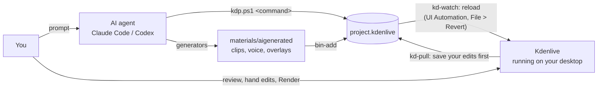

<div align="center">

# Movie Engine

**یک عامل هوش مصنوعی ویدیوی شما را در Kdenlive جلوی چشمتان ویرایش می‌کند و شما هر لحظه می‌توانید کار را خودتان به دست بگیرید.**

عامل‌های برنامه‌نویسی هوش مصنوعی (Claude Code و Codex) پروژه‌های واقعی Kdenlive را می‌سازند و تغییر می‌دهند: فیلم، ویدیوی آموزشی و ویدیوی کوتاه عمودی. ویرایش‌ها به‌صورت زنده در همان ویرایشگری که باز کرده‌اید دیده می‌شوند. قابل‌حمل، روی Windows، بدون هیچ وصله‌ای روی ویرایشگر.


[English](../../README.md) · [简体中文](README.zh-CN.md) · [繁體中文](README.zh-TW.md) · [हिन्दी](README.hi.md) · [Español](README.es.md) · [Français](README.fr.md) · [العربية](README.ar.md) · [বাংলা](README.bn.md) · [Português](README.pt.md) · [Русский](README.ru.md) · [اردو](README.ur.md) · [Bahasa Indonesia](README.id.md) · [Deutsch](README.de.md) · [日本語](README.ja.md) · [Türkçe](README.tr.md) · [한국어](README.ko.md) · [Українська](README.uk.md) · [Italiano](README.it.md) · [Polski](README.pl.md) · [Tiếng Việt](README.vi.md) · **فارسی** · [ไทย](README.th.md) · [Kiswahili](README.sw.md) · [አማርኛ](README.am.md) · [Avañe'ẽ](README.gn.md) · [Setswana](README.tn.md)

*این یک ترجمه است؛ نسخهٔ مرجع، README انگلیسی است.*

</div>

---

<div dir="rtl">

## فهرست مطالب

- [چرا](#چرا)
- [سازوکار](#سازوکار)
- [امکانات](#امکانات)
- [سیستم مورد نیاز](#سیستم-مورد-نیاز)
- [نصب](#نصب)
- [شروع سریع](#شروع-سریع)
- [کار با عامل](#کار-با-عامل)
- [خط فرمان ویرایش (`kdp.ps1`)](#خط-فرمان-ویرایش-kdpps1)
- [هماهنگی زنده با ویرایشگر باز](#هماهنگی-زنده-با-ویرایشگر-باز)
- [مولدها: فراتر از توان Kdenlive](#مولدها-فراتر-از-توان-kdenlive)
- [گویندگی و صدا](#گویندگی-و-صدا)
- [زبان رابط کاربری](#زبان-رابط-کاربری)
- [ساختار پوشه](#ساختار-پوشه)
- [آزمون و اثبات](#آزمون-و-اثبات)
- [محدودیت ها](#محدودیت-ها)
- [رفع اشکال](#رفع-اشکال)
- [پرسش و پاسخ](#پرسش-و-پاسخ)
- [مشارکت](#مشارکت)
- [سپاسگزاری](#سپاسگزاری)
- [مجوز](#مجوز)

## چرا

ویرایشگرهای ویدیو برای دستی ساخته شده‌اند که روی ماوس است. عامل‌های هوش مصنوعی در ساختار، زمان‌بندی و کارهای تکراری قوی‌اند: چیدن ۳۰۰ کلیپ روی ضرب‌آهنگ، هماهنگ کردن زمان هر زیرنویس با صدا، از نو ساختن یک صحنه پس از دریافت بازخورد. اما نمی‌توانند در یک رابط گرافیکی کلیک کنند، مگر اینکه دسکتاپ شما را تصاحب کنند.

Kdenlive ویرایشگر متن‌باز قدرتمندی است، اما روی Windows **هیچ API خودکارسازی ندارد**: کنترل از طریق D-Bus فقط در نسخه‌های Linux وجود دارد، و انشعاب‌هایی (fork) که چنین امکانی اضافه می‌کنند یا دیگر نگهداری نمی‌شوند یا امن نیستند. Movie Engine این مشکل را بدون وصله کردن ویرایشگر حل می‌کند:

1. عامل فایل پروژهٔ `.kdenlive` را از طریق یک خط فرمان آزموده‌شده (`engine/kdp.ps1`) ویرایش می‌کند.
2. به Kdenlive در حال اجرا از طریق Windows UI Automation گفته می‌شود که فایل را دوباره بارگذاری کند؛ بدون فشردن کلید، بدون ماوس و بدون ربودن فوکوس.
3. ویرایش‌های ذخیره‌نشدهٔ خود شما اول ذخیره می‌شوند و هرگز بازنویسی نمی‌شوند.

پس عامل ویرایش می‌کند و شما بازبینی می‌کنید، یا خودتان با دست ویرایش می‌کنید. هر دو روی یک پروژه، در یک ویرایشگر و هم‌زمان کار می‌کنید.

## سازوکار



هر فرمان ویرایش همان چرخهٔ امن را دنبال می‌کند:

1. **دریافت (Pull).** اگر Kdenlive تغییرات ذخیره‌نشده داشته باشد، از آن خواسته می‌شود آن‌ها را ذخیره کند (دکمهٔ Save نوار ابزار از طریق UI Automation) و ذخیره شدن تأیید می‌شود.
2. **ویرایش.** فرمان، XML را زیر قفل تغییر می‌دهد؛ پس از بررسی هش و همراه با یک نسخهٔ لحظه‌ای برای واگرد. اگر فایل در این فاصله تغییر کرده باشد، چیزی نوشته نمی‌شود.
3. **بارگذاری دوباره.** ناظر (watcher) مهر عامل را می‌بیند و در ویرایشگر باز، File > Revert را اجرا می‌کند. موفقیت فقط وقتی پذیرفته می‌شود که ویجت خط زمان واقعاً از نو ساخته شده باشد.
4. **تعارض.** اگر شما در این فاصله شروع به ویرایش کرده باشید، چیزی بارگذاری نمی‌شود و کار شما سر جایش می‌ماند. نسخهٔ عامل کنار گذاشته می‌شود و عامل تغییرش را دوباره روی تغییرات شما اعمال می‌کند.

## امکانات

- **ویرایش کامل پروژه بدون رابط گرافیکی**: حدود ۱۲۰ فرمان که bin، خط زمان، افکت‌ها، ترکیب‌ها (compositions)، ترک‌ها، راهنماها، نشانگرها، زیرنویس‌ها، سکانس‌ها، سرعت و نگاشت دوبارهٔ زمان (time remap)، اسلایدشو، عنوان‌ها، پراکسی‌ها، رندر و واگرد/ازنو را پوشش می‌دهند. [مرجع فرمان‌ها](#خط-فرمان-ویرایش-kdpps1) را ببینید.
- **هماهنگی زنده با ویرایشگر باز.** ویرایش‌های عامل در همان Kdenlive که به آن نگاه می‌کنید ظاهر می‌شوند؛ ویرایش‌های ذخیره‌نشدهٔ شما اول ذخیره می‌شوند و هرگز از بین نمی‌روند.
- **هرگز مزاحم دسکتاپ شما نمی‌شود.** نه فوکوس را می‌رباید، نه کلیدی می‌فشارد و نه ماوس را حرکت می‌دهد. ویرایشگرهای آزمایشی روی یک دسکتاپ نامرئی Windows اجرا می‌شوند.
- **قابل‌حمل.** ویرایشگر، تنظیمات، Node.js، فونت‌ها و ابزارها همه در یک پوشه‌اند. آن را به رایانهٔ دیگری کپی کنید و کار می‌کند؛ هیچ چیز در Program Files یا پروفایل Windows شما نوشته نمی‌شود.
- **مولدهایی برای کارهایی که از Kdenlive برنمی‌آید**: متن متحرک حرف‌به‌حرف، حاشیه‌نویسی‌های دست‌کشیده، صحنه‌های سه‌بعدی رابط کاربری، پویانمایی نشانگر ماوس و فیلم‌های آموزشی تعاملی بلند. این‌ها روی GPU با تاری حرکتی واقعی رندر می‌شوند و مثل کلیپ‌های معمولی روی خط زمان قرار می‌گیرند.
- **گویندگی با زمان‌بندی کلمه‌به‌کلمه** (Microsoft Edge TTS، بدون کلید API). زیرنویس‌ها و کنش‌ها دقیقاً روی همان کلمه اجرا می‌شوند.
- **جلوه‌های صوتی ساختگی** (whoosh، click، pop، riser، impact و بیشتر) که با کد تولید می‌شوند.
- **اثبات‌شده، نه فرضی.** هر فرمان یک بررسی نتیجه دارد، افکت‌ها و ترکیب‌ها یکی‌یکی آزموده می‌شوند و نتایج خام در `docs/proof/` هستند.
- **دستورالعمل‌های عامل همراه پروژه.** `AGENTS.md` و مهارت‌های `.claude/skills/` روند کار، قالب فایل و دام‌ها را به Claude Code و Codex یاد می‌دهند.

## سیستم مورد نیاز

| | |
|---|---|
| سیستم‌عامل | Windows 10 یا 11، x64 |
| ویرایشگر | نسخهٔ قابل‌حمل (standalone) Kdenlive **26.08.3**. نسخه‌های دیگر آزموده نشده‌اند. |
| Node.js | نسخهٔ 18 یا جدیدتر: فایل `.zip` مخصوص Windows x64 از nodejs.org، بازشده در `engine/node/` |
| مرورگر | Microsoft Edge (بخشی از Windows)؛ رندرکننده‌های صحنه آن را به‌صورت headless (بدون پنجره) به کار می‌برند |
| عامل | [Claude Code](https://claude.com/claude-code) یا Codex. اختیاری است: همهٔ ابزارها با دست هم اجرا می‌شوند. |
| دیسک | حدود ۱ گیگابایت برای ویرایشگر و ابزارها، به‌علاوهٔ رسانه‌های خودتان |
| GPU | هر GPU با رمزگذاری سخت‌افزاری H.264 سرعت `film-render.mjs` را بالا می‌برد (در نبود آن، به رمزگذاری نرم‌افزاری برمی‌گردد) |

## نصب

همه چیز **داخل همین پوشه** نصب می‌شود. هیچ چیز به دسترسی مدیر (admin) نیاز ندارد.

```powershell
git clone https://github.com/vladtarrow/movie-engine.git
cd movie-engine
```

**۱. Node.js.** فایل `.zip` مخصوص Windows x64 از Node.js نسخهٔ 18 یا جدیدتر را از <https://nodejs.org/en/download> دانلود کنید و محتوای آن را در `engine\node\` باز کنید، طوری که `engine\node\node.exe` و `engine\node\npm.cmd` آنجا باشند. نه نصاب لازم است و نه Node نصب‌شده روی سیستم. همهٔ اسکریپت‌ها از طریق `engine\node.cmd` اجرا می‌شوند، هرگز با Node سیستم.

**۲. بسته‌های Node** برای ابزار صدا و رندرکننده‌ها (نسخه‌ها در `engine/voice/package.json` تثبیت شده‌اند):

```powershell
engine\node\npm.cmd install --prefix engine\voice
```

**۳. Kdenlive 26.08.3 قابل‌حمل.** فایل `kdenlive-26.08.3_standalone.exe` را از <https://download.kde.org/stable/kdenlive/26.08/windows/> در `engine\installer\` دانلود کنید، آن را بررسی کنید و باز کنید:

```powershell
(Get-FileHash engine\installer\kdenlive-26.08.3_standalone.exe -Algorithm SHA256).Hash
# expected: A25427B1DFF2C17E3B0386E991BB1A719382BB3176D1A90E441CDAEB6E0A967D
engine\installer\kdenlive-26.08.3_standalone.exe -o"engine\Kdenlive" -y
```

ویرایشگر در `engine\Kdenlive\kdenlive-26.08.3_standalone\bin\` قرار می‌گیرد و `melt.exe` و `ffmpeg.exe` را از پیش در خود دارد.

**۴. اجرای نخست.**

```powershell
engine\kdenlive.cmd
```

Kdenlive همهٔ تنظیماتش را در `engine\profile-kdenlive\` نگه می‌دارد، نه در پروفایل Windows شما. در اجرای نخست، یک راهنمای راه‌اندازی یک‌باره نشان می‌دهد.

## شروع سریع

### با یک عامل

پوشه را در Claude Code (یا Codex) باز کنید و با زبان ساده درخواست کنید:

> یک پروژهٔ عمودی جدید با ۳۰ فریم بر ثانیه به نام «launch-teaser» بساز. سه اسکرین‌شات `materials/designers/launch/` را روی خط زمان بگذار، هر کدام ۲٫۵ ثانیه با یک محوشدگی متقاطع کوتاه، از `script.txt` گویندگی اضافه کن و برای هر خط یک زیرنویس متحرک هم‌زمان بساز.

> آن را برایم در Kdenlive باز کن.

> نمای دوم خیلی طولانی است. آن را به ۱٫۸ ثانیه کوتاه کن و لوگو را کمی بالاتر ببر.

عامل از `AGENTS.md` پیروی می‌کند: از طریق `kdp.ps1` ویرایش می‌کند، فقط کلیپ‌هایی را که تدوین لازم دارد رندر می‌کند و ویرایشگر باز را هماهنگ نگه می‌دارد. شما در Kdenlive بازبینی می‌کنید، هر وقت خواستید با دست ویرایش می‌کنید و وقتی راضی بودید Render را می‌زنید.

### دستی

```powershell
# a new 1080x1920 30 fps project with 2 video and 2 audio tracks
powershell -NoProfile -ExecutionPolicy Bypass -File engine\kdp.ps1 new -Project projects\hello\hello.kdenlive -Profile vertical_hd_30

# a 3-second title and a colour background
powershell -NoProfile -ExecutionPolicy Bypass -File engine\kdp.ps1 bin-color -Project projects\hello\hello.kdenlive -Color '#203060' -Seconds 3 -Name bg
powershell -NoProfile -ExecutionPolicy Bypass -File engine\kdp.ps1 title -Project projects\hello\hello.kdenlive -Text "Hello" -Seconds 3 -Name hi

# place them: background on V1, title above it on V2
powershell -NoProfile -ExecutionPolicy Bypass -File engine\kdp.ps1 add -Project projects\hello\hello.kdenlive -Bin bg -Track V1 -At 0
powershell -NoProfile -ExecutionPolicy Bypass -File engine\kdp.ps1 add -Project projects\hello\hello.kdenlive -Bin hi -Track V2 -At 0

# a check frame, then open it in the editor
powershell -NoProfile -ExecutionPolicy Bypass -File engine\kdp.ps1 frame -Project projects\hello\hello.kdenlive -At 1.5 -Out out\hello\check.png
engine\kdenlive.cmd projects\hello\hello.kdenlive
```

برای باز کردن دوبارهٔ آخرین پروژه در آینده، روی `open-last-project.cmd` دوبار کلیک کنید.

## کار با عامل

عامل `AGENTS.md` را می‌خواند (در Codex) یا `CLAUDE.md` را که آن را وارد می‌کند (در Claude Code)، و به‌علاوه دو مهارت:

| مهارت | چه چیزی یاد می‌دهد |
|---|---|
| `.claude/skills/kdenlive-project-file` | قالب `.kdenlive` / MLT XML، `kdp.ps1` و بررسی با `melt` |
| `.claude/skills/kdenlive-live` | کنترل امن ویرایشگر در حال اجرا: اجرا، دریافت، بارگذاری دوباره و گرفتن تصویر از پنجرهٔ آن |

قواعدی که عامل رعایت می‌کند و می‌توانید به آن‌ها تکیه کنید:

- هرگز ماوس، صفحه‌کلید یا فوکوس شما را نمی‌گیرد و هرگز از دسکتاپ شما تصویر نمی‌گیرد (فقط از پنجرهٔ خود ویرایشگر).
- مراحل رابط گرافیکی (ذخیره، باز کردن، بارگذاری دوباره) را خودش انجام می‌دهد، به‌جای اینکه از شما بخواهد کلیک کنید.
- پیش از دانلود یا حذف هر چیزی از شما اجازه می‌گیرد.
- فقط چیزی را رندر می‌کند که کار لازم دارد (کلیپ‌های صحنه، فریم‌های بررسی). فیلم نهایی را فقط وقتی رندر می‌کند که شما بخواهید.
- وقتی Kdenlive کاری را به‌خوبی انجام نمی‌دهد، عامل آن را بیرون از ویرایشگر با کد می‌سازد و نتیجه را به‌صورت یک کلیپ وارد می‌کند. جلوه را ساده‌تر و ضعیف‌تر نمی‌کند.

## خط فرمان ویرایش (`kdp.ps1`)

```powershell
powershell -NoProfile -ExecutionPolicy Bypass -File engine\kdp.ps1 <command> -Project <file.kdenlive> [options]
```

زمان‌ها به ثانیه و با نقطهٔ اعشار نوشته می‌شوند (`2.5`). ترک‌ها `V1 V2 …` (‏V1 پایین‌ترین) و `A1 A2 …` هستند. هر کلیپ با `-Track` به‌علاوهٔ هر زمانی در داخل آن با `-At` مشخص می‌شود. پارامترهای افکت در `-Params "name=value||name=value"` قرار می‌گیرند. فهرست کامل با همهٔ گزینه‌ها در سرآیند `engine/kdp.ps1` است.

| گروه | فرمان‌ها |
|---|---|
| پروژه | `new`، `profiles`، `info`، `validate`، `fonts`، `profile-set`، `profile-from-clip`، `zone`، `archive`، `backups`، `rebase`، `otio-export`، `otio-import` |
| Bin | `bin-add`، `bin-color`، `title`، `title-text`، `title-save`، `title-template`، `bin-rename`، `bin-remove`، `bin-info`، `bin-set`، `bin-duplicate`، `bin-replace-file`، `bin-reload`، `folder`، `bin-folder`، `relink`، `clean`، `generator`، `playlist-clip`، `extract-audio`، `transcode` |
| خط زمان | `add`، `add-av`، `move`، `copy`، `trim`، `ripple-trim`، `slip`، `split`، `remove`، `speed`، `remap`، `disable`، `enable`، `group`، `ungroup`، `mix`، `unmix`، `space-insert`، `space-remove`، `spaces-remove-all`، `track-clear`، `replace-in-timeline` |
| افکت‌ها | `effects`، `effect-info`، `effect-add`، `effect-list`، `effect-set`، `effect-remove`، `effect-copy`، `effect-clear`، `effects-all`، `bin-effect`، `effect-templates`، `effect-template` |
| ترکیب‌ها | `compositions`، `comp-info`، `comp-add`، `comp-list`، `comp-set`، `comp-remove` |
| ترک‌ها | `track-add`، `track-remove`، `track-set` |
| راهنماها و نشانگرها | `guide-add`، `guide-list`، `guide-remove`، `guide-set`، `guide-clear`، `guide-export`، `guide-category`، `marker`، `marker-list`، `marker-set`، `marker-remove` |
| زیرنویس‌ها | `sub-add`، `sub-import`، `sub-export`، `sub-state` |
| سکانس‌ها | `sequence-add`، `sequences`، `copy-to-sequence`، `expand`؛ هر فرمانی با `-Sequence <name>` درون همان سکانس کار می‌کند |
| ویژه | `slideshow`، پویانمایی‌های Lottie / Glaxnimate از طریق `bin-add`، `proxy`، `stabilize`، `scene-split`، `speed-job`، `subclip` |
| خروجی | `frame` (یک PNG)، `preview` (رندر سریع با melt)، `render` (رندرکنندهٔ خود Kdenlive یا یک پیش‌تنظیم)، `presets` |
| تاریخچه | `undo`، `redo`، `clear-history` (نسخه‌های لحظه‌ای در `projects/<name>/.kdp-history`) |

رفتارهایی که بهتر است بدانید:

- نیمه‌های صوتی و تصویری پیوندخورده با هم جابه‌جا، کوتاه، برش‌خورده و حذف می‌شوند (`-Alone` برای فقط یک نیمه).
- فرمانی که شکست بخورد با کد 1 خارج می‌شود و هیچ چیز نمی‌نویسد.
- افکت‌هایی که نسخهٔ Windows نمی‌تواند اجرا کند رد می‌شوند، نه اینکه بی‌صدا نادیده گرفته شوند (فهرست: `docs/proof/assets.txt`).
- هر کنش منوی Kdenlive در `engine/tools/data/kdenlive-actions.csv` به یک فرمان، یک راه دیگر یا «فقط نمایش» نگاشته شده است. `docs/kdenlive-coverage.md` را ببینید.

## هماهنگی زنده با ویرایشگر باز

| اسکریپت | چه می‌کند | کدهای خروج |
|---|---|---|
| `engine\kd-pull.ps1 -Project <f>` | Kdenlive را وادار می‌کند ویرایش‌های شما را ذخیره کند و این را تأیید می‌کند | 0 فایل به‌روز است، 3 در حال اجرا نیست، 4 تأیید نشد |
| `engine\kd-reload.ps1 -Project <f>` | File > Revert، که با از نو ساخته شدن خط زمان تأیید می‌شود | 0 تأیید شد، 2 ویرایش ذخیره‌نشده دارید (چیزی دور ریخته نشد)، 3 در حال اجرا نیست، 4 ناموفق |
| `engine\kd-watch.ps1 -Project <f>` | ناظر پس‌زمینه: پس از هر نوشتن عامل دوباره بارگذاری می‌کند و تعارض‌ها را ثبت می‌کند | گزارش در `engine\kd-watch.log`؛ برای توقف، `engine\kd-watch.run` را حذف کنید |
| `engine\kdenlive-bg.ps1 [project]` | Kdenlive را برای یک عامل به‌صورت کوچک‌شده (minimized) اجرا می‌کند | 0 بارگذاری شد، 4 تأیید نشد |
| `engine\kdenlive.cmd [project]` | Kdenlive را برای شما اجرا می‌کند | |

ناظر را در هر نشست یک بار اجرا کنید:

```powershell
Start-Process powershell -WindowStyle Hidden -ArgumentList '-NoProfile','-ExecutionPolicy','Bypass','-File','engine\kd-watch.ps1','-Project','projects\hello\hello.kdenlive'
```

پروژه‌های بزرگ: بارگذاری دوبارهٔ یک پروژهٔ ۱۰۰۰ کلیپی چند دقیقه طول می‌کشد و ابزارها به‌جای گزارش زودهنگام، منتظر پایان آن می‌مانند. پروژه‌ها از طریق *File > Open Recent* در یک ویرایشگر خالی باز می‌شوند، چون باز کردن مستقیم فایل باعث می‌شود Qt برای دسترس‌پذیری از روی تک‌تک آیتم‌های خط زمان بگذرد و این کار حدود ۱۰ دقیقه کندتر بود.

## مولدها: فراتر از توان Kdenlive

Kdenlive/MLT پویانمایی حرف‌به‌حرف متن و عبارت‌ها (expressions) را ندارد، سه‌بعدی آن ناچیز است و افکت‌های سنگین پخش را کند می‌کنند. Movie Engine چنین بخش‌هایی را بیرون از ویرایشگر رندر می‌کند و آن‌ها را مثل کلیپ‌های معمولی، معمولاً با کانال آلفا، روی ترکی بالاتر از تصویرها می‌گذارد. اسکریپت مولد و ورودی‌هایش در پوشهٔ پروژه می‌مانند تا هر وقت متن، فونت یا زمان‌بندی عوض شد، بتوان کلیپ را دوباره ساخت.

| ابزار | چه می‌سازد |
|---|---|
| `engine/tools/kinetic-text.ps1` | زیرنویس‌های متحرک حرف‌به‌حرف، زمان هر کلمه از `voice.json`، کادر برجسته‌سازی |
| `engine/tools/annotate.ps1` | دایره، کادر، زیرخط و فلش‌های دست‌کشیده که روی اسکرین‌شات کم‌کم کشیده می‌شوند |
| `engine/tools/card-entrance.ps1` | کارت اسکرین‌شاتی که با سایه‌ای نرم بالا می‌آید و بزرگ می‌شود |
| `engine/tools/pdf-to-png.ps1` | اسلاید از یک خروجی PDF |
| `engine/tools/html-render.mjs` | هر صحنهٔ HTML/CSS/canvas به ویدیو: پویانمایی رابط کاربری، نشانگر ماوس، سه‌بعدی، ماسک |
| `engine/tools/film-render.mjs` + `film/` | فیلم‌های آموزشی تعاملی و بلند روی canvas: یک کلیپ برای هر خط گویندگی، کنش‌ها روی کلمه‌های گفته‌شده اجرا می‌شوند، تاری حرکتی روی GPU با حدود ۴۵ فریم بر ثانیه |

هر دو رندرکننده، Microsoft Edge همراه Windows را به‌صورت headless، با یک پروفایل یک‌بارمصرف و بدون دسترسی به شبکه به کار می‌گیرند.

### نمونه‌ها

```powershell
# a 3-second 3D title card with a cursor click
engine\node.cmd engine\tools\html-render.mjs examples\demo\scene\scene.html examples\demo\out --frames 0,30,60,89
engine\node.cmd engine\tools\html-render.mjs examples\demo\scene\scene.html examples\demo\out\scene.mp4

# a 4-shot interactive film timed to two voice lines
engine\node.cmd engine\tools\film-render.mjs examples\demo\film\film.html examples\demo\out --check
engine\node.cmd engine\tools\film-render.mjs examples\demo\film\film.html examples\demo\out --shots all --width 640
engine\node.cmd engine\tools\film-render.mjs examples\demo\film\film.html examples\demo\out\clips --suffix -v01
```

هر فیلم از سه فایل کوچک تشکیل می‌شود. `data.js` نماها و زمان کلمه‌ها را نگه می‌دارد. `direction.js` برای هر نما یک خط دارد:

```text
1 | hover 192 108 @brand | tag 300 60 Your brand @deserves | confetti 192 90 @film
2 say=A film that/*explains* it
3 | click 116 108 @before | click 268 108 @after | chips Before~After @after
4 scene=counter | count 0 120 % @count
```

`scenes.js` نماهایی را نگه می‌دارد که از صفر کشیده می‌شوند. `@word` یک کنش را درست وقتی اجرا می‌کند که صدا آن کلمه را می‌گوید. کنش‌ها شامل click، hover، drag، zoom، lens، ring، arrow، chips، toggle، slider، toast، type، count و confetti هستند؛ نحو کامل در بالای `engine/tools/film/film-kit.js` آمده است.

## گویندگی و صدا

```powershell
engine\node.cmd engine\voice\voice.mjs lines.json materials\aigenerated\hello\voice en-US-AndrewMultilingualNeural +0%
```

`lines.json` فهرستی از خط‌هاست. ابزار برای هر خط یک فایل mp3 می‌نویسد و به‌علاوه `voice.json` را با مدت هر خط و آغاز و پایان تک‌تک کلمه‌ها. خط‌ها کش می‌شوند، پس تغییر یک خط فقط همان خط را دوباره تولید می‌کند. این ابزار از سرویس آنلاین تبدیل متن به گفتار Microsoft Edge از طریق بستهٔ `msedge-tts` استفاده می‌کند: کلیدی لازم نیست، اما سرویس غیررسمی است و به اینترنت نیاز دارد.

```powershell
engine\node.cmd engine\audio\sfx.mjs materials\aigenerated\sfx
```

این فرمان whoosh، whoosh-long، swipe، click، pop، tick، riser، impact، ding و reveal را با کد می‌سازد؛ یک مجموعهٔ آماده در `materials/aigenerated/sfx/` هست. صداهای کوتاه‌تر از یک فریم را پیش از قرار دادن، با سکوت بلندتر کنید (`-af apad=whole_dur=0.0667`).

## زبان رابط کاربری

اجراکننده‌ها Kdenlive را به‌طور پیش‌فرض به زبان **انگلیسی** اجرا می‌کنند. برای زبانی دیگر، پیش از اجرا `MOVIE_ENGINE_UI_LANG` را تنظیم کنید:

```powershell
$env:MOVIE_ENGINE_UI_LANG = 'ru'; engine\kdenlive.cmd
```

UI Automation آیتم‌های منو را با نام‌های قابل‌مشاهده‌شان پیدا می‌کند. نام‌ها برای ۳۱ زبان رابط کاربری از پیش موجودند (`engine/tools/kd-ui.ps1`، `$KdNames`). برای هر زبان دیگر، نام‌های آن را آنجا اضافه کنید و با این فرمان بررسی کنید:

```powershell
powershell -NoProfile -ExecutionPolicy Bypass -File engine\tools\kd-langcheck.ps1
```

## ساختار پوشه

```text
movie-engine/
├─ AGENTS.md, CLAUDE.md          instructions for AI agents
├─ .claude/skills/               agent skills: project file format, live editor
├─ engine/
│  ├─ kdp.ps1                    the editing command line
│  ├─ kd-pull / kd-reload / kd-watch .ps1, kdenlive.cmd, kdenlive-bg.ps1
│  ├─ tools/                     internals, generators, tests, data (action map)
│  ├─ voice/  audio/  fonts/     TTS, synthesized SFX, Poppins (OFL)
│  ├─ Kdenlive/  node/           portable editor and Node.js (not in git)
│  └─ profile-kdenlive/          the editor's settings (not in git)
├─ projects/<name>/<name>.kdenlive
├─ materials/
│  ├─ download/                  stock and downloaded files (not in git)
│  ├─ aigenerated/               everything the AI made (sfx/ and test-kit/ ship with the engine)
│  ├─ designers/  brand/         files from your team, brand assets
├─ examples/demo/                demos of the scene and film renderers
├─ out/                          renders (not in git)
└─ docs/                         proofs, coverage, translations of this README
```

مسیرهای رسانه درون پروژه‌ها نسبی‌اند. اگر پوشه را جابه‌جا یا کپی کنید، `kdp.ps1 rebase` (که `kdenlive.cmd` هم خودکار اجرایش می‌کند) مکان تازه را در پروژه می‌نویسد.

## آزمون و اثبات

ادعاها دربارهٔ اینکه چه چیزی کار می‌کند با بررسی نتیجه پشتیبانی می‌شوند، نه با «تابع اجرا شد». خلاصه در [`docs/kdenlive-proof.md`](../../docs/kdenlive-proof.md) است و خروجی خام در `docs/proof/`.

| آزمون | چه چیزی را بررسی می‌کند |
|---|---|
| `engine\tools\kdp-clitest.ps1` | تک‌تک فرمان‌های `kdp.ps1`، از طریق خط فرمان، با مقایسهٔ پروژهٔ حاصل |
| `engine\tools\kd-livetest.ps1` | دریافت، بارگذاری دوباره، ناظر، تعارض‌ها و رقابت‌ها (race) در برابر یک Kdenlive واقعی روی دسکتاپ نامرئی |
| `engine\tools\kdp-assetsweep.ps1` | تک‌تک افکت‌ها و ترکیب‌ها: فریم‌ها را رندر و مقایسه می‌کند |
| `engine\tools\kdp-portabletest.ps1` | پوشه را به جای دیگری کپی می‌کند و از روی آن نسخه کار می‌کند |
| `engine\tools\kd-langcheck.ps1` | زبان رابط کاربری و اینکه UI Automation منو را پیدا می‌کند |
| `engine\tools\kdp-coverage-check.ps1` | اینکه همهٔ کنش‌های منو نگاشته شده‌اند و هیچ اثباتی قدیمی‌تر از کد نیست |

```powershell
powershell -NoProfile -ExecutionPolicy Bypass -File engine\tools\kdp-clitest.ps1 -Report docs\proof\clitest.txt
powershell -NoProfile -ExecutionPolicy Bypass -File engine\tools\kd-livetest.ps1 -Report docs\proof\live-en.txt
```

ویرایشگرهای آزمایشی فقط روی یک دسکتاپ پنهان و با پروفایل جداگانهٔ خود اجرا می‌شوند، پس آزمون‌ها هرگز به Kdenlive باز شما یا فوکوس شما دست نمی‌زنند.

## محدودیت ها

- **فقط Windows** و فقط Kdenlive **26.08.3**. Linux دارای D-Bus است و به پل دیگری نیاز دارد.
- اجرای ویرایشگر هنگام ظاهر شدن پنجرهٔ خالی، حدود ۳ ثانیه فوکوس صفحه‌کلید را می‌گیرد. عامل‌ها اگر شما مشغول کار باشید، پیش از اجرای آن اجازه می‌گیرند. بارگذاری دوباره و ویرایش‌ها فوکوس را نمی‌گیرند.
- نسخهٔ Windows ماژول‌های sox، ladspa و movit در MLT و برخی افکت‌های frei0r/avfilter را ندارد؛ `kdp.ps1` آن‌ها را رد می‌کند (`docs/proof/assets.txt`).
- صدور و ورود OpenTimelineIO فقط کلیپ‌ها و فاصله‌ها را منتقل می‌کند. Multicam تعویض زندهٔ زاویه ندارد (برش‌ها با split/remove/hide انجام می‌شوند).
- «Save As…» از طریق UI Automation روی پنجرهٔ کوچک‌شده هیچ پنجرهٔ گفتگویی باز نمی‌کند؛ عامل به‌جای آن از `archive` یا کپی فایل استفاده می‌کند.
- تشخیص گفتار (زیرنویس خودکار) به Whisper یا Vosk نیاز دارد که همراه پروژه نیستند.
- عنوان‌هایی که با ابزار عنوان Kdenlive ساخته می‌شوند از فونت‌های نصب‌شده در Windows استفاده می‌کنند. برای تایپوگرافی تضمین‌شده، متن را با مولدها رندر کنید که فونت‌ها را از `engine/fonts/` بارگذاری می‌کنند.
- Edge TTS یک سرویس آنلاین غیررسمی است و ممکن است تغییر کند یا از کار بیفتد.

## رفع اشکال

| نشانه | علت و راه‌حل |
|---|---|
| Kdenlive در حال اجراست، اما کلیک روی آن در نوار وظیفه چیزی نشان نمی‌دهد | موقعیت ذخیره‌شدهٔ پنجره‌اش بیرون از صفحه است. آن را ببندید و ورودی‌های `kdockLayout` را در `engine\profile-kdenlive\AppData\Local\kdenliverc` حذف کنید، یا پنجره را با `SetWindowPos` جابه‌جا کنید (`AGENTS.md` را ببینید). |
| `kd-reload.ps1` با کد 2 خارج می‌شود | ویرایش ذخیره‌نشده دارید. چیزی دور ریخته نشده است. `kd-pull.ps1` را اجرا کنید، سپس تغییر را دوباره اعمال کنید (`kdp.ps1` این کار را خودش انجام می‌دهد). |
| `CONFLICT` در `engine\kd-watch.log` | شما و عامل در یک لحظه ویرایش کرده‌اید. نسخهٔ شما در ویرایشگر می‌ماند و نسخهٔ عامل در `projects\<name>\.kdp-history\<name>\conflict\` است. از عامل بخواهید تغییرش را دوباره اعمال کند. |
| فرمانی با کد 1 و پیام «pull not confirmed» خارج می‌شود | Kdenlive مشغول است یا یک پنجرهٔ گفتگو نشان می‌دهد. پنجره را ببندید یا صبر کنید بارگذاری تمام شود، سپس دوباره امتحان کنید. |
| یک اسکریپت PowerShell تجزیه (parse) نمی‌شود | اسکریپت‌هایی که متن غیر ASCII دارند باید برای Windows PowerShell 5.1 با UTF-8 **همراه BOM** ذخیره شوند. |
| `voice.mjs` با «Stream closed before the synthesis completed» متوقف می‌شود | معمولاً مشکل شبکه است، یا SSML بدون escape در نسخه‌های قدیمی‌تر. `voice.mjs` خودش `& < >` را escape می‌کند. |
| باز کردن یک پروژهٔ بزرگ چندین دقیقه طول می‌کشد | آن را از طریق `kdenlive.cmd` / `kdenlive-bg.ps1` باز کنید، هرگز به شکل `kdenlive.exe project.kdenlive`. |

## پرسش و پاسخ

**آیا به Claude Code یا Codex نیاز دارم؟**
نه. هر ابزار یک اسکریپت ساده است که می‌توانید با دست اجرا کنید. چیزی که کار را سریع می‌کند عامل است: تدوین را برنامه‌ریزی می‌کند، ابزارها را اجرا می‌کند و ویرایشگر را هماهنگ نگه می‌دارد.

**آیا عامل ویرایش‌های دستی من را بازنویسی می‌کند؟**
نه. پیش از هر نوشتن، ویرایش‌های ذخیره‌نشدهٔ شما ذخیره و تأیید می‌شوند. اگر در حالی که عامل در حال نوشتن است ویرایش کنید، نوشتن رد می‌شود یا به‌عنوان تعارض کنار گذاشته می‌شود و هرگز روی کار شما اعمال نمی‌شود.

**آیا می‌توانم مثل همیشه از Kdenlive استفاده کنم؟**
بله. این همان Kdenlive اصلی است با پوشهٔ تنظیمات مخصوص خودش. مثل همیشه ویرایش، پیش‌نمایش و رندر کنید.

**آیا با Kdenlive که از قبل نصب کرده‌ام کار می‌کند؟**
از نسخهٔ قابل‌حمل خودش در `engine\Kdenlive\` استفاده می‌کند، پس Kdenlive نصب‌شدهٔ شما و تنظیماتش دست‌نخورده می‌مانند.

**چرا یک انشعاب Kdenlive با API، یا ویرایشگری دیگر نه؟**
روی Windows هیچ انشعاب امن و نگهداری‌شده‌ای وجود ندارد (بررسی ۲۰۲۶-۱۱). OpenShot، Blender VSE، DaVinci Resolve، Shotcut و ویرایشگرهای تحت وب ارزیابی شدند؛ Kdenlive بیشترین عمق ویرایش را داشت. پیشنهادی برای REST API در پروژهٔ اصلی (merge request !902) زیر نظر است.

**آیا می‌تواند ویدیوی نهایی را رندر کند؟**
بله، با `kdp.ps1 render` (رندرکنندهٔ خود Kdenlive، به‌صورت پنهان)، یا خودتان در ویرایشگر Render را بزنید.

**آیا رسانه‌های من جایی بارگذاری می‌شوند؟**
نه. فقط متن گویندگی، هنگام تولید صدا، به سرویس Edge TTS فرستاده می‌شود. رندرکننده‌های صحنه با شبکهٔ غیرفعال اجرا می‌شوند.

## مشارکت

از مشارکت استقبال می‌شود. [CONTRIBUTING.md](../../CONTRIBUTING.md) را ببینید. به‌طور خلاصه:

- هر عملیات جدید یا تغییریافتهٔ `kdp.ps1` به یک بررسی نتیجه در `kdp-clitest.ps1`، یک ورودی در نقشهٔ کنش‌ها و یک اجرای تازهٔ `kdp-coverage-check.ps1` نیاز دارد.
- هرگز Kdenlive آزمایشی را روی دسکتاپ قابل‌مشاهده اجرا نکنید؛ از `engine/tools/kd-hidden.ps1` استفاده کنید.
- همه چیز را قابل‌حمل نگه دارید: نه نصبی بیرون از پوشه، نه مسیر مطلق در پروژه‌ها.
- رفتارهای عجیبی را که درستی‌شان را بررسی کرده‌اید در `AGENTS.md` یا مهارت مربوط بنویسید.

## سپاسگزاری

- [Kdenlive](https://kdenlive.org) و [MLT](https://www.mltframework.org): ویرایشگر و موتوری که زیر آن کار می‌کند.
- [FFmpeg](https://ffmpeg.org)، همراه Kdenlive.
- [msedge-tts](https://www.npmjs.com/package/msedge-tts) برای گویندگی.
- [Poppins](https://fonts.google.com/specimen/Poppins) از Indian Type Foundry، با مجوز SIL Open Font License (`engine/fonts/OFL.txt`).
- `engine/tools/data/kdenliveui-26.08.3.rc`: فایل منوی Kdenlive، برگرفته از کد منبع Kdenlive 26.08.3؛ فقط در بررسی پوشش به کار می‌رود. این فایل تحت مجوز GPL خود Kdenlive می‌ماند، نه MIT License.

## مجوز

کد خود Movie Engine تحت [MIT License](../../LICENSE) منتشر شده است. Kdenlive، MLT، FFmpeg، بسته‌های Node.js و فونت Poppins مجوزهای خودشان را حفظ می‌کنند.

</div>
