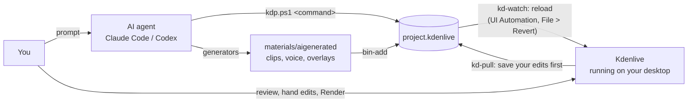

<div align="center">

# Movie Engine

**Tekoälyagentti editoi videotasi Kdenlivessä silmiesi edessä, ja voit ottaa ohjat milloin tahansa.**

Ohjelmointiin tarkoitetut tekoälyagentit (Claude Code, Codex) rakentavat ja muokkaavat oikeita Kdenlive-projekteja: elokuvia, selitysvideoita ja pystysuuntaisia lyhytvideoita. Muutokset näkyvät heti avoinna olevassa editorissasi. Siirrettävä, Windows, ei editorin paikkauksia.


[English](../../README.md) · [简体中文](README.zh-CN.md) · [繁體中文](README.zh-TW.md) · [हिन्दी](README.hi.md) · [Español](README.es.md) · [Français](README.fr.md) · [العربية](README.ar.md) · [বাংলা](README.bn.md) · [Português](README.pt.md) · [Русский](README.ru.md) · [اردو](README.ur.md) · [Bahasa Indonesia](README.id.md) · [Deutsch](README.de.md) · [日本語](README.ja.md) · [Türkçe](README.tr.md) · [한국어](README.ko.md) · [Українська](README.uk.md) · [Italiano](README.it.md) · [Polski](README.pl.md) · [Tiếng Việt](README.vi.md) · [فارسی](README.fa.md) · [ไทย](README.th.md) · [Kiswahili](README.sw.md) · [አማርኛ](README.am.md) · [Avañe'ẽ](README.gn.md) · [Setswana](README.tn.md) · [Shqip](README.sq.md) · [Беларуская](README.be.md) · [Български](README.bg.md) · [Bosanski](README.bs.md) · [Hrvatski](README.hr.md) · [Српски](README.sr.md) · [Crnogorski](README.cnr.md) · [Македонски](README.mk.md) · [Slovenščina](README.sl.md) · [Slovenčina](README.sk.md) · [Čeština](README.cs.md) · [Magyar](README.hu.md) · [Română](README.ro.md) · [Dansk](README.da.md) · [Norsk bokmål](README.nb.md) · [Norsk nynorsk](README.nn.md) · [Svenska](README.sv.md) · [Íslenska](README.is.md) · **Suomi** · [Eesti](README.et.md) · [Latviešu](README.lv.md) · [Lietuvių](README.lt.md) · [Nederlands](README.nl.md) · [Lëtzebuergesch](README.lb.md) · [Rumantsch](README.rm.md) · [Ελληνικά](README.el.md) · [Malti](README.mt.md) · [Gaeilge](README.ga.md) · [Català](README.ca.md) · [ქართული](README.ka.md) · [Հայերեն](README.hy.md) · [Azərbaycanca](README.az.md) · [Afrikaans](README.af.md) · [isiZulu](README.zu.md) · [isiXhosa](README.xh.md) · [Sesotho](README.st.md) · [Sepedi](README.nso.md) · [Xitsonga](README.ts.md) · [Tshivenḓa](README.ve.md) · [siSwati](README.ss.md) · [isiNdebele (South Africa)](README.nr.md) · [isiNdebele (Zimbabwe)](README.nd.md) · [chiShona](README.sn.md) · [Chichewa](README.ny.md) · [Ikinyarwanda](README.rw.md) · [Ikirundi](README.rn.md) · [Malagasy](README.mg.md) · [Soomaali](README.so.md) · [Afaan Oromoo](README.om.md) · [Qafar af](README.aa.md) · [ትግርኛ](README.ti.md) · [Sängö](README.sg.md) · [Kreol Seselwa](README.crs.md) · [TjiKalanga](README.kck.md) · [ChiNdau](README.ndc.md)

*Tämä on käännös. Englanninkielinen README on viiteversio.*

</div>

---

## Sisällys

- [Miksi](#miksi)
- [Miten se toimii](#miten-se-toimii)
- [Ominaisuudet](#ominaisuudet)
- [Vaatimukset](#vaatimukset)
- [Asennus](#asennus)
- [Pika-aloitus](#pika-aloitus)
- [Työskentely agentin kanssa](#työskentely-agentin-kanssa)
- [Editoinnin komentorivi (`kdp.ps1`)](#editoinnin-komentorivi-kdpps1)
- [Reaaliaikainen synkronointi avoimen editorin kanssa](#reaaliaikainen-synkronointi-avoimen-editorin-kanssa)
- [Generaattorit: mihin Kdenlive ei pysty](#generaattorit-mihin-kdenlive-ei-pysty)
- [Selostus ja ääni](#selostus-ja-ääni)
- [Käyttöliittymän kieli](#käyttöliittymän-kieli)
- [Kansiorakenne](#kansiorakenne)
- [Testit ja todisteet](#testit-ja-todisteet)
- [Rajoitukset](#rajoitukset)
- [Vianmääritys](#vianmääritys)
- [Usein kysytyt kysymykset](#usein-kysytyt-kysymykset)
- [Osallistuminen](#osallistuminen)
- [Kiitokset](#kiitokset)
- [Lisenssi](#lisenssi)

## Miksi

Videoeditorit on tehty käsille, jotka ovat hiirellä. Tekoälyagentit ovat hyviä rakenteessa, ajoituksessa ja toistossa: 300 leikkeen asettelussa musiikin tahtiin, jokaisen tekstityksen ajoittamisessa ääneen, kohtauksen uudelleentekemisessä palautteen jälkeen. Ne eivät kuitenkaan voi napsautella graafista käyttöliittymää ottamatta työpöytääsi haltuunsa.

Kdenlive on vahva avoimen lähdekoodin editori, mutta Windowsissa sillä **ei ole automaatiorajapintaa (API)**: D-Bus-ohjaus on olemassa vain Linux-versioissa, ja haarat (forkit), jotka lisäävät sellaisen, ovat joko hylättyjä tai turvattomia. Movie Engine ratkaisee tämän paikkaamatta editoria:

1. Agentti muokkaa `.kdenlive`-projektitiedostoa testatun komentorivin kautta (`engine/kdp.ps1`).
2. Käynnissä olevaa Kdenliveä käsketään lukemaan tiedosto uudelleen Windows UI Automationin avulla, ilman näppäinpainalluksia, ilman hiirtä ja viemättä kohdistusta.
3. Omat tallentamattomat muutoksesi tallennetaan ensin, eikä niiden päälle koskaan kirjoiteta.

Agentti siis editoi ja sinä tarkistat, tai sinä muokkaat käsin. Työskentelette molemmat samassa projektissa, samassa editorissa, samaan aikaan.

## Miten se toimii



Jokainen editointikomento noudattaa samaa turvallista kiertoa:

1. **Pull.** Jos Kdenlivessä on tallentamattomia muutoksia, sitä käsketään tallentamaan ne (työkalurivin Tallenna-painike UI Automationin kautta), ja tallennus vahvistetaan.
2. **Muokkaus.** Komento muuttaa XML:ää lukon alaisena, tiivistetarkistuksen jälkeen ja kumoamista varten otetun tilannevedoksen kanssa. Jos tiedosto muuttui sillä välin, mitään ei kirjoiteta.
3. **Uudelleenlataus.** Valvoja huomaa tekoälyn leiman ja suorittaa File > Revert -toiminnon avoimessa editorissa. Onnistuminen lasketaan vasta, kun aikajanapienoisohjelma on todella rakennettu uudelleen.
4. **Ristiriita.** Jos aloitit muokkaamisen sillä välin, mitään ei ladata uudelleen ja työsi säilyy. Tekoälyn versio pannaan talteen erikseen, ja agentti tekee muutoksensa uudelleen sinun muutostesi päälle.

## Ominaisuudet

- **Täysi projektin editointi ilman graafista käyttöliittymää**: noin 120 komentoa, jotka kattavat projektikorin (bin), aikajanan, tehosteet, koosteet, raidat, apuviivat, merkit, tekstitykset, sekvenssit, nopeuden ja ajan uudelleenkartoituksen, diaesitykset, otsikot, välityskopiot (proxy), renderöinnin sekä kumoa/tee uudelleen -toiminnot. Katso [komentoluettelo](#editoinnin-komentorivi-kdpps1).
- **Reaaliaikainen synkronointi avoimen editorin kanssa.** Tekoälyn muutokset näkyvät siinä Kdenlivessä, jota katsot; tallentamattomat muutoksesi tallennetaan ensin eivätkä ne koskaan katoa.
- **Ei koskaan häiritse työpöytääsi.** Ei kohdistuksen viemistä, näppäinpainalluksia eikä hiiren syötettä. Testieditorit toimivat näkymättömällä Windows-työpöydällä.
- **Siirrettävä.** Editori, asetukset, Node.js, fontit ja työkalut ovat yhdessä kansiossa. Kopioi se toiselle tietokoneelle, ja se toimii; mitään ei kirjoiteta Program Files -kansioon tai Windows-profiiliisi.
- **Generaattorit siihen, mihin Kdenlive ei pysty**: kirjain kirjaimelta animoitu kineettinen teksti, käsin piirretyt merkinnät, käyttöliittymien 3D-kohtaukset, kohdistinanimaatiot ja pitkät interaktiiviset selitysvideot. Ne renderöidään näytönohjaimella aidolla liike-epäterävyydellä ja asetetaan aikajanalle tavallisina leikkeinä.
- **Selostus sanojen ajoituksineen** (Microsoft Edge TTS, ei API-avainta). Tekstitykset ja toiminnot laukeavat täsmälleen oikeasta sanasta.
- **Syntetisoidut ääniefektit** (whoosh, click, pop, riser, impact ja muita), tuotettu koodilla.
- **Todistettu, ei oletettu.** Jokaisella komennolla on tuloksen tarkistus, tehosteet ja koosteet käydään läpi yksi kerrallaan, ja raakatulokset ovat kansiossa `docs/proof/`.
- **Agenttien ohjeet mukana.** `AGENTS.md` ja kansion `.claude/skills/` taidot (skills) opettavat Claude Codelle ja Codexille työnkulun, tiedostomuodon ja sudenkuopat.

## Vaatimukset

| | |
|---|---|
| Käyttöjärjestelmä | Windows 10 tai 11, x64 |
| Editori | Kdenlive **26.08.3**, siirrettävä versio (standalone). Muita versioita ei ole testattu. |
| Node.js | 18 tai uudempi: Windows x64 -`.zip` osoitteesta nodejs.org, purettuna kansioon `engine/node/` |
| Selain | Microsoft Edge (osa Windowsia); kohtausrenderöijät käyttävät sitä ilman ikkunaa (headless) |
| Agentti | [Claude Code](https://claude.com/claude-code) tai Codex. Valinnainen: jokaisen työkalun voi ajaa myös käsin. |
| Levytila | noin 1 Gt editorille ja työkaluille sekä mediatiedostosi |
| Näytönohjain | mikä tahansa näytönohjain, jossa on laitteistopohjainen H.264-koodaus, nopeuttaa `film-render.mjs`-työkalua (muuten käytetään ohjelmistokoodausta) |

## Asennus

Kaikki asennetaan **kansion sisään**. Mikään ei vaadi järjestelmänvalvojan oikeuksia.

```powershell
git clone https://github.com/vladtarrow/movie-engine.git
cd movie-engine
```

**1. Node.js.** Lataa Node.js 18:n tai uudemman Windows x64 -`.zip` osoitteesta <https://nodejs.org/en/download> ja pura sen sisältö kansioon `engine\node\` niin, että `engine\node\node.exe` ja `engine\node\npm.cmd` ovat siellä. Asennusohjelmaa tai järjestelmän Nodea ei tarvita. Kaikki skriptit ajetaan `engine\node.cmd`:n kautta, ei koskaan järjestelmän Noden kautta.

**2. Node-paketit** äänityökalulle ja renderöijille (versiot on lukittu tiedostossa `engine/voice/package.json`):

```powershell
engine\node\npm.cmd install --prefix engine\voice
```

**3. Siirrettävä Kdenlive 26.08.3.** Lataa `kdenlive-26.08.3_standalone.exe` osoitteesta <https://download.kde.org/stable/kdenlive/26.08/windows/> kansioon `engine\installer\`, tarkista se ja pura se:

```powershell
(Get-FileHash engine\installer\kdenlive-26.08.3_standalone.exe -Algorithm SHA256).Hash
# expected: A25427B1DFF2C17E3B0386E991BB1A719382BB3176D1A90E441CDAEB6E0A967D
engine\installer\kdenlive-26.08.3_standalone.exe -o"engine\Kdenlive" -y
```

Editori päätyy kansioon `engine\Kdenlive\kdenlive-26.08.3_standalone\bin\`. Siinä ovat jo mukana `melt.exe` ja `ffmpeg.exe`.

**4. Ensimmäinen käynnistys.**

```powershell
engine\kdenlive.cmd
```

Kdenlive säilyttää kaikki asetuksensa kansiossa `engine\profile-kdenlive\`, ei Windows-profiilissasi. Ensimmäisellä käynnistyskerralla se näyttää kertaluonteisen ohjatun määrityksen.

## Pika-aloitus

### Agentin kanssa

Avaa kansio Claude Codessa (tai Codexissa) ja pyydä tavallisin sanoin:

> Tee uusi pystysuuntainen 30 fps:n projekti "launch-teaser". Laita kolme kuvakaappausta kansiosta `materials/designers/launch/` aikajanalle, kukin 2,5 s lyhyellä ristihäivytyksellä, lisää selostus tiedostosta `script.txt` ja ajoita kineettinen teksti jokaiseen repliikkiin.

> Avaa se minulle Kdenlivessä.

> Toinen otos on liian pitkä. Lyhennä se 1,8 sekuntiin ja siirrä logoa vähän ylemmäs.

Agentti noudattaa tiedostoa `AGENTS.md`: se muokkaa `kdp.ps1`:n kautta, renderöi vain ne leikkeet, joita leikkaus tarvitsee, ja pitää avoimen editorin ajan tasalla. Sinä tarkistat Kdenlivessä, muokkaat käsin milloin haluat ja painat Render, kun olet tyytyväinen.

### Käsin

```powershell
# a new 1080x1920 30 fps project with 2 video and 2 audio tracks
powershell -NoProfile -ExecutionPolicy Bypass -File engine\kdp.ps1 new -Project projects\hello\hello.kdenlive -Profile vertical_hd_30

# a 3-second title and a colour background
powershell -NoProfile -ExecutionPolicy Bypass -File engine\kdp.ps1 bin-color -Project projects\hello\hello.kdenlive -Color '#203060' -Seconds 3 -Name bg
powershell -NoProfile -ExecutionPolicy Bypass -File engine\kdp.ps1 title -Project projects\hello\hello.kdenlive -Text "Hello" -Seconds 3 -Name hi

# place them: background on V1, title above it on V2
powershell -NoProfile -ExecutionPolicy Bypass -File engine\kdp.ps1 add -Project projects\hello\hello.kdenlive -Bin bg -Track V1 -At 0
powershell -NoProfile -ExecutionPolicy Bypass -File engine\kdp.ps1 add -Project projects\hello\hello.kdenlive -Bin hi -Track V2 -At 0

# a check frame, then open it in the editor
powershell -NoProfile -ExecutionPolicy Bypass -File engine\kdp.ps1 frame -Project projects\hello\hello.kdenlive -At 1.5 -Out out\hello\check.png
engine\kdenlive.cmd projects\hello\hello.kdenlive
```

Kun haluat myöhemmin avata viimeisimmän projektin uudelleen, kaksoisnapsauta `open-last-project.cmd`.

## Työskentely agentin kanssa

Agentti lukee tiedoston `AGENTS.md` (Codex) tai `CLAUDE.md`, joka tuo sen mukaan (Claude Code), sekä kaksi taitoa:

| Taito | Opettaa |
|---|---|
| `.claude/skills/kdenlive-project-file` | `.kdenlive` / MLT XML -muodon, `kdp.ps1`:n, tarkistuksen `melt`-työkalulla |
| `.claude/skills/kdenlive-live` | käynnissä olevan editorin turvallisen ohjaamisen: käynnistys, pull, uudelleenlataus, kuvakaappaus sen ikkunasta |

Säännöt, joita agentti noudattaa ja joihin voit luottaa:

- Se ei koskaan ota hiirtäsi, näppäimistöäsi tai kohdistusta eikä koskaan ota kuvakaappauksia työpöydästäsi (vain editorin omasta ikkunasta).
- Se tekee käyttöliittymävaiheet itse (tallenna, avaa, lataa uudelleen) sen sijaan, että pyytäisi sinua napsauttamaan.
- Se kysyy ennen kuin lataa mitään ja ennen kuin poistaa mitään.
- Se renderöi vain sen, mitä työ vaatii (kohtausleikkeet, tarkistuskuvat). Valmiin elokuvan se renderöi vain, kun pyydät.
- Kun Kdenlive ei pysty johonkin kunnolla, agentti rakentaa sen ulkopuolella koodilla ja lisää tuloksen leikkeenä. Se ei laimenna tehostetta.

## Editoinnin komentorivi (`kdp.ps1`)

```powershell
powershell -NoProfile -ExecutionPolicy Bypass -File engine\kdp.ps1 <command> -Project <file.kdenlive> [options]
```

Ajat annetaan sekunteina pisteellä (`2.5`). Raidat ovat `V1 V2 …` (V1 alimpana) ja `A1 A2 …`. Leike osoitetaan parametrilla `-Track` sekä millä tahansa sen sisällä olevalla ajalla `-At`. Tehosteiden parametrit annetaan muodossa `-Params "name=value||name=value"`. Täydellinen luettelo kaikkine valitsimineen on tiedoston `engine/kdp.ps1` alussa.

| Ryhmä | Komennot |
|---|---|
| Projekti | `new`, `profiles`, `info`, `validate`, `fonts`, `profile-set`, `profile-from-clip`, `zone`, `archive`, `backups`, `rebase`, `otio-export`, `otio-import` |
| Projektikori (bin) | `bin-add`, `bin-color`, `title`, `title-text`, `title-save`, `title-template`, `bin-rename`, `bin-remove`, `bin-info`, `bin-set`, `bin-duplicate`, `bin-replace-file`, `bin-reload`, `folder`, `bin-folder`, `relink`, `clean`, `generator`, `playlist-clip`, `extract-audio`, `transcode` |
| Aikajana | `add`, `add-av`, `move`, `copy`, `trim`, `ripple-trim`, `slip`, `split`, `remove`, `speed`, `remap`, `disable`, `enable`, `group`, `ungroup`, `mix`, `unmix`, `space-insert`, `space-remove`, `spaces-remove-all`, `track-clear`, `replace-in-timeline` |
| Tehosteet | `effects`, `effect-info`, `effect-add`, `effect-list`, `effect-set`, `effect-remove`, `effect-copy`, `effect-clear`, `effects-all`, `bin-effect`, `effect-templates`, `effect-template` |
| Koosteet | `compositions`, `comp-info`, `comp-add`, `comp-list`, `comp-set`, `comp-remove` |
| Raidat | `track-add`, `track-remove`, `track-set` |
| Apuviivat ja merkit | `guide-add`, `guide-list`, `guide-remove`, `guide-set`, `guide-clear`, `guide-export`, `guide-category`, `marker`, `marker-list`, `marker-set`, `marker-remove` |
| Tekstitykset | `sub-add`, `sub-import`, `sub-export`, `sub-state` |
| Sekvenssit | `sequence-add`, `sequences`, `copy-to-sequence`, `expand`; mikä tahansa komento valitsimella `-Sequence <name>` toimii kyseisen sekvenssin sisällä |
| Erityiset | `slideshow`, Lottie- / Glaxnimate-animaatiot `bin-add`-komennolla, `proxy`, `stabilize`, `scene-split`, `speed-job`, `subclip` |
| Tuloste | `frame` (yksi PNG), `preview` (nopea renderöinti meltillä), `render` (Kdenliven oma renderöijä tai esiasetus), `presets` |
| Historia | `undo`, `redo`, `clear-history` (tilannevedokset kansiossa `projects/<name>/.kdp-history`) |

Hyvä tietää toiminnasta:

- Linkitetyt ääni- ja videopuoliskot siirtyvät, trimmautuvat, jakautuvat ja poistuvat yhdessä (`-Alone` vain toiselle puoliskolle).
- Epäonnistuva komento päättyy koodilla 1 eikä kirjoita mitään.
- Tehosteet, joita Windows-versio ei pysty ajamaan, hylätään eikä niitä ohiteta hiljaa (luettelo: `docs/proof/assets.txt`).
- Jokainen Kdenliven valikkotoiminto on liitetty komentoon, toiseen reittiin tai merkintään "vain näkymä" tiedostossa `engine/tools/data/kdenlive-actions.csv`. Katso `docs/kdenlive-coverage.md`.

## Reaaliaikainen synkronointi avoimen editorin kanssa

| Skripti | Mitä se tekee | Paluukoodit |
|---|---|---|
| `engine\kd-pull.ps1 -Project <f>` | saa Kdenliven tallentamaan muutoksesi ja vahvistaa sen | 0 tiedosto ajan tasalla, 3 ei käynnissä, 4 ei vahvistettu |
| `engine\kd-reload.ps1 -Project <f>` | File > Revert, vahvistettuna uudelleen rakennetulla aikajanalla | 0 vahvistettu, 2 sinulla on tallentamattomia muutoksia (mitään ei hylätty), 3 ei käynnissä, 4 epäonnistui |
| `engine\kd-watch.ps1 -Project <f>` | taustavalvoja: lataa uudelleen jokaisen tekoälyn kirjoituksen jälkeen, kirjaa ristiriidat lokiin | loki tiedostossa `engine\kd-watch.log`; pysäytä poistamalla `engine\kd-watch.run` |
| `engine\kdenlive-bg.ps1 [project]` | käynnistää Kdenliven pienennettynä agentille | 0 ladattu, 4 ei vahvistettu |
| `engine\kdenlive.cmd [project]` | käynnistää Kdenliven sinulle | |

Käynnistä valvoja kerran istuntoa kohden:

```powershell
Start-Process powershell -WindowStyle Hidden -ArgumentList '-NoProfile','-ExecutionPolicy','Bypass','-File','engine\kd-watch.ps1','-Project','projects\hello\hello.kdenlive'
```

Suuret projektit: 1000 leikkeen projektin uudelleenlataus kestää minuutteja, ja työkalut odottavat sitä sen sijaan, että raportoisivat liian aikaisin. Projektit avataan valikosta *File > Open Recent* tyhjässä editorissa, koska tiedoston suora avaaminen saa Qt:n käymään läpi jokaisen aikajanan kohteen saavutettavuutta varten, ja se oli noin 10 minuuttia hitaampaa.

## Generaattorit: mihin Kdenlive ei pysty

Kdenlive/MLT:ssä ei ole kirjain kirjaimelta etenevää tekstianimaatiota, ei lausekkeita (expressions) ja vain vähän 3D:tä, ja raskaat tehosteet hidastavat toistoa. Movie Engine renderöi tällaiset osat ulkopuolella ja asettaa ne aikajanalle tavallisina leikkeinä, yleensä alfakanavalla, kuvien yläpuolella olevalle raidalle. Generaattoriskripti ja sen syötteet pysyvät projektikansiossa, joten leikkeen voi tuottaa uudelleen, kun teksti, fontti tai ajoitus muuttuu.

| Työkalu | Tuottaa |
|---|---|
| `engine/tools/kinetic-text.ps1` | kirjain kirjaimelta animoidut kineettiset tekstit, jokainen sana ajoitettu `voice.json`-tiedostosta, korostuslaatikko |
| `engine/tools/annotate.ps1` | käsin piirretyt ympyrät, laatikot, alleviivaukset ja nuolet, jotka piirtyvät esiin kuvakaappauksen päälle |
| `engine/tools/card-entrance.ps1` | kuvakaappauskortti, joka nousee ja skaalautuu esiin pehmeän varjon kanssa |
| `engine/tools/pdf-to-png.ps1` | diat PDF-viennistä |
| `engine/tools/html-render.mjs` | minkä tahansa HTML/CSS/canvas-kohtauksen videoksi: käyttöliittymäanimaatiot, kohdistimet, 3D, maskit |
| `engine/tools/film-render.mjs` + `film/` | pitkät, interaktiiviset selitysvideot canvasilla: yksi leike selostusrepliikkiä kohden, toiminnot laukeavat puhutuista sanoista, liike-epäterävyys näytönohjaimella noin 45 fps:n nopeudella |

Molemmat renderöijät ohjaavat Windowsin mukana tulevaa Microsoft Edgeä ilman ikkunaa (headless), kertakäyttöisellä profiililla ja ilman verkkoyhteyttä.

### Demot

```powershell
# a 3-second 3D title card with a cursor click
engine\node.cmd engine\tools\html-render.mjs examples\demo\scene\scene.html examples\demo\out --frames 0,30,60,89
engine\node.cmd engine\tools\html-render.mjs examples\demo\scene\scene.html examples\demo\out\scene.mp4

# a 4-shot interactive film timed to two voice lines
engine\node.cmd engine\tools\film-render.mjs examples\demo\film\film.html examples\demo\out --check
engine\node.cmd engine\tools\film-render.mjs examples\demo\film\film.html examples\demo\out --shots all --width 640
engine\node.cmd engine\tools\film-render.mjs examples\demo\film\film.html examples\demo\out\clips --suffix -v01
```

Elokuva koostuu kolmesta pienestä tiedostosta. `data.js` sisältää otokset ja sanojen ajat. `direction.js` sisältää yhden rivin otosta kohden:

```text
1 | hover 192 108 @brand | tag 300 60 Your brand @deserves | confetti 192 90 @film
2 say=A film that/*explains* it
3 | click 116 108 @before | click 268 108 @after | chips Before~After @after
4 scene=counter | count 0 120 % @count
```

`scenes.js` sisältää otokset, jotka piirretään alusta asti. `@word` laukaisee toiminnon, kun ääni sanoo kyseisen sanan. Toimintoja ovat muun muassa click, hover, drag, zoom, lens, ring, arrow, chips, toggle, slider, toast, type, count ja confetti; koko syntaksi on tiedoston `engine/tools/film/film-kit.js` alussa.

## Selostus ja ääni

```powershell
engine\node.cmd engine\voice\voice.mjs lines.json materials\aigenerated\hello\voice en-US-AndrewMultilingualNeural +0%
```

`lines.json` on luettelo repliikeistä. Työkalu kirjoittaa yhden mp3-tiedoston repliikkiä kohden sekä tiedoston `voice.json`, jossa on kesto sekä jokaisen sanan alku ja loppu. Repliikit tallennetaan välimuistiin, joten yhden repliikin muuttaminen tuottaa uudelleen vain sen. Työkalu käyttää Microsoft Edgen verkossa toimivaa tekstistä puheeksi -palvelua `msedge-tts`-paketin kautta: avainta ei tarvita, mutta palvelu on epävirallinen ja vaatii internetyhteyden.

```powershell
engine\node.cmd engine\audio\sfx.mjs materials\aigenerated\sfx
```

Tämä syntetisoi koodilla äänet whoosh, whoosh-long, swipe, click, pop, tick, riser, impact, ding ja reveal; valmis sarja on kansiossa `materials/aigenerated/sfx/`. Täydennä yhtä kuvaa lyhyemmät äänet hiljaisuudella ennen niiden asettamista (`-af apad=whole_dur=0.0667`).

## Käyttöliittymän kieli

Käynnistimet käynnistävät Kdenliven oletuksena **englanniksi**. Jos haluat käyttää toista kieltä, aseta `MOVIE_ENGINE_UI_LANG` ennen käynnistystä:

```powershell
$env:MOVIE_ENGINE_UI_LANG = 'ru'; engine\kdenlive.cmd
```

UI Automation löytää valikon kohteet niiden näkyvien nimien perusteella. Nimet 31 käyttöliittymäkielelle ovat valmiina (`engine/tools/kd-ui.ps1`, `$KdNames`). Muille kielille lisää niiden nimet sinne ja tarkista komennolla:

```powershell
powershell -NoProfile -ExecutionPolicy Bypass -File engine\tools\kd-langcheck.ps1
```

## Kansiorakenne

```text
movie-engine/
├─ AGENTS.md, CLAUDE.md          instructions for AI agents
├─ .claude/skills/               agent skills: project file format, live editor
├─ engine/
│  ├─ kdp.ps1                    the editing command line
│  ├─ kd-pull / kd-reload / kd-watch .ps1, kdenlive.cmd, kdenlive-bg.ps1
│  ├─ tools/                     internals, generators, tests, data (action map)
│  ├─ voice/  audio/  fonts/     TTS, synthesized SFX, Poppins (OFL)
│  ├─ Kdenlive/  node/           portable editor and Node.js (not in git)
│  └─ profile-kdenlive/          the editor's settings (not in git)
├─ projects/<name>/<name>.kdenlive
├─ materials/
│  ├─ download/                  stock and downloaded files (not in git)
│  ├─ aigenerated/               everything the AI made (sfx/ and test-kit/ ship with the engine)
│  ├─ designers/  brand/         files from your team, brand assets
├─ examples/demo/                demos of the scene and film renderers
├─ out/                          renders (not in git)
└─ docs/                         proofs, coverage, translations of this README
```

Projektien sisäiset mediapolut ovat suhteellisia. Jos siirrät tai kopioit kansion, `kdp.ps1 rebase` (jonka myös `kdenlive.cmd` ajaa automaattisesti) kirjoittaa uuden sijainnin projektiin.

## Testit ja todisteet

Väitteet siitä, mikä toimii, perustuvat tulosten tarkistuksiin eivätkä siihen, että "funktio ajettiin". Yhteenveto on tiedostossa [`docs/kdenlive-proof.md`](../../docs/kdenlive-proof.md), ja raakatulosteet ovat kansiossa `docs/proof/`.

| Testi | Tarkistaa |
|---|---|
| `engine\tools\kdp-clitest.ps1` | jokaisen `kdp.ps1`-komennon komentorivin kautta vertaamalla syntyvää projektia |
| `engine\tools\kd-livetest.ps1` | pullin, uudelleenlatauksen, valvojan, ristiriidat ja kilpatilanteet oikeaa Kdenliveä vasten näkymättömällä työpöydällä |
| `engine\tools\kdp-assetsweep.ps1` | jokaisen tehosteen ja koosteen: renderöi ja vertaa kuvia |
| `engine\tools\kdp-portabletest.ps1` | kopioi kansion muualle ja toimii kopiosta |
| `engine\tools\kd-langcheck.ps1` | käyttöliittymän kielen ja sen, että UI Automation löytää valikon |
| `engine\tools\kdp-coverage-check.ps1` | että jokainen valikkotoiminto on liitetty eikä mikään todiste ole koodia vanhempi |

```powershell
powershell -NoProfile -ExecutionPolicy Bypass -File engine\tools\kdp-clitest.ps1 -Report docs\proof\clitest.txt
powershell -NoProfile -ExecutionPolicy Bypass -File engine\tools\kd-livetest.ps1 -Report docs\proof\live-en.txt
```

Testieditorit toimivat vain piilotetulla työpöydällä omalla profiilillaan, joten testit eivät koskaan koske avoimeen Kdenliveesi tai kohdistukseesi.

## Rajoitukset

- **Vain Windows**, vain Kdenlive **26.08.3**. Linuxissa on D-Bus, ja se tarvitsisi toisenlaisen sillan.
- Editorin käynnistys vie näppäimistön kohdistuksen noin 3 sekunniksi, kun tyhjä ikkuna ilmestyy. Agentit kysyvät ennen kuin käynnistävät sen, kun teet töitä. Uudelleenlataukset ja muokkaukset eivät vie kohdistusta.
- Windows-versiosta puuttuvat MLT-moduulit sox, ladspa ja movit sekä osa frei0r/avfilter-tehosteista; `kdp.ps1` hylkää ne (`docs/proof/assets.txt`).
- OpenTimelineIO-vienti ja -tuonti siirtävät vain leikkeet ja välit. Monikamerassa ei ole reaaliaikaista kulmanvaihtoa (leikkaukset tehdään split/remove/hide-komennoilla).
- "Save As…" UI Automationin kautta pienennetyssä ikkunassa ei avaa valintaikkunaa; agentti käyttää sen sijaan `archive`-komentoa tai tiedostokopioita.
- Puheentunnistus (automaattiset tekstitykset) vaatii Whisperin tai Voskin, jotka eivät ole mukana.
- Kdenliven otsikkotyökalulla tehdyt otsikot käyttävät Windowsiin asennettuja fontteja. Taatun typografian saat renderöimällä tekstin generaattoreilla, jotka lataavat fontit kansiosta `engine/fonts/`.
- Edge TTS on epävirallinen verkkopalvelu, ja se voi muuttua tai lakata toimimasta.

## Vianmääritys

| Oire | Syy ja korjaus |
|---|---|
| Kdenlive on käynnissä, mutta sen napsauttaminen tehtäväpalkissa ei näytä mitään | Sen tallennettu ikkunan sijainti on näytön ulkopuolella. Sulje se ja poista `kdockLayout`-merkinnät tiedostosta `engine\profile-kdenlive\AppData\Local\kdenliverc`, tai siirrä ikkuna `SetWindowPos`-kutsulla (katso `AGENTS.md`). |
| `kd-reload.ps1` päättyy koodilla 2 | Sinulla on tallentamattomia muutoksia. Mitään ei hylätty. Aja `kd-pull.ps1` ja tee muutos sitten uudelleen (`kdp.ps1` tekee tämän itse). |
| `CONFLICT` tiedostossa `engine\kd-watch.log` | Sinä ja agentti muokkasitte samalla hetkellä. Sinun versiosi jää editoriin, ja tekoälyn versio on kansiossa `projects\<name>\.kdp-history\<name>\conflict\`. Pyydä agenttia tekemään muutoksensa uudelleen. |
| Komento päättyy koodilla 1 ja ilmoituksella "pull not confirmed" | Kdenlive on varattu tai näyttää valintaikkunaa. Sulje valintaikkuna tai odota latauksen päättymistä ja yritä sitten uudelleen. |
| PowerShell-skriptin jäsentäminen epäonnistuu | Skriptit, joissa on muuta kuin ASCII-tekstiä, on tallennettava muodossa UTF-8 **BOM:n kanssa** Windows PowerShell 5.1:tä varten. |
| `voice.mjs` pysähtyy ilmoitukseen "Stream closed before the synthesis completed" | Yleensä verkko-ongelma tai vanhemmissa kopioissa koodaamaton (escape) SSML. `voice.mjs` koodaa merkit `& < >` itse. |
| Suuren projektin avaaminen kestää monta minuuttia | Avaa se `kdenlive.cmd`:n / `kdenlive-bg.ps1`:n kautta, ei koskaan muodossa `kdenlive.exe project.kdenlive`. |

## Usein kysytyt kysymykset

**Tarvitsenko Claude Coden tai Codexin?**
En. Jokainen työkalu on tavallinen skripti, jonka voit ajaa käsin. Agentti tekee työstä nopeaa: se suunnittelee leikkauksen, ajaa työkalut ja pitää editorin ajan tasalla.

**Kirjoittaako agentti käsin tekemieni muutosten päälle?**
Ei. Ennen jokaista kirjoitusta tallentamattomat muutoksesi tallennetaan ja vahvistetaan. Jos muokkaat, kun agentti kirjoittaa, kirjoitus hylätään tai pannaan talteen ristiriitana, mutta sitä ei koskaan tehdä työsi päälle.

**Voinko jatkaa Kdenliven käyttöä tavalliseen tapaan?**
Kyllä. Se on vakio-Kdenlive omalla asetuskansiollaan. Editoi, esikatsele ja renderöi tavalliseen tapaan.

**Toimiiko se jo asentamani Kdenliven kanssa?**
Se käyttää omaa siirrettävää kopiotaan kansiossa `engine\Kdenlive\`, joten asentamaasi Kdenliveen ja sen asetuksiin ei kosketa.

**Miksi ei Kdenlive-haaraa, jossa on API, tai jotain toista editoria?**
Windowsille ei ole ylläpidettyä ja turvallista haaraa (selvitys 2026-11). OpenShot, Blender VSE, DaVinci Resolve, Shotcut ja verkkoeditorit arvioitiin; Kdenlive tarjosi syvimmät editointiominaisuudet. Pääprojektin REST API -ehdotusta (merge request !902) seurataan.

**Voiko se renderöidä valmiin videon?**
Kyllä, komennolla `kdp.ps1 render` (Kdenliven oma renderöijä, piilotettuna), tai voit painaa Render editorissa itse.

**Ladataanko mediatiedostojani minnekään?**
Ei. Vain selostuksen teksti lähetetään Edge TTS -palveluun, kun tuotat ääntä. Kohtausrenderöijät toimivat verkkoyhteys poistettuna käytöstä.

## Osallistuminen

Osallistuminen on tervetullutta. Katso [CONTRIBUTING.md](../../CONTRIBUTING.md). Lyhyesti:

- Jokainen uusi tai muutettu `kdp.ps1`-toiminto tarvitsee tuloksen tarkistuksen tiedostoon `kdp-clitest.ps1`, merkinnän toimintokarttaan ja uuden ajon `kdp-coverage-check.ps1`:llä.
- Älä koskaan käynnistä testi-Kdenliveä näkyvälle työpöydälle; käytä `engine/tools/kd-hidden.ps1`-skriptiä.
- Pidä kaikki siirrettävänä: ei asennuksia kansion ulkopuolelle, ei absoluuttisia polkuja projekteissa.
- Kirjaa todennetut erikoisuudet tiedostoon `AGENTS.md` tai vastaavaan taitoon.

## Kiitokset

- [Kdenlive](https://kdenlive.org) ja [MLT](https://www.mltframework.org): editori ja sen alla toimiva moottori.
- [FFmpeg](https://ffmpeg.org), Kdenliven mukana.
- [msedge-tts](https://www.npmjs.com/package/msedge-tts) selostusta varten.
- [Poppins](https://fonts.google.com/specimen/Poppins), tekijä Indian Type Foundry, SIL Open Font License (`engine/fonts/OFL.txt`).
- `engine/tools/data/kdenliveui-26.08.3.rc`: Kdenliven valikkotiedosto, otettu Kdenlive 26.08.3:n lähdekoodista; vain kattavuustarkistuksen käytössä. Se pysyy Kdenliven GPL-lisenssin alaisena, ei MIT License -lisenssin.

## Lisenssi

Movie Enginen oma koodi on julkaistu [MIT-lisenssillä](../../LICENSE). Kdenlive, MLT, FFmpeg, Node.js-paketit ja Poppins-fontti säilyttävät omat lisenssinsä.
