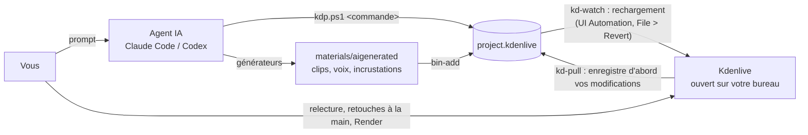

<div align="center">

# movie-engine

**Un agent IA monte votre vidéo dans Kdenlive sous vos yeux, et vous pouvez reprendre la main à tout moment.**

Des agents de programmation IA (Claude Code, Codex) créent et modifient de vrais projets Kdenlive : films, vidéos explicatives et shorts verticaux. Les modifications apparaissent en direct dans l'éditeur que vous avez ouvert. Portable, sous Windows, sans aucun patch de l'éditeur.


[English](../../README.md) · [简体中文](README.zh-CN.md) · [हिन्दी](README.hi.md) · [Español](README.es.md) · **Français** · [العربية](README.ar.md) · [বাংলা](README.bn.md) · [Português](README.pt.md) · [Русский](README.ru.md) · [اردو](README.ur.md) · [Bahasa Indonesia](README.id.md) · [Deutsch](README.de.md) · [日本語](README.ja.md) · [Türkçe](README.tr.md) · [한국어](README.ko.md)

*Ceci est une traduction ; le README en anglais fait référence.*

</div>

---

## Sommaire

- [Pourquoi](#pourquoi)
- [Fonctionnement](#fonctionnement)
- [Fonctionnalités](#fonctionnalités)
- [Prérequis](#prérequis)
- [Installation](#installation)
- [Démarrage rapide](#démarrage-rapide)
- [Travailler avec l'agent](#travailler-avec-lagent)
- [La ligne de commande de montage (`kdp.ps1`)](#la-ligne-de-commande-de-montage-kdpps1)
- [Synchronisation en direct avec l'éditeur ouvert](#synchronisation-en-direct-avec-léditeur-ouvert)
- [Générateurs pour ce que Kdenlive ne sait pas faire](#générateurs-pour-ce-que-kdenlive-ne-sait-pas-faire)
- [Voix off et son](#voix-off-et-son)
- [Langue de l'interface](#langue-de-linterface)
- [Arborescence des dossiers](#arborescence-des-dossiers)
- [Tests et preuves](#tests-et-preuves)
- [Limitations](#limitations)
- [Dépannage](#dépannage)
- [FAQ](#faq)
- [Contribuer](#contribuer)
- [Remerciements](#remerciements)
- [Licence](#licence)

## Pourquoi

Les logiciels de montage sont conçus pour une main posée sur la souris. Les agents IA, eux, excellent dans la structure, le timing et la répétition : placer 300 clips sur le rythme, caler chaque sous-titre sur la voix, refaire une scène après un retour. Mais ils ne peuvent pas cliquer dans une interface graphique sans s'emparer de votre bureau.

Kdenlive est un excellent éditeur open source, mais sous Windows il n'a **aucune API d'automatisation** : le contrôle par D-Bus n'existe que dans les builds Linux, et les forks qui en ajoutent une sont soit abandonnés, soit peu sûrs. movie-engine résout ce problème sans modifier l'éditeur :

1. L'agent modifie le fichier de projet `.kdenlive` via une ligne de commande testée (`engine/kdp.ps1`).
2. Le Kdenlive en cours d'exécution reçoit l'ordre de recharger le fichier via Windows UI Automation, sans frappe clavier, sans souris et sans voler le focus.
3. Vos propres modifications non enregistrées sont enregistrées d'abord et ne sont jamais écrasées.

Ainsi, l'agent monte et vous relisez, ou bien vous montez à la main. Vous travaillez tous les deux sur le même projet, dans le même éditeur, en même temps.

## Fonctionnement



Chaque commande de montage suit le même cycle sûr :

1. **Pull.** Si Kdenlive a des modifications non enregistrées, il reçoit l'ordre de les enregistrer (bouton Enregistrer de la barre d'outils via UI Automation), et l'enregistrement est confirmé.
2. **Modification.** La commande modifie le XML sous verrou, après une vérification de hash et avec un instantané d'annulation. Si le fichier a changé entre-temps, rien n'est écrit.
3. **Rechargement.** Le watcher repère la marque de l'IA et exécute File > Revert dans l'éditeur ouvert. L'opération n'est considérée comme réussie que lorsque le widget de la timeline a réellement été reconstruit.
4. **Conflit.** Si vous avez commencé à modifier entre-temps, rien n'est rechargé et votre travail est conservé. La version de l'IA est mise de côté, et l'agent réapplique sa modification par-dessus la vôtre.

## Fonctionnalités

- **Montage complet du projet sans l'interface graphique** : environ 120 commandes couvrant le chutier, la timeline, les effets, les compositions, les pistes, les guides, les marqueurs, les sous-titres, les séquences, la vitesse et le remappage temporel, les diaporamas, les titres, les proxys, le rendu et l'annulation/le rétablissement. Voir la [référence des commandes](#la-ligne-de-commande-de-montage-kdpps1).
- **Synchronisation en direct avec l'éditeur ouvert.** Les modifications de l'IA apparaissent dans le Kdenlive que vous avez sous les yeux ; vos modifications non enregistrées sont enregistrées d'abord et ne sont jamais perdues.
- **Ne dérange jamais votre bureau.** Aucun vol de focus, aucune frappe clavier ni action de souris. Les éditeurs de test tournent sur un bureau Windows invisible.
- **Portable.** L'éditeur, ses réglages, Node.js, les polices et les outils tiennent dans un seul dossier. Copiez-le sur un autre PC et tout fonctionne ; rien n'est écrit dans Program Files ni dans votre profil Windows.
- **Des générateurs pour ce que Kdenlive ne sait pas faire** : texte cinétique lettre par lettre, annotations dessinées à la main, scènes d'interface en 3D, animations de curseur et longs films explicatifs interactifs. Ils sont rendus sur le GPU avec un vrai flou de mouvement et placés sur la timeline comme des clips ordinaires.
- **Voix off avec minutage par mot** (Microsoft Edge TTS, sans clé d'API). Sous-titres et actions se déclenchent exactement sur le bon mot.
- **Effets sonores synthétisés** (whoosh, clic, pop, riser, impact et plus encore), générés par du code.
- **Prouvé, pas supposé.** Chaque commande est accompagnée d'une vérification du résultat, les effets et les compositions sont testés un par un, et les résultats bruts se trouvent dans `docs/proof/`.
- **Instructions pour les agents incluses.** `AGENTS.md` et les skills de `.claude/skills/` apprennent à Claude Code et à Codex le workflow, le format de fichier et les pièges à éviter.

## Prérequis

| | |
|---|---|
| Système | Windows 10 ou 11, x64 |
| Éditeur | Build portable (standalone) de Kdenlive **26.08.3**. Les autres versions n'ont pas été testées. |
| Node.js | 18 ou plus récent, sous forme d'un simple `node.exe` copié dans `engine/node/` |
| Navigateur | Microsoft Edge (fourni avec Windows) ; utilisé en mode headless par les moteurs de rendu de scènes |
| Agent | [Claude Code](https://claude.com/claude-code) ou Codex. Facultatif : chaque outil peut aussi être lancé à la main. |
| Disque | environ 1 Go pour l'éditeur et les outils, plus vos médias |
| GPU | tout GPU doté de l'encodage H.264 matériel accélère `film-render.mjs` (sinon, il se rabat sur l'encodage logiciel) |

## Installation

Tout s'installe **à l'intérieur du dossier**. Aucun droit administrateur n'est nécessaire.

```powershell
git clone <repository-url> movie-engine
cd movie-engine
```

**1. Node.js.** Copiez `node.exe` (18 ou plus récent) dans `engine\node\`. L'installeur n'est pas nécessaire : l'exe seul suffit. Tous les scripts passent par `engine\node.cmd`, jamais par un Node installé sur le système.

**2. Paquets Node** pour l'outil de voix et les moteurs de rendu (les versions sont figées dans `engine/voice/package.json`) :

```powershell
npm install --prefix engine/voice
```

**3. Kdenlive 26.08.3 portable.** Téléchargez `kdenlive-26.08.3_standalone.exe` depuis <https://download.kde.org/stable/kdenlive/26.08/windows/> dans `engine\installer\`, vérifiez-le puis décompressez-le :

```powershell
(Get-FileHash engine\installer\kdenlive-26.08.3_standalone.exe -Algorithm SHA256).Hash
# attendu : A25427B1DFF2C17E3B0386E991BB1A719382BB3176D1A90E441CDAEB6E0A967D
engine\installer\kdenlive-26.08.3_standalone.exe -o"engine\Kdenlive" -y
```

L'éditeur se retrouve dans `engine\Kdenlive\kdenlive-26.08.3_standalone\bin\`. Il inclut déjà `melt.exe` et `ffmpeg.exe`.

**4. Premier lancement.**

```powershell
engine\kdenlive.cmd
```

Kdenlive conserve tous ses réglages dans `engine\profile-kdenlive\`, et non dans votre profil Windows. Au premier lancement, il affiche un assistant de configuration qui n'apparaît qu'une fois.

## Démarrage rapide

### Avec un agent

Ouvrez le dossier dans Claude Code (ou Codex) et formulez votre demande avec vos propres mots :

> Crée un nouveau projet vertical en 30 i/s nommé "launch-teaser". Place sur la timeline les trois captures d'écran de `materials/designers/launch/`, 2,5 s chacune avec un court fondu enchaîné, ajoute une voix off à partir de `script.txt` et cale un sous-titre cinétique sur chaque réplique.

> Ouvre-le dans Kdenlive pour moi.

> Le deuxième plan est trop long. Coupe-le à 1,8 s et remonte un peu le logo.

L'agent suit `AGENTS.md` : il modifie le projet via `kdp.ps1`, ne rend que les clips dont le montage a besoin et garde l'éditeur ouvert synchronisé. Vous relisez dans Kdenlive, retouchez à la main quand vous le souhaitez, et cliquez sur Render quand le résultat vous convient.

### À la main

```powershell
# un nouveau projet 1080x1920 en 30 i/s avec 2 pistes vidéo et 2 pistes audio
powershell -NoProfile -ExecutionPolicy Bypass -File engine\kdp.ps1 new -Project projects\hello\hello.kdenlive -Profile vertical_hd_30

# un titre de 3 secondes et un fond de couleur
powershell -NoProfile -ExecutionPolicy Bypass -File engine\kdp.ps1 bin-color -Project projects\hello\hello.kdenlive -Color '#203060' -Seconds 3 -Name bg
powershell -NoProfile -ExecutionPolicy Bypass -File engine\kdp.ps1 title -Project projects\hello\hello.kdenlive -Text "Hello" -Seconds 3 -Name hi

# les placer : le fond sur V1, le titre au-dessus sur V2
powershell -NoProfile -ExecutionPolicy Bypass -File engine\kdp.ps1 add -Project projects\hello\hello.kdenlive -Bin bg -Track V1 -At 0
powershell -NoProfile -ExecutionPolicy Bypass -File engine\kdp.ps1 add -Project projects\hello\hello.kdenlive -Bin hi -Track V2 -At 0

# une image de contrôle, puis l'ouverture dans l'éditeur
powershell -NoProfile -ExecutionPolicy Bypass -File engine\kdp.ps1 frame -Project projects\hello\hello.kdenlive -At 1.5 -Out out\hello\check.png
engine\kdenlive.cmd projects\hello\hello.kdenlive
```

Pour rouvrir plus tard le dernier projet, double-cliquez sur `open-last-project.cmd`.

## Travailler avec l'agent

L'agent lit `AGENTS.md` (Codex) ou `CLAUDE.md`, qui l'importe (Claude Code), ainsi que deux skills :

| Skill | Enseigne |
|---|---|
| `.claude/skills/kdenlive-project-file` | le format `.kdenlive` / MLT XML, `kdp.ps1` et la vérification avec `melt` |
| `.claude/skills/kdenlive-live` | comment piloter l'éditeur en cours d'exécution en toute sécurité : démarrage, pull, rechargement, capture de sa fenêtre |

Les règles que suit l'agent, et sur lesquelles vous pouvez compter :

- Il ne prend jamais le contrôle de votre souris, de votre clavier ni du focus, et ne fait jamais de capture de votre bureau (uniquement de la fenêtre de l'éditeur).
- Il effectue lui-même les étapes dans l'interface graphique (enregistrer, ouvrir, recharger) au lieu de vous demander de cliquer.
- Il demande avant de télécharger quoi que ce soit et avant de supprimer quoi que ce soit.
- Il ne rend que ce dont le travail a besoin (clips de scène, images de contrôle). Il ne rend le film final que si vous le demandez.
- Quand Kdenlive ne sait pas bien faire quelque chose, l'agent le construit à l'extérieur avec du code et insère le résultat sous forme de clip. Il n'édulcore pas l'effet.

## La ligne de commande de montage (`kdp.ps1`)

```powershell
powershell -NoProfile -ExecutionPolicy Bypass -File engine\kdp.ps1 <command> -Project <file.kdenlive> [options]
```

Les durées s'expriment en secondes, avec un point (`2.5`). Les pistes sont `V1 V2 …` (V1 est la plus basse) et `A1 A2 …`. Un clip est désigné par `-Track` plus n'importe quel instant `-At` situé à l'intérieur. Les paramètres d'effet se passent dans `-Params "name=value||name=value"`. La liste complète, avec toutes les options, se trouve dans l'en-tête de `engine/kdp.ps1`.

| Groupe | Commandes |
|---|---|
| Projet | `new`, `profiles`, `info`, `validate`, `fonts`, `profile-set`, `profile-from-clip`, `zone`, `archive`, `backups`, `rebase`, `otio-export`, `otio-import` |
| Chutier | `bin-add`, `bin-color`, `title`, `title-text`, `title-save`, `title-template`, `bin-rename`, `bin-remove`, `bin-info`, `bin-set`, `bin-duplicate`, `bin-replace-file`, `bin-reload`, `folder`, `bin-folder`, `relink`, `clean`, `generator`, `playlist-clip`, `extract-audio`, `transcode` |
| Timeline | `add`, `add-av`, `move`, `copy`, `trim`, `ripple-trim`, `slip`, `split`, `remove`, `speed`, `remap`, `disable`, `enable`, `group`, `ungroup`, `mix`, `unmix`, `space-insert`, `space-remove`, `spaces-remove-all`, `track-clear`, `replace-in-timeline` |
| Effets | `effects`, `effect-info`, `effect-add`, `effect-list`, `effect-set`, `effect-remove`, `effect-copy`, `effect-clear`, `effects-all`, `bin-effect`, `effect-templates`, `effect-template` |
| Compositions | `compositions`, `comp-info`, `comp-add`, `comp-list`, `comp-set`, `comp-remove` |
| Pistes | `track-add`, `track-remove`, `track-set` |
| Guides et marqueurs | `guide-add`, `guide-list`, `guide-remove`, `guide-set`, `guide-clear`, `guide-export`, `guide-category`, `marker`, `marker-list`, `marker-set`, `marker-remove` |
| Sous-titres | `sub-add`, `sub-import`, `sub-export`, `sub-state` |
| Séquences | `sequence-add`, `sequences`, `copy-to-sequence`, `expand` ; toute commande avec `-Sequence <name>` agit à l'intérieur de cette séquence |
| Spécial | `slideshow`, animations Lottie / Glaxnimate via `bin-add`, `proxy`, `stabilize`, `scene-split`, `speed-job`, `subclip` |
| Sortie | `frame` (un PNG), `preview` (rendu rapide avec melt), `render` (le moteur de rendu de Kdenlive ou un préréglage), `presets` |
| Historique | `undo`, `redo`, `clear-history` (instantanés dans `projects/<name>/.kdp-history`) |

Comportements à connaître :

- Les parties audio et vidéo liées sont déplacées, rognées, coupées et supprimées ensemble (`-Alone` pour une seule partie).
- Une commande qui échoue se termine avec le code 1 et n'écrit rien.
- Les effets que le build Windows ne peut pas exécuter sont refusés, et non ignorés en silence (liste : `docs/proof/assets.txt`).
- Chaque action de menu de Kdenlive est associée à une commande, à une autre voie ou à « affichage uniquement » dans `engine/tools/data/kdenlive-actions.csv`. Voir `docs/kdenlive-coverage.md`.

## Synchronisation en direct avec l'éditeur ouvert

| Script | Rôle | Codes de sortie |
|---|---|---|
| `engine\kd-pull.ps1 -Project <f>` | fait enregistrer vos modifications par Kdenlive et le confirme | 0 fichier à jour, 3 non lancé, 4 non confirmé |
| `engine\kd-reload.ps1 -Project <f>` | File > Revert, confirmé par la reconstruction de la timeline | 0 confirmé, 2 vous avez des modifications non enregistrées (rien n'est perdu), 3 non lancé, 4 échec |
| `engine\kd-watch.ps1 -Project <f>` | watcher en arrière-plan : recharge après chaque écriture de l'IA et journalise les conflits | journal dans `engine\kd-watch.log` ; supprimez `engine\kd-watch.run` pour l'arrêter |
| `engine\kdenlive-bg.ps1 [project]` | lance Kdenlive réduit pour un agent | 0 chargé, 4 non confirmé |
| `engine\kdenlive.cmd [project]` | lance Kdenlive pour vous | |

Lancez le watcher une fois par session :

```powershell
Start-Process powershell -WindowStyle Hidden -ArgumentList '-NoProfile','-ExecutionPolicy','Bypass','-File','engine\kd-watch.ps1','-Project','projects\hello\hello.kdenlive'
```

Gros projets : recharger un projet de 1000 clips prend plusieurs minutes, et les outils attendent la fin au lieu de rendre la main trop tôt. Les projets s'ouvrent via *File > Open Recent* dans un éditeur vide, car ouvrir directement un fichier oblige Qt à parcourir chaque élément de la timeline pour l'accessibilité, ce qui prenait environ 10 minutes de plus.

## Générateurs pour ce que Kdenlive ne sait pas faire

Kdenlive/MLT n'offre ni animation de texte lettre par lettre, ni expressions, et très peu de 3D ; de plus, les effets lourds ralentissent la lecture. movie-engine rend ces éléments à l'extérieur et les place sur la timeline comme des clips ordinaires, généralement avec couche alpha, sur une piste au-dessus des images. Le script générateur et ses données d'entrée restent dans le dossier du projet : un clip peut donc être régénéré quand le texte, la police ou le minutage changent.

| Outil | Produit |
|---|---|
| `engine/tools/kinetic-text.ps1` | des sous-titres cinétiques lettre par lettre, chaque mot calé d'après `voice.json`, avec encadré de surlignage |
| `engine/tools/annotate.ps1` | des cercles, cadres, soulignements et flèches dessinés à la main qui se tracent sur une capture d'écran |
| `engine/tools/card-entrance.ps1` | une carte de capture d'écran qui monte et s'agrandit à l'entrée, avec une ombre douce |
| `engine/tools/pdf-to-png.ps1` | des diapositives à partir d'un export PDF |
| `engine/tools/html-render.mjs` | n'importe quelle scène HTML/CSS/canvas en vidéo : animation d'interface, curseurs, 3D, masques |
| `engine/tools/film-render.mjs` + `film/` | de longs films explicatifs interactifs sur un canvas : un clip par réplique de voix off, des actions déclenchées sur les mots prononcés, flou de mouvement sur GPU à environ 45 i/s |

Les deux moteurs de rendu pilotent le Microsoft Edge fourni avec Windows, en mode headless, avec un profil jetable et sans accès réseau.

### Démos

```powershell
# un carton-titre 3D de 3 secondes avec un clic de curseur
engine\node.cmd engine\tools\html-render.mjs examples\demo\scene\scene.html examples\demo\out --frames 0,30,60,89
engine\node.cmd engine\tools\html-render.mjs examples\demo\scene\scene.html examples\demo\out\scene.mp4

# un film interactif de 4 plans calé sur deux répliques de voix off
engine\node.cmd engine\tools\film-render.mjs examples\demo\film\film.html examples\demo\out --check
engine\node.cmd engine\tools\film-render.mjs examples\demo\film\film.html examples\demo\out --shots all --width 640
engine\node.cmd engine\tools\film-render.mjs examples\demo\film\film.html examples\demo\out\clips --suffix -v01
```

Un film tient en trois petits fichiers. `data.js` contient les plans et le minutage des mots. `direction.js` comporte une ligne par plan :

```text
1 | hover 192 108 @brand | tag 300 60 Your brand @deserves | confetti 192 90 @film
2 say=A film that/*explains* it
3 | click 116 108 @before | click 268 108 @after | chips Before~After @after
4 scene=counter | count 0 120 % @count
```

`scenes.js` contient les plans dessinés de zéro. `@word` déclenche une action quand la voix prononce ce mot. Parmi les actions : click, hover, drag, zoom, lens, ring, arrow, chips, toggle, slider, toast, type, count et confetti ; la syntaxe complète figure en tête de `engine/tools/film/film-kit.js`.

## Voix off et son

```powershell
engine\node.cmd engine\voice\voice.mjs lines.json materials\aigenerated\hello\voice en-US-AndrewMultilingualNeural +0%
```

`lines.json` est une liste de répliques. L'outil écrit un mp3 par réplique ainsi que `voice.json`, avec la durée et le début et la fin de chaque mot. Les répliques sont mises en cache : modifier une réplique ne régénère que celle-ci. L'outil utilise la synthèse vocale en ligne de Microsoft Edge via le paquet `msedge-tts` : aucune clé n'est nécessaire, mais le service n'est pas officiel et demande une connexion Internet.

```powershell
engine\node.cmd engine\audio\sfx.mjs materials\aigenerated\sfx
```

Cette commande synthétise par le code whoosh, whoosh-long, swipe, click, pop, tick, riser, impact, ding et reveal ; un jeu prêt à l'emploi se trouve dans `materials/aigenerated/sfx/`. Complétez avec du silence les sons plus courts qu'une image avant de les placer (`-af apad=whole_dur=0.0667`).

## Langue de l'interface

Les lanceurs démarrent Kdenlive en **anglais** par défaut. Pour utiliser une autre langue, définissez `MOVIE_ENGINE_UI_LANG` avant le lancement :

```powershell
$env:MOVIE_ENGINE_UI_LANG = 'ru'; engine\kdenlive.cmd
```

UI Automation retrouve les éléments de menu par leur nom affiché. Les noms anglais et russes sont intégrés (`engine/tools/kd-ui.ps1`, `$KdNames`). Pour toute autre langue, ajoutez-y ses noms et vérifiez avec :

```powershell
powershell -NoProfile -ExecutionPolicy Bypass -File engine\tools\kd-langcheck.ps1
```

## Arborescence des dossiers

```text
movie-engine/
├─ AGENTS.md, CLAUDE.md          instructions pour les agents IA
├─ .claude/skills/               skills de l'agent : format du fichier de projet, éditeur en direct
├─ engine/
│  ├─ kdp.ps1                    la ligne de commande de montage
│  ├─ kd-pull / kd-reload / kd-watch .ps1, kdenlive.cmd, kdenlive-bg.ps1
│  ├─ tools/                     mécanique interne, générateurs, tests, données (carte des actions)
│  ├─ voice/  audio/  fonts/     TTS, effets sonores synthétisés, Poppins (OFL)
│  ├─ Kdenlive/  node/           éditeur portable et Node.js (hors git)
│  └─ profile-kdenlive/          les réglages de l'éditeur (hors git)
├─ projects/<name>/<name>.kdenlive
├─ materials/
│  ├─ download/                  fichiers de banques d'images et téléchargés (hors git)
│  ├─ aigenerated/               tout ce que l'IA a créé (sfx/ et test-kit/ sont livrés avec le moteur)
│  ├─ designers/  brand/         fichiers de votre équipe, ressources de marque
├─ examples/demo/                démos des moteurs de rendu de scènes et de films
├─ out/                          rendus (hors git)
└─ docs/                         preuves, couverture, traductions de ce README
```

Les chemins des médias dans les projets sont relatifs. Si vous déplacez ou copiez le dossier, `kdp.ps1 rebase` (également lancé automatiquement par `kdenlive.cmd`) inscrit le nouvel emplacement dans le projet.

## Tests et preuves

Les affirmations sur ce qui fonctionne reposent sur des vérifications du résultat, et non sur « la fonction s'est exécutée ». Le résumé se trouve dans [`docs/kdenlive-proof.md`](../../docs/kdenlive-proof.md), et la sortie brute dans `docs/proof/`.

| Test | Vérifie |
|---|---|
| `engine\tools\kdp-clitest.ps1` | chaque commande de `kdp.ps1`, via la ligne de commande, en comparant le projet obtenu |
| `engine\tools\kd-livetest.ps1` | pull, rechargement, watcher, conflits et situations de concurrence face à un vrai Kdenlive sur un bureau invisible |
| `engine\tools\kdp-assetsweep.ps1` | chaque effet et chaque composition : rend des images et les compare |
| `engine\tools\kdp-portabletest.ps1` | copie le dossier ailleurs et travaille depuis la copie |
| `engine\tools\kd-langcheck.ps1` | la langue de l'interface et le fait qu'UI Automation trouve le menu |
| `engine\tools\kdp-coverage-check.ps1` | que chaque action de menu est associée, et qu'aucune preuve n'est plus ancienne que le code |

```powershell
powershell -NoProfile -ExecutionPolicy Bypass -File engine\tools\kdp-clitest.ps1 -Report docs\proof\clitest.txt
powershell -NoProfile -ExecutionPolicy Bypass -File engine\tools\kd-livetest.ps1 -Report docs\proof\live-en.txt
```

Les éditeurs de test ne tournent que sur un bureau caché, avec leur propre profil : les tests ne touchent donc jamais à votre Kdenlive ouvert ni à votre focus.

## Limitations

- **Windows uniquement**, et Kdenlive **26.08.3** uniquement. Linux dispose de D-Bus et nécessiterait une autre passerelle.
- Au lancement, l'éditeur prend le focus clavier pendant environ 3 secondes, le temps que la fenêtre vide apparaisse. Les agents demandent avant de le lancer pendant que vous travaillez. Les rechargements et les modifications ne prennent pas le focus.
- Le build Windows ne comprend pas les modules MLT sox, ladspa et movit, ni certains effets frei0r/avfilter ; `kdp.ps1` les refuse (`docs/proof/assets.txt`).
- L'export et l'import OpenTimelineIO ne transportent que les clips et les blancs. Le multicam ne permet pas de changer d'angle en direct (les coupes se font avec split/remove/hide).
- « Enregistrer sous… » via UI Automation sur une fenêtre réduite n'ouvre aucune boîte de dialogue ; l'agent utilise plutôt `archive` ou des copies de fichiers.
- La reconnaissance vocale (sous-titres automatiques) nécessite Whisper ou Vosk, qui ne sont pas fournis.
- Les titres créés avec l'outil de titrage de Kdenlive utilisent les polices installées dans Windows. Pour une typographie garantie, rendez le texte avec les générateurs, qui chargent les polices depuis `engine/fonts/`.
- Edge TTS est un service en ligne non officiel, susceptible de changer ou de cesser de fonctionner.

## Dépannage

| Symptôme | Cause et solution |
|---|---|
| Kdenlive tourne, mais cliquer dessus dans la barre des tâches n'affiche rien | Sa position de fenêtre enregistrée est hors de l'écran. Fermez-le et supprimez les entrées `kdockLayout` dans `engine\profile-kdenlive\AppData\Local\kdenliverc`, ou déplacez la fenêtre avec `SetWindowPos` (voir `AGENTS.md`). |
| `kd-reload.ps1` se termine avec le code 2 | Vous avez des modifications non enregistrées. Rien n'a été perdu. Lancez `kd-pull.ps1`, puis appliquez à nouveau la modification (`kdp.ps1` le fait de lui-même). |
| `CONFLICT` dans `engine\kd-watch.log` | Vous et l'agent avez modifié le projet au même moment. Votre version reste dans l'éditeur, et celle de l'IA se trouve dans `projects\<name>\.kdp-history\<name>\conflict\`. Demandez à l'agent de réappliquer sa modification. |
| Une commande se termine avec le code 1 et « pull not confirmed » | Kdenlive est occupé ou affiche une boîte de dialogue. Fermez-la ou attendez la fin du chargement, puis recommencez. |
| Un script PowerShell ne se charge pas (erreur d'analyse) | Les scripts contenant du texte non ASCII doivent être enregistrés en UTF-8 **avec BOM** pour Windows PowerShell 5.1. |
| `voice.mjs` s'arrête avec « Stream closed before the synthesis completed » | Il s'agit généralement d'un problème réseau, ou de SSML non échappé dans d'anciennes copies. `voice.mjs` échappe lui-même `& < >`. |
| L'ouverture d'un gros projet prend de nombreuses minutes | Ouvrez-le via `kdenlive.cmd` / `kdenlive-bg.ps1`, jamais avec `kdenlive.exe project.kdenlive`. |

## FAQ

**Ai-je besoin de Claude Code ou de Codex ?**
Non. Chaque outil est un simple script que vous pouvez lancer à la main. C'est l'agent qui rend le tout rapide : il planifie le montage, lance les outils et garde l'éditeur synchronisé.

**L'agent va-t-il écraser mes modifications manuelles ?**
Non. Avant toute écriture, vos modifications non enregistrées sont enregistrées et confirmées. Si vous modifiez le projet pendant que l'agent écrit, l'écriture est refusée ou mise de côté comme conflit, jamais appliquée par-dessus votre travail.

**Puis-je continuer à utiliser Kdenlive normalement ?**
Oui. C'est le Kdenlive d'origine, avec son propre dossier de réglages. Montez, prévisualisez et faites vos rendus comme d'habitude.

**Est-ce que cela fonctionne avec un Kdenlive déjà installé ?**
movie-engine utilise sa propre copie portable dans `engine\Kdenlive\` : votre Kdenlive installé et ses réglages restent intacts.

**Pourquoi pas un fork de Kdenlive avec API, ou un autre éditeur ?**
Sous Windows, il n'existe aucun fork maintenu et sûr (étude de 2026-11). OpenShot, Blender VSE, DaVinci Resolve, Shotcut et des éditeurs web ont été évalués ; Kdenlive offrait les possibilités de montage les plus riches. Une proposition d'API REST en amont (merge request !902) est suivie de près.

**Peut-il faire le rendu de la vidéo finale ?**
Oui, avec `kdp.ps1 render` (le moteur de rendu de Kdenlive, en arrière-plan), ou bien vous cliquez vous-même sur Render dans l'éditeur.

**Mes médias sont-ils envoyés quelque part ?**
Non. Seul le texte de la voix off est envoyé au service Edge TTS lorsque vous générez la voix. Les moteurs de rendu de scènes tournent avec le réseau désactivé.

## Contribuer

Les contributions sont les bienvenues. Voir [CONTRIBUTING.md](../../CONTRIBUTING.md). En bref :

- Toute opération nouvelle ou modifiée de `kdp.ps1` doit avoir une vérification du résultat dans `kdp-clitest.ps1`, une entrée dans la carte des actions et une nouvelle exécution de `kdp-coverage-check.ps1`.
- Ne lancez jamais un Kdenlive de test sur le bureau visible ; utilisez `engine/tools/kd-hidden.ps1`.
- Gardez tout portable : aucune installation hors du dossier, aucun chemin absolu dans les projets.
- Consignez les particularités vérifiées dans `AGENTS.md` ou dans la skill correspondante.

## Remerciements

- [Kdenlive](https://kdenlive.org) et [MLT](https://www.mltframework.org) : l'éditeur et le moteur sur lequel il repose.
- [FFmpeg](https://ffmpeg.org), fourni avec Kdenlive.
- [msedge-tts](https://www.npmjs.com/package/msedge-tts) pour la voix off.
- [Poppins](https://fonts.google.com/specimen/Poppins), par Indian Type Foundry, SIL Open Font License (`engine/fonts/OFL.txt`).

## Licence

Le code propre à movie-engine est publié sous [licence MIT](../../LICENSE). Kdenlive, MLT, FFmpeg, les paquets Node.js et la police Poppins conservent leurs propres licences.
