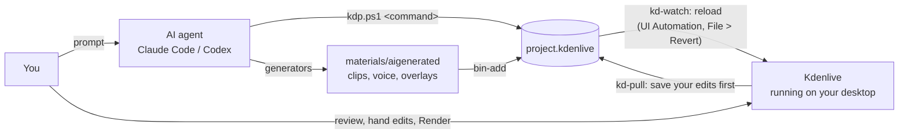

<div align="center">

# Movie Engine

**Cuireann gníomhaire intleachta saorga eagar ar d'fhíseán in Kdenlive agus tú ag faire air, agus is féidir leat an obair a ghlacadh ar láimh am ar bith.**

Tógann agus athraíonn gníomhairí IS ríomhchlárúcháin (Claude Code, Codex) fíorthionscadail Kdenlive: scannáin, físeáin mhíniúcháin agus shorts ingearacha. Feictear na hathruithe beo san eagarthóir atá oscailte agat. Iniompartha, Windows, gan paistí ar an eagarthóir.


[English](../../README.md) · [简体中文](README.zh-CN.md) · [繁體中文](README.zh-TW.md) · [हिन्दी](README.hi.md) · [Español](README.es.md) · [Français](README.fr.md) · [العربية](README.ar.md) · [বাংলা](README.bn.md) · [Português](README.pt.md) · [Русский](README.ru.md) · [اردو](README.ur.md) · [Bahasa Indonesia](README.id.md) · [Deutsch](README.de.md) · [日本語](README.ja.md) · [Türkçe](README.tr.md) · [한국어](README.ko.md) · [Українська](README.uk.md) · [Italiano](README.it.md) · [Polski](README.pl.md) · [Tiếng Việt](README.vi.md) · [فارسی](README.fa.md) · [ไทย](README.th.md) · [Kiswahili](README.sw.md) · [አማርኛ](README.am.md) · [Avañe'ẽ](README.gn.md) · [Setswana](README.tn.md) · [Shqip](README.sq.md) · [Беларуская](README.be.md) · [Български](README.bg.md) · [Bosanski](README.bs.md) · [Hrvatski](README.hr.md) · [Српски](README.sr.md) · [Crnogorski](README.cnr.md) · [Македонски](README.mk.md) · [Slovenščina](README.sl.md) · [Slovenčina](README.sk.md) · [Čeština](README.cs.md) · [Magyar](README.hu.md) · [Română](README.ro.md) · [Dansk](README.da.md) · [Norsk bokmål](README.nb.md) · [Norsk nynorsk](README.nn.md) · [Svenska](README.sv.md) · [Íslenska](README.is.md) · [Suomi](README.fi.md) · [Eesti](README.et.md) · [Latviešu](README.lv.md) · [Lietuvių](README.lt.md) · [Nederlands](README.nl.md) · [Lëtzebuergesch](README.lb.md) · [Rumantsch](README.rm.md) · [Ελληνικά](README.el.md) · [Malti](README.mt.md) · **Gaeilge** · [Català](README.ca.md) · [ქართული](README.ka.md) · [Հայերեն](README.hy.md) · [Azərbaycanca](README.az.md) · [Afrikaans](README.af.md) · [isiZulu](README.zu.md) · [isiXhosa](README.xh.md) · [Sesotho](README.st.md) · [Sepedi](README.nso.md) · [Xitsonga](README.ts.md) · [Tshivenḓa](README.ve.md) · [siSwati](README.ss.md) · [isiNdebele (South Africa)](README.nr.md) · [isiNdebele (Zimbabwe)](README.nd.md) · [chiShona](README.sn.md) · [Chichewa](README.ny.md) · [Ikinyarwanda](README.rw.md) · [Ikirundi](README.rn.md) · [Malagasy](README.mg.md) · [Soomaali](README.so.md) · [Afaan Oromoo](README.om.md) · [Qafar af](README.aa.md) · [ትግርኛ](README.ti.md) · [Sängö](README.sg.md) · [Kreol Seselwa](README.crs.md) · [TjiKalanga](README.kck.md) · [ChiNdau](README.ndc.md)

*Is aistriúchán é seo; is é an README Béarla an leagan tagartha.*

</div>

---

## Clár ábhair

- [Cén fáth](#cén-fáth)
- [Conas a oibríonn sé](#conas-a-oibríonn-sé)
- [Gnéithe](#gnéithe)
- [Riachtanais](#riachtanais)
- [Suiteáil](#suiteáil)
- [Tús tapa](#tús-tapa)
- [Ag obair leis an ngníomhaire](#ag-obair-leis-an-ngníomhaire)
- [An líne ordaithe eagarthóireachta (`kdp.ps1`)](#an-líne-ordaithe-eagarthóireachta-kdpps1)
- [Sioncrónú beo leis an eagarthóir oscailte](#sioncrónú-beo-leis-an-eagarthóir-oscailte)
- [Gineadóirí: an méid nach féidir le Kdenlive a dhéanamh](#gineadóirí-an-méid-nach-féidir-le-kdenlive-a-dhéanamh)
- [Guthú agus fuaim](#guthú-agus-fuaim)
- [Teanga an chomhéadain](#teanga-an-chomhéadain)
- [Leagan amach na bhfillteán](#leagan-amach-na-bhfillteán)
- [Tástálacha agus cruthúnais](#tástálacha-agus-cruthúnais)
- [Teorainneacha](#teorainneacha)
- [Fabhtcheartú](#fabhtcheartú)
- [Ceisteanna coitianta](#ceisteanna-coitianta)
- [Rannchuidiú](#rannchuidiú)
- [Buíochas](#buíochas)
- [Ceadúnas](#ceadúnas)

## Cén fáth

Déantar eagarthóirí físe do lámha ar luch. Is maith le gníomhairí IS struchtúr, uainiú agus athdhéanamh: 300 gearrthóg a chur ar an mbuille, gach fotheideal a uainiú leis an nguth, radharc a athdhéanamh tar éis aiseolais. Ní féidir leo cliceáil trí chomhéadan grafach, áfach, gan do dheasc a ghlacadh ar láimh.

Is eagarthóir láidir foinse oscailte é Kdenlive, ach ar Windows **níl API uathoibrithe aige**: níl rialú trí D-Bus ann ach sna leaganacha Linux, agus na forcanna a chuireann ceann leis, níl siad á gcothabháil nó níl siad sábháilte. Réitíonn Movie Engine é seo gan paiste a chur ar an eagarthóir:

1. Athraíonn an gníomhaire comhad tionscadail `.kdenlive` trí líne ordaithe thástáilte (`engine/kdp.ps1`).
2. Iarrtar ar an Kdenlive atá ag rith an comhad a athlódáil trí Windows UI Automation, gan buillí eochrach, gan luch agus gan an fócas a ghoid.
3. Sábháiltear d'athruithe féin nach bhfuil sábháilte fós ar dtús, agus ní fhorscríobhtar riamh iad.

Mar sin cuireann an gníomhaire eagar agus déanann tusa athbhreithniú, nó cuireann tú féin eagar de láimh. Oibríonn an bheirt agaibh ar an tionscadal céanna, san eagarthóir céanna, ag an am céanna.

## Conas a oibríonn sé



Leanann gach ordú eagarthóireachta an timthriall sábháilte céanna:

1. **Pull.** Má tá athruithe gan sábháil ag Kdenlive, iarrtar air iad a shábháil (an cnaipe Save ar an mbarra uirlisí trí UI Automation), agus deimhnítear an sábháil.
2. **Eagarthóireacht.** Athraíonn an t-ordú an XML faoi ghlas, tar éis seiceáil hais agus le léargas chun cealú a cheadú. Má athraíodh an comhad idir an dá linn, ní scríobhtar faic.
3. **Athlódáil.** Feiceann an faireoir stampa na hIS agus ritheann sé File > Revert san eagarthóir oscailte. Ní áirítear go raibh rath air ach amháin nuair a atógadh giuirléid na hamlíne i ndáiríre.
4. **Coinbhleacht.** Má thosaigh tú ag cur eagair idir an dá linn, ní athlódáiltear faic agus fanann d'obair. Coinnítear leagan na hIS ar leataobh, agus cuireann an gníomhaire a athrú i bhfeidhm arís ar bharr do chuid oibre.

## Gnéithe

- **Eagarthóireacht iomlán tionscadail gan an comhéadan grafach**: thart ar 120 ordú a chlúdaíonn an bin, an amlíne, maisíochtaí, comhshuíomhanna, rianta, treoracha, marcóirí, fotheidil, seichimh, luas agus athmhapáil ama, taispeántais sleamhnán, teidil, seachfhreastalaithe (proxies), rindreáil agus cealú/athdhéanamh. Féach an [tagairt orduithe](#an-líne-ordaithe-eagarthóireachta-kdpps1).
- **Sioncrónú beo leis an eagarthóir oscailte.** Feictear athruithe na hIS sa Kdenlive atá os do chomhair; sábháiltear d'athruithe gan sábháil ar dtús agus ní chailltear riamh iad.
- **Ní chuireann sé isteach ar do dheasc riamh.** Gan fócas a ghoid, gan buillí eochrach ná gluaiseacht luiche. Ritheann eagarthóirí tástála ar dheasc dofheicthe Windows.
- **Iniompartha.** Tá an t-eagarthóir, na socruithe, Node.js, na clónna agus na huirlisí in aon fhillteán amháin. Cóipeáil chuig ríomhaire eile é agus oibreoidh sé; ní scríobhtar faic chuig Program Files ná chuig do phróifíl Windows.
- **Gineadóirí don mhéid nach féidir le Kdenlive a dhéanamh**: téacs cinéiteach le beochan litir ar litir, nótaí a bhfuil cuma lámhtharraingthe orthu, radhairc chomhéadain 3D, beochan cúrsóra agus scannáin fhada idirghníomhacha mhíniúcháin. Rindreáiltear iad ar an GPU le fíor-gheamhú gluaiseachta (motion blur) agus cuirtear ar an amlíne iad mar ghnáthghearrthóga.
- **Guthú le huainiú focal** (Microsoft Edge TTS, gan eochair API). Tarlaíonn fotheidil agus gníomhartha ar an bhfocal cruinn.
- **Maisíochtaí fuaime sintéisithe** (whoosh, click, pop, riser, impact agus tuilleadh), ginte i gcód.
- **Cruthaithe, ní glactha leis.** Tá seiceáil toraidh ag gach ordú, tástáiltear maisíochtaí agus comhshuíomhanna ceann ar cheann, agus tá na torthaí amha in `docs/proof/`.
- **Treoracha do ghníomhairí san áireamh.** Múineann `AGENTS.md` agus na scileanna in `.claude/skills/` an sreabhadh oibre, formáid an chomhaid agus na gaistí do Claude Code agus Codex.

## Riachtanais

| | |
|---|---|
| Córas oibriúcháin | Windows 10 nó 11, x64 |
| Eagarthóir | Kdenlive **26.08.3**, leagan iniompartha (standalone). Níor tástáladh leaganacha eile. |
| Node.js | 18 nó níos nuaí: an `.zip` Windows x64 ó nodejs.org, díphacáilte in `engine/node/` |
| Brabhsálaí | Microsoft Edge (cuid de Windows); úsáideann na rindreálaithe radharc é gan chomhéadan (headless) |
| Gníomhaire | [Claude Code](https://claude.com/claude-code) nó Codex. Roghnach: ritheann gach uirlis de láimh freisin. |
| Diosca | thart ar 1 GB don eagarthóir agus do na huirlisí, móide do chuid meán |
| GPU | luasghéaraíonn aon GPU le hionchódú crua-earraí H.264 `film-render.mjs` (gan é úsáidtear ionchódú bogearraí) |

## Suiteáil

Suiteáiltear gach rud **taobh istigh den fhillteán**. Níl gá le cearta riarthóra.

```powershell
git clone https://github.com/vladtarrow/movie-engine.git
cd movie-engine
```

**1. Node.js.** Íoslódáil an `.zip` Windows x64 de Node.js 18 nó níos nuaí ó <https://nodejs.org/en/download> agus díphacáil a ábhar in `engine\node\`, ionas go mbeidh `engine\node\node.exe` agus `engine\node\npm.cmd` ann. Níl gá le suiteálaí ná le Node an chórais. Ritheann gach script trí `engine\node.cmd`, riamh trí Node an chórais.

**2. Pacáistí Node** don uirlis ghutha agus do na rindreálaithe (tá na leaganacha socraithe in `engine/voice/package.json`):

```powershell
engine\node\npm.cmd install --prefix engine\voice
```

**3. Kdenlive 26.08.3 iniompartha.** Íoslódáil `kdenlive-26.08.3_standalone.exe` ó <https://download.kde.org/stable/kdenlive/26.08/windows/> isteach in `engine\installer\`, seiceáil é agus díphacáil é:

```powershell
(Get-FileHash engine\installer\kdenlive-26.08.3_standalone.exe -Algorithm SHA256).Hash
# expected: A25427B1DFF2C17E3B0386E991BB1A719382BB3176D1A90E441CDAEB6E0A967D
engine\installer\kdenlive-26.08.3_standalone.exe -o"engine\Kdenlive" -y
```

Bíonn an t-eagarthóir in `engine\Kdenlive\kdenlive-26.08.3_standalone\bin\` ina dhiaidh sin. Tá `melt.exe` agus `ffmpeg.exe` ann cheana.

**4. An chéad tosú.**

```powershell
engine\kdenlive.cmd
```

Coinníonn Kdenlive a shocruithe go léir in `engine\profile-kdenlive\`, ní i do phróifíl Windows. Ar an gcéad tosú taispeánann sé draoi socraithe uair amháin.

## Tús tapa

### Le gníomhaire

Oscail an fillteán in Claude Code (nó Codex) agus iarr i ngnáthfhocail:

> Déan tionscadal ingearach nua 30 fps "launch-teaser". Cuir na trí ghabháil scáileáin ó `materials/designers/launch/` ar an amlíne, 2.5 s an ceann le traschéimniú gearr, cuir guthú ó `script.txt` leis agus uainigh fotheideal cinéiteach le gach líne.

> Oscail dom in Kdenlive é.

> Tá an dara seat rófhada. Gearr go 1.8 s é agus bog an lógó suas beagán.

Leanann an gníomhaire `AGENTS.md`: cuireann sé eagar trí `kdp.ps1`, ní rindreálann sé ach na gearrthóga a theastaíonn ón eagar, agus coinníonn sé an t-eagarthóir oscailte i sioncrónú. Déanann tusa athbhreithniú in Kdenlive, cuireann tú eagar de láimh aon uair is mian leat, agus brúnn tú Render nuair atá tú sásta.

### De láimh

```powershell
# a new 1080x1920 30 fps project with 2 video and 2 audio tracks
powershell -NoProfile -ExecutionPolicy Bypass -File engine\kdp.ps1 new -Project projects\hello\hello.kdenlive -Profile vertical_hd_30

# a 3-second title and a colour background
powershell -NoProfile -ExecutionPolicy Bypass -File engine\kdp.ps1 bin-color -Project projects\hello\hello.kdenlive -Color '#203060' -Seconds 3 -Name bg
powershell -NoProfile -ExecutionPolicy Bypass -File engine\kdp.ps1 title -Project projects\hello\hello.kdenlive -Text "Hello" -Seconds 3 -Name hi

# place them: background on V1, title above it on V2
powershell -NoProfile -ExecutionPolicy Bypass -File engine\kdp.ps1 add -Project projects\hello\hello.kdenlive -Bin bg -Track V1 -At 0
powershell -NoProfile -ExecutionPolicy Bypass -File engine\kdp.ps1 add -Project projects\hello\hello.kdenlive -Bin hi -Track V2 -At 0

# a check frame, then open it in the editor
powershell -NoProfile -ExecutionPolicy Bypass -File engine\kdp.ps1 frame -Project projects\hello\hello.kdenlive -At 1.5 -Out out\hello\check.png
engine\kdenlive.cmd projects\hello\hello.kdenlive
```

Chun an tionscadal deireanach a athoscailt níos déanaí, déchliceáil `open-last-project.cmd`.

## Ag obair leis an ngníomhaire

Léann an gníomhaire `AGENTS.md` (Codex) nó `CLAUDE.md`, a allmhairíonn é (Claude Code), móide dhá scil:

| Scil | Múineann |
|---|---|
| `.claude/skills/kdenlive-project-file` | formáid `.kdenlive` / MLT XML, `kdp.ps1`, seiceáil le `melt` |
| `.claude/skills/kdenlive-live` | an t-eagarthóir atá ag rith a stiúradh go sábháilte: tosú, pull, athlódáil, gabháil a fhuinneoige |

Rialacha a leanann an gníomhaire, ar féidir leat brath orthu:

- Ní thógann sé do luch, do mhéarchlár ná d'fhócas riamh, agus ní ghlacann sé gabháil scáileáin de do dheasc riamh (ach d'fhuinneog an eagarthóra féin amháin).
- Déanann sé na céimeanna sa chomhéadan grafach é féin (sábháil, oscailt, athlódáil) in ionad iarraidh ort cliceáil.
- Fiafraíonn sé sula n-íoslódálann sé aon rud agus sula scriosann sé aon rud.
- Ní rindreálann sé ach a bhfuil de dhíth ar an obair (gearrthóga radhairc, frámaí seiceála). Ní rindreálann sé an scannán deiridh ach amháin nuair a iarrann tú é.
- Nuair nach féidir le Kdenlive rud a dhéanamh go maith, tógann an gníomhaire é taobh amuigh le cód agus cuireann sé an toradh isteach mar ghearrthóg. Ní lagaíonn sé an mhaisíocht.

## An líne ordaithe eagarthóireachta (`kdp.ps1`)

```powershell
powershell -NoProfile -ExecutionPolicy Bypass -File engine\kdp.ps1 <command> -Project <file.kdenlive> [options]
```

Tá amanna i soicindí, le ponc (`2.5`). Is iad na rianta `V1 V2 …` (V1 an ceann is ísle) agus `A1 A2 …`. Aimsítear gearrthóg le `-Track` móide aon am `-At` taobh istigh di. Téann paraiméadair maisíochta in `-Params "name=value||name=value"`. Tá an liosta iomlán le gach rogha i gceanntásc `engine/kdp.ps1`.

| Grúpa | Orduithe |
|---|---|
| Tionscadal | `new`, `profiles`, `info`, `validate`, `fonts`, `profile-set`, `profile-from-clip`, `zone`, `archive`, `backups`, `rebase`, `otio-export`, `otio-import` |
| Bin | `bin-add`, `bin-color`, `title`, `title-text`, `title-save`, `title-template`, `bin-rename`, `bin-remove`, `bin-info`, `bin-set`, `bin-duplicate`, `bin-replace-file`, `bin-reload`, `folder`, `bin-folder`, `relink`, `clean`, `generator`, `playlist-clip`, `extract-audio`, `transcode` |
| Amlíne | `add`, `add-av`, `move`, `copy`, `trim`, `ripple-trim`, `slip`, `split`, `remove`, `speed`, `remap`, `disable`, `enable`, `group`, `ungroup`, `mix`, `unmix`, `space-insert`, `space-remove`, `spaces-remove-all`, `track-clear`, `replace-in-timeline` |
| Maisíochtaí | `effects`, `effect-info`, `effect-add`, `effect-list`, `effect-set`, `effect-remove`, `effect-copy`, `effect-clear`, `effects-all`, `bin-effect`, `effect-templates`, `effect-template` |
| Comhshuíomhanna | `compositions`, `comp-info`, `comp-add`, `comp-list`, `comp-set`, `comp-remove` |
| Rianta | `track-add`, `track-remove`, `track-set` |
| Treoracha agus marcóirí | `guide-add`, `guide-list`, `guide-remove`, `guide-set`, `guide-clear`, `guide-export`, `guide-category`, `marker`, `marker-list`, `marker-set`, `marker-remove` |
| Fotheidil | `sub-add`, `sub-import`, `sub-export`, `sub-state` |
| Seichimh | `sequence-add`, `sequences`, `copy-to-sequence`, `expand`; oibríonn aon ordú le `-Sequence <name>` taobh istigh den seicheamh sin |
| Speisialta | `slideshow`, beochan Lottie / Glaxnimate trí `bin-add`, `proxy`, `stabilize`, `scene-split`, `speed-job`, `subclip` |
| Aschur | `frame` (PNG amháin), `preview` (rindreáil thapa le melt), `render` (rindreálaí Kdenlive féin nó réamhshocrú), `presets` |
| Stair | `undo`, `redo`, `clear-history` (léargais in `projects/<name>/.kdp-history`) |

Iompar is fiú a bheith ar an eolas faoi:

- Bogtar, bearrtar, scoiltear agus baintear na leatha nasctha fuaime agus físe le chéile (`-Alone` do leath amháin).
- Scoireann ordú a theipeann le cód 1 agus ní scríobhann sé faic.
- Diúltaítear do mhaisíochtaí nach féidir le leagan Windows a rith, ní dhéantar neamhaird orthu go ciúin (liosta: `docs/proof/assets.txt`).
- Mapáiltear gach gníomh roghchláir de chuid Kdenlive chuig ordú, chuig bealach eile, nó chuig "view only" in `engine/tools/data/kdenlive-actions.csv`. Féach `docs/kdenlive-coverage.md`.

## Sioncrónú beo leis an eagarthóir oscailte

| Script | Cad a dhéanann sé | Cóid scoir |
|---|---|---|
| `engine\kd-pull.ps1 -Project <f>` | cuireann sé ar Kdenlive d'athruithe a shábháil agus deimhníonn sé é | 0 comhad cothrom le dáta, 3 gan a bheith ag rith, 4 gan deimhniú |
| `engine\kd-reload.ps1 -Project <f>` | File > Revert, deimhnithe ag an amlíne atógtha | 0 deimhnithe, 2 tá athruithe gan sábháil agat (níor caitheadh aon rud uait), 3 gan a bheith ag rith, 4 theip air |
| `engine\kd-watch.ps1 -Project <f>` | faireoir sa chúlra: athlódálann sé tar éis gach scríobh ón IS, logálann sé coinbhleachtaí | log in `engine\kd-watch.log`; scrios `engine\kd-watch.run` chun é a stopadh |
| `engine\kdenlive-bg.ps1 [project]` | tosaíonn sé Kdenlive íoslaghdaithe do ghníomhaire | 0 lódáilte, 4 gan deimhniú |
| `engine\kdenlive.cmd [project]` | tosaíonn sé Kdenlive duitse | |

Tosaigh an faireoir uair amháin in aghaidh an tseisiúin:

```powershell
Start-Process powershell -WindowStyle Hidden -ArgumentList '-NoProfile','-ExecutionPolicy','Bypass','-File','engine\kd-watch.ps1','-Project','projects\hello\hello.kdenlive'
```

Tionscadail mhóra: tógann athlódáil tionscadail 1000 gearrthóg nóiméid, agus fanann na huirlisí léi in ionad tuairisc a thabhairt róluath. Osclaítear tionscadail trí *File > Open Recent* ar eagarthóir folamh, mar nuair a osclaítear comhad go díreach siúlann Qt trí gach mír den amlíne ar mhaithe le hinrochtaineacht, agus bhí sé sin thart ar 10 nóiméad níos moille.

## Gineadóirí: an méid nach féidir le Kdenlive a dhéanamh

Níl beochan téacs litir ar litir ná sloinn (expressions) ag Kdenlive/MLT, níl ach beagán 3D aige, agus moillíonn maisíochtaí troma an t-athsheinm. Rindreálann Movie Engine na codanna sin taobh amuigh agus cuireann sé ar an amlíne iad mar ghnáthghearrthóga, de ghnáth le alfa, ar rian os cionn na bpictiúr. Fanann script an ghineadóra agus a ionchuir i bhfillteán an tionscadail, ionas gur féidir gearrthóg a athghiniúint nuair a athraíonn an téacs, an cló nó an t-uainiú.

| Uirlis | Déanann sí |
|---|---|
| `engine/tools/kinetic-text.ps1` | fotheidil chinéiteacha le beochan litir ar litir, gach focal uainithe ó `voice.json`, bosca aibhsithe |
| `engine/tools/annotate.ps1` | ciorcail, boscaí, línte faoi agus saigheada a bhfuil cuma lámhtharraingthe orthu agus a tharraingítear os cionn gabháil scáileáin |
| `engine/tools/card-entrance.ps1` | cárta le gabháil scáileáin a éiríonn agus a mhéadaíonn le scáth bog |
| `engine/tools/pdf-to-png.ps1` | sleamhnáin ó easpórtáil PDF |
| `engine/tools/html-render.mjs` | aon radharc HTML/CSS/canvas go físeán: beochan comhéadain, cúrsóirí, 3D, maisc |
| `engine/tools/film-render.mjs` + `film/` | scannáin fhada idirghníomhacha mhíniúcháin ar canvas: gearrthóg amháin in aghaidh gach líne ghutha, tarlaíonn gníomhartha ar fhocail labhartha, geamhú gluaiseachta ar an GPU ag thart ar 45 fps |

Stiúrann an dá rindreálaí an Microsoft Edge a thagann le Windows, gan chomhéadan (headless), le próifíl indiúscartha agus gan rochtain ar an líonra.

### Taispeántais

```powershell
# a 3-second 3D title card with a cursor click
engine\node.cmd engine\tools\html-render.mjs examples\demo\scene\scene.html examples\demo\out --frames 0,30,60,89
engine\node.cmd engine\tools\html-render.mjs examples\demo\scene\scene.html examples\demo\out\scene.mp4

# a 4-shot interactive film timed to two voice lines
engine\node.cmd engine\tools\film-render.mjs examples\demo\film\film.html examples\demo\out --check
engine\node.cmd engine\tools\film-render.mjs examples\demo\film\film.html examples\demo\out --shots all --width 640
engine\node.cmd engine\tools\film-render.mjs examples\demo\film\film.html examples\demo\out\clips --suffix -v01
```

Is trí chomhad bheaga atá i scannán. Tá na seatanna agus amanna na bhfocal in `data.js`. Tá líne amháin in aghaidh an tseata in `direction.js`:

```text
1 | hover 192 108 @brand | tag 300 60 Your brand @deserves | confetti 192 90 @film
2 say=A film that/*explains* it
3 | click 116 108 @before | click 268 108 @after | chips Before~After @after
4 scene=counter | count 0 120 % @count
```

Tá na seatanna a tharraingítear ón tús in `scenes.js`. Cuireann `@word` gníomh ar siúl nuair a deir an guth an focal sin. I measc na ngníomhartha tá click, hover, drag, zoom, lens, ring, arrow, chips, toggle, slider, toast, type, count agus confetti; tá an chomhréir iomlán ag barr `engine/tools/film/film-kit.js`.

## Guthú agus fuaim

```powershell
engine\node.cmd engine\voice\voice.mjs lines.json materials\aigenerated\hello\voice en-US-AndrewMultilingualNeural +0%
```

Is liosta línte é `lines.json`. Scríobhann an uirlis mp3 amháin in aghaidh na líne móide `voice.json`, leis an bhfad agus le tús agus deireadh gach focail. Cuirtear na línte i dtaisce, mar sin má athraítear líne amháin ní athghintear ach an líne sin. Úsáideann sé téacs-go-caint ar líne Microsoft Edge tríd an bpacáiste `msedge-tts`: níl gá le heochair, ach is seirbhís neamhoifigiúil í agus teastaíonn an t-idirlíon uaithi.

```powershell
engine\node.cmd engine\audio\sfx.mjs materials\aigenerated\sfx
```

Sintéisíonn sé seo whoosh, whoosh-long, swipe, click, pop, tick, riser, impact, ding agus reveal i gcód; tá sraith réidh in `materials/aigenerated/sfx/`. Líon le ciúnas fuaimeanna atá níos giorra ná fráma amháin sula gcuireann tú san áit iad (`-af apad=whole_dur=0.0667`).

## Teanga an chomhéadain

Tosaíonn na lainseálaithe Kdenlive i **mBéarla** de réir réamhshocraithe. Chun teanga eile a úsáid, socraigh `MOVIE_ENGINE_UI_LANG` roimh thosú:

```powershell
$env:MOVIE_ENGINE_UI_LANG = 'ru'; engine\kdenlive.cmd
```

Aimsíonn UI Automation míreanna roghchláir de réir a n-ainmneacha infheicthe. Tá ainmneacha do 31 theanga chomhéadain ionsuite cheana (`engine/tools/kd-ui.ps1`, `$KdNames`). Le haghaidh aon teanga eile, cuir a hainmneacha leis ansin agus seiceáil le:

```powershell
powershell -NoProfile -ExecutionPolicy Bypass -File engine\tools\kd-langcheck.ps1
```

## Leagan amach na bhfillteán

```text
movie-engine/
├─ AGENTS.md, CLAUDE.md          instructions for AI agents
├─ .claude/skills/               agent skills: project file format, live editor
├─ engine/
│  ├─ kdp.ps1                    the editing command line
│  ├─ kd-pull / kd-reload / kd-watch .ps1, kdenlive.cmd, kdenlive-bg.ps1
│  ├─ tools/                     internals, generators, tests, data (action map)
│  ├─ voice/  audio/  fonts/     TTS, synthesized SFX, Poppins (OFL)
│  ├─ Kdenlive/  node/           portable editor and Node.js (not in git)
│  └─ profile-kdenlive/          the editor's settings (not in git)
├─ projects/<name>/<name>.kdenlive
├─ materials/
│  ├─ download/                  stock and downloaded files (not in git)
│  ├─ aigenerated/               everything the AI made (sfx/ and test-kit/ ship with the engine)
│  ├─ designers/  brand/         files from your team, brand assets
├─ examples/demo/                demos of the scene and film renderers
├─ out/                          renders (not in git)
└─ docs/                         proofs, coverage, translations of this README
```

Is coibhneasta iad conairí na meán taobh istigh de thionscadail. Má bhogann nó má chóipeálann tú an fillteán, scríobhann `kdp.ps1 rebase` (a ritheann `kdenlive.cmd` go huathoibríoch freisin) an suíomh nua isteach sa tionscadal.

## Tástálacha agus cruthúnais

Tacaíonn seiceálacha toraidh le héilimh faoi cad a oibríonn, ní an fhíric gur "rith an fheidhm". Tá an achoimre in [`docs/kdenlive-proof.md`](../../docs/kdenlive-proof.md), agus tá an t-aschur amh in `docs/proof/`.

| Tástáil | Seiceálann |
|---|---|
| `engine\tools\kdp-clitest.ps1` | gach ordú de chuid `kdp.ps1`, tríd an líne ordaithe, ag comparáid an tionscadail a thagann as |
| `engine\tools\kd-livetest.ps1` | pull, athlódáil, an faireoir, coinbhleachtaí agus coinníollacha rása in aghaidh fíor-Kdenlive ar dheasc dofheicthe |
| `engine\tools\kdp-assetsweep.ps1` | gach maisíocht agus gach comhshuíomh: rindreálann sé agus déanann sé comparáid ar fhrámaí |
| `engine\tools\kdp-portabletest.ps1` | cóipeálann sé an fillteán áit éigin eile agus oibríonn sé ón gcóip |
| `engine\tools\kd-langcheck.ps1` | teanga an chomhéadain agus go n-aimsíonn UI Automation an roghchlár |
| `engine\tools\kdp-coverage-check.ps1` | go bhfuil gach gníomh roghchláir mapáilte, agus nach bhfuil aon chruthúnas níos sine ná an cód |

```powershell
powershell -NoProfile -ExecutionPolicy Bypass -File engine\tools\kdp-clitest.ps1 -Report docs\proof\clitest.txt
powershell -NoProfile -ExecutionPolicy Bypass -File engine\tools\kd-livetest.ps1 -Report docs\proof\live-en.txt
```

Ní ritheann eagarthóirí tástála ach ar dheasc fholaithe lena bpróifíl féin, mar sin ní bhaineann tástálacha riamh le do Kdenlive oscailte ná le d'fhócas.

## Teorainneacha

- **Windows amháin**, Kdenlive **26.08.3** amháin. Tá D-Bus ag Linux agus bheadh droichead difriúil ag teastáil.
- Nuair a thosaítear an t-eagarthóir, tógann sé fócas an mhéarchláir ar feadh thart ar 3 soicind fad a thagann an fhuinneog fholamh chun solais. Fiafraíonn gníomhairí sula dtosaíonn siad é agus tú ag obair. Ní thógann athlódálacha ná athruithe an fócas.
- Níl na modúil MLT sox, ladspa agus movit ná roinnt maisíochtaí frei0r/avfilter i leagan Windows; diúltaíonn `kdp.ps1` dóibh (`docs/proof/assets.txt`).
- Ní iompraíonn easpórtáil agus iompórtáil OpenTimelineIO ach gearrthóga agus bearnaí. Níl aistriú beo idir uillinneacha ag multicam (déantar gearrthacha le split/remove/hide).
- Ní osclaíonn "Save As…" trí UI Automation ar fhuinneog íoslaghdaithe aon dialóg; úsáideann an gníomhaire `archive` nó cóipeanna comhad ina ionad.
- Teastaíonn Whisper nó Vosk le haghaidh aithint cainte (fotheidil uathoibríocha), agus níl siad san áireamh.
- Úsáideann teidil a dhéantar le huirlis teideal Kdenlive clónna atá suiteáilte in Windows. Le haghaidh clóghrafaíochta ráthaithe, rindreáil téacs leis na gineadóirí, a lódálann clónna ó `engine/fonts/`.
- Is seirbhís neamhoifigiúil ar líne é Edge TTS agus d'fhéadfadh sé athrú nó stopadh ag obair.

## Fabhtcheartú

| Siomptóm | Cúis agus réiteach |
|---|---|
| Tá Kdenlive ag rith, ach ní thaispeántar faic nuair a chliceáiltear air sa tascbharra | Tá suíomh sábháilte a fhuinneoige lasmuigh den scáileán. Dún é agus scrios na hiontrálacha `kdockLayout` in `engine\profile-kdenlive\AppData\Local\kdenliverc`, nó bog an fhuinneog le `SetWindowPos` (féach `AGENTS.md`). |
| Scoireann `kd-reload.ps1` le 2 | Tá athruithe gan sábháil agat. Níor caitheadh aon rud uait. Rith `kd-pull.ps1`, ansin cuir an t-athrú i bhfeidhm arís (déanann `kdp.ps1` é seo leis féin). |
| `CONFLICT` in `engine\kd-watch.log` | Chuir tusa agus an gníomhaire eagar ag an nóiméad céanna. Fanann do leagan san eagarthóir, agus tá leagan na hIS in `projects\<name>\.kdp-history\<name>\conflict\`. Iarr ar an ngníomhaire a athrú a chur i bhfeidhm arís. |
| Scoireann ordú le 1 agus "pull not confirmed" | Tá Kdenlive gnóthach nó tá dialóg á taispeáint aige. Dún an dialóg nó fan go gcríochnóidh an lódáil, ansin déan arís é. |
| Teipeann ar script PowerShell a pharsáil | Ní mór scripteanna le téacs neamh-ASCII a shábháil mar UTF-8 **le BOM** do Windows PowerShell 5.1. |
| Stopann `voice.mjs` le "Stream closed before the synthesis completed" | Fadhb líonra de ghnáth, nó SSML gan éalú i gcóipeanna níos sine. Déanann `voice.mjs` éalú ar `& < >` é féin. |
| Tógann sé go leor nóiméad tionscadal mór a oscailt | Oscail é trí `kdenlive.cmd` / `kdenlive-bg.ps1`, riamh mar `kdenlive.exe project.kdenlive`. |

## Ceisteanna coitianta

**An bhfuil Claude Code nó Codex de dhíth orm?**
Níl. Is gnáthscript é gach uirlis ar féidir leat a rith de láimh. Is é an gníomhaire a dhéanann tapa é: pleanálann sé an t-eagar, ritheann sé na huirlisí agus coinníonn sé an t-eagarthóir i sioncrónú.

**An bhforscríobhfaidh an gníomhaire m'athruithe láimhe?**
Ní fhorscríobhfaidh. Roimh aon scríobh, sábháiltear agus deimhnítear d'athruithe gan sábháil. Má chuireann tú eagar fad atá an gníomhaire ag scríobh, diúltaítear don scríobh nó coinnítear ar leataobh é mar choinbhleacht, agus ní chuirtear i bhfeidhm riamh é ar bharr d'oibre.

**An féidir liom leanúint ar aghaidh ag úsáid Kdenlive mar is gnáth?**
Is féidir. Is é an gnáth-Kdenlive é lena fhillteán socruithe féin. Cuir eagar, réamhamharc agus rindreáil mar is gnách.

**An oibríonn sé le Kdenlive atá suiteáilte agam cheana?**
Úsáideann sé a chóip iniompartha féin in `engine\Kdenlive\`, mar sin ní bhaintear le do Kdenlive suiteáilte ná lena shocruithe.

**Cén fáth nach forc de Kdenlive le API, nó eagarthóir eile?**
Ar Windows, níl aon fhorc ann atá á chothabháil agus sábháilte (suirbhé ó Shamhain 2026). Measadh OpenShot, Blender VSE, DaVinci Resolve, Shotcut agus eagarthóirí gréasáin; ba é Kdenlive a thug an doimhneacht eagarthóireachta is fearr. Táthar ag faire ar mholadh REST API sa tionscadal upstream (merge request !902).

**An féidir leis an físeán deiridh a rindreáil?**
Is féidir, le `kdp.ps1 render` (rindreálaí Kdenlive féin, i bhfolach), nó brúnn tú féin Render san eagarthóir.

**An n-uaslódáiltear mo chuid meán áit ar bith?**
Ní uaslódáiltear. Ní sheoltar ach téacs an ghuthaithe chuig seirbhís Edge TTS nuair a ghineann tú guth. Ritheann na rindreálaithe radharc agus an líonra díchumasaithe.

## Rannchuidiú

Fáiltítear roimh rannchuidithe. Féach [CONTRIBUTING.md](../../CONTRIBUTING.md). Go hachomair:

- Teastaíonn seiceáil toraidh in `kdp-clitest.ps1`, iontráil sa mhapa gníomhartha, agus rith úr de `kdp-coverage-check.ps1` ó gach oibríocht nua nó athraithe de chuid `kdp.ps1`.
- Ná tosaigh Kdenlive tástála riamh ar an deasc infheicthe; úsáid `engine/tools/kd-hidden.ps1`.
- Coinnigh gach rud iniompartha: gan suiteálacha lasmuigh den fhillteán, gan conairí absalóideacha i dtionscadail.
- Scríobh síos aisteachtaí fíoraithe in `AGENTS.md` nó sa scil chuí.

## Buíochas

- [Kdenlive](https://kdenlive.org) agus [MLT](https://www.mltframework.org): an t-eagarthóir agus an t-inneall faoi.
- [FFmpeg](https://ffmpeg.org), atá san áireamh le Kdenlive.
- [msedge-tts](https://www.npmjs.com/package/msedge-tts) don ghuthú.
- [Poppins](https://fonts.google.com/specimen/Poppins) le Indian Type Foundry, SIL Open Font License (`engine/fonts/OFL.txt`).
- `engine/tools/data/kdenliveui-26.08.3.rc`: comhad roghchláir Kdenlive, tógtha ó chód foinse Kdenlive 26.08.3; ní úsáideann ach an tseiceáil chlúdaigh é. Fanann sé faoi cheadúnas GPL Kdenlive, ní faoin MIT License.

## Ceadúnas

Eisítear cód Movie Engine féin faoin [gCeadúnas MIT](../../LICENSE). Coinníonn Kdenlive, MLT, FFmpeg, pacáistí Node.js agus an cló Poppins a gceadúnais féin.
