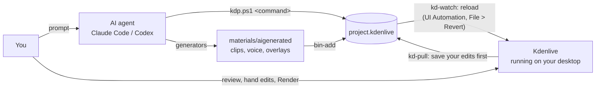

<div align="center">

# Movie Engine

**Peteĩ agente IA omyatyrõ nde video Kdenlive-pe rehecha aja, ha ikatu rejagarra tembiapo araka'eve.**

Umi agente IA ohaíva código (Claude Code, Codex) omopu'ã ha omoambue proyecto añetegua Kdenlive-pegua: película, video omyesakãva mba'e ha shorts oñembo'ýva (vertical). Umi ñemoambue ojehecha pya'e pe editor reipe'áva nde. Portable, Windows-pe guarã, ndoikotevẽi oñemoambue (patch) editor.


[English](../../README.md) · [简体中文](README.zh-CN.md) · [繁體中文](README.zh-TW.md) · [हिन्दी](README.hi.md) · [Español](README.es.md) · [Français](README.fr.md) · [العربية](README.ar.md) · [বাংলা](README.bn.md) · [Português](README.pt.md) · [Русский](README.ru.md) · [اردو](README.ur.md) · [Bahasa Indonesia](README.id.md) · [Deutsch](README.de.md) · [日本語](README.ja.md) · [Türkçe](README.tr.md) · [한국어](README.ko.md) · [Українська](README.uk.md) · [Italiano](README.it.md) · [Polski](README.pl.md) · [Tiếng Việt](README.vi.md) · [فارسی](README.fa.md) · [ไทย](README.th.md) · [Kiswahili](README.sw.md) · [አማርኛ](README.am.md) · **Avañe'ẽ** · [Setswana](README.tn.md)

*Kóva ha'e peteĩ ñembohasa; pe README inglés ñe'ẽme ojehaíva ha'e pe ypykue oje'eporãvéva.*

</div>

---

## Tetepy

- [Mba'ére](#mbaére)
- [Mba'éicha omba'apo](#mbaéicha-ombaapo)
- [Mba'e ojapokuaáva](#mbae-ojapokuaáva)
- [Mba'e oñeikotevẽva](#mbae-oñeikotevẽva)
- [Ñemohenda](#ñemohenda)
- [Ñepyrũ pya'e](#ñepyrũ-pyae)
- [Ñemba'apo agente ndive](#ñembaapo-agente-ndive)
- [Línea de comandos edición-pegua (`kdp.ps1`)](#línea-de-comandos-edición-pegua-kdpps1)
- [Ñembojoja pya'e editor ijurujáva ndive](#ñembojoja-pyae-editor-ijurujáva-ndive)
- [Generadores: Kdenlive ndojapokuaáiva](#generadores-kdenlive-ndojapokuaáiva)
- [Ñe'ẽ ha ryapu](#ñeẽ-ha-ryapu)
- [Interfaz ñe'ẽ](#interfaz-ñeẽ)
- [Carpeta-kuéra ñemohenda](#carpeta-kuéra-ñemohenda)
- [Ñeha'ã ha techaukarã](#ñehaã-ha-techaukarã)
- [Mba'e ndaikatúiva](#mbae-ndaikatúiva)
- [Apañuãi ñemyatyrõ](#apañuãi-ñemyatyrõ)
- [Porandu ojejapovéva](#porandu-ojejapovéva)
- [Mba'éicha reipytyvõkuaa](#mbaéicha-reipytyvõkuaa)
- [Aguyje](#aguyje)
- [Licencia](#licencia)

## Mba'ére

Umi editor de video ojejapo oiporu hag̃ua po ratón ndive. Umi agente IA (inteligencia artificial, programa omba'apóva ijeheguíva) iporã estructura, tiempo ha tembiapo oñembohasajeýva rehe: omoĩ 300 clip música ritmo-pe, ombojoja opaite subtítulo ñe'ẽ ndive, ojapojey peteĩ escena oñeme'ẽ rire ichupe opinión. Ha katu ndaikatúi oclickea peteĩ interfaz gráfica (GUI) rupi ojagarra'ỹre nde escritorio.

Kdenlive ha'e peteĩ editor código abierto imbaretéva, ha katu Windows-pe **ndoguerekói API automatización-pegua**: D-Bus rupi ñecontrola oĩ Linux-pe guarã ojejapóvape añónte, ha umi fork ombojoapýva peteĩ ojeheja reíma térã ndaha'éi seguro. Movie Engine omoporã ko apañuãi omoambue'ỹre editor:

1. Agente omyatyrõ archivo de proyecto `.kdenlive` peteĩ línea de comandos oñeha'ãmbáva rupive (`engine/kdp.ps1`).
2. Kdenlive omba'apóvape oje'e ohupi jey hag̃ua archivo Windows UI Automation rupive, teclado'ỹre, ratón'ỹre ha foco ojepe'a'ỹre.
3. Nde ñemoambue ndereñongatúiva gueteri oñeñongatu raẽ ha araka'eve ndojehaijeýi hi'ári.

Upéicha agente omyatyrõ ha nde rehesa'ỹijo, térã nde pópe remyatyrõ. Mokõivéva pemba'apo peteĩ proyecto-pe, peteĩ editor-pe, peteĩ jave.

## Mba'éicha omba'apo



Opaite comando edición-pegua ohasa peteĩchagua ciclo seguro rupi:

1. **Pull.** Kdenlive oguerekóramo ñemoambue oñeñongatu'ỹva, oje'e ichupe oñongatu hag̃ua (botón Save barra de herramientas-pe, UI Automation rupive), ha oñemoañete oñeñongatuha.
2. **Ñemyatyrõ.** Comando omoambue XML peteĩ lock guýpe, ohechajey rire hash ha oguerekóvo instantánea ikatu hag̃ua oñembojevy (undo). Archivo oñemoambuéramo upe aja, mba'eve ndojehaíri.
3. **Ñehupijey.** Watcher ohecha IA marca ha omboguata File > Revert editor ijurujávape. Oñemohu'ãporã oje'e añoite widget timeline-pegua oñemopu'ãjeýramo añetehápe.
4. **Ñorairõ (conflicto).** Nde reñepyrũramo remyatyrõ upe pa'ũme, mba'eve nohupijeýi ha nde rembiapo opyta. IA versión oñeñongatu ha'eño, ha agente omoĩjey iñemoambue nde mba'e ári.

## Mba'e ojapokuaáva

- **Proyecto ñemyatyrõ tenondetéva GUI'ỹre**: 120 rupi comando ohupytýva bin (proyecto medio ñongatuha), timeline, efecto, composición, pista, guía, marcador, subtítulo, secuencia, velocidad ha tiempo ñemoambue (time remap), slideshow, título, proxy, renderizado ha undo/redo. Ehecha [comando-kuéra rysýi](#línea-de-comandos-edición-pegua-kdpps1).
- **Ñembojoja pya'e editor ijurujáva ndive.** IA ñemoambue ojehecha pe Kdenlive rehecháva nde; nde ñemoambue oñeñongatu'ỹva oñeñongatu raẽ ha araka'eve nokañýi.
- **Araka'eve nombopiro'ỹi nde escritorio.** Ndojepe'ái foco, ndojopýi teclado ha ndoiporúi ratón. Editor ñeha'ãrã omba'apo peteĩ escritorio Windows-pegua ojehecha'ỹvape.
- **Portable.** Editor, configuración, Node.js, fuente (letra) ha tembiporu oĩ peteĩ carpeta-pe añónte. Emonguatia ambue PC-pe ha omba'apo; mba'eve ndojehaíri Program Files-pe térã nde perfil Windows-pegua.
- **Generadores Kdenlive ndojapokuaáiva rehe**: moñe'ẽrã omýiva letra rehe letra rehe (kinetic text), anotación ojehaíva pópe guáicha, escena interfaz 3D-pe, cursor ñemongu'e ha película "omyesakãva" ipukúva ha interactiva. Oñerenderiza GPU-pe motion blur añetegua reheve ha oñemoĩ timeline-pe clip común-icha.
- **Ñe'ẽ (voice-over) ñe'ẽnguéra aravo reheve** (Microsoft Edge TTS, ndoikotevẽi API clave). Subtítulo ha acción oñepyrũ pe ñe'ẽ hekopete oje'évo.
- **Efecto de sonido oñembosako'íva** (whoosh, click, pop, riser, impact ha hetave), oñembosako'íva código rupive.
- **Oñemoañete, ndaha'éi oñeimo'ã.** Opaite comando oguereko iñehechajey resultado-pe, efecto ha composición oñeha'ã peteĩteĩ, ha resultado ipotĩ'ỹva oĩ `docs/proof/`-pe.
- **Oĩ avei instrucción agente-kuérape guarã.** `AGENTS.md` ha umi skill oĩva `.claude/skills/`-pe ombo'e Claude Code ha Codex-pe mba'éicha oñemba'apo, archivo formato ha umi ñuha ojejehekýi va'erã.

## Mba'e oñeikotevẽva

| | |
|---|---|
| Sistema operativo | Windows 10 térã 11, x64 |
| Editor | Kdenlive **26.08.3** portable (standalone). Ambue versión noñeha'ãi gueteri. |
| Node.js | 18 térã ipyahuvéva: `.zip` Windows x64-pe guarã nodejs.org-gui, ojepe'áva `engine/node/`-pe |
| Navegador | Microsoft Edge (oĩma Windows-pe); umi renderizador escena-pegua oiporu headless-icha (ovetã'ỹre) |
| Agente | [Claude Code](https://claude.com/claude-code) térã Codex. Ndaha'éi tekotevẽ: opaite tembiporu ikatu avei oñemboguata pópe. |
| Disco | 1 GB rupi editor ha tembiporúpe guarã, ha nde medio |
| GPU | oimeraẽ GPU oguerekóva codificación H.264 hardware rupive omopya'e `film-render.mjs` (ndaipóriramo, oiporu software) |

## Ñemohenda

Opa mba'e oñemohenda **carpeta ryepýpe**. Ndoikotevẽi derecho administrador-pegua.

```powershell
git clone https://github.com/vladtarrow/movie-engine.git
cd movie-engine
```

**1. Node.js.** Emboguejy `.zip` Windows x64-pe guarã Node.js 18 térã ipyahuvéva <https://nodejs.org/en/download>-gui ha epe'a hetepy `engine\node\`-pe, oĩ hag̃ua upépe `engine\node\node.exe` ha `engine\node\npm.cmd`. Ndoikotevẽi instalador ni Node sistema-pegua. Opaite script omba'apo `engine\node.cmd` rupive, araka'eve Node sistema-pegua rupive.

**2. Paquete Node-pegua** tembiporu ñe'ẽ-pegua ha renderizador-kuérape guarã (versión-kuéra oñemopyenda `engine/voice/package.json`-pe):

```powershell
engine\node\npm.cmd install --prefix engine\voice
```

**3. Kdenlive 26.08.3 portable.** Emboguejy `kdenlive-26.08.3_standalone.exe` <https://download.kde.org/stable/kdenlive/26.08/windows/>-gui `engine\installer\`-pe, ehechajey ha epe'a:

```powershell
(Get-FileHash engine\installer\kdenlive-26.08.3_standalone.exe -Algorithm SHA256).Hash
# expected: A25427B1DFF2C17E3B0386E991BB1A719382BB3176D1A90E441CDAEB6E0A967D
engine\installer\kdenlive-26.08.3_standalone.exe -o"engine\Kdenlive" -y
```

Editor opyta `engine\Kdenlive\kdenlive-26.08.3_standalone\bin\`-pe. Oguerekóma `melt.exe` ha `ffmpeg.exe`.

**4. Ñepyrũ peteĩha.**

```powershell
engine\kdenlive.cmd
```

Kdenlive oñongatu opaite iconfiguración `engine\profile-kdenlive\`-pe, ndaha'éi nde perfil Windows-pegua-pe. Oñepyrũ peteĩha jave ohechauka peteĩ asistente configuración-pegua osẽva peteĩ jey añónte.

## Ñepyrũ pya'e

### Agente ndive

Embojuruja carpeta Claude Code-pe (térã Codex-pe) ha ejerure ñe'ẽ ndahasýiva rupive:

> Ejapo peteĩ proyecto pyahu oñembo'ýva (vertical) 30 fps "launch-teaser" héra. Emoĩ timeline-pe umi mbohapy captura de pantalla oĩva `materials/designers/launch/`-pe, 2.5 s peteĩteĩ, peteĩ cross-fade mbyky reheve, embojoapy peteĩ ñe'ẽ (voice-over) `script.txt`-gui ha embojoja peteĩ subtítulo omýiva opaite línea rehe.

> Embojuruja chéve Kdenlive-pe.

> Toma mokõiha ipuku eterei. Emombyky 1.8 s peve ha emopu'ã michĩmi logo.

Agente omoirũ `AGENTS.md`: omyatyrõ `kdp.ps1` rupive, orenderiza umi clip oikotevẽva montaje añónte, ha oñangareko editor ijurujáva oĩ hag̃ua peteĩchaite. Nde rehesa'ỹijo Kdenlive-pe, remyatyrõ nde pópe reipotárõ, ha rejopy Render revy'ápe.

### Nde pópe

```powershell
# a new 1080x1920 30 fps project with 2 video and 2 audio tracks
powershell -NoProfile -ExecutionPolicy Bypass -File engine\kdp.ps1 new -Project projects\hello\hello.kdenlive -Profile vertical_hd_30

# a 3-second title and a colour background
powershell -NoProfile -ExecutionPolicy Bypass -File engine\kdp.ps1 bin-color -Project projects\hello\hello.kdenlive -Color '#203060' -Seconds 3 -Name bg
powershell -NoProfile -ExecutionPolicy Bypass -File engine\kdp.ps1 title -Project projects\hello\hello.kdenlive -Text "Hello" -Seconds 3 -Name hi

# place them: background on V1, title above it on V2
powershell -NoProfile -ExecutionPolicy Bypass -File engine\kdp.ps1 add -Project projects\hello\hello.kdenlive -Bin bg -Track V1 -At 0
powershell -NoProfile -ExecutionPolicy Bypass -File engine\kdp.ps1 add -Project projects\hello\hello.kdenlive -Bin hi -Track V2 -At 0

# a check frame, then open it in the editor
powershell -NoProfile -ExecutionPolicy Bypass -File engine\kdp.ps1 frame -Project projects\hello\hello.kdenlive -At 1.5 -Out out\hello\check.png
engine\kdenlive.cmd projects\hello\hello.kdenlive
```

Rembojurujajey hag̃ua upe proyecto paha upe rire, ejapo doble clic `open-last-project.cmd` ári.

## Ñemba'apo agente ndive

Agente omoñe'ẽ `AGENTS.md` (Codex) térã `CLAUDE.md`, ogueru va'ekue chupe (Claude Code), ha mokõi skill:

| Skill | Ombo'e |
|---|---|
| `.claude/skills/kdenlive-project-file` | formato `.kdenlive` / MLT XML, `kdp.ps1`, ñehechajey `melt` ndive |
| `.claude/skills/kdenlive-live` | mba'éicha oñemboguata seguro editor omba'apóva: ñepyrũ, pull, ñehupijey, ovetã ra'ãnga ñenohẽ |

Umi tekorã agente omoirũva, ikatúva rejerovia hese:

- Araka'eve ndojagarrái nde ratón, teclado térã foco, ha araka'eve nonohẽi ra'ãnga nde escritorio-gui (editor ovetã añónte).
- Ojapo ha'e voi umi paso GUI-pegua (ñongatu, mbojuruja, hupijey) ojerure rangue ndéve reclickea hag̃ua.
- Oporandu raẽ omboguejy mboyve oimeraẽ mba'e ha ombogue mboyve oimeraẽ mba'e.
- Orenderiza tembiapo oikotevẽva añónte (clip escena-pegua, frame ñehechajeyrã). Película paha orenderiza rejerure ichupe añónte.
- Kdenlive ndaikatúiramo ojapo porã peteĩ mba'e, agente omopu'ã okápe código rupive ha omoinge resultado clip-icha. Nomomichĩri efecto.

## Línea de comandos edición-pegua (`kdp.ps1`)

```powershell
powershell -NoProfile -ExecutionPolicy Bypass -File engine\kdp.ps1 <command> -Project <file.kdenlive> [options]
```

Aravo oñemoĩ segundo-pe, punto reheve (`2.5`). Pista-kuéra ha'e `V1 V2 …` (V1 ha'e iguyvéva) ha `A1 A2 …`. Peteĩ clip oñehenói `-Track` ha oimeraẽ aravo `-At` oĩva ipype rupive. Efecto parámetro-kuéra oike `-Params "name=value||name=value"`-pe. Lista tenondetéva opaite opción reheve oĩ `engine/kdp.ps1` iñepyrũme (encabezado).

| Aty | Comando-kuéra |
|---|---|
| Proyecto | `new`, `profiles`, `info`, `validate`, `fonts`, `profile-set`, `profile-from-clip`, `zone`, `archive`, `backups`, `rebase`, `otio-export`, `otio-import` |
| Bin | `bin-add`, `bin-color`, `title`, `title-text`, `title-save`, `title-template`, `bin-rename`, `bin-remove`, `bin-info`, `bin-set`, `bin-duplicate`, `bin-replace-file`, `bin-reload`, `folder`, `bin-folder`, `relink`, `clean`, `generator`, `playlist-clip`, `extract-audio`, `transcode` |
| Timeline | `add`, `add-av`, `move`, `copy`, `trim`, `ripple-trim`, `slip`, `split`, `remove`, `speed`, `remap`, `disable`, `enable`, `group`, `ungroup`, `mix`, `unmix`, `space-insert`, `space-remove`, `spaces-remove-all`, `track-clear`, `replace-in-timeline` |
| Efecto | `effects`, `effect-info`, `effect-add`, `effect-list`, `effect-set`, `effect-remove`, `effect-copy`, `effect-clear`, `effects-all`, `bin-effect`, `effect-templates`, `effect-template` |
| Composición | `compositions`, `comp-info`, `comp-add`, `comp-list`, `comp-set`, `comp-remove` |
| Pista | `track-add`, `track-remove`, `track-set` |
| Guía ha marcador | `guide-add`, `guide-list`, `guide-remove`, `guide-set`, `guide-clear`, `guide-export`, `guide-category`, `marker`, `marker-list`, `marker-set`, `marker-remove` |
| Subtítulo | `sub-add`, `sub-import`, `sub-export`, `sub-state` |
| Secuencia | `sequence-add`, `sequences`, `copy-to-sequence`, `expand`; oimeraẽ comando `-Sequence <name>` reheve omba'apo upe secuencia ryepýpe |
| Especial | `slideshow`, animación Lottie / Glaxnimate `bin-add` rupive, `proxy`, `stabilize`, `scene-split`, `speed-job`, `subclip` |
| Ñenohẽ | `frame` (peteĩ PNG), `preview` (render pya'e melt ndive), `render` (Kdenlive renderizador ha'etéva térã peteĩ preset), `presets` |
| Tembiasakue | `undo`, `redo`, `clear-history` (instantánea-kuéra oĩ `projects/<name>/.kdp-history`-pe) |

Mba'éicha ojapo, ojeikuaa va'erã:

- Audio ha video mbyte ojoajúva oñemongu'e, oñemombyky, oñemboja'o ha oñembogue oñondive (`-Alone` peteĩ mbyte añónte rehe).
- Peteĩ comando ojavýva osẽ código 1 reheve ha mba'eve ndohaíri.
- Umi efecto Windows-pe guarã ndaikatúiva omboguata oñemboyke, ndaha'éi oñehejareíva kirirĩhápe (lista: `docs/proof/assets.txt`).
- Opaite acción menú Kdenlive-pegua ojoaju peteĩ comando, ambue tape térã "ojehecha hag̃ua añónte" ndive `engine/tools/data/kdenlive-actions.csv`-pe. Ehecha `docs/kdenlive-coverage.md`.

## Ñembojoja pya'e editor ijurujáva ndive

| Script | Mba'e ojapo | Código de salida |
|---|---|---|
| `engine\kd-pull.ps1 -Project <f>` | ojapouka Kdenlive-pe oñongatu hag̃ua nde ñemoambue ha omoañete | 0 archivo ipyahu, 3 nomba'apói, 4 noñemoañetéi |
| `engine\kd-reload.ps1 -Project <f>` | File > Revert, oñemoañete timeline oñemopu'ãjeýva rupive | 0 oñemoañete, 2 reguereko ñemoambue oñeñongatu'ỹva (mba'eve noñemombói), 3 nomba'apói, 4 ojavy |
| `engine\kd-watch.ps1 -Project <f>` | watcher omba'apóva tapykuépe: ohupijey opaite IA ohai rire, ohai conflicto log-pe | log oĩ `engine\kd-watch.log`-pe; embogue `engine\kd-watch.run` remopa hag̃ua |
| `engine\kdenlive-bg.ps1 [project]` | omboguata Kdenlive ojemomichĩva (minimizado) peteĩ agente-pe guarã | 0 ojehupi, 4 noñemoañetéi |
| `engine\kdenlive.cmd [project]` | omboguata Kdenlive ndéve guarã | |

Emboguata watcher peteĩ jey peteĩteĩ sesión-pe:

```powershell
Start-Process powershell -WindowStyle Hidden -ArgumentList '-NoProfile','-ExecutionPolicy','Bypass','-File','engine\kd-watch.ps1','-Project','projects\hello\hello.kdenlive'
```

Proyecto tuicháva: ohupijey hag̃ua peteĩ proyecto 1000 clip-pegua oho heta minuto, ha tembiporu oha'arõ opa peve he'i rangue tenonderãite. Proyecto-kuéra ojepe'a *File > Open Recent* rupive peteĩ editor nandi-pe, archivo ojepe'áramo hekopete Qt ohasa opaite mba'e timeline-pegua rupi accesibilidad-rã, ha upéva 10 minuto rupi ipererĩvéva.

## Generadores: Kdenlive ndojapokuaáiva

Kdenlive/MLT ndoguerekói animación moñe'ẽrã letra rehe letra rehe, ndoguerekói expresión ha 3D sa'imi, ha umi efecto ipohýiva omopererĩ reproducción. Movie Engine orenderiza umícha mbyte okápe ha omoĩ timeline-pe clip común-icha, py'ỹinte alfa (transparencia) reheve, peteĩ pista ra'ãnga-kuéra ári. Script generador ha iñemoingerã opyta proyecto carpeta-pe, upévare peteĩ clip ikatu oñemoheñoijey oñemoambuéramo moñe'ẽrã, fuente térã aravo.

| Tembiporu | Ojapo |
|---|---|
| `engine/tools/kinetic-text.ps1` | subtítulo omýiva letra rehe letra rehe, opaite ñe'ẽ aravo oñeguenohẽva `voice.json`-gui, caja omomba'eguasúva |
| `engine/tools/annotate.ps1` | círculo, caja, subrayado ha flecha ojehaíva pópe guáicha ha oñembosa'ýva peteĩ captura de pantalla ári |
| `engine/tools/card-entrance.ps1` | peteĩ tarjeta captura de pantalla reheve ojupíva ha otuichavéva, ñemokuãi (sombra) suave reheve |
| `engine/tools/pdf-to-png.ps1` | diapositiva peteĩ exportación PDF-gui |
| `engine/tools/html-render.mjs` | oimeraẽ escena HTML/CSS/canvas video-pe: interfaz ñemongu'e, cursor, 3D, máscara |
| `engine/tools/film-render.mjs` + `film/` | película omyesakãva ipukúva ha interactiva peteĩ canvas ári: peteĩ clip peteĩteĩ línea ñe'ẽme, acción oñepyrũ ñe'ẽ oje'évape, motion blur GPU-pe 45 fps rupi |

Mokõivéva renderizador omboguata Microsoft Edge oúva Windows ndive, headless, peteĩ perfil peteĩ jey guarãnte reheve ha red'ỹre.

### Ñehechauka

```powershell
# a 3-second 3D title card with a cursor click
engine\node.cmd engine\tools\html-render.mjs examples\demo\scene\scene.html examples\demo\out --frames 0,30,60,89
engine\node.cmd engine\tools\html-render.mjs examples\demo\scene\scene.html examples\demo\out\scene.mp4

# a 4-shot interactive film timed to two voice lines
engine\node.cmd engine\tools\film-render.mjs examples\demo\film\film.html examples\demo\out --check
engine\node.cmd engine\tools\film-render.mjs examples\demo\film\film.html examples\demo\out --shots all --width 640
engine\node.cmd engine\tools\film-render.mjs examples\demo\film\film.html examples\demo\out\clips --suffix -v01
```

Peteĩ película ha'e mbohapy archivo michĩva. `data.js` oguereko umi toma ha ñe'ẽ aravo. `direction.js` oguereko peteĩ línea peteĩteĩ toma rehe:

```text
1 | hover 192 108 @brand | tag 300 60 Your brand @deserves | confetti 192 90 @film
2 say=A film that/*explains* it
3 | click 116 108 @before | click 268 108 @after | chips Before~After @after
4 scene=counter | count 0 120 % @count
```

`scenes.js` oguereko umi toma ojeguatiáva ñepyrũmbýgui. `@word` omoñepyrũ peteĩ acción ñe'ẽ he'ívo upe ñe'ẽ. Acción-kuéra apytépe oĩ click, hover, drag, zoom, lens, ring, arrow, chips, toggle, slider, toast, type, count ha confetti; sintaxis tenondetéva oĩ `engine/tools/film/film-kit.js` iñepyrũme.

## Ñe'ẽ ha ryapu

```powershell
engine\node.cmd engine\voice\voice.mjs lines.json materials\aigenerated\hello\voice en-US-AndrewMultilingualNeural +0%
```

`lines.json` ha'e peteĩ lista línea-kuéra rehegua. Tembiporu ohai peteĩ mp3 peteĩteĩ línea rehe ha `voice.json`, oguerekóva pukukue ha opaite ñe'ẽ ñepyrũ ha opaha. Línea-kuéra oñeñongatu caché-pe, upévare remoambuéramo peteĩ línea, upe línea añoite oñemoheñoijey. Oiporu Microsoft Edge texto-a-voz (TTS) internet rupive paquete `msedge-tts` rupive: ndoikotevẽi clave, ha katu servicio ndaha'éi oficial ha oikotevẽ internet.

```powershell
engine\node.cmd engine\audio\sfx.mjs materials\aigenerated\sfx
```

Kóva ombosako'i código rupive whoosh, whoosh-long, swipe, click, pop, tick, riser, impact, ding ha reveal; peteĩ aty oĩmbáma oĩ `materials/aigenerated/sfx/`-pe. Umi ryapu imbykyvéva peteĩ frame-gui embopuku kirirĩ reheve remoĩ mboyve (`-af apad=whole_dur=0.0667`).

## Interfaz ñe'ẽ

Umi lanzador omboguata Kdenlive **inglés**-pe ojeiporúvaicha. Reiporu hag̃ua ambue ñe'ẽ, emoĩ `MOVIE_ENGINE_UI_LANG` remboguata mboyve:

```powershell
$env:MOVIE_ENGINE_UI_LANG = 'ru'; engine\kdenlive.cmd
```

UI Automation ojuhu menú mba'e-kuéra héra ojehecháva rupive. Téra 31 ñe'ẽ interfaz-pegua oĩmbáma (`engine/tools/kd-ui.ps1`, `$KdNames`). Oimeraẽ ambue ñe'ẽ rehe, embojoapy upépe héra-kuéra ha ehechajey ko'ã rupive:

```powershell
powershell -NoProfile -ExecutionPolicy Bypass -File engine\tools\kd-langcheck.ps1
```

## Carpeta-kuéra ñemohenda

```text
movie-engine/
├─ AGENTS.md, CLAUDE.md          instructions for AI agents
├─ .claude/skills/               agent skills: project file format, live editor
├─ engine/
│  ├─ kdp.ps1                    the editing command line
│  ├─ kd-pull / kd-reload / kd-watch .ps1, kdenlive.cmd, kdenlive-bg.ps1
│  ├─ tools/                     internals, generators, tests, data (action map)
│  ├─ voice/  audio/  fonts/     TTS, synthesized SFX, Poppins (OFL)
│  ├─ Kdenlive/  node/           portable editor and Node.js (not in git)
│  └─ profile-kdenlive/          the editor's settings (not in git)
├─ projects/<name>/<name>.kdenlive
├─ materials/
│  ├─ download/                  stock and downloaded files (not in git)
│  ├─ aigenerated/               everything the AI made (sfx/ and test-kit/ ship with the engine)
│  ├─ designers/  brand/         files from your team, brand assets
├─ examples/demo/                demos of the scene and film renderers
├─ out/                          renders (not in git)
└─ docs/                         proofs, coverage, translations of this README
```

Umi tape (ruta) medio-kuéra rehegua proyecto ryepýpe ha'e relativa. Remongu'e térã remonguatiáramo carpeta, `kdp.ps1 rebase` (`kdenlive.cmd` omboguata avei ijeheguíva) ohai proyecto-pe tenda pyahu.

## Ñeha'ã ha techaukarã

Umi mba'e oje'éva omba'apoha rehe oñemopyenda resultado ñehechajey rehe, ndaha'éi "función omba'apo" rehe. Mbyky oĩ [`docs/kdenlive-proof.md`](../../docs/kdenlive-proof.md)-pe, ha ñenohẽ ipotĩ'ỹva oĩ `docs/proof/`-pe.

| Ñeha'ã | Ohechajey |
|---|---|
| `engine\tools\kdp-clitest.ps1` | opaite comando `kdp.ps1`-pegua, línea de comandos rupive, ombojojávo proyecto osẽva |
| `engine\tools\kd-livetest.ps1` | pull, ñehupijey, watcher, conflicto ha carrera (race) peteĩ Kdenlive añetegua ndive peteĩ escritorio ojehecha'ỹvape |
| `engine\tools\kdp-assetsweep.ps1` | opaite efecto ha composición: orenderiza ha ombojoja frame-kuéra |
| `engine\tools\kdp-portabletest.ps1` | omonguatia carpeta ambue hendápe ha omba'apo upe kópia guive |
| `engine\tools\kd-langcheck.ps1` | interfaz ñe'ẽ ha UI Automation ojuhuha menú |
| `engine\tools\kdp-coverage-check.ps1` | opaite acción menú-pegua ojoajuha, ha ni peteĩ techaukarã ndaha'éiha itujavéva código-gui |

```powershell
powershell -NoProfile -ExecutionPolicy Bypass -File engine\tools\kdp-clitest.ps1 -Report docs\proof\clitest.txt
powershell -NoProfile -ExecutionPolicy Bypass -File engine\tools\kd-livetest.ps1 -Report docs\proof\live-en.txt
```

Editor ñeha'ãrã omba'apo peteĩ escritorio kañymbýpe añónte, iperfil ha'etéva reheve, upévare ñeha'ã araka'eve ndopokói nde Kdenlive ijurujáva térã nde foco.

## Mba'e ndaikatúiva

- **Windows-pe añónte**, Kdenlive **26.08.3** añónte. Linux oguereko D-Bus ha oikotevẽta ambue joajuha (puente).
- Editor oñepyrũvo ojagarra teclado foco 3 segundo rupi ovetã nandi osẽ aja. Agente-kuéra oporandu raẽ omboguata mboyve nde remba'apo aja. Ñehupijey ha ñemyatyrõ ndojagarrái foco.
- Windows-pe guarã ndoguerekói módulo MLT sox, ladspa ha movit ha heta efecto frei0r/avfilter-pegua; `kdp.ps1` omboyke umíva (`docs/proof/assets.txt`).
- OpenTimelineIO exportación ha importación ogueraha clip ha pa'ũ añónte. Multicámara ndoguerekói ñemoambue ángulo-pegua pya'e (umi corte ojejapo split/remove/hide rupive).
- "Save As…" UI Automation rupive peteĩ ovetã ojemomichĩvape ndoipe'ái mba'eveichagua diálogo; agente oiporu hendaguépe `archive` térã archivo kópia.
- Ñe'ẽ ñehendukuaa (subtítulo automático) oikotevẽ Whisper térã Vosk, ndoúiva oñondive.
- Título ojejapóva Kdenlive tembiporu título-pegua rupive oiporu fuente oñemohendáva Windows-pe. Tipografía oñemoañetévape guarã, erenderiza moñe'ẽrã generador-kuéra rupive, ohupíva fuente `engine/fonts/`-gui.
- Edge TTS ha'e peteĩ servicio internet-pegua ndaha'éiva oficial ha ikatu oñemoambue térã opa omba'apo.

## Apañuãi ñemyatyrõ

| Mba'e ojehúva | Mba'ére ha mba'éicha oñemyatyrõ |
|---|---|
| Kdenlive omba'apo, ha katu reclickeávo hese barra de tareas-pe mba'eve ndojehechái | Ovetã renda oñeñongatu va'ekue oĩ pantalla okápe. Emboty ha embogue umi `kdockLayout` oĩva `engine\profile-kdenlive\AppData\Local\kdenliverc`-pe, térã emongu'e ovetã `SetWindowPos` rupive (ehecha `AGENTS.md`). |
| `kd-reload.ps1` osẽ 2 reheve | Reguereko ñemoambue oñeñongatu'ỹva. Mba'eve noñemombói. Emboguata `kd-pull.ps1`, upéi emoĩjey ñemoambue (`kdp.ps1` ojapo ko'ã ha'e voi). |
| `CONFLICT` `engine\kd-watch.log`-pe | Nde ha agente pemyatyrõ peteĩ jave. Nde versión opyta editor-pe, ha IA versión oĩ `projects\<name>\.kdp-history\<name>\conflict\`-pe. Ejerure agente-pe omoĩjey hag̃ua iñemoambue. |
| Peteĩ comando osẽ 1 ha "pull not confirmed" reheve | Kdenlive ombaapohína térã ohechaukahína peteĩ diálogo. Emboty diálogo térã eha'arõ opa peve ñehupi, upéi ejapojey. |
| Peteĩ script PowerShell-pegua ndaikatúi oñemoñe'ẽ (parse) | Umi script oguerekóva moñe'ẽrã ndaha'éiva ASCII oñeñongatu va'erã UTF-8 **BOM reheve** Windows PowerShell 5.1-pe guarã. |
| `voice.mjs` opyta "Stream closed before the synthesis completed" reheve | Py'ỹinte ha'e apañuãi red-pegua, térã SSML ojeescapa'ỹva kópia tujavéva-pe. `voice.mjs` oescapa `& < >` ha'e voi. |
| Peteĩ proyecto tuicháva ojepe'a heta minuto-pe | Embojuruja `kdenlive.cmd` / `kdenlive-bg.ps1` rupive, araka'eve `kdenlive.exe project.kdenlive`-icha. |

## Porandu ojejapovéva

**Aikotevẽpa Claude Code térã Codex?**
Nahániri. Opaite tembiporu ha'e peteĩ script común ikatúva remboguata nde pópe. Agente omopya'e tembiapo: oplanea montaje, omboguata tembiporu ha oñangareko editor oĩ hag̃ua peteĩchaite.

**Agente ohaijeýtapa che ñemoambue pópe ajapo va'ekue ári?**
Nahániri. Ohai mboyve mba'evéichagua, nde ñemoambue oñeñongatu'ỹva oñeñongatu ha oñemoañete. Remyatyrõramo agente ohai aja, upe jehai oñemboyke térã oñeñongatu ha'eño conflicto-icha, araka'eve noñemoĩri nde rembiapo ári.

**Ikatúpa aiporu jey Kdenlive ojeiporuháicha?**
Héẽ. Ha'e Kdenlive ypykue oguerekóva icarpeta configuración-pegua ha'etéva. Emyatyrõ, ehecha raẽ ha erenderiza akóichagua.

**Omba'apópa peteĩ Kdenlive amohenda va'ekue ndive?**
Oiporu ikópia portable ha'etéva `engine\Kdenlive\`-pe, upévare nde Kdenlive oñemohendáva ha iconfiguración noñepokói.

**Mba'ére ndaha'éi peteĩ fork Kdenlive-pegua API reheve, térã ambue editor?**
Windows-pe ndaipóri fork oñemoakãrapu'ãva ha seguro (ñeporandu 2026-11-pe). Oñehesa'ỹijo OpenShot, Blender VSE, DaVinci Resolve, Shotcut ha editor web-pegua; Kdenlive ome'ẽ edición ipypukuvéva. Peteĩ propuesta REST API proyecto ypykuépe (merge request !902) oñemaña hese.

**Ikatúpa orenderiza video paha?**
Héẽ, `kdp.ps1 render` rupive (Kdenlive renderizador ha'etéva, kañyhápe), térã nde voi rejopy Render editor-pe.

**Ojeupíapa che medio oimeraẽ hendápe?**
Nahániri. Ñe'ẽ (voice-over) moñe'ẽrã añoite oñemondo servicio Edge TTS-pe remoheñóivo ñe'ẽ. Renderizador escena-pegua omba'apo red ojemboty reheve.

## Mba'éicha reipytyvõkuaa

Pytyvõ ojeguerohory. Ehecha [CONTRIBUTING.md](../../CONTRIBUTING.md). Mbykyhápe:

- Opaite operación `kdp.ps1`-pegua ipyahúva térã oñemoambuéva oikotevẽ peteĩ ñehechajey resultado-pe `kdp-clitest.ps1`-pe, peteĩ entrada mapa de acciones-pe ha `kdp-coverage-check.ps1` oñemboguatajey ipyahúva.
- Araka'eve emboguata Kdenlive ñeha'ãrã escritorio ojehechávape; eiporu `engine/tools/kd-hidden.ps1`.
- Eñangareko opa mba'e opyta hag̃ua portable: ani oñemohenda mba'eve carpeta okápe, ani oĩ ruta absoluta proyecto-kuérape.
- Ehai umi mba'e iñambuéva (quirk) oñemoañetéva `AGENTS.md`-pe térã skill ojoajúvape.

## Aguyje

- [Kdenlive](https://kdenlive.org) ha [MLT](https://www.mltframework.org): editor ha motor oĩva iguype.
- [FFmpeg](https://ffmpeg.org), oúva Kdenlive ndive.
- [msedge-tts](https://www.npmjs.com/package/msedge-tts) ñe'ẽ (voice-over) rehe.
- [Poppins](https://fonts.google.com/specimen/Poppins), Indian Type Foundry mba'e, SIL Open Font License (`engine/fonts/OFL.txt`).
- `engine/tools/data/kdenliveui-26.08.3.rc`: Kdenlive archivo menú-pegua, oñeguenohẽva Kdenlive 26.08.3 código ypykuégui; oiporu coverage check añónte. Opyta Kdenlive licencia GPL guýpe, ndaha'éi licencia MIT guýpe.

## Licencia

Movie Engine código ha'etéva oñemosarambi [licencia MIT](../../LICENSE) guýpe. Kdenlive, MLT, FFmpeg, paquete Node.js-pegua ha fuente Poppins oñongatu ilicencia ha'etéva.
