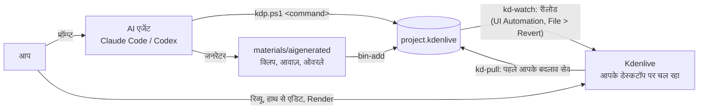

<div align="center">

# Movie Engine

**AI एजेंट आपकी आँखों के सामने Kdenlive में आपका वीडियो एडिट करता है, और आप किसी भी पल कमान अपने हाथ में ले सकते हैं।**

AI कोडिंग एजेंट (Claude Code, Codex) असली Kdenlive प्रोजेक्ट बनाते और बदलते हैं: फ़िल्में, explainer वीडियो और वर्टिकल शॉर्ट्स। बदलाव उसी एडिटर में लाइव दिखते हैं जो आपके सामने खुला है। पोर्टेबल, Windows, एडिटर में कोई पैच नहीं।


[English](../../README.md) · [简体中文](README.zh-CN.md) · [繁體中文](README.zh-TW.md) · **हिन्दी** · [Español](README.es.md) · [Français](README.fr.md) · [العربية](README.ar.md) · [বাংলা](README.bn.md) · [Português](README.pt.md) · [Русский](README.ru.md) · [اردو](README.ur.md) · [Bahasa Indonesia](README.id.md) · [Deutsch](README.de.md) · [日本語](README.ja.md) · [Türkçe](README.tr.md) · [한국어](README.ko.md) · [Українська](README.uk.md) · [Italiano](README.it.md) · [Polski](README.pl.md) · [Tiếng Việt](README.vi.md) · [فارسی](README.fa.md) · [ไทย](README.th.md) · [Kiswahili](README.sw.md) · [አማርኛ](README.am.md) · [Avañe'ẽ](README.gn.md) · [Setswana](README.tn.md) · [Shqip](README.sq.md) · [Беларуская](README.be.md) · [Български](README.bg.md) · [Bosanski](README.bs.md) · [Hrvatski](README.hr.md) · [Српски](README.sr.md) · [Crnogorski](README.cnr.md) · [Македонски](README.mk.md) · [Slovenščina](README.sl.md) · [Slovenčina](README.sk.md) · [Čeština](README.cs.md) · [Magyar](README.hu.md) · [Română](README.ro.md) · [Dansk](README.da.md) · [Norsk bokmål](README.nb.md) · [Norsk nynorsk](README.nn.md) · [Svenska](README.sv.md) · [Íslenska](README.is.md) · [Suomi](README.fi.md) · [Eesti](README.et.md) · [Latviešu](README.lv.md) · [Lietuvių](README.lt.md) · [Nederlands](README.nl.md) · [Lëtzebuergesch](README.lb.md) · [Rumantsch](README.rm.md) · [Ελληνικά](README.el.md) · [Malti](README.mt.md) · [Gaeilge](README.ga.md) · [Català](README.ca.md) · [ქართული](README.ka.md) · [Հայերեն](README.hy.md) · [Azərbaycanca](README.az.md) · [Afrikaans](README.af.md) · [isiZulu](README.zu.md) · [isiXhosa](README.xh.md) · [Sesotho](README.st.md) · [Sepedi](README.nso.md) · [Xitsonga](README.ts.md) · [Tshivenḓa](README.ve.md) · [siSwati](README.ss.md) · [isiNdebele (South Africa)](README.nr.md) · [isiNdebele (Zimbabwe)](README.nd.md) · [chiShona](README.sn.md) · [Chichewa](README.ny.md) · [Ikinyarwanda](README.rw.md) · [Ikirundi](README.rn.md) · [Malagasy](README.mg.md) · [Soomaali](README.so.md) · [Afaan Oromoo](README.om.md) · [Qafar af](README.aa.md) · [ትግርኛ](README.ti.md) · [Sängö](README.sg.md) · [Kreol Seselwa](README.crs.md) · [TjiKalanga](README.kck.md) · [ChiNdau](README.ndc.md)

*यह एक अनुवाद है; संदर्भ संस्करण अंग्रेज़ी README है।*

</div>

---

## सामग्री

- [क्यों](#क्यों)
- [यह कैसे काम करता है](#यह-कैसे-काम-करता-है)
- [विशेषताएँ](#विशेषताएँ)
- [आवश्यकताएँ](#आवश्यकताएँ)
- [इंस्टॉलेशन](#इंस्टॉलेशन)
- [त्वरित शुरुआत](#त्वरित-शुरुआत)
- [एजेंट के साथ काम करना](#एजेंट-के-साथ-काम-करना)
- [एडिटिंग कमांड लाइन (`kdp.ps1`)](#एडिटिंग-कमांड-लाइन-kdpps1)
- [खुले एडिटर के साथ लाइव सिंक](#खुले-एडिटर-के-साथ-लाइव-सिंक)
- [जनरेटर: जो Kdenlive नहीं कर सकता](#जनरेटर-जो-kdenlive-नहीं-कर-सकता)
- [वॉइस-ओवर और साउंड](#वॉइस-ओवर-और-साउंड)
- [इंटरफ़ेस की भाषा](#इंटरफ़ेस-की-भाषा)
- [फ़ोल्डर संरचना](#फ़ोल्डर-संरचना)
- [टेस्ट और प्रमाण](#टेस्ट-और-प्रमाण)
- [सीमाएँ](#सीमाएँ)
- [समस्या निवारण](#समस्या-निवारण)
- [अक्सर पूछे जाने वाले प्रश्न (FAQ)](#अक्सर-पूछे-जाने-वाले-प्रश्न-faq)
- [योगदान](#योगदान)
- [आभार](#आभार)
- [लाइसेंस](#लाइसेंस)

## क्यों

वीडियो एडिटर माउस पर टिके हाथों के लिए बने हैं। AI एजेंट संरचना, टाइमिंग और दोहराव वाले काम में अच्छे हैं: बीट पर 300 क्लिप रखना, हर कैप्शन को आवाज़ से मिलाना, फ़ीडबैक के बाद किसी सीन को दोबारा बनाना। लेकिन वे आपके डेस्कटॉप पर कब्ज़ा किए बिना GUI में क्लिक नहीं कर सकते।

Kdenlive एक दमदार ओपन-सोर्स एडिटर है, लेकिन Windows पर इसमें **कोई ऑटोमेशन API नहीं है**: D-Bus कंट्रोल सिर्फ़ Linux बिल्ड में है, और जो फ़ोर्क इसे जोड़ते हैं वे या तो मेंटेन नहीं होते या असुरक्षित हैं। Movie Engine एडिटर को पैच किए बिना यह समस्या हल करता है:

1. एजेंट `.kdenlive` प्रोजेक्ट फ़ाइल को एक टेस्ट की हुई कमांड लाइन (`engine/kdp.ps1`) से एडिट करता है।
2. चल रहे Kdenlive को Windows UI Automation के ज़रिए फ़ाइल दोबारा लोड करने को कहा जाता है, बिना कीस्ट्रोक, बिना माउस और बिना फ़ोकस छीने।
3. आपके अपने बिना सेव किए बदलाव पहले सेव होते हैं और कभी ओवरराइट नहीं होते।

यानी एजेंट एडिट करता है और आप रिव्यू करते हैं, या आप ख़ुद हाथ से एडिट करते हैं। आप दोनों एक ही प्रोजेक्ट पर, एक ही एडिटर में, एक ही समय पर काम करते हैं।

## यह कैसे काम करता है



हर एडिटिंग कमांड एक ही सुरक्षित चक्र अपनाती है:

1. **Pull.** अगर Kdenlive में बिना सेव किए बदलाव हैं, तो उसे उन्हें सेव करने को कहा जाता है (UI Automation से टूलबार का Save), और सेव की पुष्टि की जाती है।
2. **Edit.** कमांड लॉक के अंदर, हैश जाँच के बाद और undo स्नैपशॉट के साथ XML बदलती है। अगर इस बीच फ़ाइल बदल गई हो, तो कुछ भी नहीं लिखा जाता।
3. **Reload.** वॉचर AI का स्टैम्प देखता है और खुले एडिटर में File > Revert चलाता है। सफलता तभी मानी जाती है जब टाइमलाइन विजेट सचमुच दोबारा बन गया हो।
4. **Conflict.** अगर आपने बीच में एडिट करना शुरू कर दिया, तो कुछ भी रीलोड नहीं होता और आपका काम बना रहता है। AI का संस्करण अलग रख दिया जाता है, और एजेंट अपना बदलाव आपके बदलावों के ऊपर दोबारा लागू करता है।

## विशेषताएँ

- **GUI के बिना पूरी प्रोजेक्ट एडिटिंग**: लगभग 120 कमांड, जो bin, टाइमलाइन, इफ़ेक्ट, कंपोज़िशन, ट्रैक, गाइड, मार्कर, सबटाइटल, सीक्वेंस, स्पीड और टाइम रीमैप, स्लाइडशो, टाइटल, प्रॉक्सी, रेंडरिंग और undo/redo को कवर करती हैं। देखें [कमांड रेफ़रेंस](#एडिटिंग-कमांड-लाइन-kdpps1)।
- **खुले एडिटर के साथ लाइव सिंक।** AI के बदलाव उसी Kdenlive में दिखते हैं जिसे आप देख रहे हैं; आपके बिना सेव किए बदलाव पहले सेव होते हैं और कभी खोते नहीं।
- **आपके डेस्कटॉप में कभी ख़लल नहीं।** न फ़ोकस छीनना, न कीस्ट्रोक, न माउस इनपुट। टेस्ट एडिटर एक अदृश्य Windows डेस्कटॉप पर चलते हैं।
- **पोर्टेबल।** एडिटर, सेटिंग्स, Node.js, फ़ॉन्ट और टूल एक ही फ़ोल्डर में रहते हैं। इसे किसी दूसरे PC पर कॉपी करें और यह काम करेगा; Program Files या आपकी Windows प्रोफ़ाइल में कुछ नहीं लिखा जाता।
- **जो Kdenlive नहीं कर सकता, उसके लिए जनरेटर**: अक्षर-दर-अक्षर काइनेटिक टेक्स्ट, हाथ से बने एनोटेशन, 3D UI सीन, कर्सर एनिमेशन और लंबी इंटरैक्टिव "explainer" फ़िल्में। ये असली मोशन ब्लर के साथ GPU पर रेंडर होते हैं और टाइमलाइन पर सामान्य क्लिप की तरह रखे जाते हैं।
- **शब्दों की टाइमिंग के साथ वॉइस-ओवर** (Microsoft Edge TTS, API key की ज़रूरत नहीं)। कैप्शन और एक्शन ठीक उसी शब्द पर चलते हैं।
- **सिंथेसाइज़ किए गए साउंड इफ़ेक्ट** (whoosh, click, pop, riser, impact और भी बहुत), कोड में बनाए गए।
- **मान लिया नहीं, साबित किया गया।** हर कमांड के नतीजे की जाँच होती है, इफ़ेक्ट और कंपोज़िशन एक-एक करके परखे जाते हैं, और कच्चे नतीजे `docs/proof/` में हैं।
- **एजेंट के निर्देश साथ में।** `AGENTS.md` और `.claude/skills/` की स्किल्स Claude Code और Codex को वर्कफ़्लो, फ़ाइल फ़ॉर्मैट और आम ग़लतियाँ सिखाती हैं।

## आवश्यकताएँ

| | |
|---|---|
| OS | Windows 10 या 11, x64 |
| एडिटर | Kdenlive **26.08.3** पोर्टेबल (standalone) बिल्ड। दूसरे संस्करण टेस्ट नहीं किए गए हैं। |
| Node.js | 18 या नया: nodejs.org से Windows x64 `.zip`, `engine/node/` में अनज़िप किया हुआ |
| ब्राउज़र | Microsoft Edge (Windows का हिस्सा); सीन रेंडरर इसे headless मोड में इस्तेमाल करते हैं |
| एजेंट | [Claude Code](https://claude.com/claude-code) या Codex। वैकल्पिक: हर टूल हाथ से भी चलता है। |
| डिस्क | एडिटर और टूल के लिए लगभग 1 GB, साथ में आपका मीडिया |
| GPU | हार्डवेयर H.264 एन्कोडिंग वाला कोई भी GPU `film-render.mjs` को तेज़ करता है (न हो तो यह सॉफ़्टवेयर एन्कोडिंग पर चला जाता है) |

## इंस्टॉलेशन

सब कुछ **फ़ोल्डर के अंदर** इंस्टॉल होता है। किसी चीज़ के लिए admin अधिकार नहीं चाहिए।

```powershell
git clone https://github.com/vladtarrow/movie-engine.git
cd movie-engine
```

**1. Node.js.** <https://nodejs.org/en/download> से Node.js 18 या नए का Windows x64 `.zip` डाउनलोड करें और उसकी सामग्री `engine\node\` में अनज़िप करें, ताकि `engine\node\node.exe` और `engine\node\npm.cmd` वहाँ हों। न इंस्टॉलर चाहिए, न सिस्टम का Node। सभी स्क्रिप्ट `engine\node.cmd` से चलती हैं, कभी सिस्टम के Node से नहीं।

**2. Node पैकेज**, वॉइस टूल और रेंडरर के लिए (संस्करण `engine/voice/package.json` में फ़िक्स हैं):

```powershell
engine\node\npm.cmd install --prefix engine\voice
```

**3. Kdenlive 26.08.3 पोर्टेबल।** <https://download.kde.org/stable/kdenlive/26.08/windows/> से `kdenlive-26.08.3_standalone.exe` को `engine\installer\` में डाउनलोड करें, उसे जाँचें और अनपैक करें:

```powershell
(Get-FileHash engine\installer\kdenlive-26.08.3_standalone.exe -Algorithm SHA256).Hash
# अपेक्षित: A25427B1DFF2C17E3B0386E991BB1A719382BB3176D1A90E441CDAEB6E0A967D
engine\installer\kdenlive-26.08.3_standalone.exe -o"engine\Kdenlive" -y
```

एडिटर `engine\Kdenlive\kdenlive-26.08.3_standalone\bin\` में पहुँच जाता है। इसमें `melt.exe` और `ffmpeg.exe` पहले से शामिल हैं।

**4. पहली बार चलाना।**

```powershell
engine\kdenlive.cmd
```

Kdenlive अपनी सारी सेटिंग्स `engine\profile-kdenlive\` में रखता है, आपकी Windows प्रोफ़ाइल में नहीं। पहली बार चलाने पर यह एक बार का सेटअप विज़ार्ड दिखाता है।

## त्वरित शुरुआत

### एजेंट के साथ

फ़ोल्डर को Claude Code (या Codex) में खोलें और सीधे शब्दों में कहें:

> एक नया वर्टिकल 30 fps प्रोजेक्ट "launch-teaser" बनाओ। `materials/designers/launch/` के तीनों स्क्रीनशॉट टाइमलाइन पर रखो, हर एक 2.5 s का, छोटे cross-fade के साथ, `script.txt` से वॉइस-ओवर जोड़ो और हर लाइन पर एक काइनेटिक कैप्शन टाइम करो।

> इसे मेरे लिए Kdenlive में खोल दो।

> दूसरा शॉट बहुत लंबा है। इसे 1.8 s का कर दो और लोगो थोड़ा ऊपर कर दो।

एजेंट `AGENTS.md` का पालन करता है: वह `kdp.ps1` से एडिट करता है, सिर्फ़ वही क्लिप रेंडर करता है जो कट के लिए ज़रूरी हैं, और खुले एडिटर को सिंक में रखता है। आप Kdenlive में रिव्यू करते हैं, जब चाहें हाथ से एडिट करते हैं, और संतुष्ट होने पर Render दबाते हैं।

### हाथ से

```powershell
# 2 वीडियो और 2 ऑडियो ट्रैक वाला नया 1080x1920 30 fps प्रोजेक्ट
powershell -NoProfile -ExecutionPolicy Bypass -File engine\kdp.ps1 new -Project projects\hello\hello.kdenlive -Profile vertical_hd_30

# 3 सेकंड का टाइटल और एक रंगीन बैकग्राउंड
powershell -NoProfile -ExecutionPolicy Bypass -File engine\kdp.ps1 bin-color -Project projects\hello\hello.kdenlive -Color '#203060' -Seconds 3 -Name bg
powershell -NoProfile -ExecutionPolicy Bypass -File engine\kdp.ps1 title -Project projects\hello\hello.kdenlive -Text "Hello" -Seconds 3 -Name hi

# इन्हें रखें: बैकग्राउंड V1 पर, टाइटल उसके ऊपर V2 पर
powershell -NoProfile -ExecutionPolicy Bypass -File engine\kdp.ps1 add -Project projects\hello\hello.kdenlive -Bin bg -Track V1 -At 0
powershell -NoProfile -ExecutionPolicy Bypass -File engine\kdp.ps1 add -Project projects\hello\hello.kdenlive -Bin hi -Track V2 -At 0

# एक जाँच फ़्रेम, फिर इसे एडिटर में खोलें
powershell -NoProfile -ExecutionPolicy Bypass -File engine\kdp.ps1 frame -Project projects\hello\hello.kdenlive -At 1.5 -Out out\hello\check.png
engine\kdenlive.cmd projects\hello\hello.kdenlive
```

बाद में आख़िरी प्रोजेक्ट दोबारा खोलने के लिए `open-last-project.cmd` पर डबल-क्लिक करें।

## एजेंट के साथ काम करना

एजेंट `AGENTS.md` (Codex) या `CLAUDE.md` पढ़ता है, जो उसे इम्पोर्ट करती है (Claude Code), साथ में दो स्किल्स:

| स्किल | क्या सिखाती है |
|---|---|
| `.claude/skills/kdenlive-project-file` | `.kdenlive` / MLT XML फ़ॉर्मैट, `kdp.ps1`, `melt` से जाँच |
| `.claude/skills/kdenlive-live` | चल रहे एडिटर को सुरक्षित तरीक़े से चलाना: शुरू करना, pull, reload, उसकी विंडो कैप्चर करना |

एजेंट जिन नियमों का पालन करता है, और जिन पर आप भरोसा कर सकते हैं:

- यह कभी आपका माउस, कीबोर्ड या फ़ोकस नहीं लेता, और कभी आपके डेस्कटॉप का स्क्रीनशॉट नहीं लेता (सिर्फ़ एडिटर की अपनी विंडो का)।
- यह GUI के क़दम (सेव, खोलना, रीलोड) ख़ुद करता है, आपसे क्लिक करने को नहीं कहता।
- यह कुछ भी डाउनलोड करने और कुछ भी डिलीट करने से पहले पूछता है।
- यह सिर्फ़ वही रेंडर करता है जो काम के लिए ज़रूरी है (सीन क्लिप, जाँच फ़्रेम)। फ़ाइनल फ़िल्म यह तभी रेंडर करता है जब आप कहें।
- जब Kdenlive कोई चीज़ अच्छी तरह नहीं कर पाता, तो एजेंट उसे बाहर कोड से बनाता है और नतीजे को क्लिप के रूप में डालता है। वह इफ़ेक्ट को हल्का नहीं करता।

## एडिटिंग कमांड लाइन (`kdp.ps1`)

```powershell
powershell -NoProfile -ExecutionPolicy Bypass -File engine\kdp.ps1 <command> -Project <file.kdenlive> [options]
```

समय सेकंड में होता है, दशमलव के लिए बिंदु के साथ (`2.5`)। ट्रैक `V1 V2 …` (V1 सबसे नीचे) और `A1 A2 …` हैं। किसी क्लिप को `-Track` और उसके अंदर के किसी भी समय `-At` से चुना जाता है। इफ़ेक्ट पैरामीटर `-Params "name=value||name=value"` में जाते हैं। हर ऑप्शन के साथ पूरी सूची `engine/kdp.ps1` के हेडर में है।

| समूह | कमांड |
|---|---|
| प्रोजेक्ट | `new`, `profiles`, `info`, `validate`, `fonts`, `profile-set`, `profile-from-clip`, `zone`, `archive`, `backups`, `rebase`, `otio-export`, `otio-import` |
| Bin | `bin-add`, `bin-color`, `title`, `title-text`, `title-save`, `title-template`, `bin-rename`, `bin-remove`, `bin-info`, `bin-set`, `bin-duplicate`, `bin-replace-file`, `bin-reload`, `folder`, `bin-folder`, `relink`, `clean`, `generator`, `playlist-clip`, `extract-audio`, `transcode` |
| टाइमलाइन | `add`, `add-av`, `move`, `copy`, `trim`, `ripple-trim`, `slip`, `split`, `remove`, `speed`, `remap`, `disable`, `enable`, `group`, `ungroup`, `mix`, `unmix`, `space-insert`, `space-remove`, `spaces-remove-all`, `track-clear`, `replace-in-timeline` |
| इफ़ेक्ट | `effects`, `effect-info`, `effect-add`, `effect-list`, `effect-set`, `effect-remove`, `effect-copy`, `effect-clear`, `effects-all`, `bin-effect`, `effect-templates`, `effect-template` |
| कंपोज़िशन | `compositions`, `comp-info`, `comp-add`, `comp-list`, `comp-set`, `comp-remove` |
| ट्रैक | `track-add`, `track-remove`, `track-set` |
| गाइड और मार्कर | `guide-add`, `guide-list`, `guide-remove`, `guide-set`, `guide-clear`, `guide-export`, `guide-category`, `marker`, `marker-list`, `marker-set`, `marker-remove` |
| सबटाइटल | `sub-add`, `sub-import`, `sub-export`, `sub-state` |
| सीक्वेंस | `sequence-add`, `sequences`, `copy-to-sequence`, `expand`; `-Sequence <name>` के साथ कोई भी कमांड उस सीक्वेंस के अंदर काम करती है |
| विशेष | `slideshow`, `bin-add` के ज़रिए Lottie / Glaxnimate एनिमेशन, `proxy`, `stabilize`, `scene-split`, `speed-job`, `subclip` |
| आउटपुट | `frame` (एक PNG), `preview` (तेज़ melt रेंडर), `render` (Kdenlive का अपना रेंडरर या कोई प्रीसेट), `presets` |
| इतिहास | `undo`, `redo`, `clear-history` (स्नैपशॉट `projects/<name>/.kdp-history` में) |

जानने लायक़ व्यवहार:

- जुड़े हुए ऑडियो और वीडियो हिस्से साथ-साथ मूव, ट्रिम, स्प्लिट और रिमूव होते हैं (एक हिस्से के लिए `-Alone`)।
- विफल होने वाली कमांड कोड 1 के साथ बाहर निकलती है और कुछ नहीं लिखती।
- जो इफ़ेक्ट Windows बिल्ड नहीं चला सकता, उन्हें मना कर दिया जाता है, चुपचाप नज़रअंदाज़ नहीं किया जाता (सूची: `docs/proof/assets.txt`)।
- Kdenlive के हर मेन्यू एक्शन को `engine/tools/data/kdenlive-actions.csv` में किसी कमांड, किसी दूसरे रास्ते, या "सिर्फ़ देखने के लिए" से मैप किया गया है। देखें `docs/kdenlive-coverage.md`।

## खुले एडिटर के साथ लाइव सिंक

| स्क्रिप्ट | क्या करती है | एग्ज़िट कोड |
|---|---|---|
| `engine\kd-pull.ps1 -Project <f>` | Kdenlive से आपके बदलाव सेव करवाती है और इसकी पुष्टि करती है | 0 फ़ाइल अप-टू-डेट, 3 चल नहीं रहा, 4 पुष्टि नहीं हुई |
| `engine\kd-reload.ps1 -Project <f>` | File > Revert, दोबारा बनी टाइमलाइन से पुष्टि | 0 पुष्टि हुई, 2 आपके बिना सेव किए बदलाव हैं (कुछ भी नहीं हटाया गया), 3 चल नहीं रहा, 4 विफल |
| `engine\kd-watch.ps1 -Project <f>` | बैकग्राउंड वॉचर: AI के हर राइट के बाद रीलोड करता है, कॉन्फ़्लिक्ट लॉग करता है | लॉग `engine\kd-watch.log` में; रोकने के लिए `engine\kd-watch.run` डिलीट करें |
| `engine\kdenlive-bg.ps1 [project]` | एजेंट के लिए Kdenlive को मिनिमाइज़्ड शुरू करती है | 0 लोड हुआ, 4 पुष्टि नहीं हुई |
| `engine\kdenlive.cmd [project]` | आपके लिए Kdenlive शुरू करती है | |

हर सेशन में वॉचर एक बार शुरू करें:

```powershell
Start-Process powershell -WindowStyle Hidden -ArgumentList '-NoProfile','-ExecutionPolicy','Bypass','-File','engine\kd-watch.ps1','-Project','projects\hello\hello.kdenlive'
```

बड़े प्रोजेक्ट: 1000 क्लिप वाले प्रोजेक्ट को रीलोड होने में कई मिनट लगते हैं, और टूल जल्दी रिपोर्ट करने के बजाय उसका इंतज़ार करते हैं। प्रोजेक्ट ख़ाली एडिटर में *File > Open Recent* से खुलते हैं, क्योंकि फ़ाइल को सीधे खोलने पर Qt accessibility के लिए टाइमलाइन के हर आइटम से गुज़रता है, और यह लगभग 10 मिनट धीमा था।

## जनरेटर: जो Kdenlive नहीं कर सकता

Kdenlive/MLT में अक्षर-दर-अक्षर टेक्स्ट एनिमेशन नहीं है, expressions नहीं हैं और 3D बहुत कम है, और भारी इफ़ेक्ट प्लेबैक को धीमा कर देते हैं। Movie Engine ऐसे हिस्सों को बाहर रेंडर करता है और उन्हें टाइमलाइन पर सामान्य क्लिप की तरह रखता है, आम तौर पर alpha के साथ, तस्वीरों के ऊपर वाले ट्रैक पर। जनरेटर स्क्रिप्ट और उसके इनपुट प्रोजेक्ट फ़ोल्डर में रहते हैं, ताकि टेक्स्ट, फ़ॉन्ट या टाइमिंग बदलने पर क्लिप दोबारा बनाई जा सके।

| टूल | क्या बनाता है |
|---|---|
| `engine/tools/kinetic-text.ps1` | अक्षर-दर-अक्षर काइनेटिक कैप्शन, हर शब्द की टाइमिंग `voice.json` से, हाइलाइट बॉक्स |
| `engine/tools/annotate.ps1` | हाथ से बने गोले, बॉक्स, अंडरलाइन और तीर जो स्क्रीनशॉट के ऊपर ख़ुद-ब-ख़ुद खिंचते हैं |
| `engine/tools/card-entrance.ps1` | एक स्क्रीनशॉट कार्ड जो हल्की छाया के साथ ऊपर उठता और बड़ा होता हुआ आता है |
| `engine/tools/pdf-to-png.ps1` | PDF एक्सपोर्ट से स्लाइड |
| `engine/tools/html-render.mjs` | कोई भी HTML/CSS/canvas सीन वीडियो में: इंटरफ़ेस एनिमेशन, कर्सर, 3D, मास्क |
| `engine/tools/film-render.mjs` + `film/` | canvas पर लंबी, इंटरैक्टिव explainer फ़िल्में: हर वॉइस लाइन के लिए एक क्लिप, एक्शन बोले गए शब्दों पर चलते हैं, लगभग 45 fps पर GPU मोशन ब्लर |

दोनों रेंडरर Windows के साथ आने वाले Microsoft Edge को headless मोड में चलाते हैं, एक अस्थायी प्रोफ़ाइल के साथ और बिना नेटवर्क एक्सेस के।

### डेमो

```powershell
# कर्सर क्लिक के साथ 3 सेकंड का 3D टाइटल कार्ड
engine\node.cmd engine\tools\html-render.mjs examples\demo\scene\scene.html examples\demo\out --frames 0,30,60,89
engine\node.cmd engine\tools\html-render.mjs examples\demo\scene\scene.html examples\demo\out\scene.mp4

# दो वॉइस लाइनों पर टाइम की गई 4 शॉट वाली इंटरैक्टिव फ़िल्म
engine\node.cmd engine\tools\film-render.mjs examples\demo\film\film.html examples\demo\out --check
engine\node.cmd engine\tools\film-render.mjs examples\demo\film\film.html examples\demo\out --shots all --width 640
engine\node.cmd engine\tools\film-render.mjs examples\demo\film\film.html examples\demo\out\clips --suffix -v01
```

एक फ़िल्म तीन छोटी फ़ाइलों से बनती है। `data.js` में शॉट और शब्दों के समय होते हैं। `direction.js` में हर शॉट के लिए एक लाइन होती है:

```text
1 | hover 192 108 @brand | tag 300 60 Your brand @deserves | confetti 192 90 @film
2 say=A film that/*explains* it
3 | click 116 108 @before | click 268 108 @after | chips Before~After @after
4 scene=counter | count 0 120 % @count
```

`scenes.js` में वे शॉट होते हैं जो शुरू से ड्रॉ किए जाते हैं। `@word` तब एक्शन चलाता है जब आवाज़ वह शब्द बोलती है। एक्शन में click, hover, drag, zoom, lens, ring, arrow, chips, toggle, slider, toast, type, count और confetti शामिल हैं; पूरा सिंटैक्स `engine/tools/film/film-kit.js` के ऊपरी हिस्से में है।

## वॉइस-ओवर और साउंड

```powershell
engine\node.cmd engine\voice\voice.mjs lines.json materials\aigenerated\hello\voice en-US-AndrewMultilingualNeural +0%
```

`lines.json` लाइनों की एक सूची है। टूल हर लाइन के लिए एक mp3 लिखता है, साथ में `voice.json`, जिसमें अवधि और हर शब्द की शुरुआत और अंत होता है। लाइनें कैश होती हैं, इसलिए एक लाइन बदलने पर सिर्फ़ वही लाइन दोबारा बनती है। यह `msedge-tts` पैकेज के ज़रिए Microsoft Edge की ऑनलाइन text-to-speech सेवा इस्तेमाल करता है: किसी key की ज़रूरत नहीं, लेकिन सेवा अनाधिकारिक है और इंटरनेट चाहिए।

```powershell
engine\node.cmd engine\audio\sfx.mjs materials\aigenerated\sfx
```

यह whoosh, whoosh-long, swipe, click, pop, tick, riser, impact, ding और reveal को कोड में सिंथेसाइज़ करता है; एक तैयार सेट `materials/aigenerated/sfx/` में है। एक फ़्रेम से छोटी आवाज़ों को रखने से पहले उनमें साइलेंस जोड़ें (`-af apad=whole_dur=0.0667`)।

## इंटरफ़ेस की भाषा

लॉन्चर डिफ़ॉल्ट रूप से Kdenlive को **अंग्रेज़ी** में शुरू करते हैं। दूसरी भाषा इस्तेमाल करने के लिए, शुरू करने से पहले `MOVIE_ENGINE_UI_LANG` सेट करें:

```powershell
$env:MOVIE_ENGINE_UI_LANG = 'ru'; engine\kdenlive.cmd
```

UI Automation मेन्यू आइटम को उनके दिखने वाले नामों से ढूँढता है। 31 इंटरफ़ेस भाषाओं के नाम पहले से शामिल हैं (`engine/tools/kd-ui.ps1`, `$KdNames`)। किसी भी दूसरी भाषा के लिए, उसके नाम वहाँ जोड़ें और इससे जाँचें:

```powershell
powershell -NoProfile -ExecutionPolicy Bypass -File engine\tools\kd-langcheck.ps1
```

## फ़ोल्डर संरचना

```text
movie-engine/
├─ AGENTS.md, CLAUDE.md          instructions for AI agents
├─ .claude/skills/               agent skills: project file format, live editor
├─ engine/
│  ├─ kdp.ps1                    the editing command line
│  ├─ kd-pull / kd-reload / kd-watch .ps1, kdenlive.cmd, kdenlive-bg.ps1
│  ├─ tools/                     internals, generators, tests, data (action map)
│  ├─ voice/  audio/  fonts/     TTS, synthesized SFX, Poppins (OFL)
│  ├─ Kdenlive/  node/           portable editor and Node.js (not in git)
│  └─ profile-kdenlive/          the editor's settings (not in git)
├─ projects/<name>/<name>.kdenlive
├─ materials/
│  ├─ download/                  stock and downloaded files (not in git)
│  ├─ aigenerated/               everything the AI made (sfx/ and test-kit/ ship with the engine)
│  ├─ designers/  brand/         files from your team, brand assets
├─ examples/demo/                demos of the scene and film renderers
├─ out/                          renders (not in git)
└─ docs/                         proofs, coverage, translations of this README
```

प्रोजेक्ट के अंदर मीडिया पाथ relative होते हैं। अगर आप फ़ोल्डर को मूव या कॉपी करते हैं, तो `kdp.ps1 rebase` (जो `kdenlive.cmd` से अपने-आप भी चलता है) नई लोकेशन प्रोजेक्ट में लिख देता है।

## टेस्ट और प्रमाण

क्या काम करता है, इसके दावे नतीजों की जाँच पर आधारित हैं, "फ़ंक्शन चल गया" पर नहीं। सारांश [`docs/kdenlive-proof.md`](../../docs/kdenlive-proof.md) में है, और कच्चा आउटपुट `docs/proof/` में।

| टेस्ट | क्या जाँचता है |
|---|---|
| `engine\tools\kdp-clitest.ps1` | हर `kdp.ps1` कमांड, कमांड लाइन के ज़रिए, नतीजे वाले प्रोजेक्ट की तुलना करते हुए |
| `engine\tools\kd-livetest.ps1` | अदृश्य डेस्कटॉप पर असली Kdenlive के साथ pull, reload, वॉचर, कॉन्फ़्लिक्ट और race conditions |
| `engine\tools\kdp-assetsweep.ps1` | हर इफ़ेक्ट और कंपोज़िशन: फ़्रेम रेंडर करके तुलना करता है |
| `engine\tools\kdp-portabletest.ps1` | फ़ोल्डर को कहीं और कॉपी करता है और उस कॉपी से काम करता है |
| `engine\tools\kd-langcheck.ps1` | इंटरफ़ेस की भाषा, और यह कि UI Automation मेन्यू ढूँढ पाता है |
| `engine\tools\kdp-coverage-check.ps1` | हर मेन्यू एक्शन मैप है, और कोई भी प्रमाण कोड से पुराना नहीं है |

```powershell
powershell -NoProfile -ExecutionPolicy Bypass -File engine\tools\kdp-clitest.ps1 -Report docs\proof\clitest.txt
powershell -NoProfile -ExecutionPolicy Bypass -File engine\tools\kd-livetest.ps1 -Report docs\proof\live-en.txt
```

टेस्ट एडिटर सिर्फ़ छिपे हुए डेस्कटॉप पर अपनी अलग प्रोफ़ाइल के साथ चलते हैं, इसलिए टेस्ट कभी आपके खुले Kdenlive या आपके फ़ोकस को नहीं छूते।

## सीमाएँ

- **सिर्फ़ Windows**, सिर्फ़ Kdenlive **26.08.3**। Linux में D-Bus है और वहाँ एक अलग ब्रिज की ज़रूरत होगी।
- एडिटर शुरू करते समय, जब ख़ाली विंडो दिखती है, वह लगभग 3 सेकंड के लिए कीबोर्ड फ़ोकस ले लेता है। आपके काम करते समय एजेंट इसे शुरू करने से पहले पूछते हैं। रीलोड और एडिट फ़ोकस नहीं लेते।
- Windows बिल्ड में sox, ladspa और movit MLT मॉड्यूल और कुछ frei0r/avfilter इफ़ेक्ट नहीं हैं; `kdp.ps1` उन्हें मना कर देता है (`docs/proof/assets.txt`)।
- OpenTimelineIO एक्सपोर्ट और इम्पोर्ट सिर्फ़ क्लिप और गैप ले जाते हैं। Multicam में लाइव एंगल स्विचिंग नहीं है (कट split/remove/hide से बनाए जाते हैं)।
- मिनिमाइज़्ड विंडो पर UI Automation के ज़रिए "Save As…" कोई डायलॉग नहीं खोलता; एजेंट इसके बजाय `archive` या फ़ाइल कॉपी का इस्तेमाल करता है।
- स्पीच रिकग्निशन (ऑटो-सबटाइटल) के लिए Whisper या Vosk चाहिए, जो साथ में नहीं आते।
- Kdenlive के टाइटल टूल से बने टाइटल Windows में इंस्टॉल फ़ॉन्ट इस्तेमाल करते हैं। पक्की टाइपोग्राफ़ी के लिए, टेक्स्ट को जनरेटर से रेंडर करें, जो फ़ॉन्ट `engine/fonts/` से लोड करते हैं।
- Edge TTS एक अनाधिकारिक ऑनलाइन सेवा है और बदल सकती है या काम करना बंद कर सकती है।

## समस्या निवारण

| लक्षण | कारण और समाधान |
|---|---|
| Kdenlive चल रहा है, लेकिन टास्कबार पर क्लिक करने से कुछ नहीं दिखता | उसकी सेव की गई विंडो पोज़िशन स्क्रीन से बाहर है। उसे बंद करें और `engine\profile-kdenlive\AppData\Local\kdenliverc` में `kdockLayout` एंट्री डिलीट करें, या `SetWindowPos` से विंडो खिसकाएँ (देखें `AGENTS.md`)। |
| `kd-reload.ps1` कोड 2 के साथ बाहर निकलता है | आपके बिना सेव किए बदलाव हैं। कुछ भी हटाया नहीं गया। `kd-pull.ps1` चलाएँ, फिर बदलाव दोबारा लागू करें (`kdp.ps1` यह ख़ुद करता है)। |
| `engine\kd-watch.log` में `CONFLICT` | आपने और एजेंट ने एक ही पल में एडिट किया। आपका संस्करण एडिटर में रहता है, और AI का संस्करण `projects\<name>\.kdp-history\<name>\conflict\` में है। एजेंट से अपना बदलाव दोबारा लागू करने को कहें। |
| कोई कमांड "pull not confirmed" के साथ कोड 1 पर बाहर निकलती है | Kdenlive व्यस्त है या कोई डायलॉग दिखा रहा है। डायलॉग बंद करें या लोडिंग ख़त्म होने का इंतज़ार करें, फिर दोहराएँ। |
| कोई PowerShell स्क्रिप्ट पार्स नहीं होती | non-ASCII टेक्स्ट वाली स्क्रिप्ट Windows PowerShell 5.1 के लिए UTF-8 **BOM के साथ** सेव होनी चाहिए। |
| `voice.mjs` "Stream closed before the synthesis completed" के साथ रुक जाता है | आम तौर पर नेटवर्क की समस्या, या पुरानी कॉपियों में unescaped SSML। `voice.mjs` `& < >` को ख़ुद escape करता है। |
| बड़ा प्रोजेक्ट खुलने में कई मिनट लगते हैं | इसे `kdenlive.cmd` / `kdenlive-bg.ps1` से खोलें, कभी `kdenlive.exe project.kdenlive` की तरह नहीं। |

## अक्सर पूछे जाने वाले प्रश्न (FAQ)

**क्या मुझे Claude Code या Codex चाहिए?**
नहीं। हर टूल एक सादी स्क्रिप्ट है जिसे आप हाथ से चला सकते हैं। एजेंट इसे तेज़ बनाता है: वह कट की योजना बनाता है, टूल चलाता है और एडिटर को सिंक में रखता है।

**क्या एजेंट मेरे हाथ से किए बदलाव ओवरराइट कर देगा?**
नहीं। किसी भी राइट से पहले, आपके बिना सेव किए बदलाव सेव और पुष्ट किए जाते हैं। अगर एजेंट के लिखते समय आप एडिट करते हैं, तो राइट मना कर दिया जाता है या कॉन्फ़्लिक्ट के रूप में अलग रख दिया जाता है, आपके काम के ऊपर कभी लागू नहीं होता।

**क्या मैं Kdenlive को सामान्य रूप से इस्तेमाल करता रह सकता हूँ?**
हाँ। यह स्टॉक Kdenlive है, अपने अलग सेटिंग्स फ़ोल्डर के साथ। हमेशा की तरह एडिट, प्रीव्यू और रेंडर करें।

**क्या यह मेरे पहले से इंस्टॉल Kdenlive के साथ काम करता है?**
यह `engine\Kdenlive\` में अपनी पोर्टेबल कॉपी इस्तेमाल करता है, इसलिए आपका इंस्टॉल किया हुआ Kdenlive और उसकी सेटिंग्स अछूती रहती हैं।

**API वाला Kdenlive फ़ोर्क या कोई दूसरा एडिटर क्यों नहीं?**
Windows पर कोई मेंटेन किया हुआ और सुरक्षित फ़ोर्क मौजूद नहीं है (2026-11 का सर्वे)। OpenShot, Blender VSE, DaVinci Resolve, Shotcut और वेब एडिटर परखे गए; Kdenlive ने एडिटिंग की सबसे ज़्यादा गहराई दी। upstream में एक REST API प्रस्ताव (merge request !902) पर नज़र रखी जा रही है।

**क्या यह फ़ाइनल वीडियो रेंडर कर सकता है?**
हाँ, `kdp.ps1 render` से (Kdenlive का अपना रेंडरर, छिपे हुए), या आप एडिटर में ख़ुद Render दबाएँ।

**क्या मेरा मीडिया कहीं अपलोड होता है?**
नहीं। आवाज़ बनाते समय सिर्फ़ वॉइस-ओवर का टेक्स्ट Edge TTS सेवा को भेजा जाता है। सीन रेंडरर नेटवर्किंग बंद करके चलते हैं।

## योगदान

योगदान का स्वागत है। देखें [CONTRIBUTING.md](../../CONTRIBUTING.md)। संक्षेप में:

- हर नए या बदले गए `kdp.ps1` ऑपरेशन के लिए `kdp-clitest.ps1` में नतीजे की जाँच, एक्शन मैप में एक एंट्री, और `kdp-coverage-check.ps1` का ताज़ा रन ज़रूरी है।
- दिखने वाले डेस्कटॉप पर कभी टेस्ट Kdenlive शुरू न करें; `engine/tools/kd-hidden.ps1` इस्तेमाल करें।
- सब कुछ पोर्टेबल रखें: फ़ोल्डर के बाहर कोई इंस्टॉल नहीं, प्रोजेक्ट में कोई absolute पाथ नहीं।
- पुष्ट की गई ख़ासियतें (quirks) `AGENTS.md` या संबंधित स्किल में लिखें।

## आभार

- [Kdenlive](https://kdenlive.org) और [MLT](https://www.mltframework.org): एडिटर और उसके नीचे का इंजन।
- [FFmpeg](https://ffmpeg.org), जो Kdenlive के साथ आता है।
- वॉइस-ओवर के लिए [msedge-tts](https://www.npmjs.com/package/msedge-tts)।
- Indian Type Foundry का [Poppins](https://fonts.google.com/specimen/Poppins), SIL Open Font License (`engine/fonts/OFL.txt`)।
- `engine/tools/data/kdenliveui-26.08.3.rc`: Kdenlive की मेनू फ़ाइल, Kdenlive 26.08.3 के सोर्स से ली गई; केवल कवरेज जाँच में उपयोग होती है। यह MIT नहीं, Kdenlive के GPL लाइसेंस के अधीन रहती है।

## लाइसेंस

Movie Engine का अपना कोड [MIT लाइसेंस](../../LICENSE) के तहत जारी किया गया है। Kdenlive, MLT, FFmpeg, Node.js पैकेज और Poppins फ़ॉन्ट अपने-अपने लाइसेंस के अधीन रहते हैं।
