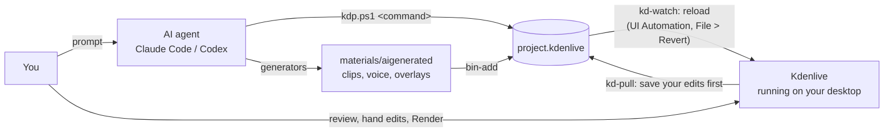

<div align="center">

# Movie Engine

**AI agent montira vaš video u Kdenliveu dok gledate, a vi u svakom trenutku možete preuzeti posao.**

AI agenti za programiranje (Claude Code, Codex) izrađuju i mijenjaju prave Kdenlive projekte: filmove, videozapise s objašnjenjima i vertikalne kratke videozapise. Izmjene se odmah pojavljuju u uređivaču koji imate otvoren. Prijenosno, Windows, bez zakrpa uređivača.


[English](../../README.md) · [简体中文](README.zh-CN.md) · [繁體中文](README.zh-TW.md) · [हिन्दी](README.hi.md) · [Español](README.es.md) · [Français](README.fr.md) · [العربية](README.ar.md) · [বাংলা](README.bn.md) · [Português](README.pt.md) · [Русский](README.ru.md) · [اردو](README.ur.md) · [Bahasa Indonesia](README.id.md) · [Deutsch](README.de.md) · [日本語](README.ja.md) · [Türkçe](README.tr.md) · [한국어](README.ko.md) · [Українська](README.uk.md) · [Italiano](README.it.md) · [Polski](README.pl.md) · [Tiếng Việt](README.vi.md) · [فارسی](README.fa.md) · [ไทย](README.th.md) · [Kiswahili](README.sw.md) · [አማርኛ](README.am.md) · [Avañe'ẽ](README.gn.md) · [Setswana](README.tn.md) · [Shqip](README.sq.md) · [Беларуская](README.be.md) · [Български](README.bg.md) · [Bosanski](README.bs.md) · **Hrvatski** · [Српски](README.sr.md) · [Crnogorski](README.cnr.md) · [Македонски](README.mk.md) · [Slovenščina](README.sl.md) · [Slovenčina](README.sk.md) · [Čeština](README.cs.md) · [Magyar](README.hu.md) · [Română](README.ro.md) · [Dansk](README.da.md) · [Norsk bokmål](README.nb.md) · [Norsk nynorsk](README.nn.md) · [Svenska](README.sv.md) · [Íslenska](README.is.md) · [Suomi](README.fi.md) · [Eesti](README.et.md) · [Latviešu](README.lv.md) · [Lietuvių](README.lt.md) · [Nederlands](README.nl.md) · [Lëtzebuergesch](README.lb.md) · [Rumantsch](README.rm.md) · [Ελληνικά](README.el.md) · [Malti](README.mt.md) · [Gaeilge](README.ga.md) · [Català](README.ca.md) · [ქართული](README.ka.md) · [Հայերեն](README.hy.md) · [Azərbaycanca](README.az.md) · [Afrikaans](README.af.md) · [isiZulu](README.zu.md) · [isiXhosa](README.xh.md) · [Sesotho](README.st.md) · [Sepedi](README.nso.md) · [Xitsonga](README.ts.md) · [Tshivenḓa](README.ve.md) · [siSwati](README.ss.md) · [isiNdebele (South Africa)](README.nr.md) · [isiNdebele (Zimbabwe)](README.nd.md) · [chiShona](README.sn.md) · [Chichewa](README.ny.md) · [Ikinyarwanda](README.rw.md) · [Ikirundi](README.rn.md) · [Malagasy](README.mg.md) · [Soomaali](README.so.md) · [Afaan Oromoo](README.om.md) · [Qafar af](README.aa.md) · [ትግርኛ](README.ti.md) · [Sängö](README.sg.md) · [Kreol Seselwa](README.crs.md) · [TjiKalanga](README.kck.md) · [ChiNdau](README.ndc.md)

*Ovo je prijevod; mjerodavna je engleska inačica README-a.*

</div>

---

## Sadržaj

- [Zašto](#zašto)
- [Kako radi](#kako-radi)
- [Značajke](#značajke)
- [Zahtjevi](#zahtjevi)
- [Instalacija](#instalacija)
- [Brzi početak](#brzi-početak)
- [Rad s agentom](#rad-s-agentom)
- [Naredbeni redak za uređivanje (`kdp.ps1`)](#naredbeni-redak-za-uređivanje-kdpps1)
- [Sinkronizacija uživo s otvorenim uređivačem](#sinkronizacija-uživo-s-otvorenim-uređivačem)
- [Generatori: ono što Kdenlive ne može](#generatori-ono-što-kdenlive-ne-može)
- [Glasovna naracija i zvuk](#glasovna-naracija-i-zvuk)
- [Jezik sučelja](#jezik-sučelja)
- [Struktura mapa](#struktura-mapa)
- [Testovi i dokazi](#testovi-i-dokazi)
- [Ograničenja](#ograničenja)
- [Rješavanje problema](#rješavanje-problema)
- [Česta pitanja](#česta-pitanja)
- [Doprinos projektu](#doprinos-projektu)
- [Zahvale](#zahvale)
- [Licencija](#licencija)

## Zašto

Programi za montažu videa napravljeni su za ruku na mišu. AI agenti dobri su u strukturi, vremenskom usklađivanju i ponavljanju: postaviti 300 isječaka u ritam glazbe, uskladiti svaki natpis s glasom, ponovno napraviti scenu nakon primjedbi. Ali ne mogu klikati po grafičkom sučelju a da ne preuzmu vašu radnu površinu.

Kdenlive je snažan uređivač otvorenog koda, ali na Windowsima **nema API za automatizaciju**: upravljanje putem D-Busa postoji samo u inačicama za Linux, a forkovi koji ga dodaju ili se više ne održavaju ili nisu sigurni. Movie Engine to rješava bez krpanja uređivača:

1. Agent mijenja datoteku projekta `.kdenlive` pomoću testiranog naredbenog retka (`engine/kdp.ps1`).
2. Pokrenutom Kdenliveu putem Windows UI Automationa poručuje se da ponovno učita datoteku, bez pritisaka tipki, bez miša i bez otimanja fokusa.
3. Vaše nespremljene izmjene najprije se spremaju i nikad se ne prepisuju.

Dakle, agent montira, a vi pregledavate, ili sami uređujete ručno. Oboje radite na istom projektu, u istom uređivaču, u isto vrijeme.

## Kako radi



Svaka naredba za uređivanje prolazi isti sigurni ciklus:

1. **Pull.** Ako Kdenlive ima nespremljene promjene, dobiva nalog da ih spremi (gumb Save na alatnoj traci putem UI Automationa), a spremanje se potvrđuje.
2. **Izmjena.** Naredba mijenja XML pod zaključavanjem, nakon provjere sažetka (hash) i sa snimkom stanja za poništavanje. Ako se datoteka u međuvremenu promijenila, ništa se ne zapisuje.
3. **Ponovno učitavanje.** Promatrač prepoznaje oznaku koju ostavlja AI i u otvorenom uređivaču pokreće File > Revert. Uspjehom se smatra samo kad je widget vremenske crte doista ponovno izgrađen.
4. **Sukob.** Ako ste u međuvremenu počeli uređivati, ništa se ne učitava ponovno i vaš rad ostaje. AI inačica sprema se sa strane, a agent ponovno primjenjuje svoju izmjenu povrh vaše.

## Značajke

- **Potpuno uređivanje projekta bez grafičkog sučelja**: oko 120 naredbi koje pokrivaju spremnik projekta, vremensku crtu, efekte, kompozicije, staze, vodilice, markere, titlove, sekvencije, brzinu i preslikavanje vremena (time remap), dijaprojekcije, naslove, proxy isječke, renderiranje te poništavanje i ponavljanje. Pogledajte [popis naredbi](#naredbeni-redak-za-uređivanje-kdpps1).
- **Sinkronizacija uživo s otvorenim uređivačem.** AI izmjene pojavljuju se u Kdenliveu koji gledate; vaše nespremljene izmjene najprije se spremaju i nikad se ne gube.
- **Nikad ne ometa vašu radnu površinu.** Bez otimanja fokusa, pritisaka tipki i unosa mišem. Testni uređivači rade na nevidljivoj radnoj površini sustava Windows.
- **Prijenosno.** Uređivač, postavke, Node.js, fontovi i alati nalaze se u jednoj mapi. Kopirajte je na drugo računalo i radit će; ništa se ne zapisuje u Program Files ni u vaš profil sustava Windows.
- **Generatori za ono što Kdenlive ne može**: kinetički tekst animiran slovo po slovo, ručno crtane oznake, 3D scene sučelja, animacije pokazivača i dugi interaktivni filmovi s objašnjenjima. Renderiraju se na GPU-u sa stvarnim zamućenjem pokreta i postavljaju na vremensku crtu kao obični isječci.
- **Glasovna naracija s vremenskim oznakama riječi** (Microsoft Edge TTS, bez API ključa). Natpisi i radnje okidaju se točno na zadanoj riječi.
- **Sintetizirani zvučni efekti** (whoosh, click, pop, riser, impact i drugi), generirani kodom.
- **Dokazano, a ne pretpostavljeno.** Svaka naredba ima provjeru rezultata, efekti i kompozicije provjeravaju se jedan po jedan, a sirovi rezultati nalaze se u `docs/proof/`.
- **Upute za agente su uključene.** `AGENTS.md` i vještine u `.claude/skills/` uče Claude Code i Codex tijeku rada, formatu datoteke i zamkama.

## Zahtjevi

| | |
|---|---|
| OS | Windows 10 ili 11, x64 |
| Uređivač | Kdenlive **26.08.3**, prijenosna (standalone) inačica. Druge inačice nisu testirane. |
| Node.js | 18 ili noviji: Windows x64 `.zip` s nodejs.org, raspakiran u `engine/node/` |
| Preglednik | Microsoft Edge (dio sustava Windows); rendereri scena koriste ga u headless načinu rada |
| Agent | [Claude Code](https://claude.com/claude-code) ili Codex. Nije obavezno: svaki se alat može pokrenuti i ručno. |
| Disk | oko 1 GB za uređivač i alate, plus vaši medijski sadržaji |
| GPU | bilo koji GPU s hardverskim kodiranjem H.264 ubrzava `film-render.mjs` (bez njega se koristi softversko kodiranje) |

## Instalacija

Sve se instalira **unutar mape**. Administratorska prava nisu potrebna.

```powershell
git clone https://github.com/vladtarrow/movie-engine.git
cd movie-engine
```

**1. Node.js.** Preuzmite Windows x64 `.zip` Node.js-a 18 ili novijeg s <https://nodejs.org/en/download> i raspakirajte njegov sadržaj u `engine\node\`, tako da se ondje nalaze `engine\node\node.exe` i `engine\node\npm.cmd`. Nisu potrebni ni instalacijski program ni Node instaliran u sustavu. Sve se skripte pokreću putem `engine\node.cmd`, nikad putem Nodea iz sustava.

**2. Node paketi** za glasovni alat i renderere (inačice su fiksirane u `engine/voice/package.json`):

```powershell
engine\node\npm.cmd install --prefix engine\voice
```

**3. Prijenosni Kdenlive 26.08.3.** Preuzmite `kdenlive-26.08.3_standalone.exe` s <https://download.kde.org/stable/kdenlive/26.08/windows/> u `engine\installer\`, provjerite ga i raspakirajte:

```powershell
(Get-FileHash engine\installer\kdenlive-26.08.3_standalone.exe -Algorithm SHA256).Hash
# expected: A25427B1DFF2C17E3B0386E991BB1A719382BB3176D1A90E441CDAEB6E0A967D
engine\installer\kdenlive-26.08.3_standalone.exe -o"engine\Kdenlive" -y
```

Uređivač se nalazi u `engine\Kdenlive\kdenlive-26.08.3_standalone\bin\`. Već sadrži `melt.exe` i `ffmpeg.exe`.

**4. Prvo pokretanje.**

```powershell
engine\kdenlive.cmd
```

Kdenlive sve svoje postavke drži u `engine\profile-kdenlive\`, a ne u vašem profilu sustava Windows. Pri prvom pokretanju jednom prikazuje čarobnjak za početno postavljanje.

## Brzi početak

### S agentom

Otvorite mapu u Claude Codeu (ili Codexu) i zatražite običnim riječima:

> Napravi novi vertikalni projekt „launch-teaser” od 30 fps. Stavi na vremensku crtu tri snimke zaslona iz `materials/designers/launch/`, svaku po 2,5 s s kratkim pretapanjem, dodaj glasovnu naraciju iz `script.txt` i uskladi kinetički natpis sa svakim retkom.

> Otvori mi ga u Kdenliveu.

> Drugi kadar je predug. Skrati ga na 1,8 s i pomakni logotip malo prema gore.

Agent slijedi `AGENTS.md`: uređuje putem `kdp.ps1`, renderira samo isječke koji su potrebni montaži i drži otvoreni uređivač usklađenim. Vi pregledavate u Kdenliveu, ručno uređujete kad god želite i pritisnete Render kad ste zadovoljni.

### Ručno

```powershell
# a new 1080x1920 30 fps project with 2 video and 2 audio tracks
powershell -NoProfile -ExecutionPolicy Bypass -File engine\kdp.ps1 new -Project projects\hello\hello.kdenlive -Profile vertical_hd_30

# a 3-second title and a colour background
powershell -NoProfile -ExecutionPolicy Bypass -File engine\kdp.ps1 bin-color -Project projects\hello\hello.kdenlive -Color '#203060' -Seconds 3 -Name bg
powershell -NoProfile -ExecutionPolicy Bypass -File engine\kdp.ps1 title -Project projects\hello\hello.kdenlive -Text "Hello" -Seconds 3 -Name hi

# place them: background on V1, title above it on V2
powershell -NoProfile -ExecutionPolicy Bypass -File engine\kdp.ps1 add -Project projects\hello\hello.kdenlive -Bin bg -Track V1 -At 0
powershell -NoProfile -ExecutionPolicy Bypass -File engine\kdp.ps1 add -Project projects\hello\hello.kdenlive -Bin hi -Track V2 -At 0

# a check frame, then open it in the editor
powershell -NoProfile -ExecutionPolicy Bypass -File engine\kdp.ps1 frame -Project projects\hello\hello.kdenlive -At 1.5 -Out out\hello\check.png
engine\kdenlive.cmd projects\hello\hello.kdenlive
```

Da biste kasnije ponovno otvorili posljednji projekt, dvaput kliknite `open-last-project.cmd`.

## Rad s agentom

Agent čita `AGENTS.md` (Codex) ili `CLAUDE.md`, koji ga uvozi (Claude Code), te dvije vještine:

| Vještina | Čemu uči |
|---|---|
| `.claude/skills/kdenlive-project-file` | formatu `.kdenlive` / MLT XML, radu s `kdp.ps1`, provjeri pomoću `melt` |
| `.claude/skills/kdenlive-live` | sigurnom upravljanju pokrenutim uređivačem: pokretanje, pull, ponovno učitavanje, snimanje njegova prozora |

Pravila kojih se agent drži i na koja se možete osloniti:

- Nikad ne preuzima vaš miš, tipkovnicu ili fokus i nikad ne snima vašu radnu površinu (samo vlastiti prozor uređivača).
- Korake u grafičkom sučelju (spremanje, otvaranje, ponovno učitavanje) obavlja sam, umjesto da od vas traži da kliknete.
- Pita prije nego što išta preuzme i prije nego što išta izbriše.
- Renderira samo ono što je potrebno za rad (isječke scena, kontrolne sličice). Završni film renderira samo kad to zatražite.
- Kad Kdenlive nešto ne može dobro napraviti, agent to izrađuje izvan njega kodom i umeće rezultat kao isječak. Efekt ne razvodnjava.

## Naredbeni redak za uređivanje (`kdp.ps1`)

```powershell
powershell -NoProfile -ExecutionPolicy Bypass -File engine\kdp.ps1 <command> -Project <file.kdenlive> [options]
```

Vrijeme se zadaje u sekundama, s točkom (`2.5`). Staze su `V1 V2 …` (V1 je najniža) i `A1 A2 …`. Isječak se određuje pomoću `-Track` i bilo kojeg trenutka `-At` unutar njega. Parametri efekata navode se u `-Params "name=value||name=value"`. Potpuni popis sa svim opcijama nalazi se u zaglavlju datoteke `engine/kdp.ps1`.

| Skupina | Naredbe |
|---|---|
| Projekt | `new`, `profiles`, `info`, `validate`, `fonts`, `profile-set`, `profile-from-clip`, `zone`, `archive`, `backups`, `rebase`, `otio-export`, `otio-import` |
| Spremnik projekta | `bin-add`, `bin-color`, `title`, `title-text`, `title-save`, `title-template`, `bin-rename`, `bin-remove`, `bin-info`, `bin-set`, `bin-duplicate`, `bin-replace-file`, `bin-reload`, `folder`, `bin-folder`, `relink`, `clean`, `generator`, `playlist-clip`, `extract-audio`, `transcode` |
| Vremenska crta | `add`, `add-av`, `move`, `copy`, `trim`, `ripple-trim`, `slip`, `split`, `remove`, `speed`, `remap`, `disable`, `enable`, `group`, `ungroup`, `mix`, `unmix`, `space-insert`, `space-remove`, `spaces-remove-all`, `track-clear`, `replace-in-timeline` |
| Efekti | `effects`, `effect-info`, `effect-add`, `effect-list`, `effect-set`, `effect-remove`, `effect-copy`, `effect-clear`, `effects-all`, `bin-effect`, `effect-templates`, `effect-template` |
| Kompozicije | `compositions`, `comp-info`, `comp-add`, `comp-list`, `comp-set`, `comp-remove` |
| Staze | `track-add`, `track-remove`, `track-set` |
| Vodilice i markeri | `guide-add`, `guide-list`, `guide-remove`, `guide-set`, `guide-clear`, `guide-export`, `guide-category`, `marker`, `marker-list`, `marker-set`, `marker-remove` |
| Titlovi | `sub-add`, `sub-import`, `sub-export`, `sub-state` |
| Sekvencije | `sequence-add`, `sequences`, `copy-to-sequence`, `expand`; svaka naredba s `-Sequence <name>` radi unutar te sekvencije |
| Posebno | `slideshow`, Lottie / Glaxnimate animacije putem `bin-add`, `proxy`, `stabilize`, `scene-split`, `speed-job`, `subclip` |
| Izlaz | `frame` (jedan PNG), `preview` (brzo renderiranje melt-om), `render` (Kdenliveov vlastiti renderer ili predložak), `presets` |
| Povijest | `undo`, `redo`, `clear-history` (snimke stanja u `projects/<name>/.kdp-history`) |

Ponašanje koje vrijedi znati:

- Povezane audio i video polovice zajedno se premještaju, skraćuju, dijele i uklanjaju (`-Alone` za samo jednu polovicu).
- Naredba koja ne uspije završava s kodom 1 i ništa ne zapisuje.
- Efekti koje inačica za Windows ne može izvesti odbijaju se, a ne prešutno zanemaruju (popis: `docs/proof/assets.txt`).
- Svaka radnja iz izbornika Kdenlivea povezana je s naredbom, drugim putem ili oznakom „samo prikaz” u `engine/tools/data/kdenlive-actions.csv`. Pogledajte `docs/kdenlive-coverage.md`.

## Sinkronizacija uživo s otvorenim uređivačem

| Skripta | Što radi | Izlazni kodovi |
|---|---|---|
| `engine\kd-pull.ps1 -Project <f>` | navodi Kdenlive da spremi vaše izmjene i to potvrđuje | 0 datoteka je ažurna, 3 nije pokrenut, 4 nije potvrđeno |
| `engine\kd-reload.ps1 -Project <f>` | File > Revert, potvrđeno ponovno izgrađenom vremenskom crtom | 0 potvrđeno, 2 imate nespremljene izmjene (ništa nije odbačeno), 3 nije pokrenut, 4 nije uspjelo |
| `engine\kd-watch.ps1 -Project <f>` | promatrač u pozadini: ponovno učitava nakon svakog AI zapisa, bilježi sukobe | zapisnik u `engine\kd-watch.log`; za zaustavljanje izbrišite `engine\kd-watch.run` |
| `engine\kdenlive-bg.ps1 [project]` | pokreće Kdenlive minimiziran, za agenta | 0 učitano, 4 nije potvrđeno |
| `engine\kdenlive.cmd [project]` | pokreće Kdenlive za vas | |

Pokrenite promatrača jednom po sesiji:

```powershell
Start-Process powershell -WindowStyle Hidden -ArgumentList '-NoProfile','-ExecutionPolicy','Bypass','-File','engine\kd-watch.ps1','-Project','projects\hello\hello.kdenlive'
```

Veliki projekti: ponovno učitavanje projekta s 1000 isječaka traje nekoliko minuta, a alati ga čekaju umjesto da prerano jave rezultat. Projekti se otvaraju putem *File > Open Recent* u praznom uređivaču, jer pri izravnom otvaranju datoteke Qt radi pristupačnosti prolazi kroz svaki element vremenske crte, što je bilo oko 10 minuta sporije.

## Generatori: ono što Kdenlive ne može

Kdenlive/MLT nema animaciju teksta slovo po slovo, nema izraze (expressions) i ima malo 3D-a, a zahtjevni efekti usporavaju reprodukciju. Movie Engine takve dijelove renderira izvan uređivača i postavlja ih na vremensku crtu kao obične isječke, obično s alfa-kanalom, na stazu iznad slike. Skripta generatora i njezini ulazni podaci ostaju u mapi projekta, pa se isječak može ponovno generirati kad se promijene tekst, font ili vremenski raspored.

| Alat | Izrađuje |
|---|---|
| `engine/tools/kinetic-text.ps1` | kinetičke natpise animirane slovo po slovo, svaku riječ vremenski usklađenu prema `voice.json`, okvir za isticanje |
| `engine/tools/annotate.ps1` | ručno crtane krugove, okvire, podcrtavanja i strelice koje se iscrtavaju preko snimke zaslona |
| `engine/tools/card-entrance.ps1` | karticu sa snimkom zaslona koja se podiže i povećava uz meku sjenu |
| `engine/tools/pdf-to-png.ps1` | slajdove iz PDF izvoza |
| `engine/tools/html-render.mjs` | video iz bilo koje HTML/CSS/canvas scene: animacija sučelja, pokazivači, 3D, maske |
| `engine/tools/film-render.mjs` + `film/` | duge interaktivne filmove s objašnjenjima na canvasu: jedan isječak po rečenici naracije, radnje se okidaju na izgovorenim riječima, zamućenje pokreta na GPU-u pri oko 45 fps |

Oba renderera upravljaju Microsoft Edgeom koji dolazi sa sustavom Windows, u headless načinu rada, s jednokratnim profilom i bez pristupa mreži.

### Demonstracije

```powershell
# a 3-second 3D title card with a cursor click
engine\node.cmd engine\tools\html-render.mjs examples\demo\scene\scene.html examples\demo\out --frames 0,30,60,89
engine\node.cmd engine\tools\html-render.mjs examples\demo\scene\scene.html examples\demo\out\scene.mp4

# a 4-shot interactive film timed to two voice lines
engine\node.cmd engine\tools\film-render.mjs examples\demo\film\film.html examples\demo\out --check
engine\node.cmd engine\tools\film-render.mjs examples\demo\film\film.html examples\demo\out --shots all --width 640
engine\node.cmd engine\tools\film-render.mjs examples\demo\film\film.html examples\demo\out\clips --suffix -v01
```

Film se sastoji od tri male datoteke. `data.js` sadrži kadrove i vremena riječi. `direction.js` ima jedan redak po kadru:

```text
1 | hover 192 108 @brand | tag 300 60 Your brand @deserves | confetti 192 90 @film
2 say=A film that/*explains* it
3 | click 116 108 @before | click 268 108 @after | chips Before~After @after
4 scene=counter | count 0 120 % @count
```

`scenes.js` sadrži kadrove koji se crtaju od nule. `@word` okida radnju kad glas izgovori tu riječ. Među radnjama su click, hover, drag, zoom, lens, ring, arrow, chips, toggle, slider, toast, type, count i confetti; potpuna sintaksa nalazi se na početku datoteke `engine/tools/film/film-kit.js`.

## Glasovna naracija i zvuk

```powershell
engine\node.cmd engine\voice\voice.mjs lines.json materials\aigenerated\hello\voice en-US-AndrewMultilingualNeural +0%
```

`lines.json` je popis rečenica. Alat zapisuje po jedan mp3 za svaku rečenicu te `voice.json` s trajanjem i s početkom i krajem svake riječi. Rečenice se spremaju u predmemoriju, pa promjena jedne rečenice ponovno generira samo nju. Alat koristi mrežnu sintezu govora Microsoft Edgea putem paketa `msedge-tts`: ključ nije potreban, ali usluga je neslužbena i zahtijeva internetsku vezu.

```powershell
engine\node.cmd engine\audio\sfx.mjs materials\aigenerated\sfx
```

Ovo kodom sintetizira whoosh, whoosh-long, swipe, click, pop, tick, riser, impact, ding i reveal; gotov skup nalazi se u `materials/aigenerated/sfx/`. Zvukove kraće od jedne sličice prije postavljanja nadopunite tišinom (`-af apad=whole_dur=0.0667`).

## Jezik sučelja

Pokretači prema zadanim postavkama pokreću Kdenlive na **engleskom**. Za drugi jezik postavite `MOVIE_ENGINE_UI_LANG` prije pokretanja:

```powershell
$env:MOVIE_ENGINE_UI_LANG = 'ru'; engine\kdenlive.cmd
```

UI Automation pronalazi stavke izbornika po njihovim vidljivim nazivima. Nazivi za 31 jezik sučelja već su ugrađeni (`engine/tools/kd-ui.ps1`, `$KdNames`). Za bilo koji drugi jezik ondje dodajte njegove nazive i provjerite naredbom:

```powershell
powershell -NoProfile -ExecutionPolicy Bypass -File engine\tools\kd-langcheck.ps1
```

## Struktura mapa

```text
movie-engine/
├─ AGENTS.md, CLAUDE.md          instructions for AI agents
├─ .claude/skills/               agent skills: project file format, live editor
├─ engine/
│  ├─ kdp.ps1                    the editing command line
│  ├─ kd-pull / kd-reload / kd-watch .ps1, kdenlive.cmd, kdenlive-bg.ps1
│  ├─ tools/                     internals, generators, tests, data (action map)
│  ├─ voice/  audio/  fonts/     TTS, synthesized SFX, Poppins (OFL)
│  ├─ Kdenlive/  node/           portable editor and Node.js (not in git)
│  └─ profile-kdenlive/          the editor's settings (not in git)
├─ projects/<name>/<name>.kdenlive
├─ materials/
│  ├─ download/                  stock and downloaded files (not in git)
│  ├─ aigenerated/               everything the AI made (sfx/ and test-kit/ ship with the engine)
│  ├─ designers/  brand/         files from your team, brand assets
├─ examples/demo/                demos of the scene and film renderers
├─ out/                          renders (not in git)
└─ docs/                         proofs, coverage, translations of this README
```

Putanje do medija unutar projekata su relativne. Ako premjestite ili kopirate mapu, `kdp.ps1 rebase` (koji `kdenlive.cmd` također pokreće automatski) upisuje novu lokaciju u projekt.

## Testovi i dokazi

Tvrdnje o tome što radi potkrijepljene su provjerama rezultata, a ne time što se „funkcija izvršila”. Sažetak je u [`docs/kdenlive-proof.md`](../../docs/kdenlive-proof.md), a sirovi izlaz u `docs/proof/`.

| Test | Provjerava |
|---|---|
| `engine\tools\kdp-clitest.ps1` | svaku naredbu `kdp.ps1`, putem naredbenog retka, uspoređujući dobiveni projekt |
| `engine\tools\kd-livetest.ps1` | pull, ponovno učitavanje, promatrača, sukobe i utrke (race conditions) sa stvarnim Kdenliveom na nevidljivoj radnoj površini |
| `engine\tools\kdp-assetsweep.ps1` | svaki efekt i svaku kompoziciju: renderira i uspoređuje sličice |
| `engine\tools\kdp-portabletest.ps1` | kopira mapu na drugo mjesto i radi iz kopije |
| `engine\tools\kd-langcheck.ps1` | jezik sučelja i to da UI Automation pronalazi izbornik |
| `engine\tools\kdp-coverage-check.ps1` | da je svaka radnja izbornika povezana i da nijedan dokaz nije stariji od koda |

```powershell
powershell -NoProfile -ExecutionPolicy Bypass -File engine\tools\kdp-clitest.ps1 -Report docs\proof\clitest.txt
powershell -NoProfile -ExecutionPolicy Bypass -File engine\tools\kd-livetest.ps1 -Report docs\proof\live-en.txt
```

Testni uređivači rade samo na skrivenoj radnoj površini s vlastitim profilom, pa testovi nikad ne diraju vaš otvoreni Kdenlive ni vaš fokus.

## Ograničenja

- **Samo Windows**, samo Kdenlive **26.08.3**. Linux ima D-Bus i za njega bi trebao drugačiji most.
- Pokretanje uređivača preuzima fokus tipkovnice na oko 3 sekunde dok se pojavljuje prazan prozor. Agenti pitaju prije nego što ga pokrenu dok radite. Ponovna učitavanja i izmjene ne preuzimaju fokus.
- Inačici za Windows nedostaju MLT moduli sox, ladspa i movit te neki frei0r/avfilter efekti; `kdp.ps1` ih odbija (`docs/proof/assets.txt`).
- Izvoz i uvoz OpenTimelineIO prenose samo isječke i praznine. Multicam nema prebacivanje kutova snimanja uživo (rezovi se rade pomoću split/remove/hide).
- „Save As…” putem UI Automationa na minimiziranom prozoru ne otvara dijaloški okvir; agent umjesto toga koristi `archive` ili kopije datoteka.
- Prepoznavanje govora (automatski titlovi) zahtijeva Whisper ili Vosk, koji nisu uključeni.
- Naslovi izrađeni Kdenliveovim alatom za naslove koriste fontove instalirane u sustavu Windows. Za zajamčenu tipografiju renderirajte tekst generatorima, koji učitavaju fontove iz `engine/fonts/`.
- Edge TTS je neslužbena mrežna usluga i može se promijeniti ili prestati raditi.

## Rješavanje problema

| Simptom | Uzrok i rješenje |
|---|---|
| Kdenlive je pokrenut, ali klik na njega na programskoj traci ništa ne prikazuje | Njegov spremljeni položaj prozora nalazi se izvan zaslona. Zatvorite ga i izbrišite unose `kdockLayout` u `engine\profile-kdenlive\AppData\Local\kdenliverc` ili premjestite prozor pomoću `SetWindowPos` (pogledajte `AGENTS.md`). |
| `kd-reload.ps1` završava s kodom 2 | Imate nespremljene izmjene. Ništa nije odbačeno. Pokrenite `kd-pull.ps1`, a zatim ponovno primijenite promjenu (`kdp.ps1` to radi sam). |
| `CONFLICT` u `engine\kd-watch.log` | Vi i agent uređivali ste u istom trenutku. Vaša inačica ostaje u uređivaču, a AI inačica nalazi se u `projects\<name>\.kdp-history\<name>\conflict\`. Zamolite agenta da ponovno primijeni svoju izmjenu. |
| Naredba završava s kodom 1 i porukom „pull not confirmed” | Kdenlive je zauzet ili prikazuje dijaloški okvir. Zatvorite dijaloški okvir ili pričekajte da se učitavanje završi, a zatim ponovite. |
| PowerShell skripta ne može se raščlaniti | Skripte s tekstom izvan ASCII-ja za Windows PowerShell 5.1 moraju biti spremljene kao UTF-8 **s BOM-om**. |
| `voice.mjs` se zaustavlja porukom „Stream closed before the synthesis completed” | Obično je riječ o problemu s mrežom ili o neizbjegnutom (unescaped) SSML-u u starijim kopijama. `voice.mjs` sam izbjegava znakove `& < >`. |
| Otvaranje velikog projekta traje mnogo minuta | Otvorite ga putem `kdenlive.cmd` / `kdenlive-bg.ps1`, nikad kao `kdenlive.exe project.kdenlive`. |

## Česta pitanja

**Trebam li Claude Code ili Codex?**
Ne. Svaki je alat obična skripta koju možete pokrenuti ručno. Agent je ono što posao čini brzim: planira montažu, pokreće alate i drži uređivač usklađenim.

**Hoće li agent prepisati moje ručne izmjene?**
Ne. Prije svakog zapisivanja vaše se nespremljene izmjene spremaju i potvrđuju. Ako uređujete dok agent zapisuje, zapis se odbija ili sprema sa strane kao sukob, a nikad se ne primjenjuje preko vašeg rada.

**Mogu li i dalje normalno koristiti Kdenlive?**
Da. To je standardni Kdenlive s vlastitom mapom postavki. Uređujte, pregledavajte i renderirajte kao i obično.

**Radi li s Kdenliveom koji već imam instaliran?**
Koristi vlastitu prijenosnu kopiju u `engine\Kdenlive\`, pa vaš instalirani Kdenlive i njegove postavke ostaju netaknuti.

**Zašto ne fork Kdenlivea s API-jem ili neki drugi uređivač?**
Za Windows ne postoji održavan i siguran fork (pregled iz studenoga 2026.). Razmotreni su OpenShot, Blender VSE, DaVinci Resolve, Shotcut i web-uređivači; Kdenlive je pružio najveću dubinu uređivanja. Pratimo prijedlog REST API-ja u izvornom projektu (merge request !902).

**Može li renderirati završni video?**
Da, pomoću `kdp.ps1 render` (Kdenliveov vlastiti renderer, skriveno), ili sami pritisnete Render u uređivaču.

**Šalju li se moji mediji ikamo?**
Ne. Kad generirate glas, usluzi Edge TTS šalje se samo tekst naracije. Rendereri scena rade s isključenom mrežom.

## Doprinos projektu

Doprinosi su dobrodošli. Pogledajte [CONTRIBUTING.md](../../CONTRIBUTING.md). Ukratko:

- Svaka nova ili izmijenjena operacija `kdp.ps1` treba provjeru rezultata u `kdp-clitest.ps1`, unos u karti radnji i novo pokretanje `kdp-coverage-check.ps1`.
- Nikad ne pokrećite testni Kdenlive na vidljivoj radnoj površini; koristite `engine/tools/kd-hidden.ps1`.
- Neka sve ostane prijenosno: bez instalacija izvan mape, bez apsolutnih putanja u projektima.
- Provjerene posebnosti zapišite u `AGENTS.md` ili u odgovarajuću vještinu.

## Zahvale

- [Kdenlive](https://kdenlive.org) i [MLT](https://www.mltframework.org): uređivač i pogon ispod njega.
- [FFmpeg](https://ffmpeg.org), isporučuje se s Kdenliveom.
- [msedge-tts](https://www.npmjs.com/package/msedge-tts) za glasovnu naraciju.
- [Poppins](https://fonts.google.com/specimen/Poppins) tvrtke Indian Type Foundry, SIL Open Font License (`engine/fonts/OFL.txt`).
- `engine/tools/data/kdenliveui-26.08.3.rc`: datoteka izbornika Kdenlivea, preuzeta iz izvornog koda Kdenlivea 26.08.3; koristi je samo provjera pokrivenosti. I dalje podliježe Kdenliveovoj licenciji GPL, a ne licenciji MIT.

## Licencija

Vlastiti kod Movie Enginea objavljen je pod [licencijom MIT](../../LICENSE). Kdenlive, MLT, FFmpeg, Node.js paketi i font Poppins zadržavaju vlastite licencije.
