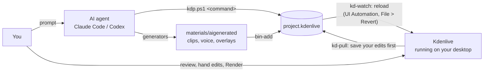

<div align="center">

# Movie Engine

**Egy MI-ügynök a szeme láttára vágja a videóját a Kdenlive-ban, és Ön bármikor átveheti az irányítást.**

Programozó MI-ügynökök (Claude Code, Codex) valódi Kdenlive-projekteket hoznak létre és módosítanak: filmeket, magyarázó videókat és függőleges rövid videókat. A módosítások élőben megjelennek a megnyitott szerkesztőben. Hordozható, Windows, a szerkesztő módosítása nélkül.


[English](../../README.md) · [简体中文](README.zh-CN.md) · [繁體中文](README.zh-TW.md) · [हिन्दी](README.hi.md) · [Español](README.es.md) · [Français](README.fr.md) · [العربية](README.ar.md) · [বাংলা](README.bn.md) · [Português](README.pt.md) · [Русский](README.ru.md) · [اردو](README.ur.md) · [Bahasa Indonesia](README.id.md) · [Deutsch](README.de.md) · [日本語](README.ja.md) · [Türkçe](README.tr.md) · [한국어](README.ko.md) · [Українська](README.uk.md) · [Italiano](README.it.md) · [Polski](README.pl.md) · [Tiếng Việt](README.vi.md) · [فارسی](README.fa.md) · [ไทย](README.th.md) · [Kiswahili](README.sw.md) · [አማርኛ](README.am.md) · [Avañe'ẽ](README.gn.md) · [Setswana](README.tn.md) · [Shqip](README.sq.md) · [Беларуская](README.be.md) · [Български](README.bg.md) · [Bosanski](README.bs.md) · [Hrvatski](README.hr.md) · [Српски](README.sr.md) · [Crnogorski](README.cnr.md) · [Македонски](README.mk.md) · [Slovenščina](README.sl.md) · [Slovenčina](README.sk.md) · [Čeština](README.cs.md) · **Magyar** · [Română](README.ro.md) · [Dansk](README.da.md) · [Norsk bokmål](README.nb.md) · [Norsk nynorsk](README.nn.md) · [Svenska](README.sv.md) · [Íslenska](README.is.md) · [Suomi](README.fi.md) · [Eesti](README.et.md) · [Latviešu](README.lv.md) · [Lietuvių](README.lt.md) · [Nederlands](README.nl.md) · [Lëtzebuergesch](README.lb.md) · [Rumantsch](README.rm.md) · [Ελληνικά](README.el.md) · [Malti](README.mt.md) · [Gaeilge](README.ga.md) · [Català](README.ca.md) · [ქართული](README.ka.md) · [Հայերեն](README.hy.md) · [Azərbaycanca](README.az.md) · [Afrikaans](README.af.md) · [isiZulu](README.zu.md) · [isiXhosa](README.xh.md) · [Sesotho](README.st.md) · [Sepedi](README.nso.md) · [Xitsonga](README.ts.md) · [Tshivenḓa](README.ve.md) · [siSwati](README.ss.md) · [isiNdebele (South Africa)](README.nr.md) · [isiNdebele (Zimbabwe)](README.nd.md) · [chiShona](README.sn.md) · [Chichewa](README.ny.md) · [Ikinyarwanda](README.rw.md) · [Ikirundi](README.rn.md) · [Malagasy](README.mg.md) · [Soomaali](README.so.md) · [Afaan Oromoo](README.om.md) · [Qafar af](README.aa.md) · [ትግርኛ](README.ti.md) · [Sängö](README.sg.md) · [Kreol Seselwa](README.crs.md) · [TjiKalanga](README.kck.md) · [ChiNdau](README.ndc.md)

*Ez egy fordítás. A referenciaváltozat az angol nyelvű README.*

</div>

---

## Tartalom

- [Miért](#miért)
- [Hogyan működik](#hogyan-működik)
- [Funkciók](#funkciók)
- [Követelmények](#követelmények)
- [Telepítés](#telepítés)
- [Gyors kezdés](#gyors-kezdés)
- [Munka az ügynökkel](#munka-az-ügynökkel)
- [A vágási parancssor (`kdp.ps1`)](#a-vágási-parancssor-kdpps1)
- [Élő szinkronizálás a megnyitott szerkesztővel](#élő-szinkronizálás-a-megnyitott-szerkesztővel)
- [Generátorok: amire a Kdenlive nem képes](#generátorok-amire-a-kdenlive-nem-képes)
- [Narráció és hang](#narráció-és-hang)
- [A felület nyelve](#a-felület-nyelve)
- [Mappaszerkezet](#mappaszerkezet)
- [Tesztek és bizonyítékok](#tesztek-és-bizonyítékok)
- [Korlátozások](#korlátozások)
- [Hibaelhárítás](#hibaelhárítás)
- [GYIK](#gyik)
- [Közreműködés](#közreműködés)
- [Köszönetnyilvánítás](#köszönetnyilvánítás)
- [Licenc](#licenc)

## Miért

A videószerkesztőket egérre tett kézre tervezték. Az MI-ügynökök a szerkezetben, az időzítésben és az ismétlődő munkában jók: 300 klipet ütemre helyeznek, minden feliratot a hanghoz időzítenek, visszajelzés után újracsinálnak egy jelenetet. A grafikus felületen viszont nem tudnak kattintgatni anélkül, hogy átvennék az Ön asztalát.

A Kdenlive erős, nyílt forráskódú szerkesztő, de Windowson **nincs automatizálási API-ja**: D-Bus-vezérlés csak a linuxos buildekben van, az ezt hozzáadó forkok pedig vagy nem karbantartottak, vagy nem biztonságosak. A Movie Engine a szerkesztő módosítása nélkül oldja meg ezt:

1. Az ügynök egy tesztelt parancssorral (`engine/kdp.ps1`) szerkeszti a `.kdenlive` projektfájlt.
2. A futó Kdenlive a Windows UI Automationön keresztül utasítást kap a fájl újraolvasására, billentyűleütések, egér és fókuszelvétel nélkül.
3. Az Ön saját, nem mentett módosításai előbb mentésre kerülnek, és soha nem íródnak felül.

Az ügynök tehát vág, Ön pedig ellenőriz, vagy kézzel szerkeszt. Mindketten ugyanazon a projekten, ugyanabban a szerkesztőben, ugyanabban az időben dolgoznak.

## Hogyan működik



Minden szerkesztőparancs ugyanazt a biztonságos ciklust követi:

1. **Pull.** Ha a Kdenlive-ban nem mentett módosítások vannak, utasítást kap a mentésükre (az eszköztár Save gombja UI Automationön keresztül), és a mentés megerősítést kap.
2. **Szerkesztés.** A parancs zárolás alatt, hash-ellenőrzés után és visszavonási pillanatképpel módosítja az XML-t. Ha a fájl közben megváltozott, semmi nem íródik ki.
3. **Újratöltés.** A figyelő felismeri az MI által hagyott jelölést, és a megnyitott szerkesztőben lefuttatja a File > Revert parancsot. Csak az számít sikernek, ha az idővonal-widget ténylegesen újraépült.
4. **Ütközés.** Ha Ön közben szerkeszteni kezdett, semmi nem töltődik újra, és az Ön munkája megmarad. Az MI változata félre lesz téve, az ügynök pedig az Önéi fölé újra alkalmazza a saját módosítását.

## Funkciók

- **Teljes projektszerkesztés grafikus felület nélkül**: körülbelül 120 parancs, amely lefedi a projekttárat, az idővonalat, az effekteket, a kompozíciókat, a sávokat, a vezetővonalakat, a jelölőket, a feliratokat, a szekvenciákat, a sebességet és az időleképezést, a diavetítéseket, a címklipeket, a proxykat, a renderelést és a visszavonást/újra végrehajtást. Lásd a [parancsreferenciát](#a-vágási-parancssor-kdpps1).
- **Élő szinkronizálás a megnyitott szerkesztővel.** Az MI módosításai abban a Kdenlive-ban jelennek meg, amelyet Ön éppen néz; az Ön nem mentett módosításai előbb mentésre kerülnek, és soha nem vesznek el.
- **Soha nem zavarja az asztalát.** Nincs fókuszelvétel, billentyűleütés vagy egérmozgatás. A tesztszerkesztők egy láthatatlan Windows-asztalon futnak.
- **Hordozható.** A szerkesztő, a beállítások, a Node.js, a betűtípusok és az eszközök egyetlen mappában vannak. Másolja át egy másik gépre, és működik; semmi nem íródik a Program Files mappába vagy az Ön Windows-profiljába.
- **Generátorok arra, amire a Kdenlive nem képes**: betűnként animált kinetikus szöveg, kézzel rajzolt jelölések, 3D felületi jelenetek, kurzoranimációk és hosszú, interaktív magyarázó filmek. GPU-n renderelődnek valódi mozgási elmosódással, és közönséges klipként kerülnek az idővonalra.
- **Narráció szóidőzítéssel** (Microsoft Edge TTS, API-kulcs nélkül). A feliratok és a műveletek pontosan a megfelelő szónál indulnak.
- **Szintetizált hangeffektek** (whoosh, click, pop, riser, impact és mások), kódból generálva.
- **Bizonyított, nem feltételezett.** Minden parancsnak van eredményellenőrzése, az effekteket és a kompozíciókat egyenként végigpróbáljuk, a nyers eredmények pedig a `docs/proof/` mappában vannak.
- **Ügynökutasításokkal együtt.** Az `AGENTS.md` és a `.claude/skills/` képességei megtanítják a Claude Code-nak és a Codexnek a munkafolyamatot, a fájlformátumot és a buktatókat.

## Követelmények

| | |
|---|---|
| Operációs rendszer | Windows 10 vagy 11, x64 |
| Szerkesztő | Kdenlive **26.08.3** hordozható (standalone) build. Más verziók nincsenek tesztelve. |
| Node.js | 18-as vagy újabb: a Windows x64 `.zip` a nodejs.org oldalról, kicsomagolva az `engine/node/` mappába |
| Böngésző | Microsoft Edge (a Windows része); a jelenetrenderelők headless módban használják |
| Ügynök | [Claude Code](https://claude.com/claude-code) vagy Codex. Opcionális: minden eszköz kézzel is futtatható. |
| Lemez | körülbelül 1 GB a szerkesztőnek és az eszközöknek, plusz az Ön médiafájljai |
| GPU | bármely hardveres H.264-kódolásra képes GPU felgyorsítja a `film-render.mjs` futását (enélkül szoftveres kódolásra vált) |

## Telepítés

Minden **a mappán belülre** települ. Semmihez sem kell rendszergazdai jog.

```powershell
git clone https://github.com/vladtarrow/movie-engine.git
cd movie-engine
```

**1. Node.js.** Töltse le a Node.js 18-as vagy újabb verziójának Windows x64 `.zip` fájlját a <https://nodejs.org/en/download> oldalról, és csomagolja ki a tartalmát az `engine\node\` mappába úgy, hogy ott legyen az `engine\node\node.exe` és az `engine\node\npm.cmd`. Nincs szükség telepítőre és rendszerszintű Node-ra. Minden szkript az `engine\node.cmd` segítségével fut, soha nem a rendszer Node-jával.

**2. Node-csomagok** a hangeszközhöz és a renderelőkhöz (a verziók rögzítve vannak az `engine/voice/package.json` fájlban):

```powershell
engine\node\npm.cmd install --prefix engine\voice
```

**3. Hordozható Kdenlive 26.08.3.** Töltse le a `kdenlive-26.08.3_standalone.exe` fájlt a <https://download.kde.org/stable/kdenlive/26.08/windows/> oldalról az `engine\installer\` mappába, ellenőrizze, majd csomagolja ki:

```powershell
(Get-FileHash engine\installer\kdenlive-26.08.3_standalone.exe -Algorithm SHA256).Hash
# expected: A25427B1DFF2C17E3B0386E991BB1A719382BB3176D1A90E441CDAEB6E0A967D
engine\installer\kdenlive-26.08.3_standalone.exe -o"engine\Kdenlive" -y
```

A szerkesztő az `engine\Kdenlive\kdenlive-26.08.3_standalone\bin\` mappába kerül. Már tartalmazza a `melt.exe` és az `ffmpeg.exe` fájlt.

**4. Első indítás.**

```powershell
engine\kdenlive.cmd
```

A Kdenlive minden beállítását az `engine\profile-kdenlive\` mappában tárolja, nem az Ön Windows-profiljában. Az első indításkor egyszer megjelenít egy beállítási varázslót.

## Gyors kezdés

### Ügynökkel

Nyissa meg a mappát a Claude Code-ban (vagy a Codexben), és kérje egyszerű szavakkal:

> Készíts egy új függőleges, 30 fps-es „launch-teaser” projektet. Tedd az idővonalra a `materials/designers/launch/` három képernyőképét, mindegyiket 2,5 másodpercre, rövid áttűnéssel, adj hozzá narrációt a `script.txt` alapján, és minden sorhoz időzíts egy kinetikus feliratot.

> Nyisd meg nekem a Kdenlive-ban.

> A második snitt túl hosszú. Vágd le 1,8 másodpercre, és vidd egy kicsit feljebb a logót.

Az ügynök az `AGENTS.md` szerint jár el: a `kdp.ps1` segítségével szerkeszt, csak azokat a klipeket rendereli, amelyekre a vágásnak szüksége van, és szinkronban tartja a megnyitott szerkesztőt. Ön a Kdenlive-ban ellenőriz, bármikor kézzel szerkeszthet, és ha elégedett, megnyomja a Render gombot.

### Kézzel

```powershell
# a new 1080x1920 30 fps project with 2 video and 2 audio tracks
powershell -NoProfile -ExecutionPolicy Bypass -File engine\kdp.ps1 new -Project projects\hello\hello.kdenlive -Profile vertical_hd_30

# a 3-second title and a colour background
powershell -NoProfile -ExecutionPolicy Bypass -File engine\kdp.ps1 bin-color -Project projects\hello\hello.kdenlive -Color '#203060' -Seconds 3 -Name bg
powershell -NoProfile -ExecutionPolicy Bypass -File engine\kdp.ps1 title -Project projects\hello\hello.kdenlive -Text "Hello" -Seconds 3 -Name hi

# place them: background on V1, title above it on V2
powershell -NoProfile -ExecutionPolicy Bypass -File engine\kdp.ps1 add -Project projects\hello\hello.kdenlive -Bin bg -Track V1 -At 0
powershell -NoProfile -ExecutionPolicy Bypass -File engine\kdp.ps1 add -Project projects\hello\hello.kdenlive -Bin hi -Track V2 -At 0

# a check frame, then open it in the editor
powershell -NoProfile -ExecutionPolicy Bypass -File engine\kdp.ps1 frame -Project projects\hello\hello.kdenlive -At 1.5 -Out out\hello\check.png
engine\kdenlive.cmd projects\hello\hello.kdenlive
```

Ha később újra meg szeretné nyitni az utolsó projektet, kattintson duplán az `open-last-project.cmd` fájlra.

## Munka az ügynökkel

Az ügynök az `AGENTS.md` fájlt (Codex) vagy az azt importáló `CLAUDE.md` fájlt (Claude Code) olvassa, valamint két képességet:

| Képesség | Mit tanít |
|---|---|
| `.claude/skills/kdenlive-project-file` | a `.kdenlive` / MLT XML formátumot, a `kdp.ps1` használatát, az ellenőrzést a `melt` segítségével |
| `.claude/skills/kdenlive-live` | a futó szerkesztő biztonságos vezérlését: indítás, pull, újratöltés, az ablak rögzítése |

Szabályok, amelyeket az ügynök betart, és amelyekre Ön számíthat:

- Soha nem veszi el az Ön egerét, billentyűzetét vagy fókuszát, és soha nem készít képernyőképet az asztaláról (csak a szerkesztő saját ablakáról).
- A grafikus felületen szükséges lépéseket (mentés, megnyitás, újratöltés) maga végzi el ahelyett, hogy kattintásra kérné Önt.
- Bármi letöltése és bármi törlése előtt rákérdez.
- Csak azt rendereli, amire a munkának szüksége van (jelenetklipek, ellenőrző képkockák). A kész filmet csak akkor rendereli, ha Ön kéri.
- Ha a Kdenlive valamire nem képes jól, az ügynök kóddal, azon kívül készíti el, és az eredményt klipként illeszti be. Nem butítja le az effektet.

## A vágási parancssor (`kdp.ps1`)

```powershell
powershell -NoProfile -ExecutionPolicy Bypass -File engine\kdp.ps1 <command> -Project <file.kdenlive> [options]
```

Az időket másodpercben kell megadni, ponttal (`2.5`). A sávok neve `V1 V2 …` (a V1 a legalsó) és `A1 A2 …`. Egy klipet a `-Track` és egy tetszőleges, a klipen belüli `-At` időpont azonosít. Az effektparaméterek a `-Params "name=value||name=value"` formában adhatók meg. A teljes lista az összes opcióval az `engine/kdp.ps1` fejlécében található.

| Csoport | Parancsok |
|---|---|
| Projekt | `new`, `profiles`, `info`, `validate`, `fonts`, `profile-set`, `profile-from-clip`, `zone`, `archive`, `backups`, `rebase`, `otio-export`, `otio-import` |
| Projekttár | `bin-add`, `bin-color`, `title`, `title-text`, `title-save`, `title-template`, `bin-rename`, `bin-remove`, `bin-info`, `bin-set`, `bin-duplicate`, `bin-replace-file`, `bin-reload`, `folder`, `bin-folder`, `relink`, `clean`, `generator`, `playlist-clip`, `extract-audio`, `transcode` |
| Idővonal | `add`, `add-av`, `move`, `copy`, `trim`, `ripple-trim`, `slip`, `split`, `remove`, `speed`, `remap`, `disable`, `enable`, `group`, `ungroup`, `mix`, `unmix`, `space-insert`, `space-remove`, `spaces-remove-all`, `track-clear`, `replace-in-timeline` |
| Effektek | `effects`, `effect-info`, `effect-add`, `effect-list`, `effect-set`, `effect-remove`, `effect-copy`, `effect-clear`, `effects-all`, `bin-effect`, `effect-templates`, `effect-template` |
| Kompozíciók | `compositions`, `comp-info`, `comp-add`, `comp-list`, `comp-set`, `comp-remove` |
| Sávok | `track-add`, `track-remove`, `track-set` |
| Vezetővonalak és jelölők | `guide-add`, `guide-list`, `guide-remove`, `guide-set`, `guide-clear`, `guide-export`, `guide-category`, `marker`, `marker-list`, `marker-set`, `marker-remove` |
| Feliratok | `sub-add`, `sub-import`, `sub-export`, `sub-state` |
| Szekvenciák | `sequence-add`, `sequences`, `copy-to-sequence`, `expand`; bármely parancs a `-Sequence <name>` opcióval az adott szekvencián belül működik |
| Speciális | `slideshow`, Lottie / Glaxnimate animációk a `bin-add` segítségével, `proxy`, `stabilize`, `scene-split`, `speed-job`, `subclip` |
| Kimenet | `frame` (egy PNG), `preview` (gyors renderelés melttel), `render` (a Kdenlive saját renderelője vagy egy előbeállítás), `presets` |
| Előzmények | `undo`, `redo`, `clear-history` (pillanatképek a `projects/<name>/.kdp-history` mappában) |

Amit érdemes tudni a működésről:

- Az összekapcsolt hang- és képfelek együtt mozognak, vágódnak, darabolódnak és törlődnek (`-Alone` csak az egyik félhez).
- A sikertelen parancs 1-es kóddal lép ki, és semmit nem ír ki.
- Azokat az effekteket, amelyeket a windowsos build nem tud futtatni, a parancs elutasítja, nem hallgatja el csendben (lista: `docs/proof/assets.txt`).
- A Kdenlive minden menüművelete hozzá van rendelve egy parancshoz, egy másik megoldáshoz vagy a „csak megtekintés” jelöléshez az `engine/tools/data/kdenlive-actions.csv` fájlban. Lásd: `docs/kdenlive-coverage.md`.

## Élő szinkronizálás a megnyitott szerkesztővel

| Szkript | Mit csinál | Kilépési kódok |
|---|---|---|
| `engine\kd-pull.ps1 -Project <f>` | menti a Kdenlive-val az Ön módosításait, és megerősíti a mentést | 0 a fájl naprakész, 3 nem fut, 4 nincs megerősítve |
| `engine\kd-reload.ps1 -Project <f>` | File > Revert, az újraépült idővonal erősíti meg | 0 megerősítve, 2 Önnek nem mentett módosításai vannak (semmi nem veszett el), 3 nem fut, 4 sikertelen |
| `engine\kd-watch.ps1 -Project <f>` | háttérfigyelő: minden MI-írás után újratölt, naplózza az ütközéseket | napló: `engine\kd-watch.log`; leállításhoz törölje az `engine\kd-watch.run` fájlt |
| `engine\kdenlive-bg.ps1 [project]` | kis méretre állítva indítja a Kdenlive-ot egy ügynök számára | 0 betöltve, 4 nincs megerősítve |
| `engine\kdenlive.cmd [project]` | elindítja a Kdenlive-ot Önnek | |

Munkamenetenként egyszer indítsa el a figyelőt:

```powershell
Start-Process powershell -WindowStyle Hidden -ArgumentList '-NoProfile','-ExecutionPolicy','Bypass','-File','engine\kd-watch.ps1','-Project','projects\hello\hello.kdenlive'
```

Nagy projektek: egy 1000 klipes projekt újratöltése perceket vesz igénybe, és az eszközök kivárják, ahelyett hogy idő előtt jelentenének. A projektek egy üres szerkesztőben a *File > Open Recent* menüponttal nyílnak meg, mert egy fájl közvetlen megnyitásakor a Qt az akadálymentesítés miatt végigjárja az idővonal minden elemét, és ez körülbelül 10 perccel lassabb volt.

## Generátorok: amire a Kdenlive nem képes

A Kdenlive/MLT nem ismeri a betűnkénti szöveganimációt és a kifejezéseket (expressions), alig tud 3D-t, a nehéz effektek pedig lassítják a lejátszást. A Movie Engine az ilyen részeket a szerkesztőn kívül rendereli, és közönséges klipként helyezi az idővonalra, általában alfa-csatornával, a képek feletti sávra. A generátorszkript és a bemenetei a projekt mappájában maradnak, így a klip újragenerálható, ha a szöveg, a betűtípus vagy az időzítés változik.

| Eszköz | Mit készít |
|---|---|
| `engine/tools/kinetic-text.ps1` | betűnként animált kinetikus feliratok, minden szó a `voice.json` alapján időzítve, kiemelő keret |
| `engine/tools/annotate.ps1` | kézzel rajzolt körök, keretek, aláhúzások és nyilak, amelyek egy képernyőkép fölött rajzolódnak ki |
| `engine/tools/card-entrance.ps1` | képernyőképes kártya, amely lágy árnyékkal felemelkedik és felnagyul |
| `engine/tools/pdf-to-png.ps1` | diák egy PDF-exportból |
| `engine/tools/html-render.mjs` | bármilyen HTML/CSS/canvas jelenet videóvá: felületanimáció, kurzorok, 3D, maszkok |
| `engine/tools/film-render.mjs` + `film/` | hosszú, interaktív magyarázó filmek canvasen: narrációs soronként egy klip, a műveletek az elhangzó szavaknál indulnak, GPU-s mozgási elmosódás körülbelül 45 fps sebességgel |

Mindkét renderelő a Windowsszal érkező Microsoft Edge-et vezérli headless módban, eldobható profillal és hálózati hozzáférés nélkül.

### Bemutatók

```powershell
# a 3-second 3D title card with a cursor click
engine\node.cmd engine\tools\html-render.mjs examples\demo\scene\scene.html examples\demo\out --frames 0,30,60,89
engine\node.cmd engine\tools\html-render.mjs examples\demo\scene\scene.html examples\demo\out\scene.mp4

# a 4-shot interactive film timed to two voice lines
engine\node.cmd engine\tools\film-render.mjs examples\demo\film\film.html examples\demo\out --check
engine\node.cmd engine\tools\film-render.mjs examples\demo\film\film.html examples\demo\out --shots all --width 640
engine\node.cmd engine\tools\film-render.mjs examples\demo\film\film.html examples\demo\out\clips --suffix -v01
```

Egy film három kis fájlból áll. A `data.js` tartalmazza a snitteket és a szavak időpontjait. A `direction.js` snittenként egy sort tartalmaz:

```text
1 | hover 192 108 @brand | tag 300 60 Your brand @deserves | confetti 192 90 @film
2 say=A film that/*explains* it
3 | click 116 108 @before | click 268 108 @after | chips Before~After @after
4 scene=counter | count 0 120 % @count
```

A `scenes.js` tartalmazza azokat a snitteket, amelyek a semmiből rajzolódnak. A `@word` akkor indít el egy műveletet, amikor a hang kimondja az adott szót. A műveletek között van click, hover, drag, zoom, lens, ring, arrow, chips, toggle, slider, toast, type, count és confetti; a teljes szintaxis az `engine/tools/film/film-kit.js` elején található.

## Narráció és hang

```powershell
engine\node.cmd engine\voice\voice.mjs lines.json materials\aigenerated\hello\voice en-US-AndrewMultilingualNeural +0%
```

A `lines.json` sorok listája. Az eszköz soronként egy mp3 fájlt ír, valamint egy `voice.json` fájlt az időtartammal és minden szó kezdetével és végével. A sorok gyorsítótárba kerülnek, így egy sor módosításakor csak az a sor generálódik újra. Az eszköz a Microsoft Edge online szövegfelolvasását használja a `msedge-tts` csomagon keresztül: kulcs nem kell, de a szolgáltatás nem hivatalos, és internetet igényel.

```powershell
engine\node.cmd engine\audio\sfx.mjs materials\aigenerated\sfx
```

Ez kódból szintetizálja a whoosh, whoosh-long, swipe, click, pop, tick, riser, impact, ding és reveal hangokat; egy kész készlet található a `materials/aigenerated/sfx/` mappában. Az egy képkockánál rövidebb hangokat elhelyezés előtt egészítse ki csenddel (`-af apad=whole_dur=0.0667`).

## A felület nyelve

Az indítók alapértelmezés szerint **angol** nyelven indítják a Kdenlive-ot. Más nyelvhez indítás előtt állítsa be a `MOVIE_ENGINE_UI_LANG` változót:

```powershell
$env:MOVIE_ENGINE_UI_LANG = 'ru'; engine\kdenlive.cmd
```

A UI Automation a menüpontokat a látható nevük alapján találja meg. 31 felületi nyelv nevei be vannak építve (`engine/tools/kd-ui.ps1`, `$KdNames`). Bármely más nyelvhez adja hozzá ott a nyelv neveit, és ellenőrizze ezzel:

```powershell
powershell -NoProfile -ExecutionPolicy Bypass -File engine\tools\kd-langcheck.ps1
```

## Mappaszerkezet

```text
movie-engine/
├─ AGENTS.md, CLAUDE.md          instructions for AI agents
├─ .claude/skills/               agent skills: project file format, live editor
├─ engine/
│  ├─ kdp.ps1                    the editing command line
│  ├─ kd-pull / kd-reload / kd-watch .ps1, kdenlive.cmd, kdenlive-bg.ps1
│  ├─ tools/                     internals, generators, tests, data (action map)
│  ├─ voice/  audio/  fonts/     TTS, synthesized SFX, Poppins (OFL)
│  ├─ Kdenlive/  node/           portable editor and Node.js (not in git)
│  └─ profile-kdenlive/          the editor's settings (not in git)
├─ projects/<name>/<name>.kdenlive
├─ materials/
│  ├─ download/                  stock and downloaded files (not in git)
│  ├─ aigenerated/               everything the AI made (sfx/ and test-kit/ ship with the engine)
│  ├─ designers/  brand/         files from your team, brand assets
├─ examples/demo/                demos of the scene and film renderers
├─ out/                          renders (not in git)
└─ docs/                         proofs, coverage, translations of this README
```

A projekteken belüli médiaútvonalak relatívak. Ha áthelyezi vagy átmásolja a mappát, a `kdp.ps1 rebase` (amelyet a `kdenlive.cmd` automatikusan is lefuttat) beírja a projektbe az új helyet.

## Tesztek és bizonyítékok

Az arra vonatkozó állításokat, hogy mi működik, eredményellenőrzések támasztják alá, nem az, hogy „a függvény lefutott”. Az összefoglaló a [`docs/kdenlive-proof.md`](../../docs/kdenlive-proof.md) fájlban, a nyers kimenet a `docs/proof/` mappában található.

| Teszt | Mit ellenőriz |
|---|---|
| `engine\tools\kdp-clitest.ps1` | minden `kdp.ps1` parancsot a parancssoron keresztül, az eredményül kapott projekt összehasonlításával |
| `engine\tools\kd-livetest.ps1` | a pullt, az újratöltést, a figyelőt, az ütközéseket és a versenyhelyzeteket egy valódi Kdenlive-val, egy láthatatlan asztalon |
| `engine\tools\kdp-assetsweep.ps1` | minden effektet és kompozíciót: renderel és képkockákat hasonlít össze |
| `engine\tools\kdp-portabletest.ps1` | máshová másolja a mappát, és a másolatból dolgozik |
| `engine\tools\kd-langcheck.ps1` | a felület nyelvét, és hogy a UI Automation megtalálja-e a menüt |
| `engine\tools\kdp-coverage-check.ps1` | hogy minden menüművelet hozzá van-e rendelve, és egyetlen bizonyíték sem régebbi-e a kódnál |

```powershell
powershell -NoProfile -ExecutionPolicy Bypass -File engine\tools\kdp-clitest.ps1 -Report docs\proof\clitest.txt
powershell -NoProfile -ExecutionPolicy Bypass -File engine\tools\kd-livetest.ps1 -Report docs\proof\live-en.txt
```

A tesztszerkesztők csak egy rejtett asztalon futnak, saját profillal, így a tesztek soha nem érintik az Ön megnyitott Kdenlive-ját vagy a fókuszát.

## Korlátozások

- **Csak Windows**, csak Kdenlive **26.08.3**. Linuxon D-Bus van, ott másik híd kellene.
- A szerkesztő indítása körülbelül 3 másodpercre elveszi a billentyűzetfókuszt, amíg az üres ablak megjelenik. Az ügynökök rákérdeznek, mielőtt elindítanák, miközben Ön dolgozik. Az újratöltések és a szerkesztések nem veszik el a fókuszt.
- A windowsos buildből hiányoznak a sox, ladspa és movit MLT-modulok, valamint néhány frei0r/avfilter effekt; a `kdp.ps1` elutasítja őket (`docs/proof/assets.txt`).
- Az OpenTimelineIO export és import csak a klipeket és a réseket viszi át. A többkamerás szerkesztésben nincs élő nézetváltás (a vágások split/remove/hide műveletekkel készülnek).
- A „Save As…” a UI Automationön keresztül kis méretre állított ablakban nem nyit meg párbeszédablakot; az ügynök helyette az `archive` parancsot vagy fájlmásolást használ.
- A beszédfelismeréshez (automatikus feliratokhoz) Whisper vagy Vosk kell, ezek nincsenek mellékelve.
- A Kdenlive címszerkesztőjével készült címek a Windowsban telepített betűtípusokat használják. Garantált tipográfiához renderelje a szöveget a generátorokkal, amelyek az `engine/fonts/` mappából töltik be a betűtípusokat.
- Az Edge TTS nem hivatalos online szolgáltatás, és megváltozhat vagy leállhat.

## Hibaelhárítás

| Tünet | Ok és megoldás |
|---|---|
| A Kdenlive fut, de a tálcán rákattintva semmi sem jelenik meg | A mentett ablakpozíciója a képernyőn kívül van. Zárja be, és törölje a `kdockLayout` bejegyzéseket az `engine\profile-kdenlive\AppData\Local\kdenliverc` fájlban, vagy helyezze át az ablakot a `SetWindowPos` segítségével (lásd: `AGENTS.md`). |
| A `kd-reload.ps1` 2-es kóddal lép ki | Önnek nem mentett módosításai vannak. Semmi nem veszett el. Futtassa a `kd-pull.ps1` szkriptet, majd alkalmazza újra a módosítást (a `kdp.ps1` ezt magától megteszi). |
| `CONFLICT` az `engine\kd-watch.log` fájlban | Ön és az ügynök ugyanabban a pillanatban szerkesztett. Az Ön változata a szerkesztőben marad, az MI változata a `projects\<name>\.kdp-history\<name>\conflict\` mappában van. Kérje meg az ügynököt, hogy alkalmazza újra a módosítását. |
| Egy parancs 1-es kóddal lép ki „pull not confirmed” üzenettel | A Kdenlive foglalt, vagy párbeszédablakot mutat. Zárja be a párbeszédablakot, vagy várja meg, amíg a betöltés befejeződik, majd ismételje meg. |
| Egy PowerShell-szkriptet nem lehet értelmezni | A nem ASCII szöveget tartalmazó szkripteket a Windows PowerShell 5.1 számára UTF-8 kódolásban, **BOM-mal** kell menteni. |
| A `voice.mjs` „Stream closed before the synthesis completed” üzenettel leáll | Általában hálózati probléma, vagy régebbi példányokban escape-eletlen SSML. A `voice.mjs` maga escape-eli a `& < >` karaktereket. |
| Egy nagy projekt megnyitása sok percig tart | Nyissa meg a `kdenlive.cmd` / `kdenlive-bg.ps1` segítségével, soha ne `kdenlive.exe project.kdenlive` formában. |

## GYIK

**Szükségem van a Claude Code-ra vagy a Codexre?**
Nem. Minden eszköz egyszerű szkript, amelyet kézzel is futtathat. Az ügynök teszi gyorssá a munkát: megtervezi a vágást, futtatja az eszközöket, és szinkronban tartja a szerkesztőt.

**Felülírja az ügynök a kézi módosításaimat?**
Nem. Bármilyen írás előtt az Ön nem mentett módosításai mentésre kerülnek, és a mentés megerősítést kap. Ha Ön akkor szerkeszt, amikor az ügynök ír, az írás elutasításra kerül, vagy ütközésként félre lesz téve, de soha nem kerül az Ön munkája fölé.

**Használhatom továbbra is a szokásos módon a Kdenlive-ot?**
Igen. Ez a gyári Kdenlive saját beállítási mappával. Szerkesszen, nézzen előnézetet és rendereljen a megszokott módon.

**Működik a már telepített Kdenlive-ommal?**
Saját hordozható példányt használ az `engine\Kdenlive\` mappában, így a telepített Kdenlive és annak beállításai érintetlenek maradnak.

**Miért nem egy API-val rendelkező Kdenlive-fork vagy egy másik szerkesztő?**
Windowsra nincs karbantartott és biztonságos fork (2026. novemberi felmérés). Megvizsgáltuk az OpenShotot, a Blender VSE-t, a DaVinci Resolve-ot, a Shotcutot és a webes szerkesztőket; a Kdenlive kínálta a legnagyobb szerkesztési mélységet. Figyelemmel kísérünk egy REST API-javaslatot a Kdenlive fő projektjében (merge request !902).

**Tudja renderelni a végleges videót?**
Igen, a `kdp.ps1 render` paranccsal (a Kdenlive saját renderelője, rejtve), vagy Ön maga nyomja meg a Render gombot a szerkesztőben.

**Feltöltődnek valahová a médiafájljaim?**
Nem. Hanggenerálás közben csak a narráció szövege kerül elküldésre az Edge TTS szolgáltatásnak. A jelenetrenderelők kikapcsolt hálózattal futnak.

## Közreműködés

A hozzájárulásokat szívesen fogadjuk. Lásd: [CONTRIBUTING.md](../../CONTRIBUTING.md). Röviden:

- Minden új vagy módosított `kdp.ps1` művelethez kell egy eredményellenőrzés a `kdp-clitest.ps1` fájlban, egy bejegyzés a műveletek térképében, és a `kdp-coverage-check.ps1` friss futtatása.
- Soha ne indítson teszt-Kdenlive-ot a látható asztalon; használja az `engine/tools/kd-hidden.ps1` szkriptet.
- Tartson mindent hordozhatónak: semmilyen telepítés a mappán kívülre, semmilyen abszolút útvonal a projektekben.
- Az ellenőrzött furcsaságokat írja le az `AGENTS.md` fájlba vagy a megfelelő képességbe.

## Köszönetnyilvánítás

- [Kdenlive](https://kdenlive.org) és [MLT](https://www.mltframework.org): a szerkesztő és az alatta futó motor.
- [FFmpeg](https://ffmpeg.org), a Kdenlive-val együtt szállítva.
- [msedge-tts](https://www.npmjs.com/package/msedge-tts) a narrációhoz.
- [Poppins](https://fonts.google.com/specimen/Poppins) az Indian Type Foundrytől, SIL Open Font License (`engine/fonts/OFL.txt`).
- `engine/tools/data/kdenliveui-26.08.3.rc`: a Kdenlive menüfájlja, a Kdenlive 26.08.3 forráskódjából átvéve; csak a lefedettség-ellenőrzés használja. A Kdenlive GPL licence alatt marad, nem az MIT License alatt.

## Licenc

A Movie Engine saját kódja az [MIT licenc](../../LICENSE) alatt jelenik meg. A Kdenlive, az MLT, az FFmpeg, a Node.js-csomagok és a Poppins betűtípus megtartják a saját licencüket.
