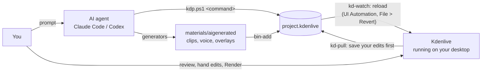

<div align="center">

# Movie Engine

**ԱԲ գործակալը մոնտաժում է ձեր տեսանյութը Kdenlive-ում ձեր աչքի առաջ, իսկ դուք կարող եք ցանկացած պահի աշխատանքը վերցնել ձեր ձեռքը։**

Ծրագրավորման ԱԲ գործակալները (Claude Code, Codex) ստեղծում և փոփոխում են իրական Kdenlive նախագծեր՝ ֆիլմեր, բացատրական տեսանյութեր և ուղղահայաց շորթսեր։ Խմբագրումներն անմիջապես երևում են ձեր բացած խմբագրիչում։ Դյուրակիր, Windows, առանց խմբագրիչի փոփոխությունների (patch)։


[English](../../README.md) · [简体中文](README.zh-CN.md) · [繁體中文](README.zh-TW.md) · [हिन्दी](README.hi.md) · [Español](README.es.md) · [Français](README.fr.md) · [العربية](README.ar.md) · [বাংলা](README.bn.md) · [Português](README.pt.md) · [Русский](README.ru.md) · [اردو](README.ur.md) · [Bahasa Indonesia](README.id.md) · [Deutsch](README.de.md) · [日本語](README.ja.md) · [Türkçe](README.tr.md) · [한국어](README.ko.md) · [Українська](README.uk.md) · [Italiano](README.it.md) · [Polski](README.pl.md) · [Tiếng Việt](README.vi.md) · [فارسی](README.fa.md) · [ไทย](README.th.md) · [Kiswahili](README.sw.md) · [አማርኛ](README.am.md) · [Avañe'ẽ](README.gn.md) · [Setswana](README.tn.md) · [Shqip](README.sq.md) · [Беларуская](README.be.md) · [Български](README.bg.md) · [Bosanski](README.bs.md) · [Hrvatski](README.hr.md) · [Српски](README.sr.md) · [Crnogorski](README.cnr.md) · [Македонски](README.mk.md) · [Slovenščina](README.sl.md) · [Slovenčina](README.sk.md) · [Čeština](README.cs.md) · [Magyar](README.hu.md) · [Română](README.ro.md) · [Dansk](README.da.md) · [Norsk bokmål](README.nb.md) · [Norsk nynorsk](README.nn.md) · [Svenska](README.sv.md) · [Íslenska](README.is.md) · [Suomi](README.fi.md) · [Eesti](README.et.md) · [Latviešu](README.lv.md) · [Lietuvių](README.lt.md) · [Nederlands](README.nl.md) · [Lëtzebuergesch](README.lb.md) · [Rumantsch](README.rm.md) · [Ελληνικά](README.el.md) · [Malti](README.mt.md) · [Gaeilge](README.ga.md) · [Català](README.ca.md) · [ქართული](README.ka.md) · **Հայերեն** · [Azərbaycanca](README.az.md) · [Afrikaans](README.af.md) · [isiZulu](README.zu.md) · [isiXhosa](README.xh.md) · [Sesotho](README.st.md) · [Sepedi](README.nso.md) · [Xitsonga](README.ts.md) · [Tshivenḓa](README.ve.md) · [siSwati](README.ss.md) · [isiNdebele (South Africa)](README.nr.md) · [isiNdebele (Zimbabwe)](README.nd.md) · [chiShona](README.sn.md) · [Chichewa](README.ny.md) · [Ikinyarwanda](README.rw.md) · [Ikirundi](README.rn.md) · [Malagasy](README.mg.md) · [Soomaali](README.so.md) · [Afaan Oromoo](README.om.md) · [Qafar af](README.aa.md) · [ትግርኛ](README.ti.md) · [Sängö](README.sg.md) · [Kreol Seselwa](README.crs.md) · [TjiKalanga](README.kck.md) · [ChiNdau](README.ndc.md)

*Սա թարգմանություն է։ Հիմնական տարբերակը անգլերեն README-ն է։*

</div>

---

## Բովանդակություն

- [Ինչու](#ինչու)
- [Ինչպես է այն աշխատում](#ինչպես-է-այն-աշխատում)
- [Հնարավորություններ](#հնարավորություններ)
- [Պահանջներ](#պահանջներ)
- [Տեղադրում](#տեղադրում)
- [Արագ մեկնարկ](#արագ-մեկնարկ)
- [Աշխատանք գործակալի հետ](#աշխատանք-գործակալի-հետ)
- [Մոնտաժի հրամանային տող (`kdp.ps1`)](#մոնտաժի-հրամանային-տող-kdpps1)
- [Համաժամեցում բաց խմբագրիչի հետ](#համաժամեցում-բաց-խմբագրիչի-հետ)
- [Գեներատորներ՝ այն, ինչ Kdenlive-ը չի կարող](#գեներատորներ-այն-ինչ-kdenlive-ը-չի-կարող)
- [Ձայնային ուղեկցում և հնչյուններ](#ձայնային-ուղեկցում-և-հնչյուններ)
- [Ինտերֆեյսի լեզու](#ինտերֆեյսի-լեզու)
- [Թղթապանակների կառուցվածք](#թղթապանակների-կառուցվածք)
- [Թեստեր և ապացույցներ](#թեստեր-և-ապացույցներ)
- [Սահմանափակումներ](#սահմանափակումներ)
- [Խնդիրների լուծում](#խնդիրների-լուծում)
- [Հաճախ տրվող հարցեր](#հաճախ-տրվող-հարցեր)
- [Ներդրում նախագծում](#ներդրում-նախագծում)
- [Շնորհակալություններ](#շնորհակալություններ)
- [Լիցենզիա](#լիցենզիա)

## Ինչու

Տեսախմբագրիչները ստեղծված են մկնիկի վրա դրված ձեռքի համար։ ԱԲ գործակալները լավ են հաղթահարում կառուցվածքը, ժամանակավորումը և կրկնվող աշխատանքը՝ 300 կլիպ դասավորել ռիթմին համապատասխան, յուրաքանչյուր ենթագիր համաժամեցնել ձայնի հետ, վերափոխել տեսարանը դիտողություններից հետո։ Բայց նրանք չեն կարող սեղմել ինտերֆեյսի վրա՝ առանց ձեր աշխատասեղանը զավթելու։

Kdenlive-ը բաց կոդով հզոր խմբագրիչ է, բայց Windows-ում այն **ավտոմատացման API չունի**։ D-Bus-ով կառավարումը կա միայն Linux-ի հավաքներում, իսկ այն ֆորքերը, որոնք ավելացնում են այն, կամ լքված են, կամ անվտանգ չեն։ Movie Engine-ը լուծում է այս խնդիրն առանց խմբագրիչը փոփոխելու։

1. Գործակալը փոփոխում է `.kdenlive` նախագծի ֆայլը թեստերով ստուգված հրամանային տողի միջոցով (`engine/kdp.ps1`)։
2. Աշխատող Kdenlive-ին Windows UI Automation-ի միջոցով հրահանգ է տրվում վերընթերցել ֆայլը՝ առանց ստեղների սեղմումների, առանց մկնիկի և առանց ֆոկուսը խլելու։
3. Ձեր չպահպանված խմբագրումները նախ պահպանվում են և երբեք չեն վերագրանցվում։

Այսպիսով, գործակալը մոնտաժում է, իսկ դուք դիտում եք, կամ ինքներդ եք ձեռքով խմբագրում։ Երկուսդ էլ աշխատում եք նույն նախագծի վրա, նույն խմբագրիչում, միաժամանակ։

## Ինչպես է այն աշխատում



Մոնտաժի յուրաքանչյուր հրաման անցնում է նույն անվտանգ ցիկլով։

1. **Pull։** Եթե Kdenlive-ում կան չպահպանված փոփոխություններ, նրան հրահանգ է տրվում պահպանել դրանք (գործիքագոտու Save կոճակը՝ UI Automation-ի միջոցով), և պահպանումը հաստատվում է։
2. **Խմբագրում։** Հրամանը փոխում է XML-ը կողպեքի ներքո, հեշի ստուգումից հետո և հետարկման համար վիճակի պատկերով (snapshot)։ Եթե ֆայլն այդ ընթացքում փոխվել է, ոչինչ չի գրանցվում։
3. **Վերաբեռնում։** Դիտորդը տեսնում է ԱԲ-ի նշանը և բաց խմբագրիչում գործարկում File > Revert։ Հաջողություն է համարվում միայն այն դեպքը, երբ թայմլայնի վիջեթն իրոք վերակառուցվել է։
4. **Կոնֆլիկտ։** Եթե այդ ընթացքում դուք սկսել եք խմբագրել, ոչինչ չի վերաբեռնվում, և ձեր աշխատանքը մնում է։ ԱԲ-ի տարբերակը պահվում է առանձին, և գործակալը կրկին կիրառում է իր փոփոխությունը ձերի վրայից։

## Հնարավորություններ

- **Նախագծի լիարժեք խմբագրում առանց ինտերֆեյսի**՝ մոտ 120 հրաման, որոնք ընդգրկում են նախագծի պահոցը (bin), թայմլայնը, էֆեկտները, կոմպոզիցիաները, ուղիները (tracks), ուղեցույցները (guides), մարկերները, ենթագրերը, հաջորդականությունները (sequences), արագությունը և ժամանակի վերաբաշխումը (time remap), սլայդշոուները, տիտրերը, պրոքսիները, ռենդերը և հետարկում/կրկնումը։ Տե՛ս [հրամանների տեղեկատուն](#մոնտաժի-հրամանային-տող-kdpps1)։
- **Համաժամեցում բաց խմբագրիչի հետ։** ԱԲ-ի խմբագրումները հայտնվում են այն Kdenlive-ում, որին դուք նայում եք, իսկ ձեր չպահպանված խմբագրումները նախ պահպանվում են և երբեք չեն կորչում։
- **Երբեք չի խանգարում ձեր աշխատանքին։** Ո՛չ ֆոկուսի խլում, ո՛չ ստեղնասեղմումներ, ո՛չ մկնիկի շարժումներ։ Թեստային խմբագրիչներն աշխատում են Windows-ի անտեսանելի աշխատասեղանի վրա։
- **Դյուրակիր։** Խմբագրիչը, կարգավորումները, Node.js-ը, տառատեսակները և գործիքները գտնվում են մեկ թղթապանակում։ Պատճենեք այն մեկ այլ համակարգիչ, և այն կաշխատի։ Ոչինչ չի գրվում Program Files-ում կամ ձեր Windows պրոֆիլում։
- **Գեներատորներ այն ամենի համար, ինչ Kdenlive-ը չի կարող**՝ տառ առ տառ անիմացված կինետիկ տեքստ, ձեռքով գծված նշումներ, ինտերֆեյսի 3D տեսարաններ, կուրսորի անիմացիաներ և երկար ինտերակտիվ բացատրական ֆիլմեր։ Դրանք ռենդերվում են GPU-ով՝ իրական շարժման լղոզումով (motion blur), և թայմլայնի վրա տեղադրվում որպես սովորական կլիպեր։
- **Ձայնային ուղեկցում բառերի ժամանակավորմամբ** (Microsoft Edge TTS, առանց API բանալու)։ Ենթագրերը և գործողությունները գործարկվում են ճիշտ անհրաժեշտ բառի վրա։
- **Սինթեզված ձայնային էֆեկտներ** (whoosh, click, pop, riser, impact և այլն)՝ ստեղծված կոդով։
- **Ապացուցված, ոչ թե ենթադրված։** Յուրաքանչյուր հրաման ունի արդյունքի ստուգում, էֆեկտներն ու կոմպոզիցիաները ստուգվում են մեկ առ մեկ, իսկ հում արդյունքները գտնվում են `docs/proof/`-ում։
- **Գործակալների հրահանգները ներառված են։** `AGENTS.md`-ը և `.claude/skills/`-ի հմտությունները (skills) Claude Code-ին և Codex-ին սովորեցնում են աշխատանքի ընթացքը, ֆայլի ձևաչափը և թակարդները։

## Պահանջներ

| | |
|---|---|
| Օպերացիոն համակարգ | Windows 10 կամ 11, x64 |
| Խմբագրիչ | Kdenlive **26.08.3**, դյուրակիր (standalone) հավաք։ Այլ տարբերակներ փորձարկված չեն։ |
| Node.js | 18 կամ ավելի նոր՝ Windows x64-ի `.zip`-ը nodejs.org-ից, բացված `engine/node/`-ի մեջ |
| Դիտարկիչ | Microsoft Edge (ներառված է Windows-ում)։ Տեսարանների ռենդերիչներն այն օգտագործում են headless ռեժիմում |
| Գործակալ | [Claude Code](https://claude.com/claude-code) կամ Codex։ Պարտադիր չէ՝ յուրաքանչյուր գործիք կարելի է գործարկել նաև ձեռքով։ |
| Սկավառակ | մոտ 1 ԳԲ խմբագրիչի և գործիքների համար, գումարած ձեր մեդիան |
| GPU | ապարատային H.264 կոդավորմամբ ցանկացած GPU արագացնում է `film-render.mjs`-ը (առանց դրա օգտագործվում է ծրագրային կոդավորում) |

## Տեղադրում

Ամեն ինչ տեղադրվում է **թղթապանակի ներսում**։ Ադմինիստրատորի իրավունքներ պետք չեն։

```powershell
git clone https://github.com/vladtarrow/movie-engine.git
cd movie-engine
```

**1. Node.js։** Ներբեռնեք Node.js 18 կամ ավելի նոր տարբերակի Windows x64 `.zip`-ը <https://nodejs.org/en/download> հասցեից և բացեք դրա պարունակությունը `engine\node\`-ի մեջ, որպեսզի այնտեղ լինեն `engine\node\node.exe`-ը և `engine\node\npm.cmd`-ը։ Ո՛չ տեղադրիչ, ո՛չ համակարգային Node պետք չէ։ Բոլոր սկրիպտները գործարկվում են `engine\node.cmd`-ի միջոցով, երբեք՝ համակարգային Node-ով։

**2. Node փաթեթներ** ձայնային գործիքի և ռենդերիչների համար (տարբերակներն ամրագրված են `engine/voice/package.json`-ում)։

```powershell
engine\node\npm.cmd install --prefix engine\voice
```

**3. Դյուրակիր Kdenlive 26.08.3։** Ներբեռնեք `kdenlive-26.08.3_standalone.exe`-ը <https://download.kde.org/stable/kdenlive/26.08/windows/> հասցեից `engine\installer\`-ի մեջ, ստուգեք և բացեք այն։

```powershell
(Get-FileHash engine\installer\kdenlive-26.08.3_standalone.exe -Algorithm SHA256).Hash
# expected: A25427B1DFF2C17E3B0386E991BB1A719382BB3176D1A90E441CDAEB6E0A967D
engine\installer\kdenlive-26.08.3_standalone.exe -o"engine\Kdenlive" -y
```

Խմբագրիչը կհայտնվի `engine\Kdenlive\kdenlive-26.08.3_standalone\bin\`-ում։ Այն արդեն ներառում է `melt.exe`-ը և `ffmpeg.exe`-ը։

**4. Առաջին գործարկում։**

```powershell
engine\kdenlive.cmd
```

Kdenlive-ը իր բոլոր կարգավորումները պահում է `engine\profile-kdenlive\`-ում, ոչ թե ձեր Windows պրոֆիլում։ Առաջին գործարկման ժամանակ այն մեկ անգամ ցույց է տալիս կարգավորման օգնականը։

## Արագ մեկնարկ

### Գործակալի հետ

Բացեք թղթապանակը Claude Code-ում (կամ Codex-ում) և խնդրեք պարզ բառերով։

> Ստեղծիր նոր ուղղահայաց նախագիծ «launch-teaser»՝ 30 fps-ով։ Թայմլայնի վրա դիր `materials/designers/launch/`-ի երեք սքրինշոթները՝ յուրաքանչյուրը 2,5 վ, կարճ անցումներով, ավելացրու ձայնային ուղեկցում `script.txt`-ից և յուրաքանչյուր տողին համաժամեցրու կինետիկ մակագրություն։

> Բացիր այն ինձ համար Kdenlive-ում։

> Երկրորդ կադրը չափազանց երկար է։ Կրճատիր այն մինչև 1,8 վ և լոգոն մի քիչ վեր բարձրացրու։

Գործակալը հետևում է `AGENTS.md`-ին՝ խմբագրում է `kdp.ps1`-ի միջոցով, ռենդերում է միայն այն կլիպերը, որոնք պետք են մոնտաժին, և բաց խմբագրիչը պահում է համաժամեցված վիճակում։ Դուք դիտում եք արդյունքը Kdenlive-ում, ձեռքով խմբագրում եք երբ ցանկանաք և սեղմում Render, երբ գոհ եք։

### Ձեռքով

```powershell
# a new 1080x1920 30 fps project with 2 video and 2 audio tracks
powershell -NoProfile -ExecutionPolicy Bypass -File engine\kdp.ps1 new -Project projects\hello\hello.kdenlive -Profile vertical_hd_30

# a 3-second title and a colour background
powershell -NoProfile -ExecutionPolicy Bypass -File engine\kdp.ps1 bin-color -Project projects\hello\hello.kdenlive -Color '#203060' -Seconds 3 -Name bg
powershell -NoProfile -ExecutionPolicy Bypass -File engine\kdp.ps1 title -Project projects\hello\hello.kdenlive -Text "Hello" -Seconds 3 -Name hi

# place them: background on V1, title above it on V2
powershell -NoProfile -ExecutionPolicy Bypass -File engine\kdp.ps1 add -Project projects\hello\hello.kdenlive -Bin bg -Track V1 -At 0
powershell -NoProfile -ExecutionPolicy Bypass -File engine\kdp.ps1 add -Project projects\hello\hello.kdenlive -Bin hi -Track V2 -At 0

# a check frame, then open it in the editor
powershell -NoProfile -ExecutionPolicy Bypass -File engine\kdp.ps1 frame -Project projects\hello\hello.kdenlive -At 1.5 -Out out\hello\check.png
engine\kdenlive.cmd projects\hello\hello.kdenlive
```

Վերջին նախագիծը հետագայում նորից բացելու համար կրկնակի սեղմեք `open-last-project.cmd`-ի վրա։

## Աշխատանք գործակալի հետ

Գործակալը կարդում է `AGENTS.md`-ը (Codex) կամ `CLAUDE.md`-ը, որը ներմուծում է այն (Claude Code), ինչպես նաև երկու հմտություն։

| Հմտություն | Ինչ է սովորեցնում |
|---|---|
| `.claude/skills/kdenlive-project-file` | `.kdenlive` / MLT XML ձևաչափը, `kdp.ps1`-ը, ստուգում `melt`-ով |
| `.claude/skills/kdenlive-live` | աշխատող խմբագրիչի անվտանգ կառավարում՝ գործարկում, pull, վերաբեռնում, դրա պատուհանի նկարահանում |

Կանոններ, որոնց հետևում է գործակալը, և որոնց վրա կարող եք հույս դնել։

- Այն երբեք չի խլում ձեր մկնիկը, ստեղնաշարը կամ ֆոկուսը և երբեք չի լուսանկարում ձեր աշխատասեղանը (միայն խմբագրիչի սեփական պատուհանը)։
- Ինտերֆեյսի քայլերը (պահպանել, բացել, վերաբեռնել) այն կատարում է ինքը՝ ձեզ սեղմել խնդրելու փոխարեն։
- Այն հարցնում է նախքան որևէ բան ներբեռնելը և նախքան որևէ բան ջնջելը։
- Այն ռենդերում է միայն այն, ինչ պետք է աշխատանքին (տեսարանների կլիպեր, ստուգիչ կադրեր)։ Վերջնական ֆիլմը այն ռենդերում է միայն ձեր խնդրանքով։
- Երբ Kdenlive-ը ինչ-որ բան լավ չի կարողանում անել, գործակալը այն կառուցում է դրսում՝ կոդով, և արդյունքը տեղադրում որպես կլիպ։ Այն չի պարզեցնում էֆեկտը։

## Մոնտաժի հրամանային տող (`kdp.ps1`)

```powershell
powershell -NoProfile -ExecutionPolicy Bypass -File engine\kdp.ps1 <command> -Project <file.kdenlive> [options]
```

Ժամանակը նշվում է վայրկյաններով, կետով (`2.5`)։ Ուղիներն են `V1 V2 …` (V1-ը ամենաներքևինն է) և `A1 A2 …`։ Կլիպը որոշվում է `-Track`-ով և դրա ներսում ցանկացած `-At` պահով։ Էֆեկտի պարամետրերը փոխանցվում են `-Params "name=value||name=value"`-ում։ Ամբողջական ցանկը բոլոր ընտրանքներով գտնվում է `engine/kdp.ps1`-ի գլխամասում։

| Խումբ | Հրամաններ |
|---|---|
| Նախագիծ | `new`, `profiles`, `info`, `validate`, `fonts`, `profile-set`, `profile-from-clip`, `zone`, `archive`, `backups`, `rebase`, `otio-export`, `otio-import` |
| Պահոց | `bin-add`, `bin-color`, `title`, `title-text`, `title-save`, `title-template`, `bin-rename`, `bin-remove`, `bin-info`, `bin-set`, `bin-duplicate`, `bin-replace-file`, `bin-reload`, `folder`, `bin-folder`, `relink`, `clean`, `generator`, `playlist-clip`, `extract-audio`, `transcode` |
| Թայմլայն | `add`, `add-av`, `move`, `copy`, `trim`, `ripple-trim`, `slip`, `split`, `remove`, `speed`, `remap`, `disable`, `enable`, `group`, `ungroup`, `mix`, `unmix`, `space-insert`, `space-remove`, `spaces-remove-all`, `track-clear`, `replace-in-timeline` |
| Էֆեկտներ | `effects`, `effect-info`, `effect-add`, `effect-list`, `effect-set`, `effect-remove`, `effect-copy`, `effect-clear`, `effects-all`, `bin-effect`, `effect-templates`, `effect-template` |
| Կոմպոզիցիաներ | `compositions`, `comp-info`, `comp-add`, `comp-list`, `comp-set`, `comp-remove` |
| Ուղիներ | `track-add`, `track-remove`, `track-set` |
| Ուղեցույցներ և մարկերներ | `guide-add`, `guide-list`, `guide-remove`, `guide-set`, `guide-clear`, `guide-export`, `guide-category`, `marker`, `marker-list`, `marker-set`, `marker-remove` |
| Ենթագրեր | `sub-add`, `sub-import`, `sub-export`, `sub-state` |
| Հաջորդականություններ | `sequence-add`, `sequences`, `copy-to-sequence`, `expand`, իսկ `-Sequence <name>`-ով ցանկացած հրաման աշխատում է այդ հաջորդականության ներսում |
| Հատուկ | `slideshow`, Lottie / Glaxnimate անիմացիաներ `bin-add`-ի միջոցով, `proxy`, `stabilize`, `scene-split`, `speed-job`, `subclip` |
| Ելք | `frame` (մեկ PNG), `preview` (արագ ռենդեր melt-ով), `render` (Kdenlive-ի սեփական ռենդերիչը կամ նախադրվածք), `presets` |
| Պատմություն | `undo`, `redo`, `clear-history` (վիճակի պատկերներ `projects/<name>/.kdp-history`-ում) |

Վարքագիծ, որի մասին արժե իմանալ։

- Կապակցված աուդիո և վիդեո կեսերը միասին են տեղափոխվում, կտրատվում, բաժանվում և հեռացվում (`-Alone`՝ միայն մեկ կեսի համար)։
- Ձախողված հրամանն ավարտվում է 1 կոդով և ոչինչ չի գրում։
- Էֆեկտները, որոնք Windows հավաքը չի կարող կատարել, մերժվում են, այլ ոչ թե լուռ անտեսվում (ցանկը՝ `docs/proof/assets.txt`)։
- Kdenlive-ի ընտրացանկի յուրաքանչյուր գործողություն `engine/tools/data/kdenlive-actions.csv`-ում համապատասխանեցված է հրամանի, այլ ճանապարհի կամ «միայն դիտում» նշման։ Տե՛ս `docs/kdenlive-coverage.md`։

## Համաժամեցում բաց խմբագրիչի հետ

| Սկրիպտ | Ինչ է անում | Ելքի կոդեր |
|---|---|---|
| `engine\kd-pull.ps1 -Project <f>` | ստիպում է Kdenlive-ին պահպանել ձեր խմբագրումները և հաստատում է դա | 0 ֆայլը արդիական է, 3 չի աշխատում, 4 չի հաստատվել |
| `engine\kd-reload.ps1 -Project <f>` | File > Revert, հաստատվում է վերակառուցված թայմլայնով | 0 հաստատված է, 2 ունեք չպահպանված խմբագրումներ (ոչինչ չի կորել), 3 չի աշխատում, 4 ձախողվել է |
| `engine\kd-watch.ps1 -Project <f>` | ֆոնային դիտորդ՝ վերաբեռնում է ԱԲ-ի յուրաքանչյուր գրանցումից հետո, կոնֆլիկտները գրանցում է մատյանում | մատյանը՝ `engine\kd-watch.log`-ում, կանգնեցնելու համար ջնջեք `engine\kd-watch.run`-ը |
| `engine\kdenlive-bg.ps1 [project]` | գործարկում է Kdenlive-ը նվազեցված պատուհանով՝ գործակալի համար | 0 բեռնված է, 4 չի հաստատվել |
| `engine\kdenlive.cmd [project]` | գործարկում է Kdenlive-ը ձեզ համար | |

Գործարկեք դիտորդը մեկ անգամ յուրաքանչյուր աշխատանքային նստաշրջանում։

```powershell
Start-Process powershell -WindowStyle Hidden -ArgumentList '-NoProfile','-ExecutionPolicy','Bypass','-File','engine\kd-watch.ps1','-Project','projects\hello\hello.kdenlive'
```

Մեծ նախագծերի դեպքում 1000 կլիպանոց նախագծի վերաբեռնումը տևում է րոպեներ, և գործիքները սպասում են դրան՝ վաղաժամ զեկուցելու փոխարեն։ Նախագծերը բացվում են դատարկ խմբագրիչում *File > Open Recent*-ի միջոցով, քանի որ ֆայլն ուղղակիորեն բացելիս Qt-ն մատչելիության (accessibility) համար անցնում է թայմլայնի յուրաքանչյուր տարրով, և դա մոտ 10 րոպեով ավելի դանդաղ էր։

## Գեներատորներ՝ այն, ինչ Kdenlive-ը չի կարող

Kdenlive/MLT-ն չունի տառ առ տառ տեքստի անիմացիա, արտահայտություններ (expressions) և գրեթե չունի 3D, իսկ ծանր էֆեկտները դանդաղեցնում են նվագարկումը։ Movie Engine-ը նման մասերը ռենդերում է դրսում և դնում թայմլայնի վրա որպես սովորական կլիպեր, սովորաբար ալֆա ալիքով, պատկերներից վերև գտնվող ուղու վրա։ Գեներատորի սկրիպտը և դրա մուտքային տվյալները մնում են նախագծի թղթապանակում, ուստի կլիպը կարելի է նորից գեներացնել, երբ փոխվում են տեքստը, տառատեսակը կամ ժամանակավորումը։

| Գործիք | Ինչ է ստեղծում |
|---|---|
| `engine/tools/kinetic-text.ps1` | տառ առ տառ կինետիկ մակագրություններ, յուրաքանչյուր բառ՝ ժամանակավորված `voice.json`-ից, ընդգծման շրջանակ |
| `engine/tools/annotate.ps1` | ձեռքով գծված շրջաններ, շրջանակներ, ընդգծումներ և սլաքներ, որոնք աստիճանաբար գծվում են սքրինշոթի վրա |
| `engine/tools/card-entrance.ps1` | սքրինշոթով քարտ, որը բարձրանում և մեծանում է մեղմ ստվերով |
| `engine/tools/pdf-to-png.ps1` | սլայդներ PDF արտահանումից |
| `engine/tools/html-render.mjs` | ցանկացած HTML/CSS/canvas տեսարանի վերածում տեսանյութի՝ ինտերֆեյսի անիմացիա, կուրսորներ, 3D, դիմակներ |
| `engine/tools/film-render.mjs` + `film/` | երկար ինտերակտիվ բացատրական ֆիլմեր canvas-ի վրա՝ մեկ կլիպ ձայնային ուղեկցման յուրաքանչյուր տողի համար, գործողությունները գործարկվում են արտասանված բառերի վրա, GPU-ով motion blur մոտ 45 fps արագությամբ |

Երկու ռենդերիչներն էլ կառավարում են Windows-ի հետ մատակարարվող Microsoft Edge-ը headless ռեժիմում՝ միանգամյա պրոֆիլով և առանց ցանցի հասանելիության։

### Դեմոներ

```powershell
# a 3-second 3D title card with a cursor click
engine\node.cmd engine\tools\html-render.mjs examples\demo\scene\scene.html examples\demo\out --frames 0,30,60,89
engine\node.cmd engine\tools\html-render.mjs examples\demo\scene\scene.html examples\demo\out\scene.mp4

# a 4-shot interactive film timed to two voice lines
engine\node.cmd engine\tools\film-render.mjs examples\demo\film\film.html examples\demo\out --check
engine\node.cmd engine\tools\film-render.mjs examples\demo\film\film.html examples\demo\out --shots all --width 640
engine\node.cmd engine\tools\film-render.mjs examples\demo\film\film.html examples\demo\out\clips --suffix -v01
```

Ֆիլմը երեք փոքր ֆայլ է։ `data.js`-ը պարունակում է կադրերը և բառերի ժամանակները։ `direction.js`-ում յուրաքանչյուր կադրի համար մեկ տող է։

```text
1 | hover 192 108 @brand | tag 300 60 Your brand @deserves | confetti 192 90 @film
2 say=A film that/*explains* it
3 | click 116 108 @before | click 268 108 @after | chips Before~After @after
4 scene=counter | count 0 120 % @count
```

`scenes.js`-ը պարունակում է այն կադրերը, որոնք գծվում են զրոյից։ `@word`-ը գործարկում է գործողությունը, երբ ձայնն արտասանում է այդ բառը։ Գործողությունների թվում են click, hover, drag, zoom, lens, ring, arrow, chips, toggle, slider, toast, type, count և confetti։ Ամբողջական շարահյուսությունը գտնվում է `engine/tools/film/film-kit.js`-ի սկզբում։

## Ձայնային ուղեկցում և հնչյուններ

```powershell
engine\node.cmd engine\voice\voice.mjs lines.json materials\aigenerated\hello\voice en-US-AndrewMultilingualNeural +0%
```

`lines.json`-ը տողերի ցանկ է։ Գործիքը յուրաքանչյուր տողի համար գրում է մեկ mp3, ինչպես նաև `voice.json`՝ տևողությամբ և յուրաքանչյուր բառի սկզբով ու վերջով։ Տողերը քեշավորվում են, ուստի մեկ տողը փոխելիս նորից գեներացվում է միայն այդ տողը։ Այն օգտագործում է Microsoft Edge-ի առցանց «տեքստից խոսք» ծառայությունը `msedge-tts` փաթեթի միջոցով։ Բանալի պետք չէ, բայց ծառայությունը ոչ պաշտոնական է և պահանջում է ինտերնետ։

```powershell
engine\node.cmd engine\audio\sfx.mjs materials\aigenerated\sfx
```

Այս հրամանը կոդով սինթեզում է whoosh, whoosh-long, swipe, click, pop, tick, riser, impact, ding և reveal հնչյունները։ Պատրաստի հավաքածուն գտնվում է `materials/aigenerated/sfx/`-ում։ Մեկ կադրից կարճ հնչյունները տեղադրելուց առաջ լրացրեք լռությամբ (`-af apad=whole_dur=0.0667`)։

## Ինտերֆեյսի լեզու

Լռելյայն գործարկիչները Kdenlive-ը գործարկում են **անգլերենով**։ Այլ լեզու օգտագործելու համար գործարկելուց առաջ սահմանեք `MOVIE_ENGINE_UI_LANG`-ը։

```powershell
$env:MOVIE_ENGINE_UI_LANG = 'ru'; engine\kdenlive.cmd
```

UI Automation-ը գտնում է ընտրացանկի կետերն իրենց տեսանելի անուններով։ Ինտերֆեյսի 31 լեզվի անուններն արդեն ներկառուցված են (`engine/tools/kd-ui.ps1`, `$KdNames`)։ Ցանկացած այլ լեզվի համար ավելացրեք դրա անուններն այնտեղ և ստուգեք հետևյալ հրամանով։

```powershell
powershell -NoProfile -ExecutionPolicy Bypass -File engine\tools\kd-langcheck.ps1
```

## Թղթապանակների կառուցվածք

```text
movie-engine/
├─ AGENTS.md, CLAUDE.md          instructions for AI agents
├─ .claude/skills/               agent skills: project file format, live editor
├─ engine/
│  ├─ kdp.ps1                    the editing command line
│  ├─ kd-pull / kd-reload / kd-watch .ps1, kdenlive.cmd, kdenlive-bg.ps1
│  ├─ tools/                     internals, generators, tests, data (action map)
│  ├─ voice/  audio/  fonts/     TTS, synthesized SFX, Poppins (OFL)
│  ├─ Kdenlive/  node/           portable editor and Node.js (not in git)
│  └─ profile-kdenlive/          the editor's settings (not in git)
├─ projects/<name>/<name>.kdenlive
├─ materials/
│  ├─ download/                  stock and downloaded files (not in git)
│  ├─ aigenerated/               everything the AI made (sfx/ and test-kit/ ship with the engine)
│  ├─ designers/  brand/         files from your team, brand assets
├─ examples/demo/                demos of the scene and film renderers
├─ out/                          renders (not in git)
└─ docs/                         proofs, coverage, translations of this README
```

Նախագծերի ներսում մեդիաֆայլերի ուղիները հարաբերական են։ Եթե թղթապանակը տեղափոխեք կամ պատճենեք, `kdp.ps1 rebase`-ը (այն ավտոմատ գործարկում է նաև `kdenlive.cmd`-ը) նախագծում կգրանցի նոր տեղադրությունը։

## Թեստեր և ապացույցներ

Պնդումները, թե ինչն է աշխատում, հիմնավորված են արդյունքի ստուգումներով, այլ ոչ թե նրանով, որ «ֆունկցիան կատարվեց»։ Ամփոփումը գտնվում է [`docs/kdenlive-proof.md`](../../docs/kdenlive-proof.md)-ում, իսկ հում ելքը՝ `docs/proof/`-ում։

| Թեստ | Ինչ է ստուգում |
|---|---|
| `engine\tools\kdp-clitest.ps1` | `kdp.ps1`-ի յուրաքանչյուր հրաման՝ հրամանային տողի միջոցով, համեմատելով ստացված նախագիծը |
| `engine\tools\kd-livetest.ps1` | pull, վերաբեռնում, դիտորդ, կոնֆլիկտներ և մրցավազքի իրավիճակներ (races) իրական Kdenlive-ի վրա՝ անտեսանելի աշխատասեղանին |
| `engine\tools\kdp-assetsweep.ps1` | յուրաքանչյուր էֆեկտ և կոմպոզիցիա՝ ռենդերում և համեմատում է կադրերը |
| `engine\tools\kdp-portabletest.ps1` | պատճենում է թղթապանակը այլ տեղ և աշխատում պատճենից |
| `engine\tools\kd-langcheck.ps1` | ինտերֆեյսի լեզուն և այն, որ UI Automation-ը գտնում է ընտրացանկը |
| `engine\tools\kdp-coverage-check.ps1` | որ ընտրացանկի յուրաքանչյուր գործողություն համապատասխանեցված է, և ոչ մի ապացույց կոդից հին չէ |

```powershell
powershell -NoProfile -ExecutionPolicy Bypass -File engine\tools\kdp-clitest.ps1 -Report docs\proof\clitest.txt
powershell -NoProfile -ExecutionPolicy Bypass -File engine\tools\kd-livetest.ps1 -Report docs\proof\live-en.txt
```

Թեստային խմբագրիչներն աշխատում են միայն թաքնված աշխատասեղանին՝ իրենց սեփական պրոֆիլով, ուստի թեստերը երբեք չեն դիպչում ձեր բաց Kdenlive-ին կամ ձեր ֆոկուսին։

## Սահմանափակումներ

- **Միայն Windows** և միայն Kdenlive **26.08.3**։ Linux-ն ունի D-Bus, և այնտեղ այլ կամուրջ կպահանջվեր։
- Գործարկվելիս խմբագրիչը մոտ 3 վայրկյանով խլում է ստեղնաշարի ֆոկուսը, մինչ դատարկ պատուհանը հայտնվում է։ Եթե դուք աշխատում եք, գործակալները հարցնում են նախքան այն գործարկելը։ Վերաբեռնումներն ու խմբագրումները ֆոկուսը չեն խլում։
- Windows հավաքում բացակայում են sox, ladspa և movit MLT մոդուլները և frei0r/avfilter-ի որոշ էֆեկտներ, և `kdp.ps1`-ը մերժում է դրանք (`docs/proof/assets.txt`)։
- OpenTimelineIO-ի արտահանումն ու ներմուծումը փոխանցում են միայն կլիպերն ու դատարկ միջակայքերը։ Բազմախցիկ մոնտաժում (multicam) տեսանկյունների ուղիղ փոխարկում չկա (կտրվածքները կատարվում են split/remove/hide-ով)։
- «Save As…»-ը UI Automation-ի միջոցով նվազեցված պատուհանում երկխոսություն չի բացում, ուստի գործակալը փոխարենն օգտագործում է `archive` կամ ֆայլերի պատճենում։
- Խոսքի ճանաչումը (ավտոմատ ենթագրեր) պահանջում է Whisper կամ Vosk, որոնք ներառված չեն։
- Kdenlive-ի տիտրերի գործիքով ստեղծված տիտրերն օգտագործում են Windows-ում տեղադրված տառատեսակներ։ Երաշխավորված տպագրական տեսքի համար տեքստը ռենդերեք գեներատորներով, որոնք տառատեսակները բեռնում են `engine/fonts/`-ից։
- Edge TTS-ը ոչ պաշտոնական առցանց ծառայություն է և կարող է փոխվել կամ դադարել աշխատել։

## Խնդիրների լուծում

| Ախտանիշ | Պատճառ և լուծում |
|---|---|
| Kdenlive-ը աշխատում է, բայց առաջադրանքների վահանակում դրա վրա սեղմելը ոչինչ ցույց չի տալիս | Դրա պատուհանի պահպանված դիրքը էկրանից դուրս է։ Փակեք այն և ջնջեք `kdockLayout` գրառումները `engine\profile-kdenlive\AppData\Local\kdenliverc`-ում, կամ տեղափոխեք պատուհանը `SetWindowPos`-ով (տե՛ս `AGENTS.md`)։ |
| `kd-reload.ps1`-ն ավարտվում է 2 կոդով | Դուք ունեք չպահպանված խմբագրումներ։ Ոչինչ չի կորել։ Գործարկեք `kd-pull.ps1`-ը, ապա նորից կիրառեք փոփոխությունը (`kdp.ps1`-ն դա անում է ինքնուրույն)։ |
| `CONFLICT` `engine\kd-watch.log`-ում | Դուք և գործակալը խմբագրել եք նույն պահին։ Ձեր տարբերակը մնում է խմբագրիչում, իսկ ԱԲ-ի տարբերակը գտնվում է `projects\<name>\.kdp-history\<name>\conflict\`-ում։ Խնդրեք գործակալին նորից կիրառել իր փոփոխությունը։ |
| Հրամանն ավարտվում է 1 կոդով և «pull not confirmed» հաղորդագրությամբ | Kdenlive-ը զբաղված է կամ երկխոսություն է ցույց տալիս։ Փակեք երկխոսությունը կամ սպասեք բեռնման ավարտին, ապա կրկնեք։ |
| PowerShell սկրիպտը չի վերլուծվում | Ոչ ASCII տեքստ պարունակող սկրիպտները Windows PowerShell 5.1-ի համար պետք է պահպանվեն UTF-8 կոդավորմամբ՝ **BOM-ով**։ |
| `voice.mjs`-ը կանգ է առնում «Stream closed before the synthesis completed» հաղորդագրությամբ | Սովորաբար դա ցանցի խնդիր է կամ հին պատճեններում չէկրանավորված SSML։ `voice.mjs`-ն ինքն է էկրանավորում `& < >`-ը։ |
| Մեծ նախագծի բացումը տևում է շատ րոպեներ | Բացեք այն `kdenlive.cmd` / `kdenlive-bg.ps1`-ի միջոցով, երբեք՝ որպես `kdenlive.exe project.kdenlive`։ |

## Հաճախ տրվող հարցեր

**Ինձ պե՞տք է Claude Code կամ Codex**
Ոչ։ Յուրաքանչյուր գործիք սովորական սկրիպտ է, որը կարող եք գործարկել ձեռքով։ Գործակալն է աշխատանքը արագ դարձնում՝ պլանավորում է մոնտաժը, գործարկում գործիքները և խմբագրիչը պահում համաժամեցված։

**Գործակալը կվերագրանցի՞ իմ ձեռքով արված խմբագրումները**
Ոչ։ Ցանկացած գրանցումից առաջ ձեր չպահպանված խմբագրումները պահպանվում և հաստատվում են։ Եթե դուք խմբագրում եք, մինչ գործակալը գրում է, գրանցումը մերժվում է կամ պահվում առանձին որպես կոնֆլիկտ և երբեք չի կիրառվում ձեր աշխատանքի վրայից։

**Կարո՞ղ եմ շարունակել Kdenlive-ն օգտագործել սովորականի պես**
Այո։ Սա ստանդարտ Kdenlive-ն է՝ իր սեփական կարգավորումների թղթապանակով։ Խմբագրեք, դիտեք և ռենդերեք ինչպես սովորաբար։

**Այն կաշխատի՞ արդեն տեղադրված Kdenlive-ի հետ**
Այն օգտագործում է իր սեփական դյուրակիր պատճենը `engine\Kdenlive\`-ում, ուստի ձեր տեղադրված Kdenlive-ն ու դրա կարգավորումները մնում են անձեռնմխելի։

**Ինչո՞ւ ոչ API-ով Kdenlive-ի ֆորք կամ մեկ այլ խմբագրիչ**
Windows-ում չկա աջակցվող և անվտանգ ֆորք (2026 թվականի նոյեմբերի ուսումնասիրություն)։ Գնահատվել են OpenShot-ը, Blender VSE-ն, DaVinci Resolve-ը, Shotcut-ը և վեբ խմբագրիչները, և Kdenlive-ն ապահովեց մոնտաժի լավագույն խորությունը։ Մենք հետևում ենք հիմնական նախագծում REST API-ի առաջարկին (merge request !902)։

**Կարո՞ղ է այն ռենդերել վերջնական տեսանյութը**
Այո՝ `kdp.ps1 render`-ով (Kdenlive-ի սեփական ռենդերիչը, թաքնված ռեժիմում), կամ դուք ինքներդ եք սեղմում Render խմբագրիչում։

**Իմ մեդիան որևէ տեղ վերբեռնվո՞ւմ է**
Ոչ։ Ձայն գեներացնելիս Edge TTS ծառայությանն ուղարկվում է միայն ձայնային ուղեկցման տեքստը։ Տեսարանների ռենդերիչներն աշխատում են անջատված ցանցով։

## Ներդրում նախագծում

Ներդրումները ողջունելի են։ Տե՛ս [CONTRIBUTING.md](../../CONTRIBUTING.md)։ Համառոտ՝

- `kdp.ps1`-ի յուրաքանչյուր նոր կամ փոփոխված գործողություն պահանջում է արդյունքի ստուգում `kdp-clitest.ps1`-ում, գրառում գործողությունների քարտեզում և `kdp-coverage-check.ps1`-ի նոր գործարկում։
- Երբեք մի գործարկեք թեստային Kdenlive տեսանելի աշխատասեղանին, օգտագործեք `engine/tools/kd-hidden.ps1`-ը։
- Ամեն ինչ պահեք դյուրակիր՝ ոչ մի տեղադրում թղթապանակից դուրս, ոչ մի բացարձակ ուղի նախագծերում։
- Ստուգված առանձնահատկությունները գրանցեք `AGENTS.md`-ում կամ համապատասխան հմտության մեջ։

## Շնորհակալություններ

- [Kdenlive](https://kdenlive.org) և [MLT](https://www.mltframework.org)՝ խմբագրիչը և դրա հիմքում ընկած շարժիչը։
- [FFmpeg](https://ffmpeg.org), որը մատակարարվում է Kdenlive-ի հետ։
- [msedge-tts](https://www.npmjs.com/package/msedge-tts)՝ ձայնային ուղեկցման համար։
- [Poppins](https://fonts.google.com/specimen/Poppins)՝ Indian Type Foundry-ից, SIL Open Font License (`engine/fonts/OFL.txt`)։
- `engine/tools/data/kdenliveui-26.08.3.rc`՝ Kdenlive-ի ընտրացանկի ֆայլը, վերցված Kdenlive 26.08.3-ի սկզբնական կոդից և օգտագործվող միայն ծածկույթի ստուգման կողմից։ Այն մնում է Kdenlive-ի GPL լիցենզիայի ներքո, ոչ թե MIT License-ի։

## Լիցենզիա

Movie Engine-ի սեփական կոդը թողարկված է [MIT լիցենզիայով](../../LICENSE)։ Kdenlive-ը, MLT-ն, FFmpeg-ը, Node.js փաթեթները և Poppins տառատեսակը պահպանում են իրենց սեփական լիցենզիաները։
