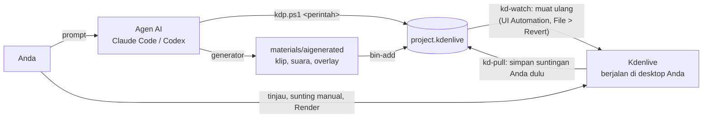

<div align="center">

# Movie Engine

**Agen AI menyunting video Anda di Kdenlive sementara Anda menonton, dan Anda bisa mengambil alih kapan saja.**

Agen coding AI (Claude Code, Codex) membangun dan mengubah proyek Kdenlive sungguhan: film, video penjelasan, dan video pendek vertikal. Hasil suntingan langsung muncul di editor yang sedang Anda buka. Portabel, untuk Windows, tanpa patch pada editor.


[English](../../README.md) · [简体中文](README.zh-CN.md) · [繁體中文](README.zh-TW.md) · [हिन्दी](README.hi.md) · [Español](README.es.md) · [Français](README.fr.md) · [العربية](README.ar.md) · [বাংলা](README.bn.md) · [Português](README.pt.md) · [Русский](README.ru.md) · [اردو](README.ur.md) · **Bahasa Indonesia** · [Deutsch](README.de.md) · [日本語](README.ja.md) · [Türkçe](README.tr.md) · [한국어](README.ko.md) · [Українська](README.uk.md) · [Italiano](README.it.md) · [Polski](README.pl.md) · [Tiếng Việt](README.vi.md) · [فارسی](README.fa.md) · [ไทย](README.th.md) · [Kiswahili](README.sw.md) · [አማርኛ](README.am.md) · [Avañe'ẽ](README.gn.md) · [Setswana](README.tn.md) · [Shqip](README.sq.md) · [Беларуская](README.be.md) · [Български](README.bg.md) · [Bosanski](README.bs.md) · [Hrvatski](README.hr.md) · [Српски](README.sr.md) · [Crnogorski](README.cnr.md) · [Македонски](README.mk.md) · [Slovenščina](README.sl.md) · [Slovenčina](README.sk.md) · [Čeština](README.cs.md) · [Magyar](README.hu.md) · [Română](README.ro.md) · [Dansk](README.da.md) · [Norsk bokmål](README.nb.md) · [Norsk nynorsk](README.nn.md) · [Svenska](README.sv.md) · [Íslenska](README.is.md) · [Suomi](README.fi.md) · [Eesti](README.et.md) · [Latviešu](README.lv.md) · [Lietuvių](README.lt.md) · [Nederlands](README.nl.md) · [Lëtzebuergesch](README.lb.md) · [Rumantsch](README.rm.md) · [Ελληνικά](README.el.md) · [Malti](README.mt.md) · [Gaeilge](README.ga.md) · [Català](README.ca.md) · [ქართული](README.ka.md) · [Հայերեն](README.hy.md) · [Azərbaycanca](README.az.md) · [Afrikaans](README.af.md) · [isiZulu](README.zu.md) · [isiXhosa](README.xh.md) · [Sesotho](README.st.md) · [Sepedi](README.nso.md) · [Xitsonga](README.ts.md) · [Tshivenḓa](README.ve.md) · [siSwati](README.ss.md) · [isiNdebele (South Africa)](README.nr.md) · [isiNdebele (Zimbabwe)](README.nd.md) · [chiShona](README.sn.md) · [Chichewa](README.ny.md) · [Ikinyarwanda](README.rw.md) · [Ikirundi](README.rn.md) · [Malagasy](README.mg.md) · [Soomaali](README.so.md) · [Afaan Oromoo](README.om.md) · [Qafar af](README.aa.md) · [ትግርኛ](README.ti.md) · [Sängö](README.sg.md) · [Kreol Seselwa](README.crs.md) · [TjiKalanga](README.kck.md) · [ChiNdau](README.ndc.md)

*Ini adalah terjemahan; README berbahasa Inggris adalah versi acuan.*

</div>

---

## Daftar isi

- [Mengapa](#mengapa)
- [Cara kerja](#cara-kerja)
- [Fitur](#fitur)
- [Persyaratan](#persyaratan)
- [Instalasi](#instalasi)
- [Mulai cepat](#mulai-cepat)
- [Bekerja dengan agen](#bekerja-dengan-agen)
- [Baris perintah penyuntingan (`kdp.ps1`)](#baris-perintah-penyuntingan-kdpps1)
- [Sinkronisasi langsung dengan editor yang terbuka](#sinkronisasi-langsung-dengan-editor-yang-terbuka)
- [Generator: yang tidak bisa dilakukan Kdenlive](#generator-yang-tidak-bisa-dilakukan-kdenlive)
- [Sulih suara dan audio](#sulih-suara-dan-audio)
- [Bahasa antarmuka](#bahasa-antarmuka)
- [Struktur folder](#struktur-folder)
- [Pengujian dan bukti](#pengujian-dan-bukti)
- [Keterbatasan](#keterbatasan)
- [Pemecahan masalah](#pemecahan-masalah)
- [FAQ](#faq)
- [Kontribusi](#kontribusi)
- [Ucapan terima kasih](#ucapan-terima-kasih)
- [Lisensi](#lisensi)

## Mengapa

Editor video dirancang untuk tangan yang memegang mouse. Agen AI unggul dalam struktur, pengaturan waktu, dan pekerjaan berulang: menempatkan 300 klip sesuai ketukan, menyelaraskan setiap teks dengan suara, mengulang sebuah adegan setelah mendapat masukan. Namun mereka tidak bisa mengklik GUI tanpa mengambil alih desktop Anda.

Kdenlive adalah editor open-source yang andal, tetapi di Windows ia **tidak punya API otomatisasi**: kontrol lewat D-Bus hanya ada di build Linux, dan fork yang menambahkannya entah tidak lagi dipelihara atau tidak aman. Movie Engine memecahkan masalah ini tanpa mem-patch editor:

1. Agen menyunting file proyek `.kdenlive` melalui baris perintah yang sudah diuji (`engine/kdp.ps1`).
2. Kdenlive yang sedang berjalan diminta memuat ulang file tersebut melalui Windows UI Automation, tanpa penekanan tombol, tanpa mouse, dan tanpa merebut fokus.
3. Suntingan Anda yang belum disimpan disimpan lebih dulu dan tidak pernah ditimpa.

Jadi agen menyunting dan Anda meninjau, atau Anda menyunting sendiri secara manual. Anda berdua mengerjakan proyek yang sama, di editor yang sama, pada waktu yang sama.

## Cara kerja



Setiap perintah penyuntingan mengikuti siklus aman yang sama:

1. **Pull.** Jika Kdenlive memiliki perubahan yang belum disimpan, ia diminta menyimpannya (tombol Save di toolbar melalui UI Automation), dan penyimpanan itu dikonfirmasi.
2. **Sunting.** Perintah mengubah XML di bawah lock, setelah pemeriksaan hash dan dengan snapshot untuk undo. Jika file berubah di tengah jalan, tidak ada yang ditulis.
3. **Muat ulang.** Watcher melihat stempel dari AI dan menjalankan File > Revert di editor yang terbuka. Ini baru dianggap berhasil jika widget timeline benar-benar telah dibangun ulang.
4. **Konflik.** Jika Anda mulai menyunting di sela-selanya, tidak ada yang dimuat ulang dan pekerjaan Anda tetap utuh. Versi AI disimpan terpisah, dan agen menerapkan ulang perubahannya di atas perubahan Anda.

## Fitur

- **Penyuntingan proyek penuh tanpa GUI**: sekitar 120 perintah yang mencakup bin, timeline, efek, komposisi, track, guide, marker, subtitle, sequence, kecepatan dan time remap, slideshow, judul, proxy, rendering, serta undo/redo. Lihat [referensi perintah](#baris-perintah-penyuntingan-kdpps1).
- **Sinkronisasi langsung dengan editor yang terbuka.** Suntingan AI muncul di Kdenlive yang sedang Anda lihat; suntingan Anda yang belum disimpan disimpan lebih dulu dan tidak pernah hilang.
- **Tidak pernah mengganggu desktop Anda.** Tidak merebut fokus, tidak ada penekanan tombol atau input mouse. Editor untuk pengujian berjalan di desktop Windows yang tidak terlihat.
- **Portabel.** Editor, pengaturan, Node.js, font, dan tool berada dalam satu folder. Salin ke PC lain dan langsung berfungsi; tidak ada yang ditulis ke Program Files atau ke profil Windows Anda.
- **Generator untuk hal yang tidak bisa dilakukan Kdenlive**: teks kinetik per huruf, anotasi gaya coretan tangan, adegan UI 3D, animasi kursor, dan film "penjelasan" interaktif yang panjang. Semuanya dirender di GPU dengan motion blur sungguhan dan ditempatkan di timeline sebagai klip biasa.
- **Sulih suara dengan timing per kata** (Microsoft Edge TTS, tanpa API key). Teks dan aksi muncul tepat pada kata yang diucapkan.
- **Efek suara sintetis** (whoosh, click, pop, riser, impact, dan lainnya), dibuat lewat kode.
- **Terbukti, bukan diasumsikan.** Setiap perintah memiliki pemeriksaan hasil, efek dan komposisi diuji satu per satu, dan hasil mentahnya ada di `docs/proof/`.
- **Instruksi untuk agen sudah disertakan.** `AGENTS.md` dan skill di `.claude/skills/` mengajarkan alur kerja, format file, dan jebakan-jebakannya kepada Claude Code dan Codex.

## Persyaratan

| | |
|---|---|
| OS | Windows 10 atau 11, x64 |
| Editor | Build portabel (standalone) Kdenlive **26.08.3**. Versi lain belum diuji. |
| Node.js | 18 atau lebih baru: `.zip` Windows x64 dari nodejs.org, diekstrak ke `engine/node/` |
| Browser | Microsoft Edge (bawaan Windows); dipakai secara headless oleh renderer adegan |
| Agen | [Claude Code](https://claude.com/claude-code) atau Codex. Opsional: setiap tool juga bisa dijalankan manual. |
| Disk | sekitar 1 GB untuk editor dan tool, ditambah media Anda |
| GPU | GPU apa pun dengan encoding H.264 berbasis hardware mempercepat `film-render.mjs` (jika tidak ada, beralih ke software) |

## Instalasi

Semuanya diinstal **di dalam folder**. Tidak ada yang memerlukan hak admin.

```powershell
git clone https://github.com/vladtarrow/movie-engine.git
cd movie-engine
```

**1. Node.js.** Unduh `.zip` Windows x64 Node.js 18 atau lebih baru dari <https://nodejs.org/en/download> dan ekstrak isinya ke `engine\node\`, sehingga `engine\node\node.exe` dan `engine\node\npm.cmd` ada di sana. Installer maupun Node milik sistem tidak diperlukan. Semua skrip dijalankan melalui `engine\node.cmd`, tidak pernah melalui Node milik sistem.

**2. Paket Node** untuk tool suara dan renderer (versinya dikunci di `engine/voice/package.json`):

```powershell
engine\node\npm.cmd install --prefix engine\voice
```

**3. Kdenlive 26.08.3 portabel.** Unduh `kdenlive-26.08.3_standalone.exe` dari <https://download.kde.org/stable/kdenlive/26.08/windows/> ke `engine\installer\`, periksa, lalu ekstrak:

```powershell
(Get-FileHash engine\installer\kdenlive-26.08.3_standalone.exe -Algorithm SHA256).Hash
# yang diharapkan: A25427B1DFF2C17E3B0386E991BB1A719382BB3176D1A90E441CDAEB6E0A967D
engine\installer\kdenlive-26.08.3_standalone.exe -o"engine\Kdenlive" -y
```

Editor akan berada di `engine\Kdenlive\kdenlive-26.08.3_standalone\bin\`. Di dalamnya sudah ada `melt.exe` dan `ffmpeg.exe`.

**4. Menjalankan pertama kali.**

```powershell
engine\kdenlive.cmd
```

Kdenlive menyimpan semua pengaturannya di `engine\profile-kdenlive\`, bukan di profil Windows Anda. Saat pertama kali dijalankan, ia menampilkan wizard penyiapan satu kali.

## Mulai cepat

### Dengan agen

Buka folder ini di Claude Code (atau Codex) dan minta dengan bahasa sehari-hari:

> Buat proyek vertikal baru 30 fps bernama "launch-teaser". Letakkan tiga screenshot dari `materials/designers/launch/` di timeline, masing-masing 2,5 detik dengan cross-fade singkat, tambahkan sulih suara dari `script.txt`, dan selaraskan teks kinetik dengan setiap baris.

> Bukakan di Kdenlive untuk saya.

> Shot kedua terlalu panjang. Potong menjadi 1,8 detik dan geser logonya sedikit ke atas.

Agen mengikuti `AGENTS.md`: ia menyunting melalui `kdp.ps1`, hanya merender klip yang dibutuhkan potongan video, dan menjaga editor yang terbuka tetap sinkron. Anda meninjau di Kdenlive, menyunting manual kapan pun Anda mau, dan menekan Render saat sudah puas.

### Secara manual

```powershell
# proyek baru 1080x1920 30 fps dengan 2 track video dan 2 track audio
powershell -NoProfile -ExecutionPolicy Bypass -File engine\kdp.ps1 new -Project projects\hello\hello.kdenlive -Profile vertical_hd_30

# judul 3 detik dan latar belakang berwarna
powershell -NoProfile -ExecutionPolicy Bypass -File engine\kdp.ps1 bin-color -Project projects\hello\hello.kdenlive -Color '#203060' -Seconds 3 -Name bg
powershell -NoProfile -ExecutionPolicy Bypass -File engine\kdp.ps1 title -Project projects\hello\hello.kdenlive -Text "Hello" -Seconds 3 -Name hi

# tempatkan: latar belakang di V1, judul di atasnya di V2
powershell -NoProfile -ExecutionPolicy Bypass -File engine\kdp.ps1 add -Project projects\hello\hello.kdenlive -Bin bg -Track V1 -At 0
powershell -NoProfile -ExecutionPolicy Bypass -File engine\kdp.ps1 add -Project projects\hello\hello.kdenlive -Bin hi -Track V2 -At 0

# frame untuk pemeriksaan, lalu buka di editor
powershell -NoProfile -ExecutionPolicy Bypass -File engine\kdp.ps1 frame -Project projects\hello\hello.kdenlive -At 1.5 -Out out\hello\check.png
engine\kdenlive.cmd projects\hello\hello.kdenlive
```

Untuk membuka kembali proyek terakhir di lain waktu, klik dua kali `open-last-project.cmd`.

## Bekerja dengan agen

Agen membaca `AGENTS.md` (Codex) atau `CLAUDE.md` yang mengimpornya (Claude Code), ditambah dua skill:

| Skill | Mengajarkan |
|---|---|
| `.claude/skills/kdenlive-project-file` | format `.kdenlive` / MLT XML, `kdp.ps1`, pemeriksaan dengan `melt` |
| `.claude/skills/kdenlive-live` | mengendalikan editor yang sedang berjalan dengan aman: menjalankan, pull, memuat ulang, menangkap jendelanya |

Aturan yang diikuti agen, yang bisa Anda andalkan:

- Ia tidak pernah mengambil alih mouse, keyboard, atau fokus Anda, dan tidak pernah mengambil screenshot desktop Anda (hanya jendela editor itu sendiri).
- Ia mengerjakan langkah-langkah GUI sendiri (menyimpan, membuka, memuat ulang) alih-alih meminta Anda mengklik.
- Ia bertanya dulu sebelum mengunduh apa pun dan sebelum menghapus apa pun.
- Ia hanya merender yang dibutuhkan pekerjaan (klip adegan, frame pemeriksaan). Ia merender film final hanya jika Anda memintanya.
- Jika Kdenlive tidak bisa melakukan sesuatu dengan baik, agen membangunnya di luar dengan kode dan memasukkan hasilnya sebagai klip. Ia tidak menurunkan kualitas efeknya.

## Baris perintah penyuntingan (`kdp.ps1`)

```powershell
powershell -NoProfile -ExecutionPolicy Bypass -File engine\kdp.ps1 <command> -Project <file.kdenlive> [options]
```

Waktu dalam detik, dengan titik sebagai pemisah desimal (`2.5`). Track ditulis `V1 V2 …` (V1 paling bawah) dan `A1 A2 …`. Sebuah klip dirujuk dengan `-Track` ditambah waktu `-At` mana pun di dalamnya. Parameter efek dituliskan di `-Params "name=value||name=value"`. Daftar lengkap beserta setiap opsinya ada di header `engine/kdp.ps1`.

| Grup | Perintah |
|---|---|
| Proyek | `new`, `profiles`, `info`, `validate`, `fonts`, `profile-set`, `profile-from-clip`, `zone`, `archive`, `backups`, `rebase`, `otio-export`, `otio-import` |
| Bin | `bin-add`, `bin-color`, `title`, `title-text`, `title-save`, `title-template`, `bin-rename`, `bin-remove`, `bin-info`, `bin-set`, `bin-duplicate`, `bin-replace-file`, `bin-reload`, `folder`, `bin-folder`, `relink`, `clean`, `generator`, `playlist-clip`, `extract-audio`, `transcode` |
| Timeline | `add`, `add-av`, `move`, `copy`, `trim`, `ripple-trim`, `slip`, `split`, `remove`, `speed`, `remap`, `disable`, `enable`, `group`, `ungroup`, `mix`, `unmix`, `space-insert`, `space-remove`, `spaces-remove-all`, `track-clear`, `replace-in-timeline` |
| Efek | `effects`, `effect-info`, `effect-add`, `effect-list`, `effect-set`, `effect-remove`, `effect-copy`, `effect-clear`, `effects-all`, `bin-effect`, `effect-templates`, `effect-template` |
| Komposisi | `compositions`, `comp-info`, `comp-add`, `comp-list`, `comp-set`, `comp-remove` |
| Track | `track-add`, `track-remove`, `track-set` |
| Guide dan marker | `guide-add`, `guide-list`, `guide-remove`, `guide-set`, `guide-clear`, `guide-export`, `guide-category`, `marker`, `marker-list`, `marker-set`, `marker-remove` |
| Subtitle | `sub-add`, `sub-import`, `sub-export`, `sub-state` |
| Sequence | `sequence-add`, `sequences`, `copy-to-sequence`, `expand`; perintah apa pun dengan `-Sequence <name>` bekerja di dalam sequence tersebut |
| Khusus | `slideshow`, animasi Lottie / Glaxnimate melalui `bin-add`, `proxy`, `stabilize`, `scene-split`, `speed-job`, `subclip` |
| Output | `frame` (satu PNG), `preview` (render cepat dengan melt), `render` (renderer bawaan Kdenlive atau sebuah preset), `presets` |
| Riwayat | `undo`, `redo`, `clear-history` (snapshot di `projects/<name>/.kdp-history`) |

Perilaku yang perlu diketahui:

- Pasangan audio dan video yang tertaut dipindahkan, di-trim, dipotong, dan dihapus bersama-sama (`-Alone` untuk salah satunya saja).
- Perintah yang gagal keluar dengan kode 1 dan tidak menulis apa pun.
- Efek yang tidak bisa dijalankan oleh build Windows akan ditolak, bukan diabaikan diam-diam (daftar: `docs/proof/assets.txt`).
- Setiap aksi menu Kdenlive dipetakan ke sebuah perintah, rute lain, atau "hanya tampilan" di `engine/tools/data/kdenlive-actions.csv`. Lihat `docs/kdenlive-coverage.md`.

## Sinkronisasi langsung dengan editor yang terbuka

| Skrip | Fungsinya | Kode keluar |
|---|---|---|
| `engine\kd-pull.ps1 -Project <f>` | membuat Kdenlive menyimpan suntingan Anda dan mengonfirmasinya | 0 file terkini, 3 tidak berjalan, 4 tidak terkonfirmasi |
| `engine\kd-reload.ps1 -Project <f>` | File > Revert, dikonfirmasi lewat timeline yang dibangun ulang | 0 terkonfirmasi, 2 Anda punya suntingan yang belum disimpan (tidak ada yang dibuang), 3 tidak berjalan, 4 gagal |
| `engine\kd-watch.ps1 -Project <f>` | watcher di latar belakang: memuat ulang setelah setiap penulisan oleh AI, mencatat konflik | log di `engine\kd-watch.log`; hapus `engine\kd-watch.run` untuk menghentikan |
| `engine\kdenlive-bg.ps1 [project]` | menjalankan Kdenlive dalam keadaan terminimalkan untuk agen | 0 termuat, 4 tidak terkonfirmasi |
| `engine\kdenlive.cmd [project]` | menjalankan Kdenlive untuk Anda | |

Jalankan watcher sekali per sesi:

```powershell
Start-Process powershell -WindowStyle Hidden -ArgumentList '-NoProfile','-ExecutionPolicy','Bypass','-File','engine\kd-watch.ps1','-Project','projects\hello\hello.kdenlive'
```

Proyek besar: memuat ulang proyek berisi 1000 klip memakan waktu beberapa menit, dan tool akan menunggu hingga selesai alih-alih melapor terlalu dini. Proyek dibuka melalui *File > Open Recent* pada editor kosong, karena membuka file secara langsung membuat Qt menelusuri setiap item timeline untuk aksesibilitas dan sekitar 10 menit lebih lambat.

## Generator: yang tidak bisa dilakukan Kdenlive

Kdenlive/MLT tidak punya animasi teks per huruf, tidak punya expression, dukungan 3D-nya minim, dan efek berat memperlambat pemutaran. Movie Engine merender bagian-bagian seperti itu di luar dan menempatkannya di timeline sebagai klip biasa, umumnya dengan alpha, pada track di atas gambar. Skrip generator dan input-nya tetap berada di folder proyek, sehingga klip bisa dibuat ulang ketika teks, font, atau timing berubah.

| Tool | Menghasilkan |
|---|---|
| `engine/tools/kinetic-text.ps1` | teks kinetik per huruf, setiap kata diselaraskan dari `voice.json`, kotak sorotan |
| `engine/tools/annotate.ps1` | lingkaran, kotak, garis bawah, dan panah gaya coretan tangan yang tergambar di atas screenshot |
| `engine/tools/card-entrance.ps1` | kartu screenshot yang naik dan membesar masuk dengan bayangan lembut |
| `engine/tools/pdf-to-png.ps1` | slide dari ekspor PDF |
| `engine/tools/html-render.mjs` | adegan HTML/CSS/canvas apa pun menjadi video: animasi antarmuka, kursor, 3D, mask |
| `engine/tools/film-render.mjs` + `film/` | film penjelasan interaktif yang panjang di canvas: satu klip per baris suara, aksi dipicu oleh kata yang diucapkan, motion blur di GPU sekitar 45 fps |

Kedua renderer mengendalikan Microsoft Edge bawaan Windows secara headless, dengan profil sekali pakai dan tanpa akses jaringan.

### Demo

```powershell
# kartu judul 3D berdurasi 3 detik dengan klik kursor
engine\node.cmd engine\tools\html-render.mjs examples\demo\scene\scene.html examples\demo\out --frames 0,30,60,89
engine\node.cmd engine\tools\html-render.mjs examples\demo\scene\scene.html examples\demo\out\scene.mp4

# film interaktif 4 shot yang diselaraskan dengan dua baris suara
engine\node.cmd engine\tools\film-render.mjs examples\demo\film\film.html examples\demo\out --check
engine\node.cmd engine\tools\film-render.mjs examples\demo\film\film.html examples\demo\out --shots all --width 640
engine\node.cmd engine\tools\film-render.mjs examples\demo\film\film.html examples\demo\out\clips --suffix -v01
```

Sebuah film terdiri dari tiga file kecil. `data.js` berisi shot dan waktu kata. `direction.js` berisi satu baris per shot:

```text
1 | hover 192 108 @brand | tag 300 60 Your brand @deserves | confetti 192 90 @film
2 say=A film that/*explains* it
3 | click 116 108 @before | click 268 108 @after | chips Before~After @after
4 scene=counter | count 0 120 % @count
```

`scenes.js` berisi shot yang digambar dari nol. `@word` memicu sebuah aksi saat suara mengucapkan kata tersebut. Aksinya antara lain click, hover, drag, zoom, lens, ring, arrow, chips, toggle, slider, toast, type, count, dan confetti; sintaks lengkapnya ada di bagian atas `engine/tools/film/film-kit.js`.

## Sulih suara dan audio

```powershell
engine\node.cmd engine\voice\voice.mjs lines.json materials\aigenerated\hello\voice en-US-AndrewMultilingualNeural +0%
```

`lines.json` adalah daftar baris. Tool ini menulis satu mp3 per baris ditambah `voice.json`, berisi durasi serta awal dan akhir setiap kata. Baris-baris di-cache, sehingga mengubah satu baris hanya membuat ulang baris itu saja. Tool ini memakai layanan text-to-speech online Microsoft Edge melalui paket `msedge-tts`: tidak perlu key, tetapi layanan ini tidak resmi dan memerlukan internet.

```powershell
engine\node.cmd engine\audio\sfx.mjs materials\aigenerated\sfx
```

Perintah ini menyintesis whoosh, whoosh-long, swipe, click, pop, tick, riser, impact, ding, dan reveal lewat kode; set siap pakai ada di `materials/aigenerated/sfx/`. Tambahkan jeda hening pada suara yang lebih pendek dari satu frame sebelum menempatkannya (`-af apad=whole_dur=0.0667`).

## Bahasa antarmuka

Launcher menjalankan Kdenlive dalam bahasa **Inggris** secara default. Untuk memakai bahasa lain, atur `MOVIE_ENGINE_UI_LANG` sebelum menjalankan:

```powershell
$env:MOVIE_ENGINE_UI_LANG = 'ru'; engine\kdenlive.cmd
```

UI Automation menemukan item menu berdasarkan nama yang terlihat. Nama untuk 31 bahasa antarmuka sudah tersedia bawaan (`engine/tools/kd-ui.ps1`, `$KdNames`). Untuk bahasa lain, tambahkan nama-namanya di sana lalu periksa dengan:

```powershell
powershell -NoProfile -ExecutionPolicy Bypass -File engine\tools\kd-langcheck.ps1
```

## Struktur folder

```text
movie-engine/
├─ AGENTS.md, CLAUDE.md          instructions for AI agents
├─ .claude/skills/               agent skills: project file format, live editor
├─ engine/
│  ├─ kdp.ps1                    the editing command line
│  ├─ kd-pull / kd-reload / kd-watch .ps1, kdenlive.cmd, kdenlive-bg.ps1
│  ├─ tools/                     internals, generators, tests, data (action map)
│  ├─ voice/  audio/  fonts/     TTS, synthesized SFX, Poppins (OFL)
│  ├─ Kdenlive/  node/           portable editor and Node.js (not in git)
│  └─ profile-kdenlive/          the editor's settings (not in git)
├─ projects/<name>/<name>.kdenlive
├─ materials/
│  ├─ download/                  stock and downloaded files (not in git)
│  ├─ aigenerated/               everything the AI made (sfx/ and test-kit/ ship with the engine)
│  ├─ designers/  brand/         files from your team, brand assets
├─ examples/demo/                demos of the scene and film renderers
├─ out/                          renders (not in git)
└─ docs/                         proofs, coverage, translations of this README
```

Path media di dalam proyek bersifat relatif. Jika Anda memindahkan atau menyalin folder, `kdp.ps1 rebase` (juga dijalankan otomatis oleh `kdenlive.cmd`) menuliskan lokasi baru ke dalam proyek.

## Pengujian dan bukti

Klaim tentang apa yang berfungsi didukung oleh pemeriksaan hasil, bukan oleh "fungsinya sudah berjalan". Ringkasannya ada di [`docs/kdenlive-proof.md`](../../docs/kdenlive-proof.md), dan output mentahnya ada di `docs/proof/`.

| Pengujian | Yang diperiksa |
|---|---|
| `engine\tools\kdp-clitest.ps1` | setiap perintah `kdp.ps1`, melalui baris perintah, dengan membandingkan proyek yang dihasilkan |
| `engine\tools\kd-livetest.ps1` | pull, muat ulang, watcher, konflik, dan race condition terhadap Kdenlive sungguhan di desktop yang tidak terlihat |
| `engine\tools\kdp-assetsweep.ps1` | setiap efek dan komposisi: merender dan membandingkan frame |
| `engine\tools\kdp-portabletest.ps1` | menyalin folder ke tempat lain dan bekerja dari salinannya |
| `engine\tools\kd-langcheck.ps1` | bahasa antarmuka dan apakah UI Automation menemukan menunya |
| `engine\tools\kdp-coverage-check.ps1` | setiap aksi menu sudah dipetakan, dan tidak ada bukti yang lebih lama dari kodenya |

```powershell
powershell -NoProfile -ExecutionPolicy Bypass -File engine\tools\kdp-clitest.ps1 -Report docs\proof\clitest.txt
powershell -NoProfile -ExecutionPolicy Bypass -File engine\tools\kd-livetest.ps1 -Report docs\proof\live-en.txt
```

Editor untuk pengujian hanya berjalan di desktop tersembunyi dengan profilnya sendiri, sehingga pengujian tidak pernah menyentuh Kdenlive yang sedang Anda buka ataupun fokus Anda.

## Keterbatasan

- **Hanya Windows**, hanya Kdenlive **26.08.3**. Linux memiliki D-Bus dan akan memerlukan jembatan yang berbeda.
- Menjalankan editor mengambil fokus keyboard selama sekitar 3 detik saat jendela kosong muncul. Agen akan bertanya dulu sebelum menjalankannya saat Anda sedang bekerja. Memuat ulang dan menyunting tidak mengambil fokus.
- Build Windows tidak memiliki modul MLT sox, ladspa, dan movit serta sebagian efek frei0r/avfilter; `kdp.ps1` menolaknya (`docs/proof/assets.txt`).
- Ekspor dan impor OpenTimelineIO hanya membawa klip dan celah (gap). Multicam tidak mendukung pergantian sudut kamera secara langsung (potongan dibuat dengan split/remove/hide).
- "Save As…" melalui UI Automation pada jendela yang terminimalkan tidak membuka dialog apa pun; agen memakai `archive` atau menyalin file sebagai gantinya.
- Pengenalan ucapan (subtitle otomatis) memerlukan Whisper atau Vosk, yang tidak disertakan.
- Judul yang dibuat dengan title tool Kdenlive memakai font yang terinstal di Windows. Untuk tipografi yang terjamin, render teks dengan generator, yang memuat font dari `engine/fonts/`.
- Edge TTS adalah layanan online tidak resmi dan bisa berubah atau berhenti berfungsi.

## Pemecahan masalah

| Gejala | Penyebab dan solusi |
|---|---|
| Kdenlive berjalan, tetapi mengkliknya di taskbar tidak menampilkan apa pun | Posisi jendela yang tersimpan berada di luar layar. Tutup Kdenlive dan hapus entri `kdockLayout` di `engine\profile-kdenlive\AppData\Local\kdenliverc`, atau pindahkan jendela dengan `SetWindowPos` (lihat `AGENTS.md`). |
| `kd-reload.ps1` keluar dengan kode 2 | Anda punya suntingan yang belum disimpan. Tidak ada yang dibuang. Jalankan `kd-pull.ps1`, lalu terapkan perubahan lagi (`kdp.ps1` melakukannya sendiri). |
| `CONFLICT` di `engine\kd-watch.log` | Anda dan agen menyunting pada saat yang sama. Versi Anda tetap di editor, dan versi AI ada di `projects\<name>\.kdp-history\<name>\conflict\`. Minta agen menerapkan ulang perubahannya. |
| Sebuah perintah keluar dengan kode 1 dan pesan "pull not confirmed" | Kdenlive sedang sibuk atau menampilkan dialog. Tutup dialognya atau tunggu hingga pemuatan selesai, lalu ulangi. |
| Skrip PowerShell gagal di-parse | Skrip yang berisi teks non-ASCII harus disimpan sebagai UTF-8 **dengan BOM** untuk Windows PowerShell 5.1. |
| `voice.mjs` berhenti dengan "Stream closed before the synthesis completed" | Biasanya masalah jaringan, atau SSML yang tidak di-escape pada salinan lama. `voice.mjs` sudah meng-escape `& < >` sendiri. |
| Membuka proyek besar memakan waktu bermenit-menit | Buka melalui `kdenlive.cmd` / `kdenlive-bg.ps1`, jangan pernah sebagai `kdenlive.exe project.kdenlive`. |

## FAQ

**Apakah saya memerlukan Claude Code atau Codex?**
Tidak. Setiap tool adalah skrip biasa yang bisa Anda jalankan manual. Agenlah yang membuatnya cepat: ia merencanakan potongan video, menjalankan tool, dan menjaga editor tetap sinkron.

**Apakah agen akan menimpa suntingan manual saya?**
Tidak. Sebelum menulis apa pun, suntingan Anda yang belum disimpan akan disimpan dan dikonfirmasi. Jika Anda menyunting saat agen sedang menulis, penulisan itu ditolak atau disimpan terpisah sebagai konflik, tidak pernah diterapkan di atas pekerjaan Anda.

**Apakah saya tetap bisa memakai Kdenlive seperti biasa?**
Ya. Ini adalah Kdenlive standar dengan folder pengaturannya sendiri. Sunting, pratinjau, dan render seperti biasa.

**Apakah ini bekerja dengan Kdenlive yang sudah terinstal di komputer saya?**
Ia memakai salinan portabelnya sendiri di `engine\Kdenlive\`, sehingga Kdenlive yang terinstal beserta pengaturannya tidak tersentuh.

**Mengapa tidak memakai fork Kdenlive yang punya API, atau editor lain?**
Di Windows, tidak ada fork yang dipelihara dan aman (survei 2026-11). OpenShot, Blender VSE, DaVinci Resolve, Shotcut, dan editor web sudah dievaluasi; Kdenlive memberikan kedalaman penyuntingan terbaik. Proposal REST API di upstream (merge request !902) sedang dipantau.

**Apakah ia bisa merender video final?**
Ya, dengan `kdp.ps1 render` (renderer bawaan Kdenlive, tersembunyi), atau Anda sendiri menekan Render di editor.

**Apakah media saya diunggah ke mana pun?**
Tidak. Hanya teks sulih suara yang dikirim ke layanan Edge TTS saat Anda membuat suara. Renderer adegan berjalan dengan jaringan dinonaktifkan.

## Kontribusi

Kontribusi sangat diterima. Lihat [CONTRIBUTING.md](../../CONTRIBUTING.md). Singkatnya:

- Setiap operasi `kdp.ps1` yang baru atau diubah memerlukan pemeriksaan hasil di `kdp-clitest.ps1`, entri di peta aksi, dan menjalankan ulang `kdp-coverage-check.ps1`.
- Jangan pernah menjalankan Kdenlive untuk pengujian di desktop yang terlihat; gunakan `engine/tools/kd-hidden.ps1`.
- Jaga semuanya tetap portabel: tidak ada instalasi di luar folder, tidak ada path absolut di dalam proyek.
- Catat keanehan yang sudah diverifikasi di `AGENTS.md` atau di skill yang sesuai.

## Ucapan terima kasih

- [Kdenlive](https://kdenlive.org) dan [MLT](https://www.mltframework.org): editor dan engine di baliknya.
- [FFmpeg](https://ffmpeg.org), disertakan bersama Kdenlive.
- [msedge-tts](https://www.npmjs.com/package/msedge-tts) untuk sulih suara.
- [Poppins](https://fonts.google.com/specimen/Poppins) oleh Indian Type Foundry, SIL Open Font License (`engine/fonts/OFL.txt`).
- `engine/tools/data/kdenliveui-26.08.3.rc`: berkas menu Kdenlive, diambil dari kode sumber Kdenlive 26.08.3; hanya dipakai oleh pemeriksaan cakupan. Berkas ini tetap di bawah lisensi GPL Kdenlive, bukan Lisensi MIT.

## Lisensi

Kode milik Movie Engine sendiri dirilis di bawah [Lisensi MIT](../../LICENSE). Kdenlive, MLT, FFmpeg, paket Node.js, dan font Poppins tetap memakai lisensinya masing-masing.
