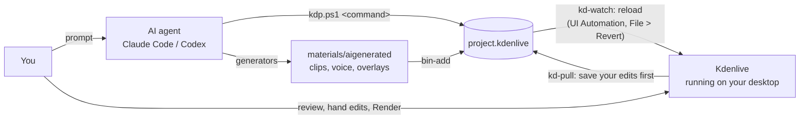

<div align="center">

# Movie Engine

**Gervigreindarfulltrúi klippir myndbandið þitt í Kdenlive á meðan þú fylgist með, og þú getur tekið við hvenær sem er.**

Gervigreindarfulltrúar fyrir forritun (Claude Code, Codex) búa til og breyta raunverulegum Kdenlive-verkefnum: kvikmyndum, útskýringarmyndböndum og lóðréttum stuttmyndböndum. Breytingarnar birtast jafnóðum í klippiforritinu sem þú ert með opið. Færanlegt, Windows, engar breytingar á klippiforritinu sjálfu.


[English](../../README.md) · [简体中文](README.zh-CN.md) · [繁體中文](README.zh-TW.md) · [हिन्दी](README.hi.md) · [Español](README.es.md) · [Français](README.fr.md) · [العربية](README.ar.md) · [বাংলা](README.bn.md) · [Português](README.pt.md) · [Русский](README.ru.md) · [اردو](README.ur.md) · [Bahasa Indonesia](README.id.md) · [Deutsch](README.de.md) · [日本語](README.ja.md) · [Türkçe](README.tr.md) · [한국어](README.ko.md) · [Українська](README.uk.md) · [Italiano](README.it.md) · [Polski](README.pl.md) · [Tiếng Việt](README.vi.md) · [فارسی](README.fa.md) · [ไทย](README.th.md) · [Kiswahili](README.sw.md) · [አማርኛ](README.am.md) · [Avañe'ẽ](README.gn.md) · [Setswana](README.tn.md) · [Shqip](README.sq.md) · [Беларуская](README.be.md) · [Български](README.bg.md) · [Bosanski](README.bs.md) · [Hrvatski](README.hr.md) · [Српски](README.sr.md) · [Crnogorski](README.cnr.md) · [Македонски](README.mk.md) · [Slovenščina](README.sl.md) · [Slovenčina](README.sk.md) · [Čeština](README.cs.md) · [Magyar](README.hu.md) · [Română](README.ro.md) · [Dansk](README.da.md) · [Norsk bokmål](README.nb.md) · [Norsk nynorsk](README.nn.md) · [Svenska](README.sv.md) · **Íslenska** · [Suomi](README.fi.md) · [Eesti](README.et.md) · [Latviešu](README.lv.md) · [Lietuvių](README.lt.md) · [Nederlands](README.nl.md) · [Lëtzebuergesch](README.lb.md) · [Rumantsch](README.rm.md) · [Ελληνικά](README.el.md) · [Malti](README.mt.md) · [Gaeilge](README.ga.md) · [Català](README.ca.md) · [ქართული](README.ka.md) · [Հայերեն](README.hy.md) · [Azərbaycanca](README.az.md) · [Afrikaans](README.af.md) · [isiZulu](README.zu.md) · [isiXhosa](README.xh.md) · [Sesotho](README.st.md) · [Sepedi](README.nso.md) · [Xitsonga](README.ts.md) · [Tshivenḓa](README.ve.md) · [siSwati](README.ss.md) · [isiNdebele (South Africa)](README.nr.md) · [isiNdebele (Zimbabwe)](README.nd.md) · [chiShona](README.sn.md) · [Chichewa](README.ny.md) · [Ikinyarwanda](README.rw.md) · [Ikirundi](README.rn.md) · [Malagasy](README.mg.md) · [Soomaali](README.so.md) · [Afaan Oromoo](README.om.md) · [Qafar af](README.aa.md) · [ትግርኛ](README.ti.md) · [Sängö](README.sg.md) · [Kreol Seselwa](README.crs.md) · [TjiKalanga](README.kck.md) · [ChiNdau](README.ndc.md)

*Þetta er þýðing. Enska README-skráin er viðmiðunarútgáfan.*

</div>

---

## Efnisyfirlit

- [Hvers vegna](#hvers-vegna)
- [Hvernig þetta virkar](#hvernig-þetta-virkar)
- [Eiginleikar](#eiginleikar)
- [Kröfur](#kröfur)
- [Uppsetning](#uppsetning)
- [Fljótleg byrjun](#fljótleg-byrjun)
- [Að vinna með fulltrúanum](#að-vinna-með-fulltrúanum)
- [Klippiskipanalínan (`kdp.ps1`)](#klippiskipanalínan-kdpps1)
- [Samstilling í rauntíma við opna klippiforritið](#samstilling-í-rauntíma-við-opna-klippiforritið)
- [Rafalar: það sem Kdenlive getur ekki](#rafalar-það-sem-kdenlive-getur-ekki)
- [Talsetning og hljóð](#talsetning-og-hljóð)
- [Tungumál viðmótsins](#tungumál-viðmótsins)
- [Möppuskipan](#möppuskipan)
- [Prófanir og sannanir](#prófanir-og-sannanir)
- [Takmarkanir](#takmarkanir)
- [Bilanaleit](#bilanaleit)
- [Algengar spurningar](#algengar-spurningar)
- [Framlög](#framlög)
- [Þakkir](#þakkir)
- [Leyfi](#leyfi)

## Hvers vegna

Klippiforrit eru hönnuð fyrir hönd á mús. Gervigreindarfulltrúar eru góðir í uppbyggingu, tímasetningu og endurtekningu: að raða 300 bútum í takt við tónlistina, tímasetja hvern skjátexta við röddina, endurgera senu eftir athugasemdir. Þeir geta hins vegar ekki smellt sig í gegnum myndrænt viðmót án þess að taka yfir skjáborðið þitt.

Kdenlive er öflugt klippiforrit með opnum hugbúnaði, en á Windows hefur það **ekkert sjálfvirkniviðmót (API)**: stýring um D-Bus er aðeins til í Linux-útgáfum, og þær kvíslir (forks) sem bæta slíku við eru annaðhvort yfirgefnar eða ótryggar. Movie Engine leysir þetta án þess að breyta klippiforritinu:

1. Fulltrúinn breytir verkefnaskránni `.kdenlive` með prófaðri skipanalínu (`engine/kdp.ps1`).
2. Kdenlive, sem er í gangi, fær boð um að lesa skrána aftur í gegnum Windows UI Automation, án lyklaborðsslátta, án músar og án þess að stela fókus.
3. Óvistaðar breytingar þínar eru vistaðar fyrst og aldrei skrifað yfir þær.

Fulltrúinn klippir og þú ferð yfir, eða þú breytir sjálf(ur) í höndunum. Þið vinnið bæði í sama verkefninu, í sama klippiforritinu, á sama tíma.

## Hvernig þetta virkar



Hver klippiskipun fylgir sömu öruggu hringrásinni:

1. **Pull.** Ef Kdenlive er með óvistaðar breytingar fær það boð um að vista þær (vistunarhnappurinn á tækjastikunni í gegnum UI Automation), og vistunin er staðfest.
2. **Breyting.** Skipunin breytir XML-skránni undir lás, eftir tætigildisathugun (hash) og með skyndimynd til að afturkalla. Ef skránni var breytt í millitíðinni er ekkert skrifað.
3. **Endurhleðsla.** Vaktarinn sér stimpil gervigreindarinnar og keyrir File > Revert í opna klippiforritinu. Það telst aðeins hafa tekist þegar tímalínugræjan hefur í raun verið byggð upp á nýtt.
4. **Árekstur.** Ef þú byrjaðir að breyta í millitíðinni er ekkert endurhlaðið og vinnan þín helst. Útgáfa gervigreindarinnar er geymd til hliðar og fulltrúinn beitir breytingu sinni aftur ofan á þína.

## Eiginleikar

- **Full verkefnaklipping án myndræns viðmóts**: um 120 skipanir sem ná yfir verkefnakörfuna (bin), tímalínuna, brellur, samsetningar, rásir, leiðarlínur, merki, skjátexta, runur (sequences), hraða og tímavörpun, myndasýningar, titla, staðgengilsskrár (proxies), útfærslu (render) og afturköllun/endurgerð. Sjá [skipanaskrána](#klippiskipanalínan-kdpps1).
- **Samstilling í rauntíma við opna klippiforritið.** Breytingar gervigreindarinnar birtast í því Kdenlive sem þú ert að horfa á; óvistaðar breytingar þínar eru vistaðar fyrst og glatast aldrei.
- **Truflar aldrei skjáborðið þitt.** Enginn fókusþjófnaður, engir lyklaborðsslættir, engin músarhreyfing. Prófunareintök klippiforritsins keyra á ósýnilegu Windows-skjáborði.
- **Færanlegt.** Klippiforrit, stillingar, Node.js, letur og verkfæri eru í einni möppu. Afritaðu hana á aðra tölvu og allt virkar; ekkert er skrifað í Program Files eða í Windows-prófílinn þinn.
- **Rafalar fyrir það sem Kdenlive getur ekki**: hreyfitexti sem lífgaður er staf fyrir staf, handteiknaðar merkingar, þrívíddarsenur af viðmótum, bendilshreyfimyndir og löng gagnvirk útskýringarmyndbönd. Þau eru útfærð á skjákortinu (GPU) með raunverulegri hreyfiþoku og sett á tímalínuna sem venjulegir bútar.
- **Talsetning með tímasetningu orða** (Microsoft Edge TTS, enginn API-lykill). Skjátextar og aðgerðir fara af stað nákvæmlega á réttu orði.
- **Tölvugerðar hljóðbrellur** (whoosh, click, pop, riser, impact og fleiri), búnar til með kóða.
- **Sannað, ekki gefið.** Hver skipun hefur athugun á niðurstöðu, brellur og samsetningar eru prófaðar ein af annarri, og hráar niðurstöður eru í `docs/proof/`.
- **Leiðbeiningar fyrir fulltrúa fylgja með.** `AGENTS.md` og færnipakkarnir (skills) í `.claude/skills/` kenna Claude Code og Codex vinnuferlið, skráarsniðið og gildrurnar.

## Kröfur

| | |
|---|---|
| Stýrikerfi | Windows 10 eða 11, x64 |
| Klippiforrit | Kdenlive **26.08.3**, færanleg útgáfa (standalone). Aðrar útgáfur hafa ekki verið prófaðar. |
| Node.js | 18 eða nýrra: `.zip`-skráin fyrir Windows x64 frá nodejs.org, afþjöppuð í `engine/node/` |
| Vafri | Microsoft Edge (hluti af Windows); notaður án skjáglugga (headless) af senuútfærslunum |
| Fulltrúi | [Claude Code](https://claude.com/claude-code) eða Codex. Valfrjálst: öll verkfærin má einnig keyra í höndunum. |
| Diskur | um 1 GB fyrir klippiforritið og verkfærin, auk efnisins þíns |
| Skjákort | hvaða skjákort sem er með vélbúnaðarkóðun á H.264 flýtir fyrir `film-render.mjs` (annars er notuð hugbúnaðarkóðun) |

## Uppsetning

Allt er sett upp **inni í möppunni**. Ekkert þarfnast stjórnandaréttinda.

```powershell
git clone https://github.com/vladtarrow/movie-engine.git
cd movie-engine
```

**1. Node.js.** Sæktu `.zip`-skrána fyrir Windows x64 af Node.js 18 eða nýrra frá <https://nodejs.org/en/download> og afþjappaðu innihald hennar í `engine\node\`, þannig að `engine\node\node.exe` og `engine\node\npm.cmd` séu þar. Hvorki uppsetningarforrit né Node kerfisins er nauðsynlegt. Öll skriftur keyra í gegnum `engine\node.cmd`, aldrei í gegnum Node kerfisins.

**2. Node-pakkar** fyrir raddverkfærið og útfærslurnar (útgáfurnar eru festar í `engine/voice/package.json`):

```powershell
engine\node\npm.cmd install --prefix engine\voice
```

**3. Færanlegt Kdenlive 26.08.3.** Sæktu `kdenlive-26.08.3_standalone.exe` frá <https://download.kde.org/stable/kdenlive/26.08/windows/> í `engine\installer\`, athugaðu hana og afþjappaðu:

```powershell
(Get-FileHash engine\installer\kdenlive-26.08.3_standalone.exe -Algorithm SHA256).Hash
# expected: A25427B1DFF2C17E3B0386E991BB1A719382BB3176D1A90E441CDAEB6E0A967D
engine\installer\kdenlive-26.08.3_standalone.exe -o"engine\Kdenlive" -y
```

Klippiforritið lendir í `engine\Kdenlive\kdenlive-26.08.3_standalone\bin\`. Það inniheldur nú þegar `melt.exe` og `ffmpeg.exe`.

**4. Fyrsta ræsing.**

```powershell
engine\kdenlive.cmd
```

Kdenlive geymir allar stillingar sínar í `engine\profile-kdenlive\`, ekki í Windows-prófílnum þínum. Við fyrstu ræsingu birtir það uppsetningarálf einu sinni.

## Fljótleg byrjun

### Með fulltrúa

Opnaðu möppuna í Claude Code (eða Codex) og biddu um það með venjulegum orðum:

> Búðu til nýtt lóðrétt verkefni "launch-teaser" í 30 fps. Settu skjámyndirnar þrjár úr `materials/designers/launch/` á tímalínuna, 2,5 s hverja með stuttri víxlun, bættu við talsetningu úr `script.txt` og tímasettu hreyfitexta við hverja línu.

> Opnaðu það fyrir mig í Kdenlive.

> Annað skotið er of langt. Styttu það í 1,8 s og færðu merkið aðeins ofar.

Fulltrúinn fylgir `AGENTS.md`: hann breytir í gegnum `kdp.ps1`, útfærir aðeins þá búta sem klippið þarfnast og heldur opna klippiforritinu samstilltu. Þú ferð yfir í Kdenlive, breytir í höndunum hvenær sem þú vilt og ýtir á Render þegar þú ert sátt(ur).

### Í höndunum

```powershell
# a new 1080x1920 30 fps project with 2 video and 2 audio tracks
powershell -NoProfile -ExecutionPolicy Bypass -File engine\kdp.ps1 new -Project projects\hello\hello.kdenlive -Profile vertical_hd_30

# a 3-second title and a colour background
powershell -NoProfile -ExecutionPolicy Bypass -File engine\kdp.ps1 bin-color -Project projects\hello\hello.kdenlive -Color '#203060' -Seconds 3 -Name bg
powershell -NoProfile -ExecutionPolicy Bypass -File engine\kdp.ps1 title -Project projects\hello\hello.kdenlive -Text "Hello" -Seconds 3 -Name hi

# place them: background on V1, title above it on V2
powershell -NoProfile -ExecutionPolicy Bypass -File engine\kdp.ps1 add -Project projects\hello\hello.kdenlive -Bin bg -Track V1 -At 0
powershell -NoProfile -ExecutionPolicy Bypass -File engine\kdp.ps1 add -Project projects\hello\hello.kdenlive -Bin hi -Track V2 -At 0

# a check frame, then open it in the editor
powershell -NoProfile -ExecutionPolicy Bypass -File engine\kdp.ps1 frame -Project projects\hello\hello.kdenlive -At 1.5 -Out out\hello\check.png
engine\kdenlive.cmd projects\hello\hello.kdenlive
```

Til að opna síðasta verkefnið aftur síðar tvísmellirðu á `open-last-project.cmd`.

## Að vinna með fulltrúanum

Fulltrúinn les `AGENTS.md` (Codex) eða `CLAUDE.md`, sem flytur hana inn (Claude Code), auk tveggja færnipakka:

| Færnipakki | Kennir |
|---|---|
| `.claude/skills/kdenlive-project-file` | sniðið `.kdenlive` / MLT XML, `kdp.ps1`, athugun með `melt` |
| `.claude/skills/kdenlive-live` | að stýra klippiforritinu, sem er í gangi, á öruggan hátt: ræsing, pull, endurhleðsla, mynd af glugga þess |

Reglur sem fulltrúinn fylgir og þú getur treyst á:

- Hann tekur aldrei músina þína, lyklaborðið eða fókusinn og tekur aldrei skjámyndir af skjáborðinu þínu (aðeins af glugga klippiforritsins sjálfs).
- Hann framkvæmir skrefin í viðmótinu sjálfur (vista, opna, endurhlaða) í stað þess að biðja þig að smella.
- Hann spyr áður en hann sækir eitthvað og áður en hann eyðir einhverju.
- Hann útfærir aðeins það sem verkið þarfnast (senubúta, athugunarramma). Fullbúnu myndina útfærir hann aðeins þegar þú biður um það.
- Þegar Kdenlive ræður ekki vel við eitthvað smíðar fulltrúinn það utan forritsins með kóða og setur niðurstöðuna inn sem bút. Hann útvatnar ekki brelluna.

## Klippiskipanalínan (`kdp.ps1`)

```powershell
powershell -NoProfile -ExecutionPolicy Bypass -File engine\kdp.ps1 <command> -Project <file.kdenlive> [options]
```

Tímar eru í sekúndum, með punkti (`2.5`). Rásirnar heita `V1 V2 …` (V1 neðst) og `A1 A2 …`. Bútur er tilgreindur með `-Track` auk hvaða tímapunkts `-At` sem er innan hans. Færibreytur brellna fara í `-Params "name=value||name=value"`. Heildarlistinn með öllum valkostum er í haus `engine/kdp.ps1`.

| Flokkur | Skipanir |
|---|---|
| Verkefni | `new`, `profiles`, `info`, `validate`, `fonts`, `profile-set`, `profile-from-clip`, `zone`, `archive`, `backups`, `rebase`, `otio-export`, `otio-import` |
| Verkefnakarfa (bin) | `bin-add`, `bin-color`, `title`, `title-text`, `title-save`, `title-template`, `bin-rename`, `bin-remove`, `bin-info`, `bin-set`, `bin-duplicate`, `bin-replace-file`, `bin-reload`, `folder`, `bin-folder`, `relink`, `clean`, `generator`, `playlist-clip`, `extract-audio`, `transcode` |
| Tímalína | `add`, `add-av`, `move`, `copy`, `trim`, `ripple-trim`, `slip`, `split`, `remove`, `speed`, `remap`, `disable`, `enable`, `group`, `ungroup`, `mix`, `unmix`, `space-insert`, `space-remove`, `spaces-remove-all`, `track-clear`, `replace-in-timeline` |
| Brellur | `effects`, `effect-info`, `effect-add`, `effect-list`, `effect-set`, `effect-remove`, `effect-copy`, `effect-clear`, `effects-all`, `bin-effect`, `effect-templates`, `effect-template` |
| Samsetningar | `compositions`, `comp-info`, `comp-add`, `comp-list`, `comp-set`, `comp-remove` |
| Rásir | `track-add`, `track-remove`, `track-set` |
| Leiðarlínur og merki | `guide-add`, `guide-list`, `guide-remove`, `guide-set`, `guide-clear`, `guide-export`, `guide-category`, `marker`, `marker-list`, `marker-set`, `marker-remove` |
| Skjátextar | `sub-add`, `sub-import`, `sub-export`, `sub-state` |
| Runur | `sequence-add`, `sequences`, `copy-to-sequence`, `expand`; hvaða skipun sem er með `-Sequence <name>` virkar innan þeirrar runu |
| Sérstakt | `slideshow`, Lottie- / Glaxnimate-hreyfimyndir í gegnum `bin-add`, `proxy`, `stabilize`, `scene-split`, `speed-job`, `subclip` |
| Úttak | `frame` (ein PNG-mynd), `preview` (hröð útfærsla með melt), `render` (eigin útfærsluvél Kdenlive eða forstilling), `presets` |
| Saga | `undo`, `redo`, `clear-history` (skyndimyndir í `projects/<name>/.kdp-history`) |

Hegðun sem gott er að vita af:

- Tengdir hljóð- og myndhelmingar eru færðir, snyrtir, klofnir og fjarlægðir saman (`-Alone` fyrir annan helminginn).
- Skipun sem mistekst hættir með kóða 1 og skrifar ekkert.
- Brellum sem Windows-útgáfan getur ekki keyrt er hafnað, þær eru ekki hunsaðar í hljóði (listi: `docs/proof/assets.txt`).
- Hverri valmyndaraðgerð í Kdenlive er varpað á skipun, aðra leið eða „aðeins skoðun“ í `engine/tools/data/kdenlive-actions.csv`. Sjá `docs/kdenlive-coverage.md`.

## Samstilling í rauntíma við opna klippiforritið

| Skrifta | Hvað hún gerir | Lokakóðar |
|---|---|---|
| `engine\kd-pull.ps1 -Project <f>` | lætur Kdenlive vista breytingar þínar og staðfestir það | 0 skráin er uppfærð, 3 ekki í gangi, 4 ekki staðfest |
| `engine\kd-reload.ps1 -Project <f>` | File > Revert, staðfest með endurbyggðri tímalínu | 0 staðfest, 2 þú ert með óvistaðar breytingar (engu fleygt), 3 ekki í gangi, 4 mistókst |
| `engine\kd-watch.ps1 -Project <f>` | vaktari í bakgrunni: endurhleður eftir hverja skrift gervigreindarinnar, skráir árekstra | annáll í `engine\kd-watch.log`; eyddu `engine\kd-watch.run` til að stöðva |
| `engine\kdenlive-bg.ps1 [project]` | ræsir Kdenlive lágmarkað fyrir fulltrúa | 0 hlaðið, 4 ekki staðfest |
| `engine\kdenlive.cmd [project]` | ræsir Kdenlive fyrir þig | |

Ræstu vaktarann einu sinni í hverri lotu:

```powershell
Start-Process powershell -WindowStyle Hidden -ArgumentList '-NoProfile','-ExecutionPolicy','Bypass','-File','engine\kd-watch.ps1','-Project','projects\hello\hello.kdenlive'
```

Stór verkefni: endurhleðsla verkefnis með 1000 bútum tekur nokkrar mínútur, og verkfærin bíða eftir henni í stað þess að tilkynna of snemma. Verkefni eru opnuð í gegnum *File > Open Recent* í tómu klippiforriti, því þegar skrá er opnuð beint fer Qt í gegnum hvert atriði á tímalínunni vegna aðgengis, og það var um 10 mínútum hægara.

## Rafalar: það sem Kdenlive getur ekki

Kdenlive/MLT hefur enga textahreyfingu staf fyrir staf, engar segðir (expressions) og litla þrívídd, og þungar brellur hægja á spilun. Movie Engine útfærir slíka hluta utan forritsins og setur þá á tímalínuna sem venjulega búta, yfirleitt með alfarás, á rás fyrir ofan myndirnar. Rafalsskriftan og inntak hennar verða eftir í verkefnamöppunni, svo hægt er að búa bútinn til aftur þegar texti, letur eða tímasetning breytist.

| Verkfæri | Býr til |
|---|---|
| `engine/tools/kinetic-text.ps1` | hreyfitexta lífgaðan staf fyrir staf, hvert orð tímasett eftir `voice.json`, áherslukassa |
| `engine/tools/annotate.ps1` | handteiknaða hringi, kassa, undirstrikanir og örvar sem teiknast fram yfir skjámynd |
| `engine/tools/card-entrance.ps1` | spjald með skjámynd sem rís upp og stækkar inn með mjúkum skugga |
| `engine/tools/pdf-to-png.ps1` | glærur úr PDF-útflutningi |
| `engine/tools/html-render.mjs` | hvaða HTML/CSS/canvas-senu sem er yfir í myndband: viðmótshreyfingar, bendla, þrívídd, grímur |
| `engine/tools/film-render.mjs` + `film/` | löng, gagnvirk útskýringarmyndbönd á canvas: einn bútur á hverja talsetningarlínu, aðgerðir fara af stað á töluðum orðum, hreyfiþoka á skjákortinu á um 45 fps |

Báðar útfærslurnar stýra Microsoft Edge sem fylgir Windows, án skjáglugga (headless), með einnota prófíl og án netaðgangs.

### Sýnidæmi

```powershell
# a 3-second 3D title card with a cursor click
engine\node.cmd engine\tools\html-render.mjs examples\demo\scene\scene.html examples\demo\out --frames 0,30,60,89
engine\node.cmd engine\tools\html-render.mjs examples\demo\scene\scene.html examples\demo\out\scene.mp4

# a 4-shot interactive film timed to two voice lines
engine\node.cmd engine\tools\film-render.mjs examples\demo\film\film.html examples\demo\out --check
engine\node.cmd engine\tools\film-render.mjs examples\demo\film\film.html examples\demo\out --shots all --width 640
engine\node.cmd engine\tools\film-render.mjs examples\demo\film\film.html examples\demo\out\clips --suffix -v01
```

Mynd samanstendur af þremur litlum skrám. `data.js` geymir skotin og tímasetningar orðanna. `direction.js` hefur eina línu fyrir hvert skot:

```text
1 | hover 192 108 @brand | tag 300 60 Your brand @deserves | confetti 192 90 @film
2 say=A film that/*explains* it
3 | click 116 108 @before | click 268 108 @after | chips Before~After @after
4 scene=counter | count 0 120 % @count
```

`scenes.js` geymir skotin sem eru teiknuð frá grunni. `@word` setur aðgerð af stað þegar röddin segir það orð. Meðal aðgerðanna eru click, hover, drag, zoom, lens, ring, arrow, chips, toggle, slider, toast, type, count og confetti; öll málskipanin er efst í `engine/tools/film/film-kit.js`.

## Talsetning og hljóð

```powershell
engine\node.cmd engine\voice\voice.mjs lines.json materials\aigenerated\hello\voice en-US-AndrewMultilingualNeural +0%
```

`lines.json` er listi af línum. Verkfærið skrifar eina mp3-skrá á hverja línu auk `voice.json`, með lengdinni og upphafi og enda hvers orðs. Línurnar eru geymdar í skyndiminni, svo ef einni línu er breytt er aðeins sú lína búin til aftur. Verkfærið notar talgervil Microsoft Edge á netinu í gegnum pakkann `msedge-tts`: enginn lykill er nauðsynlegur, en þjónustan er óopinber og þarfnast nettengingar.

```powershell
engine\node.cmd engine\audio\sfx.mjs materials\aigenerated\sfx
```

Þetta býr til whoosh, whoosh-long, swipe, click, pop, tick, riser, impact, ding og reveal með kóða; tilbúið safn er í `materials/aigenerated/sfx/`. Fylltu hljóð sem eru styttri en einn rammi með þögn áður en þú setur þau inn (`-af apad=whole_dur=0.0667`).

## Tungumál viðmótsins

Ræsiskrifturnar ræsa Kdenlive sjálfgefið á **ensku**. Til að nota annað tungumál skaltu stilla `MOVIE_ENGINE_UI_LANG` fyrir ræsingu:

```powershell
$env:MOVIE_ENGINE_UI_LANG = 'ru'; engine\kdenlive.cmd
```

UI Automation finnur valmyndaratriði eftir sýnilegum heitum þeirra. Heiti fyrir 31 viðmótstungumál eru innbyggð (`engine/tools/kd-ui.ps1`, `$KdNames`). Fyrir önnur tungumál skaltu bæta heitum þeirra þar við og athuga með:

```powershell
powershell -NoProfile -ExecutionPolicy Bypass -File engine\tools\kd-langcheck.ps1
```

## Möppuskipan

```text
movie-engine/
├─ AGENTS.md, CLAUDE.md          instructions for AI agents
├─ .claude/skills/               agent skills: project file format, live editor
├─ engine/
│  ├─ kdp.ps1                    the editing command line
│  ├─ kd-pull / kd-reload / kd-watch .ps1, kdenlive.cmd, kdenlive-bg.ps1
│  ├─ tools/                     internals, generators, tests, data (action map)
│  ├─ voice/  audio/  fonts/     TTS, synthesized SFX, Poppins (OFL)
│  ├─ Kdenlive/  node/           portable editor and Node.js (not in git)
│  └─ profile-kdenlive/          the editor's settings (not in git)
├─ projects/<name>/<name>.kdenlive
├─ materials/
│  ├─ download/                  stock and downloaded files (not in git)
│  ├─ aigenerated/               everything the AI made (sfx/ and test-kit/ ship with the engine)
│  ├─ designers/  brand/         files from your team, brand assets
├─ examples/demo/                demos of the scene and film renderers
├─ out/                          renders (not in git)
└─ docs/                         proofs, coverage, translations of this README
```

Slóðir á efni innan verkefna eru afstæðar. Ef þú færir eða afritar möppuna skrifar `kdp.ps1 rebase` (sem `kdenlive.cmd` keyrir líka sjálfkrafa) nýju staðsetninguna inn í verkefnið.

## Prófanir og sannanir

Fullyrðingar um hvað virkar eru studdar athugunum á niðurstöðum, ekki því að „fallið keyrði“. Samantektin er í [`docs/kdenlive-proof.md`](../../docs/kdenlive-proof.md), og hrátt úttak er í `docs/proof/`.

| Prófun | Athugar |
|---|---|
| `engine\tools\kdp-clitest.ps1` | hverja skipun `kdp.ps1`, í gegnum skipanalínuna, með samanburði á verkefninu sem kemur út |
| `engine\tools\kd-livetest.ps1` | pull, endurhleðslu, vaktara, árekstra og kapphlaup (races) gegn raunverulegu Kdenlive á ósýnilegu skjáborði |
| `engine\tools\kdp-assetsweep.ps1` | hverja brellu og samsetningu: útfærir og ber saman ramma |
| `engine\tools\kdp-portabletest.ps1` | afritar möppuna annað og vinnur úr afritinu |
| `engine\tools\kd-langcheck.ps1` | tungumál viðmótsins og að UI Automation finni valmyndina |
| `engine\tools\kdp-coverage-check.ps1` | að hverri valmyndaraðgerð sé varpað og að engin sönnun sé eldri en kóðinn |

```powershell
powershell -NoProfile -ExecutionPolicy Bypass -File engine\tools\kdp-clitest.ps1 -Report docs\proof\clitest.txt
powershell -NoProfile -ExecutionPolicy Bypass -File engine\tools\kd-livetest.ps1 -Report docs\proof\live-en.txt
```

Prófunareintök klippiforritsins keyra aðeins á földu skjáborði með eigin prófíl, svo prófanir snerta aldrei opna Kdenlive-forritið þitt eða fókusinn þinn.

## Takmarkanir

- **Aðeins Windows**, aðeins Kdenlive **26.08.3**. Linux hefur D-Bus og þyrfti aðra brú.
- Þegar klippiforritið ræsist tekur það lyklaborðsfókusinn í um 3 sekúndur á meðan tómi glugginn birtist. Fulltrúar spyrja áður en þeir ræsa það á meðan þú ert að vinna. Endurhleðslur og breytingar taka ekki fókus.
- Windows-útgáfuna vantar MLT-einingarnar sox, ladspa og movit og sumar frei0r/avfilter-brellur; `kdp.ps1` hafnar þeim (`docs/proof/assets.txt`).
- Útflutningur og innflutningur OpenTimelineIO flytur aðeins búta og bil. Fjölmyndavélaklipping (multicam) hefur engin sjónarhornaskipti í rauntíma (klippt er með split/remove/hide).
- „Save As…“ í gegnum UI Automation í lágmörkuðum glugga opnar engan glugga; fulltrúinn notar `archive` eða afrit af skrám í staðinn.
- Talgreining (sjálfvirkir skjátextar) þarfnast Whisper eða Vosk, sem fylgja ekki með.
- Titlar sem gerðir eru með titlatóli Kdenlive nota letur sem er uppsett í Windows. Fyrir örugga leturgerð skaltu útfæra texta með rafölunum, sem hlaða letri úr `engine/fonts/`.
- Edge TTS er óopinber netþjónusta og getur breyst eða hætt að virka.

## Bilanaleit

| Einkenni | Orsök og lausn |
|---|---|
| Kdenlive er í gangi, en ekkert birtist þegar smellt er á það á verkstikunni | Vistuð staðsetning gluggans er utan skjásins. Lokaðu forritinu og eyddu `kdockLayout`-færslunum í `engine\profile-kdenlive\AppData\Local\kdenliverc`, eða færðu gluggann með `SetWindowPos` (sjá `AGENTS.md`). |
| `kd-reload.ps1` hættir með 2 | Þú ert með óvistaðar breytingar. Engu var fleygt. Keyrðu `kd-pull.ps1` og beittu svo breytingunni aftur (`kdp.ps1` gerir þetta sjálft). |
| `CONFLICT` í `engine\kd-watch.log` | Þú og fulltrúinn breyttuð á sama augnabliki. Þín útgáfa helst í klippiforritinu, og útgáfa gervigreindarinnar er í `projects\<name>\.kdp-history\<name>\conflict\`. Biddu fulltrúann að beita breytingu sinni aftur. |
| Skipun hættir með 1 og „pull not confirmed“ | Kdenlive er upptekið eða sýnir glugga. Lokaðu glugganum eða bíddu eftir að hleðslu ljúki og reyndu svo aftur. |
| PowerShell-skrifta þáttast ekki | Skriftur með texta utan ASCII verður að vista sem UTF-8 **með BOM** fyrir Windows PowerShell 5.1. |
| `voice.mjs` stöðvast með „Stream closed before the synthesis completed“ | Yfirleitt netvandamál, eða SSML án lausnarstafa (escape) í eldri afritum. `voice.mjs` sér sjálft um `& < >`. |
| Það tekur margar mínútur að opna stórt verkefni | Opnaðu það í gegnum `kdenlive.cmd` / `kdenlive-bg.ps1`, aldrei sem `kdenlive.exe project.kdenlive`. |

## Algengar spurningar

**Þarf ég Claude Code eða Codex?**
Nei. Hvert verkfæri er venjuleg skrifta sem þú getur keyrt í höndunum. Það er fulltrúinn sem gerir þetta hratt: hann skipuleggur klippið, keyrir verkfærin og heldur klippiforritinu samstilltu.

**Mun fulltrúinn skrifa yfir handvirkar breytingar mínar?**
Nei. Fyrir hverja skrift eru óvistaðar breytingar þínar vistaðar og staðfestar. Ef þú breytir á meðan fulltrúinn skrifar er skriftinni hafnað eða hún geymd til hliðar sem árekstur, en henni er aldrei beitt ofan á vinnuna þína.

**Get ég haldið áfram að nota Kdenlive eins og venjulega?**
Já. Þetta er hefðbundið Kdenlive með eigin stillingamöppu. Klipptu, forskoðaðu og útfærðu eins og venjulega.

**Virkar þetta með Kdenlive sem ég hef þegar sett upp?**
Það notar sitt eigið færanlega eintak í `engine\Kdenlive\`, svo uppsett Kdenlive og stillingar þess haldast óbreyttar.

**Af hverju ekki kvísl af Kdenlive með API, eða annað klippiforrit?**
Á Windows er engin viðhaldin og örugg kvísl til (könnun frá 2026-11). OpenShot, Blender VSE, DaVinci Resolve, Shotcut og vefklippiforrit voru metin; Kdenlive bauð upp á mesta klippidýpt. Fylgst er með tillögu um REST API í aðalverkefninu (merge request !902).

**Getur það útfært fullbúna myndbandið?**
Já, með `kdp.ps1 render` (eigin útfærsluvél Kdenlive, falin), eða þú ýtir sjálf(ur) á Render í klippiforritinu.

**Er efninu mínu hlaðið upp einhvers staðar?**
Nei. Aðeins texti talsetningarinnar er sendur til Edge TTS-þjónustunnar þegar þú býrð til rödd. Senuútfærslurnar keyra með netið óvirkt.

## Framlög

Framlög eru velkomin. Sjá [CONTRIBUTING.md](../../CONTRIBUTING.md). Í stuttu máli:

- Hver ný eða breytt aðgerð í `kdp.ps1` þarfnast athugunar á niðurstöðu í `kdp-clitest.ps1`, færslu í aðgerðakortinu og nýrrar keyrslu á `kdp-coverage-check.ps1`.
- Ræstu aldrei prófunareintak af Kdenlive á sýnilega skjáborðinu; notaðu `engine/tools/kd-hidden.ps1`.
- Haltu öllu færanlegu: engar uppsetningar utan möppunnar, engar algildar slóðir í verkefnum.
- Skráðu staðfest sérkenni í `AGENTS.md` eða í viðeigandi færnipakka.

## Þakkir

- [Kdenlive](https://kdenlive.org) og [MLT](https://www.mltframework.org): klippiforritið og vélin undir því.
- [FFmpeg](https://ffmpeg.org), sem fylgir Kdenlive.
- [msedge-tts](https://www.npmjs.com/package/msedge-tts) fyrir talsetninguna.
- [Poppins](https://fonts.google.com/specimen/Poppins) frá Indian Type Foundry, SIL Open Font License (`engine/fonts/OFL.txt`).
- `engine/tools/data/kdenliveui-26.08.3.rc`: valmyndaskrá Kdenlive, tekin úr frumkóða Kdenlive 26.08.3; aðeins notuð af þekjuathuguninni. Hún heyrir áfram undir GPL-leyfi Kdenlive, ekki MIT License.

## Leyfi

Eigin kóði Movie Engine er gefinn út undir [MIT-leyfinu](../../LICENSE). Kdenlive, MLT, FFmpeg, Node.js-pakkar og Poppins-letrið halda sínum eigin leyfum.
