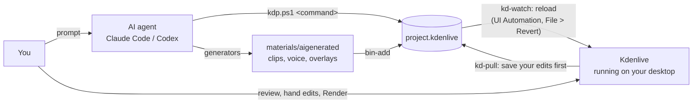

<div align="center">

# Movie Engine

**Un agente IA monta il tuo video in Kdenlive sotto i tuoi occhi, e tu puoi subentrare in qualsiasi momento.**

Gli agenti IA per la programmazione (Claude Code, Codex) creano e modificano veri progetti Kdenlive: film, video esplicativi e short verticali. Le modifiche compaiono in tempo reale nell'editor che hai aperto. Portabile, per Windows, senza patch all'editor.


[English](../../README.md) · [简体中文](README.zh-CN.md) · [繁體中文](README.zh-TW.md) · [हिन्दी](README.hi.md) · [Español](README.es.md) · [Français](README.fr.md) · [العربية](README.ar.md) · [বাংলা](README.bn.md) · [Português](README.pt.md) · [Русский](README.ru.md) · [اردو](README.ur.md) · [Bahasa Indonesia](README.id.md) · [Deutsch](README.de.md) · [日本語](README.ja.md) · [Türkçe](README.tr.md) · [한국어](README.ko.md) · [Українська](README.uk.md) · **Italiano** · [Polski](README.pl.md) · [Tiếng Việt](README.vi.md) · [فارسی](README.fa.md) · [ไทย](README.th.md) · [Kiswahili](README.sw.md) · [አማርኛ](README.am.md) · [Avañe'ẽ](README.gn.md) · [Setswana](README.tn.md) · [Shqip](README.sq.md) · [Беларуская](README.be.md) · [Български](README.bg.md) · [Bosanski](README.bs.md) · [Hrvatski](README.hr.md) · [Српски](README.sr.md) · [Crnogorski](README.cnr.md) · [Македонски](README.mk.md) · [Slovenščina](README.sl.md) · [Slovenčina](README.sk.md) · [Čeština](README.cs.md) · [Magyar](README.hu.md) · [Română](README.ro.md) · [Dansk](README.da.md) · [Norsk bokmål](README.nb.md) · [Norsk nynorsk](README.nn.md) · [Svenska](README.sv.md) · [Íslenska](README.is.md) · [Suomi](README.fi.md) · [Eesti](README.et.md) · [Latviešu](README.lv.md) · [Lietuvių](README.lt.md) · [Nederlands](README.nl.md) · [Lëtzebuergesch](README.lb.md) · [Rumantsch](README.rm.md) · [Ελληνικά](README.el.md) · [Malti](README.mt.md) · [Gaeilge](README.ga.md) · [Català](README.ca.md) · [ქართული](README.ka.md) · [Հայերեն](README.hy.md) · [Azərbaycanca](README.az.md) · [Afrikaans](README.af.md) · [isiZulu](README.zu.md) · [isiXhosa](README.xh.md) · [Sesotho](README.st.md) · [Sepedi](README.nso.md) · [Xitsonga](README.ts.md) · [Tshivenḓa](README.ve.md) · [siSwati](README.ss.md) · [isiNdebele (South Africa)](README.nr.md) · [isiNdebele (Zimbabwe)](README.nd.md) · [chiShona](README.sn.md) · [Chichewa](README.ny.md) · [Ikinyarwanda](README.rw.md) · [Ikirundi](README.rn.md) · [Malagasy](README.mg.md) · [Soomaali](README.so.md) · [Afaan Oromoo](README.om.md) · [Qafar af](README.aa.md) · [ትግርኛ](README.ti.md) · [Sängö](README.sg.md) · [Kreol Seselwa](README.crs.md) · [TjiKalanga](README.kck.md) · [ChiNdau](README.ndc.md)

*Questa è una traduzione; la versione di riferimento è il README in inglese.*

</div>

---

## Indice

- [Perché](#perché)
- [Come funziona](#come-funziona)
- [Funzionalità](#funzionalità)
- [Requisiti](#requisiti)
- [Installazione](#installazione)
- [Avvio rapido](#avvio-rapido)
- [Lavorare con l'agente](#lavorare-con-lagente)
- [La riga di comando per il montaggio (`kdp.ps1`)](#la-riga-di-comando-per-il-montaggio-kdpps1)
- [Sincronizzazione live con l'editor aperto](#sincronizzazione-live-con-leditor-aperto)
- [Generatori: ciò che Kdenlive non sa fare](#generatori-ciò-che-kdenlive-non-sa-fare)
- [Voce fuori campo e audio](#voce-fuori-campo-e-audio)
- [Lingua dell'interfaccia](#lingua-dellinterfaccia)
- [Struttura delle cartelle](#struttura-delle-cartelle)
- [Test e prove](#test-e-prove)
- [Limitazioni](#limitazioni)
- [Risoluzione dei problemi](#risoluzione-dei-problemi)
- [Domande frequenti](#domande-frequenti)
- [Contribuire](#contribuire)
- [Ringraziamenti](#ringraziamenti)
- [Licenza](#licenza)

## Perché

Gli editor video sono pensati per una mano sul mouse. Gli agenti IA invece sono bravi con la struttura, il timing e i compiti ripetitivi: mettere 300 clip a tempo di musica, sincronizzare ogni sottotitolo con la voce, rifare una scena dopo un feedback. Però non possono cliccare in un'interfaccia grafica senza impadronirsi del tuo desktop.

Kdenlive è un ottimo editor open source, ma su Windows **non ha un'API di automazione**: il controllo via D-Bus esiste solo nelle build per Linux, e i fork che ne aggiungono una sono abbandonati oppure non sicuri. Movie Engine risolve il problema senza modificare l'editor:

1. L'agente modifica il file di progetto `.kdenlive` tramite una riga di comando testata (`engine/kdp.ps1`).
2. Al Kdenlive in esecuzione viene chiesto di ricaricare il file tramite Windows UI Automation, senza tasti premuti, senza mouse e senza rubare il focus.
3. Le tue modifiche non salvate vengono salvate per prime e non vengono mai sovrascritte.

Quindi l'agente monta e tu controlli, oppure monti tu a mano. Lavorate entrambi sullo stesso progetto, nello stesso editor, nello stesso momento.

## Come funziona



Ogni comando di montaggio segue lo stesso ciclo sicuro:

1. **Pull.** Se Kdenlive ha modifiche non salvate, gli viene chiesto di salvarle (il pulsante Salva della barra degli strumenti tramite UI Automation) e il salvataggio viene confermato.
2. **Modifica.** Il comando cambia l'XML sotto un blocco, dopo un controllo dell'hash e con uno snapshot per l'annullamento. Se nel frattempo il file è cambiato, non viene scritto nulla.
3. **Ricaricamento.** Il watcher riconosce il contrassegno lasciato dall'IA ed esegue File > Revert nell'editor aperto. Conta come riuscito solo se il widget della timeline è stato effettivamente ricostruito.
4. **Conflitto.** Se nel frattempo hai iniziato a modificare, non viene ricaricato nulla e il tuo lavoro resta com'è. La versione dell'IA viene messa da parte e l'agente riapplica la sua modifica sopra la tua.

## Funzionalità

- **Montaggio completo del progetto senza interfaccia grafica**: circa 120 comandi per contenitore del progetto, timeline, effetti, composizioni, tracce, guide, marcatori, sottotitoli, sequenze, velocità e rimappatura del tempo, presentazioni, titoli, proxy, rendering e annulla/ripeti. Vedi il [riferimento dei comandi](#la-riga-di-comando-per-il-montaggio-kdpps1).
- **Sincronizzazione live con l'editor aperto.** Le modifiche dell'IA compaiono nel Kdenlive che stai guardando; le tue modifiche non salvate vengono salvate prima e non vanno mai perse.
- **Non disturba mai il tuo desktop.** Nessun furto del focus, nessun tasto premuto, nessun input del mouse. Gli editor di test girano su un desktop Windows invisibile.
- **Portabile.** Editor, impostazioni, Node.js, font e strumenti stanno in un'unica cartella. Copiala su un altro PC e funziona; nulla viene scritto in Program Files o nel tuo profilo Windows.
- **Generatori per ciò che Kdenlive non sa fare**: testo cinetico animato lettera per lettera, annotazioni disegnate a mano, scene 3D di interfacce, animazioni del cursore e lunghi film esplicativi interattivi. Vengono renderizzati sulla GPU con un vero motion blur e messi sulla timeline come normali clip.
- **Voce fuori campo con i tempi di ogni parola** (Microsoft Edge TTS, senza chiave API). Sottotitoli e azioni partono esattamente sulla parola giusta.
- **Effetti sonori sintetizzati** (whoosh, click, pop, riser, impact e altri), generati via codice.
- **Dimostrato, non presunto.** Ogni comando ha un controllo del risultato, effetti e composizioni vengono verificati uno per uno e i risultati grezzi sono in `docs/proof/`.
- **Istruzioni per gli agenti incluse.** `AGENTS.md` e le skill in `.claude/skills/` insegnano a Claude Code e Codex il flusso di lavoro, il formato dei file e le insidie.

## Requisiti

| | |
|---|---|
| Sistema operativo | Windows 10 o 11, x64 |
| Editor | Kdenlive **26.08.3**, build portabile (standalone). Le altre versioni non sono testate. |
| Node.js | 18 o successivo: il `.zip` per Windows x64 da nodejs.org, estratto in `engine/node/` |
| Browser | Microsoft Edge (incluso in Windows); usato in modalità headless dai renderer delle scene |
| Agente | [Claude Code](https://claude.com/claude-code) o Codex. Facoltativo: ogni strumento si può anche eseguire a mano. |
| Disco | circa 1 GB per editor e strumenti, più i tuoi file multimediali |
| GPU | qualsiasi GPU con codifica H.264 hardware velocizza `film-render.mjs` (altrimenti ripiega sulla codifica software) |

## Installazione

Tutto viene installato **dentro la cartella**. Non servono diritti di amministratore.

```powershell
git clone https://github.com/vladtarrow/movie-engine.git
cd movie-engine
```

**1. Node.js.** Scarica il `.zip` per Windows x64 di Node.js 18 o successivo da <https://nodejs.org/en/download> ed estraine il contenuto in `engine\node\`, in modo che ci siano `engine\node\node.exe` e `engine\node\npm.cmd`. Non servono né un programma di installazione né un Node di sistema. Tutti gli script girano tramite `engine\node.cmd`, mai con un Node di sistema.

**2. Pacchetti Node** per lo strumento di sintesi vocale e i renderer (le versioni sono fissate in `engine/voice/package.json`):

```powershell
engine\node\npm.cmd install --prefix engine\voice
```

**3. Kdenlive 26.08.3 portabile.** Scarica `kdenlive-26.08.3_standalone.exe` da <https://download.kde.org/stable/kdenlive/26.08/windows/> in `engine\installer\`, verificalo ed estrailo:

```powershell
(Get-FileHash engine\installer\kdenlive-26.08.3_standalone.exe -Algorithm SHA256).Hash
# expected: A25427B1DFF2C17E3B0386E991BB1A719382BB3176D1A90E441CDAEB6E0A967D
engine\installer\kdenlive-26.08.3_standalone.exe -o"engine\Kdenlive" -y
```

L'editor finisce in `engine\Kdenlive\kdenlive-26.08.3_standalone\bin\`. Include già `melt.exe` e `ffmpeg.exe`.

**4. Primo avvio.**

```powershell
engine\kdenlive.cmd
```

Kdenlive tiene tutte le sue impostazioni in `engine\profile-kdenlive\`, non nel tuo profilo Windows. Al primo avvio mostra una sola volta una procedura guidata di configurazione.

## Avvio rapido

### Con un agente

Apri la cartella in Claude Code (o Codex) e chiedi con parole semplici:

> Crea un nuovo progetto verticale a 30 fps chiamato "launch-teaser". Metti sulla timeline i tre screenshot di `materials/designers/launch/`, 2,5 s ciascuno con una breve dissolvenza incrociata, aggiungi una voce fuori campo da `script.txt` e sincronizza una didascalia cinetica con ogni riga.

> Aprimelo in Kdenlive.

> La seconda inquadratura è troppo lunga. Accorciala a 1,8 s e sposta il logo un po' più in alto.

L'agente segue `AGENTS.md`: modifica tramite `kdp.ps1`, renderizza solo le clip di cui il montaggio ha bisogno e mantiene sincronizzato l'editor aperto. Tu controlli in Kdenlive, modifichi a mano quando vuoi e premi Render quando sei soddisfatto.

### A mano

```powershell
# a new 1080x1920 30 fps project with 2 video and 2 audio tracks
powershell -NoProfile -ExecutionPolicy Bypass -File engine\kdp.ps1 new -Project projects\hello\hello.kdenlive -Profile vertical_hd_30

# a 3-second title and a colour background
powershell -NoProfile -ExecutionPolicy Bypass -File engine\kdp.ps1 bin-color -Project projects\hello\hello.kdenlive -Color '#203060' -Seconds 3 -Name bg
powershell -NoProfile -ExecutionPolicy Bypass -File engine\kdp.ps1 title -Project projects\hello\hello.kdenlive -Text "Hello" -Seconds 3 -Name hi

# place them: background on V1, title above it on V2
powershell -NoProfile -ExecutionPolicy Bypass -File engine\kdp.ps1 add -Project projects\hello\hello.kdenlive -Bin bg -Track V1 -At 0
powershell -NoProfile -ExecutionPolicy Bypass -File engine\kdp.ps1 add -Project projects\hello\hello.kdenlive -Bin hi -Track V2 -At 0

# a check frame, then open it in the editor
powershell -NoProfile -ExecutionPolicy Bypass -File engine\kdp.ps1 frame -Project projects\hello\hello.kdenlive -At 1.5 -Out out\hello\check.png
engine\kdenlive.cmd projects\hello\hello.kdenlive
```

Per riaprire in seguito l'ultimo progetto, fai doppio clic su `open-last-project.cmd`.

## Lavorare con l'agente

L'agente legge `AGENTS.md` (Codex) oppure `CLAUDE.md`, che lo importa (Claude Code), più due skill:

| Skill | Cosa insegna |
|---|---|
| `.claude/skills/kdenlive-project-file` | il formato `.kdenlive` / MLT XML, `kdp.ps1`, la verifica con `melt` |
| `.claude/skills/kdenlive-live` | come pilotare in sicurezza l'editor in esecuzione: avvio, pull, ricaricamento, cattura della sua finestra |

Regole che l'agente segue e su cui puoi contare:

- Non si prende mai il tuo mouse, la tastiera o il focus e non cattura mai schermate del tuo desktop (solo della finestra dell'editor).
- Esegue da solo i passaggi nell'interfaccia (salvare, aprire, ricaricare) invece di chiederti di cliccare.
- Chiede prima di scaricare qualsiasi cosa e prima di eliminare qualsiasi cosa.
- Renderizza solo ciò che serve al lavoro (clip delle scene, fotogrammi di verifica). Renderizza il film finale solo se glielo chiedi.
- Quando Kdenlive non sa fare bene qualcosa, l'agente lo costruisce all'esterno con il codice e inserisce il risultato come clip. Non annacqua l'effetto.

## La riga di comando per il montaggio (`kdp.ps1`)

```powershell
powershell -NoProfile -ExecutionPolicy Bypass -File engine\kdp.ps1 <command> -Project <file.kdenlive> [options]
```

I tempi sono in secondi, con il punto (`2.5`). Le tracce sono `V1 V2 …` (V1 è la più bassa) e `A1 A2 …`. Una clip si indica con `-Track` più un qualsiasi istante `-At` al suo interno. I parametri degli effetti vanno in `-Params "name=value||name=value"`. L'elenco completo con tutte le opzioni è nell'intestazione di `engine/kdp.ps1`.

| Gruppo | Comandi |
|---|---|
| Progetto | `new`, `profiles`, `info`, `validate`, `fonts`, `profile-set`, `profile-from-clip`, `zone`, `archive`, `backups`, `rebase`, `otio-export`, `otio-import` |
| Contenitore del progetto | `bin-add`, `bin-color`, `title`, `title-text`, `title-save`, `title-template`, `bin-rename`, `bin-remove`, `bin-info`, `bin-set`, `bin-duplicate`, `bin-replace-file`, `bin-reload`, `folder`, `bin-folder`, `relink`, `clean`, `generator`, `playlist-clip`, `extract-audio`, `transcode` |
| Timeline | `add`, `add-av`, `move`, `copy`, `trim`, `ripple-trim`, `slip`, `split`, `remove`, `speed`, `remap`, `disable`, `enable`, `group`, `ungroup`, `mix`, `unmix`, `space-insert`, `space-remove`, `spaces-remove-all`, `track-clear`, `replace-in-timeline` |
| Effetti | `effects`, `effect-info`, `effect-add`, `effect-list`, `effect-set`, `effect-remove`, `effect-copy`, `effect-clear`, `effects-all`, `bin-effect`, `effect-templates`, `effect-template` |
| Composizioni | `compositions`, `comp-info`, `comp-add`, `comp-list`, `comp-set`, `comp-remove` |
| Tracce | `track-add`, `track-remove`, `track-set` |
| Guide e marcatori | `guide-add`, `guide-list`, `guide-remove`, `guide-set`, `guide-clear`, `guide-export`, `guide-category`, `marker`, `marker-list`, `marker-set`, `marker-remove` |
| Sottotitoli | `sub-add`, `sub-import`, `sub-export`, `sub-state` |
| Sequenze | `sequence-add`, `sequences`, `copy-to-sequence`, `expand`; qualsiasi comando con `-Sequence <name>` lavora dentro quella sequenza |
| Speciali | `slideshow`, animazioni Lottie / Glaxnimate tramite `bin-add`, `proxy`, `stabilize`, `scene-split`, `speed-job`, `subclip` |
| Output | `frame` (un PNG), `preview` (render veloce con melt), `render` (il renderer di Kdenlive o un preset), `presets` |
| Cronologia | `undo`, `redo`, `clear-history` (snapshot in `projects/<name>/.kdp-history`) |

Comportamenti da conoscere:

- Le metà audio e video collegate vengono spostate, rifilate, divise e rimosse insieme (`-Alone` per una sola metà).
- Un comando che fallisce esce con codice 1 e non scrive nulla.
- Gli effetti che la build per Windows non può eseguire vengono rifiutati, non ignorati in silenzio (elenco: `docs/proof/assets.txt`).
- Ogni azione dei menu di Kdenlive è associata a un comando, a un'altra strada o a "solo visualizzazione" in `engine/tools/data/kdenlive-actions.csv`. Vedi `docs/kdenlive-coverage.md`.

## Sincronizzazione live con l'editor aperto

| Script | Cosa fa | Codici di uscita |
|---|---|---|
| `engine\kd-pull.ps1 -Project <f>` | fa salvare a Kdenlive le tue modifiche e lo conferma | 0 file aggiornato, 3 non in esecuzione, 4 non confermato |
| `engine\kd-reload.ps1 -Project <f>` | File > Revert, confermato dalla timeline ricostruita | 0 confermato, 2 hai modifiche non salvate (nulla scartato), 3 non in esecuzione, 4 fallito |
| `engine\kd-watch.ps1 -Project <f>` | watcher in background: ricarica dopo ogni scrittura dell'IA, registra i conflitti | log in `engine\kd-watch.log`; elimina `engine\kd-watch.run` per fermarlo |
| `engine\kdenlive-bg.ps1 [project]` | avvia Kdenlive ridotto a icona per un agente | 0 caricato, 4 non confermato |
| `engine\kdenlive.cmd [project]` | avvia Kdenlive per te | |

Avvia il watcher una volta per sessione:

```powershell
Start-Process powershell -WindowStyle Hidden -ArgumentList '-NoProfile','-ExecutionPolicy','Bypass','-File','engine\kd-watch.ps1','-Project','projects\hello\hello.kdenlive'
```

Progetti grandi: ricaricare un progetto da 1000 clip richiede minuti, e gli strumenti aspettano invece di segnalare il successo in anticipo. I progetti si aprono tramite *File > Open Recent* in un editor vuoto, perché aprendo direttamente un file Qt percorre ogni elemento della timeline per l'accessibilità, e questo richiedeva circa 10 minuti in più.

## Generatori: ciò che Kdenlive non sa fare

Kdenlive/MLT non ha animazione del testo lettera per lettera, né espressioni, ha poco 3D, e gli effetti pesanti rallentano la riproduzione. Movie Engine renderizza queste parti all'esterno e le mette sulla timeline come normali clip, di solito con canale alfa, su una traccia sopra le immagini. Lo script del generatore e i suoi input restano nella cartella del progetto, così una clip si può rigenerare quando cambiano il testo, il font o il timing.

| Strumento | Cosa produce |
|---|---|
| `engine/tools/kinetic-text.ps1` | didascalie cinetiche animate lettera per lettera, ogni parola sincronizzata da `voice.json`, riquadro di evidenziazione |
| `engine/tools/annotate.ps1` | cerchi, riquadri, sottolineature e frecce disegnati a mano che si tracciano sopra uno screenshot |
| `engine/tools/card-entrance.ps1` | una scheda con uno screenshot che sale e si ingrandisce con un'ombra morbida |
| `engine/tools/pdf-to-png.ps1` | diapositive da un'esportazione PDF |
| `engine/tools/html-render.mjs` | qualsiasi scena HTML/CSS/canvas in video: animazioni di interfaccia, cursori, 3D, maschere |
| `engine/tools/film-render.mjs` + `film/` | lunghi film esplicativi interattivi su un canvas: una clip per ogni battuta della voce, azioni che partono sulle parole pronunciate, motion blur su GPU a circa 45 fps |

Entrambi i renderer pilotano il Microsoft Edge incluso in Windows, in modalità headless, con un profilo usa e getta e senza accesso alla rete.

### Demo

```powershell
# a 3-second 3D title card with a cursor click
engine\node.cmd engine\tools\html-render.mjs examples\demo\scene\scene.html examples\demo\out --frames 0,30,60,89
engine\node.cmd engine\tools\html-render.mjs examples\demo\scene\scene.html examples\demo\out\scene.mp4

# a 4-shot interactive film timed to two voice lines
engine\node.cmd engine\tools\film-render.mjs examples\demo\film\film.html examples\demo\out --check
engine\node.cmd engine\tools\film-render.mjs examples\demo\film\film.html examples\demo\out --shots all --width 640
engine\node.cmd engine\tools\film-render.mjs examples\demo\film\film.html examples\demo\out\clips --suffix -v01
```

Un film è composto da tre piccoli file. `data.js` contiene le inquadrature e i tempi delle parole. `direction.js` ha una riga per inquadratura:

```text
1 | hover 192 108 @brand | tag 300 60 Your brand @deserves | confetti 192 90 @film
2 say=A film that/*explains* it
3 | click 116 108 @before | click 268 108 @after | chips Before~After @after
4 scene=counter | count 0 120 % @count
```

`scenes.js` contiene le inquadrature disegnate da zero. `@word` fa partire un'azione quando la voce pronuncia quella parola. Tra le azioni ci sono click, hover, drag, zoom, lens, ring, arrow, chips, toggle, slider, toast, type, count e confetti; la sintassi completa è all'inizio di `engine/tools/film/film-kit.js`.

## Voce fuori campo e audio

```powershell
engine\node.cmd engine\voice\voice.mjs lines.json materials\aigenerated\hello\voice en-US-AndrewMultilingualNeural +0%
```

`lines.json` è un elenco di battute. Lo strumento scrive un mp3 per battuta più `voice.json`, con la durata e l'inizio e la fine di ogni parola. Le battute vengono messe in cache, quindi se ne cambi una viene rigenerata solo quella. Usa la sintesi vocale online di Microsoft Edge tramite il pacchetto `msedge-tts`: non serve alcuna chiave, ma il servizio non è ufficiale e richiede internet.

```powershell
engine\node.cmd engine\audio\sfx.mjs materials\aigenerated\sfx
```

Questo comando sintetizza via codice whoosh, whoosh-long, swipe, click, pop, tick, riser, impact, ding e reveal; un set pronto si trova in `materials/aigenerated/sfx/`. I suoni più brevi di un fotogramma vanno allungati con del silenzio prima di posizionarli (`-af apad=whole_dur=0.0667`).

## Lingua dell'interfaccia

Per impostazione predefinita i launcher avviano Kdenlive in **inglese**. Per usare un'altra lingua, imposta `MOVIE_ENGINE_UI_LANG` prima dell'avvio:

```powershell
$env:MOVIE_ENGINE_UI_LANG = 'ru'; engine\kdenlive.cmd
```

UI Automation trova le voci di menu in base ai loro nomi visibili. I nomi per 31 lingue dell'interfaccia sono già inclusi (`engine/tools/kd-ui.ps1`, `$KdNames`). Per qualsiasi altra lingua, aggiungi lì i suoi nomi e verifica con:

```powershell
powershell -NoProfile -ExecutionPolicy Bypass -File engine\tools\kd-langcheck.ps1
```

## Struttura delle cartelle

```text
movie-engine/
├─ AGENTS.md, CLAUDE.md          instructions for AI agents
├─ .claude/skills/               agent skills: project file format, live editor
├─ engine/
│  ├─ kdp.ps1                    the editing command line
│  ├─ kd-pull / kd-reload / kd-watch .ps1, kdenlive.cmd, kdenlive-bg.ps1
│  ├─ tools/                     internals, generators, tests, data (action map)
│  ├─ voice/  audio/  fonts/     TTS, synthesized SFX, Poppins (OFL)
│  ├─ Kdenlive/  node/           portable editor and Node.js (not in git)
│  └─ profile-kdenlive/          the editor's settings (not in git)
├─ projects/<name>/<name>.kdenlive
├─ materials/
│  ├─ download/                  stock and downloaded files (not in git)
│  ├─ aigenerated/               everything the AI made (sfx/ and test-kit/ ship with the engine)
│  ├─ designers/  brand/         files from your team, brand assets
├─ examples/demo/                demos of the scene and film renderers
├─ out/                          renders (not in git)
└─ docs/                         proofs, coverage, translations of this README
```

I percorsi dei file multimediali nei progetti sono relativi. Se sposti o copi la cartella, `kdp.ps1 rebase` (eseguito anche automaticamente da `kdenlive.cmd`) scrive la nuova posizione nel progetto.

## Test e prove

Le affermazioni su ciò che funziona si basano su controlli del risultato, non sul fatto che "la funzione è stata eseguita". Il riepilogo è in [`docs/kdenlive-proof.md`](../../docs/kdenlive-proof.md) e l'output grezzo è in `docs/proof/`.

| Test | Cosa verifica |
|---|---|
| `engine\tools\kdp-clitest.ps1` | ogni comando di `kdp.ps1`, tramite la riga di comando, confrontando il progetto risultante |
| `engine\tools\kd-livetest.ps1` | pull, ricaricamento, watcher, conflitti e race condition su un vero Kdenlive in un desktop invisibile |
| `engine\tools\kdp-assetsweep.ps1` | ogni effetto e ogni composizione: renderizza e confronta i fotogrammi |
| `engine\tools\kdp-portabletest.ps1` | copia la cartella altrove e lavora dalla copia |
| `engine\tools\kd-langcheck.ps1` | la lingua dell'interfaccia e che UI Automation trovi il menu |
| `engine\tools\kdp-coverage-check.ps1` | che ogni azione di menu sia associata e che nessuna prova sia più vecchia del codice |

```powershell
powershell -NoProfile -ExecutionPolicy Bypass -File engine\tools\kdp-clitest.ps1 -Report docs\proof\clitest.txt
powershell -NoProfile -ExecutionPolicy Bypass -File engine\tools\kd-livetest.ps1 -Report docs\proof\live-en.txt
```

Gli editor di test girano solo su un desktop nascosto con un proprio profilo, quindi i test non toccano mai il tuo Kdenlive aperto né il tuo focus.

## Limitazioni

- **Solo Windows** e solo Kdenlive **26.08.3**. Linux ha D-Bus e richiederebbe un ponte diverso.
- L'avvio dell'editor prende il focus della tastiera per circa 3 secondi, mentre compare la finestra vuota. Gli agenti chiedono prima di avviarlo mentre stai lavorando. Ricaricamenti e modifiche non prendono il focus.
- Alla build per Windows mancano i moduli MLT sox, ladspa e movit e alcuni effetti frei0r/avfilter; `kdp.ps1` li rifiuta (`docs/proof/assets.txt`).
- L'esportazione e l'importazione OpenTimelineIO trasferiscono solo clip e spazi vuoti. Il multicamera non ha il cambio di angolazione dal vivo (i tagli si fanno con split/remove/hide).
- "Salva come…" tramite UI Automation su una finestra ridotta a icona non apre alcuna finestra di dialogo; l'agente usa invece `archive` o copie dei file.
- Il riconoscimento vocale (sottotitoli automatici) richiede Whisper o Vosk, che non sono inclusi.
- I titoli creati con lo strumento titoli di Kdenlive usano i font installati in Windows. Per una tipografia garantita, renderizza il testo con i generatori, che caricano i font da `engine/fonts/`.
- Edge TTS è un servizio online non ufficiale e potrebbe cambiare o smettere di funzionare.

## Risoluzione dei problemi

| Sintomo | Causa e soluzione |
|---|---|
| Kdenlive è in esecuzione, ma cliccandolo nella barra delle applicazioni non si vede nulla | La posizione salvata della finestra è fuori dallo schermo. Chiudilo ed elimina le voci `kdockLayout` in `engine\profile-kdenlive\AppData\Local\kdenliverc`, oppure sposta la finestra con `SetWindowPos` (vedi `AGENTS.md`). |
| `kd-reload.ps1` esce con 2 | Hai modifiche non salvate. Non è stato scartato nulla. Esegui `kd-pull.ps1`, poi applica di nuovo la modifica (`kdp.ps1` lo fa da solo). |
| `CONFLICT` in `engine\kd-watch.log` | Tu e l'agente avete modificato nello stesso momento. La tua versione resta nell'editor e la versione dell'IA è in `projects\<name>\.kdp-history\<name>\conflict\`. Chiedi all'agente di riapplicare la sua modifica. |
| Un comando esce con 1 e "pull not confirmed" | Kdenlive è occupato o mostra una finestra di dialogo. Chiudi la finestra di dialogo o attendi la fine del caricamento, poi riprova. |
| Uno script PowerShell non viene analizzato | Gli script con testo non ASCII devono essere salvati in UTF-8 **con BOM** per Windows PowerShell 5.1. |
| `voice.mjs` si ferma con "Stream closed before the synthesis completed" | Di solito è un problema di rete, oppure SSML non sottoposto a escape nelle copie più vecchie. `voice.mjs` esegue da solo l'escape di `& < >`. |
| L'apertura di un progetto grande richiede molti minuti | Aprilo tramite `kdenlive.cmd` / `kdenlive-bg.ps1`, mai come `kdenlive.exe project.kdenlive`. |

## Domande frequenti

**Mi servono Claude Code o Codex?**
No. Ogni strumento è un semplice script che puoi eseguire a mano. È l'agente a rendere tutto veloce: pianifica il montaggio, esegue gli strumenti e mantiene sincronizzato l'editor.

**L'agente sovrascriverà le mie modifiche manuali?**
No. Prima di ogni scrittura, le tue modifiche non salvate vengono salvate e confermate. Se modifichi mentre l'agente sta scrivendo, la scrittura viene rifiutata o messa da parte come conflitto, mai applicata sopra il tuo lavoro.

**Posso continuare a usare Kdenlive normalmente?**
Sì. È il Kdenlive originale, con una propria cartella di impostazioni. Monta, guarda l'anteprima e renderizza come al solito.

**Funziona con un Kdenlive che ho già installato?**
Usa una propria copia portabile in `engine\Kdenlive\`, quindi il Kdenlive installato e le sue impostazioni restano intatti.

**Perché non un fork di Kdenlive con un'API, o un altro editor?**
Su Windows non esiste un fork mantenuto e sicuro (indagine di novembre 2026). Sono stati valutati OpenShot, Blender VSE, DaVinci Resolve, Shotcut ed editor web; Kdenlive ha offerto la maggiore profondità di montaggio. Teniamo d'occhio una proposta di API REST nel progetto principale (merge request !902).

**Può renderizzare il video finale?**
Sì, con `kdp.ps1 render` (il renderer di Kdenlive, in modalità nascosta), oppure premi tu Render nell'editor.

**I miei file multimediali vengono caricati da qualche parte?**
No. Quando generi la voce, al servizio Edge TTS viene inviato solo il testo della voce fuori campo. I renderer delle scene girano con la rete disattivata.

## Contribuire

I contributi sono benvenuti. Vedi [CONTRIBUTING.md](../../CONTRIBUTING.md). In breve:

- Ogni operazione di `kdp.ps1` nuova o modificata richiede un controllo del risultato in `kdp-clitest.ps1`, una voce nella mappa delle azioni e una nuova esecuzione di `kdp-coverage-check.ps1`.
- Non avviare mai un Kdenlive di test sul desktop visibile; usa `engine/tools/kd-hidden.ps1`.
- Mantieni tutto portabile: nessuna installazione fuori dalla cartella, nessun percorso assoluto nei progetti.
- Annota le particolarità verificate in `AGENTS.md` o nella skill corrispondente.

## Ringraziamenti

- [Kdenlive](https://kdenlive.org) e [MLT](https://www.mltframework.org): l'editor e il motore sottostante.
- [FFmpeg](https://ffmpeg.org), incluso con Kdenlive.
- [msedge-tts](https://www.npmjs.com/package/msedge-tts) per la voce fuori campo.
- [Poppins](https://fonts.google.com/specimen/Poppins) di Indian Type Foundry, SIL Open Font License (`engine/fonts/OFL.txt`).
- `engine/tools/data/kdenliveui-26.08.3.rc`: il file dei menu di Kdenlive, preso dal codice sorgente di Kdenlive 26.08.3; è usato solo dal controllo della copertura. Resta sotto la licenza GPL di Kdenlive, non sotto la licenza MIT.

## Licenza

Il codice proprio di Movie Engine è distribuito sotto la [licenza MIT](../../LICENSE). Kdenlive, MLT, FFmpeg, i pacchetti Node.js e il font Poppins mantengono le proprie licenze.
