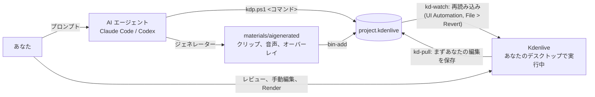

<div align="center">

# Movie Engine

**AI エージェントが Kdenlive で動画を編集し、あなたはそれを見守りながら、いつでも作業を引き継げます。**

AI コーディングエージェント（Claude Code、Codex）が、本物の Kdenlive プロジェクトを作成・変更します。対象は映像作品、解説動画、縦型ショート動画です。編集内容は、開いているエディターにリアルタイムで反映されます。ポータブル、Windows 対応、エディターへのパッチは不要です。


[English](../../README.md) · [简体中文](README.zh-CN.md) · [繁體中文](README.zh-TW.md) · [हिन्दी](README.hi.md) · [Español](README.es.md) · [Français](README.fr.md) · [العربية](README.ar.md) · [বাংলা](README.bn.md) · [Português](README.pt.md) · [Русский](README.ru.md) · [اردو](README.ur.md) · [Bahasa Indonesia](README.id.md) · [Deutsch](README.de.md) · **日本語** · [Türkçe](README.tr.md) · [한국어](README.ko.md) · [Українська](README.uk.md) · [Italiano](README.it.md) · [Polski](README.pl.md) · [Tiếng Việt](README.vi.md) · [فارسی](README.fa.md) · [ไทย](README.th.md) · [Kiswahili](README.sw.md) · [አማርኛ](README.am.md) · [Avañe'ẽ](README.gn.md) · [Setswana](README.tn.md)

*これは翻訳版です。正式な基準となるのは英語版の README です。*

</div>

---

## 目次

- [なぜ作ったのか](#なぜ作ったのか)
- [仕組み](#仕組み)
- [機能](#機能)
- [動作要件](#動作要件)
- [インストール](#インストール)
- [クイックスタート](#クイックスタート)
- [エージェントと作業する](#エージェントと作業する)
- [編集用コマンドライン (`kdp.ps1`)](#編集用コマンドライン-kdpps1)
- [開いているエディターとのライブ同期](#開いているエディターとのライブ同期)
- [Kdenlive にできないことはジェネレーターで](#kdenlive-にできないことはジェネレーターで)
- [ナレーションとサウンド](#ナレーションとサウンド)
- [インターフェースの言語](#インターフェースの言語)
- [フォルダー構成](#フォルダー構成)
- [テストと検証](#テストと検証)
- [制限事項](#制限事項)
- [トラブルシューティング](#トラブルシューティング)
- [よくある質問](#よくある質問)
- [コントリビューション](#コントリビューション)
- [謝辞](#謝辞)
- [ライセンス](#ライセンス)

## なぜ作ったのか

動画エディターは、マウスを握る人の手のために作られています。一方、AI エージェントが得意なのは構成、タイミング、繰り返し作業です。300 本のクリップをビートに合わせて並べる、すべての字幕をナレーションに合わせる、フィードバックを受けてシーンを作り直す、といった作業です。しかしエージェントは、あなたのデスクトップを乗っ取らずに GUI をクリックして操作することはできません。

Kdenlive は優れたオープンソースのエディターですが、Windows では**自動化 API がありません**。D-Bus による制御は Linux ビルドにしかなく、API を追加したフォークはメンテナンスされていないか、安全ではありません。Movie Engine は、エディターにパッチを当てることなくこの問題を解決します。

1. エージェントは、テスト済みのコマンドライン（`engine/kdp.ps1`）を通じて `.kdenlive` プロジェクトファイルを編集します。
2. 実行中の Kdenlive には、Windows UI Automation を通じてファイルの再読み込みを指示します。キー入力もマウス操作もせず、フォーカスも奪いません。
3. あなた自身の未保存の編集は先に保存され、決して上書きされません。

つまり、エージェントが編集してあなたがレビューすることも、あなたが手で編集することもできます。2 人が同じ時間に、同じエディターで、同じプロジェクトを扱えるのです。

## 仕組み



すべての編集コマンドは、同じ安全なサイクルに従います。

1. **プル（Pull）。** Kdenlive に未保存の変更があれば保存するよう指示し（UI Automation でツールバーの保存を実行）、保存が完了したことを確認します。
2. **編集（Edit）。** コマンドはロックをかけたうえで XML を変更します。変更前にハッシュを確認し、元に戻すためのスナップショットも作成します。その間にファイルが変わっていた場合は、何も書き込みません。
3. **再読み込み（Reload）。** ウォッチャーが AI の書き込みを示すスタンプを検出し、開いているエディターで File > Revert を実行します。タイムラインのウィジェットが実際に再構築されたときだけ、成功とみなします。
4. **競合（Conflict）。** その間にあなたが編集を始めていた場合は再読み込みを行わず、あなたの作業はそのまま残ります。AI 版は別に保管され、エージェントはあなたの変更の上に自分の変更を適用し直します。

## 機能

- **GUI なしでプロジェクトを完全に編集**: 約 120 のコマンドで、ビン、タイムライン、エフェクト、コンポジション、トラック、ガイド、マーカー、字幕、シーケンス、速度変更とタイムリマップ、スライドショー、タイトル、プロキシ、レンダリング、元に戻す／やり直しをカバーします。[コマンドリファレンス](#編集用コマンドライン-kdpps1)を参照してください。
- **開いているエディターとのライブ同期。** AI の編集は、あなたが見ている Kdenlive に反映されます。未保存の編集は先に保存され、失われることはありません。
- **デスクトップを決して邪魔しません。** フォーカスを奪わず、キー入力もマウス入力も送りません。テスト用のエディターは、見えない Windows デスクトップ上で動作します。
- **ポータブル。** エディター、設定、Node.js、フォント、ツールはすべて 1 つのフォルダーに収まっています。別の PC にコピーすればそのまま動きます。Program Files や Windows のユーザープロファイルには何も書き込みません。
- **Kdenlive にできないことを補うジェネレーター**: 1 文字ずつ動くキネティックテキスト、手描き風の注釈、3D の UI シーン、カーソルアニメーション、長尺のインタラクティブな「解説」映像。これらは本物のモーションブラー付きで GPU 上でレンダリングされ、通常のクリップとしてタイムラインに配置されます。
- **単語単位のタイミング付きナレーション**（Microsoft Edge TTS、API キー不要）。字幕やアクションが、ちょうどその単語のところで発動します。
- **合成された効果音**（whoosh、click、pop、riser、impact など）を、コードで生成します。
- **思い込みではなく検証済み。** すべてのコマンドに結果のチェックがあり、エフェクトとコンポジションは 1 つずつ網羅的にテストされ、生の結果は `docs/proof/` にあります。
- **エージェント向けの指示書つき。** `AGENTS.md` と `.claude/skills/` のスキルが、Claude Code と Codex にワークフロー、ファイル形式、落とし穴を教えます。

## 動作要件

| | |
|---|---|
| OS | Windows 10 または 11、x64 |
| エディター | Kdenlive **26.08.3** ポータブル（standalone）版。他のバージョンは未テストです。 |
| Node.js | 18 以降。nodejs.org の Windows x64 用 `.zip` を `engine/node/` に展開 |
| ブラウザー | Microsoft Edge（Windows に付属）。シーンレンダラーがヘッドレスで使用します |
| エージェント | [Claude Code](https://claude.com/claude-code) または Codex。任意です。すべてのツールは手動でも実行できます。 |
| ディスク | エディターとツールで約 1 GB、加えてあなたのメディア |
| GPU | H.264 ハードウェアエンコードに対応した GPU なら `film-render.mjs` が高速になります（非対応ならソフトウェアにフォールバック） |

## インストール

すべては**このフォルダーの中に**インストールされます。管理者権限は一切不要です。

```powershell
git clone https://github.com/vladtarrow/movie-engine.git
cd movie-engine
```

**1. Node.js。** <https://nodejs.org/en/download> から Node.js 18 以降の Windows x64 用 `.zip` をダウンロードし、中身を `engine\node\` に展開して `engine\node\node.exe` と `engine\node\npm.cmd` がある状態にします。インストーラーもシステムの Node も不要です。すべてのスクリプトは `engine\node.cmd` を通じて実行され、システムの Node は決して使いません。

**2. Node パッケージ**（ナレーションツールとレンダラー用。バージョンは `engine/voice/package.json` で固定されています）:

```powershell
engine\node\npm.cmd install --prefix engine\voice
```

**3. Kdenlive 26.08.3 ポータブル版。** <https://download.kde.org/stable/kdenlive/26.08/windows/> から `kdenlive-26.08.3_standalone.exe` を `engine\installer\` にダウンロードし、検証してから展開します。

```powershell
(Get-FileHash engine\installer\kdenlive-26.08.3_standalone.exe -Algorithm SHA256).Hash
# 期待される値: A25427B1DFF2C17E3B0386E991BB1A719382BB3176D1A90E441CDAEB6E0A967D
engine\installer\kdenlive-26.08.3_standalone.exe -o"engine\Kdenlive" -y
```

エディターは `engine\Kdenlive\kdenlive-26.08.3_standalone\bin\` に展開されます。`melt.exe` と `ffmpeg.exe` はすでに含まれています。

**4. 初回起動。**

```powershell
engine\kdenlive.cmd
```

Kdenlive はすべての設定を Windows のユーザープロファイルではなく `engine\profile-kdenlive\` に保存します。初回起動時には、一度だけセットアップウィザードが表示されます。

## クイックスタート

### エージェントで

Claude Code（または Codex）でこのフォルダーを開き、ふだんの言葉で頼みます。

> 縦型 30 fps の新しいプロジェクト「launch-teaser」を作って。`materials/designers/launch/` の 3 枚のスクリーンショットをタイムラインに並べ、それぞれ 2.5 秒、短いクロスフェードでつないで。`script.txt` からナレーションを付けて、すべての行にキネティックキャプションをタイミングを合わせて入れて。

> それを Kdenlive で開いて。

> 2 つ目のショットが長すぎる。1.8 秒に詰めて、ロゴを少し上に動かして。

エージェントは `AGENTS.md` に従います。`kdp.ps1` を通じて編集し、カットに必要なクリップだけをレンダリングし、開いているエディターを同期し続けます。あなたは Kdenlive でレビューし、好きなときに手で編集し、満足したら Render を押します。

### 手作業で

```powershell
# 1080x1920、30 fps、ビデオ 2 トラックとオーディオ 2 トラックの新規プロジェクト
powershell -NoProfile -ExecutionPolicy Bypass -File engine\kdp.ps1 new -Project projects\hello\hello.kdenlive -Profile vertical_hd_30

# 3 秒のタイトルと単色の背景
powershell -NoProfile -ExecutionPolicy Bypass -File engine\kdp.ps1 bin-color -Project projects\hello\hello.kdenlive -Color '#203060' -Seconds 3 -Name bg
powershell -NoProfile -ExecutionPolicy Bypass -File engine\kdp.ps1 title -Project projects\hello\hello.kdenlive -Text "Hello" -Seconds 3 -Name hi

# 配置: 背景は V1、その上の V2 にタイトル
powershell -NoProfile -ExecutionPolicy Bypass -File engine\kdp.ps1 add -Project projects\hello\hello.kdenlive -Bin bg -Track V1 -At 0
powershell -NoProfile -ExecutionPolicy Bypass -File engine\kdp.ps1 add -Project projects\hello\hello.kdenlive -Bin hi -Track V2 -At 0

# 確認用のフレームを書き出し、エディターで開く
powershell -NoProfile -ExecutionPolicy Bypass -File engine\kdp.ps1 frame -Project projects\hello\hello.kdenlive -At 1.5 -Out out\hello\check.png
engine\kdenlive.cmd projects\hello\hello.kdenlive
```

あとで最後のプロジェクトを開き直すには、`open-last-project.cmd` をダブルクリックします。

## エージェントと作業する

エージェントは `AGENTS.md`（Codex）、またはそれをインポートする `CLAUDE.md`（Claude Code）と、2 つのスキルを読み込みます。

| スキル | 教える内容 |
|---|---|
| `.claude/skills/kdenlive-project-file` | `.kdenlive` / MLT XML 形式、`kdp.ps1`、`melt` によるチェック |
| `.claude/skills/kdenlive-live` | 実行中のエディターを安全に操作する方法: 起動、プル、再読み込み、ウィンドウのキャプチャ |

エージェントが守るルールで、あなたが信頼してよいもの:

- マウス、キーボード、フォーカスを決して奪わず、デスクトップのスクリーンショットも決して撮りません（撮るのはエディター自身のウィンドウだけです）。
- GUI の操作（保存、開く、再読み込み）は、あなたにクリックを頼まず自分で行います。
- 何かをダウンロードする前、何かを削除する前には、必ず確認を求めます。
- レンダリングするのは作業に必要なもの（シーンクリップ、確認用フレーム）だけです。最終的な完成映像は、あなたが頼んだときだけレンダリングします。
- Kdenlive でうまくできないことがあれば、エージェントは外部でコードを使ってそれを作り、結果をクリップとして取り込みます。エフェクトの質を落とすことはしません。

## 編集用コマンドライン (`kdp.ps1`)

```powershell
powershell -NoProfile -ExecutionPolicy Bypass -File engine\kdp.ps1 <command> -Project <file.kdenlive> [options]
```

時間は秒単位で、小数点にはドットを使います（`2.5`）。トラックは `V1 V2 …`（V1 が最下段）と `A1 A2 …` です。クリップは `-Track` と、そのクリップ内の任意の時刻 `-At` で指定します。エフェクトのパラメーターは `-Params "name=value||name=value"` に書きます。すべてのオプションを含む完全な一覧は、`engine/kdp.ps1` のヘッダーにあります。

| グループ | コマンド |
|---|---|
| プロジェクト | `new`, `profiles`, `info`, `validate`, `fonts`, `profile-set`, `profile-from-clip`, `zone`, `archive`, `backups`, `rebase`, `otio-export`, `otio-import` |
| ビン | `bin-add`, `bin-color`, `title`, `title-text`, `title-save`, `title-template`, `bin-rename`, `bin-remove`, `bin-info`, `bin-set`, `bin-duplicate`, `bin-replace-file`, `bin-reload`, `folder`, `bin-folder`, `relink`, `clean`, `generator`, `playlist-clip`, `extract-audio`, `transcode` |
| タイムライン | `add`, `add-av`, `move`, `copy`, `trim`, `ripple-trim`, `slip`, `split`, `remove`, `speed`, `remap`, `disable`, `enable`, `group`, `ungroup`, `mix`, `unmix`, `space-insert`, `space-remove`, `spaces-remove-all`, `track-clear`, `replace-in-timeline` |
| エフェクト | `effects`, `effect-info`, `effect-add`, `effect-list`, `effect-set`, `effect-remove`, `effect-copy`, `effect-clear`, `effects-all`, `bin-effect`, `effect-templates`, `effect-template` |
| コンポジション | `compositions`, `comp-info`, `comp-add`, `comp-list`, `comp-set`, `comp-remove` |
| トラック | `track-add`, `track-remove`, `track-set` |
| ガイドとマーカー | `guide-add`, `guide-list`, `guide-remove`, `guide-set`, `guide-clear`, `guide-export`, `guide-category`, `marker`, `marker-list`, `marker-set`, `marker-remove` |
| 字幕 | `sub-add`, `sub-import`, `sub-export`, `sub-state` |
| シーケンス | `sequence-add`, `sequences`, `copy-to-sequence`, `expand`。どのコマンドも `-Sequence <name>` を付ければそのシーケンス内で動作します |
| 特殊 | `slideshow`、`bin-add` による Lottie / Glaxnimate アニメーション、`proxy`、`stabilize`、`scene-split`、`speed-job`、`subclip` |
| 出力 | `frame`（PNG 1 枚）、`preview`（melt による高速レンダリング）、`render`（Kdenlive 自身のレンダラー、またはプリセット）、`presets` |
| 履歴 | `undo`、`redo`、`clear-history`（スナップショットは `projects/<name>/.kdp-history` に保存） |

知っておくとよい挙動:

- リンクされたオーディオとビデオの両方は、一緒に移動、トリム、分割、削除されます（片方だけなら `-Alone`）。
- 失敗したコマンドは終了コード 1 で終わり、何も書き込みません。
- Windows ビルドで実行できないエフェクトは、黙って無視されるのではなく、明確に拒否されます（一覧: `docs/proof/assets.txt`）。
- Kdenlive のすべてのメニュー操作は、`engine/tools/data/kdenlive-actions.csv` でコマンド、別の手段、または「表示のみ」に対応付けられています。`docs/kdenlive-coverage.md` を参照してください。

## 開いているエディターとのライブ同期

| スクリプト | 動作 | 終了コード |
|---|---|---|
| `engine\kd-pull.ps1 -Project <f>` | Kdenlive にあなたの編集を保存させ、それを確認する | 0 ファイルは最新、3 起動していない、4 確認できない |
| `engine\kd-reload.ps1 -Project <f>` | File > Revert を実行し、タイムラインの再構築で完了を確認する | 0 確認済み、2 未保存の編集あり（何も破棄していない）、3 起動していない、4 失敗 |
| `engine\kd-watch.ps1 -Project <f>` | バックグラウンドのウォッチャー: AI が書き込むたびに再読み込みし、競合を記録する | ログは `engine\kd-watch.log`。停止するには `engine\kd-watch.run` を削除 |
| `engine\kdenlive-bg.ps1 [project]` | エージェント用に Kdenlive を最小化状態で起動する | 0 読み込み完了、4 確認できない |
| `engine\kdenlive.cmd [project]` | あなたのために Kdenlive を起動する | |

ウォッチャーはセッションごとに 1 回起動します。

```powershell
Start-Process powershell -WindowStyle Hidden -ArgumentList '-NoProfile','-ExecutionPolicy','Bypass','-File','engine\kd-watch.ps1','-Project','projects\hello\hello.kdenlive'
```

大きなプロジェクトについて: 1000 クリップのプロジェクトの再読み込みには数分かかり、ツールは途中で報告せずに完了を待ちます。プロジェクトは空のエディターから *File > Open Recent* で開きます。ファイルを直接開くと、Qt がアクセシビリティのためにタイムラインのすべての要素を走査してしまい、約 10 分遅くなるためです。

## Kdenlive にできないことはジェネレーターで

Kdenlive/MLT には、1 文字単位のテキストアニメーションもエクスプレッションもなく、3D もほとんどありません。また、重いエフェクトは再生を遅くします。Movie Engine はそうした部分を外部でレンダリングし、通常のクリップとしてタイムラインに配置します。多くの場合はアルファ付きで、映像トラックの上のトラックに置きます。ジェネレーターのスクリプトとその入力はプロジェクトフォルダーに残るので、テキスト、フォント、タイミングが変わればクリップを再生成できます。

| ツール | 作るもの |
|---|---|
| `engine/tools/kinetic-text.ps1` | 1 文字ずつ動くキネティックキャプション。各単語のタイミングは `voice.json` から取得し、ハイライトボックス付き |
| `engine/tools/annotate.ps1` | スクリーンショットの上に描かれていく、手描き風の丸、枠、下線、矢印 |
| `engine/tools/card-entrance.ps1` | 柔らかな影とともに浮かび上がり、拡大しながら登場するスクリーンショットカード |
| `engine/tools/pdf-to-png.ps1` | PDF の書き出しからスライドを作成 |
| `engine/tools/html-render.mjs` | 任意の HTML/CSS/canvas シーンを動画に: UI アニメーション、カーソル、3D、マスク |
| `engine/tools/film-render.mjs` + `film/` | canvas 上の長尺でインタラクティブな解説映像: ナレーション 1 行につき 1 クリップ、アクションは話された単語で発動、GPU によるモーションブラーで約 45 fps |

どちらのレンダラーも、Windows に付属する Microsoft Edge をヘッドレスで操作し、使い捨てのプロファイルを使い、ネットワークにはアクセスしません。

### デモ

```powershell
# カーソルのクリック付き、3 秒の 3D タイトルカード
engine\node.cmd engine\tools\html-render.mjs examples\demo\scene\scene.html examples\demo\out --frames 0,30,60,89
engine\node.cmd engine\tools\html-render.mjs examples\demo\scene\scene.html examples\demo\out\scene.mp4

# 2 行のナレーションに合わせた、4 ショットのインタラクティブ映像
engine\node.cmd engine\tools\film-render.mjs examples\demo\film\film.html examples\demo\out --check
engine\node.cmd engine\tools\film-render.mjs examples\demo\film\film.html examples\demo\out --shots all --width 640
engine\node.cmd engine\tools\film-render.mjs examples\demo\film\film.html examples\demo\out\clips --suffix -v01
```

映像は 3 つの小さなファイルで構成されます。`data.js` にはショットと単語のタイミングが入っています。`direction.js` には 1 ショットにつき 1 行を書きます。

```text
1 | hover 192 108 @brand | tag 300 60 Your brand @deserves | confetti 192 90 @film
2 say=A film that/*explains* it
3 | click 116 108 @before | click 268 108 @after | chips Before~After @after
4 scene=counter | count 0 120 % @count
```

`scenes.js` には、ゼロから描画するショットが入っています。`@word` は、ナレーションがその単語を話したときにアクションを発動させます。アクションには click、hover、drag、zoom、lens、ring、arrow、chips、toggle、slider、toast、type、count、confetti があります。完全な構文は `engine/tools/film/film-kit.js` の冒頭にあります。

## ナレーションとサウンド

```powershell
engine\node.cmd engine\voice\voice.mjs lines.json materials\aigenerated\hello\voice en-US-AndrewMultilingualNeural +0%
```

`lines.json` はセリフの一覧です。ツールは 1 行ごとに mp3 を 1 つ書き出し、さらに長さと各単語の開始・終了時刻を含む `voice.json` を出力します。行はキャッシュされるので、1 行を変更してもその行だけが再生成されます。`msedge-tts` パッケージを通じて Microsoft Edge のオンライン音声合成を使います。キーは不要ですが、サービスは非公式で、インターネット接続が必要です。

```powershell
engine\node.cmd engine\audio\sfx.mjs materials\aigenerated\sfx
```

これは whoosh、whoosh-long、swipe、click、pop、tick、riser、impact、ding、reveal をコードで合成します。すぐに使えるセットは `materials/aigenerated/sfx/` にあります。1 フレームより短い音は、配置する前に無音で埋めて長さを確保してください（`-af apad=whole_dur=0.0667`）。

## インターフェースの言語

ランチャーは、デフォルトで Kdenlive を**英語**で起動します。別の言語を使うには、起動前に `MOVIE_ENGINE_UI_LANG` を設定します。

```powershell
$env:MOVIE_ENGINE_UI_LANG = 'ru'; engine\kdenlive.cmd
```

UI Automation は、メニュー項目を画面に表示される名前で探します。31 のインターフェース言語の名前は組み込み済みです（`engine/tools/kd-ui.ps1`、`$KdNames`）。それ以外の言語では、そこに名前を追加し、次のコマンドで確認してください。

```powershell
powershell -NoProfile -ExecutionPolicy Bypass -File engine\tools\kd-langcheck.ps1
```

## フォルダー構成

```text
movie-engine/
├─ AGENTS.md, CLAUDE.md          instructions for AI agents
├─ .claude/skills/               agent skills: project file format, live editor
├─ engine/
│  ├─ kdp.ps1                    the editing command line
│  ├─ kd-pull / kd-reload / kd-watch .ps1, kdenlive.cmd, kdenlive-bg.ps1
│  ├─ tools/                     internals, generators, tests, data (action map)
│  ├─ voice/  audio/  fonts/     TTS, synthesized SFX, Poppins (OFL)
│  ├─ Kdenlive/  node/           portable editor and Node.js (not in git)
│  └─ profile-kdenlive/          the editor's settings (not in git)
├─ projects/<name>/<name>.kdenlive
├─ materials/
│  ├─ download/                  stock and downloaded files (not in git)
│  ├─ aigenerated/               everything the AI made (sfx/ and test-kit/ ship with the engine)
│  ├─ designers/  brand/         files from your team, brand assets
├─ examples/demo/                demos of the scene and film renderers
├─ out/                          renders (not in git)
└─ docs/                         proofs, coverage, translations of this README
```

プロジェクト内のメディアパスは相対パスです。フォルダーを移動またはコピーした場合は、`kdp.ps1 rebase`（`kdenlive.cmd` からも自動で実行されます）が新しい場所をプロジェクトに書き込みます。

## テストと検証

何が動くかという主張は、「関数が実行された」ことではなく、結果のチェックによって裏付けられています。概要は [`docs/kdenlive-proof.md`](../../docs/kdenlive-proof.md) に、生の出力は `docs/proof/` にあります。

| テスト | チェック内容 |
|---|---|
| `engine\tools\kdp-clitest.ps1` | すべての `kdp.ps1` コマンドをコマンドライン経由で実行し、結果のプロジェクトを比較 |
| `engine\tools\kd-livetest.ps1` | 見えないデスクトップ上の本物の Kdenlive を相手に、プル、再読み込み、ウォッチャー、競合、競合状態をテスト |
| `engine\tools\kdp-assetsweep.ps1` | すべてのエフェクトとコンポジション: レンダリングしてフレームを比較 |
| `engine\tools\kdp-portabletest.ps1` | フォルダーを別の場所にコピーし、そのコピーから動作させる |
| `engine\tools\kd-langcheck.ps1` | インターフェースの言語と、UI Automation がメニューを見つけられること |
| `engine\tools\kdp-coverage-check.ps1` | すべてのメニュー操作が対応付けられていること、そしてどの検証結果もコードより古くないこと |

```powershell
powershell -NoProfile -ExecutionPolicy Bypass -File engine\tools\kdp-clitest.ps1 -Report docs\proof\clitest.txt
powershell -NoProfile -ExecutionPolicy Bypass -File engine\tools\kd-livetest.ps1 -Report docs\proof\live-en.txt
```

テスト用のエディターは、専用のプロファイルを使って非表示のデスクトップ上でのみ動作するため、テストが開いている Kdenlive やフォーカスに触れることはありません。

## 制限事項

- **Windows 専用**で、Kdenlive **26.08.3** のみに対応しています。Linux には D-Bus があり、別のブリッジが必要になります。
- エディターの起動時、空のウィンドウが表示される約 3 秒間はキーボードフォーカスを奪います。あなたが作業中のときは、エージェントは起動前に確認を求めます。再読み込みと編集ではフォーカスを奪いません。
- Windows ビルドには MLT の sox、ladspa、movit モジュールと、一部の frei0r/avfilter エフェクトがありません。`kdp.ps1` はそれらを拒否します（`docs/proof/assets.txt`）。
- OpenTimelineIO のエクスポートとインポートで扱えるのは、クリップとギャップだけです。マルチカムではアングルのライブ切り替えができません（カットは split/remove/hide で行います）。
- 最小化したウィンドウで UI Automation を使って「Save As…」を実行しても、ダイアログが開きません。エージェントは代わりに `archive` またはファイルのコピーを使います。
- 音声認識（自動字幕）には Whisper または Vosk が必要ですが、同梱されていません。
- Kdenlive のタイトルツールで作ったタイトルは、Windows にインストールされたフォントを使います。タイポグラフィを確実にするには、`engine/fonts/` からフォントを読み込むジェネレーターでテキストをレンダリングしてください。
- Edge TTS は非公式のオンラインサービスであり、仕様変更されたり使えなくなったりする可能性があります。

## トラブルシューティング

| 症状 | 原因と対処 |
|---|---|
| Kdenlive は起動しているのに、タスクバーでクリックしても何も表示されない | 保存されたウィンドウ位置が画面外にあります。Kdenlive を閉じて `engine\profile-kdenlive\AppData\Local\kdenliverc` の `kdockLayout` エントリーを削除するか、`SetWindowPos` でウィンドウを移動してください（`AGENTS.md` を参照）。 |
| `kd-reload.ps1` が終了コード 2 で終わる | 未保存の編集があります。何も破棄されていません。`kd-pull.ps1` を実行してから、変更を適用し直してください（`kdp.ps1` はこれを自動で行います）。 |
| `engine\kd-watch.log` に `CONFLICT` がある | あなたとエージェントが同時に編集しました。あなたの版はエディターに残り、AI 版は `projects\<name>\.kdp-history\<name>\conflict\` にあります。エージェントに変更を適用し直すよう頼んでください。 |
| コマンドが "pull not confirmed" と表示して終了コード 1 で終わる | Kdenlive がビジー状態か、ダイアログを表示しています。ダイアログを閉じるか読み込みが終わるのを待ってから、もう一度実行してください。 |
| PowerShell スクリプトの解析に失敗する | Windows PowerShell 5.1 では、ASCII 以外の文字を含むスクリプトは **BOM 付き** UTF-8 で保存する必要があります。 |
| `voice.mjs` が "Stream closed before the synthesis completed" で止まる | たいていはネットワークの問題か、古いコピーで SSML がエスケープされていないことが原因です。`voice.mjs` は `& < >` を自分でエスケープします。 |
| 大きなプロジェクトを開くのに何分もかかる | `kdenlive.cmd` / `kdenlive-bg.ps1` から開いてください。`kdenlive.exe project.kdenlive` のように開いてはいけません。 |

## よくある質問

**Claude Code や Codex は必要ですか？**
いいえ。すべてのツールは手動で実行できる普通のスクリプトです。エージェントは作業を速くするためのものです。カットを計画し、ツールを実行し、エディターを同期し続けます。

**エージェントが私の手動編集を上書きすることはありますか？**
いいえ。書き込みの前には必ず、あなたの未保存の編集が保存され、確認されます。エージェントが書き込んでいる最中にあなたが編集した場合、その書き込みは拒否されるか競合として別に保管され、あなたの作業の上に適用されることは決してありません。

**Kdenlive をこれまでどおり普通に使えますか？**
はい。独自の設定フォルダーを持つだけの、標準の Kdenlive です。いつもどおり編集、プレビュー、レンダリングしてください。

**すでにインストールしてある Kdenlive でも動きますか？**
`engine\Kdenlive\` にある独自のポータブル版を使うので、インストール済みの Kdenlive やその設定には一切手を触れません。

**なぜ API 付きの Kdenlive フォークや、別のエディターを使わないのですか？**
Windows では、メンテナンスされていて安全なフォークが存在しません（2026-11 の調査）。OpenShot、Blender VSE、DaVinci Resolve、Shotcut、Web ベースのエディターを評価した結果、最も編集機能が充実していたのが Kdenlive でした。アップストリームの REST API の提案（マージリクエスト !902）の動向を見守っています。

**最終的な動画をレンダリングできますか？**
はい。`kdp.ps1 render`（Kdenlive 自身のレンダラーを非表示で実行）を使うか、エディターであなた自身が Render を押してください。

**私のメディアはどこかにアップロードされますか？**
いいえ。ナレーションを生成するときに、そのテキストだけが Edge TTS サービスに送信されます。シーンレンダラーはネットワークを無効にした状態で動作します。

## コントリビューション

コントリビューションを歓迎します。[CONTRIBUTING.md](../../CONTRIBUTING.md) を参照してください。要点は次のとおりです。

- `kdp.ps1` の操作を新しく追加または変更した場合は、`kdp-clitest.ps1` への結果チェックの追加、アクションマップへの登録、そして `kdp-coverage-check.ps1` の再実行が必要です。
- テスト用の Kdenlive を見えるデスクトップ上で起動してはいけません。`engine/tools/kd-hidden.ps1` を使ってください。
- すべてをポータブルに保ってください。フォルダーの外にはインストールせず、プロジェクトに絶対パスを使わないこと。
- 検証済みのクセは `AGENTS.md` または該当するスキルに書き残してください。

## 謝辞

- [Kdenlive](https://kdenlive.org) と [MLT](https://www.mltframework.org): エディターと、その土台となるエンジン。
- [FFmpeg](https://ffmpeg.org): Kdenlive に同梱。
- [msedge-tts](https://www.npmjs.com/package/msedge-tts): ナレーションに使用。
- [Poppins](https://fonts.google.com/specimen/Poppins): Indian Type Foundry 制作、SIL Open Font License（`engine/fonts/OFL.txt`）。
- `engine/tools/data/kdenliveui-26.08.3.rc`: Kdenlive のメニュー定義ファイル。Kdenlive 26.08.3 のソースから取得し、カバレッジ検査だけで使用。MIT ライセンスではなく、Kdenlive の GPL ライセンスに従います。

## ライセンス

Movie Engine 自体のコードは [MIT ライセンス](../../LICENSE)で公開されています。Kdenlive、MLT、FFmpeg、Node.js パッケージ、Poppins フォントは、それぞれ独自のライセンスに従います。
