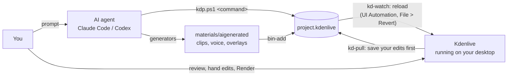

<div align="center">

# Movie Engine

**AI აგენტი Kdenlive-ში თქვენს თვალწინ ამონტაჟებს ვიდეოს, თქვენ კი ნებისმიერ მომენტში შეგიძლიათ საქმე საკუთარ ხელში აიღოთ.**

პროგრამირების AI აგენტები (Claude Code, Codex) ქმნიან და ცვლიან ნამდვილ Kdenlive-ის პროექტებს: ფილმებს, ახსნით ვიდეოებს და ვერტიკალურ შორთსებს. ცვლილებები მაშინვე ჩანს თქვენს გახსნილ რედაქტორში. პორტატული, Windows, რედაქტორის პატჩების გარეშე.


[English](../../README.md) · [简体中文](README.zh-CN.md) · [繁體中文](README.zh-TW.md) · [हिन्दी](README.hi.md) · [Español](README.es.md) · [Français](README.fr.md) · [العربية](README.ar.md) · [বাংলা](README.bn.md) · [Português](README.pt.md) · [Русский](README.ru.md) · [اردو](README.ur.md) · [Bahasa Indonesia](README.id.md) · [Deutsch](README.de.md) · [日本語](README.ja.md) · [Türkçe](README.tr.md) · [한국어](README.ko.md) · [Українська](README.uk.md) · [Italiano](README.it.md) · [Polski](README.pl.md) · [Tiếng Việt](README.vi.md) · [فارسی](README.fa.md) · [ไทย](README.th.md) · [Kiswahili](README.sw.md) · [አማርኛ](README.am.md) · [Avañe'ẽ](README.gn.md) · [Setswana](README.tn.md) · [Shqip](README.sq.md) · [Беларуская](README.be.md) · [Български](README.bg.md) · [Bosanski](README.bs.md) · [Hrvatski](README.hr.md) · [Српски](README.sr.md) · [Crnogorski](README.cnr.md) · [Македонски](README.mk.md) · [Slovenščina](README.sl.md) · [Slovenčina](README.sk.md) · [Čeština](README.cs.md) · [Magyar](README.hu.md) · [Română](README.ro.md) · [Dansk](README.da.md) · [Norsk bokmål](README.nb.md) · [Norsk nynorsk](README.nn.md) · [Svenska](README.sv.md) · [Íslenska](README.is.md) · [Suomi](README.fi.md) · [Eesti](README.et.md) · [Latviešu](README.lv.md) · [Lietuvių](README.lt.md) · [Nederlands](README.nl.md) · [Lëtzebuergesch](README.lb.md) · [Rumantsch](README.rm.md) · [Ελληνικά](README.el.md) · [Malti](README.mt.md) · [Gaeilge](README.ga.md) · [Català](README.ca.md) · **ქართული** · [Հայերեն](README.hy.md) · [Azərbaycanca](README.az.md) · [Afrikaans](README.af.md) · [isiZulu](README.zu.md) · [isiXhosa](README.xh.md) · [Sesotho](README.st.md) · [Sepedi](README.nso.md) · [Xitsonga](README.ts.md) · [Tshivenḓa](README.ve.md) · [siSwati](README.ss.md) · [isiNdebele (South Africa)](README.nr.md) · [isiNdebele (Zimbabwe)](README.nd.md) · [chiShona](README.sn.md) · [Chichewa](README.ny.md) · [Ikinyarwanda](README.rw.md) · [Ikirundi](README.rn.md) · [Malagasy](README.mg.md) · [Soomaali](README.so.md) · [Afaan Oromoo](README.om.md) · [Qafar af](README.aa.md) · [ትግርኛ](README.ti.md) · [Sängö](README.sg.md) · [Kreol Seselwa](README.crs.md) · [TjiKalanga](README.kck.md) · [ChiNdau](README.ndc.md)

*ეს თარგმანია. საცნობარო ვერსიად ითვლება ინგლისური README.*

</div>

---

## სარჩევი

- [რატომ](#რატომ)
- [როგორ მუშაობს](#როგორ-მუშაობს)
- [შესაძლებლობები](#შესაძლებლობები)
- [მოთხოვნები](#მოთხოვნები)
- [ინსტალაცია](#ინსტალაცია)
- [სწრაფი დაწყება](#სწრაფი-დაწყება)
- [აგენტთან მუშაობა](#აგენტთან-მუშაობა)
- [მონტაჟის ბრძანების ხაზი (`kdp.ps1`)](#მონტაჟის-ბრძანების-ხაზი-kdpps1)
- [სინქრონიზაცია ღია რედაქტორთან](#სინქრონიზაცია-ღია-რედაქტორთან)
- [გენერატორები: რისი გაკეთებაც Kdenlive-ს არ შეუძლია](#გენერატორები-რისი-გაკეთებაც-kdenlive-ს-არ-შეუძლია)
- [გახმოვანება და ხმა](#გახმოვანება-და-ხმა)
- [ინტერფეისის ენა](#ინტერფეისის-ენა)
- [საქაღალდეების სტრუქტურა](#საქაღალდეების-სტრუქტურა)
- [ტესტები და მტკიცებულებები](#ტესტები-და-მტკიცებულებები)
- [შეზღუდვები](#შეზღუდვები)
- [პრობლემების მოგვარება](#პრობლემების-მოგვარება)
- [ხშირად დასმული კითხვები](#ხშირად-დასმული-კითხვები)
- [წვლილის შეტანა](#წვლილის-შეტანა)
- [მადლიერება](#მადლიერება)
- [ლიცენზია](#ლიცენზია)

## რატომ

ვიდეორედაქტორები თაგვზე დადებული ხელისთვისაა შექმნილი. AI აგენტები კარგად ართმევენ თავს სტრუქტურას, ტაიმინგს და განმეორებად სამუშაოს: 300 კლიპის რიტმში განლაგებას, ყოველი სუბტიტრის ხმასთან მიბმას, სცენის თავიდან გაკეთებას შენიშვნების შემდეგ. მაგრამ ინტერფეისზე დაწკაპუნება მათ არ შეუძლიათ ისე, რომ თქვენი სამუშაო მაგიდა არ დაიკავონ.

Kdenlive ძლიერი ღია კოდის რედაქტორია, მაგრამ Windows-ზე მას **ავტომატიზაციის API არ აქვს**: D-Bus-ით მართვა მხოლოდ Linux-ის ანაწყობებშია, ხოლო ფორკები, რომლებიც მას ამატებენ, ან მიტოვებულია, ან სახიფათო. Movie Engine ამ პრობლემას რედაქტორის შეცვლის გარეშე წყვეტს:

1. აგენტი `.kdenlive` პროექტის ფაილს ტესტებით შემოწმებული ბრძანების ხაზით (`engine/kdp.ps1`) ცვლის.
2. გაშვებულ Kdenlive-ს Windows UI Automation-ის საშუალებით ეძლევა ბრძანება, ფაილი ხელახლა წაიკითხოს — კლავიშების დაჭერის, თაგვის და ფოკუსის მოპარვის გარეშე.
3. თქვენი შეუნახავი ცვლილებები ჯერ ინახება და არასდროს გადაიწერება.

ასე რომ, აგენტი ამონტაჟებს, თქვენ კი ათვალიერებთ — ან თავად ასწორებთ ხელით. ორივენი ერთსა და იმავე პროექტზე, ერთსა და იმავე რედაქტორში, ერთდროულად მუშაობთ.

## როგორ მუშაობს



ყოველი სამონტაჟო ბრძანება ერთსა და იმავე უსაფრთხო ციკლს გადის:

1. **Pull.** თუ Kdenlive-ში შეუნახავი ცვლილებებია, მას ეძლევა ბრძანება, შეინახოს ისინი (ხელსაწყოთა ზოლის ღილაკი Save, UI Automation-ით), და შენახვა დასტურდება.
2. **რედაქტირება.** ბრძანება XML-ს ბლოკირების ქვეშ ცვლის, ჰეშის შემოწმების შემდეგ და გაუქმებისთვის განკუთვნილი სნეპშოტით. თუ ფაილი ამასობაში შეიცვალა, არაფერი იწერება.
3. **გადატვირთვა.** მეთვალყურე ხედავს AI-ის ნიშანს და გახსნილ რედაქტორში უშვებს File > Revert-ს. წარმატებად ითვლება მხოლოდ ის შემთხვევა, როცა თაიმლაინის ვიჯეტი მართლაც თავიდან აიგო.
4. **კონფლიქტი.** თუ ამასობაში თქვენ დაიწყეთ რედაქტირება, არაფერი გადაიტვირთება და თქვენი ნამუშევარი რჩება. AI-ის ვერსია ცალკე ინახება, აგენტი კი თავის ცვლილებას თქვენსაზე ზემოდან ხელახლა ასრულებს.

## შესაძლებლობები

- **პროექტის სრული რედაქტირება ინტერფეისის გარეშე**: დაახლოებით 120 ბრძანება, რომლებიც მოიცავს პროექტის ბინს, თაიმლაინს, ეფექტებს, კომპოზიციებს, ტრეკებს, გზამკვლევებს (guides), მარკერებს, სუბტიტრებს, სექვენციებს, სიჩქარეს და დროის გადანაწილებას (time remap), სლაიდშოუებს, ტიტრებს, პროქსიებს, რენდერს და გაუქმება/გამეორებას. იხ. [ბრძანებების ცნობარი](#მონტაჟის-ბრძანების-ხაზი-kdpps1).
- **სინქრონიზაცია ღია რედაქტორთან.** AI-ის ცვლილებები ჩნდება იმ Kdenlive-ში, რომელსაც უყურებთ; თქვენი შეუნახავი ცვლილებები ჯერ ინახება და არასდროს იკარგება.
- **არასდროს გიშლით ხელს კომპიუტერთან.** არც ფოკუსის მოპარვა, არც კლავიშების დაჭერა, არც თაგვის მოძრაობა. სატესტო რედაქტორები Windows-ის უხილავ სამუშაო მაგიდაზე ეშვება.
- **პორტატულობა.** რედაქტორი, პარამეტრები, Node.js, შრიფტები და ხელსაწყოები ერთ საქაღალდეშია. დააკოპირეთ სხვა კომპიუტერზე და იმუშავებს; Program Files-ში ან თქვენს Windows-ის პროფილში არაფერი იწერება.
- **გენერატორები იმისთვის, რაც Kdenlive-ს არ შეუძლია**: ასო-ასო ანიმირებული კინეტიკური ტექსტი, ხელით დახატული ანოტაციები, ინტერფეისის 3D სცენები, კურსორის ანიმაციები და გრძელი ინტერაქტიული ახსნითი ფილმები. ისინი GPU-ზე რენდერდება ნამდვილი მოძრაობის დაბინდვით (motion blur) და თაიმლაინზე ჩვეულებრივ კლიპებად თავსდება.
- **გახმოვანება სიტყვების ტაიმინგით** (Microsoft Edge TTS, API გასაღების გარეშე). სუბტიტრები და მოქმედებები ზუსტად საჭირო სიტყვაზე ირთვება.
- **სინთეზირებული ხმოვანი ეფექტები** (whoosh, click, pop, riser, impact და სხვა), კოდით შექმნილი.
- **დამტკიცებული და არა ნავარაუდევი.** ყოველ ბრძანებას აქვს შედეგის შემოწმება, ეფექტები და კომპოზიციები სათითაოდ მოწმდება, ხოლო ნედლი შედეგები `docs/proof/`-შია.
- **აგენტების ინსტრუქციები თან ახლავს.** `AGENTS.md` და `.claude/skills/`-ის უნარები (skills) Claude Code-სა და Codex-ს ასწავლის სამუშაო პროცესს, ფაილის ფორმატს და ხაფანგებს.

## მოთხოვნები

| | |
|---|---|
| ოპერაციული სისტემა | Windows 10 ან 11, x64 |
| რედაქტორი | Kdenlive **26.08.3**, პორტატული (standalone) ანაწყობი. სხვა ვერსიები შემოწმებული არ არის. |
| Node.js | 18 ან უფრო ახალი: Windows x64-ის `.zip` nodejs.org-დან, გახსნილი `engine/node/`-ში |
| ბრაუზერი | Microsoft Edge (Windows-ის ნაწილია); სცენების რენდერერები მას headless რეჟიმში იყენებენ |
| აგენტი | [Claude Code](https://claude.com/claude-code) ან Codex. არასავალდებულოა: ყოველი ხელსაწყო ხელითაც ეშვება. |
| დისკი | დაახლოებით 1 GB რედაქტორისა და ხელსაწყოებისთვის, პლუს თქვენი მედია |
| GPU | ნებისმიერი GPU აპარატული H.264 კოდირებით აჩქარებს `film-render.mjs`-ს (მის გარეშე პროგრამული კოდირება გამოიყენება) |

## ინსტალაცია

ყველაფერი **საქაღალდის შიგნით** ინსტალირდება. ადმინისტრატორის უფლებები არ არის საჭირო.

```powershell
git clone https://github.com/vladtarrow/movie-engine.git
cd movie-engine
```

**1. Node.js.** ჩამოტვირთეთ Node.js 18-ის ან უფრო ახალი ვერსიის Windows x64 `.zip` მისამართიდან <https://nodejs.org/en/download> და მისი შიგთავსი გახსენით `engine\node\`-ში, ისე რომ იქ აღმოჩნდეს `engine\node\node.exe` და `engine\node\npm.cmd`. არც ინსტალერია საჭირო, არც სისტემური Node. ყველა სკრიპტი `engine\node.cmd`-ით ეშვება და არასდროს სისტემური Node-ით.

**2. Node-ის პაკეტები** გახმოვანების ხელსაწყოსა და რენდერერებისთვის (ვერსიები ფიქსირებულია `engine/voice/package.json`-ში):

```powershell
engine\node\npm.cmd install --prefix engine\voice
```

**3. პორტატული Kdenlive 26.08.3.** ჩამოტვირთეთ `kdenlive-26.08.3_standalone.exe` მისამართიდან <https://download.kde.org/stable/kdenlive/26.08/windows/> `engine\installer\`-ში, შეამოწმეთ და გახსენით:

```powershell
(Get-FileHash engine\installer\kdenlive-26.08.3_standalone.exe -Algorithm SHA256).Hash
# expected: A25427B1DFF2C17E3B0386E991BB1A719382BB3176D1A90E441CDAEB6E0A967D
engine\installer\kdenlive-26.08.3_standalone.exe -o"engine\Kdenlive" -y
```

რედაქტორი აღმოჩნდება `engine\Kdenlive\kdenlive-26.08.3_standalone\bin\`-ში. მასში უკვე შედის `melt.exe` და `ffmpeg.exe`.

**4. პირველი გაშვება.**

```powershell
engine\kdenlive.cmd
```

Kdenlive ყველა თავის პარამეტრს `engine\profile-kdenlive\`-ში ინახავს და არა თქვენს Windows-ის პროფილში. პირველი გაშვებისას ის ერთხელ აჩვენებს დაყენების ოსტატს.

## სწრაფი დაწყება

### აგენტით

გახსენით საქაღალდე Claude Code-ში (ან Codex-ში) და სთხოვეთ ჩვეულებრივი სიტყვებით:

> შექმენი ახალი ვერტიკალური პროექტი „launch-teaser“ 30 fps-ით. თაიმლაინზე დადე სამი სკრინშოტი `materials/designers/launch/`-დან, თითო 2,5 წამით, მოკლე გადასვლებით, დაამატე გახმოვანება `script.txt`-დან და ყოველ ხაზს მიუბი კინეტიკური წარწერა.

> გამიხსენი Kdenlive-ში.

> მეორე კადრი ზედმეტად გრძელია. შეამოკლე 1,8 წამამდე და ლოგო ცოტა მაღლა აწიე.

აგენტი მიჰყვება `AGENTS.md`-ს: ცვლილებებს `kdp.ps1`-ით შეაქვს, არენდერებს მხოლოდ იმ კლიპებს, რაც მონტაჟს სჭირდება, და გახსნილ რედაქტორს სინქრონიზებულს ინახავს. თქვენ შედეგს Kdenlive-ში ათვალიერებთ, როცა გინდათ ხელით ასწორებთ და Render-ს აჭერთ, როცა კმაყოფილი ხართ.

### ხელით

```powershell
# a new 1080x1920 30 fps project with 2 video and 2 audio tracks
powershell -NoProfile -ExecutionPolicy Bypass -File engine\kdp.ps1 new -Project projects\hello\hello.kdenlive -Profile vertical_hd_30

# a 3-second title and a colour background
powershell -NoProfile -ExecutionPolicy Bypass -File engine\kdp.ps1 bin-color -Project projects\hello\hello.kdenlive -Color '#203060' -Seconds 3 -Name bg
powershell -NoProfile -ExecutionPolicy Bypass -File engine\kdp.ps1 title -Project projects\hello\hello.kdenlive -Text "Hello" -Seconds 3 -Name hi

# place them: background on V1, title above it on V2
powershell -NoProfile -ExecutionPolicy Bypass -File engine\kdp.ps1 add -Project projects\hello\hello.kdenlive -Bin bg -Track V1 -At 0
powershell -NoProfile -ExecutionPolicy Bypass -File engine\kdp.ps1 add -Project projects\hello\hello.kdenlive -Bin hi -Track V2 -At 0

# a check frame, then open it in the editor
powershell -NoProfile -ExecutionPolicy Bypass -File engine\kdp.ps1 frame -Project projects\hello\hello.kdenlive -At 1.5 -Out out\hello\check.png
engine\kdenlive.cmd projects\hello\hello.kdenlive
```

ბოლო პროექტის მოგვიანებით ხელახლა გასახსნელად ორჯერ დააწკაპუნეთ `open-last-project.cmd`-ზე.

## აგენტთან მუშაობა

აგენტი კითხულობს `AGENTS.md`-ს (Codex) ან `CLAUDE.md`-ს, რომელიც მას იმპორტს უკეთებს (Claude Code), და ასევე ორ უნარს (skills):

| უნარი | რას ასწავლის |
|---|---|
| `.claude/skills/kdenlive-project-file` | `.kdenlive` / MLT XML ფორმატი, `kdp.ps1`, შემოწმება `melt`-ით |
| `.claude/skills/kdenlive-live` | გაშვებული რედაქტორის უსაფრთხო მართვა: გაშვება, pull, გადატვირთვა, მისი ფანჯრის გადაღება |

წესები, რომლებსაც აგენტი იცავს და რომლებსაც შეგიძლიათ დაეყრდნოთ:

- ის არასდროს გართმევთ თაგვს, კლავიატურას ან ფოკუსს და არასდროს იღებს თქვენი სამუშაო მაგიდის სკრინშოტს (მხოლოდ თავად რედაქტორის ფანჯრისას).
- ინტერფეისის ნაბიჯებს (შენახვა, გახსნა, გადატვირთვა) თავად ასრულებს და არ გთხოვთ დაწკაპუნებას.
- ის გეკითხებათ, სანამ რამეს ჩამოტვირთავს და სანამ რამეს წაშლის.
- ის არენდერებს მხოლოდ იმას, რაც სამუშაოს სჭირდება (სცენების კლიპები, საკონტროლო კადრები). საბოლოო ფილმს მხოლოდ თქვენი თხოვნით არენდერებს.
- როცა Kdenlive-ს რაღაცის კარგად გაკეთება არ შეუძლია, აგენტი მას გარეთ, კოდით აწყობს და შედეგს კლიპად სვამს. ის ეფექტს არ ამარტივებს.

## მონტაჟის ბრძანების ხაზი (`kdp.ps1`)

```powershell
powershell -NoProfile -ExecutionPolicy Bypass -File engine\kdp.ps1 <command> -Project <file.kdenlive> [options]
```

დრო წამებში მიეთითება, წერტილით (`2.5`). ტრეკებია `V1 V2 …` (V1 ყველაზე ქვედაა) და `A1 A2 …`. კლიპი განისაზღვრება `-Track`-ით და მის შიგნით ნებისმიერი დროით `-At`. ეფექტის პარამეტრები გადაეცემა `-Params "name=value||name=value"`-ში. სრული სია ყველა ოფციით `engine/kdp.ps1`-ის სათაურ ნაწილშია.

| ჯგუფი | ბრძანებები |
|---|---|
| პროექტი | `new`, `profiles`, `info`, `validate`, `fonts`, `profile-set`, `profile-from-clip`, `zone`, `archive`, `backups`, `rebase`, `otio-export`, `otio-import` |
| ბინი | `bin-add`, `bin-color`, `title`, `title-text`, `title-save`, `title-template`, `bin-rename`, `bin-remove`, `bin-info`, `bin-set`, `bin-duplicate`, `bin-replace-file`, `bin-reload`, `folder`, `bin-folder`, `relink`, `clean`, `generator`, `playlist-clip`, `extract-audio`, `transcode` |
| თაიმლაინი | `add`, `add-av`, `move`, `copy`, `trim`, `ripple-trim`, `slip`, `split`, `remove`, `speed`, `remap`, `disable`, `enable`, `group`, `ungroup`, `mix`, `unmix`, `space-insert`, `space-remove`, `spaces-remove-all`, `track-clear`, `replace-in-timeline` |
| ეფექტები | `effects`, `effect-info`, `effect-add`, `effect-list`, `effect-set`, `effect-remove`, `effect-copy`, `effect-clear`, `effects-all`, `bin-effect`, `effect-templates`, `effect-template` |
| კომპოზიციები | `compositions`, `comp-info`, `comp-add`, `comp-list`, `comp-set`, `comp-remove` |
| ტრეკები | `track-add`, `track-remove`, `track-set` |
| გზამკვლევები და მარკერები | `guide-add`, `guide-list`, `guide-remove`, `guide-set`, `guide-clear`, `guide-export`, `guide-category`, `marker`, `marker-list`, `marker-set`, `marker-remove` |
| სუბტიტრები | `sub-add`, `sub-import`, `sub-export`, `sub-state` |
| სექვენციები | `sequence-add`, `sequences`, `copy-to-sequence`, `expand`; ნებისმიერი ბრძანება `-Sequence <name>`-ით იმ სექვენციის შიგნით მუშაობს |
| სპეციალური | `slideshow`, Lottie / Glaxnimate ანიმაციები `bin-add`-ით, `proxy`, `stabilize`, `scene-split`, `speed-job`, `subclip` |
| გამოტანა | `frame` (ერთი PNG), `preview` (სწრაფი რენდერი melt-ით), `render` (Kdenlive-ის საკუთარი რენდერერი ან პრესეტი), `presets` |
| ისტორია | `undo`, `redo`, `clear-history` (სნეპშოტები `projects/<name>/.kdp-history`-ში) |

ქცევა, რომლის ცოდნაც ღირს:

- დაკავშირებული აუდიო და ვიდეო ნახევრები ერთად გადაადგილდება, იჭრება, იყოფა და იშლება (`-Alone` ერთი ნახევრისთვის).
- წარუმატებელი ბრძანება სრულდება კოდით 1 და არაფერს წერს.
- ეფექტები, რომელთა შესრულებაც Windows-ის ანაწყობს არ შეუძლია, უარყოფილია და არა ჩუმად იგნორირებული (სია: `docs/proof/assets.txt`).
- Kdenlive-ის მენიუს ყოველი მოქმედება `engine/tools/data/kdenlive-actions.csv`-ში დაკავშირებულია ბრძანებასთან, სხვა გზასთან ან აღნიშვნასთან „მხოლოდ ნახვა“. იხ. `docs/kdenlive-coverage.md`.

## სინქრონიზაცია ღია რედაქტორთან

| სკრიპტი | რას აკეთებს | გამოსვლის კოდები |
|---|---|---|
| `engine\kd-pull.ps1 -Project <f>` | აიძულებს Kdenlive-ს, შეინახოს თქვენი ცვლილებები, და ადასტურებს ამას | 0 ფაილი აქტუალურია, 3 არ არის გაშვებული, 4 არ დადასტურდა |
| `engine\kd-reload.ps1 -Project <f>` | File > Revert, დადასტურებული თავიდან აგებული თაიმლაინით | 0 დადასტურდა, 2 გაქვთ შეუნახავი ცვლილებები (არაფერი დაკარგულა), 3 არ არის გაშვებული, 4 ვერ შესრულდა |
| `engine\kd-watch.ps1 -Project <f>` | ფონური მეთვალყურე: გადატვირთავს AI-ის ყოველი ჩაწერის შემდეგ, კონფლიქტებს ჟურნალში წერს | ჟურნალი `engine\kd-watch.log`-შია; შესაჩერებლად წაშალეთ `engine\kd-watch.run` |
| `engine\kdenlive-bg.ps1 [project]` | უშვებს Kdenlive-ს ჩაკეცილ მდგომარეობაში აგენტისთვის | 0 ჩაიტვირთა, 4 არ დადასტურდა |
| `engine\kdenlive.cmd [project]` | უშვებს Kdenlive-ს თქვენთვის | |

გაუშვით მეთვალყურე ერთხელ ყოველ სესიაზე:

```powershell
Start-Process powershell -WindowStyle Hidden -ArgumentList '-NoProfile','-ExecutionPolicy','Bypass','-File','engine\kd-watch.ps1','-Project','projects\hello\hello.kdenlive'
```

დიდი პროექტები: 1000-კლიპიანი პროექტის გადატვირთვას წუთები სჭირდება, და ხელსაწყოები მას ელოდება, ნაადრევი შეტყობინების ნაცვლად. პროექტები ცარიელ რედაქტორში *File > Open Recent*-ით იხსნება, რადგან ფაილის პირდაპირ გახსნისას Qt წვდომადობისთვის (accessibility) თაიმლაინის ყოველ ელემენტს უვლის, და ეს დაახლოებით 10 წუთით ნელი იყო.

## გენერატორები: რისი გაკეთებაც Kdenlive-ს არ შეუძლია

Kdenlive/MLT-ს არ აქვს ასო-ასო ტექსტის ანიმაცია, არც გამოსახულებები (expressions) და თითქმის არც 3D, ხოლო მძიმე ეფექტები დაკვრას ანელებს. Movie Engine ასეთ ნაწილებს გარეთ არენდერებს და თაიმლაინზე ჩვეულებრივ კლიპებად სვამს, როგორც წესი ალფა-არხით, გამოსახულების ზემოთ მდებარე ტრეკზე. გენერატორის სკრიპტი და მისი შემავალი მონაცემები პროექტის საქაღალდეში რჩება, ამიტომ კლიპის თავიდან გენერირება შეიძლება, როცა ტექსტი, შრიფტი ან ტაიმინგი იცვლება.

| ხელსაწყო | რას ქმნის |
|---|---|
| `engine/tools/kinetic-text.ps1` | ასო-ასო კინეტიკური წარწერები, ყოველი სიტყვის დრო აღებულია `voice.json`-დან, მონიშვნის ჩარჩო |
| `engine/tools/annotate.ps1` | ხელით დახატული წრეები, ჩარჩოები, ხაზგასმები და ისრები, რომლებიც სკრინშოტზე თანდათან იხატება |
| `engine/tools/card-entrance.ps1` | სკრინშოტის ბარათი, რომელიც რბილი ჩრდილით ამოდის და იზრდება |
| `engine/tools/pdf-to-png.ps1` | სლაიდები PDF ექსპორტიდან |
| `engine/tools/html-render.mjs` | ნებისმიერი HTML/CSS/canvas სცენა ვიდეოდ: ინტერფეისის ანიმაცია, კურსორები, 3D, ნიღბები |
| `engine/tools/film-render.mjs` + `film/` | გრძელი ინტერაქტიული ახსნითი ფილმები canvas-ზე: ერთი კლიპი გახმოვანების ყოველ ხაზზე, მოქმედებები წარმოთქმულ სიტყვებზე ირთვება, GPU-ზე motion blur დაახლოებით 45 fps-ით |

ორივე რენდერერი მართავს Windows-თან ერთად მოწოდებულ Microsoft Edge-ს headless რეჟიმში, ერთჯერადი პროფილით და ქსელთან წვდომის გარეშე.

### დემოები

```powershell
# a 3-second 3D title card with a cursor click
engine\node.cmd engine\tools\html-render.mjs examples\demo\scene\scene.html examples\demo\out --frames 0,30,60,89
engine\node.cmd engine\tools\html-render.mjs examples\demo\scene\scene.html examples\demo\out\scene.mp4

# a 4-shot interactive film timed to two voice lines
engine\node.cmd engine\tools\film-render.mjs examples\demo\film\film.html examples\demo\out --check
engine\node.cmd engine\tools\film-render.mjs examples\demo\film\film.html examples\demo\out --shots all --width 640
engine\node.cmd engine\tools\film-render.mjs examples\demo\film\film.html examples\demo\out\clips --suffix -v01
```

ფილმი სამი პატარა ფაილია. `data.js` შეიცავს კადრებს და სიტყვების დროებს. `direction.js`-ში თითო კადრზე თითო ხაზია:

```text
1 | hover 192 108 @brand | tag 300 60 Your brand @deserves | confetti 192 90 @film
2 say=A film that/*explains* it
3 | click 116 108 @before | click 268 108 @after | chips Before~After @after
4 scene=counter | count 0 120 % @count
```

`scenes.js` შეიცავს კადრებს, რომლებიც ნულიდან იხატება. `@word` მოქმედებას მაშინ რთავს, როცა ხმა ამ სიტყვას წარმოთქვამს. მოქმედებებს შორისაა click, hover, drag, zoom, lens, ring, arrow, chips, toggle, slider, toast, type, count და confetti; სრული სინტაქსი `engine/tools/film/film-kit.js`-ის დასაწყისშია.

## გახმოვანება და ხმა

```powershell
engine\node.cmd engine\voice\voice.mjs lines.json materials\aigenerated\hello\voice en-US-AndrewMultilingualNeural +0%
```

`lines.json` ხაზების სიაა. ხელსაწყო ყოველ ხაზზე ერთ mp3-ს წერს, პლუს `voice.json`-ს ხანგრძლივობით და ყოველი სიტყვის დასაწყისითა და დასასრულით. ხაზები ქეშირდება, ამიტომ ერთი ხაზის შეცვლისას თავიდან მხოლოდ ის ხაზი გენერირდება. გამოიყენება Microsoft Edge-ის ონლაინ ტექსტის მეტყველებად გარდაქმნა `msedge-tts` პაკეტით: გასაღები არ არის საჭირო, მაგრამ სერვისი არაოფიციალურია და ინტერნეტს საჭიროებს.

```powershell
engine\node.cmd engine\audio\sfx.mjs materials\aigenerated\sfx
```

ეს ბრძანება კოდით სინთეზირებს whoosh, whoosh-long, swipe, click, pop, tick, riser, impact, ding და reveal ხმებს; მზა ნაკრები `materials/aigenerated/sfx/`-შია. ერთ კადრზე მოკლე ხმები განთავსებამდე სიჩუმით შეავსეთ (`-af apad=whole_dur=0.0667`).

## ინტერფეისის ენა

ნაგულისხმევად ლაუნჩერები Kdenlive-ს **ინგლისურად** უშვებენ. სხვა ენის გამოსაყენებლად გაშვებამდე დააყენეთ `MOVIE_ENGINE_UI_LANG`:

```powershell
$env:MOVIE_ENGINE_UI_LANG = 'ru'; engine\kdenlive.cmd
```

UI Automation მენიუს პუნქტებს მათი ხილული სახელებით პოულობს. სახელები ინტერფეისის 31 ენისთვის უკვე ჩაშენებულია (`engine/tools/kd-ui.ps1`, `$KdNames`). ნებისმიერი სხვა ენისთვის დაამატეთ იქ მისი სახელები და შეამოწმეთ ბრძანებით:

```powershell
powershell -NoProfile -ExecutionPolicy Bypass -File engine\tools\kd-langcheck.ps1
```

## საქაღალდეების სტრუქტურა

```text
movie-engine/
├─ AGENTS.md, CLAUDE.md          instructions for AI agents
├─ .claude/skills/               agent skills: project file format, live editor
├─ engine/
│  ├─ kdp.ps1                    the editing command line
│  ├─ kd-pull / kd-reload / kd-watch .ps1, kdenlive.cmd, kdenlive-bg.ps1
│  ├─ tools/                     internals, generators, tests, data (action map)
│  ├─ voice/  audio/  fonts/     TTS, synthesized SFX, Poppins (OFL)
│  ├─ Kdenlive/  node/           portable editor and Node.js (not in git)
│  └─ profile-kdenlive/          the editor's settings (not in git)
├─ projects/<name>/<name>.kdenlive
├─ materials/
│  ├─ download/                  stock and downloaded files (not in git)
│  ├─ aigenerated/               everything the AI made (sfx/ and test-kit/ ship with the engine)
│  ├─ designers/  brand/         files from your team, brand assets
├─ examples/demo/                demos of the scene and film renderers
├─ out/                          renders (not in git)
└─ docs/                         proofs, coverage, translations of this README
```

პროექტების შიგნით მედიაფაილების ბილიკები ფარდობითია. თუ საქაღალდეს გადაიტანთ ან დააკოპირებთ, `kdp.ps1 rebase` (მას `kdenlive.cmd` ავტომატურადაც უშვებს) პროექტში ახალ მდებარეობას ჩაწერს.

## ტესტები და მტკიცებულებები

განცხადებები იმის შესახებ, თუ რა მუშაობს, შედეგის შემოწმებებით არის გამყარებული და არა იმით, რომ „ფუნქცია შესრულდა“. შეჯამება [`docs/kdenlive-proof.md`](../../docs/kdenlive-proof.md)-შია, ხოლო ნედლი გამონატანი — `docs/proof/`-ში.

| ტესტი | რას ამოწმებს |
|---|---|
| `engine\tools\kdp-clitest.ps1` | `kdp.ps1`-ის ყოველ ბრძანებას ბრძანების ხაზით, მიღებული პროექტის შედარებით |
| `engine\tools\kd-livetest.ps1` | pull-ს, გადატვირთვას, მეთვალყურეს, კონფლიქტებს და რბოლის მდგომარეობებს (races) ნამდვილ Kdenlive-ზე, უხილავ სამუშაო მაგიდაზე |
| `engine\tools\kdp-assetsweep.ps1` | ყოველ ეფექტს და კომპოზიციას: არენდერებს და ადარებს კადრებს |
| `engine\tools\kdp-portabletest.ps1` | აკოპირებს საქაღალდეს სხვაგან და მუშაობს ასლიდან |
| `engine\tools\kd-langcheck.ps1` | ინტერფეისის ენას და იმას, რომ UI Automation მენიუს პოულობს |
| `engine\tools\kdp-coverage-check.ps1` | რომ მენიუს ყოველი მოქმედება დაკავშირებულია და არცერთი მტკიცებულება კოდზე ძველი არ არის |

```powershell
powershell -NoProfile -ExecutionPolicy Bypass -File engine\tools\kdp-clitest.ps1 -Report docs\proof\clitest.txt
powershell -NoProfile -ExecutionPolicy Bypass -File engine\tools\kd-livetest.ps1 -Report docs\proof\live-en.txt
```

სატესტო რედაქტორები მხოლოდ დამალულ სამუშაო მაგიდაზე ეშვება საკუთარი პროფილით, ამიტომ ტესტები არასდროს ეხება თქვენს გახსნილ Kdenlive-ს ან თქვენს ფოკუსს.

## შეზღუდვები

- **მხოლოდ Windows** და მხოლოდ Kdenlive **26.08.3**. Linux-ს აქვს D-Bus და მას სხვა ხიდი დასჭირდებოდა.
- გაშვებისას რედაქტორი კლავიატურის ფოკუსს დაახლოებით 3 წამით იკავებს, სანამ ცარიელი ფანჯარა ჩნდება. თუ მუშაობთ, აგენტები მის გაშვებამდე გეკითხებიან. გადატვირთვები და რედაქტირება ფოკუსს არ იკავებს.
- Windows-ის ანაწყობს აკლია MLT-ის მოდულები sox, ladspa და movit და frei0r/avfilter-ის ზოგიერთი ეფექტი; `kdp.ps1` მათ უარყოფს (`docs/proof/assets.txt`).
- OpenTimelineIO-ის ექსპორტი და იმპორტი მხოლოდ კლიპებს და ცარიელ შუალედებს გადაიტანს. მულტიკამერას არ აქვს კუთხეების პირდაპირ რეჟიმში გადართვა (ჭრები split/remove/hide-ით კეთდება).
- „Save As…“ UI Automation-ით ჩაკეცილ ფანჯარაზე დიალოგს არ ხსნის; სამაგიეროდ აგენტი `archive`-ს ან ფაილების ასლებს იყენებს.
- მეტყველების ამოცნობას (ავტომატური სუბტიტრები) სჭირდება Whisper ან Vosk, რომლებიც თან არ ახლავს.
- Kdenlive-ის ტიტრების ხელსაწყოთი შექმნილი ტიტრები Windows-ში დაინსტალირებულ შრიფტებს იყენებს. გარანტირებული ტიპოგრაფიისთვის ტექსტი გენერატორებით დაარენდერეთ, რომლებიც შრიფტებს `engine/fonts/`-დან ტვირთავს.
- Edge TTS არაოფიციალური ონლაინ სერვისია და შეიძლება შეიცვალოს ან შეწყვიტოს მუშაობა.

## პრობლემების მოგვარება

| სიმპტომი | მიზეზი და გამოსავალი |
|---|---|
| Kdenlive გაშვებულია, მაგრამ ამოცანების პანელზე მასზე დაწკაპუნება არაფერს აჩვენებს | მისი ფანჯრის შენახული პოზიცია ეკრანის გარეთაა. დახურეთ ის და წაშალეთ `kdockLayout` ჩანაწერები `engine\profile-kdenlive\AppData\Local\kdenliverc`-ში, ან გადაადგილეთ ფანჯარა `SetWindowPos`-ით (იხ. `AGENTS.md`). |
| `kd-reload.ps1` სრულდება კოდით 2 | გაქვთ შეუნახავი ცვლილებები. არაფერი დაკარგულა. გაუშვით `kd-pull.ps1`, შემდეგ ცვლილება თავიდან გამოიყენეთ (`kdp.ps1` ამას თავად აკეთებს). |
| `CONFLICT` `engine\kd-watch.log`-ში | თქვენ და აგენტმა ერთსა და იმავე მომენტში შეიტანეთ ცვლილებები. თქვენი ვერსია რედაქტორში რჩება, ხოლო AI-ის ვერსია `projects\<name>\.kdp-history\<name>\conflict\`-შია. სთხოვეთ აგენტს, თავისი ცვლილება თავიდან გამოიყენოს. |
| ბრძანება სრულდება კოდით 1 და შეტყობინებით „pull not confirmed“ | Kdenlive დაკავებულია ან დიალოგს აჩვენებს. დახურეთ დიალოგი ან დაელოდეთ ჩატვირთვის დასრულებას, შემდეგ გაიმეორეთ. |
| PowerShell-ის სკრიპტი ვერ პარსირდება | არა-ASCII ტექსტის შემცველი სკრიპტები Windows PowerShell 5.1-ისთვის UTF-8-ში **BOM-ით** უნდა შეინახოს. |
| `voice.mjs` ჩერდება შეტყობინებით „Stream closed before the synthesis completed“ | როგორც წესი, ეს ქსელის პრობლემაა, ან ძველ ასლებში არაეკრანირებული SSML. `voice.mjs` `& < >`-ს თავად აეკრანირებს. |
| დიდი პროექტის გახსნას ბევრი წუთი სჭირდება | გახსენით ის `kdenlive.cmd` / `kdenlive-bg.ps1`-ით და არასდროს როგორც `kdenlive.exe project.kdenlive`. |

## ხშირად დასმული კითხვები

**მჭირდება თუ არა Claude Code ან Codex?**
არა. ყოველი ხელსაწყო ჩვეულებრივი სკრიპტია, რომლის ხელით გაშვებაც შეგიძლიათ. აგენტი სამუშაოს აჩქარებს: ის გეგმავს მონტაჟს, უშვებს ხელსაწყოებს და რედაქტორს სინქრონიზებულს ინახავს.

**გადაწერს თუ არა აგენტი ჩემს ხელით შეტანილ ცვლილებებს?**
არა. ნებისმიერი ჩაწერის წინ თქვენი შეუნახავი ცვლილებები ინახება და დასტურდება. თუ რედაქტირებთ, სანამ აგენტი წერს, ჩაწერა უარყოფილია ან კონფლიქტის სახით ცალკე ინახება და არასდროს ედება თქვენს ნამუშევარს.

**შემიძლია Kdenlive-ით ჩვეულებრივად სარგებლობა გავაგრძელო?**
დიახ. ეს სტანდარტული Kdenlive-ია საკუთარი პარამეტრების საქაღალდით. ამონტაჟეთ, ათვალიერეთ და არენდერეთ ჩვეულებრივ.

**იმუშავებს თუ არა ეს უკვე დაინსტალირებულ Kdenlive-თან?**
ის იყენებს საკუთარ პორტატულ ასლს `engine\Kdenlive\`-ში, ამიტომ თქვენი დაინსტალირებული Kdenlive და მისი პარამეტრები ხელუხლებელი რჩება.

**რატომ არა Kdenlive-ის ფორკი API-ით ან სხვა რედაქტორი?**
Windows-ზე არ არსებობს მხარდაჭერილი და უსაფრთხო ფორკი (2026 წლის ნოემბრის მიმოხილვა). შეფასდა OpenShot, Blender VSE, DaVinci Resolve, Shotcut და ვებ-რედაქტორები; Kdenlive-მა მონტაჟის საუკეთესო სიღრმე აჩვენა. ჩვენ თვალს ვადევნებთ ძირითად პროექტში REST API-ის შეთავაზებას (merge request !902).

**შეუძლია თუ არა საბოლოო ვიდეოს დარენდერება?**
დიახ, `kdp.ps1 render`-ით (Kdenlive-ის საკუთარი რენდერერი, დამალულ რეჟიმში), ან თქვენ თავად აჭერთ Render-ს რედაქტორში.

**იტვირთება თუ არა ჩემი მედია სადმე?**
არა. გახმოვანების გენერირებისას Edge TTS სერვისს მხოლოდ გახმოვანების ტექსტი ეგზავნება. სცენების რენდერერები გათიშული ქსელით მუშაობს.

## წვლილის შეტანა

წვლილი მისასალმებელია. იხ. [CONTRIBUTING.md](../../CONTRIBUTING.md). მოკლედ:

- `kdp.ps1`-ის ყოველ ახალ ან შეცვლილ ოპერაციას სჭირდება შედეგის შემოწმება `kdp-clitest.ps1`-ში, ჩანაწერი მოქმედებების რუკაში და `kdp-coverage-check.ps1`-ის ახალი გაშვება.
- არასდროს გაუშვათ სატესტო Kdenlive ხილულ სამუშაო მაგიდაზე; გამოიყენეთ `engine/tools/kd-hidden.ps1`.
- ყველაფერი პორტატული დატოვეთ: არანაირი ინსტალაცია საქაღალდის გარეთ, არანაირი აბსოლუტური ბილიკი პროექტებში.
- შემოწმებული თავისებურებები ჩაწერეთ `AGENTS.md`-ში ან შესაბამის უნარში.

## მადლიერება

- [Kdenlive](https://kdenlive.org) და [MLT](https://www.mltframework.org): რედაქტორი და მის საფუძვლად არსებული ძრავა.
- [FFmpeg](https://ffmpeg.org), Kdenlive-თან ერთად მოწოდებული.
- [msedge-tts](https://www.npmjs.com/package/msedge-tts) გახმოვანებისთვის.
- [Poppins](https://fonts.google.com/specimen/Poppins), Indian Type Foundry, SIL Open Font License (`engine/fonts/OFL.txt`).
- `engine/tools/data/kdenliveui-26.08.3.rc`: Kdenlive-ის მენიუს ფაილი, აღებული Kdenlive 26.08.3-ის წყაროს კოდიდან; გამოიყენება მხოლოდ დაფარვის შემოწმებისთვის. ის Kdenlive-ის GPL ლიცენზიის ქვეშ რჩება და არა MIT License-ის.

## ლიცენზია

Movie Engine-ის საკუთარი კოდი გამოქვეყნებულია [MIT ლიცენზიით](../../LICENSE). Kdenlive, MLT, FFmpeg, Node.js-ის პაკეტები და Poppins შრიფტი საკუთარ ლიცენზიებს ინარჩუნებენ.
