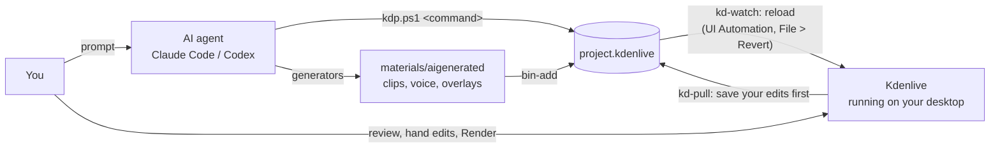

<div align="center">

# Movie Engine

**Agent ye AI inogadzilisa vhidhiyo yako mu Kdenlive iwe utjibona, uye unogona kutola basa ili nguva ipi na ipi.**

Ma agent e AI anonyola code (Claude Code, Codex) anogadzila nokutjinja mapulojekiti tjaiwo e Kdenlive: mafilimu, mavhidhiyo okutsanangula na ma shorts akamila (vertical). Zwinotjinjwa zwinobonekela pakalepo mu editor yaunayo yakazhulwa. Portable, Windows, pasina kutjinja editor (no patches).


[English](../../README.md) · [简体中文](README.zh-CN.md) · [繁體中文](README.zh-TW.md) · [हिन्दी](README.hi.md) · [Español](README.es.md) · [Français](README.fr.md) · [العربية](README.ar.md) · [বাংলা](README.bn.md) · [Português](README.pt.md) · [Русский](README.ru.md) · [اردو](README.ur.md) · [Bahasa Indonesia](README.id.md) · [Deutsch](README.de.md) · [日本語](README.ja.md) · [Türkçe](README.tr.md) · [한국어](README.ko.md) · [Українська](README.uk.md) · [Italiano](README.it.md) · [Polski](README.pl.md) · [Tiếng Việt](README.vi.md) · [فارسی](README.fa.md) · [ไทย](README.th.md) · [Kiswahili](README.sw.md) · [አማርኛ](README.am.md) · [Avañe'ẽ](README.gn.md) · [Setswana](README.tn.md) · [Shqip](README.sq.md) · [Беларуская](README.be.md) · [Български](README.bg.md) · [Bosanski](README.bs.md) · [Hrvatski](README.hr.md) · [Српски](README.sr.md) · [Crnogorski](README.cnr.md) · [Македонски](README.mk.md) · [Slovenščina](README.sl.md) · [Slovenčina](README.sk.md) · [Čeština](README.cs.md) · [Magyar](README.hu.md) · [Română](README.ro.md) · [Dansk](README.da.md) · [Norsk bokmål](README.nb.md) · [Norsk nynorsk](README.nn.md) · [Svenska](README.sv.md) · [Íslenska](README.is.md) · [Suomi](README.fi.md) · [Eesti](README.et.md) · [Latviešu](README.lv.md) · [Lietuvių](README.lt.md) · [Nederlands](README.nl.md) · [Lëtzebuergesch](README.lb.md) · [Rumantsch](README.rm.md) · [Ελληνικά](README.el.md) · [Malti](README.mt.md) · [Gaeilge](README.ga.md) · [Català](README.ca.md) · [ქართული](README.ka.md) · [Հայերեն](README.hy.md) · [Azərbaycanca](README.az.md) · [Afrikaans](README.af.md) · [isiZulu](README.zu.md) · [isiXhosa](README.xh.md) · [Sesotho](README.st.md) · [Sepedi](README.nso.md) · [Xitsonga](README.ts.md) · [Tshivenḓa](README.ve.md) · [siSwati](README.ss.md) · [isiNdebele (South Africa)](README.nr.md) · [isiNdebele (Zimbabwe)](README.nd.md) · [chiShona](README.sn.md) · [Chichewa](README.ny.md) · [Ikinyarwanda](README.rw.md) · [Ikirundi](README.rn.md) · [Malagasy](README.mg.md) · [Soomaali](README.so.md) · [Afaan Oromoo](README.om.md) · [Qafar af](README.aa.md) · [ትግርኛ](README.ti.md) · [Sängö](README.sg.md) · [Kreol Seselwa](README.crs.md) · **TjiKalanga** · [ChiNdau](README.ndc.md)

*Iyi ishandulo. README yeTjiNgisi ndiyo inotevelwa (reference version).*

</div>

---

## Zwili mukati

- [Tjikonzelo](#tjikonzelo)
- [Kushanda kwazwo](#kushanda-kwazwo)
- [Zwinogona kuitwa](#zwinogona-kuitwa)
- [Zwinodiwa](#zwinodiwa)
- [Kuisa](#kuisa)
- [Kutanga ngokukasila](#kutanga-ngokukasila)
- [Kushanda na agent](#kushanda-na-agent)
- [Command line yokugadzilisa (`kdp.ps1`)](#command-line-yokugadzilisa-kdpps1)
- [Kuwilana na editor yakazhulwa](#kuwilana-na-editor-yakazhulwa)
- [Ma generator: zwisingaitwi na Kdenlive](#ma-generator-zwisingaitwi-na-kdenlive)
- [Voice-over na manzwi](#voice-over-na-manzwi)
- [Lulimi lwe interface](#lulimi-lwe-interface)
- [Malongelo e ma folder](#malongelo-e-ma-folder)
- [Ma test na umbowo](#ma-test-na-umbowo)
- [Miganhu](#miganhu)
- [Kugadzilisa matambudziko](#kugadzilisa-matambudziko)
- [Mibvunzo inowanzobvunzwa](#mibvunzo-inowanzobvunzwa)
- [Kubhatsila](#kubhatsila)
- [Ndalumba](#ndalumba)
- [License](#license)

## Tjikonzelo

Ma editor e vhidhiyo akagadzililwa maboko ali pa mouse. Ma agent e AI anogona zwikulu malongelo, nguva (timing) na basa linodzokolwa: kuisa ma clip 300 pa beat, kuenzanisa caption imwe na imwe na izwi, kugadzilazve scene pashule pokunge vanhu vataula zwavanofunga. Asi avagoni kudzvanya-dzvanya mu GUI vasina kutola desktop yako.

Kdenlive i editor yakasimba ye open-source, asi pa Windows **ayina automation API**: kudzola na D-Bus kunowanikwa pa ma build e Linux tjete, uye ma fork anoiwedzela angave asisatjengetwi kana kuti ane njodzi. Movie Engine inogadzilisa izwi isingatjinji editor:

1. Agent initjinja faela le pulojekiti `.kdenlive` itjishandisa command line yakaedzwa (`engine/kdp.ps1`).
2. Kdenlive ili kushanda inoudzwa kubalazve faela itjishandisa Windows UI Automation, pasina kudzvanya makiyi, pasina mouse uye pasina kutola focus.
3. Zwawatjinja iwe usati wa-save zwinotanga kutjengetwa uye azwimbonyolelwi pamusolo.

Ndizwo agent inogadzilisa iwe utjiongolola, kana kuti iwe unogadzilisa ngamaboko. Mose muli vavili munoshanda pa pulojekiti imwe tjete, mu editor imwe tjete, panguva imwe tjete.

## Kushanda kwazwo



Command imwe na imwe yokugadzilisa initevela denderedzwa limwe tjete lakatjengeteka:

1. **Pull.** Kana Kdenlive ine zwakatjinjwa zwisati zwa-save-wa, inoudzwa kuzwi-save (Save ili pa toolbar, na UI Automation), uye kutjengetwa uku kunosimbiswa.
2. **Kugadzilisa.** Command initjinja XML ili pasi pe lock, pashule pokuongolola hash uye itjigadzila undo snapshot. Kana faela latjinja panguva iyoyo, apana tjinonyolwa.
3. **Reload.** Watcher inobona tjilatidzo (stamp) tje AI yobva yaita File > Revert mu editor yakazhulwa. Zwinonzi zwabudilila tjete kana widget ye timeline yavakwazve tjaizwo.
4. **Kupesana (conflict).** Kana iwe watanga kugadzilisa panguva iyoyo, apana tjinoitwa reload uye basa lako linosala. Version ye AI initjengetwa palutivi, uye agent inoisazve shanduko yayo pamusolo pe yako.

## Zwinogona kuitwa

- **Kugadzilisa pulojekiti yose pasina GUI**: ma command anenge 120 anobhata bin, timeline, ma effect, ma composition, ma track, ma guide, ma marker, ma subtitle, ma sequence, speed na time remap, ma slideshow, ma title, ma proxy, kulenda (rendering) na undo/redo. Bona [reference ye ma command](#command-line-yokugadzilisa-kdpps1).
- **Kuwilana na editor yakazhulwa.** Zwinotjinjwa na AI zwinobonekela mu Kdenlive yauli kutalisa; zwawatjinja usati wa-save zwinotanga kutjengetwa uye azwimbolasika.
- **Ayimbokanganisa desktop yako.** Ayitoli focus, ayidzvanyi makiyi uye ayishandisi mouse. Ma editor okuedza anoshanda pa desktop ye Windows isingabonekeli.
- **Portable.** Editor, ma setting, Node.js, ma font na zwishandiso zwese zwili mu folder imwe. Iteedzele (copy) pa PC imwe inoshanda; apana tjinonyolwa mu Program Files kana mu profile yako ye Windows.
- **Ma generator e zwisingaitwi na Kdenlive**: kinetic text ine animation ye bhii na bhii (per-letter), zwilatidzo zwakadhilowewa ngamaboko, ma scene e UI e 3D, animation ye cursor na mafilimu malefu okutsanangula (interactive "explainer"). Anolendwa pa GPU ane motion blur tjaiyo uye anoiswa pa timeline se ma clip akajaijwa.
- **Voice-over ine nguva ye izwi limwe na limwe** (Microsoft Edge TTS, pasina API key). Ma caption na zwiito zwinoitika pa izwi tjailo.
- **Manzwi (sound effects) akagadzilwa na code** (whoosh, click, pop, riser, impact na mamwe), anogadzilwa mu code.
- **Zwakalatidzwa, azwifungidzilwi.** Command imwe na imwe ine kuongololwa kwe mhedzisilo, ma effect na ma composition anoedzwa limwe na limwe, uye mhedzisilo isina kugadzilwa (raw) ili mu `docs/proof/`.
- **Milayilo ye agent ilimo.** `AGENTS.md` na ma skill ali mu `.claude/skills/` anodzidzisa Claude Code na Codex nzila yokushanda, malongelo e faela na zwinokanganisa.

## Zwinodiwa

| | |
|---|---|
| OS | Windows 10 kana 11, x64 |
| Editor | Kdenlive **26.08.3**, build ili portable (standalone). Mamwe ma version aana kuedzwa. |
| Node.js | 18 kana itsva kupfuula: `.zip` ye Windows x64 kubva ku nodejs.org, yakazhulwa mu `engine/node/` |
| Browser | Microsoft Edge (ili mu Windows); inoshandiswa isingabonekeli (headless) na ma renderer e scene |
| Agent | [Claude Code](https://claude.com/claude-code) kana Codex. Azwimanikidzwi: tjishandiso tjimwe na tjimwe tjinoshandawo ngamaboko. |
| Disk | anenge 1 GB ye editor na zwishandiso, pamwe tjete na media yako |
| GPU | GPU ipi na ipi ine hardware H.264 encoding inokulumidzisa `film-render.mjs` (isipo inoshandisa software) |

## Kuisa

Zwese zwinoiswa **mukati me folder**. Apana tjinoda kodzelo dze admin.

```powershell
git clone https://github.com/vladtarrow/movie-engine.git
cd movie-engine
```

**1. Node.js.** Dhawunilodha `.zip` ye Windows x64 ye Node.js 18 kana itsva kupfuula kubva ku <https://nodejs.org/en/download> uzhule zwili mukati mayo mu `engine\node\`, kuti `engine\node\node.exe` na `engine\node\npm.cmd` zwibepo. Auna kuda installer kana Node ye system. Ma script ose anoshanda na `engine\node.cmd`, kwete na Node ye system.

**2. Ma package e Node** e tjishandiso tje izwi na ma renderer (ma version akasungwa mu `engine/voice/package.json`):

```powershell
engine\node\npm.cmd install --prefix engine\voice
```

**3. Kdenlive 26.08.3 portable.** Dhawunilodha `kdenlive-26.08.3_standalone.exe` kubva ku <https://download.kde.org/stable/kdenlive/26.08/windows/> uyise mu `engine\installer\`, uyiongolole woyizhula:

```powershell
(Get-FileHash engine\installer\kdenlive-26.08.3_standalone.exe -Algorithm SHA256).Hash
# expected: A25427B1DFF2C17E3B0386E991BB1A719382BB3176D1A90E441CDAEB6E0A967D
engine\installer\kdenlive-26.08.3_standalone.exe -o"engine\Kdenlive" -y
```

Editor inopedzisila ili mu `engine\Kdenlive\kdenlive-26.08.3_standalone\bin\`. Inotova na `melt.exe` na `ffmpeg.exe`.

**4. Kutanga kokutanga.**

```powershell
engine\kdenlive.cmd
```

Kdenlive initjengeta ma setting ayo ose mu `engine\profile-kdenlive\`, kwete mu profile yako ye Windows. Painotanga kokutanga inolatidza setup wizard kamwe tjete.

## Kutanga ngokukasila

### Na agent

Zhula folder mu Claude Code (kana Codex) ukumbile nga mazwi akajaijwa:

> Gadzila pulojekiti itsva yakamila (vertical) ye 30 fps inonzi "launch-teaser". Isa ma screenshot matatu ali mu `materials/designers/launch/` pa timeline, limwe na limwe 2.5 s line cross-fade pfupi, wedzela voice-over kubva ku `script.txt` uye uenzanise kinetic caption na mutsetse umwe na umwe.

> Ndizhulile mu Kdenlive.

> Shot yetjipili yakalebesa. Itjekelele kusvika 1.8 s uye usimudze logo zwishoma.

Agent initevela `AGENTS.md`: inogadzilisa itjishandisa `kdp.ps1`, inolenda ma clip anodiwa na cut tjete, uye initjengeta editor yakazhulwa itjiwilana. Iwe unoongolola mu Kdenlive, unogadzilisa ngamaboko nguva ipi na ipi yaunoda, uye unodzvanya Render kana wafala.

### Ngamaboko

```powershell
# a new 1080x1920 30 fps project with 2 video and 2 audio tracks
powershell -NoProfile -ExecutionPolicy Bypass -File engine\kdp.ps1 new -Project projects\hello\hello.kdenlive -Profile vertical_hd_30

# a 3-second title and a colour background
powershell -NoProfile -ExecutionPolicy Bypass -File engine\kdp.ps1 bin-color -Project projects\hello\hello.kdenlive -Color '#203060' -Seconds 3 -Name bg
powershell -NoProfile -ExecutionPolicy Bypass -File engine\kdp.ps1 title -Project projects\hello\hello.kdenlive -Text "Hello" -Seconds 3 -Name hi

# place them: background on V1, title above it on V2
powershell -NoProfile -ExecutionPolicy Bypass -File engine\kdp.ps1 add -Project projects\hello\hello.kdenlive -Bin bg -Track V1 -At 0
powershell -NoProfile -ExecutionPolicy Bypass -File engine\kdp.ps1 add -Project projects\hello\hello.kdenlive -Bin hi -Track V2 -At 0

# a check frame, then open it in the editor
powershell -NoProfile -ExecutionPolicy Bypass -File engine\kdp.ps1 frame -Project projects\hello\hello.kdenlive -At 1.5 -Out out\hello\check.png
engine\kdenlive.cmd projects\hello\hello.kdenlive
```

Kuti uzhulezve pulojekiti yokupedzisila nguva yatjiza, dzvanya kavili pa `open-last-project.cmd`.

## Kushanda na agent

Agent inobala `AGENTS.md` (Codex) kana `CLAUDE.md`, inoiyisa mukati (Claude Code), pamwe tjete na ma skill mavili:

| Skill | Zwainodzidzisa |
|---|---|
| `.claude/skills/kdenlive-project-file` | malongelo e `.kdenlive` / MLT XML, `kdp.ps1`, kuongolola na `melt` |
| `.claude/skills/kdenlive-live` | kudzola editor ili kushanda zwakatjengeteka: kutanga, pull, reload, kutola mufananidzo we window layo |

Milayo inotevelwa na agent, yaunogona kuvimba nayo:

- Ayimbotola mouse yako, keyboard kana focus, uye ayimbotola mufananidzo we desktop yako (window le editor tjete).
- Inoita yoga matanho e GUI (save, open, reload) pana kukukumbila kuti udzvanye.
- Inobvunza isati yadhawunilodha tjinhu tjipi na tjipi uye isati yadzima tjinhu tjipi na tjipi.
- Inolenda zwinodiwa na basa tjete (ma clip e scene, ma frame okuongolola). Inolenda filimu lokupedzisila tjete kana wakumbila.
- Kana Kdenlive itjitadza kuita tjimwe tjinhu zwakanaka, agent initjivaka kunze na code yoisa mhedzisilo se clip. Ayidelelezi effect.

## Command line yokugadzilisa (`kdp.ps1`)

```powershell
powershell -NoProfile -ExecutionPolicy Bypass -File engine\kdp.ps1 <command> -Project <file.kdenlive> [options]
```

Nguva dzili mu ma second, na dot (`2.5`). Ma track ndi `V1 V2 …` (V1 ndiyo ye pasi) na `A1 A2 …`. Clip inonongedzwa na `-Track` pamwe na nguva ipi na ipi `-At` ili mukati mayo. Ma parameter e effect anoiswa mu `-Params "name=value||name=value"`. Londedzelo yose ine option imwe na imwe ili mu header ye `engine/kdp.ps1`.

| Boka | Ma command |
|---|---|
| Pulojekiti | `new`, `profiles`, `info`, `validate`, `fonts`, `profile-set`, `profile-from-clip`, `zone`, `archive`, `backups`, `rebase`, `otio-export`, `otio-import` |
| Bin | `bin-add`, `bin-color`, `title`, `title-text`, `title-save`, `title-template`, `bin-rename`, `bin-remove`, `bin-info`, `bin-set`, `bin-duplicate`, `bin-replace-file`, `bin-reload`, `folder`, `bin-folder`, `relink`, `clean`, `generator`, `playlist-clip`, `extract-audio`, `transcode` |
| Timeline | `add`, `add-av`, `move`, `copy`, `trim`, `ripple-trim`, `slip`, `split`, `remove`, `speed`, `remap`, `disable`, `enable`, `group`, `ungroup`, `mix`, `unmix`, `space-insert`, `space-remove`, `spaces-remove-all`, `track-clear`, `replace-in-timeline` |
| Ma effect | `effects`, `effect-info`, `effect-add`, `effect-list`, `effect-set`, `effect-remove`, `effect-copy`, `effect-clear`, `effects-all`, `bin-effect`, `effect-templates`, `effect-template` |
| Ma composition | `compositions`, `comp-info`, `comp-add`, `comp-list`, `comp-set`, `comp-remove` |
| Ma track | `track-add`, `track-remove`, `track-set` |
| Ma guide na ma marker | `guide-add`, `guide-list`, `guide-remove`, `guide-set`, `guide-clear`, `guide-export`, `guide-category`, `marker`, `marker-list`, `marker-set`, `marker-remove` |
| Ma subtitle | `sub-add`, `sub-import`, `sub-export`, `sub-state` |
| Ma sequence | `sequence-add`, `sequences`, `copy-to-sequence`, `expand`; command ipi na ipi ine `-Sequence <name>` inoshanda mukati me sequence iyoyo |
| Zwakasiyana | `slideshow`, ma animation e Lottie / Glaxnimate kubudikidza na `bin-add`, `proxy`, `stabilize`, `scene-split`, `speed-job`, `subclip` |
| Zwinobuda (output) | `frame` (PNG imwe), `preview` (kulenda ngokukasila na melt), `render` (renderer ye Kdenlive patjayo kana preset), `presets` |
| Nhololondo | `undo`, `redo`, `clear-history` (ma snapshot ali mu `projects/<name>/.kdp-history`) |

Maitilo akanaka kuziba:

- Hafu dze audio na video dzakabhatanidzwa dzinofamba, dzinotjekwa (trim), dzinopaladzaniswa (split) uye dzinobviswa pamwe tjete (`-Alone` kuti ibhate hafu imwe tjete).
- Command inokundikana inobuda na code 1 uye ayinyoli tjinhu.
- Ma effect asingagoni kushanda pa build ye Windows anolambwa, azwisiyiwi tjinyalalile (londedzelo: `docs/proof/assets.txt`).
- Tjiito tjimwe na tjimwe tje menu ye Kdenlive tjakabhatanidzwa na command, imwe nzila, kana kuti "view only" mu `engine/tools/data/kdenlive-actions.csv`. Bona `docs/kdenlive-coverage.md`.

## Kuwilana na editor yakazhulwa

| Script | Zwainoita | Ma exit code |
|---|---|---|
| `engine\kd-pull.ps1 -Project <f>` | inoita kuti Kdenlive i-save zwawatjinja yosimbisa | 0 faela ndele zwino, 3 ayisi kushanda, 4 azwina kusimbiswa |
| `engine\kd-reload.ps1 -Project <f>` | File > Revert, zwinosimbiswa na timeline yavakwazve | 0 zwasimbiswa, 2 une zwawatjinja usati wa-save (apana tjakalaswa), 3 ayisi kushanda, 4 zwakundikana |
| `engine\kd-watch.ps1 -Project <f>` | watcher ili kumashule: inoita reload pashule pokunyola kumwe na kumwe kwe AI, inonyola ma conflict mu log | log ili mu `engine\kd-watch.log`; dzima `engine\kd-watch.run` kuti imile |
| `engine\kdenlive-bg.ps1 [project]` | initanga Kdenlive yakadelezwa (minimized) ye agent | 0 yapinda, 4 azwina kusimbiswa |
| `engine\kdenlive.cmd [project]` | initangila iwe Kdenlive | |

Tanga watcher kamwe tjete pa session imwe na imwe:

```powershell
Start-Process powershell -WindowStyle Hidden -ArgumentList '-NoProfile','-ExecutionPolicy','Bypass','-File','engine\kd-watch.ps1','-Project','projects\hello\hello.kdenlive'
```

Mapulojekiti makulu: reload ye pulojekiti ine ma clip 1000 initola maminitsi, uye zwishandiso zwinoyimilila pana kupa mhinduro ngokukulumidza. Mapulojekiti anozhulwa na *File > Open Recent* mu editor isina tjinhu, ngokuti kuzhula faela zwakananga kunoita kuti Qt ifambe pa tjinhu tjimwe na tjimwe tje timeline tje accessibility, uye zwaitola maminitsi anenge 10 akawanda.

## Ma generator: zwisingaitwi na Kdenlive

Kdenlive/MLT ayina animation ye text ye bhii na bhii, ayina ma expression uye ine 3D shoma, uye ma effect anolema anononotsa playback. Movie Engine inolenda zwikamu zwakadaro kunze yozwiisa pa timeline se ma clip akajaijwa, kazhinji ane alpha, pa track ili pamusolo pe mifananidzo. Script ye generator na zwainoisa mukati zwinosala mu folder ye pulojekiti, ndizwo clip inogona kugadzilwazve kana text, font kana nguva zwatjinja.

| Tjishandiso | Zwatjinogadzila |
|---|---|
| `engine/tools/kinetic-text.ps1` | kinetic caption dze bhii na bhii, izwi limwe na limwe line nguva kubva ku `voice.json`, highlight box |
| `engine/tools/annotate.ps1` | madenderedzwa, mabhokisi, mitsetse ye pasi na miseve zwakadhilowewa ngamaboko zwinozwidhilowa pamusolo pe screenshot |
| `engine/tools/card-entrance.ps1` | card ye screenshot inokwila yokula ine mumvuli wakapfava |
| `engine/tools/pdf-to-png.ps1` | ma slide kubva ku PDF export |
| `engine/tools/html-render.mjs` | scene ipi na ipi ye HTML/CSS/canvas kuita vhidhiyo: animation ye interface, ma cursor, 3D, ma mask |
| `engine/tools/film-render.mjs` + `film/` | mafilimu malefu e interactive okutsanangula pa canvas: clip imwe pa mutsetse we izwi, zwiito zwinoitika pa mazwi anotaulwa, GPU motion blur pa anenge 45 fps |

Ma renderer ose ali mavili anodzola Microsoft Edge inouya na Windows, isingabonekeli (headless), ine profile inolaswa uye isina network.

### Mienzaniso

```powershell
# a 3-second 3D title card with a cursor click
engine\node.cmd engine\tools\html-render.mjs examples\demo\scene\scene.html examples\demo\out --frames 0,30,60,89
engine\node.cmd engine\tools\html-render.mjs examples\demo\scene\scene.html examples\demo\out\scene.mp4

# a 4-shot interactive film timed to two voice lines
engine\node.cmd engine\tools\film-render.mjs examples\demo\film\film.html examples\demo\out --check
engine\node.cmd engine\tools\film-render.mjs examples\demo\film\film.html examples\demo\out --shots all --width 640
engine\node.cmd engine\tools\film-render.mjs examples\demo\film\film.html examples\demo\out\clips --suffix -v01
```

Filimu limwe linoba na mafaela matatu madoko. `data.js` line ma shot na nguva dze mazwi. `direction.js` line mutsetse umwe pa shot imwe na imwe:

```text
1 | hover 192 108 @brand | tag 300 60 Your brand @deserves | confetti 192 90 @film
2 say=A film that/*explains* it
3 | click 116 108 @before | click 268 108 @after | chips Before~After @after
4 scene=counter | count 0 120 % @count
```

`scenes.js` line ma shot anodhilowewa kubva pasina. `@word` inoita tjiito kana izwi lataula izwi ilolo. Zwiito zwinosanganisila click, hover, drag, zoom, lens, ring, arrow, chips, toggle, slider, toast, type, count na confetti; milayo yose (syntax) ili pamusolo pe `engine/tools/film/film-kit.js`.

## Voice-over na manzwi

```powershell
engine\node.cmd engine\voice\voice.mjs lines.json materials\aigenerated\hello\voice en-US-AndrewMultilingualNeural +0%
```

`lines.json` londedzelo ye mitsetse. Tjishandiso tjinonyola mp3 imwe pa mutsetse umwe na umwe pamwe na `voice.json`, line kuleba kwe nguva pamwe na kutanga na kupela kwe izwi limwe na limwe. Mitsetse initjengetwa (cache), ndizwo kutjinja mutsetse umwe kunogadzilazve mutsetse uwoyo tjete. Inoshandisa text-to-speech ye Microsoft Edge ili pa internet kubudikidza na package `msedge-tts`: apana key inodiwa, asi service iyi ayisi ye pamutemo uye inoda internet.

```powershell
engine\node.cmd engine\audio\sfx.mjs materials\aigenerated\sfx
```

Izwi zwinogadzila mu code whoosh, whoosh-long, swipe, click, pop, tick, riser, impact, ding na reveal; seti yakagadzilwa kale ili mu `materials/aigenerated/sfx/`. Manzwi mapfupi kupfuula frame imwe wedzela kunyalala (silence) usati waaisa (`-af apad=whole_dur=0.0667`).

## Lulimi lwe interface

Ma launcher anotanga Kdenlive na **TjiNgisi** (English) kazhinji. Kuti ushandise lumwe lulimi, isa `MOVIE_ENGINE_UI_LANG` usati watanga:

```powershell
$env:MOVIE_ENGINE_UI_LANG = 'ru'; engine\kdenlive.cmd
```

UI Automation inowana zwinhu zwe menu nga mazina azwo anobonekela. Mazina e ndimi 31 dze interface akatoiswa mukati (`engine/tools/kd-ui.ps1`, `$KdNames`). Pa lumwe lulimi lupi na lupi, wedzela mazina alwo ipapo woongolola na:

```powershell
powershell -NoProfile -ExecutionPolicy Bypass -File engine\tools\kd-langcheck.ps1
```

## Malongelo e ma folder

```text
movie-engine/
├─ AGENTS.md, CLAUDE.md          instructions for AI agents
├─ .claude/skills/               agent skills: project file format, live editor
├─ engine/
│  ├─ kdp.ps1                    the editing command line
│  ├─ kd-pull / kd-reload / kd-watch .ps1, kdenlive.cmd, kdenlive-bg.ps1
│  ├─ tools/                     internals, generators, tests, data (action map)
│  ├─ voice/  audio/  fonts/     TTS, synthesized SFX, Poppins (OFL)
│  ├─ Kdenlive/  node/           portable editor and Node.js (not in git)
│  └─ profile-kdenlive/          the editor's settings (not in git)
├─ projects/<name>/<name>.kdenlive
├─ materials/
│  ├─ download/                  stock and downloaded files (not in git)
│  ├─ aigenerated/               everything the AI made (sfx/ and test-kit/ ship with the engine)
│  ├─ designers/  brand/         files from your team, brand assets
├─ examples/demo/                demos of the scene and film renderers
├─ out/                          renders (not in git)
└─ docs/                         proofs, coverage, translations of this README
```

Nzila dze media mukati me mapulojekiti dzinoendelana na folder (relative). Kana ukatama kana kuteedzela folder, `kdp.ps1 rebase` (inoitwawo yoga na `kdenlive.cmd`) inonyola nzvimbo itsva mu pulojekiti.

## Ma test na umbowo

Zwinotaulwa pamusolo pe zwinoshanda zwinotsigilwa na kuongololwa kwe mhedzisilo, kwete ngokuti "function yakashanda". Pfupiso ili mu [`docs/kdenlive-proof.md`](../../docs/kdenlive-proof.md), uye zwakabuda zwisina kugadzilwa (raw) zwili mu `docs/proof/`.

| Test | Zwainoongolola |
|---|---|
| `engine\tools\kdp-clitest.ps1` | command imwe na imwe ye `kdp.ps1`, kubudikidza na command line, itjienzanisa pulojekiti inobuda |
| `engine\tools\kd-livetest.ps1` | pull, reload, watcher, ma conflict na makwikwi e nguva (races) pa Kdenlive tjaiyo pa desktop isingabonekeli |
| `engine\tools\kdp-assetsweep.ps1` | effect imwe na imwe na composition imwe na imwe: inolenda yoenzanisa ma frame |
| `engine\tools\kdp-portabletest.ps1` | inoteedzela folder ku imwe nzvimbo yoshanda kubva pa copy |
| `engine\tools\kd-langcheck.ps1` | lulimi lwe interface uye kuti UI Automation inowana menu |
| `engine\tools\kdp-coverage-check.ps1` | kuti tjiito tjimwe na tjimwe tje menu tjakabhatanidzwa, uye kuti apana umbowo hwakatjembela kupfuula code |

```powershell
powershell -NoProfile -ExecutionPolicy Bypass -File engine\tools\kdp-clitest.ps1 -Report docs\proof\clitest.txt
powershell -NoProfile -ExecutionPolicy Bypass -File engine\tools\kd-livetest.ps1 -Report docs\proof\live-en.txt
```

Ma editor okuedza anoshanda pa desktop yakavanzika ine profile yawo tjete, ndizwo ma test aambobhata Kdenlive yako yakazhulwa kana focus yako.

## Miganhu

- **Windows tjete**, Kdenlive **26.08.3** tjete. Linux ine D-Bus uye yaizoda bhilidji lakasiyana.
- Kutanga editor kunotola focus ye keyboard kwe ma second anenge 3 apo window lisina tjinhu litjibonekela. Ma agent anobvunza asati ayitanga iwe utjishanda. Ma reload na zwinotjinjwa azwitoli focus.
- Build ye Windows ayina ma module e MLT sox, ladspa na movit uye mamwe ma effect e frei0r/avfilter; `kdp.ps1` inoalamba (`docs/proof/assets.txt`).
- Kubudisa na kuisa mukati OpenTimelineIO kunotakula ma clip na nzvimbo dzisina tjinhu (gaps) tjete. Multicam ayina kutjinja ma angle pakalepo (ma cut anoitwa na split/remove/hide).
- "Save As…" kubudikidza na UI Automation pa window lakadelezwa (minimized) alizhuli dialog; agent inoshandisa `archive` kana kuteedzela mafaela pana izwo.
- Kuziba kutaula (auto-subtitles) kunoda Whisper kana Vosk, zwisina kuiswa mukati.
- Ma title anogadzilwa na title tool ye Kdenlive anoshandisa ma font akaiswa mu Windows. Kuti typography ivimbike, lenda text na ma generator, anoisa mukati ma font kubva mu `engine/fonts/`.
- Edge TTS i service ili pa internet isili ye pamutemo uye inogona kutjinja kana kumila kushanda.

## Kugadzilisa matambudziko

| Tjilatidzo | Tjikonzelo na magadzilisilo |
|---|---|
| Kdenlive ili kushanda, asi kuidzvanya pa taskbar akulatidzi tjinhu | Nzvimbo ye window layo yakatjengetwa ili kunze kwe screen. Livale wodzima zwinyolwa zwe `kdockLayout` mu `engine\profile-kdenlive\AppData\Local\kdenliverc`, kana kufambisa window na `SetWindowPos` (bona `AGENTS.md`). |
| `kd-reload.ps1` inobuda na 2 | Une zwawatjinja usati wa-save. Apana tjakalaswa. Mhanyisa `kd-pull.ps1`, wozoisazve shanduko (`kdp.ps1` inozwiita yoga). |
| `CONFLICT` mu `engine\kd-watch.log` | Iwe na agent makagadzilisa panguva imwe tjete. Version yako inosala mu editor, uye version ye AI ili mu `projects\<name>\.kdp-history\<name>\conflict\`. Kumbila agent kuti iisezve shanduko yayo. |
| Command inobuda na 1 ine "pull not confirmed" | Kdenlive ine basa kana kuti ili kulatidza dialog. Vala dialog kana mimila kuti kupinda kupele, wozodzokolola. |
| Script ye PowerShell ayibaleki (fails to parse) | Ma script ane text isili ASCII anofanila kutjengetwa se UTF-8 **ine BOM** ye Windows PowerShell 5.1. |
| `voice.mjs` inomila na "Stream closed before the synthesis completed" | Kazhinji idambudziko le network, kana SSML isina kuitwa escape mu ma copy ekale. `voice.mjs` inozwiita escape yoga `& < >`. |
| Kuzhula pulojekiti hulu kunotola maminitsi mazhinji | Iyizhule na `kdenlive.cmd` / `kdenlive-bg.ps1`, kwete se `kdenlive.exe project.kdenlive`. |

## Mibvunzo inowanzobvunzwa

**Ndinoda Claude Code kana Codex here?**
Ayiwa. Tjishandiso tjimwe na tjimwe i script yakajaijwa yaunogona kumhanyisa ngamaboko. Agent ndiyo inozwikulumidzisa: inolonga cut, inomhanyisa zwishandiso uye initjengeta editor itjiwilana.

**Agent itjanyola pamusolo pe zwandakagadzilisa ngamaboko here?**
Ayiwa. Isati yanyola tjinhu tjipi na tjipi, zwawatjinja usati wa-save zwinotjengetwa zwosimbiswa. Kana ukagadzilisa agent itjinyola, kunyola uku kunolambwa kana kutjengetwa palutivi se conflict, akumboiswi pamusolo pe basa lako.

**Ndinogona kulamba nditjishandisa Kdenlive sezwandakajaila here?**
Ehe. I Kdenlive yakajaijwa (stock) ine folder yayo ye ma setting. Gadzilisa, bona preview uye lenda sezwawakajaila.

**Inoshanda na Kdenlive yandakatoisa here?**
Inoshandisa copy yayo portable ili mu `engine\Kdenlive\`, ndizwo Kdenlive yawakaisa na ma setting ayo azwibhatwi.

**Ngenyi kusashandisa fork ye Kdenlive ine API, kana imwe editor?**
Pa Windows apana fork initjengetwa uye yakatjengeteka (ongololo ya 2026-11). OpenShot, Blender VSE, DaVinci Resolve, Shotcut na ma editor e pa web zwakaongololwa; Kdenlive yakapa kudzika kukulu kwe kugadzilisa. Tjilongwa tje REST API ku upstream (merge request !902) tjili kutaliswa.

**Inogona kulenda vhidhiyo yokupedzisila here?**
Ehe, na `kdp.ps1 render` (renderer ye Kdenlive patjayo, yakavanzika), kana iwe patjako unodzvanya Render mu editor.

**Media yangu initumilwa kumwe kunhu here?**
Ayiwa. Text ye voice-over tjete ndiyo initumilwa ku service ye Edge TTS paunogadzila izwi. Ma renderer e scene anoshanda network yakadzimwa.

## Kubhatsila

Kubhatsila kunotambiligwa. Bona [CONTRIBUTING.md](../../CONTRIBUTING.md). Ngokupfupikisa:

- Basa (operation) litsva kana lakatjinjwa le `kdp.ps1` linoda kuongololwa kwe mhedzisilo mu `kdp-clitest.ps1`, tjinyolwa mu action map, uye kumhanyisazve `kdp-coverage-check.ps1`.
- Usambotanga Kdenlive yokuedza pa desktop inobonekela; shandisa `engine/tools/kd-hidden.ps1`.
- Tjengeta zwese zwili portable: apana kuisa kunze kwe folder, apana nzila dzakazala (absolute paths) mu mapulojekiti.
- Nyola maitilo asinganzwisisike akasimbiswa mu `AGENTS.md` kana mu skill inoendelana.

## Ndalumba

- [Kdenlive](https://kdenlive.org) na [MLT](https://www.mltframework.org): editor na engine ili pasi payo.
- [FFmpeg](https://ffmpeg.org), inouya na Kdenlive.
- [msedge-tts](https://www.npmjs.com/package/msedge-tts) ye voice-over.
- [Poppins](https://fonts.google.com/specimen/Poppins) na Indian Type Foundry, SIL Open Font License (`engine/fonts/OFL.txt`).
- `engine/tools/data/kdenliveui-26.08.3.rc`: faela le menu le Kdenlive, lakatolwa kubva ku source ye Kdenlive 26.08.3; linoshandiswa na coverage check tjete. Linosala pasi pe license ye GPL ye Kdenlive, kwete pasi pe MIT License.

## License

Code ye Movie Engine patjayo inobudiswa pasi pe [MIT License](../../LICENSE). Kdenlive, MLT, FFmpeg, ma package e Node.js na font ye Poppins zwinotjengeta ma license azwo.
