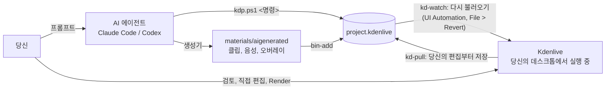

<div align="center">

# movie-engine

**AI 에이전트가 Kdenlive에서 영상을 편집하는 동안 당신은 지켜보다가 언제든 직접 이어받을 수 있습니다.**

AI 코딩 에이전트(Claude Code, Codex)가 실제 Kdenlive 프로젝트를 만들고 수정합니다. 영화, 설명 영상, 세로형 쇼츠까지 다룹니다. 편집 내용은 열려 있는 편집기에 실시간으로 나타납니다. 포터블, Windows, 편집기 패치 불필요.


[English](../../README.md) · [简体中文](README.zh-CN.md) · [हिन्दी](README.hi.md) · [Español](README.es.md) · [Français](README.fr.md) · [العربية](README.ar.md) · [বাংলা](README.bn.md) · [Português](README.pt.md) · [Русский](README.ru.md) · [اردو](README.ur.md) · [Bahasa Indonesia](README.id.md) · [Deutsch](README.de.md) · [日本語](README.ja.md) · [Türkçe](README.tr.md) · **한국어**

*이 문서는 번역본입니다. 기준이 되는 문서는 영어 README입니다.*

</div>

---

## 목차

- [왜 필요한가](#왜-필요한가)
- [작동 방식](#작동-방식)
- [기능](#기능)
- [요구 사항](#요구-사항)
- [설치](#설치)
- [빠른 시작](#빠른-시작)
- [에이전트와 함께 작업하기](#에이전트와-함께-작업하기)
- [편집 명령줄 (`kdp.ps1`)](#편집-명령줄-kdpps1)
- [열려 있는 편집기와 실시간 동기화](#열려-있는-편집기와-실시간-동기화)
- [Kdenlive가 못 하는 일은 생성기로](#kdenlive가-못-하는-일은-생성기로)
- [내레이션과 사운드](#내레이션과-사운드)
- [인터페이스 언어](#인터페이스-언어)
- [폴더 구조](#폴더-구조)
- [테스트와 검증](#테스트와-검증)
- [제한 사항](#제한-사항)
- [문제 해결](#문제-해결)
- [자주 묻는 질문](#자주-묻는-질문)
- [기여하기](#기여하기)
- [감사의 말](#감사의-말)
- [라이선스](#라이선스)

## 왜 필요한가

영상 편집기는 마우스를 쥔 손을 위해 만들어졌습니다. 반면 AI 에이전트는 구조, 타이밍, 반복 작업에 강합니다. 클립 300개를 비트에 맞춰 배치하고, 모든 자막을 내레이션에 맞추고, 피드백을 받아 장면을 다시 만드는 일 말입니다. 하지만 에이전트는 당신의 데스크톱을 차지하지 않고서는 GUI를 클릭하며 조작할 수 없습니다.

Kdenlive는 강력한 오픈 소스 편집기이지만, Windows에서는 **자동화 API가 없습니다**. D-Bus 제어는 Linux 빌드에만 있고, API를 추가한 포크들은 관리되지 않거나 안전하지 않습니다. movie-engine은 편집기를 패치하지 않고 이 문제를 해결합니다.

1. 에이전트는 테스트를 거친 명령줄 도구(`engine/kdp.ps1`)로 `.kdenlive` 프로젝트 파일을 편집합니다.
2. 실행 중인 Kdenlive에는 Windows UI Automation을 통해 파일을 다시 불러오라고 지시합니다. 키 입력도, 마우스 조작도, 포커스 가로채기도 없습니다.
3. 당신이 저장하지 않은 편집 내용은 먼저 저장되며 절대 덮어써지지 않습니다.

그래서 에이전트가 편집하고 당신이 검토할 수도 있고, 당신이 직접 손으로 편집할 수도 있습니다. 둘이 같은 프로젝트를, 같은 편집기에서, 동시에 작업합니다.

## 작동 방식



모든 편집 명령은 같은 안전한 주기를 따릅니다.

1. **풀(Pull).** Kdenlive에 저장되지 않은 변경 사항이 있으면 저장하라고 지시하고(UI Automation으로 도구 모음의 저장 실행), 저장이 끝났는지 확인합니다.
2. **편집(Edit).** 명령은 잠금을 건 상태에서 해시를 확인한 뒤, 실행 취소용 스냅샷을 만들고 XML을 변경합니다. 그 사이에 파일이 바뀌었다면 아무것도 쓰지 않습니다.
3. **다시 불러오기(Reload).** 감시기가 AI의 스탬프를 발견하면 열려 있는 편집기에서 File > Revert를 실행합니다. 타임라인 위젯이 실제로 다시 만들어졌을 때만 성공으로 칩니다.
4. **충돌(Conflict).** 그 사이에 당신이 편집을 시작했다면 다시 불러오지 않으며, 당신의 작업은 그대로 남습니다. AI 버전은 따로 보관되고, 에이전트는 당신의 변경 위에 자신의 변경을 다시 적용합니다.

## 기능

- **GUI 없이 프로젝트 전체 편집**: 약 120개의 명령으로 빈, 타임라인, 이펙트, 컴포지션, 트랙, 가이드, 마커, 자막, 시퀀스, 속도 및 시간 리매핑, 슬라이드쇼, 타이틀, 프록시, 렌더링, 실행 취소/다시 실행을 다룹니다. [명령 참조](#편집-명령줄-kdpps1)를 확인하세요.
- **열려 있는 편집기와 실시간 동기화.** AI의 편집이 지금 보고 있는 Kdenlive에 나타납니다. 저장하지 않은 편집은 먼저 저장되며 절대 사라지지 않습니다.
- **데스크톱을 절대 방해하지 않습니다.** 포커스를 가로채지 않고, 키 입력이나 마우스 입력도 보내지 않습니다. 테스트용 편집기는 보이지 않는 Windows 데스크톱에서 실행됩니다.
- **포터블.** 편집기, 설정, Node.js, 글꼴, 도구가 모두 하나의 폴더에 들어 있습니다. 다른 PC에 복사하면 그대로 작동하며, Program Files나 Windows 사용자 프로필에는 아무것도 기록하지 않습니다.
- **Kdenlive가 못 하는 일을 위한 생성기**: 글자 단위 키네틱 텍스트, 손그림 주석, 3D UI 장면, 커서 애니메이션, 긴 인터랙티브 "설명" 영상. GPU에서 실제 모션 블러와 함께 렌더링되며, 일반 클립으로 타임라인에 배치됩니다.
- **단어별 타이밍이 포함된 내레이션**(Microsoft Edge TTS, API 키 불필요). 자막과 액션이 정확히 그 단어에서 실행됩니다.
- **합성 효과음**(whoosh, click, pop, riser, impact 등)을 코드로 생성합니다.
- **추정이 아닌 검증.** 모든 명령에 결과 검사가 있고, 이펙트와 컴포지션은 하나씩 전수 테스트되며, 원본 결과는 `docs/proof/`에 있습니다.
- **에이전트용 지침 포함.** `AGENTS.md`와 `.claude/skills/`의 스킬이 Claude Code와 Codex에 작업 흐름, 파일 형식, 주의할 함정을 가르칩니다.

## 요구 사항

| | |
|---|---|
| OS | Windows 10 또는 11, x64 |
| 편집기 | Kdenlive **26.08.3** 포터블(standalone) 빌드. 다른 버전은 테스트되지 않았습니다. |
| Node.js | 18 이상. nodejs.org의 Windows x64 `.zip`을 `engine/node/`에 압축 해제 |
| 브라우저 | Microsoft Edge(Windows 기본 포함). 장면 렌더러가 헤드리스 모드로 사용합니다 |
| 에이전트 | [Claude Code](https://claude.com/claude-code) 또는 Codex. 선택 사항이며, 모든 도구는 직접 실행할 수도 있습니다. |
| 디스크 | 편집기와 도구에 약 1 GB, 여기에 미디어 용량 추가 |
| GPU | H.264 하드웨어 인코딩을 지원하는 GPU라면 `film-render.mjs`가 빨라집니다(없으면 소프트웨어로 대체) |

## 설치

모든 것이 **이 폴더 안에** 설치됩니다. 관리자 권한은 전혀 필요하지 않습니다.

```powershell
git clone https://github.com/vladtarrow/movie-engine.git
cd movie-engine
```

**1. Node.js.** <https://nodejs.org/en/download>에서 Node.js 18 이상의 Windows x64 `.zip`을 내려받아 내용을 `engine\node\`에 압축 해제합니다. 그러면 `engine\node\node.exe`와 `engine\node\npm.cmd`가 생깁니다. 설치 프로그램도 시스템 Node도 필요 없습니다. 모든 스크립트는 `engine\node.cmd`를 통해 실행되며, 시스템에 설치된 Node는 절대 사용하지 않습니다.

**2. Node 패키지**(내레이션 도구와 렌더러용, 버전은 `engine/voice/package.json`에 고정되어 있음):

```powershell
engine\node\npm.cmd install --prefix engine\voice
```

**3. Kdenlive 26.08.3 포터블.** <https://download.kde.org/stable/kdenlive/26.08/windows/>에서 `kdenlive-26.08.3_standalone.exe`를 `engine\installer\`로 내려받아 검증한 뒤 압축을 풉니다.

```powershell
(Get-FileHash engine\installer\kdenlive-26.08.3_standalone.exe -Algorithm SHA256).Hash
# 예상 값: A25427B1DFF2C17E3B0386E991BB1A719382BB3176D1A90E441CDAEB6E0A967D
engine\installer\kdenlive-26.08.3_standalone.exe -o"engine\Kdenlive" -y
```

편집기는 `engine\Kdenlive\kdenlive-26.08.3_standalone\bin\`에 풀립니다. `melt.exe`와 `ffmpeg.exe`가 이미 포함되어 있습니다.

**4. 첫 실행.**

```powershell
engine\kdenlive.cmd
```

Kdenlive는 모든 설정을 Windows 사용자 프로필이 아닌 `engine\profile-kdenlive\`에 저장합니다. 처음 실행할 때 한 번만 설정 마법사가 나타납니다.

## 빠른 시작

### 에이전트로

Claude Code(또는 Codex)에서 이 폴더를 열고 평소 말투로 요청하세요.

> 세로형 30 fps 새 프로젝트 "launch-teaser"를 만들어 줘. `materials/designers/launch/`에 있는 스크린샷 세 장을 각각 2.5초씩 짧은 크로스페이드로 타임라인에 올리고, `script.txt`로 내레이션을 넣은 다음 모든 줄에 타이밍을 맞춘 키네틱 자막을 달아 줘.

> Kdenlive에서 열어 줘.

> 두 번째 샷이 너무 길어. 1.8초로 줄이고 로고를 조금 위로 올려 줘.

에이전트는 `AGENTS.md`를 따릅니다. `kdp.ps1`로 편집하고, 컷에 필요한 클립만 렌더링하며, 열려 있는 편집기를 계속 동기화합니다. 당신은 Kdenlive에서 검토하고, 원할 때마다 직접 편집하고, 마음에 들면 Render를 누르면 됩니다.

### 직접 손으로

```powershell
# 비디오 트랙 2개, 오디오 트랙 2개를 가진 1080x1920 30 fps 새 프로젝트
powershell -NoProfile -ExecutionPolicy Bypass -File engine\kdp.ps1 new -Project projects\hello\hello.kdenlive -Profile vertical_hd_30

# 3초짜리 타이틀과 단색 배경
powershell -NoProfile -ExecutionPolicy Bypass -File engine\kdp.ps1 bin-color -Project projects\hello\hello.kdenlive -Color '#203060' -Seconds 3 -Name bg
powershell -NoProfile -ExecutionPolicy Bypass -File engine\kdp.ps1 title -Project projects\hello\hello.kdenlive -Text "Hello" -Seconds 3 -Name hi

# 배치: 배경은 V1, 타이틀은 그 위의 V2
powershell -NoProfile -ExecutionPolicy Bypass -File engine\kdp.ps1 add -Project projects\hello\hello.kdenlive -Bin bg -Track V1 -At 0
powershell -NoProfile -ExecutionPolicy Bypass -File engine\kdp.ps1 add -Project projects\hello\hello.kdenlive -Bin hi -Track V2 -At 0

# 확인용 프레임을 뽑은 뒤 편집기에서 열기
powershell -NoProfile -ExecutionPolicy Bypass -File engine\kdp.ps1 frame -Project projects\hello\hello.kdenlive -At 1.5 -Out out\hello\check.png
engine\kdenlive.cmd projects\hello\hello.kdenlive
```

나중에 마지막 프로젝트를 다시 열려면 `open-last-project.cmd`를 더블클릭하세요.

## 에이전트와 함께 작업하기

에이전트는 `AGENTS.md`(Codex) 또는 이를 가져오는 `CLAUDE.md`(Claude Code)와 함께 두 가지 스킬을 읽습니다.

| 스킬 | 가르치는 내용 |
|---|---|
| `.claude/skills/kdenlive-project-file` | `.kdenlive` / MLT XML 형식, `kdp.ps1`, `melt`로 검사하기 |
| `.claude/skills/kdenlive-live` | 실행 중인 편집기를 안전하게 다루기: 시작, 풀, 다시 불러오기, 창 캡처 |

에이전트가 지키는 규칙이며, 믿고 맡겨도 됩니다.

- 마우스, 키보드, 포커스를 절대 가져가지 않으며, 데스크톱 스크린샷도 절대 찍지 않습니다(편집기 자체의 창만 찍습니다).
- GUI 작업(저장, 열기, 다시 불러오기)은 당신에게 클릭을 부탁하지 않고 직접 처리합니다.
- 무엇이든 내려받기 전, 무엇이든 삭제하기 전에 먼저 물어봅니다.
- 작업에 필요한 것(장면 클립, 확인용 프레임)만 렌더링합니다. 최종 영상은 당신이 요청할 때만 렌더링합니다.
- Kdenlive가 어떤 일을 제대로 하지 못하면, 에이전트는 외부에서 코드로 만들어 결과를 클립으로 넣습니다. 효과의 품질을 낮추지 않습니다.

## 편집 명령줄 (`kdp.ps1`)

```powershell
powershell -NoProfile -ExecutionPolicy Bypass -File engine\kdp.ps1 <command> -Project <file.kdenlive> [options]
```

시간은 초 단위이며 소수점으로 점을 씁니다(`2.5`). 트랙은 `V1 V2 …`(V1이 가장 아래)와 `A1 A2 …`입니다. 클립은 `-Track`과 그 클립 안의 아무 시점 `-At`으로 지정합니다. 이펙트 매개변수는 `-Params "name=value||name=value"`에 넣습니다. 모든 옵션이 담긴 전체 목록은 `engine/kdp.ps1`의 헤더에 있습니다.

| 그룹 | 명령 |
|---|---|
| 프로젝트 | `new`, `profiles`, `info`, `validate`, `fonts`, `profile-set`, `profile-from-clip`, `zone`, `archive`, `backups`, `rebase`, `otio-export`, `otio-import` |
| 빈 | `bin-add`, `bin-color`, `title`, `title-text`, `title-save`, `title-template`, `bin-rename`, `bin-remove`, `bin-info`, `bin-set`, `bin-duplicate`, `bin-replace-file`, `bin-reload`, `folder`, `bin-folder`, `relink`, `clean`, `generator`, `playlist-clip`, `extract-audio`, `transcode` |
| 타임라인 | `add`, `add-av`, `move`, `copy`, `trim`, `ripple-trim`, `slip`, `split`, `remove`, `speed`, `remap`, `disable`, `enable`, `group`, `ungroup`, `mix`, `unmix`, `space-insert`, `space-remove`, `spaces-remove-all`, `track-clear`, `replace-in-timeline` |
| 이펙트 | `effects`, `effect-info`, `effect-add`, `effect-list`, `effect-set`, `effect-remove`, `effect-copy`, `effect-clear`, `effects-all`, `bin-effect`, `effect-templates`, `effect-template` |
| 컴포지션 | `compositions`, `comp-info`, `comp-add`, `comp-list`, `comp-set`, `comp-remove` |
| 트랙 | `track-add`, `track-remove`, `track-set` |
| 가이드와 마커 | `guide-add`, `guide-list`, `guide-remove`, `guide-set`, `guide-clear`, `guide-export`, `guide-category`, `marker`, `marker-list`, `marker-set`, `marker-remove` |
| 자막 | `sub-add`, `sub-import`, `sub-export`, `sub-state` |
| 시퀀스 | `sequence-add`, `sequences`, `copy-to-sequence`, `expand`. 어떤 명령이든 `-Sequence <name>`을 붙이면 해당 시퀀스 안에서 동작합니다 |
| 특수 | `slideshow`, `bin-add`를 통한 Lottie / Glaxnimate 애니메이션, `proxy`, `stabilize`, `scene-split`, `speed-job`, `subclip` |
| 출력 | `frame`(PNG 한 장), `preview`(빠른 melt 렌더링), `render`(Kdenlive 자체 렌더러 또는 프리셋), `presets` |
| 기록 | `undo`, `redo`, `clear-history`(스냅샷은 `projects/<name>/.kdp-history`에 저장) |

알아 두면 좋은 동작:

- 연결된 오디오와 비디오 두 부분은 함께 이동, 트리밍, 분할, 삭제됩니다(한쪽만 다루려면 `-Alone`).
- 실패한 명령은 종료 코드 1로 끝나며 아무것도 쓰지 않습니다.
- Windows 빌드에서 실행할 수 없는 이펙트는 조용히 무시되지 않고 명시적으로 거부됩니다(목록: `docs/proof/assets.txt`).
- Kdenlive의 모든 메뉴 동작은 `engine/tools/data/kdenlive-actions.csv`에서 명령, 다른 경로, 또는 "보기 전용"으로 매핑되어 있습니다. `docs/kdenlive-coverage.md`를 참고하세요.

## 열려 있는 편집기와 실시간 동기화

| 스크립트 | 하는 일 | 종료 코드 |
|---|---|---|
| `engine\kd-pull.ps1 -Project <f>` | Kdenlive가 당신의 편집을 저장하게 하고 이를 확인 | 0 파일 최신 상태, 3 실행 중 아님, 4 확인 안 됨 |
| `engine\kd-reload.ps1 -Project <f>` | File > Revert 실행, 타임라인 재구성으로 확인 | 0 확인됨, 2 저장하지 않은 편집 있음(아무것도 버리지 않음), 3 실행 중 아님, 4 실패 |
| `engine\kd-watch.ps1 -Project <f>` | 백그라운드 감시기: AI가 쓸 때마다 다시 불러오고 충돌을 기록 | 로그는 `engine\kd-watch.log`, 중지하려면 `engine\kd-watch.run` 삭제 |
| `engine\kdenlive-bg.ps1 [project]` | 에이전트용으로 Kdenlive를 최소화 상태로 시작 | 0 불러오기 완료, 4 확인 안 됨 |
| `engine\kdenlive.cmd [project]` | 당신을 위해 Kdenlive를 시작 | |

감시기는 세션마다 한 번 시작합니다.

```powershell
Start-Process powershell -WindowStyle Hidden -ArgumentList '-NoProfile','-ExecutionPolicy','Bypass','-File','engine\kd-watch.ps1','-Project','projects\hello\hello.kdenlive'
```

큰 프로젝트: 클립 1000개짜리 프로젝트를 다시 불러오는 데는 몇 분이 걸리며, 도구는 미리 보고하지 않고 끝날 때까지 기다립니다. 프로젝트는 빈 편집기에서 *File > Open Recent*로 엽니다. 파일을 직접 열면 Qt가 접근성 기능을 위해 타임라인의 모든 항목을 순회하게 되어 약 10분이나 느려지기 때문입니다.

## Kdenlive가 못 하는 일은 생성기로

Kdenlive/MLT에는 글자 단위 텍스트 애니메이션도, 익스프레션도 없고 3D 기능도 거의 없으며, 무거운 이펙트는 재생을 느리게 만듭니다. movie-engine은 이런 부분을 외부에서 렌더링한 뒤 일반 클립으로 타임라인에 올립니다. 보통 알파 채널을 포함하며, 영상 트랙 위의 트랙에 배치합니다. 생성기 스크립트와 입력 파일은 프로젝트 폴더에 남아 있으므로, 텍스트나 글꼴, 타이밍이 바뀌면 클립을 다시 생성할 수 있습니다.

| 도구 | 만드는 것 |
|---|---|
| `engine/tools/kinetic-text.ps1` | 글자 단위 키네틱 자막. 모든 단어의 타이밍을 `voice.json`에서 가져오며 강조 박스 포함 |
| `engine/tools/annotate.ps1` | 스크린샷 위에 그려지며 나타나는 손그림 원, 상자, 밑줄, 화살표 |
| `engine/tools/card-entrance.ps1` | 부드러운 그림자와 함께 떠오르며 확대되어 등장하는 스크린샷 카드 |
| `engine/tools/pdf-to-png.ps1` | PDF로 내보낸 파일에서 슬라이드 생성 |
| `engine/tools/html-render.mjs` | 모든 HTML/CSS/canvas 장면을 영상으로: 인터페이스 애니메이션, 커서, 3D, 마스크 |
| `engine/tools/film-render.mjs` + `film/` | canvas 위의 길고 인터랙티브한 설명 영상: 내레이션 한 줄당 클립 하나, 말한 단어에서 액션 실행, 약 45 fps의 GPU 모션 블러 |

두 렌더러 모두 Windows에 기본으로 포함된 Microsoft Edge를 헤드리스 모드로 구동하며, 일회용 프로필을 쓰고 네트워크에는 접근하지 않습니다.

### 데모

```powershell
# 커서 클릭이 들어간 3초짜리 3D 타이틀 카드
engine\node.cmd engine\tools\html-render.mjs examples\demo\scene\scene.html examples\demo\out --frames 0,30,60,89
engine\node.cmd engine\tools\html-render.mjs examples\demo\scene\scene.html examples\demo\out\scene.mp4

# 내레이션 두 줄에 맞춘 4샷 인터랙티브 영상
engine\node.cmd engine\tools\film-render.mjs examples\demo\film\film.html examples\demo\out --check
engine\node.cmd engine\tools\film-render.mjs examples\demo\film\film.html examples\demo\out --shots all --width 640
engine\node.cmd engine\tools\film-render.mjs examples\demo\film\film.html examples\demo\out\clips --suffix -v01
```

영상 하나는 작은 파일 세 개로 이루어집니다. `data.js`에는 샷과 단어 타이밍이 들어 있습니다. `direction.js`에는 샷마다 한 줄씩 씁니다.

```text
1 | hover 192 108 @brand | tag 300 60 Your brand @deserves | confetti 192 90 @film
2 say=A film that/*explains* it
3 | click 116 108 @before | click 268 108 @after | chips Before~After @after
4 scene=counter | count 0 120 % @count
```

`scenes.js`에는 처음부터 직접 그리는 샷이 들어 있습니다. `@word`는 내레이션이 그 단어를 말할 때 액션을 실행합니다. 액션에는 click, hover, drag, zoom, lens, ring, arrow, chips, toggle, slider, toast, type, count, confetti가 있으며, 전체 문법은 `engine/tools/film/film-kit.js`의 맨 위에 있습니다.

## 내레이션과 사운드

```powershell
engine\node.cmd engine\voice\voice.mjs lines.json materials\aigenerated\hello\voice en-US-AndrewMultilingualNeural +0%
```

`lines.json`은 대사 목록입니다. 도구는 줄마다 mp3 하나를 만들고, 길이와 모든 단어의 시작·끝 시각이 담긴 `voice.json`도 함께 만듭니다. 줄은 캐시되므로 한 줄을 바꾸면 그 줄만 다시 생성됩니다. `msedge-tts` 패키지를 통해 Microsoft Edge의 온라인 음성 합성을 사용합니다. 키는 필요 없지만, 비공식 서비스이며 인터넷 연결이 필요합니다.

```powershell
engine\node.cmd engine\audio\sfx.mjs materials\aigenerated\sfx
```

이 명령은 whoosh, whoosh-long, swipe, click, pop, tick, riser, impact, ding, reveal을 코드로 합성합니다. 바로 쓸 수 있는 세트는 `materials/aigenerated/sfx/`에 있습니다. 한 프레임보다 짧은 소리는 배치하기 전에 무음으로 채워 늘려 주세요(`-af apad=whole_dur=0.0667`).

## 인터페이스 언어

런처는 기본적으로 Kdenlive를 **영어**로 시작합니다. 다른 언어를 쓰려면 시작하기 전에 `MOVIE_ENGINE_UI_LANG`을 설정하세요.

```powershell
$env:MOVIE_ENGINE_UI_LANG = 'ru'; engine\kdenlive.cmd
```

UI Automation은 메뉴 항목을 화면에 보이는 이름으로 찾습니다. 영어와 러시아어 이름은 기본 내장되어 있습니다(`engine/tools/kd-ui.ps1`, `$KdNames`). 다른 언어라면 그곳에 이름을 추가하고 다음 명령으로 확인하세요.

```powershell
powershell -NoProfile -ExecutionPolicy Bypass -File engine\tools\kd-langcheck.ps1
```

## 폴더 구조

```text
movie-engine/
├─ AGENTS.md, CLAUDE.md          instructions for AI agents
├─ .claude/skills/               agent skills: project file format, live editor
├─ engine/
│  ├─ kdp.ps1                    the editing command line
│  ├─ kd-pull / kd-reload / kd-watch .ps1, kdenlive.cmd, kdenlive-bg.ps1
│  ├─ tools/                     internals, generators, tests, data (action map)
│  ├─ voice/  audio/  fonts/     TTS, synthesized SFX, Poppins (OFL)
│  ├─ Kdenlive/  node/           portable editor and Node.js (not in git)
│  └─ profile-kdenlive/          the editor's settings (not in git)
├─ projects/<name>/<name>.kdenlive
├─ materials/
│  ├─ download/                  stock and downloaded files (not in git)
│  ├─ aigenerated/               everything the AI made (sfx/ and test-kit/ ship with the engine)
│  ├─ designers/  brand/         files from your team, brand assets
├─ examples/demo/                demos of the scene and film renderers
├─ out/                          renders (not in git)
└─ docs/                         proofs, coverage, translations of this README
```

프로젝트 안의 미디어 경로는 상대 경로입니다. 폴더를 옮기거나 복사하면 `kdp.ps1 rebase`(`kdenlive.cmd`가 자동으로 실행하기도 함)가 새 위치를 프로젝트에 기록합니다.

## 테스트와 검증

무엇이 작동하는지에 대한 주장은 "함수가 실행되었다"가 아니라 결과 검사로 뒷받침됩니다. 요약은 [`docs/kdenlive-proof.md`](../../docs/kdenlive-proof.md)에, 원본 출력은 `docs/proof/`에 있습니다.

| 테스트 | 검사 내용 |
|---|---|
| `engine\tools\kdp-clitest.ps1` | 모든 `kdp.ps1` 명령을 명령줄로 실행하고 결과 프로젝트를 비교 |
| `engine\tools\kd-livetest.ps1` | 보이지 않는 데스크톱의 실제 Kdenlive를 대상으로 풀, 다시 불러오기, 감시기, 충돌, 경쟁 상태를 검사 |
| `engine\tools\kdp-assetsweep.ps1` | 모든 이펙트와 컴포지션: 렌더링한 뒤 프레임을 비교 |
| `engine\tools\kdp-portabletest.ps1` | 폴더를 다른 곳에 복사하고 그 복사본에서 작업 |
| `engine\tools\kd-langcheck.ps1` | 인터페이스 언어와 UI Automation이 메뉴를 찾는지 여부 |
| `engine\tools\kdp-coverage-check.ps1` | 모든 메뉴 동작이 매핑되어 있는지, 그리고 코드보다 오래된 검증 결과가 없는지 |

```powershell
powershell -NoProfile -ExecutionPolicy Bypass -File engine\tools\kdp-clitest.ps1 -Report docs\proof\clitest.txt
powershell -NoProfile -ExecutionPolicy Bypass -File engine\tools\kd-livetest.ps1 -Report docs\proof\live-en.txt
```

테스트용 편집기는 자체 프로필을 사용해 숨겨진 데스크톱에서만 실행되므로, 테스트가 열려 있는 Kdenlive나 당신의 포커스를 건드리는 일은 없습니다.

## 제한 사항

- **Windows 전용**이며 Kdenlive **26.08.3**만 지원합니다. Linux에는 D-Bus가 있으므로 다른 연결 방식이 필요합니다.
- 편집기를 시작할 때 빈 창이 나타나는 약 3초 동안 키보드 포커스를 가져갑니다. 당신이 작업 중일 때 에이전트는 시작하기 전에 먼저 물어봅니다. 다시 불러오기와 편집은 포커스를 가져가지 않습니다.
- Windows 빌드에는 sox, ladspa, movit MLT 모듈과 일부 frei0r/avfilter 이펙트가 없습니다. `kdp.ps1`은 이들을 거부합니다(`docs/proof/assets.txt`).
- OpenTimelineIO 내보내기와 가져오기는 클립과 빈 공간만 다룹니다. 멀티캠은 실시간 앵글 전환을 지원하지 않습니다(컷은 split/remove/hide로 만듭니다).
- 최소화된 창에서 UI Automation으로 "Save As…"를 실행하면 대화 상자가 열리지 않습니다. 에이전트는 대신 `archive`나 파일 복사를 사용합니다.
- 음성 인식(자동 자막)에는 Whisper 또는 Vosk가 필요하며, 이들은 포함되어 있지 않습니다.
- Kdenlive 타이틀 도구로 만든 타이틀은 Windows에 설치된 글꼴을 사용합니다. 타이포그래피를 확실히 보장하려면 `engine/fonts/`에서 글꼴을 불러오는 생성기로 텍스트를 렌더링하세요.
- Edge TTS는 비공식 온라인 서비스이므로 바뀌거나 작동을 멈출 수 있습니다.

## 문제 해결

| 증상 | 원인과 해결 방법 |
|---|---|
| Kdenlive가 실행 중인데 작업 표시줄에서 클릭해도 아무것도 보이지 않음 | 저장된 창 위치가 화면 밖에 있습니다. Kdenlive를 닫고 `engine\profile-kdenlive\AppData\Local\kdenliverc`의 `kdockLayout` 항목을 삭제하거나, `SetWindowPos`로 창을 옮기세요(`AGENTS.md` 참고). |
| `kd-reload.ps1`이 종료 코드 2로 끝남 | 저장하지 않은 편집이 있습니다. 아무것도 버려지지 않았습니다. `kd-pull.ps1`을 실행한 뒤 변경 사항을 다시 적용하세요(`kdp.ps1`은 이를 자동으로 합니다). |
| `engine\kd-watch.log`에 `CONFLICT`가 있음 | 당신과 에이전트가 같은 순간에 편집했습니다. 당신의 버전은 편집기에 남아 있고, AI 버전은 `projects\<name>\.kdp-history\<name>\conflict\`에 있습니다. 에이전트에게 변경 사항을 다시 적용해 달라고 요청하세요. |
| 명령이 "pull not confirmed"와 함께 종료 코드 1로 끝남 | Kdenlive가 바쁘거나 대화 상자를 표시하고 있습니다. 대화 상자를 닫거나 불러오기가 끝날 때까지 기다린 뒤 다시 실행하세요. |
| PowerShell 스크립트 구문 분석에 실패함 | Windows PowerShell 5.1에서는 ASCII가 아닌 문자가 들어간 스크립트를 **BOM 포함** UTF-8로 저장해야 합니다. |
| `voice.mjs`가 "Stream closed before the synthesis completed"로 멈춤 | 대개 네트워크 문제이거나, 오래된 사본에서 SSML이 이스케이프되지 않았기 때문입니다. `voice.mjs`는 `& < >`를 스스로 이스케이프합니다. |
| 큰 프로젝트를 여는 데 몇 분씩 걸림 | `kdenlive.cmd` / `kdenlive-bg.ps1`로 여세요. 절대 `kdenlive.exe project.kdenlive` 방식으로 열지 마세요. |

## 자주 묻는 질문

**Claude Code나 Codex가 꼭 필요한가요?**
아니요. 모든 도구는 직접 실행할 수 있는 평범한 스크립트입니다. 에이전트는 작업을 빠르게 해 줄 뿐입니다. 컷을 계획하고, 도구를 실행하고, 편집기를 계속 동기화합니다.

**에이전트가 제가 직접 한 편집을 덮어쓰나요?**
아니요. 무언가를 쓰기 전에는 항상 당신이 저장하지 않은 편집을 먼저 저장하고 확인합니다. 에이전트가 쓰는 도중에 당신이 편집하면, 그 쓰기는 거부되거나 충돌로 따로 보관될 뿐 절대 당신의 작업 위에 적용되지 않습니다.

**Kdenlive를 평소처럼 계속 쓸 수 있나요?**
네. 자체 설정 폴더를 가진 기본 Kdenlive일 뿐입니다. 평소처럼 편집하고, 미리 보고, 렌더링하세요.

**이미 설치된 Kdenlive와도 작동하나요?**
`engine\Kdenlive\`에 있는 자체 포터블 사본을 사용하므로, 설치된 Kdenlive와 그 설정은 전혀 건드리지 않습니다.

**왜 API가 있는 Kdenlive 포크나 다른 편집기를 쓰지 않나요?**
Windows에는 관리되면서도 안전한 포크가 없습니다(2026-11 조사). OpenShot, Blender VSE, DaVinci Resolve, Shotcut, 웹 편집기를 평가했고, 편집 기능의 깊이는 Kdenlive가 가장 뛰어났습니다. 업스트림의 REST API 제안(머지 리퀘스트 !902)을 지켜보고 있습니다.

**최종 영상도 렌더링할 수 있나요?**
네. `kdp.ps1 render`(Kdenlive 자체 렌더러를 숨긴 채 실행)를 사용하거나, 편집기에서 직접 Render를 누르면 됩니다.

**제 미디어가 어딘가에 업로드되나요?**
아니요. 내레이션을 생성할 때 그 텍스트만 Edge TTS 서비스로 전송됩니다. 장면 렌더러는 네트워크가 비활성화된 상태로 실행됩니다.

## 기여하기

기여를 환영합니다. [CONTRIBUTING.md](../../CONTRIBUTING.md)를 참고하세요. 요약하면 다음과 같습니다.

- `kdp.ps1` 작업을 새로 추가하거나 변경할 때마다 `kdp-clitest.ps1`에 결과 검사를 추가하고, 동작 맵에 항목을 넣고, `kdp-coverage-check.ps1`을 새로 실행해야 합니다.
- 테스트용 Kdenlive를 보이는 데스크톱에서 절대 시작하지 마세요. `engine/tools/kd-hidden.ps1`을 사용하세요.
- 모든 것을 포터블하게 유지하세요. 폴더 밖에 아무것도 설치하지 말고, 프로젝트에 절대 경로를 쓰지 마세요.
- 검증된 특이 사항은 `AGENTS.md`나 해당 스킬에 기록하세요.

## 감사의 말

- [Kdenlive](https://kdenlive.org)와 [MLT](https://www.mltframework.org): 편집기와 그 밑에서 동작하는 엔진.
- [FFmpeg](https://ffmpeg.org): Kdenlive에 함께 포함됨.
- [msedge-tts](https://www.npmjs.com/package/msedge-tts): 내레이션에 사용.
- [Poppins](https://fonts.google.com/specimen/Poppins): Indian Type Foundry 제작, SIL Open Font License(`engine/fonts/OFL.txt`).
- `engine/tools/data/kdenliveui-26.08.3.rc`: Kdenlive 메뉴 파일로, Kdenlive 26.08.3 소스에서 가져왔으며 커버리지 검사에만 쓰입니다. MIT 라이선스가 아니라 Kdenlive의 GPL 라이선스를 따릅니다.

## 라이선스

movie-engine 자체 코드는 [MIT 라이선스](../../LICENSE)로 배포됩니다. Kdenlive, MLT, FFmpeg, Node.js 패키지, Poppins 글꼴은 각자의 라이선스를 따릅니다.
