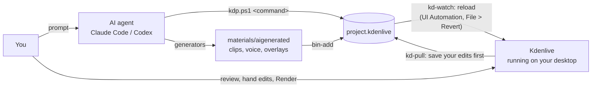

<div align="center">

# Movie Engine

**En KI-Agent schneit Äre Video am Kdenlive, während Dir nokuckt, an Dir kënnt zu all Moment iwwerhuelen.**

KI-Agente fir d'Programméieren (Claude Code, Codex) bauen an änneren echt Kdenlive-Projeten: Filmer, Erklärvideoen a vertikal Shorts. D'Ännerungen erschéngen live am Editor, deen Dir op hutt. Portabel, Windows, ouni Patcher um Editor.


[English](../../README.md) · [简体中文](README.zh-CN.md) · [繁體中文](README.zh-TW.md) · [हिन्दी](README.hi.md) · [Español](README.es.md) · [Français](README.fr.md) · [العربية](README.ar.md) · [বাংলা](README.bn.md) · [Português](README.pt.md) · [Русский](README.ru.md) · [اردو](README.ur.md) · [Bahasa Indonesia](README.id.md) · [Deutsch](README.de.md) · [日本語](README.ja.md) · [Türkçe](README.tr.md) · [한국어](README.ko.md) · [Українська](README.uk.md) · [Italiano](README.it.md) · [Polski](README.pl.md) · [Tiếng Việt](README.vi.md) · [فارسی](README.fa.md) · [ไทย](README.th.md) · [Kiswahili](README.sw.md) · [አማርኛ](README.am.md) · [Avañe'ẽ](README.gn.md) · [Setswana](README.tn.md) · [Shqip](README.sq.md) · [Беларуская](README.be.md) · [Български](README.bg.md) · [Bosanski](README.bs.md) · [Hrvatski](README.hr.md) · [Српски](README.sr.md) · [Crnogorski](README.cnr.md) · [Македонски](README.mk.md) · [Slovenščina](README.sl.md) · [Slovenčina](README.sk.md) · [Čeština](README.cs.md) · [Magyar](README.hu.md) · [Română](README.ro.md) · [Dansk](README.da.md) · [Norsk bokmål](README.nb.md) · [Norsk nynorsk](README.nn.md) · [Svenska](README.sv.md) · [Íslenska](README.is.md) · [Suomi](README.fi.md) · [Eesti](README.et.md) · [Latviešu](README.lv.md) · [Lietuvių](README.lt.md) · [Nederlands](README.nl.md) · **Lëtzebuergesch** · [Rumantsch](README.rm.md) · [Ελληνικά](README.el.md) · [Malti](README.mt.md) · [Gaeilge](README.ga.md) · [Català](README.ca.md) · [ქართული](README.ka.md) · [Հայերեն](README.hy.md) · [Azərbaycanca](README.az.md) · [Afrikaans](README.af.md) · [isiZulu](README.zu.md) · [isiXhosa](README.xh.md) · [Sesotho](README.st.md) · [Sepedi](README.nso.md) · [Xitsonga](README.ts.md) · [Tshivenḓa](README.ve.md) · [siSwati](README.ss.md) · [isiNdebele (South Africa)](README.nr.md) · [isiNdebele (Zimbabwe)](README.nd.md) · [chiShona](README.sn.md) · [Chichewa](README.ny.md) · [Ikinyarwanda](README.rw.md) · [Ikirundi](README.rn.md) · [Malagasy](README.mg.md) · [Soomaali](README.so.md) · [Afaan Oromoo](README.om.md) · [Qafar af](README.aa.md) · [ትግርኛ](README.ti.md) · [Sängö](README.sg.md) · [Kreol Seselwa](README.crs.md) · [TjiKalanga](README.kck.md) · [ChiNdau](README.ndc.md)

*Dëst ass eng Iwwersetzung; déi englesch Versioun vum README ass d'Referenzversioun.*

</div>

---

## Inhalt

- [Firwat](#firwat)
- [Wéi et funktionéiert](#wéi-et-funktionéiert)
- [Funktiounen](#funktiounen)
- [Viraussetzungen](#viraussetzungen)
- [Installatioun](#installatioun)
- [Séier ufänken](#séier-ufänken)
- [Mam Agent schaffen](#mam-agent-schaffen)
- [D'Kommandozeil fir de Schnëtt (`kdp.ps1`)](#dkommandozeil-fir-de-schnëtt-kdpps1)
- [Live-Synchronisatioun mam opmaachten Editor](#live-synchronisatioun-mam-opmaachten-editor)
- [Generatoren: wat Kdenlive net kann](#generatoren-wat-kdenlive-net-kann)
- [Voice-over an Toun](#voice-over-an-toun)
- [Interfacesprooch](#interfacesprooch)
- [Dossiersstruktur](#dossiersstruktur)
- [Tester a Beweiser](#tester-a-beweiser)
- [Aschränkungen](#aschränkungen)
- [Problemer léisen](#problemer-léisen)
- [Dacks gestallte Froen](#dacks-gestallte-froen)
- [Matschaffen](#matschaffen)
- [Merci](#merci)
- [Lizenz](#lizenz)

## Firwat

Videoeditore si fir eng Hand op der Maus gemaach. KI-Agente si gutt bei Struktur, Timing a Widderhuelung: 300 Clippen am Takt placéieren, all Ënnertitel op d'Stëmm ofstëmmen, eng Zeen no engem Feedback nei maachen. Si kënnen awer net duerch eng grafesch Uewerfläch klicken, ouni Ären Desktop ze iwwerhuelen.

Kdenlive ass e staarken Open-Source-Editor, mä ënner Windows huet en **keng Automatiséierungs-API**: D-Bus-Steierung gëtt et nëmmen an de Linux-Builds, an d'Forken, déi eng derbäisetzen, ginn entweder net méi gefleegt oder si net sécher. Movie Engine léist dat, ouni den Editor ze patchen:

1. Den Agent ännert de Projetfichier `.kdenlive` iwwer eng getest Kommandozeil (`engine/kdp.ps1`).
2. De lafende Kdenlive kritt iwwer Windows UI Automation gesot, de Fichier nei ze lueden, ouni Tastendréck, ouni Maus an ouni de Fokus ze klauen.
3. Är eege net gespäichert Ännerunge ginn als éischt gespäichert an ni iwwerschriwwen.

Sou schneit den Agent an Dir kuckt et no, oder Dir ännert selwer vun Hand. Dir schafft zu zwee um selwechte Projet, am selwechten Editor, zur selwechter Zäit.

## Wéi et funktionéiert



All Befeel fir de Schnëtt leeft duerch dee selwechte sécheren Zyklus:

1. **Pull.** Wann de Kdenlive net gespäichert Ännerungen huet, kritt en gesot, se ze späicheren (de Knäppchen Save an der Toolbar iwwer UI Automation), an d'Späicheren gëtt confirméiert.
2. **Änneren.** De Befeel ännert den XML ënner enger Spär, no enger Hash-Kontroll a mat engem Snapshot fir d'Réckgängegmaachen. Wann de Fichier sech an der Tëschenzäit geännert huet, gëtt näischt geschriwwen.
3. **Nei lueden.** De Watcher gesäit de Stempel vun der KI a mécht am opmaachten Editor File > Revert. Et zielt eréischt als Erfolleg, wann den Timeline-Widget wierklech nei opgebaut gouf.
4. **Konflikt.** Wann Dir an der Tëschenzäit ugefaangen hutt ze änneren, gëtt näischt nei gelueden an Är Aarbecht bleift. D'KI-Versioun gëtt op d'Säit geluecht, an den Agent setzt seng Ännerung nach eng Kéier uewen op déi vun Iech drop.

## Funktiounen

- **Komplett Projetbearbechtung ouni grafesch Uewerfläch**: ongeféier 120 Befeler fir Bin, Timeline, Effekter, Kompositiounen, Spueren, Hëllefslinnen, Markéierungen, Ënnertitelen, Sequenzen, Vitess an Time Remap, Diashowen, Titelen, Proxyen, Rendering an Undo/Redo. Kuckt d'[Referenz vun de Befeler](#dkommandozeil-fir-de-schnëtt-kdpps1).
- **Live-Synchronisatioun mam opmaachten Editor.** KI-Ännerungen erschéngen am Kdenlive, op deen Dir kuckt; Är net gespäichert Ännerunge ginn als éischt gespäichert a ginn ni verluer.
- **Stéiert Ären Desktop ni.** Kee Fokusklau, keng Tastendréck a keng Mausagab. Test-Editore lafen op engem onsichtbaren Windows-Desktop.
- **Portabel.** Editor, Astellungen, Node.js, Schrëften an Tools sinn an engem eenzegen Dossier. Kopéiert en op en anere PC an et funktionéiert; näischt gëtt a Program Files oder an Äre Windows-Profil geschriwwen.
- **Generatore fir dat, wat Kdenlive net kann**: kinetesch Text Buschtaf fir Buschtaf, mat der Hand gezeechent Annotatiounen, 3D-Interface-Zeenen, Cursor-Animatiounen a laang interaktiv Erklärfilmer. Si ginn op der GPU mat echter Beweegungsonschäerft gerendert a ginn als normal Clippen op d'Timeline gesat.
- **Voice-over mat Wuert-Timings** (Microsoft Edge TTS, keen API-Schlëssel). Ënnertitelen an Aktiounen starten exakt um richtege Wuert.
- **Synthetiséiert Toun-Effekter** (whoosh, click, pop, riser, impact a méi), am Code generéiert.
- **Bewisen, net ugeholl.** All Befeel huet eng Resultatkontroll, Effekter a Kompositioune ginn een nom aneren duerchgetest, an déi réi Resultater sinn an `docs/proof/`.
- **Instruktioune fir Agenten dobäi.** `AGENTS.md` an d'Skills an `.claude/skills/` léieren dem Claude Code an dem Codex den Aarbechtsoflaf, de Fichiersformat an d'Fallen.

## Viraussetzungen

| | |
|---|---|
| Betribssystem | Windows 10 oder 11, x64 |
| Editor | Kdenlive **26.08.3**, portabel Build (standalone). Aner Versioune sinn net getest. |
| Node.js | 18 oder méi nei: d'Windows-x64-`.zip` vun nodejs.org, an `engine/node/` ausgepakt |
| Browser | Microsoft Edge (Deel vu Windows); vun den Zeen-Rendereren headless benotzt |
| Agent | [Claude Code](https://claude.com/claude-code) oder Codex. Optional: all Tool leeft och vun Hand. |
| Disk | ongeféier 1 GB fir den Editor an d'Tools, plus Är Medien |
| GPU | all GPU mat Hardware-Kodéierung fir H.264 beschleunegt `film-render.mjs` (soss gëtt op Software zeréckgegraff) |

## Installatioun

Alles gëtt **am Dossier** installéiert. Et brauch ee keng Administrateursrechter.

```powershell
git clone https://github.com/vladtarrow/movie-engine.git
cd movie-engine
```

**1. Node.js.** Luet d'Windows-x64-`.zip` vun Node.js 18 oder méi nei vun <https://nodejs.org/en/download> erof a paakt den Inhalt an `engine\node\` aus, sou datt `engine\node\node.exe` an `engine\node\npm.cmd` do leien. Et brauch ee keen Installer a keen System-Node. All Skripter lafen iwwer `engine\node.cmd`, ni iwwer e System-Node.

**2. Node-Paketen** fir d'Stëmm-Tool an d'Renderer (d'Versioune sinn an `engine/voice/package.json` fixéiert):

```powershell
engine\node\npm.cmd install --prefix engine\voice
```

**3. Kdenlive 26.08.3 portabel.** Luet `kdenlive-26.08.3_standalone.exe` vun <https://download.kde.org/stable/kdenlive/26.08/windows/> an `engine\installer\` erof, kontrolléiert en a paakt en aus:

```powershell
(Get-FileHash engine\installer\kdenlive-26.08.3_standalone.exe -Algorithm SHA256).Hash
# expected: A25427B1DFF2C17E3B0386E991BB1A719382BB3176D1A90E441CDAEB6E0A967D
engine\installer\kdenlive-26.08.3_standalone.exe -o"engine\Kdenlive" -y
```

Den Editor landt an `engine\Kdenlive\kdenlive-26.08.3_standalone\bin\`. `melt.exe` an `ffmpeg.exe` si schonn dran.

**4. Éischte Start.**

```powershell
engine\kdenlive.cmd
```

De Kdenlive hält all seng Astellungen an `engine\profile-kdenlive\`, net an Ärem Windows-Profil. Beim éischte Start weist en eemol en Astellungsassistent.

## Séier ufänken

### Mat engem Agent

Maacht den Dossier am Claude Code (oder Codex) op a frot an einfache Wierder:

> Maach en neie vertikale Projet "launch-teaser" mat 30 fps. Setz déi dräi Screenshots aus `materials/designers/launch/` op d'Timeline, all 2,5 s mat enger kuerzer Iwwerbliendung, kreéier e Voice-over aus `script.txt` a stëmm op all Zeil e kineteschen Ënnertitel of.

> Maach mer en am Kdenlive op.

> Den zweete Shot ass ze laang. Kierz en op 1,8 s a réck de Logo e bëssen erop.

Den Agent hält sech un `AGENTS.md`: en ännert iwwer `kdp.ps1`, rendert nëmmen d'Clippen, déi de Schnëtt brauch, an hält den opmaachten Editor synchron. Dir kuckt am Kdenlive no, ännert vun Hand, wann Dir wëllt, an dréckt op Render, wann Dir zefridde sidd.

### Vun Hand

```powershell
# a new 1080x1920 30 fps project with 2 video and 2 audio tracks
powershell -NoProfile -ExecutionPolicy Bypass -File engine\kdp.ps1 new -Project projects\hello\hello.kdenlive -Profile vertical_hd_30

# a 3-second title and a colour background
powershell -NoProfile -ExecutionPolicy Bypass -File engine\kdp.ps1 bin-color -Project projects\hello\hello.kdenlive -Color '#203060' -Seconds 3 -Name bg
powershell -NoProfile -ExecutionPolicy Bypass -File engine\kdp.ps1 title -Project projects\hello\hello.kdenlive -Text "Hello" -Seconds 3 -Name hi

# place them: background on V1, title above it on V2
powershell -NoProfile -ExecutionPolicy Bypass -File engine\kdp.ps1 add -Project projects\hello\hello.kdenlive -Bin bg -Track V1 -At 0
powershell -NoProfile -ExecutionPolicy Bypass -File engine\kdp.ps1 add -Project projects\hello\hello.kdenlive -Bin hi -Track V2 -At 0

# a check frame, then open it in the editor
powershell -NoProfile -ExecutionPolicy Bypass -File engine\kdp.ps1 frame -Project projects\hello\hello.kdenlive -At 1.5 -Out out\hello\check.png
engine\kdenlive.cmd projects\hello\hello.kdenlive
```

Fir de leschte Projet spéider nees opzemaachen, klickt duebel op `open-last-project.cmd`.

## Mam Agent schaffen

Den Agent liest `AGENTS.md` (Codex) oder `CLAUDE.md`, deen et importéiert (Claude Code), plus zwee Skills:

| Skill | Léiert |
|---|---|
| `.claude/skills/kdenlive-project-file` | de Format `.kdenlive` / MLT XML, `kdp.ps1`, Kontroll mat `melt` |
| `.claude/skills/kdenlive-live` | de lafenden Editor sécher steieren: starten, pull, nei lueden, seng eege Fënster ophuelen |

Reegelen, un déi den Agent sech hält an op déi Dir Iech verloosse kënnt:

- Hien hëlt Iech ni Maus, Tastatur oder Fokus ewech a mécht ni Screenshots vun Ärem Desktop (nëmme vun der eegener Fënster vum Editor).
- Hie mécht d'Schrëtt an der Uewerfläch selwer (späicheren, opmaachen, nei lueden), amplaz Iech ze froen, ze klicken.
- Hie freet, ier en eppes erofluet an ier en eppes läscht.
- Hie rendert nëmmen dat, wat d'Aarbecht brauch (Zeen-Clippen, Kontrollbiller). De fäerdege Film rendert en nëmmen, wann Dir dorëm frot.
- Wann de Kdenlive eppes net gutt kann, baut den Agent et dobausse mat Code a setzt d'Resultat als Clip an. Hie schwächt den Effekt net of.

## D'Kommandozeil fir de Schnëtt (`kdp.ps1`)

```powershell
powershell -NoProfile -ExecutionPolicy Bypass -File engine\kdp.ps1 <command> -Project <file.kdenlive> [options]
```

Zäite sinn a Sekonnen, mat engem Punkt (`2.5`). D'Spuere heeschen `V1 V2 …` (V1 ass déi ënnescht) an `A1 A2 …`. E Clip gëtt mat `-Track` plus enger beliebeger Zäit `-At` dobannen ugesprach. Effektparameter kommen an `-Params "name=value||name=value"`. Déi komplett Lëscht mat allen Optiounen steet am Kapp vun `engine/kdp.ps1`.

| Grupp | Befeler |
|---|---|
| Projet | `new`, `profiles`, `info`, `validate`, `fonts`, `profile-set`, `profile-from-clip`, `zone`, `archive`, `backups`, `rebase`, `otio-export`, `otio-import` |
| Bin | `bin-add`, `bin-color`, `title`, `title-text`, `title-save`, `title-template`, `bin-rename`, `bin-remove`, `bin-info`, `bin-set`, `bin-duplicate`, `bin-replace-file`, `bin-reload`, `folder`, `bin-folder`, `relink`, `clean`, `generator`, `playlist-clip`, `extract-audio`, `transcode` |
| Timeline | `add`, `add-av`, `move`, `copy`, `trim`, `ripple-trim`, `slip`, `split`, `remove`, `speed`, `remap`, `disable`, `enable`, `group`, `ungroup`, `mix`, `unmix`, `space-insert`, `space-remove`, `spaces-remove-all`, `track-clear`, `replace-in-timeline` |
| Effekter | `effects`, `effect-info`, `effect-add`, `effect-list`, `effect-set`, `effect-remove`, `effect-copy`, `effect-clear`, `effects-all`, `bin-effect`, `effect-templates`, `effect-template` |
| Kompositiounen | `compositions`, `comp-info`, `comp-add`, `comp-list`, `comp-set`, `comp-remove` |
| Spueren | `track-add`, `track-remove`, `track-set` |
| Hëllefslinnen a Markéierungen | `guide-add`, `guide-list`, `guide-remove`, `guide-set`, `guide-clear`, `guide-export`, `guide-category`, `marker`, `marker-list`, `marker-set`, `marker-remove` |
| Ënnertitelen | `sub-add`, `sub-import`, `sub-export`, `sub-state` |
| Sequenzen | `sequence-add`, `sequences`, `copy-to-sequence`, `expand`; all Befeel mat `-Sequence <name>` funktionéiert an där Sequenz |
| Speziell | `slideshow`, Lottie- / Glaxnimate-Animatiounen iwwer `bin-add`, `proxy`, `stabilize`, `scene-split`, `speed-job`, `subclip` |
| Ausgab | `frame` (een PNG), `preview` (séiere melt-Render), `render` (dem Kdenlive säin eegene Renderer oder e Preset), `presets` |
| Geschicht | `undo`, `redo`, `clear-history` (Snapshots an `projects/<name>/.kdp-history`) |

Verhalen, dat gutt ze wëssen ass:

- Verbonnen Audio- a Videohalschente ginn zesumme verréckelt, gekierzt, gespléckt an ewechgeholl (`-Alone` fir eng Halschent).
- E Befeel, deen net klappt, hält mam Code 1 op a schreift näischt.
- Effekter, déi de Windows-Build net ausféiere kann, ginn ofgeleent, net stëllschweigend ignoréiert (Lëscht: `docs/proof/assets.txt`).
- All Menüaktioun vum Kdenlive ass an `engine/tools/data/kdenlive-actions.csv` engem Befeel, engem anere Wee oder "nëmmen ukucken" zougeuerdent. Kuckt `docs/kdenlive-coverage.md`.

## Live-Synchronisatioun mam opmaachten Editor

| Skript | Wat et mécht | Exit-Coden |
|---|---|---|
| `engine\kd-pull.ps1 -Project <f>` | bréngt de Kdenlive dozou, Är Ännerungen ze späicheren, a confirméiert et | 0 Fichier aktuell, 3 leeft net, 4 net confirméiert |
| `engine\kd-reload.ps1 -Project <f>` | File > Revert, confirméiert duerch déi nei opgebaut Timeline | 0 confirméiert, 2 Dir hutt net gespäichert Ännerungen (näischt verworf), 3 leeft net, 4 feelgeschloen |
| `engine\kd-watch.ps1 -Project <f>` | Watcher am Hannergrond: lued no all Schreiwen vun der KI nei, protokolléiert Konflikter | Log an `engine\kd-watch.log`; läscht `engine\kd-watch.run`, fir ze stoppen |
| `engine\kdenlive-bg.ps1 [project]` | start de Kdenlive minimiséiert fir en Agent | 0 gelueden, 4 net confirméiert |
| `engine\kdenlive.cmd [project]` | start de Kdenlive fir Iech | |

Start de Watcher eemol pro Sessioun:

```powershell
Start-Process powershell -WindowStyle Hidden -ArgumentList '-NoProfile','-ExecutionPolicy','Bypass','-File','engine\kd-watch.ps1','-Project','projects\hello\hello.kdenlive'
```

Grouss Projeten: E Projet mat 1000 Clippen nei ze lueden dauert Minutten, an d'Tools waarden drop, amplaz ze fréi ze mellen. Projete ginn iwwer *File > Open Recent* an engem eidelen Editor opgemaach, well Qt beim direkten Opmaache vun engem Fichier all Element vun der Timeline fir d'Accessibilitéit duerchgeet, an dat war ongeféier 10 Minutte méi lues.

## Generatoren: wat Kdenlive net kann

Kdenlive/MLT huet keng Textanimatioun Buschtaf fir Buschtaf, keng Expressiounen a wéineg 3D, a schwéier Effekter bremsen d'Ofspillen. Movie Engine rendert esou Deeler dobaussen a setzt se als normal Clippen op d'Timeline, meeschtens mat Alpha, op eng Spuer iwwer de Biller. De Generator-Skript a seng Inpute bleiwen am Projetdossier, sou datt e Clip nei generéiert ka ginn, wann den Text, d'Schrëft oder den Timing sech ännert.

| Tool | Mécht |
|---|---|
| `engine/tools/kinetic-text.ps1` | kinetesch Ënnertitele Buschtaf fir Buschtaf, all Wuert aus `voice.json` getimt, Highlight-Këscht |
| `engine/tools/annotate.ps1` | mat der Hand gezeechent Kreeser, Këschten, Ënnerstreechungen a Feiler, déi sech iwwer engem Screenshot zeechnen |
| `engine/tools/card-entrance.ps1` | eng Screenshot-Kaart, déi mat engem mëlle Schiet eropkënnt a sech grouss skaléiert |
| `engine/tools/pdf-to-png.ps1` | Folien aus engem PDF-Export |
| `engine/tools/html-render.mjs` | all HTML/CSS/canvas-Zeen als Video: Interface-Animatioun, Cursoren, 3D, Masken |
| `engine/tools/film-render.mjs` + `film/` | laang, interaktiv Erklärfilmer op engem Canvas: ee Clip pro Voice-over-Zeil, Aktioune starten op geschwate Wierder, GPU-Beweegungsonschäerft bei ongeféier 45 fps |

Béid Renderer steieren de Microsoft Edge, dee mat Windows kënnt, headless, mat engem Profil, dat duerno ewechgehäit gëtt, an ouni Netzwierkzougang.

### Demoen

```powershell
# a 3-second 3D title card with a cursor click
engine\node.cmd engine\tools\html-render.mjs examples\demo\scene\scene.html examples\demo\out --frames 0,30,60,89
engine\node.cmd engine\tools\html-render.mjs examples\demo\scene\scene.html examples\demo\out\scene.mp4

# a 4-shot interactive film timed to two voice lines
engine\node.cmd engine\tools\film-render.mjs examples\demo\film\film.html examples\demo\out --check
engine\node.cmd engine\tools\film-render.mjs examples\demo\film\film.html examples\demo\out --shots all --width 640
engine\node.cmd engine\tools\film-render.mjs examples\demo\film\film.html examples\demo\out\clips --suffix -v01
```

E Film besteet aus dräi klenge Fichieren. `data.js` enthält d'Shots an d'Zäite vun de Wierder. `direction.js` huet eng Zeil pro Shot:

```text
1 | hover 192 108 @brand | tag 300 60 Your brand @deserves | confetti 192 90 @film
2 say=A film that/*explains* it
3 | click 116 108 @before | click 268 108 @after | chips Before~After @after
4 scene=counter | count 0 120 % @count
```

`scenes.js` enthält d'Shots, déi komplett nei gezeechent ginn. `@word` start eng Aktioun, wann d'Stëmm dat Wuert seet. Zu den Aktioune gehéieren click, hover, drag, zoom, lens, ring, arrow, chips, toggle, slider, toast, type, count a confetti; déi komplett Syntax steet uewen an `engine/tools/film/film-kit.js`.

## Voice-over an Toun

```powershell
engine\node.cmd engine\voice\voice.mjs lines.json materials\aigenerated\hello\voice en-US-AndrewMultilingualNeural +0%
```

`lines.json` ass eng Lëscht vun Zeilen. D'Tool schreift ee mp3 pro Zeil plus `voice.json`, mat der Dauer an dem Ufank an Enn vun all Wuert. Zeile ginn am Cache gehalen, sou datt bei der Ännerung vun enger Zeil nëmmen déi Zeil nei generéiert gëtt. Et benotzt déi online Sproochsynthees vu Microsoft Edge iwwer de Package `msedge-tts`: et brauch ee kee Schlëssel, mä de Service ass net offiziell a brauch Internet.

```powershell
engine\node.cmd engine\audio\sfx.mjs materials\aigenerated\sfx
```

Dëst synthetiséiert whoosh, whoosh-long, swipe, click, pop, tick, riser, impact, ding a reveal am Code; e fäerdege Set läit an `materials/aigenerated/sfx/`. Fëllt Téin, déi méi kuerz wéi ee Frame sinn, mat Rou op, ier Dir se placéiert (`-af apad=whole_dur=0.0667`).

## Interfacesprooch

D'Starter maachen de Kdenlive standardméisseg op **Englesch** op. Fir eng aner Sprooch ze benotzen, setzt `MOVIE_ENGINE_UI_LANG` virum Start:

```powershell
$env:MOVIE_ENGINE_UI_LANG = 'ru'; engine\kdenlive.cmd
```

UI Automation fënnt Menüpunkten iwwer hir siichtbar Nimm. Nimm fir 31 Interfacesprooche sinn agebaut (`engine/tools/kd-ui.ps1`, `$KdNames`). Fir all aner Sprooch setzt hir Nimm do derbäi a kontrolléiert mat:

```powershell
powershell -NoProfile -ExecutionPolicy Bypass -File engine\tools\kd-langcheck.ps1
```

## Dossiersstruktur

```text
movie-engine/
├─ AGENTS.md, CLAUDE.md          instructions for AI agents
├─ .claude/skills/               agent skills: project file format, live editor
├─ engine/
│  ├─ kdp.ps1                    the editing command line
│  ├─ kd-pull / kd-reload / kd-watch .ps1, kdenlive.cmd, kdenlive-bg.ps1
│  ├─ tools/                     internals, generators, tests, data (action map)
│  ├─ voice/  audio/  fonts/     TTS, synthesized SFX, Poppins (OFL)
│  ├─ Kdenlive/  node/           portable editor and Node.js (not in git)
│  └─ profile-kdenlive/          the editor's settings (not in git)
├─ projects/<name>/<name>.kdenlive
├─ materials/
│  ├─ download/                  stock and downloaded files (not in git)
│  ├─ aigenerated/               everything the AI made (sfx/ and test-kit/ ship with the engine)
│  ├─ designers/  brand/         files from your team, brand assets
├─ examples/demo/                demos of the scene and film renderers
├─ out/                          renders (not in git)
└─ docs/                         proofs, coverage, translations of this README
```

Mediepfaden an de Projete si relativ. Wann Dir den Dossier réckelt oder kopéiert, schreift `kdp.ps1 rebase` (leeft och automatesch mat `kdenlive.cmd`) déi nei Plaz an de Projet.

## Tester a Beweiser

Aussoen iwwer dat, wat funktionéiert, gi mat Resultatkontrollen ënnermauert, net mat "d'Funktioun ass gelaf". De Resumé steet an [`docs/kdenlive-proof.md`](../../docs/kdenlive-proof.md), an de réien Output an `docs/proof/`.

| Test | Kontrolléiert |
|---|---|
| `engine\tools\kdp-clitest.ps1` | all `kdp.ps1`-Befeel, iwwer d'Kommandozeil, andeems de resultéierende Projet verglach gëtt |
| `engine\tools\kd-livetest.ps1` | pull, nei lueden, Watcher, Konflikter a Race Conditions mat engem richtege Kdenlive op engem onsichtbaren Desktop |
| `engine\tools\kdp-assetsweep.ps1` | all Effekt an all Kompositioun: rendert a vergläicht Biller |
| `engine\tools\kdp-portabletest.ps1` | kopéiert den Dossier op eng aner Plaz a schafft vun der Kopie aus |
| `engine\tools\kd-langcheck.ps1` | d'Interfacesprooch an datt UI Automation de Menü fënnt |
| `engine\tools\kdp-coverage-check.ps1` | datt all Menüaktioun zougeuerdent ass an datt kee Beweis méi al ass wéi de Code |

```powershell
powershell -NoProfile -ExecutionPolicy Bypass -File engine\tools\kdp-clitest.ps1 -Report docs\proof\clitest.txt
powershell -NoProfile -ExecutionPolicy Bypass -File engine\tools\kd-livetest.ps1 -Report docs\proof\live-en.txt
```

Test-Editore lafen nëmmen op engem verstoppten Desktop mat hirem eegene Profil, sou datt Tester ni Ären opmaachte Kdenlive oder Äre Fokus beréieren.

## Aschränkungen

- **Nëmme Windows**, nëmme Kdenlive **26.08.3**. Linux huet D-Bus a bräicht eng aner Bréck.
- Beim Start hëlt den Editor ongeféier 3 Sekonnen de Fokus vun der Tastatur, während déi eidel Fënster erschéngt. Agente froen, ier se en starten, während Dir schafft. Nei lueden an Ännerungen huelen de Fokus net.
- Dem Windows-Build feelen d'MLT-Moduler sox, ladspa a movit an e puer frei0r/avfilter-Effekter; `kdp.ps1` leent se of (`docs/proof/assets.txt`).
- Export an Import vun OpenTimelineIO huelen nëmme Clippen a Lücke mat. Multicam huet keen Live-Wiessel vum Kamerawénkel (Schnëtter gi mat split/remove/hide gemaach).
- "Save As…" iwwer UI Automation op enger minimiséierter Fënster mécht keen Dialog op; den Agent benotzt amplaz `archive` oder Kopie vu Fichieren.
- Sproocherkennung (automatesch Ënnertitelen) brauch Whisper oder Vosk, déi net dobäi sinn.
- Titelen, déi mam Titel-Tool vum Kdenlive gemaach sinn, benotze Schrëften, déi am Windows installéiert sinn. Fir eng garantéiert Typographie rendert Dir den Text mat de Generatoren, déi Schrëften aus `engine/fonts/` lueden.
- Edge TTS ass en net offiziellen Online-Service a ka sech änneren oder ophalen ze funktionéieren.

## Problemer léisen

| Symptom | Ursaach a Léisung |
|---|---|
| De Kdenlive leeft, mä e Klick drop an der Taskbar weist näischt | Seng gespäichert Fënsterpositioun ass ausserhalb vum Bildschierm. Maacht en zou a läscht d'`kdockLayout`-Agäben an `engine\profile-kdenlive\AppData\Local\kdenliverc`, oder réckelt d'Fënster mat `SetWindowPos` (kuckt `AGENTS.md`). |
| `kd-reload.ps1` hält mam Code 2 op | Dir hutt net gespäichert Ännerungen. Näischt gouf verworf. Lancéiert `kd-pull.ps1` an applizéiert d'Ännerung dann nach eng Kéier (`kdp.ps1` mécht dat selwer). |
| `CONFLICT` an `engine\kd-watch.log` | Dir an den Agent hutt am selwechte Moment geännert. Är Versioun bleift am Editor, an d'KI-Versioun ass an `projects\<name>\.kdp-history\<name>\conflict\`. Frot den Agent, seng Ännerung nei ze applizéieren. |
| E Befeel hält mam Code 1 an "pull not confirmed" op | De Kdenlive ass beschäftegt oder weist en Dialog. Maacht den Dialog zou oder waart, bis d'Lueden fäerdeg ass, a probéiert dann nach eng Kéier. |
| E PowerShell-Skript léisst sech net parsen | Skripter mat Net-ASCII-Text musse fir Windows PowerShell 5.1 als UTF-8 **mat BOM** gespäichert ginn. |
| `voice.mjs` hält mat "Stream closed before the synthesis completed" op | Meeschtens e Netzwierkproblem, oder net escapéiert SSML an ale Kopien. `voice.mjs` escapéiert `& < >` selwer. |
| E grousse Projet opzemaachen dauert vill Minutten | Maacht en iwwer `kdenlive.cmd` / `kdenlive-bg.ps1` op, ni als `kdenlive.exe project.kdenlive`. |

## Dacks gestallte Froen

**Brauch ech Claude Code oder Codex?**
Nee. All Tool ass en einfache Skript, deen Dir vun Hand lafe loosse kënnt. Den Agent mécht et séier: en plangt de Schnëtt, lancéiert d'Tools an hält den Editor synchron.

**Iwwerschreift den Agent meng manuell Ännerungen?**
Nee. Virun all Schreiwen ginn Är net gespäichert Ännerunge gespäichert a confirméiert. Wann Dir ännert, während den Agent schreift, gëtt d'Schreiwen ofgeleent oder als Konflikt op d'Säit geluecht, ni iwwer Är Aarbecht applizéiert.

**Kann ech de Kdenlive normal weider benotzen?**
Jo. Et ass de Standard-Kdenlive mat sengem eegenen Astellungsdossier. Ännert, kuckt Iech et un a rendert wéi gewinnt.

**Funktionéiert et mat engem Kdenlive, deen ech schonn installéiert hunn?**
Et benotzt seng eege portabel Kopie an `engine\Kdenlive\`, sou datt Ären installéierte Kdenlive a seng Astellungen onberéiert bleiwen.

**Firwat keng Kdenlive-Fork mat API, oder en aneren Editor?**
Fir Windows gëtt et keng gefleegt a sécher Fork (Ëmfro vum November 2026). OpenShot, Blender VSE, DaVinci Resolve, Shotcut a Web-Editore goufen evaluéiert; de Kdenlive huet déi gréisst Déift beim Schneiden. Eng Propositioun fir eng REST-API am Haaptprojet (Merge Request !902) gëtt am A behalen.

**Kann et de fäerdege Video renderen?**
Jo, mat `kdp.ps1 render` (dem Kdenlive säin eegene Renderer, verstoppt), oder Dir dréckt selwer am Editor op Render.

**Gi meng Medien iergendwou eropgelueden?**
Nee. Just den Text vum Voice-over gëtt un den Edge-TTS-Service geschéckt, wann Dir eng Stëmm generéiert. D'Zeen-Renderer lafe mat ausgeschaltenem Netzwierk.

## Matschaffen

Bäiträg si wëllkomm. Kuckt [CONTRIBUTING.md](../../CONTRIBUTING.md). Kuerz gesot:

- All nei oder geännert `kdp.ps1`-Operatioun brauch eng Resultatkontroll an `kdp-clitest.ps1`, eng Entrée an der Aktiounskaart an en neie Laf vun `kdp-coverage-check.ps1`.
- Start ni en Test-Kdenlive um sichtbaren Desktop; benotzt `engine/tools/kd-hidden.ps1`.
- Haalt alles portabel: keng Installatiounen ausserhalb vum Dossier, keng absolut Pfaden a Projeten.
- Schreift verifizéiert Besonneschkeeten an `AGENTS.md` oder an de passende Skill.

## Merci

- [Kdenlive](https://kdenlive.org) an [MLT](https://www.mltframework.org): den Editor an d'Engine drënner.
- [FFmpeg](https://ffmpeg.org), mat Kdenlive geliwwert.
- [msedge-tts](https://www.npmjs.com/package/msedge-tts) fir de Voice-over.
- [Poppins](https://fonts.google.com/specimen/Poppins) vun der Indian Type Foundry, SIL Open Font License (`engine/fonts/OFL.txt`).
- `engine/tools/data/kdenliveui-26.08.3.rc`: dem Kdenlive säi Menü-Fichier, aus dem Quellcode vu Kdenlive 26.08.3 iwwerholl; gëtt nëmme vun der Ofdeckungskontroll benotzt. En bleift ënner der GPL-Lizenz vu Kdenlive, net ënner der MIT License.

## Lizenz

Dem Movie Engine säin eegene Code gëtt ënner der [MIT-Lizenz](../../LICENSE) verëffentlecht. Kdenlive, MLT, FFmpeg, Node.js-Paketen an d'Schrëft Poppins behalen hir eege Lizenzen.
