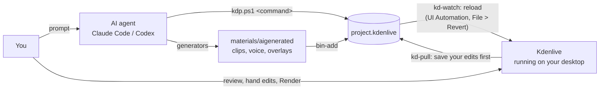

<div align="center">

# Movie Engine

**DI agentas montuoja tavo vaizdo įrašą Kdenlive tau matant, o tu bet kuriuo metu gali perimti darbą.**

DI programavimo agentai (Claude Code, Codex) kuria ir keičia tikrus Kdenlive projektus: filmus, aiškinamuosius vaizdo įrašus ir vertikalius trumpuosius vaizdo įrašus. Pakeitimai iškart atsiranda tavo atidarytame redaktoriuje. Perkeliama, Windows, be redaktoriaus pataisų.


[English](../../README.md) · [简体中文](README.zh-CN.md) · [繁體中文](README.zh-TW.md) · [हिन्दी](README.hi.md) · [Español](README.es.md) · [Français](README.fr.md) · [العربية](README.ar.md) · [বাংলা](README.bn.md) · [Português](README.pt.md) · [Русский](README.ru.md) · [اردو](README.ur.md) · [Bahasa Indonesia](README.id.md) · [Deutsch](README.de.md) · [日本語](README.ja.md) · [Türkçe](README.tr.md) · [한국어](README.ko.md) · [Українська](README.uk.md) · [Italiano](README.it.md) · [Polski](README.pl.md) · [Tiếng Việt](README.vi.md) · [فارسی](README.fa.md) · [ไทย](README.th.md) · [Kiswahili](README.sw.md) · [አማርኛ](README.am.md) · [Avañe'ẽ](README.gn.md) · [Setswana](README.tn.md) · [Shqip](README.sq.md) · [Беларуская](README.be.md) · [Български](README.bg.md) · [Bosanski](README.bs.md) · [Hrvatski](README.hr.md) · [Српски](README.sr.md) · [Crnogorski](README.cnr.md) · [Македонски](README.mk.md) · [Slovenščina](README.sl.md) · [Slovenčina](README.sk.md) · [Čeština](README.cs.md) · [Magyar](README.hu.md) · [Română](README.ro.md) · [Dansk](README.da.md) · [Norsk bokmål](README.nb.md) · [Norsk nynorsk](README.nn.md) · [Svenska](README.sv.md) · [Íslenska](README.is.md) · [Suomi](README.fi.md) · [Eesti](README.et.md) · [Latviešu](README.lv.md) · **Lietuvių** · [Nederlands](README.nl.md) · [Lëtzebuergesch](README.lb.md) · [Rumantsch](README.rm.md) · [Ελληνικά](README.el.md) · [Malti](README.mt.md) · [Gaeilge](README.ga.md) · [Català](README.ca.md) · [ქართული](README.ka.md) · [Հայերեն](README.hy.md) · [Azərbaycanca](README.az.md) · [Afrikaans](README.af.md) · [isiZulu](README.zu.md) · [isiXhosa](README.xh.md) · [Sesotho](README.st.md) · [Sepedi](README.nso.md) · [Xitsonga](README.ts.md) · [Tshivenḓa](README.ve.md) · [siSwati](README.ss.md) · [isiNdebele (South Africa)](README.nr.md) · [isiNdebele (Zimbabwe)](README.nd.md) · [chiShona](README.sn.md) · [Chichewa](README.ny.md) · [Ikinyarwanda](README.rw.md) · [Ikirundi](README.rn.md) · [Malagasy](README.mg.md) · [Soomaali](README.so.md) · [Afaan Oromoo](README.om.md) · [Qafar af](README.aa.md) · [ትግርኛ](README.ti.md) · [Sängö](README.sg.md) · [Kreol Seselwa](README.crs.md) · [TjiKalanga](README.kck.md) · [ChiNdau](README.ndc.md)

*Tai vertimas. Pagrindine laikoma README versija anglų kalba.*

</div>

---

## Turinys

- [Kodėl](#kodėl)
- [Kaip tai veikia](#kaip-tai-veikia)
- [Galimybės](#galimybės)
- [Reikalavimai](#reikalavimai)
- [Diegimas](#diegimas)
- [Greita pradžia](#greita-pradžia)
- [Darbas su agentu](#darbas-su-agentu)
- [Montavimo komandų eilutė (`kdp.ps1`)](#montavimo-komandų-eilutė-kdpps1)
- [Gyvas sinchronizavimas su atidarytu redaktoriumi](#gyvas-sinchronizavimas-su-atidarytu-redaktoriumi)
- [Generatoriai: ko Kdenlive nemoka](#generatoriai-ko-kdenlive-nemoka)
- [Įgarsinimas ir garsas](#įgarsinimas-ir-garsas)
- [Sąsajos kalba](#sąsajos-kalba)
- [Aplankų struktūra](#aplankų-struktūra)
- [Testai ir įrodymai](#testai-ir-įrodymai)
- [Apribojimai](#apribojimai)
- [Trikčių šalinimas](#trikčių-šalinimas)
- [DUK](#duk)
- [Prisidėjimas](#prisidėjimas)
- [Padėkos](#padėkos)
- [Licencija](#licencija)

## Kodėl

Vaizdo redaktoriai sukurti rankai ant pelės. DI agentams gerai sekasi struktūra, laiko derinimas ir pasikartojantis darbas: sudėlioti 300 klipų pagal ritmą, kiekvieną subtitrą suderinti su balsu, perdaryti sceną pagal pastabas. Tačiau spustelėti grafinėje sąsajoje jie negali neužvaldę tavo darbalaukio.

Kdenlive yra galingas atvirojo kodo redaktorius, tačiau sistemoje Windows jis **neturi automatizavimo API**: valdymas per D-Bus yra tik Linux versijose, o atšakos (forkai), kurios jį prideda, yra arba neprižiūrimos, arba nesaugios. Movie Engine tai išsprendžia netaisydamas redaktoriaus:

1. Agentas keičia projekto failą `.kdenlive` per ištestuotą komandų eilutę (`engine/kdp.ps1`).
2. Veikiančiam Kdenlive per Windows UI Automation nurodoma iš naujo įkelti failą, be klavišų paspaudimų, be pelės ir be fokuso atėmimo.
3. Tavo neišsaugoti pakeitimai pirmiausia išsaugomi ir niekada neperrašomi.

Taigi agentas montuoja, o tu peržiūri arba taisai pats rankomis. Jūs abu dirbate su tuo pačiu projektu, tame pačiame redaktoriuje, tuo pačiu metu.

## Kaip tai veikia



Kiekviena montavimo komanda pereina tą patį saugų ciklą:

1. **Pull.** Jei Kdenlive turi neišsaugotų pakeitimų, jam nurodoma juos išsaugoti (įrankių juostos mygtukas Save per UI Automation), ir išsaugojimas patvirtinamas.
2. **Taisymas.** Komanda keičia XML užrakinusi failą, patikrinusi maišos reikšmę ir padariusi momentinę kopiją atšaukimui. Jei failas tuo metu pasikeitė, niekas neįrašoma.
3. **Įkėlimas iš naujo.** Stebėtojas pamato DI žymą ir atidarytame redaktoriuje įvykdo File > Revert. Sėkme laikoma tik tai, kad laiko juostos valdiklis iš tikrųjų buvo perstatytas.
4. **Konfliktas.** Jei tuo metu pradėjai taisyti pats, niekas neįkeliama iš naujo ir tavo darbas lieka. DI versija atidedama į šalį, o agentas iš naujo pritaiko savo pakeitimą ant tavųjų.

## Galimybės

- **Visavertis projekto montavimas be grafinės sąsajos**: apie 120 komandų, apimančių projekto saugyklą (bin), laiko juostą, efektus, kompozicijas, takelius, gaires, žymeklius, subtitrus, sekas, greitį ir laiko perskirstymą, skaidrių peržiūras, titrus, tarpinius failus (proxy), atvaizdavimą ir atšaukimą/pakartojimą. Žr. [komandų žinyną](#montavimo-komandų-eilutė-kdpps1).
- **Gyvas sinchronizavimas su atidarytu redaktoriumi.** DI pakeitimai atsiranda tame Kdenlive, į kurį žiūri; tavo neišsaugoti pakeitimai pirmiausia išsaugomi ir niekada neprarandami.
- **Niekada netrukdo tavo darbalaukiui.** Jokio fokuso atėmimo, klavišų paspaudimų ar pelės judesių. Bandomieji redaktoriai veikia nematomame Windows darbalaukyje.
- **Perkeliama.** Redaktorius, nustatymai, Node.js, šriftai ir įrankiai yra viename aplanke. Nukopijuok jį į kitą kompiuterį ir viskas veiks; niekas neįrašoma į Program Files ar tavo Windows profilį.
- **Generatoriai tam, ko Kdenlive nemoka**: kinetinis tekstas su animacija raidė po raidės, ranka piešti užrašai, 3D sąsajos scenos, žymeklio animacijos ir ilgi interaktyvūs aiškinamieji filmai. Jie atvaizduojami GPU su tikru judesio suliejimu ir dedami į laiko juostą kaip įprasti klipai.
- **Įgarsinimas su žodžių laiko žymomis** (Microsoft Edge TTS, be API rakto). Subtitrai ir veiksmai suveikia tiksliai ties reikiamu žodžiu.
- **Sintezuoti garso efektai** (whoosh, click, pop, riser, impact ir kiti), sukurti kodu.
- **Įrodyta, o ne numanoma.** Kiekviena komanda turi rezultato patikrą, efektai ir kompozicijos patikrinti po vieną, o neapdoroti rezultatai yra aplanke `docs/proof/`.
- **Instrukcijos agentams pridedamos.** `AGENTS.md` ir įgūdžiai aplanke `.claude/skills/` išmoko Claude Code ir Codex darbo eigos, failo formato ir spąstų.

## Reikalavimai

| | |
|---|---|
| OS | Windows 10 arba 11, x64 |
| Redaktorius | Kdenlive **26.08.3** perkeliama (standalone) versija. Kitos versijos neišbandytos. |
| Node.js | 18 ar naujesnė: Windows x64 `.zip` iš nodejs.org, išskleistas į `engine/node/` |
| Naršyklė | Microsoft Edge (Windows dalis); scenų atvaizdavimo įrankiai ją naudoja be grafinės sąsajos (headless) |
| Agentas | [Claude Code](https://claude.com/claude-code) arba Codex. Neprivaloma: kiekvieną įrankį galima paleisti ir rankiniu būdu. |
| Diskas | apie 1 GB redaktoriui ir įrankiams, plius tavo medija |
| GPU | bet kuris GPU su aparatiniu H.264 kodavimu pagreitina `film-render.mjs` (be jo naudojamas programinis kodavimas) |

## Diegimas

Viskas diegiama **aplanko viduje**. Administratoriaus teisių nereikia.

```powershell
git clone https://github.com/vladtarrow/movie-engine.git
cd movie-engine
```

**1. Node.js.** Atsisiųsk Node.js 18 ar naujesnės versijos Windows x64 `.zip` iš <https://nodejs.org/en/download> ir išskleisk jo turinį į `engine\node\`, kad ten būtų `engine\node\node.exe` ir `engine\node\npm.cmd`. Nereikia nei diegimo programos, nei sisteminio Node. Visi scenarijai paleidžiami per `engine\node.cmd`, niekada ne per sisteminį Node.

**2. Node paketai** įgarsinimo įrankiui ir atvaizdavimo įrankiams (versijos užfiksuotos `engine/voice/package.json`):

```powershell
engine\node\npm.cmd install --prefix engine\voice
```

**3. Perkeliamas Kdenlive 26.08.3.** Atsisiųsk `kdenlive-26.08.3_standalone.exe` iš <https://download.kde.org/stable/kdenlive/26.08/windows/> į `engine\installer\`, patikrink jį ir išskleisk:

```powershell
(Get-FileHash engine\installer\kdenlive-26.08.3_standalone.exe -Algorithm SHA256).Hash
# expected: A25427B1DFF2C17E3B0386E991BB1A719382BB3176D1A90E441CDAEB6E0A967D
engine\installer\kdenlive-26.08.3_standalone.exe -o"engine\Kdenlive" -y
```

Redaktorius atsiduria `engine\Kdenlive\kdenlive-26.08.3_standalone\bin\`. Jame jau yra `melt.exe` ir `ffmpeg.exe`.

**4. Pirmasis paleidimas.**

```powershell
engine\kdenlive.cmd
```

Kdenlive visus savo nustatymus laiko `engine\profile-kdenlive\`, o ne tavo Windows profilyje. Pirmą kartą paleistas jis vieną kartą parodo sąrankos vedlį.

## Greita pradžia

### Su agentu

Atidaryk aplanką Claude Code (arba Codex) ir paprašyk paprastais žodžiais:

> Sukurk naują vertikalų 30 fps projektą „launch-teaser“. Sudėk į laiko juostą tris ekrano kopijas iš `materials/designers/launch/`, kiekvieną po 2,5 s su trumpu perėjimu, pridėk įgarsinimą iš `script.txt` ir prie kiekvienos eilutės priderink kinetinį užrašą.

> Atidaryk jį man Kdenlive.

> Antrasis kadras per ilgas. Sutrumpink jį iki 1,8 s ir pakelk logotipą šiek tiek aukščiau.

Agentas laikosi `AGENTS.md`: jis taiso per `kdp.ps1`, atvaizduoja tik tuos klipus, kurių reikia montažui, ir palaiko atidarytą redaktorių atnaujintą. Tu peržiūri rezultatą Kdenlive, taisai rankomis kada tik nori ir paspaudi Render, kai esi patenkintas.

### Rankiniu būdu

```powershell
# a new 1080x1920 30 fps project with 2 video and 2 audio tracks
powershell -NoProfile -ExecutionPolicy Bypass -File engine\kdp.ps1 new -Project projects\hello\hello.kdenlive -Profile vertical_hd_30

# a 3-second title and a colour background
powershell -NoProfile -ExecutionPolicy Bypass -File engine\kdp.ps1 bin-color -Project projects\hello\hello.kdenlive -Color '#203060' -Seconds 3 -Name bg
powershell -NoProfile -ExecutionPolicy Bypass -File engine\kdp.ps1 title -Project projects\hello\hello.kdenlive -Text "Hello" -Seconds 3 -Name hi

# place them: background on V1, title above it on V2
powershell -NoProfile -ExecutionPolicy Bypass -File engine\kdp.ps1 add -Project projects\hello\hello.kdenlive -Bin bg -Track V1 -At 0
powershell -NoProfile -ExecutionPolicy Bypass -File engine\kdp.ps1 add -Project projects\hello\hello.kdenlive -Bin hi -Track V2 -At 0

# a check frame, then open it in the editor
powershell -NoProfile -ExecutionPolicy Bypass -File engine\kdp.ps1 frame -Project projects\hello\hello.kdenlive -At 1.5 -Out out\hello\check.png
engine\kdenlive.cmd projects\hello\hello.kdenlive
```

Norėdamas vėliau vėl atidaryti paskutinį projektą, dukart spustelėk `open-last-project.cmd`.

## Darbas su agentu

Agentas skaito `AGENTS.md` (Codex) arba `CLAUDE.md`, kuris jį importuoja (Claude Code), taip pat du įgūdžius:

| Įgūdis | Ko moko |
|---|---|
| `.claude/skills/kdenlive-project-file` | formato `.kdenlive` / MLT XML, `kdp.ps1`, tikrinimo su `melt` |
| `.claude/skills/kdenlive-live` | saugaus veikiančio redaktoriaus valdymo: paleidimo, pull, įkėlimo iš naujo, jo lango užfiksavimo |

Taisyklės, kurių laikosi agentas ir kuriomis gali pasikliauti:

- Jis niekada neperima tavo pelės, klaviatūros ar fokuso ir niekada nedaro tavo darbalaukio ekrano kopijų (tik paties redaktoriaus lango).
- Grafinės sąsajos veiksmus (išsaugojimą, atidarymą, įkėlimą iš naujo) jis atlieka pats, užuot prašęs tavęs spustelėti.
- Jis klausia prieš ką nors atsisiųsdamas ir prieš ką nors ištrindamas.
- Jis atvaizduoja tik tai, ko reikia darbui (scenų klipus, patikros kadrus). Galutinį filmą jis atvaizduoja tik tada, kai paprašai.
- Kai Kdenlive ko nors nesugeba padaryti gerai, agentas tai sukuria išorėje kodu ir įdeda rezultatą kaip klipą. Jis nesupaprastina efekto.

## Montavimo komandų eilutė (`kdp.ps1`)

```powershell
powershell -NoProfile -ExecutionPolicy Bypass -File engine\kdp.ps1 <command> -Project <file.kdenlive> [options]
```

Laikas nurodomas sekundėmis, su tašku (`2.5`). Takeliai yra `V1 V2 …` (V1 apatinis) ir `A1 A2 …`. Į klipą nurodoma per `-Track` ir bet kurį jo viduje esantį laiko momentą `-At`. Efektų parametrai perduodami kaip `-Params "name=value||name=value"`. Visas sąrašas su visomis parinktimis yra `engine/kdp.ps1` antraštėje.

| Grupė | Komandos |
|---|---|
| Projektas | `new`, `profiles`, `info`, `validate`, `fonts`, `profile-set`, `profile-from-clip`, `zone`, `archive`, `backups`, `rebase`, `otio-export`, `otio-import` |
| Projekto saugykla (bin) | `bin-add`, `bin-color`, `title`, `title-text`, `title-save`, `title-template`, `bin-rename`, `bin-remove`, `bin-info`, `bin-set`, `bin-duplicate`, `bin-replace-file`, `bin-reload`, `folder`, `bin-folder`, `relink`, `clean`, `generator`, `playlist-clip`, `extract-audio`, `transcode` |
| Laiko juosta | `add`, `add-av`, `move`, `copy`, `trim`, `ripple-trim`, `slip`, `split`, `remove`, `speed`, `remap`, `disable`, `enable`, `group`, `ungroup`, `mix`, `unmix`, `space-insert`, `space-remove`, `spaces-remove-all`, `track-clear`, `replace-in-timeline` |
| Efektai | `effects`, `effect-info`, `effect-add`, `effect-list`, `effect-set`, `effect-remove`, `effect-copy`, `effect-clear`, `effects-all`, `bin-effect`, `effect-templates`, `effect-template` |
| Kompozicijos | `compositions`, `comp-info`, `comp-add`, `comp-list`, `comp-set`, `comp-remove` |
| Takeliai | `track-add`, `track-remove`, `track-set` |
| Gairės ir žymekliai | `guide-add`, `guide-list`, `guide-remove`, `guide-set`, `guide-clear`, `guide-export`, `guide-category`, `marker`, `marker-list`, `marker-set`, `marker-remove` |
| Subtitrai | `sub-add`, `sub-import`, `sub-export`, `sub-state` |
| Sekos | `sequence-add`, `sequences`, `copy-to-sequence`, `expand`; bet kuri komanda su `-Sequence <name>` veikia tos sekos viduje |
| Specialiosios | `slideshow`, Lottie / Glaxnimate animacijos per `bin-add`, `proxy`, `stabilize`, `scene-split`, `speed-job`, `subclip` |
| Išvestis | `frame` (vienas PNG), `preview` (greitas atvaizdavimas su melt), `render` (paties Kdenlive atvaizdavimo įrankis arba šablonas), `presets` |
| Istorija | `undo`, `redo`, `clear-history` (momentinės kopijos `projects/<name>/.kdp-history`) |

Elgsena, kurią verta žinoti:

- Susietos garso ir vaizdo pusės perkeliamos, apkarpomos, skaidomos ir šalinamos kartu (`-Alone` vienai pusei).
- Nepavykusi komanda baigiasi kodu 1 ir nieko neįrašo.
- Efektai, kurių Windows versija negali vykdyti, atmetami, o ne tyliai ignoruojami (sąrašas: `docs/proof/assets.txt`).
- Kiekvienas Kdenlive meniu veiksmas faile `engine/tools/data/kdenlive-actions.csv` susietas su komanda, kitu keliu arba žyma „tik peržiūrai“. Žr. `docs/kdenlive-coverage.md`.

## Gyvas sinchronizavimas su atidarytu redaktoriumi

| Scenarijus | Ką daro | Išėjimo kodai |
|---|---|---|
| `engine\kd-pull.ps1 -Project <f>` | priverčia Kdenlive išsaugoti tavo pakeitimus ir tai patvirtina | 0 failas aktualus, 3 neveikia, 4 nepatvirtinta |
| `engine\kd-reload.ps1 -Project <f>` | File > Revert, patvirtinama perstatyta laiko juosta | 0 patvirtinta, 2 turi neišsaugotų pakeitimų (niekas neatmesta), 3 neveikia, 4 nepavyko |
| `engine\kd-watch.ps1 -Project <f>` | foninis stebėtojas: įkelia iš naujo po kiekvieno DI įrašo, registruoja konfliktus žurnale | žurnalas `engine\kd-watch.log`; norėdamas sustabdyti, ištrink `engine\kd-watch.run` |
| `engine\kdenlive-bg.ps1 [project]` | paleidžia Kdenlive sumažintą agentui | 0 įkelta, 4 nepatvirtinta |
| `engine\kdenlive.cmd [project]` | paleidžia Kdenlive tau | |

Paleisk stebėtoją vieną kartą per seansą:

```powershell
Start-Process powershell -WindowStyle Hidden -ArgumentList '-NoProfile','-ExecutionPolicy','Bypass','-File','engine\kd-watch.ps1','-Project','projects\hello\hello.kdenlive'
```

Dideli projektai: 1000 klipų projekto įkėlimas iš naujo trunka kelias minutes, ir įrankiai jo palaukia, užuot pranešę per anksti. Projektai atidaromi tuščiame redaktoriuje per *File > Open Recent*, nes atidarant failą tiesiogiai Qt prieinamumo funkcijoms apeina kiekvieną laiko juostos elementą, ir tai buvo maždaug 10 minučių lėčiau.

## Generatoriai: ko Kdenlive nemoka

Kdenlive/MLT neturi teksto animacijos raidė po raidės, neturi išraiškų (expressions) ir turi mažai 3D, o sunkūs efektai lėtina atkūrimą. Movie Engine tokias dalis atvaizduoja išorėje ir deda į laiko juostą kaip įprastus klipus, dažniausiai su alfa kanalu, takelyje virš vaizdų. Generatoriaus scenarijus ir jo įvesties duomenys lieka projekto aplanke, todėl klipą galima sugeneruoti iš naujo, kai pasikeičia tekstas, šriftas ar laiko derinimas.

| Įrankis | Ką kuria |
|---|---|
| `engine/tools/kinetic-text.ps1` | kinetinius užrašus su animacija raidė po raidės, kiekvienas žodis suderintas pagal `voice.json`, paryškinimo rėmelis |
| `engine/tools/annotate.ps1` | ranka pieštus apskritimus, rėmelius, pabraukimus ir rodykles, kurie išsipiešia ant ekrano kopijos |
| `engine/tools/card-entrance.ps1` | ekrano kopijos kortelę, kuri pakyla ir padidėja su švelniu šešėliu |
| `engine/tools/pdf-to-png.ps1` | skaidres iš PDF eksporto |
| `engine/tools/html-render.mjs` | bet kurią HTML/CSS/canvas sceną į vaizdo įrašą: sąsajos animaciją, žymeklius, 3D, kaukes |
| `engine/tools/film-render.mjs` + `film/` | ilgus, interaktyvius aiškinamuosius filmus ant canvas: vienas klipas kiekvienai įgarsinimo replikai, veiksmai suveikia ties ištartais žodžiais, GPU judesio suliejimas maždaug 45 kadrais per sekundę |

Abu atvaizdavimo įrankiai valdo kartu su Windows pateikiamą Microsoft Edge be grafinės sąsajos, su vienkartiniu profiliu ir be prieigos prie tinklo.

### Demonstracijos

```powershell
# a 3-second 3D title card with a cursor click
engine\node.cmd engine\tools\html-render.mjs examples\demo\scene\scene.html examples\demo\out --frames 0,30,60,89
engine\node.cmd engine\tools\html-render.mjs examples\demo\scene\scene.html examples\demo\out\scene.mp4

# a 4-shot interactive film timed to two voice lines
engine\node.cmd engine\tools\film-render.mjs examples\demo\film\film.html examples\demo\out --check
engine\node.cmd engine\tools\film-render.mjs examples\demo\film\film.html examples\demo\out --shots all --width 640
engine\node.cmd engine\tools\film-render.mjs examples\demo\film\film.html examples\demo\out\clips --suffix -v01
```

Filmą sudaro trys nedideli failai. `data.js` saugo kadrus ir žodžių laikus. `direction.js` turi po vieną eilutę kiekvienam kadrui:

```text
1 | hover 192 108 @brand | tag 300 60 Your brand @deserves | confetti 192 90 @film
2 say=A film that/*explains* it
3 | click 116 108 @before | click 268 108 @after | chips Before~After @after
4 scene=counter | count 0 120 % @count
```

`scenes.js` saugo kadrus, kurie piešiami nuo nulio. `@word` paleidžia veiksmą, kai balsas ištaria tą žodį. Tarp veiksmų yra click, hover, drag, zoom, lens, ring, arrow, chips, toggle, slider, toast, type, count ir confetti; visa sintaksė yra `engine/tools/film/film-kit.js` pradžioje.

## Įgarsinimas ir garsas

```powershell
engine\node.cmd engine\voice\voice.mjs lines.json materials\aigenerated\hello\voice en-US-AndrewMultilingualNeural +0%
```

`lines.json` yra replikų sąrašas. Įrankis įrašo po vieną mp3 kiekvienai replikai ir failą `voice.json` su trukme bei kiekvieno žodžio pradžia ir pabaiga. Replikos saugomos podėlyje, todėl pakeitus vieną repliką iš naujo sugeneruojama tik ji. Naudojama Microsoft Edge internetinė kalbos sintezė per paketą `msedge-tts`: rakto nereikia, tačiau paslauga yra neoficiali ir reikalauja interneto ryšio.

```powershell
engine\node.cmd engine\audio\sfx.mjs materials\aigenerated\sfx
```

Ši komanda kodu sintezuoja whoosh, whoosh-long, swipe, click, pop, tick, riser, impact, ding ir reveal; paruoštas rinkinys yra `materials/aigenerated/sfx/`. Garsus, trumpesnius nei vienas kadras, prieš dėdamas papildyk tyla (`-af apad=whole_dur=0.0667`).

## Sąsajos kalba

Paleidikliai pagal numatytuosius nustatymus paleidžia Kdenlive **anglų kalba**. Norėdamas naudoti kitą kalbą, prieš paleisdamas nustatyk `MOVIE_ENGINE_UI_LANG`:

```powershell
$env:MOVIE_ENGINE_UI_LANG = 'ru'; engine\kdenlive.cmd
```

UI Automation randa meniu elementus pagal jų matomus pavadinimus. Pavadinimai 31 sąsajos kalbai jau įtaisyti (`engine/tools/kd-ui.ps1`, `$KdNames`). Bet kuriai kitai kalbai pridėk ten jos pavadinimus ir patikrink su:

```powershell
powershell -NoProfile -ExecutionPolicy Bypass -File engine\tools\kd-langcheck.ps1
```

## Aplankų struktūra

```text
movie-engine/
├─ AGENTS.md, CLAUDE.md          instructions for AI agents
├─ .claude/skills/               agent skills: project file format, live editor
├─ engine/
│  ├─ kdp.ps1                    the editing command line
│  ├─ kd-pull / kd-reload / kd-watch .ps1, kdenlive.cmd, kdenlive-bg.ps1
│  ├─ tools/                     internals, generators, tests, data (action map)
│  ├─ voice/  audio/  fonts/     TTS, synthesized SFX, Poppins (OFL)
│  ├─ Kdenlive/  node/           portable editor and Node.js (not in git)
│  └─ profile-kdenlive/          the editor's settings (not in git)
├─ projects/<name>/<name>.kdenlive
├─ materials/
│  ├─ download/                  stock and downloaded files (not in git)
│  ├─ aigenerated/               everything the AI made (sfx/ and test-kit/ ship with the engine)
│  ├─ designers/  brand/         files from your team, brand assets
├─ examples/demo/                demos of the scene and film renderers
├─ out/                          renders (not in git)
└─ docs/                         proofs, coverage, translations of this README
```

Medijos keliai projektuose yra santykiniai. Jei perkeli ar nukopijuoji aplanką, `kdp.ps1 rebase` (jį automatiškai paleidžia ir `kdenlive.cmd`) įrašo į projektą naują vietą.

## Testai ir įrodymai

Teiginiai apie tai, kas veikia, pagrįsti rezultatų patikromis, o ne tuo, kad „funkcija įvykdyta“. Santrauka yra [`docs/kdenlive-proof.md`](../../docs/kdenlive-proof.md), o neapdorota išvestis yra `docs/proof/`.

| Testas | Ką tikrina |
|---|---|
| `engine\tools\kdp-clitest.ps1` | kiekvieną `kdp.ps1` komandą per komandų eilutę, lygindamas gautą projektą |
| `engine\tools\kd-livetest.ps1` | pull, įkėlimą iš naujo, stebėtoją, konfliktus ir lenktynių sąlygas su tikru Kdenlive nematomame darbalaukyje |
| `engine\tools\kdp-assetsweep.ps1` | kiekvieną efektą ir kompoziciją: atvaizduoja ir lygina kadrus |
| `engine\tools\kdp-portabletest.ps1` | nukopijuoja aplanką kitur ir dirba iš kopijos |
| `engine\tools\kd-langcheck.ps1` | sąsajos kalbą ir tai, kad UI Automation randa meniu |
| `engine\tools\kdp-coverage-check.ps1` | kad kiekvienas meniu veiksmas susietas ir joks įrodymas nėra senesnis už kodą |

```powershell
powershell -NoProfile -ExecutionPolicy Bypass -File engine\tools\kdp-clitest.ps1 -Report docs\proof\clitest.txt
powershell -NoProfile -ExecutionPolicy Bypass -File engine\tools\kd-livetest.ps1 -Report docs\proof\live-en.txt
```

Bandomieji redaktoriai veikia tik paslėptame darbalaukyje su savo profiliu, todėl testai niekada neliečia tavo atidaryto Kdenlive ir tavo fokuso.

## Apribojimai

- **Tik Windows**, tik Kdenlive **26.08.3**. Linux turi D-Bus, ir ten reikėtų kitokio tilto.
- Paleidžiant redaktorių, jis maždaug 3 sekundėms paima klaviatūros fokusą, kol pasirodo tuščias langas. Agentai paklausia prieš jį paleisdami, kai tu dirbi. Įkėlimai iš naujo ir pakeitimai fokuso neatima.
- Windows versijoje nėra MLT modulių sox, ladspa ir movit bei kai kurių frei0r/avfilter efektų; `kdp.ps1` juos atmeta (`docs/proof/assets.txt`).
- OpenTimelineIO eksportas ir importas perkelia tik klipus ir tarpus. Kelių kamerų montaže nėra gyvo kampų perjungimo (kirpimai daromi su split/remove/hide).
- „Save As…“ per UI Automation sumažintame lange neatidaro dialogo; agentas vietoj to naudoja `archive` arba failų kopijas.
- Kalbos atpažinimui (automatiniams subtitrams) reikia Whisper arba Vosk, kurie nepridedami.
- Kdenlive titrų įrankiu sukurti titrai naudoja Windows įdiegtus šriftus. Garantuotai tipografijai atvaizduok tekstą generatoriais, kurie įkelia šriftus iš `engine/fonts/`.
- Edge TTS yra neoficiali internetinė paslauga, ji gali pasikeisti arba nustoti veikti.

## Trikčių šalinimas

| Požymis | Priežastis ir sprendimas |
|---|---|
| Kdenlive veikia, bet jį spustelėjus užduočių juostoje nieko nerodoma | Jo išsaugota lango padėtis yra už ekrano ribų. Uždaryk jį ir ištrink `kdockLayout` įrašus faile `engine\profile-kdenlive\AppData\Local\kdenliverc` arba perkelk langą su `SetWindowPos` (žr. `AGENTS.md`). |
| `kd-reload.ps1` baigiasi kodu 2 | Turi neišsaugotų pakeitimų. Niekas neatmesta. Paleisk `kd-pull.ps1`, tada pritaikyk pakeitimą dar kartą (`kdp.ps1` tai daro pats). |
| `CONFLICT` faile `engine\kd-watch.log` | Tu ir agentas taisėte tuo pačiu metu. Tavo versija lieka redaktoriuje, o DI versija yra `projects\<name>\.kdp-history\<name>\conflict\`. Paprašyk agento dar kartą pritaikyti savo pakeitimą. |
| Komanda baigiasi kodu 1 su pranešimu „pull not confirmed“ | Kdenlive užimtas arba rodo dialogą. Uždaryk dialogą arba palauk, kol baigsis įkėlimas, tada pakartok. |
| PowerShell scenarijaus nepavyksta išanalizuoti | Scenarijai su ne ASCII tekstu Windows PowerShell 5.1 turi būti išsaugoti UTF-8 **su BOM**. |
| `voice.mjs` sustoja su „Stream closed before the synthesis completed“ | Dažniausiai tinklo problema arba neekranuotas SSML senesnėse kopijose. `voice.mjs` pats ekranuoja `& < >`. |
| Didelio projekto atidarymas trunka daug minučių | Atidaryk jį per `kdenlive.cmd` / `kdenlive-bg.ps1`, niekada ne kaip `kdenlive.exe project.kdenlive`. |

## DUK

**Ar man reikia Claude Code ar Codex?**
Ne. Kiekvienas įrankis yra paprastas scenarijus, kurį gali paleisti rankiniu būdu. Agentas padaro darbą greitą: jis suplanuoja montažą, paleidžia įrankius ir palaiko redaktorių atnaujintą.

**Ar agentas perrašys mano rankinius pakeitimus?**
Ne. Prieš bet kokį įrašymą tavo neišsaugoti pakeitimai išsaugomi ir tai patvirtinama. Jei taisai, kol agentas rašo, įrašymas atmetamas arba atidedamas kaip konfliktas, bet niekada nepritaikomas ant tavo darbo.

**Ar galiu toliau įprastai naudotis Kdenlive?**
Taip. Tai standartinis Kdenlive su savo nustatymų aplanku. Montuok, peržiūrėk ir atvaizduok kaip įprastai.

**Ar tai veikia su jau mano įdiegtu Kdenlive?**
Naudojama sava perkeliama kopija `engine\Kdenlive\`, todėl tavo įdiegtas Kdenlive ir jo nustatymai lieka nepaliesti.

**Kodėl ne Kdenlive atšaka su API ar kitas redaktorius?**
Sistemoje Windows nėra nė vienos prižiūrimos ir saugios atšakos (2026 m. lapkričio apžvalga). Buvo įvertinti OpenShot, Blender VSE, DaVinci Resolve, Shotcut ir žiniatinklio redaktoriai; Kdenlive suteikė giliausias montavimo galimybes. Pagrindinio projekto REST API pasiūlymas (merge request !902) stebimas.

**Ar jis gali atvaizduoti galutinį vaizdo įrašą?**
Taip, su `kdp.ps1 render` (paties Kdenlive atvaizdavimo įrankis, paslėptai), arba pats paspaudi Render redaktoriuje.

**Ar mano medija kur nors įkeliama?**
Ne. Generuojant balsą, Edge TTS paslaugai siunčiamas tik įgarsinimo tekstas. Scenų atvaizdavimo įrankiai veikia išjungus tinklą.

## Prisidėjimas

Indėliai laukiami. Žr. [CONTRIBUTING.md](../../CONTRIBUTING.md). Trumpai:

- Kiekvienai naujai ar pakeistai `kdp.ps1` operacijai reikia rezultato patikros `kdp-clitest.ps1`, įrašo veiksmų žemėlapyje ir naujo `kdp-coverage-check.ps1` paleidimo.
- Niekada nepaleisk bandomojo Kdenlive matomame darbalaukyje; naudok `engine/tools/kd-hidden.ps1`.
- Viską laikyk perkeliama: jokių diegimų už aplanko ribų, jokių absoliučių kelių projektuose.
- Patikrintas keistenybes užrašyk `AGENTS.md` arba atitinkamame įgūdyje.

## Padėkos

- [Kdenlive](https://kdenlive.org) ir [MLT](https://www.mltframework.org): redaktorius ir po juo veikiantis variklis.
- [FFmpeg](https://ffmpeg.org), pateikiamas kartu su Kdenlive.
- [msedge-tts](https://www.npmjs.com/package/msedge-tts) įgarsinimui.
- [Poppins](https://fonts.google.com/specimen/Poppins), sukūrė Indian Type Foundry, SIL Open Font License (`engine/fonts/OFL.txt`).
- `engine/tools/data/kdenliveui-26.08.3.rc`: Kdenlive meniu failas, paimtas iš Kdenlive 26.08.3 išeitinio kodo; jį naudoja tik aprėpties patikra. Jam ir toliau taikoma Kdenlive GPL licencija, o ne MIT License.

## Licencija

Paties Movie Engine kodas išleistas pagal [MIT licenciją](../../LICENSE). Kdenlive, MLT, FFmpeg, Node.js paketai ir šriftas Poppins turi savo licencijas.
