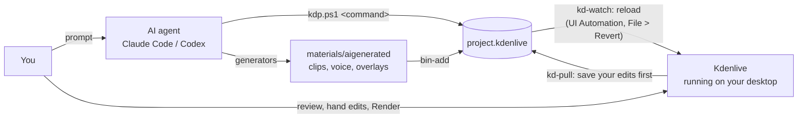

<div align="center">

# Movie Engine

**MI aģents montē tavu video programmā Kdenlive tev acu priekšā, un tu jebkurā brīdī vari pārņemt darbu.**

MI programmēšanas aģenti (Claude Code, Codex) veido un maina īstus Kdenlive projektus: filmas, skaidrojošus video un vertikālus īsvideo. Izmaiņas uzreiz parādās tavā atvērtajā redaktorā. Pārnēsājams, Windows, bez redaktora ielāpiem.


[English](../../README.md) · [简体中文](README.zh-CN.md) · [繁體中文](README.zh-TW.md) · [हिन्दी](README.hi.md) · [Español](README.es.md) · [Français](README.fr.md) · [العربية](README.ar.md) · [বাংলা](README.bn.md) · [Português](README.pt.md) · [Русский](README.ru.md) · [اردو](README.ur.md) · [Bahasa Indonesia](README.id.md) · [Deutsch](README.de.md) · [日本語](README.ja.md) · [Türkçe](README.tr.md) · [한국어](README.ko.md) · [Українська](README.uk.md) · [Italiano](README.it.md) · [Polski](README.pl.md) · [Tiếng Việt](README.vi.md) · [فارسی](README.fa.md) · [ไทย](README.th.md) · [Kiswahili](README.sw.md) · [አማርኛ](README.am.md) · [Avañe'ẽ](README.gn.md) · [Setswana](README.tn.md) · [Shqip](README.sq.md) · [Беларуская](README.be.md) · [Български](README.bg.md) · [Bosanski](README.bs.md) · [Hrvatski](README.hr.md) · [Српски](README.sr.md) · [Crnogorski](README.cnr.md) · [Македонски](README.mk.md) · [Slovenščina](README.sl.md) · [Slovenčina](README.sk.md) · [Čeština](README.cs.md) · [Magyar](README.hu.md) · [Română](README.ro.md) · [Dansk](README.da.md) · [Norsk bokmål](README.nb.md) · [Norsk nynorsk](README.nn.md) · [Svenska](README.sv.md) · [Íslenska](README.is.md) · [Suomi](README.fi.md) · [Eesti](README.et.md) · **Latviešu** · [Lietuvių](README.lt.md) · [Nederlands](README.nl.md) · [Lëtzebuergesch](README.lb.md) · [Rumantsch](README.rm.md) · [Ελληνικά](README.el.md) · [Malti](README.mt.md) · [Gaeilge](README.ga.md) · [Català](README.ca.md) · [ქართული](README.ka.md) · [Հայերեն](README.hy.md) · [Azərbaycanca](README.az.md) · [Afrikaans](README.af.md) · [isiZulu](README.zu.md) · [isiXhosa](README.xh.md) · [Sesotho](README.st.md) · [Sepedi](README.nso.md) · [Xitsonga](README.ts.md) · [Tshivenḓa](README.ve.md) · [siSwati](README.ss.md) · [isiNdebele (South Africa)](README.nr.md) · [isiNdebele (Zimbabwe)](README.nd.md) · [chiShona](README.sn.md) · [Chichewa](README.ny.md) · [Ikinyarwanda](README.rw.md) · [Ikirundi](README.rn.md) · [Malagasy](README.mg.md) · [Soomaali](README.so.md) · [Afaan Oromoo](README.om.md) · [Qafar af](README.aa.md) · [ትግርኛ](README.ti.md) · [Sängö](README.sg.md) · [Kreol Seselwa](README.crs.md) · [TjiKalanga](README.kck.md) · [ChiNdau](README.ndc.md)

*Šis ir tulkojums. Par pamatversiju uzskatāms README angļu valodā.*

</div>

---

## Saturs

- [Kāpēc](#kāpēc)
- [Kā tas darbojas](#kā-tas-darbojas)
- [Iespējas](#iespējas)
- [Prasības](#prasības)
- [Instalēšana](#instalēšana)
- [Ātrais sākums](#ātrais-sākums)
- [Darbs ar aģentu](#darbs-ar-aģentu)
- [Montāžas komandrinda (`kdp.ps1`)](#montāžas-komandrinda-kdpps1)
- [Sinhronizācija reāllaikā ar atvērto redaktoru](#sinhronizācija-reāllaikā-ar-atvērto-redaktoru)
- [Ģeneratori: ko Kdenlive neprot](#ģeneratori-ko-kdenlive-neprot)
- [Ierunāšana un skaņa](#ierunāšana-un-skaņa)
- [Saskarnes valoda](#saskarnes-valoda)
- [Mapju struktūra](#mapju-struktūra)
- [Testi un pierādījumi](#testi-un-pierādījumi)
- [Ierobežojumi](#ierobežojumi)
- [Problēmu novēršana](#problēmu-novēršana)
- [BUJ](#buj)
- [Līdzdalība](#līdzdalība)
- [Pateicības](#pateicības)
- [Licence](#licence)

## Kāpēc

Video redaktori ir veidoti rokai uz peles. MI aģenti labi tiek galā ar struktūru, laika noteikšanu un atkārtotu darbu: izvietot 300 klipus pēc ritma, piesaistīt katru subtitru balsij, pārtaisīt ainu pēc atsauksmēm. Taču klikšķināt pa grafisko saskarni tie nevar, nepārņemot tavu darbvirsmu.

Kdenlive ir spēcīgs atvērtā pirmkoda redaktors, taču operētājsistēmā Windows tam **nav automatizācijas API**: vadība caur D-Bus pastāv tikai Linux būvējumos, bet atzari (forki), kas to pievieno, ir vai nu neuzturēti, vai nedroši. Movie Engine to atrisina, nelāpot redaktoru:

1. Aģents maina projekta failu `.kdenlive` ar pārbaudītas komandrindas palīdzību (`engine/kdp.ps1`).
2. Strādājošajam Kdenlive caur Windows UI Automation tiek likts failu ielādēt no jauna, bez taustiņu nospiešanas, bez peles un bez fokusa atņemšanas.
3. Tavas nesaglabātās izmaiņas vispirms tiek saglabātas un nekad netiek pārrakstītas.

Tātad aģents montē, bet tu pārskati vai labo pats ar roku. Jūs abi strādājat pie viena projekta, vienā redaktorā, vienlaikus.

## Kā tas darbojas



Katra montāžas komanda iziet vienu un to pašu drošo ciklu:

1. **Pull.** Ja Kdenlive ir nesaglabātas izmaiņas, tam tiek likts tās saglabāt (rīkjoslas poga Save caur UI Automation), un saglabāšana tiek apstiprināta.
2. **Labošana.** Komanda maina XML zem slēdzenes, pēc jaucējkoda pārbaudes un ar momentuzņēmumu atsaukšanai. Ja fails pa to laiku ir mainījies, nekas netiek ierakstīts.
3. **Pārielāde.** Novērotājs pamana MI zīmogu un atvērtajā redaktorā izpilda File > Revert. Par veiksmi tiek uzskatīts tikai tas, ka laika joslas logrīks tiešām ir pārbūvēts.
4. **Konflikts.** Ja tu pa to laiku sāki labot, nekas netiek pārielādēts un tavs darbs paliek. MI versija tiek nolikta malā, un aģents no jauna piemēro savu izmaiņu virs tavējām.

## Iespējas

- **Pilnīga projekta montāža bez grafiskās saskarnes**: aptuveni 120 komandas, kas aptver projekta krātuvi (bin), laika joslu, efektus, kompozīcijas, celiņus, palīglīnijas, marķierus, subtitrus, sekvences, ātrumu un laika pārkartēšanu, slaidrādes, titrus, starpniekfailus (proxy), renderēšanu un atsaukšanu/atcelšanu. Skati [komandu uzziņu](#montāžas-komandrinda-kdpps1).
- **Sinhronizācija reāllaikā ar atvērto redaktoru.** MI izmaiņas parādās tajā Kdenlive, uz kuru tu skaties; tavas nesaglabātās izmaiņas vispirms tiek saglabātas un nekad nepazūd.
- **Nekad netraucē tavu darbvirsmu.** Nekādas fokusa atņemšanas, taustiņu nospiešanas vai peles kustību. Testa redaktori darbojas neredzamā Windows darbvirsmā.
- **Pārnēsājams.** Redaktors, iestatījumi, Node.js, fonti un rīki atrodas vienā mapē. Nokopē to uz citu datoru, un viss darbojas; nekas netiek ierakstīts mapē Program Files vai tavā Windows profilā.
- **Ģeneratori tam, ko Kdenlive neprot**: kinētisks teksts ar animāciju pa burtiem, ar roku zīmētas anotācijas, 3D saskarnes ainas, kursora animācijas un garas interaktīvas skaidrojošās filmas. Tās tiek renderētas uz GPU ar īstu kustības izplūdumu un novietotas laika joslā kā parasti klipi.
- **Ierunāšana ar vārdu laika atzīmēm** (Microsoft Edge TTS, bez API atslēgas). Subtitri un darbības nostrādā tieši uz vajadzīgā vārda.
- **Sintezēti skaņas efekti** (whoosh, click, pop, riser, impact un citi), radīti ar kodu.
- **Pierādīts, nevis pieņemts.** Katrai komandai ir rezultāta pārbaude, efekti un kompozīcijas ir pārbaudīti pa vienam, un neapstrādātie rezultāti atrodas mapē `docs/proof/`.
- **Aģentu instrukcijas komplektā.** `AGENTS.md` un prasmes mapē `.claude/skills/` iemāca Claude Code un Codex darba plūsmu, faila formātu un slazdus.

## Prasības

| | |
|---|---|
| OS | Windows 10 vai 11, x64 |
| Redaktors | Kdenlive **26.08.3** pārnēsājamais (standalone) būvējums. Citas versijas nav testētas. |
| Node.js | 18 vai jaunāka: Windows x64 `.zip` no nodejs.org, atarhivēts mapē `engine/node/` |
| Pārlūks | Microsoft Edge (daļa no Windows); ainu renderētāji to izmanto bezgalvas (headless) režīmā |
| Aģents | [Claude Code](https://claude.com/claude-code) vai Codex. Nav obligāts: katru rīku var palaist arī ar roku. |
| Disks | aptuveni 1 GB redaktoram un rīkiem, plus tavi mediji |
| GPU | jebkurš GPU ar aparatūras H.264 kodēšanu paātrina `film-render.mjs` (bez tā tiek izmantota programmatūras kodēšana) |

## Instalēšana

Viss tiek instalēts **mapes iekšpusē**. Administratora tiesības nav vajadzīgas.

```powershell
git clone https://github.com/vladtarrow/movie-engine.git
cd movie-engine
```

**1. Node.js.** Lejupielādē Node.js 18 vai jaunākas versijas Windows x64 `.zip` no <https://nodejs.org/en/download> un atarhivē tā saturu mapē `engine\node\`, lai tur būtu `engine\node\node.exe` un `engine\node\npm.cmd`. Ne instalētājs, ne sistēmas Node nav vajadzīgs. Visi skripti tiek palaisti caur `engine\node.cmd`, nekad ar sistēmas Node.

**2. Node pakotnes** ierunāšanas rīkam un renderētājiem (versijas ir fiksētas failā `engine/voice/package.json`):

```powershell
engine\node\npm.cmd install --prefix engine\voice
```

**3. Pārnēsājamais Kdenlive 26.08.3.** Lejupielādē `kdenlive-26.08.3_standalone.exe` no <https://download.kde.org/stable/kdenlive/26.08/windows/> mapē `engine\installer\`, pārbaudi to un atarhivē:

```powershell
(Get-FileHash engine\installer\kdenlive-26.08.3_standalone.exe -Algorithm SHA256).Hash
# expected: A25427B1DFF2C17E3B0386E991BB1A719382BB3176D1A90E441CDAEB6E0A967D
engine\installer\kdenlive-26.08.3_standalone.exe -o"engine\Kdenlive" -y
```

Redaktors nonāk mapē `engine\Kdenlive\kdenlive-26.08.3_standalone\bin\`. Tajā jau ir `melt.exe` un `ffmpeg.exe`.

**4. Pirmā palaišana.**

```powershell
engine\kdenlive.cmd
```

Kdenlive glabā visus savus iestatījumus mapē `engine\profile-kdenlive\`, nevis tavā Windows profilā. Pirmajā palaišanā tas vienreiz parāda iestatīšanas vedni.

## Ātrais sākums

### Ar aģentu

Atver mapi programmā Claude Code (vai Codex) un palūdz vienkāršiem vārdiem:

> Izveido jaunu vertikālu 30 fps projektu “launch-teaser”. Novieto laika joslā trīs ekrānuzņēmumus no `materials/designers/launch/`, katru pa 2,5 s ar īsu pāreju, pievieno ierunāšanu no `script.txt` un piesaisti katrai rindai kinētisku parakstu.

> Atver to man programmā Kdenlive.

> Otrais kadrs ir par garu. Saīsini to līdz 1,8 s un pacel logotipu mazliet augstāk.

Aģents ievēro `AGENTS.md`: tas labo caur `kdp.ps1`, renderē tikai tos klipus, kas vajadzīgi montāžai, un uztur atvērto redaktoru aktuālu. Tu pārskati rezultātu programmā Kdenlive, labo ar roku, kad vien vēlies, un nospied Render, kad esi apmierināts.

### Manuāli

```powershell
# a new 1080x1920 30 fps project with 2 video and 2 audio tracks
powershell -NoProfile -ExecutionPolicy Bypass -File engine\kdp.ps1 new -Project projects\hello\hello.kdenlive -Profile vertical_hd_30

# a 3-second title and a colour background
powershell -NoProfile -ExecutionPolicy Bypass -File engine\kdp.ps1 bin-color -Project projects\hello\hello.kdenlive -Color '#203060' -Seconds 3 -Name bg
powershell -NoProfile -ExecutionPolicy Bypass -File engine\kdp.ps1 title -Project projects\hello\hello.kdenlive -Text "Hello" -Seconds 3 -Name hi

# place them: background on V1, title above it on V2
powershell -NoProfile -ExecutionPolicy Bypass -File engine\kdp.ps1 add -Project projects\hello\hello.kdenlive -Bin bg -Track V1 -At 0
powershell -NoProfile -ExecutionPolicy Bypass -File engine\kdp.ps1 add -Project projects\hello\hello.kdenlive -Bin hi -Track V2 -At 0

# a check frame, then open it in the editor
powershell -NoProfile -ExecutionPolicy Bypass -File engine\kdp.ps1 frame -Project projects\hello\hello.kdenlive -At 1.5 -Out out\hello\check.png
engine\kdenlive.cmd projects\hello\hello.kdenlive
```

Lai vēlāk atkal atvērtu pēdējo projektu, veic dubultklikšķi uz `open-last-project.cmd`.

## Darbs ar aģentu

Aģents lasa `AGENTS.md` (Codex) vai `CLAUDE.md`, kas to importē (Claude Code), kā arī divas prasmes:

| Prasme | Ko māca |
|---|---|
| `.claude/skills/kdenlive-project-file` | formātu `.kdenlive` / MLT XML, `kdp.ps1`, pārbaudi ar `melt` |
| `.claude/skills/kdenlive-live` | drošu strādājošā redaktora vadību: palaišanu, pull, pārielādi, tā loga uzņemšanu |

Noteikumi, ko aģents ievēro un uz kuriem vari paļauties:

- Tas nekad neatņem tavu peli, tastatūru vai fokusu un nekad neuzņem tavas darbvirsmas ekrānattēlu (tikai paša redaktora logu).
- Grafiskās saskarnes darbības (saglabāšanu, atvēršanu, pārielādi) tas veic pats, nevis lūdz tev noklikšķināt.
- Tas jautā, pirms kaut ko lejupielādē un pirms kaut ko dzēš.
- Tas renderē tikai to, kas vajadzīgs darbam (ainu klipus, pārbaudes kadrus). Gatavo filmu tas renderē tikai tad, ja tu palūdz.
- Ja Kdenlive kaut ko nespēj izdarīt labi, aģents to izveido ārpusē ar kodu un ievieto rezultātu kā klipu. Tas nevienkāršo efektu.

## Montāžas komandrinda (`kdp.ps1`)

```powershell
powershell -NoProfile -ExecutionPolicy Bypass -File engine\kdp.ps1 <command> -Project <file.kdenlive> [options]
```

Laiks tiek norādīts sekundēs, ar punktu (`2.5`). Celiņi ir `V1 V2 …` (V1 ir apakšējais) un `A1 A2 …`. Uz klipu norāda ar `-Track` un jebkuru tā iekšienē esošu laika brīdi `-At`. Efektu parametrus nodod formā `-Params "name=value||name=value"`. Pilns saraksts ar visām opcijām ir faila `engine/kdp.ps1` galvenē.

| Grupa | Komandas |
|---|---|
| Projekts | `new`, `profiles`, `info`, `validate`, `fonts`, `profile-set`, `profile-from-clip`, `zone`, `archive`, `backups`, `rebase`, `otio-export`, `otio-import` |
| Projekta krātuve (bin) | `bin-add`, `bin-color`, `title`, `title-text`, `title-save`, `title-template`, `bin-rename`, `bin-remove`, `bin-info`, `bin-set`, `bin-duplicate`, `bin-replace-file`, `bin-reload`, `folder`, `bin-folder`, `relink`, `clean`, `generator`, `playlist-clip`, `extract-audio`, `transcode` |
| Laika josla | `add`, `add-av`, `move`, `copy`, `trim`, `ripple-trim`, `slip`, `split`, `remove`, `speed`, `remap`, `disable`, `enable`, `group`, `ungroup`, `mix`, `unmix`, `space-insert`, `space-remove`, `spaces-remove-all`, `track-clear`, `replace-in-timeline` |
| Efekti | `effects`, `effect-info`, `effect-add`, `effect-list`, `effect-set`, `effect-remove`, `effect-copy`, `effect-clear`, `effects-all`, `bin-effect`, `effect-templates`, `effect-template` |
| Kompozīcijas | `compositions`, `comp-info`, `comp-add`, `comp-list`, `comp-set`, `comp-remove` |
| Celiņi | `track-add`, `track-remove`, `track-set` |
| Palīglīnijas un marķieri | `guide-add`, `guide-list`, `guide-remove`, `guide-set`, `guide-clear`, `guide-export`, `guide-category`, `marker`, `marker-list`, `marker-set`, `marker-remove` |
| Subtitri | `sub-add`, `sub-import`, `sub-export`, `sub-state` |
| Sekvences | `sequence-add`, `sequences`, `copy-to-sequence`, `expand`; jebkura komanda ar `-Sequence <name>` darbojas šīs sekvences iekšienē |
| Īpašās | `slideshow`, Lottie / Glaxnimate animācijas caur `bin-add`, `proxy`, `stabilize`, `scene-split`, `speed-job`, `subclip` |
| Izvade | `frame` (viens PNG), `preview` (ātra renderēšana ar melt), `render` (paša Kdenlive renderētājs vai sagatave), `presets` |
| Vēsture | `undo`, `redo`, `clear-history` (momentuzņēmumi mapē `projects/<name>/.kdp-history`) |

Uzvedība, ko vērts zināt:

- Saistītās audio un video daļas tiek pārvietotas, apgrieztas, sadalītas un noņemtas kopā (`-Alone` vienai daļai).
- Neveiksmīga komanda beidzas ar kodu 1 un neko neieraksta.
- Efekti, ko Windows būvējums nespēj izpildīt, tiek noraidīti, nevis klusi ignorēti (saraksts: `docs/proof/assets.txt`).
- Katra Kdenlive izvēlnes darbība failā `engine/tools/data/kdenlive-actions.csv` ir piesaistīta komandai, citam ceļam vai atzīmei “tikai skatīšanai”. Skati `docs/kdenlive-coverage.md`.

## Sinhronizācija reāllaikā ar atvērto redaktoru

| Skripts | Ko dara | Izejas kodi |
|---|---|---|
| `engine\kd-pull.ps1 -Project <f>` | liek Kdenlive saglabāt tavas izmaiņas un to apstiprina | 0 fails aktuāls, 3 nedarbojas, 4 nav apstiprināts |
| `engine\kd-reload.ps1 -Project <f>` | File > Revert, apstiprina pārbūvētā laika josla | 0 apstiprināts, 2 tev ir nesaglabātas izmaiņas (nekas netika atmests), 3 nedarbojas, 4 neizdevās |
| `engine\kd-watch.ps1 -Project <f>` | fona novērotājs: pārielādē pēc katra MI ieraksta, reģistrē konfliktus žurnālā | žurnāls failā `engine\kd-watch.log`; lai apturētu, izdzēs `engine\kd-watch.run` |
| `engine\kdenlive-bg.ps1 [project]` | palaiž Kdenlive minimizētu aģentam | 0 ielādēts, 4 nav apstiprināts |
| `engine\kdenlive.cmd [project]` | palaiž Kdenlive tev | |

Palaid novērotāju vienreiz katrā sesijā:

```powershell
Start-Process powershell -WindowStyle Hidden -ArgumentList '-NoProfile','-ExecutionPolicy','Bypass','-File','engine\kd-watch.ps1','-Project','projects\hello\hello.kdenlive'
```

Lieli projekti: 1000 klipu projekta pārielāde aizņem minūtes, un rīki to sagaida, nevis ziņo pāragri. Projekti tiek atvērti tukšā redaktorā caur *File > Open Recent*, jo, atverot failu tieši, Qt pieejamības vajadzībām apstaigā katru laika joslas elementu, un tas bija aptuveni par 10 minūtēm lēnāk.

## Ģeneratori: ko Kdenlive neprot

Kdenlive/MLT nav teksta animācijas pa burtiem, nav izteiksmju (expressions) un maz 3D, bet smagi efekti palēnina atskaņošanu. Movie Engine šādas daļas renderē ārpusē un novieto tās laika joslā kā parastus klipus, parasti ar alfa kanālu, celiņā virs attēliem. Ģeneratora skripts un tā ievaddati paliek projekta mapē, tāpēc klipu var ģenerēt no jauna, ja mainās teksts, fonts vai laika noteikšana.

| Rīks | Ko veido |
|---|---|
| `engine/tools/kinetic-text.ps1` | kinētiskus parakstus ar animāciju pa burtiem, katrs vārds piesaistīts `voice.json`, izcēluma rāmis |
| `engine/tools/annotate.ps1` | ar roku zīmētus apļus, rāmjus, pasvītrojumus un bultas, kas iezīmējas virs ekrānuzņēmuma |
| `engine/tools/card-entrance.ps1` | ekrānuzņēmuma kartīti, kas paceļas un palielinās ar maigu ēnu |
| `engine/tools/pdf-to-png.ps1` | slaidus no PDF eksporta |
| `engine/tools/html-render.mjs` | jebkuru HTML/CSS/canvas ainu par video: saskarnes animāciju, kursorus, 3D, maskas |
| `engine/tools/film-render.mjs` + `film/` | garas, interaktīvas skaidrojošās filmas uz canvas: viens klips uz katru ierunāto repliku, darbības nostrādā uz izrunātiem vārdiem, GPU kustības izplūdums ar aptuveni 45 kadriem sekundē |

Abi renderētāji vada operētājsistēmā Windows iebūvēto Microsoft Edge bezgalvas režīmā, ar vienreizēju profilu un bez piekļuves tīklam.

### Demonstrācijas

```powershell
# a 3-second 3D title card with a cursor click
engine\node.cmd engine\tools\html-render.mjs examples\demo\scene\scene.html examples\demo\out --frames 0,30,60,89
engine\node.cmd engine\tools\html-render.mjs examples\demo\scene\scene.html examples\demo\out\scene.mp4

# a 4-shot interactive film timed to two voice lines
engine\node.cmd engine\tools\film-render.mjs examples\demo\film\film.html examples\demo\out --check
engine\node.cmd engine\tools\film-render.mjs examples\demo\film\film.html examples\demo\out --shots all --width 640
engine\node.cmd engine\tools\film-render.mjs examples\demo\film\film.html examples\demo\out\clips --suffix -v01
```

Filma sastāv no trim maziem failiem. `data.js` satur kadrus un vārdu laikus. Failā `direction.js` ir viena rinda katram kadram:

```text
1 | hover 192 108 @brand | tag 300 60 Your brand @deserves | confetti 192 90 @film
2 say=A film that/*explains* it
3 | click 116 108 @before | click 268 108 @after | chips Before~After @after
4 scene=counter | count 0 120 % @count
```

`scenes.js` satur kadrus, kas tiek zīmēti no nulles. `@word` iedarbina darbību, kad balss izrunā šo vārdu. Darbību vidū ir click, hover, drag, zoom, lens, ring, arrow, chips, toggle, slider, toast, type, count un confetti; pilna sintakse ir faila `engine/tools/film/film-kit.js` sākumā.

## Ierunāšana un skaņa

```powershell
engine\node.cmd engine\voice\voice.mjs lines.json materials\aigenerated\hello\voice en-US-AndrewMultilingualNeural +0%
```

`lines.json` ir repliku saraksts. Rīks ieraksta vienu mp3 katrai replikai un failu `voice.json` ar ilgumu un katra vārda sākumu un beigām. Replikas tiek saglabātas kešatmiņā, tāpēc, mainot vienu repliku, no jauna tiek ģenerēta tikai tā. Tiek izmantota Microsoft Edge tiešsaistes runas sintēze caur pakotni `msedge-tts`: atslēga nav vajadzīga, taču pakalpojums ir neoficiāls un prasa interneta savienojumu.

```powershell
engine\node.cmd engine\audio\sfx.mjs materials\aigenerated\sfx
```

Šī komanda ar kodu sintezē whoosh, whoosh-long, swipe, click, pop, tick, riser, impact, ding un reveal; gatavs komplekts ir mapē `materials/aigenerated/sfx/`. Skaņas, kas īsākas par vienu kadru, pirms novietošanas papildini ar klusumu (`-af apad=whole_dur=0.0667`).

## Saskarnes valoda

Palaidēji pēc noklusējuma palaiž Kdenlive **angļu valodā**. Lai izmantotu citu valodu, pirms palaišanas iestati `MOVIE_ENGINE_UI_LANG`:

```powershell
$env:MOVIE_ENGINE_UI_LANG = 'ru'; engine\kdenlive.cmd
```

UI Automation atrod izvēlnes vienumus pēc to redzamajiem nosaukumiem. Nosaukumi 31 saskarnes valodai jau ir iebūvēti (`engine/tools/kd-ui.ps1`, `$KdNames`). Jebkurai citai valodai pievieno tur tās nosaukumus un pārbaudi ar:

```powershell
powershell -NoProfile -ExecutionPolicy Bypass -File engine\tools\kd-langcheck.ps1
```

## Mapju struktūra

```text
movie-engine/
├─ AGENTS.md, CLAUDE.md          instructions for AI agents
├─ .claude/skills/               agent skills: project file format, live editor
├─ engine/
│  ├─ kdp.ps1                    the editing command line
│  ├─ kd-pull / kd-reload / kd-watch .ps1, kdenlive.cmd, kdenlive-bg.ps1
│  ├─ tools/                     internals, generators, tests, data (action map)
│  ├─ voice/  audio/  fonts/     TTS, synthesized SFX, Poppins (OFL)
│  ├─ Kdenlive/  node/           portable editor and Node.js (not in git)
│  └─ profile-kdenlive/          the editor's settings (not in git)
├─ projects/<name>/<name>.kdenlive
├─ materials/
│  ├─ download/                  stock and downloaded files (not in git)
│  ├─ aigenerated/               everything the AI made (sfx/ and test-kit/ ship with the engine)
│  ├─ designers/  brand/         files from your team, brand assets
├─ examples/demo/                demos of the scene and film renderers
├─ out/                          renders (not in git)
└─ docs/                         proofs, coverage, translations of this README
```

Mediju ceļi projektos ir relatīvi. Ja pārvieto vai kopē mapi, `kdp.ps1 rebase` (ko automātiski palaiž arī `kdenlive.cmd`) ieraksta projektā jauno atrašanās vietu.

## Testi un pierādījumi

Apgalvojumi par to, kas darbojas, balstās uz rezultātu pārbaudēm, nevis uz to, ka “funkcija izpildījās”. Kopsavilkums ir failā [`docs/kdenlive-proof.md`](../../docs/kdenlive-proof.md), bet neapstrādātā izvade ir mapē `docs/proof/`.

| Tests | Ko pārbauda |
|---|---|
| `engine\tools\kdp-clitest.ps1` | katru `kdp.ps1` komandu caur komandrindu, salīdzinot iegūto projektu |
| `engine\tools\kd-livetest.ps1` | pull, pārielādi, novērotāju, konfliktus un sacensību stāvokļus ar īstu Kdenlive neredzamā darbvirsmā |
| `engine\tools\kdp-assetsweep.ps1` | katru efektu un kompozīciju: renderē un salīdzina kadrus |
| `engine\tools\kdp-portabletest.ps1` | nokopē mapi citur un strādā no kopijas |
| `engine\tools\kd-langcheck.ps1` | saskarnes valodu un to, ka UI Automation atrod izvēlni |
| `engine\tools\kdp-coverage-check.ps1` | ka katra izvēlnes darbība ir piesaistīta un neviens pierādījums nav vecāks par kodu |

```powershell
powershell -NoProfile -ExecutionPolicy Bypass -File engine\tools\kdp-clitest.ps1 -Report docs\proof\clitest.txt
powershell -NoProfile -ExecutionPolicy Bypass -File engine\tools\kd-livetest.ps1 -Report docs\proof\live-en.txt
```

Testa redaktori darbojas tikai slēptā darbvirsmā ar savu profilu, tāpēc testi nekad neaiztiek tavu atvērto Kdenlive un tavu fokusu.

## Ierobežojumi

- **Tikai Windows**, tikai Kdenlive **26.08.3**. Linux ir D-Bus, un tur būtu vajadzīgs cits tilts.
- Redaktora palaišana atņem tastatūras fokusu uz aptuveni 3 sekundēm, kamēr parādās tukšais logs. Aģenti pajautā, pirms to palaiž, kamēr tu strādā. Pārielādes un izmaiņas fokusu neatņem.
- Windows būvējumā nav MLT moduļu sox, ladspa un movit, kā arī dažu frei0r/avfilter efektu; `kdp.ps1` tos noraida (`docs/proof/assets.txt`).
- OpenTimelineIO eksports un imports pārnes tikai klipus un spraugas. Vairāku kameru montāžā nav leņķu pārslēgšanas reāllaikā (griezumi tiek veikti ar split/remove/hide).
- “Save As…” caur UI Automation minimizētā logā neatver dialogu; aģents tā vietā izmanto `archive` vai failu kopijas.
- Runas atpazīšanai (automātiskiem subtitriem) vajadzīgs Whisper vai Vosk, kas nav iekļauti komplektā.
- Ar Kdenlive titru rīku veidotie titri izmanto sistēmā Windows instalētos fontus. Garantētai tipogrāfijai renderē tekstu ar ģeneratoriem, kas ielādē fontus no `engine/fonts/`.
- Edge TTS ir neoficiāls tiešsaistes pakalpojums, un tas var mainīties vai pārstāt darboties.

## Problēmu novēršana

| Simptoms | Cēlonis un risinājums |
|---|---|
| Kdenlive darbojas, bet klikšķis uz tā uzdevumjoslā neko neparāda | Tā saglabātā loga atrašanās vieta ir ārpus ekrāna. Aizver to un izdzēs ierakstus `kdockLayout` failā `engine\profile-kdenlive\AppData\Local\kdenliverc` vai pārvieto logu ar `SetWindowPos` (skati `AGENTS.md`). |
| `kd-reload.ps1` beidzas ar kodu 2 | Tev ir nesaglabātas izmaiņas. Nekas netika atmests. Palaid `kd-pull.ps1` un pēc tam piemēro izmaiņu vēlreiz (`kdp.ps1` to dara pats). |
| `CONFLICT` failā `engine\kd-watch.log` | Tu un aģents labojāt vienā un tajā pašā brīdī. Tava versija paliek redaktorā, bet MI versija ir mapē `projects\<name>\.kdp-history\<name>\conflict\`. Palūdz aģentam piemērot savu izmaiņu vēlreiz. |
| Komanda beidzas ar kodu 1 un ziņojumu “pull not confirmed” | Kdenlive ir aizņemts vai rāda dialogu. Aizver dialogu vai sagaidi, kamēr ielāde beidzas, tad atkārto. |
| PowerShell skriptu neizdodas parsēt | Skripti ar ne-ASCII tekstu priekš Windows PowerShell 5.1 jāsaglabā UTF-8 kodējumā **ar BOM**. |
| `voice.mjs` apstājas ar “Stream closed before the synthesis completed” | Parasti tīkla problēma vai neekranēts SSML vecākās kopijās. `voice.mjs` pats ekranē `& < >`. |
| Liela projekta atvēršana aizņem daudzas minūtes | Atver to caur `kdenlive.cmd` / `kdenlive-bg.ps1`, nekad kā `kdenlive.exe project.kdenlive`. |

## BUJ

**Vai man vajag Claude Code vai Codex?**
Nē. Katrs rīks ir parasts skripts, ko vari palaist ar roku. Aģents padara darbu ātru: tas plāno montāžu, palaiž rīkus un uztur redaktoru aktuālu.

**Vai aģents pārrakstīs manas manuālās izmaiņas?**
Nē. Pirms jebkura ieraksta tavas nesaglabātās izmaiņas tiek saglabātas un tas tiek apstiprināts. Ja tu labo, kamēr aģents raksta, ieraksts tiek noraidīts vai nolikts malā kā konflikts, bet nekad netiek piemērots virs tava darba.

**Vai varu turpināt lietot Kdenlive kā parasti?**
Jā. Tas ir standarta Kdenlive ar savu iestatījumu mapi. Montē, priekšskati un renderē kā parasti.

**Vai tas darbojas ar Kdenlive, kas man jau ir instalēts?**
Tas izmanto savu pārnēsājamo kopiju mapē `engine\Kdenlive\`, tāpēc tavs instalētais Kdenlive un tā iestatījumi paliek neskarti.

**Kāpēc ne Kdenlive atzars ar API vai cits redaktors?**
Operētājsistēmā Windows nav neviena uzturēta un droša atzara (apskats 2026. gada novembrī). Tika izvērtēti OpenShot, Blender VSE, DaVinci Resolve, Shotcut un tīmekļa redaktori; Kdenlive piedāvāja visdziļākās montāžas iespējas. Galvenā projekta REST API priekšlikums (merge request !902) tiek uzraudzīts.

**Vai tas var renderēt gatavo video?**
Jā, ar `kdp.ps1 render` (paša Kdenlive renderētājs, slēpti), vai arī tu pats redaktorā nospied Render.

**Vai mani mediji kaut kur tiek augšupielādēti?**
Nē. Ģenerējot balsi, pakalpojumam Edge TTS tiek nosūtīts tikai ierunājamais teksts. Ainu renderētāji darbojas ar atslēgtu tīklu.

## Līdzdalība

Ieguldījumi ir laipni gaidīti. Skati [CONTRIBUTING.md](../../CONTRIBUTING.md). Īsumā:

- Katrai jaunai vai mainītai `kdp.ps1` operācijai vajadzīga rezultāta pārbaude failā `kdp-clitest.ps1`, ieraksts darbību kartē un jauna `kdp-coverage-check.ps1` palaišana.
- Nekad nepalaid testa Kdenlive redzamajā darbvirsmā; izmanto `engine/tools/kd-hidden.ps1`.
- Saglabā visu pārnēsājamu: nekādu instalāciju ārpus mapes, nekādu absolūto ceļu projektos.
- Pieraksti pārbaudītas īpatnības failā `AGENTS.md` vai atbilstošajā prasmē.

## Pateicības

- [Kdenlive](https://kdenlive.org) un [MLT](https://www.mltframework.org): redaktors un dzinējs zem tā.
- [FFmpeg](https://ffmpeg.org), kas iekļauts Kdenlive komplektā.
- [msedge-tts](https://www.npmjs.com/package/msedge-tts) ierunāšanai.
- [Poppins](https://fonts.google.com/specimen/Poppins), autors Indian Type Foundry, SIL Open Font License (`engine/fonts/OFL.txt`).
- `engine/tools/data/kdenliveui-26.08.3.rc`: Kdenlive izvēlnes fails, ņemts no Kdenlive 26.08.3 pirmkoda; to izmanto tikai pārklājuma pārbaude. Uz to joprojām attiecas Kdenlive GPL licence, nevis MIT License.

## Licence

Movie Engine paša kods ir publicēts ar [MIT licenci](../../LICENSE). Kdenlive, MLT, FFmpeg, Node.js pakotnēm un fontam Poppins ir savas licences.
