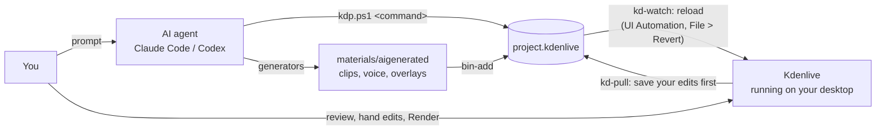

<div align="center">

# Movie Engine

**Agent AI no manova ny horonan-tsarinao ao amin'ny Kdenlive eo imasonao, ary afaka mandray ny asa ianao amin'ny fotoana rehetra.**

Ireo agent AI manoratra code (AI agents: Claude Code, Codex) no manamboatra sy manova tetikasa Kdenlive tena izy: sarimihetsika, horonan-tsary manazava ary horonan-tsary fohy mitsangana (vertical shorts). Miseho avy hatrany ao amin'ny editor (rindranasa fanovana horonan-tsary) misokatra eo aminao ireo fanovana. Azo entina (portable), Windows, tsy misy fanovana ny editor mihitsy.


[English](../../README.md) · [简体中文](README.zh-CN.md) · [繁體中文](README.zh-TW.md) · [हिन्दी](README.hi.md) · [Español](README.es.md) · [Français](README.fr.md) · [العربية](README.ar.md) · [বাংলা](README.bn.md) · [Português](README.pt.md) · [Русский](README.ru.md) · [اردو](README.ur.md) · [Bahasa Indonesia](README.id.md) · [Deutsch](README.de.md) · [日本語](README.ja.md) · [Türkçe](README.tr.md) · [한국어](README.ko.md) · [Українська](README.uk.md) · [Italiano](README.it.md) · [Polski](README.pl.md) · [Tiếng Việt](README.vi.md) · [فارسی](README.fa.md) · [ไทย](README.th.md) · [Kiswahili](README.sw.md) · [አማርኛ](README.am.md) · [Avañe'ẽ](README.gn.md) · [Setswana](README.tn.md) · [Shqip](README.sq.md) · [Беларуская](README.be.md) · [Български](README.bg.md) · [Bosanski](README.bs.md) · [Hrvatski](README.hr.md) · [Српски](README.sr.md) · [Crnogorski](README.cnr.md) · [Македонски](README.mk.md) · [Slovenščina](README.sl.md) · [Slovenčina](README.sk.md) · [Čeština](README.cs.md) · [Magyar](README.hu.md) · [Română](README.ro.md) · [Dansk](README.da.md) · [Norsk bokmål](README.nb.md) · [Norsk nynorsk](README.nn.md) · [Svenska](README.sv.md) · [Íslenska](README.is.md) · [Suomi](README.fi.md) · [Eesti](README.et.md) · [Latviešu](README.lv.md) · [Lietuvių](README.lt.md) · [Nederlands](README.nl.md) · [Lëtzebuergesch](README.lb.md) · [Rumantsch](README.rm.md) · [Ελληνικά](README.el.md) · [Malti](README.mt.md) · [Gaeilge](README.ga.md) · [Català](README.ca.md) · [ქართული](README.ka.md) · [Հայերեն](README.hy.md) · [Azərbaycanca](README.az.md) · [Afrikaans](README.af.md) · [isiZulu](README.zu.md) · [isiXhosa](README.xh.md) · [Sesotho](README.st.md) · [Sepedi](README.nso.md) · [Xitsonga](README.ts.md) · [Tshivenḓa](README.ve.md) · [siSwati](README.ss.md) · [isiNdebele (South Africa)](README.nr.md) · [isiNdebele (Zimbabwe)](README.nd.md) · [chiShona](README.sn.md) · [Chichewa](README.ny.md) · [Ikinyarwanda](README.rw.md) · [Ikirundi](README.rn.md) · **Malagasy** · [Soomaali](README.so.md) · [Afaan Oromoo](README.om.md) · [Qafar af](README.aa.md) · [ትግርኛ](README.ti.md) · [Sängö](README.sg.md) · [Kreol Seselwa](README.crs.md) · [TjiKalanga](README.kck.md) · [ChiNdau](README.ndc.md)

*Dikan-teny ity; ny README amin'ny teny anglisy no dika fototra.*

</div>

---

## Votoatiny

- [Nahoana](#nahoana)
- [Ny fomba fiasany](#ny-fomba-fiasany)
- [Ireo fahaizany](#ireo-fahaizany)
- [Ireo zavatra ilaina](#ireo-zavatra-ilaina)
- [Fametrahana](#fametrahana)
- [Fanombohana haingana](#fanombohana-haingana)
- [Fiaraha-miasa amin'ny agent AI](#fiaraha-miasa-aminny-agent-ai)
- [Ny tsipika baiko fanovana (`kdp.ps1`)](#ny-tsipika-baiko-fanovana-kdpps1)
- [Fampifanarahana mivantana amin'ny editor misokatra](#fampifanarahana-mivantana-aminny-editor-misokatra)
- [Generators: izay tsy vitan'i Kdenlive](#generators-izay-tsy-vitani-kdenlive)
- [Feo mitantara sy feo hafa](#feo-mitantara-sy-feo-hafa)
- [Fiteny amin'ny interface](#fiteny-aminny-interface)
- [Firafitry ny lahatahiry](#firafitry-ny-lahatahiry)
- [Fitsapana sy porofo](#fitsapana-sy-porofo)
- [Ny fetra](#ny-fetra)
- [Famahana olana](#famahana-olana)
- [Fanontaniana matetika apetraka](#fanontaniana-matetika-apetraka)
- [Fandraisana anjara](#fandraisana-anjara)
- [Fisaorana](#fisaorana)
- [Fahazoan-dalana](#fahazoan-dalana)

## Nahoana

Natao ho an'ny tanana mihazona totozy (mouse) ny rindranasa fanovana horonan-tsary. Mahay tsara ny firafitra, ny fandaharam-potoana ary ny asa miverimberina ireo agent AI: mametraka clips 300 mifanaraka amin'ny gadona, mampifanaraka ny caption (soratra eo amin'ny sary) tsirairay amin'ny feo, manao indray ny scene iray rehefa avy nahazo hevitra. Saingy tsy afaka manindry ao anaty GUI (interface misy sary) izy ireo raha tsy maka ny desktop-nao.

Editor matanjaka misokatra (open-source) ny Kdenlive, saingy amin'ny Windows dia **tsy manana API ho an'ny automation izy**: ny fifehezana amin'ny alalan'ny D-Bus dia tsy misy afa-tsy amin'ny builds Linux, ary ireo fork manampy izany dia na tsy karakaraina intsony na tsy azo antoka. Mamaha izany ny Movie Engine nefa tsy manova ny editor:

1. Manova ny rakitry ny tetikasa `.kdenlive` ny agent AI amin'ny alalan'ny tsipika baiko efa voasedra (`engine/kdp.ps1`).
2. Ampandrenesina hamaky indray ny rakitra ny Kdenlive mandeha amin'ny alalan'ny Windows UI Automation, tsy misy fanindriana fitendry, tsy misy totozy ary tsy misy fangalarana ny focus.
3. Ny fanovanao mbola tsy voatahiry no tehirizina aloha ary tsy hosoloana mihitsy.

Noho izany dia manova ny agent AI ary ianao no mijery, na manova amin'ny tananao ianao. Samy miasa amin'ny tetikasa iray ihany ianareo, ao amin'ny editor iray ihany, amin'ny fotoana iray ihany.

## Ny fomba fiasany



Ny baiko fanovana rehetra dia manaraka dingana azo antoka iray ihany:

1. **Pull (fisintonana).** Raha misy fanovana tsy voatahiry ao amin'ny Kdenlive dia asaina mitahiry izany izy (bokotra Save eo amin'ny barazy fitaovana, amin'ny alalan'ny UI Automation), ary hamafisina ny fitahirizana.
2. **Fanovana.** Manova ny XML ny baiko rehefa avy nanidy ny rakitra (lock), taorian'ny fanamarinana hash ary miaraka amin'ny sary fiverenana (undo snapshot). Raha niova ny rakitra nandritra izany dia tsy misy soratana.
3. **Famakiana indray (reload).** Mahita ny mariky ny AI ny mpanara-maso (watcher) ka manao File > Revert ao amin'ny editor misokatra. Tsy heverina ho nahomby izany raha tsy tena naorina indray ny widget-n'ny timeline.
4. **Fifanoherana (conflict).** Raha nanomboka nanova ianao nandritra izany dia tsy misy famakiana indray ary mijanona ny asanao. Tehirizina mitokana ny dikan'ny AI, ary ampiharin'ny agent AI indray ny fanovany eo ambonin'ny anao.

## Ireo fahaizany

- **Fanovana feno ny tetikasa tsy mila GUI**: baiko 120 eo ho eo mandrakotra ny bin (fitehirizan'ny loharanon'ny tetikasa), timeline, effects, compositions, tracks, guides, markers, subtitles, sequences, hafainganana sy fanovana ny fotoana (time remap), slideshows, titles, proxies, rendering ary undo/redo. Jereo ny [lisitry ny baiko](#ny-tsipika-baiko-fanovana-kdpps1).
- **Fampifanarahana mivantana amin'ny editor misokatra.** Miseho ao amin'ny Kdenlive jerenao ny fanovan'ny AI; ny fanovanao tsy voatahiry dia tehirizina aloha ary tsy ho very mihitsy.
- **Tsy manelingelina ny desktop-nao mihitsy.** Tsy misy fangalarana focus, fanindriana fitendry na fihetsehan'ny totozy. Mandeha amin'ny desktop Windows tsy hita maso ireo editor fitsapana.
- **Azo entina.** Ao anaty lahatahiry iray ny editor, ny fikirana (settings), Node.js, ny endri-tsoratra (fonts) ary ny fitaovana. Adikao any amin'ny PC hafa izy dia mandeha; tsy misy soratana ao amin'ny Program Files na ao amin'ny profile Windows-nao.
- **Generators ho an'izay tsy vitan'i Kdenlive**: soratra mihetsika isaky ny litera (kinetic text), marika voasoratra tanana, scenes 3D an'ny interface, animations cursor ary sarimihetsika lava manazava ("explainer") mifandray amin'ny mpijery. Vokarina (render) amin'ny GPU izy ireo miaraka amin'ny motion blur tena izy ary apetraka eo amin'ny timeline ho clips tsotra.
- **Feo mitantara (voice-over) misy fotoana isaky ny teny** (Microsoft Edge TTS, tsy mila API key). Mipoitra mazava tsara eo amin'ny teny marina ny captions sy ny hetsika.
- **Feo manokana (sound effects) noforonin'ny code** (whoosh, click, pop, riser, impact sy ny sisa).
- **Voaporofo, tsy noheverina fotsiny.** Samy manana fanamarinana ny vokatra ny baiko tsirairay, voamarina tsirairay ny effects sy ny compositions, ary ao amin'ny `docs/proof/` ny vokatra tsy voakitika.
- **Tafiditra ao ny torolalana ho an'ny agent AI.** Ny `AGENTS.md` sy ny skills ao amin'ny `.claude/skills/` no mampianatra an'i Claude Code sy Codex ny fomba fiasa, ny endriky ny rakitra ary ny fandrika tokony hialana.

## Ireo zavatra ilaina

| | |
|---|---|
| Rafitra fiasana (OS) | Windows 10 na 11, x64 |
| Editor | Kdenlive **26.08.3**, build azo entina (standalone). Tsy voasedra ny dikan-kafa. |
| Node.js | 18 na vaovao kokoa: ny `.zip` Windows x64 avy amin'ny nodejs.org, voavelatra ao amin'ny `engine/node/` |
| Mpitety tranonkala (browser) | Microsoft Edge (tafiditra ao amin'ny Windows); ampiasain'ireo mpamokatra scenes tsy misy varavarankely (headless) |
| Agent AI | [Claude Code](https://claude.com/claude-code) na Codex. Tsy voatery: azo alefa amin'ny tanana koa ny fitaovana rehetra. |
| Kapila | 1 GB eo ho eo ho an'ny editor sy ny fitaovana, miampy ny media-nao |
| GPU | GPU rehetra misy H.264 encoding amin'ny hardware no manafaingana ny `film-render.mjs` (raha tsy misy dia software no ampiasaina) |

## Fametrahana

Apetraka **ao anatin'ny lahatahiry** daholo ny zava-drehetra. Tsy mila zon'ny admin.

```powershell
git clone https://github.com/vladtarrow/movie-engine.git
cd movie-engine
```

**1. Node.js.** Sintomy ny `.zip` Windows x64 an'ny Node.js 18 na vaovao kokoa avy amin'ny <https://nodejs.org/en/download> ary velaro ao amin'ny `engine\node\` ny ao anatiny, mba hisy ao ny `engine\node\node.exe` sy ny `engine\node\npm.cmd`. Tsy mila installer na Node an'ny rafitra. Ny scripts rehetra dia alefa amin'ny alalan'ny `engine\node.cmd`, tsy amin'ny Node an'ny rafitra mihitsy.

**2. Packages Node** ho an'ny fitaovana feo sy ireo mpamokatra sary (renderers) (voafaritra ao amin'ny `engine/voice/package.json` ny dikan'izy ireo):

```powershell
engine\node\npm.cmd install --prefix engine\voice
```

**3. Kdenlive 26.08.3 azo entina.** Sintomy ny `kdenlive-26.08.3_standalone.exe` avy amin'ny <https://download.kde.org/stable/kdenlive/26.08/windows/> ho ao amin'ny `engine\installer\`, hamarino ary velaro:

```powershell
(Get-FileHash engine\installer\kdenlive-26.08.3_standalone.exe -Algorithm SHA256).Hash
# expected: A25427B1DFF2C17E3B0386E991BB1A719382BB3176D1A90E441CDAEB6E0A967D
engine\installer\kdenlive-26.08.3_standalone.exe -o"engine\Kdenlive" -y
```

Tonga ao amin'ny `engine\Kdenlive\kdenlive-26.08.3_standalone\bin\` ny editor. Efa ao anatiny ny `melt.exe` sy ny `ffmpeg.exe`.

**4. Fanombohana voalohany.**

```powershell
engine\kdenlive.cmd
```

Tehirizin'ny Kdenlive ao amin'ny `engine\profile-kdenlive\` ny fikirany rehetra, fa tsy ao amin'ny profile Windows-nao. Amin'ny fanombohana voalohany dia mampiseho mpanampy fanomanana (setup wizard) indray mandeha monja izy.

## Fanombohana haingana

### Miaraka amin'ny agent AI

Sokafy ao amin'ny Claude Code (na Codex) ny lahatahiry ary angataho amin'ny teny tsotra:

> Manaova tetikasa vaovao mitsangana 30 fps antsoina hoe "launch-teaser". Apetraho eo amin'ny timeline ireo sary efijery (screenshots) telo ao amin'ny `materials/designers/launch/`, 2.5 s avy miaraka amin'ny cross-fade fohy, ampio feo mitantara avy amin'ny `script.txt` ary ampifanaraho caption mihetsika amin'ny andalana tsirairay.

> Sokafy ho ahy ao amin'ny Kdenlive izany.

> Lava loatra ny shot faharoa. Fohezo ho 1.8 s izy ary akaro kely ny logo.

Manaraka ny `AGENTS.md` ny agent AI: manova amin'ny alalan'ny `kdp.ps1` izy, tsy mamokatra (render) afa-tsy ireo clips ilain'ny montage, ary mitazona ny editor misokatra ho mifanaraka. Ianao no mijery ao amin'ny Kdenlive, manova amin'ny tananao isaky ny tianao, ary manindry Render rehefa afa-po.

### Amin'ny tanana

```powershell
# a new 1080x1920 30 fps project with 2 video and 2 audio tracks
powershell -NoProfile -ExecutionPolicy Bypass -File engine\kdp.ps1 new -Project projects\hello\hello.kdenlive -Profile vertical_hd_30

# a 3-second title and a colour background
powershell -NoProfile -ExecutionPolicy Bypass -File engine\kdp.ps1 bin-color -Project projects\hello\hello.kdenlive -Color '#203060' -Seconds 3 -Name bg
powershell -NoProfile -ExecutionPolicy Bypass -File engine\kdp.ps1 title -Project projects\hello\hello.kdenlive -Text "Hello" -Seconds 3 -Name hi

# place them: background on V1, title above it on V2
powershell -NoProfile -ExecutionPolicy Bypass -File engine\kdp.ps1 add -Project projects\hello\hello.kdenlive -Bin bg -Track V1 -At 0
powershell -NoProfile -ExecutionPolicy Bypass -File engine\kdp.ps1 add -Project projects\hello\hello.kdenlive -Bin hi -Track V2 -At 0

# a check frame, then open it in the editor
powershell -NoProfile -ExecutionPolicy Bypass -File engine\kdp.ps1 frame -Project projects\hello\hello.kdenlive -At 1.5 -Out out\hello\check.png
engine\kdenlive.cmd projects\hello\hello.kdenlive
```

Raha hanokatra indray ny tetikasa farany ianao any aoriana, tsindrio indroa ny `open-last-project.cmd`.

## Fiaraha-miasa amin'ny agent AI

Mamaky ny `AGENTS.md` (Codex) na ny `CLAUDE.md`, izay manafatra azy (Claude Code), ny agent AI, miampy skills roa:

| Skill | Zavatra ampianariny |
|---|---|
| `.claude/skills/kdenlive-project-file` | ny endrika `.kdenlive` / MLT XML, `kdp.ps1`, fanamarinana amin'ny `melt` |
| `.claude/skills/kdenlive-live` | fifehezana azo antoka ny editor mandeha: fanombohana, pull, famakiana indray, fakana sary ny varavarankeliny |

Fitsipika arahin'ny agent AI, azonao iankinana:

- Tsy maka ny totozinao, ny fitendrinao na ny focus mihitsy izy, ary tsy maka sary ny desktop-nao mihitsy (ny varavarankelin'ny editor ihany).
- Izy ihany no manao ny dingana GUI (mitahiry, manokatra, mamaky indray) fa tsy mangataka anao hanindry.
- Manontany izy alohan'ny hisintonana na inona na inona ary alohan'ny hamafana na inona na inona.
- Tsy mamokatra (render) afa-tsy izay ilain'ny asa izy (clips scenes, sary fanamarinana). Ny sarimihetsika farany dia tsy vokariny raha tsy angatahinao.
- Raha tsy vitan'ny Kdenlive tsara ny zavatra iray, dia amboarin'ny agent AI any ivelany amin'ny code izany ary ampidiriny ho clip ny vokatra. Tsy ahenany ny kalitaon'ny effect.

## Ny tsipika baiko fanovana (`kdp.ps1`)

```powershell
powershell -NoProfile -ExecutionPolicy Bypass -File engine\kdp.ps1 <command> -Project <file.kdenlive> [options]
```

Amin'ny segondra ny fotoana, misy teboka (`2.5`). Ny tracks dia `V1 V2 …` (V1 no ambany indrindra) sy `A1 A2 …`. Fantarina amin'ny `-Track` miampy fotoana `-At` rehetra ao anatiny ny clip iray. Ny paramètres an'ny effects dia apetraka ao amin'ny `-Params "name=value||name=value"`. Ao amin'ny lohan'ny (header) `engine/kdp.ps1` ny lisitra feno miaraka amin'ny safidy rehetra.

| Vondrona | Baiko |
|---|---|
| Tetikasa | `new`, `profiles`, `info`, `validate`, `fonts`, `profile-set`, `profile-from-clip`, `zone`, `archive`, `backups`, `rebase`, `otio-export`, `otio-import` |
| Bin | `bin-add`, `bin-color`, `title`, `title-text`, `title-save`, `title-template`, `bin-rename`, `bin-remove`, `bin-info`, `bin-set`, `bin-duplicate`, `bin-replace-file`, `bin-reload`, `folder`, `bin-folder`, `relink`, `clean`, `generator`, `playlist-clip`, `extract-audio`, `transcode` |
| Timeline | `add`, `add-av`, `move`, `copy`, `trim`, `ripple-trim`, `slip`, `split`, `remove`, `speed`, `remap`, `disable`, `enable`, `group`, `ungroup`, `mix`, `unmix`, `space-insert`, `space-remove`, `spaces-remove-all`, `track-clear`, `replace-in-timeline` |
| Effects | `effects`, `effect-info`, `effect-add`, `effect-list`, `effect-set`, `effect-remove`, `effect-copy`, `effect-clear`, `effects-all`, `bin-effect`, `effect-templates`, `effect-template` |
| Compositions | `compositions`, `comp-info`, `comp-add`, `comp-list`, `comp-set`, `comp-remove` |
| Tracks | `track-add`, `track-remove`, `track-set` |
| Guides sy markers | `guide-add`, `guide-list`, `guide-remove`, `guide-set`, `guide-clear`, `guide-export`, `guide-category`, `marker`, `marker-list`, `marker-set`, `marker-remove` |
| Subtitles | `sub-add`, `sub-import`, `sub-export`, `sub-state` |
| Sequences | `sequence-add`, `sequences`, `copy-to-sequence`, `expand`; ny baiko rehetra misy `-Sequence <name>` dia miasa ao anatin'io sequence io |
| Manokana | `slideshow`, animations Lottie / Glaxnimate amin'ny alalan'ny `bin-add`, `proxy`, `stabilize`, `scene-split`, `speed-job`, `subclip` |
| Vokatra | `frame` (PNG iray), `preview` (render haingana amin'ny melt), `render` (ny renderer an'ny Kdenlive mihitsy na preset), `presets` |
| Tantara | `undo`, `redo`, `clear-history` (snapshots ao amin'ny `projects/<name>/.kdp-history`) |

Fihetsika tokony ho fantatra:

- Ny tapany audio sy video mifamatotra dia afindra, tapahina (trim), zaraina (split) ary esorina miaraka (`-Alone` ho an'ny tapany iray ihany).
- Ny baiko tsy nahomby dia mivoaka amin'ny code 1 ary tsy manoratra na inona na inona.
- Ny effects tsy azon'ny build Windows alefa dia lavina, fa tsy tsinontsinoavina mangina (lisitra: `docs/proof/assets.txt`).
- Ny hetsika rehetra ao amin'ny menu Kdenlive dia mifandray amin'ny baiko iray, lalana hafa, na "fijerena ihany" ao amin'ny `engine/tools/data/kdenlive-actions.csv`. Jereo ny `docs/kdenlive-coverage.md`.

## Fampifanarahana mivantana amin'ny editor misokatra

| Script | Zavatra ataony | Exit codes (kaody fivoahana) |
|---|---|---|
| `engine\kd-pull.ps1 -Project <f>` | mampitahiry ny fanovanao amin'ny Kdenlive ary manamafy izany | 0 vaovao ny rakitra, 3 tsy mandeha, 4 tsy voamafy |
| `engine\kd-reload.ps1 -Project <f>` | File > Revert, hamafisin'ny timeline naorina indray | 0 voamafy, 2 manana fanovana tsy voatahiry ianao (tsy nisy nariana), 3 tsy mandeha, 4 tsy nahomby |
| `engine\kd-watch.ps1 -Project <f>` | mpanara-maso ao ambadika: mamaky indray isaky ny manoratra ny AI, mirakitra ny conflicts ao amin'ny log | log ao amin'ny `engine\kd-watch.log`; fafao ny `engine\kd-watch.run` raha hampiato azy |
| `engine\kdenlive-bg.ps1 [project]` | manomboka ny Kdenlive ahena (minimized) ho an'ny agent AI | 0 voasokatra, 4 tsy voamafy |
| `engine\kdenlive.cmd [project]` | manomboka ny Kdenlive ho anao | |

Alefaso indray mandeha isaky ny session ny mpanara-maso (watcher):

```powershell
Start-Process powershell -WindowStyle Hidden -ArgumentList '-NoProfile','-ExecutionPolicy','Bypass','-File','engine\kd-watch.ps1','-Project','projects\hello\hello.kdenlive'
```

Tetikasa lehibe: maharitra minitra maromaro ny famakiana indray tetikasa misy clips 1000, ary miandry izany ireo fitaovana fa tsy manao tatitra aloha loatra. Sokafana amin'ny alalan'ny *File > Open Recent* ao amin'ny editor foana ny tetikasa, satria ny fanokafana mivantana ny rakitra dia mahatonga an'i Qt handalo ny singa rehetra ao amin'ny timeline noho ny accessibility, ary 10 minitra eo ho eo no naharitra kokoa izany.

## Generators: izay tsy vitan'i Kdenlive

Tsy manana animation soratra isaky ny litera ny Kdenlive/MLT, tsy manana expressions, kely ny 3D, ary mampiadana ny playback (fijerena) ny effects mavesatra. Mamokatra (render) ireo ampahany ireo any ivelany ny Movie Engine ary mametraka azy ireo eo amin'ny timeline ho clips tsotra, matetika misy alpha (faritra mangarahara), eo amin'ny track iray eo ambonin'ny sary. Mijanona ao amin'ny lahatahirin'ny tetikasa ny script generator sy ny angona omena azy, ka azo vokarina indray ny clip rehefa miova ny soratra, ny endri-tsoratra na ny fotoana.

| Fitaovana | Zavatra vokariny |
|---|---|
| `engine/tools/kinetic-text.ps1` | captions mihetsika isaky ny litera, mifanaraka amin'ny fotoana ao amin'ny `voice.json` ny teny tsirairay, boaty fanasongadinana (highlight) |
| `engine/tools/annotate.ps1` | faribolana, boaty, tsipika eo ambany ary zana-tsipika voasoratra tanana izay misoratra eo ambonin'ny screenshot |
| `engine/tools/card-entrance.ps1` | karatra screenshot miakatra sy mihalehibe miaraka amin'ny aloka malefaka |
| `engine/tools/pdf-to-png.ps1` | slides avy amin'ny PDF navoaka (export) |
| `engine/tools/html-render.mjs` | scene HTML/CSS/canvas rehetra ho video: animation interface, cursors, 3D, masks |
| `engine/tools/film-render.mjs` + `film/` | sarimihetsika lava manazava mifandray amin'ny mpijery eo amin'ny canvas: clip iray isaky ny andalana feo, mipoitra eo amin'ny teny voalaza ny hetsika, motion blur amin'ny GPU amin'ny 45 fps eo ho eo |

Samy mampiasa ny Microsoft Edge miaraka amin'ny Windows ireo renderer roa ireo, tsy misy varavarankely (headless), miaraka amin'ny profile ariana aorian'ny fampiasana ary tsy misy fidirana amin'ny tambajotra.

### Ohatra

```powershell
# a 3-second 3D title card with a cursor click
engine\node.cmd engine\tools\html-render.mjs examples\demo\scene\scene.html examples\demo\out --frames 0,30,60,89
engine\node.cmd engine\tools\html-render.mjs examples\demo\scene\scene.html examples\demo\out\scene.mp4

# a 4-shot interactive film timed to two voice lines
engine\node.cmd engine\tools\film-render.mjs examples\demo\film\film.html examples\demo\out --check
engine\node.cmd engine\tools\film-render.mjs examples\demo\film\film.html examples\demo\out --shots all --width 640
engine\node.cmd engine\tools\film-render.mjs examples\demo\film\film.html examples\demo\out\clips --suffix -v01
```

Rakitra kely telo no mandrafitra ny sarimihetsika iray. Ny `data.js` no mitahiry ny shots sy ny fotoanan'ny teny. Ny `direction.js` dia manana andalana iray isaky ny shot:

```text
1 | hover 192 108 @brand | tag 300 60 Your brand @deserves | confetti 192 90 @film
2 say=A film that/*explains* it
3 | click 116 108 @before | click 268 108 @after | chips Before~After @after
4 scene=counter | count 0 120 % @count
```

Ny `scenes.js` no mitahiry ireo shots sarihana hatramin'ny voalohany. Ny `@word` dia manomboka hetsika rehefa tononin'ny feo io teny io. Anisan'ny hetsika ny click, hover, drag, zoom, lens, ring, arrow, chips, toggle, slider, toast, type, count ary confetti; ao an-tampon'ny `engine/tools/film/film-kit.js` ny fitsipi-pitenenana (syntax) feno.

## Feo mitantara sy feo hafa

```powershell
engine\node.cmd engine\voice\voice.mjs lines.json materials\aigenerated\hello\voice en-US-AndrewMultilingualNeural +0%
```

Lisitry ny andalana ny `lines.json`. Manoratra mp3 iray isaky ny andalana ny fitaovana, miampy ny `voice.json`, misy ny faharetany sy ny fiandohana ary ny fiafaran'ny teny tsirairay. Tehirizina (cache) ny andalana, ka raha ovaina ny andalana iray dia io andalana io ihany no vokarina indray. Mampiasa ny serivisy text-to-speech (famadihana soratra ho feo) an-tserasera an'ny Microsoft Edge amin'ny alalan'ny package `msedge-tts` izy: tsy mila key, saingy tsy ofisialy ny serivisy ary mila Internet.

```powershell
engine\node.cmd engine\audio\sfx.mjs materials\aigenerated\sfx
```

Mamorona amin'ny code ny whoosh, whoosh-long, swipe, click, pop, tick, riser, impact, ding ary reveal izany; ao amin'ny `materials/aigenerated/sfx/` ny andiany efa vonona. Ny feo fohy noho ny frame iray dia ampio fahanginana (silence) alohan'ny hametrahana azy (`-af apad=whole_dur=0.0667`).

## Fiteny amin'ny interface

Amin'ny **teny anglisy** no anombohan'ireo launcher ny Kdenlive raha tsy misy fanovana. Raha hampiasa fiteny hafa, apetraho ny `MOVIE_ENGINE_UI_LANG` alohan'ny hanombohana:

```powershell
$env:MOVIE_ENGINE_UI_LANG = 'ru'; engine\kdenlive.cmd
```

Mahita ny singa ao amin'ny menu amin'ny anarany hita maso ny UI Automation. Efa tafiditra ao ny anarana ho an'ny fiteny interface 31 (`engine/tools/kd-ui.ps1`, `$KdNames`). Ho an'ny fiteny hafa rehetra, ampio ao ny anarany ary hamarino amin'ny:

```powershell
powershell -NoProfile -ExecutionPolicy Bypass -File engine\tools\kd-langcheck.ps1
```

## Firafitry ny lahatahiry

```text
movie-engine/
├─ AGENTS.md, CLAUDE.md          instructions for AI agents
├─ .claude/skills/               agent skills: project file format, live editor
├─ engine/
│  ├─ kdp.ps1                    the editing command line
│  ├─ kd-pull / kd-reload / kd-watch .ps1, kdenlive.cmd, kdenlive-bg.ps1
│  ├─ tools/                     internals, generators, tests, data (action map)
│  ├─ voice/  audio/  fonts/     TTS, synthesized SFX, Poppins (OFL)
│  ├─ Kdenlive/  node/           portable editor and Node.js (not in git)
│  └─ profile-kdenlive/          the editor's settings (not in git)
├─ projects/<name>/<name>.kdenlive
├─ materials/
│  ├─ download/                  stock and downloaded files (not in git)
│  ├─ aigenerated/               everything the AI made (sfx/ and test-kit/ ship with the engine)
│  ├─ designers/  brand/         files from your team, brand assets
├─ examples/demo/                demos of the scene and film renderers
├─ out/                          renders (not in git)
└─ docs/                         proofs, coverage, translations of this README
```

Relatifs (miankina amin'ny lahatahirin'ny tetikasa) ny lalan'ny media (paths) ao anatin'ny tetikasa. Raha afindrao na adikao ny lahatahiry, ny `kdp.ps1 rebase` (alefan'ny `kdenlive.cmd` ho azy koa) no manoratra ny toerana vaovao ao amin'ny tetikasa.

## Fitsapana sy porofo

Ny filazana momba izay mandeha dia miorina amin'ny fanamarinana ny vokatra, fa tsy amin'ny hoe "nandeha ny function". Ao amin'ny [`docs/kdenlive-proof.md`](../../docs/kdenlive-proof.md) ny famintinana, ary ao amin'ny `docs/proof/` ny vokatra tsy voakitika.

| Fitsapana | Zavatra hamarininy |
|---|---|
| `engine\tools\kdp-clitest.ps1` | ny baiko `kdp.ps1` rehetra, amin'ny alalan'ny tsipika baiko, amin'ny fampitahana ny tetikasa vokarina |
| `engine\tools\kd-livetest.ps1` | pull, famakiana indray, watcher, conflicts ary races (fifandrombahana) amin'ny Kdenlive tena izy eo amin'ny desktop tsy hita maso |
| `engine\tools\kdp-assetsweep.ps1` | ny effect sy ny composition rehetra: mamokatra ary mampitaha frames |
| `engine\tools\kdp-portabletest.ps1` | mandika ny lahatahiry any an-kafa ary miasa avy amin'ilay dika |
| `engine\tools\kd-langcheck.ps1` | ny fitenin'ny interface sy ny fahitan'ny UI Automation ny menu |
| `engine\tools\kdp-coverage-check.ps1` | fa mifandray ny hetsika menu rehetra, ary tsy misy porofo tranainy noho ny code |

```powershell
powershell -NoProfile -ExecutionPolicy Bypass -File engine\tools\kdp-clitest.ps1 -Report docs\proof\clitest.txt
powershell -NoProfile -ExecutionPolicy Bypass -File engine\tools\kd-livetest.ps1 -Report docs\proof\live-en.txt
```

Tsy mandeha afa-tsy amin'ny desktop miafina miaraka amin'ny profile-ny manokana ireo editor fitsapana, ka tsy mikitika ny Kdenlive misokatra eo aminao na ny focus-nao mihitsy ny fitsapana.

## Ny fetra

- **Windows ihany**, Kdenlive **26.08.3** ihany. Manana D-Bus ny Linux ary mila tetezana hafa.
- Maka ny focus an'ny fitendry mandritra ny 3 segondra eo ho eo ny fanombohana ny editor, eo am-pisehoan'ny varavarankely foana. Manontany ireo agent AI alohan'ny hanombohana azy raha mbola miasa ianao. Tsy maka focus ny famakiana indray sy ny fanovana.
- Tsy ananan'ny build Windows ny modules MLT sox, ladspa ary movit ary ny sasany amin'ireo effects frei0r/avfilter; lavin'ny `kdp.ps1` ireo (`docs/proof/assets.txt`).
- Ny export sy import OpenTimelineIO dia tsy mitondra afa-tsy clips sy banga (gaps). Tsy misy fanovana zoro (angle) mivantana ny multicam (atao amin'ny split/remove/hide ny fanapahana).
- Ny "Save As…" amin'ny alalan'ny UI Automation amin'ny varavarankely ahena (minimized) dia tsy manokatra dialog; ampiasain'ny agent AI ny `archive` na ny fandikana rakitra ho solony.
- Mila Whisper na Vosk ny fahafantarana ny teny lazaina (speech recognition, ho an'ny subtitles mandeha ho azy), ary tsy tafiditra ao ireo.
- Ny titles natao tamin'ny fitaovana titles an'ny Kdenlive dia mampiasa ny endri-tsoratra napetraka ao amin'ny Windows. Raha tiana ho azo antoka ny typography, vokary amin'ny generators ny soratra, satria maka endri-tsoratra avy amin'ny `engine/fonts/` izy ireo.
- Serivisy an-tserasera tsy ofisialy ny Edge TTS ary mety hiova na hitsahatra tsy handeha.

## Famahana olana

| Soritr'aretina | Antony sy vahaolana |
|---|---|
| Mandeha ny Kdenlive, saingy tsy misy miseho rehefa tsindriana eo amin'ny taskbar | Any ivelan'ny efijery ny toeran'ny varavarankeliny voatahiry. Hidio izy ary fafao ireo entries `kdockLayout` ao amin'ny `engine\profile-kdenlive\AppData\Local\kdenliverc`, na afindrao amin'ny `SetWindowPos` ny varavarankely (jereo ny `AGENTS.md`). |
| Mivoaka amin'ny 2 ny `kd-reload.ps1` | Manana fanovana tsy voatahiry ianao. Tsy nisy nariana. Alefaso ny `kd-pull.ps1`, avy eo ampiharo indray ny fanovana (`kdp.ps1` dia manao izany ho azy). |
| `CONFLICT` ao amin'ny `engine\kd-watch.log` | Nanova tamin'ny fotoana iray ianao sy ny agent AI. Mijanona ao amin'ny editor ny dikanao, ary ao amin'ny `projects\<name>\.kdp-history\<name>\conflict\` ny dikan'ny AI. Angataho ny agent AI hampihatra indray ny fanovany. |
| Mivoaka amin'ny 1 miaraka amin'ny "pull not confirmed" ny baiko iray | Sahirana ny Kdenlive na mampiseho dialog. Hidio ny dialog na andraso ho vita ny fanokafana, avy eo avereno. |
| Tsy voavaky (parse) ny script PowerShell iray | Ny scripts misy soratra tsy ASCII dia tsy maintsy tehirizina ho UTF-8 **misy BOM** ho an'ny Windows PowerShell 5.1. |
| Mijanona miaraka amin'ny "Stream closed before the synthesis completed" ny `voice.mjs` | Matetika olana amin'ny tambajotra, na SSML tsy voaaro (unescaped) amin'ireo dika taloha. Miaro (escape) ho azy ny `& < >` ny `voice.mjs`. |
| Minitra maro vao misokatra ny tetikasa lehibe | Sokafy amin'ny `kdenlive.cmd` / `kdenlive-bg.ps1` izy, fa aza sokafana ho `kdenlive.exe project.kdenlive` mihitsy. |

## Fanontaniana matetika apetraka

**Mila Claude Code na Codex ve aho?**
Tsia. Script tsotra azonao alefa amin'ny tanana ny fitaovana rehetra. Ny agent AI no mampihafaingana azy: mandrafitra ny montage izy, mampandeha ny fitaovana ary mitazona ny editor ho mifanaraka.

**Hosoloin'ny agent AI ve ny fanovana nataoko tamin'ny tanana?**
Tsia. Alohan'ny fanoratana rehetra dia tehirizina sy hamafisina ny fanovanao tsy voatahiry. Raha manova ianao eo am-panoratan'ny agent AI, dia lavina na tehirizina mitokana ho conflict ny fanoratana, fa tsy ampiharina eo ambonin'ny asanao mihitsy.

**Afaka mampiasa ny Kdenlive toy ny mahazatra foana ve aho?**
Eny. Kdenlive tsotra misy lahatahiry fikirana manokana izy. Manova, mijery ary mamokatra (render) toy ny mahazatra.

**Mandeha amin'ny Kdenlive efa napetrako ve izy?**
Mampiasa ny dika azo entina ao amin'ny `engine\Kdenlive\` izy, ka tsy voakitika ny Kdenlive napetrakao sy ny fikirany.

**Nahoana no tsy fork Kdenlive misy API, na editor hafa?**
Amin'ny Windows dia tsy misy fork karakaraina sy azo antoka (fanadihadiana tamin'ny Novambra 2026). Nodinihina ny OpenShot, Blender VSE, DaVinci Resolve, Shotcut ary ireo editor an-tranonkala; ny Kdenlive no nanome ny halalin'ny fanovana tsara indrindra. Arahi-maso ny tolo-kevitra REST API ao amin'ny tetikasa fototra Kdenlive (merge request !902).

**Afaka mamokatra ny horonan-tsary farany ve izy?**
Eny, amin'ny `kdp.ps1 render` (ny renderer an'ny Kdenlive mihitsy, miafina), na ianao ihany no manindry Render ao amin'ny editor.

**Alefa any amin'ny toerana hafa ve ny media-ko?**
Tsia. Ny soratry ny feo mitantara ihany no alefa any amin'ny serivisy Edge TTS rehefa mamorona feo ianao. Mandeha tsy misy tambajotra ireo mpamokatra scenes.

## Fandraisana anjara

Raisina an-tanam-pifaliana ny fandraisana anjara. Jereo ny [CONTRIBUTING.md](../../CONTRIBUTING.md). Raha fintinina:

- Ny asa `kdp.ps1` vaovao na novaina rehetra dia mila fanamarinana ny vokatra ao amin'ny `kdp-clitest.ps1`, fidirana ao amin'ny sarintanin'ny hetsika (action map), ary fandefasana vaovao ny `kdp-coverage-check.ps1`.
- Aza manomboka Kdenlive fitsapana eo amin'ny desktop hita maso mihitsy; ampiasao ny `engine/tools/kd-hidden.ps1`.
- Ataovy azo entina foana ny zava-drehetra: tsy misy fametrahana any ivelan'ny lahatahiry, tsy misy lalana absolu (absolute paths) ao amin'ny tetikasa.
- Soraty ao amin'ny `AGENTS.md` na ao amin'ny skill mifanaraka aminy ireo toetra hafahafa voamarina (quirks).

## Fisaorana

- [Kdenlive](https://kdenlive.org) sy [MLT](https://www.mltframework.org): ny editor sy ny motera ao ambaniny.
- [FFmpeg](https://ffmpeg.org), miaraka amin'ny Kdenlive.
- [msedge-tts](https://www.npmjs.com/package/msedge-tts) ho an'ny feo mitantara.
- [Poppins](https://fonts.google.com/specimen/Poppins) avy amin'ny Indian Type Foundry, SIL Open Font License (`engine/fonts/OFL.txt`).
- `engine/tools/data/kdenliveui-26.08.3.rc`: ny rakitra menu an'ny Kdenlive, nalaina avy amin'ny code loharano (source) an'ny Kdenlive 26.08.3; ny fanamarinana coverage ihany no mampiasa azy. Mijanona eo ambanin'ny fahazoan-dalana GPL an'ny Kdenlive izy, fa tsy eo ambanin'ny MIT License.

## Fahazoan-dalana

Navoaka eo ambanin'ny [MIT License](../../LICENSE) ny code an'ny Movie Engine. Mitazona ny fahazoan-dalany manokana ny Kdenlive, MLT, FFmpeg, ireo packages Node.js ary ny endri-tsoratra Poppins.
