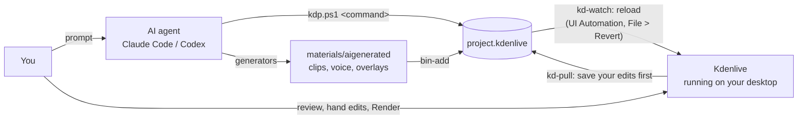

<div align="center">

# Movie Engine

**ВИ-агент го монтира вашето видео во Kdenlive додека гледате, а вие можете да ја преземете работата во секој момент.**

ВИ-агентите за програмирање (Claude Code, Codex) градат и менуваат вистински Kdenlive-проекти: филмови, објаснувачки видеа и вертикални кратки видеа. Измените се појавуваат во живо во уредувачот што го имате отворен. Преносливо, Windows, без закрпи на уредувачот.


[English](../../README.md) · [简体中文](README.zh-CN.md) · [繁體中文](README.zh-TW.md) · [हिन्दी](README.hi.md) · [Español](README.es.md) · [Français](README.fr.md) · [العربية](README.ar.md) · [বাংলা](README.bn.md) · [Português](README.pt.md) · [Русский](README.ru.md) · [اردو](README.ur.md) · [Bahasa Indonesia](README.id.md) · [Deutsch](README.de.md) · [日本語](README.ja.md) · [Türkçe](README.tr.md) · [한국어](README.ko.md) · [Українська](README.uk.md) · [Italiano](README.it.md) · [Polski](README.pl.md) · [Tiếng Việt](README.vi.md) · [فارسی](README.fa.md) · [ไทย](README.th.md) · [Kiswahili](README.sw.md) · [አማርኛ](README.am.md) · [Avañe'ẽ](README.gn.md) · [Setswana](README.tn.md) · [Shqip](README.sq.md) · [Беларуская](README.be.md) · [Български](README.bg.md) · [Bosanski](README.bs.md) · [Hrvatski](README.hr.md) · [Српски](README.sr.md) · [Crnogorski](README.cnr.md) · **Македонски** · [Slovenščina](README.sl.md) · [Slovenčina](README.sk.md) · [Čeština](README.cs.md) · [Magyar](README.hu.md) · [Română](README.ro.md) · [Dansk](README.da.md) · [Norsk bokmål](README.nb.md) · [Norsk nynorsk](README.nn.md) · [Svenska](README.sv.md) · [Íslenska](README.is.md) · [Suomi](README.fi.md) · [Eesti](README.et.md) · [Latviešu](README.lv.md) · [Lietuvių](README.lt.md) · [Nederlands](README.nl.md) · [Lëtzebuergesch](README.lb.md) · [Rumantsch](README.rm.md) · [Ελληνικά](README.el.md) · [Malti](README.mt.md) · [Gaeilge](README.ga.md) · [Català](README.ca.md) · [ქართული](README.ka.md) · [Հայերեն](README.hy.md) · [Azərbaycanca](README.az.md) · [Afrikaans](README.af.md) · [isiZulu](README.zu.md) · [isiXhosa](README.xh.md) · [Sesotho](README.st.md) · [Sepedi](README.nso.md) · [Xitsonga](README.ts.md) · [Tshivenḓa](README.ve.md) · [siSwati](README.ss.md) · [isiNdebele (South Africa)](README.nr.md) · [isiNdebele (Zimbabwe)](README.nd.md) · [chiShona](README.sn.md) · [Chichewa](README.ny.md) · [Ikinyarwanda](README.rw.md) · [Ikirundi](README.rn.md) · [Malagasy](README.mg.md) · [Soomaali](README.so.md) · [Afaan Oromoo](README.om.md) · [Qafar af](README.aa.md) · [ትግርኛ](README.ti.md) · [Sängö](README.sg.md) · [Kreol Seselwa](README.crs.md) · [TjiKalanga](README.kck.md) · [ChiNdau](README.ndc.md)

*Ова е превод. Референтна верзија е англискиот README.*

</div>

---

## Содржина

- [Зошто](#зошто)
- [Како функционира](#како-функционира)
- [Можности](#можности)
- [Барања](#барања)
- [Инсталација](#инсталација)
- [Брз почеток](#брз-почеток)
- [Работа со агентот](#работа-со-агентот)
- [Командна линија за монтажа (`kdp.ps1`)](#командна-линија-за-монтажа-kdpps1)
- [Синхронизација во живо со отворениот уредувач](#синхронизација-во-живо-со-отворениот-уредувач)
- [Генератори: она што Kdenlive не може да го направи](#генератори-она-што-kdenlive-не-може-да-го-направи)
- [Нарација и звук](#нарација-и-звук)
- [Јазик на интерфејсот](#јазик-на-интерфејсот)
- [Структура на папките](#структура-на-папките)
- [Тестови и докази](#тестови-и-докази)
- [Ограничувања](#ограничувања)
- [Решавање проблеми](#решавање-проблеми)
- [Чести прашања](#чести-прашања)
- [Придонесување](#придонесување)
- [Благодарност](#благодарност)
- [Лиценца](#лиценца)

## Зошто

Видеоуредувачите се направени за рака на глувчето. ВИ-агентите се добри во структура, тајминг и повторување: да постават 300 клипови во ритамот на музиката, да го усогласат секој титл со гласот, повторно да направат сцена по добиени забелешки. Но тие не можат да кликаат низ графички интерфејс без да ја преземат вашата работна површина.

Kdenlive е моќен уредувач со отворен код, но на Windows **нема API за автоматизација**: управувањето преку D-Bus постои само во изданијата за Linux, а форковите што го додаваат се или напуштени или небезбедни. Movie Engine го решава ова без закрпи на уредувачот:

1. Агентот ја менува проектната датотека `.kdenlive` преку тестирана командна линија (`engine/kdp.ps1`).
2. На Kdenlive што работи му се кажува повторно да ја вчита датотеката преку Windows UI Automation, без притискања на тастери, без глувче и без одземање на фокусот.
3. Вашите незачувани измени прво се зачувуваат и никогаш не се пребришуваат.

Така агентот монтира, а вие прегледувате, или монтирате рачно. И двајцата работите на ист проект, во ист уредувач, во исто време.

## Како функционира



Секоја команда за монтажа го следи истиот безбеден циклус:

1. **Pull.** Ако Kdenlive има незачувани промени, му се кажува да ги зачува (копчето Save во лентата со алатки преку UI Automation), и зачувувањето се потврдува.
2. **Измена.** Командата го менува XML-от под заклучување, по проверка на хешот и со снимка на состојбата за враќање. Ако датотеката во меѓувреме се променила, ништо не се запишува.
3. **Повторно вчитување.** Набљудувачот го гледа печатот на ВИ и извршува File > Revert во отворениот уредувач. Успех се смета само кога виџетот на временската линија навистина е повторно изграден.
4. **Конфликт.** Ако во меѓувреме сте почнале да менувате, ништо не се вчитува повторно и вашата работа останува. Верзијата на ВИ се чува настрана, а агентот ја применува својата измена одново врз вашата.

## Можности

- **Целосна монтажа на проектот без графички интерфејс**: околу 120 команди што ги покриваат корпата на проектот, временската линија, ефектите, композициите, патеките, водилките, маркерите, титловите, секвенците, брзината и пресликувањето на времето (time remap), слајдшоуата, насловите, прокси-датотеките, рендерирањето и враќањето/повторувањето. Видете го [прегледот на командите](#командна-линија-за-монтажа-kdpps1).
- **Синхронизација во живо со отворениот уредувач.** Измените на ВИ се појавуваат во Kdenlive што го гледате; вашите незачувани измени прво се зачувуваат и никогаш не се губат.
- **Никогаш не ја попречува вашата работна површина.** Без одземање на фокусот, притискања на тастери или движења на глувчето. Тестовите уредувачи работат на невидлива работна површина на Windows.
- **Преносливо.** Уредувачот, поставките, Node.js, фонтовите и алатките се во една папка. Копирајте ја на друг компјутер и работи; ништо не се запишува во Program Files или во вашиот профил на Windows.
- **Генератори за она што Kdenlive не може да го направи**: кинетички текст анимиран буква по буква, рачно нацртани прибелешки, 3D-сцени на интерфејс, анимации на курсорот и долги интерактивни „објаснувачки“ филмови. Се рендерираат на GPU со вистинско заматување на движењето (motion blur) и се поставуваат на временската линија како обични клипови.
- **Нарација со тајминг на зборовите** (Microsoft Edge TTS, без API-клуч). Титловите и дејствата се активираат точно на зборот.
- **Синтетизирани звучни ефекти** (whoosh, click, pop, riser, impact и други), генерирани со код.
- **Докажано, не претпоставено.** Секоја команда има проверка на резултатот, ефектите и композициите се проверуваат еден по еден, а суровите резултати се во `docs/proof/`.
- **Вклучени упатства за агентите.** `AGENTS.md` и вештините во `.claude/skills/` ги учат Claude Code и Codex на работниот тек, форматот на датотеката и замките.

## Барања

| | |
|---|---|
| ОС | Windows 10 или 11, x64 |
| Уредувач | Kdenlive **26.08.3**, пренослива верзија (standalone). Другите верзии не се тестирани. |
| Node.js | 18 или понова: `.zip` за Windows x64 од nodejs.org, распакуван во `engine/node/` |
| Прелистувач | Microsoft Edge (дел од Windows); го користат рендерерите на сцени во headless-режим |
| Агент | [Claude Code](https://claude.com/claude-code) или Codex. Опционално: секоја алатка може да се изврши и рачно. |
| Диск | околу 1 GB за уредувачот и алатките, плус вашите медиумски датотеки |
| GPU | секој GPU со хардверско кодирање H.264 го забрзува `film-render.mjs` (инаку се користи софтверско кодирање) |

## Инсталација

Сè се инсталира **во папката**. Не се потребни администраторски права.

```powershell
git clone https://github.com/vladtarrow/movie-engine.git
cd movie-engine
```

**1. Node.js.** Преземете го `.zip` за Windows x64 на Node.js 18 или понова од <https://nodejs.org/en/download> и распакувајте ја неговата содржина во `engine\node\`, така што `engine\node\node.exe` и `engine\node\npm.cmd` да бидат таму. Не се потребни ни инсталатор ни системски Node. Сите скрипти се извршуваат преку `engine\node.cmd`, никогаш преку системски Node.

**2. Node-пакети** за алатката за глас и рендерерите (верзиите се фиксирани во `engine/voice/package.json`):

```powershell
engine\node\npm.cmd install --prefix engine\voice
```

**3. Пренослив Kdenlive 26.08.3.** Преземете го `kdenlive-26.08.3_standalone.exe` од <https://download.kde.org/stable/kdenlive/26.08/windows/> во `engine\installer\`, проверете го и распакувајте го:

```powershell
(Get-FileHash engine\installer\kdenlive-26.08.3_standalone.exe -Algorithm SHA256).Hash
# expected: A25427B1DFF2C17E3B0386E991BB1A719382BB3176D1A90E441CDAEB6E0A967D
engine\installer\kdenlive-26.08.3_standalone.exe -o"engine\Kdenlive" -y
```

Уредувачот завршува во `engine\Kdenlive\kdenlive-26.08.3_standalone\bin\`. Тој веќе ги содржи `melt.exe` и `ffmpeg.exe`.

**4. Прво стартување.**

```powershell
engine\kdenlive.cmd
```

Kdenlive ги чува сите свои поставки во `engine\profile-kdenlive\`, а не во вашиот профил на Windows. При првото стартување еднаш прикажува волшебник за поставување.

## Брз почеток

### Со агент

Отворете ја папката во Claude Code (или Codex) и побарајте со обични зборови:

> Направи нов вертикален проект „launch-teaser“ со 30 fps. Стави ги на временската линија трите слики од екранот од `materials/designers/launch/`, по 2,5 s секоја со краток премин, додај нарација од `script.txt` и усогласи кинетички натпис со секоја реплика.

> Отвори ми го во Kdenlive.

> Вториот кадар е предолг. Скрати го на 1,8 s и подигни го логото малку погоре.

Агентот го следи `AGENTS.md`: менува преку `kdp.ps1`, ги рендерира само клиповите што му се потребни на монтажот и го одржува отворениот уредувач синхронизиран. Вие прегледувате во Kdenlive, менувате рачно кога сакате и притискате Render кога сте задоволни.

### Рачно

```powershell
# a new 1080x1920 30 fps project with 2 video and 2 audio tracks
powershell -NoProfile -ExecutionPolicy Bypass -File engine\kdp.ps1 new -Project projects\hello\hello.kdenlive -Profile vertical_hd_30

# a 3-second title and a colour background
powershell -NoProfile -ExecutionPolicy Bypass -File engine\kdp.ps1 bin-color -Project projects\hello\hello.kdenlive -Color '#203060' -Seconds 3 -Name bg
powershell -NoProfile -ExecutionPolicy Bypass -File engine\kdp.ps1 title -Project projects\hello\hello.kdenlive -Text "Hello" -Seconds 3 -Name hi

# place them: background on V1, title above it on V2
powershell -NoProfile -ExecutionPolicy Bypass -File engine\kdp.ps1 add -Project projects\hello\hello.kdenlive -Bin bg -Track V1 -At 0
powershell -NoProfile -ExecutionPolicy Bypass -File engine\kdp.ps1 add -Project projects\hello\hello.kdenlive -Bin hi -Track V2 -At 0

# a check frame, then open it in the editor
powershell -NoProfile -ExecutionPolicy Bypass -File engine\kdp.ps1 frame -Project projects\hello\hello.kdenlive -At 1.5 -Out out\hello\check.png
engine\kdenlive.cmd projects\hello\hello.kdenlive
```

За подоцна повторно да го отворите последниот проект, двапати кликнете на `open-last-project.cmd`.

## Работа со агентот

Агентот го чита `AGENTS.md` (Codex) или `CLAUDE.md`, кој го увезува (Claude Code), плус две вештини:

| Вештина | Што учи |
|---|---|
| `.claude/skills/kdenlive-project-file` | форматот `.kdenlive` / MLT XML, `kdp.ps1`, проверка со `melt` |
| `.claude/skills/kdenlive-live` | безбедно управување со уредувачот што работи: стартување, pull, повторно вчитување, снимање на неговиот прозорец |

Правила што агентот ги следи и на кои можете да се потпрете:

- Никогаш не ви го зема глувчето, тастатурата или фокусот и никогаш не прави снимки од вашата работна површина (само од прозорецот на самиот уредувач).
- Чекорите во интерфејсот (зачувување, отворање, повторно вчитување) ги прави сам, наместо да бара од вас да кликнете.
- Прашува пред да преземе што било и пред да избрише што било.
- Рендерира само она што му е потребно на работата (клипови од сцени, контролни кадри). Финалниот филм го рендерира само кога ќе побарате.
- Кога Kdenlive не може нешто да направи добро, агентот го гради надвор со код и го вметнува резултатот како клип. Не го ослабува ефектот.

## Командна линија за монтажа (`kdp.ps1`)

```powershell
powershell -NoProfile -ExecutionPolicy Bypass -File engine\kdp.ps1 <command> -Project <file.kdenlive> [options]
```

Времињата се во секунди, со точка (`2.5`). Патеките се `V1 V2 …` (V1 е најдолната) и `A1 A2 …`. Клипот се определува со `-Track` плус кој било момент `-At` во него. Параметрите на ефектите се задаваат во `-Params "name=value||name=value"`. Целосниот список со секоја опција е во заглавието на `engine/kdp.ps1`.

| Група | Команди |
|---|---|
| Проект | `new`, `profiles`, `info`, `validate`, `fonts`, `profile-set`, `profile-from-clip`, `zone`, `archive`, `backups`, `rebase`, `otio-export`, `otio-import` |
| Корпа на проектот | `bin-add`, `bin-color`, `title`, `title-text`, `title-save`, `title-template`, `bin-rename`, `bin-remove`, `bin-info`, `bin-set`, `bin-duplicate`, `bin-replace-file`, `bin-reload`, `folder`, `bin-folder`, `relink`, `clean`, `generator`, `playlist-clip`, `extract-audio`, `transcode` |
| Временска линија | `add`, `add-av`, `move`, `copy`, `trim`, `ripple-trim`, `slip`, `split`, `remove`, `speed`, `remap`, `disable`, `enable`, `group`, `ungroup`, `mix`, `unmix`, `space-insert`, `space-remove`, `spaces-remove-all`, `track-clear`, `replace-in-timeline` |
| Ефекти | `effects`, `effect-info`, `effect-add`, `effect-list`, `effect-set`, `effect-remove`, `effect-copy`, `effect-clear`, `effects-all`, `bin-effect`, `effect-templates`, `effect-template` |
| Композиции | `compositions`, `comp-info`, `comp-add`, `comp-list`, `comp-set`, `comp-remove` |
| Патеки | `track-add`, `track-remove`, `track-set` |
| Водилки и маркери | `guide-add`, `guide-list`, `guide-remove`, `guide-set`, `guide-clear`, `guide-export`, `guide-category`, `marker`, `marker-list`, `marker-set`, `marker-remove` |
| Титлови | `sub-add`, `sub-import`, `sub-export`, `sub-state` |
| Секвенци | `sequence-add`, `sequences`, `copy-to-sequence`, `expand`; секоја команда со `-Sequence <name>` работи во таа секвенца |
| Посебни | `slideshow`, анимации Lottie / Glaxnimate преку `bin-add`, `proxy`, `stabilize`, `scene-split`, `speed-job`, `subclip` |
| Излез | `frame` (една PNG-слика), `preview` (брзо рендерирање со melt), `render` (сопствениот рендерер на Kdenlive или однапред зададена поставка), `presets` |
| Историја | `undo`, `redo`, `clear-history` (снимките на состојбата во `projects/<name>/.kdp-history`) |

Однесување што вреди да се знае:

- Поврзаните аудио и видео половини се поместуваат, скратуваат, сечат и отстрануваат заедно (`-Alone` за само една половина).
- Команда што не успее завршува со код 1 и не запишува ништо.
- Ефектите што изданието за Windows не може да ги изврши се одбиваат, а не тивко се игнорираат (список: `docs/proof/assets.txt`).
- Секое дејство од менито на Kdenlive е поврзано со команда, со друг пат или со „само преглед“ во `engine/tools/data/kdenlive-actions.csv`. Видете `docs/kdenlive-coverage.md`.

## Синхронизација во живо со отворениот уредувач

| Скрипта | Што прави | Излезни кодови |
|---|---|---|
| `engine\kd-pull.ps1 -Project <f>` | го тера Kdenlive да ги зачува вашите измени и го потврдува тоа | 0 датотеката е ажурна, 3 не работи, 4 не е потврдено |
| `engine\kd-reload.ps1 -Project <f>` | File > Revert, потврдено со повторно изградената временска линија | 0 потврдено, 2 имате незачувани измени (ништо не е отфрлено), 3 не работи, 4 неуспешно |
| `engine\kd-watch.ps1 -Project <f>` | набљудувач во позадина: вчитува повторно по секое запишување на ВИ, ги бележи конфликтите | дневник во `engine\kd-watch.log`; избришете `engine\kd-watch.run` за да го запрете |
| `engine\kdenlive-bg.ps1 [project]` | го стартува Kdenlive минимизиран за агент | 0 вчитано, 4 не е потврдено |
| `engine\kdenlive.cmd [project]` | го стартува Kdenlive за вас | |

Стартувајте го набљудувачот еднаш по сесија:

```powershell
Start-Process powershell -WindowStyle Hidden -ArgumentList '-NoProfile','-ExecutionPolicy','Bypass','-File','engine\kd-watch.ps1','-Project','projects\hello\hello.kdenlive'
```

Големи проекти: повторното вчитување на проект со 1000 клипови трае неколку минути, а алатките го чекаат наместо да известат прерано. Проектите се отвораат преку *File > Open Recent* во празен уредувач, бидејќи директното отворање датотека го тера Qt да го помине секој елемент од временската линија заради пристапноста, што беше околу 10 минути побавно.

## Генератори: она што Kdenlive не може да го направи

Kdenlive/MLT нема анимација на текст буква по буква, нема изрази (expressions) и има малку 3D, а тешките ефекти ја забавуваат репродукцијата. Movie Engine ги рендерира таквите делови надвор и ги става на временската линија како обични клипови, обично со алфа-канал, на патека над сликите. Скриптата на генераторот и нејзините влезни податоци остануваат во папката на проектот, па клипот може повторно да се генерира кога ќе се смени текстот, фонтот или тајмингот.

| Алатка | Што прави |
|---|---|
| `engine/tools/kinetic-text.ps1` | кинетички натписи буква по буква, секој збор усогласен според `voice.json`, рамка за истакнување |
| `engine/tools/annotate.ps1` | рачно нацртани кругови, рамки, подвлекувања и стрелки што постепено се исцртуваат врз слика од екранот |
| `engine/tools/card-entrance.ps1` | картичка со слика од екранот што се издига и зголемува со мека сенка |
| `engine/tools/pdf-to-png.ps1` | слајдови од PDF-извоз |
| `engine/tools/html-render.mjs` | секоја HTML/CSS/canvas сцена во видео: анимација на интерфејс, курсори, 3D, маски |
| `engine/tools/film-render.mjs` + `film/` | долги интерактивни објаснувачки филмови на canvas: еден клип по гласовна реплика, дејствата се активираат на изговорените зборови, заматување на движењето на GPU со околу 45 fps |

И двата рендерери управуваат со Microsoft Edge што доаѓа со Windows, во headless-режим, со еднократен профил и без пристап до мрежата.

### Демо

```powershell
# a 3-second 3D title card with a cursor click
engine\node.cmd engine\tools\html-render.mjs examples\demo\scene\scene.html examples\demo\out --frames 0,30,60,89
engine\node.cmd engine\tools\html-render.mjs examples\demo\scene\scene.html examples\demo\out\scene.mp4

# a 4-shot interactive film timed to two voice lines
engine\node.cmd engine\tools\film-render.mjs examples\demo\film\film.html examples\demo\out --check
engine\node.cmd engine\tools\film-render.mjs examples\demo\film\film.html examples\demo\out --shots all --width 640
engine\node.cmd engine\tools\film-render.mjs examples\demo\film\film.html examples\demo\out\clips --suffix -v01
```

Филмот се состои од три мали датотеки. `data.js` ги содржи кадрите и времињата на зборовите. `direction.js` има по еден ред за секој кадар:

```text
1 | hover 192 108 @brand | tag 300 60 Your brand @deserves | confetti 192 90 @film
2 say=A film that/*explains* it
3 | click 116 108 @before | click 268 108 @after | chips Before~After @after
4 scene=counter | count 0 120 % @count
```

`scenes.js` ги содржи кадрите што се цртаат од нула. `@word` активира дејство кога гласот ќе го изговори тој збор. Дејствата вклучуваат click, hover, drag, zoom, lens, ring, arrow, chips, toggle, slider, toast, type, count и confetti; целосната синтакса е на почетокот на `engine/tools/film/film-kit.js`.

## Нарација и звук

```powershell
engine\node.cmd engine\voice\voice.mjs lines.json materials\aigenerated\hello\voice en-US-AndrewMultilingualNeural +0%
```

`lines.json` е список на реплики. Алатката запишува по еден mp3 за секоја реплика плус `voice.json`, со траењето и почетокот и крајот на секој збор. Репликите се кешираат, па промената на една реплика ја генерира повторно само неа. Користи онлајн претворање текст во говор на Microsoft Edge преку пакетот `msedge-tts`: не е потребен клуч, но услугата е неофицијална и бара интернет.

```powershell
engine\node.cmd engine\audio\sfx.mjs materials\aigenerated\sfx
```

Ова ги синтетизира со код whoosh, whoosh-long, swipe, click, pop, tick, riser, impact, ding и reveal; готов сет има во `materials/aigenerated/sfx/`. Звуците пократки од еден кадар дополнете ги со тишина пред да ги поставите (`-af apad=whole_dur=0.0667`).

## Јазик на интерфејсот

Стартерите стандардно го стартуваат Kdenlive на **англиски**. За да користите друг јазик, поставете `MOVIE_ENGINE_UI_LANG` пред стартувањето:

```powershell
$env:MOVIE_ENGINE_UI_LANG = 'ru'; engine\kdenlive.cmd
```

UI Automation ги наоѓа ставките од менито според нивните видливи имиња. Имињата за 31 јазик на интерфејсот се веќе вградени (`engine/tools/kd-ui.ps1`, `$KdNames`). За кој било друг јазик, додајте ги неговите имиња таму и проверете со:

```powershell
powershell -NoProfile -ExecutionPolicy Bypass -File engine\tools\kd-langcheck.ps1
```

## Структура на папките

```text
movie-engine/
├─ AGENTS.md, CLAUDE.md          instructions for AI agents
├─ .claude/skills/               agent skills: project file format, live editor
├─ engine/
│  ├─ kdp.ps1                    the editing command line
│  ├─ kd-pull / kd-reload / kd-watch .ps1, kdenlive.cmd, kdenlive-bg.ps1
│  ├─ tools/                     internals, generators, tests, data (action map)
│  ├─ voice/  audio/  fonts/     TTS, synthesized SFX, Poppins (OFL)
│  ├─ Kdenlive/  node/           portable editor and Node.js (not in git)
│  └─ profile-kdenlive/          the editor's settings (not in git)
├─ projects/<name>/<name>.kdenlive
├─ materials/
│  ├─ download/                  stock and downloaded files (not in git)
│  ├─ aigenerated/               everything the AI made (sfx/ and test-kit/ ship with the engine)
│  ├─ designers/  brand/         files from your team, brand assets
├─ examples/demo/                demos of the scene and film renderers
├─ out/                          renders (not in git)
└─ docs/                         proofs, coverage, translations of this README
```

Патеките до медиумските датотеки во проектите се релативни. Ако ја преместите или копирате папката, `kdp.ps1 rebase` (кој автоматски го извршува и `kdenlive.cmd`) ја запишува новата локација во проектот.

## Тестови и докази

Тврдењата за тоа што работи се поткрепени со проверки на резултатот, а не со „функцијата се изврши“. Резимето е во [`docs/kdenlive-proof.md`](../../docs/kdenlive-proof.md), а суровиот излез е во `docs/proof/`.

| Тест | Што проверува |
|---|---|
| `engine\tools\kdp-clitest.ps1` | секоја команда на `kdp.ps1`, преку командната линија, споредувајќи го добиениот проект |
| `engine\tools\kd-livetest.ps1` | pull, повторно вчитување, набљудувачот, конфликтите и трките (race conditions) со вистински Kdenlive на невидлива работна површина |
| `engine\tools\kdp-assetsweep.ps1` | секој ефект и секоја композиција: рендерира и споредува кадри |
| `engine\tools\kdp-portabletest.ps1` | ја копира папката на друго место и работи од копијата |
| `engine\tools\kd-langcheck.ps1` | јазикот на интерфејсот и дека UI Automation го наоѓа менито |
| `engine\tools\kdp-coverage-check.ps1` | дека секое дејство од менито е поврзано и ниеден доказ не е постар од кодот |

```powershell
powershell -NoProfile -ExecutionPolicy Bypass -File engine\tools\kdp-clitest.ps1 -Report docs\proof\clitest.txt
powershell -NoProfile -ExecutionPolicy Bypass -File engine\tools\kd-livetest.ps1 -Report docs\proof\live-en.txt
```

Тестовите уредувачи работат само на скриена работна површина со сопствен профил, па тестовите никогаш не го допираат вашиот отворен Kdenlive или вашиот фокус.

## Ограничувања

- **Само Windows**, само Kdenlive **26.08.3**. Linux има D-Bus и за него би требало друг мост.
- Стартувањето на уредувачот го зема фокусот на тастатурата околу 3 секунди додека се појавува празниот прозорец. Агентите прашуваат пред да го стартуваат додека работите. Повторните вчитувања и измените не го земаат фокусот.
- На изданието за Windows му недостигаат MLT-модулите sox, ladspa и movit и некои frei0r/avfilter ефекти; `kdp.ps1` ги одбива (`docs/proof/assets.txt`).
- Извозот и увозот на OpenTimelineIO пренесуваат само клипови и празнини. Multicam нема менување на аглите во живо (резовите се прават со split/remove/hide).
- „Save As…“ преку UI Automation на минимизиран прозорец не отвора дијалог; наместо тоа агентот користи `archive` или копии на датотеки.
- Препознавањето говор (автоматски титлови) бара Whisper или Vosk, кои не се вклучени.
- Насловите направени со алатката за наслови на Kdenlive користат фонтови инсталирани во Windows. За загарантирана типографија, рендерирајте го текстот со генераторите, кои ги вчитуваат фонтовите од `engine/fonts/`.
- Edge TTS е неофицијална онлајн услуга и може да се промени или да престане да работи.

## Решавање проблеми

| Симптом | Причина и решение |
|---|---|
| Kdenlive работи, но кликот на него во лентата со задачи не прикажува ништо | Неговата зачувана позиција на прозорецот е надвор од екранот. Затворете го и избришете ги записите `kdockLayout` во `engine\profile-kdenlive\AppData\Local\kdenliverc`, или преместете го прозорецот со `SetWindowPos` (видете `AGENTS.md`). |
| `kd-reload.ps1` завршува со код 2 | Имате незачувани измени. Ништо не е отфрлено. Извршете `kd-pull.ps1`, па применете ја промената повторно (`kdp.ps1` го прави тоа сам). |
| `CONFLICT` во `engine\kd-watch.log` | Вие и агентот менувавте во ист момент. Вашата верзија останува во уредувачот, а верзијата на ВИ е во `projects\<name>\.kdp-history\<name>\conflict\`. Побарајте од агентот повторно да ја примени својата измена. |
| Команда завршува со код 1 и пораката „pull not confirmed“ | Kdenlive е зафатен или прикажува дијалог. Затворете го дијалогот или почекајте да заврши вчитувањето, па повторете. |
| Скрипта на PowerShell не може да се парсира | Скриптите со текст што не е ASCII мора да се зачуваат како UTF-8 **со BOM** за Windows PowerShell 5.1. |
| `voice.mjs` запира со „Stream closed before the synthesis completed“ | Обично проблем со мрежата, или неескејпиран SSML во постари копии. `voice.mjs` сам ги ескејпира `& < >`. |
| Отворањето голем проект трае многу минути | Отворајте го преку `kdenlive.cmd` / `kdenlive-bg.ps1`, никогаш како `kdenlive.exe project.kdenlive`. |

## Чести прашања

**Дали ми треба Claude Code или Codex?**
Не. Секоја алатка е обична скрипта што можете да ја извршите рачно. Агентот е тој што ја прави работата брза: го планира монтажот, ги извршува алатките и го одржува уредувачот синхронизиран.

**Дали агентот ќе ги пребрише моите рачни измени?**
Не. Пред секое запишување, вашите незачувани измени се зачувуваат и потврдуваат. Ако менувате додека агентот запишува, запишувањето се одбива или се чува настрана како конфликт, но никогаш не се применува врз вашата работа.

**Можам ли и понатаму нормално да го користам Kdenlive?**
Да. Тоа е стандардниот Kdenlive со сопствена папка за поставки. Монтирајте, прегледувајте и рендерирајте како и обично.

**Дали работи со Kdenlive што веќе го имам инсталирано?**
Користи сопствена пренослива копија во `engine\Kdenlive\`, па вашиот инсталиран Kdenlive и неговите поставки остануваат недопрени.

**Зошто не форк на Kdenlive со API, или друг уредувач?**
На Windows не постои одржуван и безбеден форк (преглед од ноември 2026). Беа оценети OpenShot, Blender VSE, DaVinci Resolve, Shotcut и веб-уредувачи; Kdenlive ја даде најголемата длабочина на монтажа. Се следи предлогот за REST API во главниот проект (merge request !902).

**Може ли да го рендерира финалното видео?**
Да, со `kdp.ps1 render` (сопствениот рендерер на Kdenlive, скриено), или вие самите притискате Render во уредувачот.

**Дали моите медиумски датотеки се прикачуваат некаде?**
Не. Само текстот на нарацијата се праќа до услугата Edge TTS кога генерирате глас. Рендерерите на сцени работат со исклучена мрежа.

## Придонесување

Придонесите се добредојдени. Видете [CONTRIBUTING.md](../../CONTRIBUTING.md). Накратко:

- Секоја нова или изменета операција на `kdp.ps1` бара проверка на резултатот во `kdp-clitest.ps1`, запис во мапата на дејства и ново извршување на `kdp-coverage-check.ps1`.
- Никогаш не стартувајте тестов Kdenlive на видливата работна површина; користете `engine/tools/kd-hidden.ps1`.
- Чувајте сè преносливо: без инсталации надвор од папката, без апсолутни патеки во проектите.
- Запишувајте ги потврдените необичности во `AGENTS.md` или во соодветната вештина.

## Благодарност

- [Kdenlive](https://kdenlive.org) и [MLT](https://www.mltframework.org): уредувачот и моторот под него.
- [FFmpeg](https://ffmpeg.org), вклучен со Kdenlive.
- [msedge-tts](https://www.npmjs.com/package/msedge-tts) за нарацијата.
- [Poppins](https://fonts.google.com/specimen/Poppins) од Indian Type Foundry, SIL Open Font License (`engine/fonts/OFL.txt`).
- `engine/tools/data/kdenliveui-26.08.3.rc`: датотеката со менито на Kdenlive, земена од изворниот код на Kdenlive 26.08.3; ја користи само проверката на покриеноста. Таа останува под лиценцата GPL на Kdenlive, а не под MIT License.

## Лиценца

Сопствениот код на Movie Engine е објавен под [лиценцата MIT](../../LICENSE). Kdenlive, MLT, FFmpeg, пакетите на Node.js и фонтот Poppins ги задржуваат своите лиценци.
