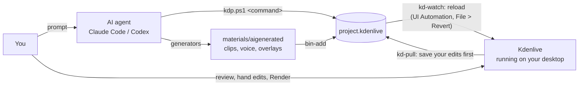

<div align="center">

# Movie Engine

**Aġent tal-intelliġenza artifiċjali jimmonta l-vidjo tiegħek f'Kdenlive waqt li tkun qed tara, u tista' tieħu f'idejk ix-xogħol f'kull mument.**

Aġenti tal-IA għall-ipprogrammar (Claude Code, Codex) jibnu u jibdlu proġetti veri ta' Kdenlive: films, vidjows ta' spjegazzjoni u shorts vertikali. Il-bidliet jidhru live fl-editur li għandek miftuħ. Portabbli, għal Windows, mingħajr patches fl-editur.


[English](../../README.md) · [简体中文](README.zh-CN.md) · [繁體中文](README.zh-TW.md) · [हिन्दी](README.hi.md) · [Español](README.es.md) · [Français](README.fr.md) · [العربية](README.ar.md) · [বাংলা](README.bn.md) · [Português](README.pt.md) · [Русский](README.ru.md) · [اردو](README.ur.md) · [Bahasa Indonesia](README.id.md) · [Deutsch](README.de.md) · [日本語](README.ja.md) · [Türkçe](README.tr.md) · [한국어](README.ko.md) · [Українська](README.uk.md) · [Italiano](README.it.md) · [Polski](README.pl.md) · [Tiếng Việt](README.vi.md) · [فارسی](README.fa.md) · [ไทย](README.th.md) · [Kiswahili](README.sw.md) · [አማርኛ](README.am.md) · [Avañe'ẽ](README.gn.md) · [Setswana](README.tn.md) · [Shqip](README.sq.md) · [Беларуская](README.be.md) · [Български](README.bg.md) · [Bosanski](README.bs.md) · [Hrvatski](README.hr.md) · [Српски](README.sr.md) · [Crnogorski](README.cnr.md) · [Македонски](README.mk.md) · [Slovenščina](README.sl.md) · [Slovenčina](README.sk.md) · [Čeština](README.cs.md) · [Magyar](README.hu.md) · [Română](README.ro.md) · [Dansk](README.da.md) · [Norsk bokmål](README.nb.md) · [Norsk nynorsk](README.nn.md) · [Svenska](README.sv.md) · [Íslenska](README.is.md) · [Suomi](README.fi.md) · [Eesti](README.et.md) · [Latviešu](README.lv.md) · [Lietuvių](README.lt.md) · [Nederlands](README.nl.md) · [Lëtzebuergesch](README.lb.md) · [Rumantsch](README.rm.md) · [Ελληνικά](README.el.md) · **Malti** · [Gaeilge](README.ga.md) · [Català](README.ca.md) · [ქართული](README.ka.md) · [Հայերեն](README.hy.md) · [Azərbaycanca](README.az.md) · [Afrikaans](README.af.md) · [isiZulu](README.zu.md) · [isiXhosa](README.xh.md) · [Sesotho](README.st.md) · [Sepedi](README.nso.md) · [Xitsonga](README.ts.md) · [Tshivenḓa](README.ve.md) · [siSwati](README.ss.md) · [isiNdebele (South Africa)](README.nr.md) · [isiNdebele (Zimbabwe)](README.nd.md) · [chiShona](README.sn.md) · [Chichewa](README.ny.md) · [Ikinyarwanda](README.rw.md) · [Ikirundi](README.rn.md) · [Malagasy](README.mg.md) · [Soomaali](README.so.md) · [Afaan Oromoo](README.om.md) · [Qafar af](README.aa.md) · [ትግርኛ](README.ti.md) · [Sängö](README.sg.md) · [Kreol Seselwa](README.crs.md) · [TjiKalanga](README.kck.md) · [ChiNdau](README.ndc.md)

*Din hija traduzzjoni; il-README bl-Ingliż hija l-verżjoni ta' referenza.*

</div>

---

## Werrej

- [Għaliex](#għaliex)
- [Kif jaħdem](#kif-jaħdem)
- [Karatteristiċi](#karatteristiċi)
- [Rekwiżiti](#rekwiżiti)
- [Installazzjoni](#installazzjoni)
- [Bidu malajr](#bidu-malajr)
- [Kif taħdem mal-aġent](#kif-taħdem-mal-aġent)
- [Il-linja tal-kmand għall-immuntar (`kdp.ps1`)](#il-linja-tal-kmand-għall-immuntar-kdpps1)
- [Sinkronizzazzjoni live mal-editur miftuħ](#sinkronizzazzjoni-live-mal-editur-miftuħ)
- [Ġeneraturi: dak li Kdenlive ma jistax jagħmel](#ġeneraturi-dak-li-kdenlive-ma-jistax-jagħmel)
- [Vuċi u ħoss](#vuċi-u-ħoss)
- [Lingwa tal-interfaċċa](#lingwa-tal-interfaċċa)
- [Struttura tal-folders](#struttura-tal-folders)
- [Testijiet u provi](#testijiet-u-provi)
- [Limitazzjonijiet](#limitazzjonijiet)
- [Soluzzjoni tal-problemi](#soluzzjoni-tal-problemi)
- [Mistoqsijiet frekwenti](#mistoqsijiet-frekwenti)
- [Kontribuzzjonijiet](#kontribuzzjonijiet)
- [Ringrazzjamenti](#ringrazzjamenti)
- [Liċenzja](#liċenzja)

## Għaliex

L-edituri tal-vidjo huma mibnija għal idejn fuq il-maws. L-aġenti tal-IA huma tajbin fl-istruttura, fit-timing u fir-ripetizzjoni: ipoġġu 300 clip fuq il-ritmu, jallinjaw kull sottotitlu mal-vuċi, jerġgħu jagħmlu xena wara l-feedback. Iżda ma jistgħux jikklikkjaw f'interfaċċa grafika mingħajr ma jieħdu f'idejhom id-desktop tiegħek.

Kdenlive huwa editur b'saħħtu b'kodiċi miftuħ, iżda fuq Windows **m'għandux API għall-awtomazzjoni**: il-kontroll permezz ta' D-Bus jeżisti biss fil-verżjonijiet għal Linux, u l-forks li jżidu wieħed jew mhumiex miżmuma jew mhumiex sikuri. Movie Engine isolvi dan mingħajr ma jagħmel patches fl-editur:

1. L-aġent jibdel il-fajl tal-proġett `.kdenlive` permezz ta' linja tal-kmand ittestjata (`engine/kdp.ps1`).
2. Kdenlive li jkun qed jaħdem jingħata struzzjoni biex jerġa' jaqra l-fajl permezz ta' Windows UI Automation, mingħajr ebda ttajpjar, mingħajr maws u mingħajr ma jisraq il-fokus.
3. Il-bidliet tiegħek li għadhom mhux salvati jiġu salvati l-ewwel u qatt ma jinkitbu fuqhom.

Għalhekk l-aġent jimmonta u int tiċċekkja, jew timmonta int bl-idejn. It-tnejn taħdmu fuq l-istess proġett, fl-istess editur, fl-istess ħin.

## Kif jaħdem



Kull kmand tal-immuntar isegwi l-istess ċiklu sikur:

1. **Pull.** Jekk Kdenlive għandu bidliet mhux salvati, jingħata struzzjoni biex isalvahom (il-buttuna Save tat-toolbar permezz ta' UI Automation), u s-salvataġġ jiġi kkonfermat.
2. **Bidla.** Il-kmand jibdel l-XML taħt lock, wara verifika tal-hash u b'snapshot biex tkun tista' tirrevoka. Jekk il-fajl inbidel sadanittant, ma jinkiteb xejn.
3. **Rikarikar.** Il-watcher jara t-timbru tal-IA u jħaddem File > Revert fl-editur miftuħ. Is-suċċess jgħodd biss meta l-widget tat-timeline ikun verament inbena mill-ġdid.
4. **Kunflitt.** Jekk bdejt timmonta fil-frattemp, ma jsir l-ebda rikarikar u x-xogħol tiegħek jibqa'. Il-verżjoni tal-IA tinżamm għalihom, u l-aġent jerġa' japplika l-bidla tiegħu fuq tiegħek.

## Karatteristiċi

- **Immuntar sħiħ tal-proġett mingħajr l-interfaċċa grafika**: madwar 120 kmand li jkopru l-bin, it-timeline, l-effetti, il-kompożizzjonijiet, it-tracks, il-gwidi, il-markers, is-sottotitli, is-sekwenzi, il-veloċità u r-remapping tal-ħin, is-slideshows, it-titli, il-proxies, ir-rendering u l-undo/redo. Ara r-[referenza tal-kmandi](#il-linja-tal-kmand-għall-immuntar-kdpps1).
- **Sinkronizzazzjoni live mal-editur miftuħ.** Il-bidliet tal-IA jidhru fil-Kdenlive li qed tħares lejh; il-bidliet tiegħek mhux salvati jiġu salvati l-ewwel u qatt ma jintilfu.
- **Qatt ma jfixkel id-desktop tiegħek.** L-ebda serqa tal-fokus, ittajpjar jew moviment tal-maws. L-edituri tat-test jaħdmu fuq desktop inviżibbli ta' Windows.
- **Portabbli.** L-editur, is-settings, Node.js, il-fonts u l-għodod jinsabu f'folder wieħed. Ikkopjah fuq PC ieħor u jaħdem; xejn ma jinkiteb f'Program Files jew fil-profil tiegħek ta' Windows.
- **Ġeneraturi għal dak li Kdenlive ma jistax jagħmel**: test kinetiku b'animazzjoni ittra b'ittra, annotazzjonijiet li jidhru miġbuda bl-idejn, xeni 3D tal-interfaċċa, animazzjonijiet tal-cursor u films twal u interattivi ta' spjegazzjoni. Jiġu rrenderjati fuq il-GPU b'motion blur veru u jitqiegħdu fuq it-timeline bħala clips normali.
- **Vuċi b'timing tal-kliem** (Microsoft Edge TTS, mingħajr ċavetta tal-API). Is-sottotitli u l-azzjonijiet jiskattaw eżatt fuq il-kelma.
- **Effetti tal-ħoss sintetizzati** (whoosh, click, pop, riser, impact u oħrajn), iġġenerati bil-kodiċi.
- **Ippruvat, mhux preżunt.** Kull kmand għandu verifika tar-riżultat, l-effetti u l-kompożizzjonijiet jiġu ttestjati wieħed wieħed, u r-riżultati mhux ipproċessati jinsabu f'`docs/proof/`.
- **Struzzjonijiet għall-aġenti inklużi.** `AGENTS.md` u l-ħiliet f'`.claude/skills/` jgħallmu lil Claude Code u Codex il-proċess tax-xogħol, il-format tal-fajl u l-insidji.

## Rekwiżiti

| | |
|---|---|
| Sistema operattiva | Windows 10 jew 11, x64 |
| Editur | Kdenlive **26.08.3**, verżjoni portabbli (standalone). Verżjonijiet oħra mhumiex ittestjati. |
| Node.js | 18 jew aktar ġdid: il-`.zip` għal Windows x64 minn nodejs.org, estratt f'`engine/node/` |
| Browser | Microsoft Edge (parti minn Windows); jintuża headless mir-renderers tax-xeni |
| Aġent | [Claude Code](https://claude.com/claude-code) jew Codex. Mhux obbligatorju: kull għodda taħdem ukoll bl-idejn. |
| Diska | madwar 1 GB għall-editur u l-għodod, flimkien mal-midja tiegħek |
| GPU | kwalunkwe GPU b'kodifikazzjoni H.264 fil-hardware tħaffef `film-render.mjs` (mingħajrha tintuża kodifikazzjoni bis-software) |

## Installazzjoni

Kollox jiġi installat **ġewwa l-folder**. Ma hemm bżonn l-ebda drittijiet ta' amministratur.

```powershell
git clone https://github.com/vladtarrow/movie-engine.git
cd movie-engine
```

**1. Node.js.** Niżżel il-`.zip` għal Windows x64 ta' Node.js 18 jew aktar ġdid minn <https://nodejs.org/en/download> u estratti l-kontenut tiegħu f'`engine\node\`, sabiex hemmhekk ikun hemm `engine\node\node.exe` u `engine\node\npm.cmd`. Ma hemm bżonn la installer u lanqas Node tas-sistema. L-iskripts kollha jaħdmu permezz ta' `engine\node.cmd`, qatt permezz ta' Node tas-sistema.

**2. Pakketti ta' Node** għall-għodda tal-vuċi u għar-renderers (il-verżjonijiet huma ffissati f'`engine/voice/package.json`):

```powershell
engine\node\npm.cmd install --prefix engine\voice
```

**3. Kdenlive 26.08.3 portabbli.** Niżżel `kdenlive-26.08.3_standalone.exe` minn <https://download.kde.org/stable/kdenlive/26.08/windows/> f'`engine\installer\`, iċċekkjah u estrattih:

```powershell
(Get-FileHash engine\installer\kdenlive-26.08.3_standalone.exe -Algorithm SHA256).Hash
# expected: A25427B1DFF2C17E3B0386E991BB1A719382BB3176D1A90E441CDAEB6E0A967D
engine\installer\kdenlive-26.08.3_standalone.exe -o"engine\Kdenlive" -y
```

L-editur jispiċċa f'`engine\Kdenlive\kdenlive-26.08.3_standalone\bin\`. Diġà jinkludi `melt.exe` u `ffmpeg.exe`.

**4. L-ewwel tħaddim.**

```powershell
engine\kdenlive.cmd
```

Kdenlive iżomm is-settings kollha tiegħu f'`engine\profile-kdenlive\`, mhux fil-profil tiegħek ta' Windows. Fl-ewwel tħaddim juri darba waħda wizard tas-setup.

## Bidu malajr

### B'aġent

Iftaħ il-folder f'Claude Code (jew Codex) u itlob bi kliem sempliċi:

> Agħmel proġett vertikali ġdid ta' 30 fps "launch-teaser". Poġġi t-tliet screenshots minn `materials/designers/launch/` fuq it-timeline, 2.5 s kull wieħed b'cross-fade qasir, żid vuċi minn `script.txt` u allinja sottotitlu kinetiku ma' kull linja.

> Iftaħhuli f'Kdenlive.

> It-tieni shot huwa twil wisq. Qassru għal 1.8 s u tella' l-logo ftit 'il fuq.

L-aġent isegwi `AGENTS.md`: jibdel permezz ta' `kdp.ps1`, jirrenderja biss il-clips li jeħtieġ l-immuntar, u jżomm l-editur miftuħ sinkronizzat. Int tiċċekkja f'Kdenlive, timmonta bl-idejn meta trid, u tagħfas Render meta tkun sodisfatt.

### Bl-idejn

```powershell
# a new 1080x1920 30 fps project with 2 video and 2 audio tracks
powershell -NoProfile -ExecutionPolicy Bypass -File engine\kdp.ps1 new -Project projects\hello\hello.kdenlive -Profile vertical_hd_30

# a 3-second title and a colour background
powershell -NoProfile -ExecutionPolicy Bypass -File engine\kdp.ps1 bin-color -Project projects\hello\hello.kdenlive -Color '#203060' -Seconds 3 -Name bg
powershell -NoProfile -ExecutionPolicy Bypass -File engine\kdp.ps1 title -Project projects\hello\hello.kdenlive -Text "Hello" -Seconds 3 -Name hi

# place them: background on V1, title above it on V2
powershell -NoProfile -ExecutionPolicy Bypass -File engine\kdp.ps1 add -Project projects\hello\hello.kdenlive -Bin bg -Track V1 -At 0
powershell -NoProfile -ExecutionPolicy Bypass -File engine\kdp.ps1 add -Project projects\hello\hello.kdenlive -Bin hi -Track V2 -At 0

# a check frame, then open it in the editor
powershell -NoProfile -ExecutionPolicy Bypass -File engine\kdp.ps1 frame -Project projects\hello\hello.kdenlive -At 1.5 -Out out\hello\check.png
engine\kdenlive.cmd projects\hello\hello.kdenlive
```

Biex terġa' tiftaħ l-aħħar proġett aktar tard, agħfas darbtejn fuq `open-last-project.cmd`.

## Kif taħdem mal-aġent

L-aġent jaqra `AGENTS.md` (Codex) jew `CLAUDE.md`, li jimportah (Claude Code), flimkien ma' żewġ ħiliet:

| Ħila | X'tgħallem |
|---|---|
| `.claude/skills/kdenlive-project-file` | il-format `.kdenlive` / MLT XML, `kdp.ps1`, il-verifika b'`melt` |
| `.claude/skills/kdenlive-live` | kif jitħaddem l-editur li qed jaħdem b'mod sikur: tħaddim, pull, rikarikar, qbid tat-tieqa tiegħu |

Regoli li l-aġent isegwi, u li tista' toqgħod fuqhom:

- Qatt ma jieħu l-maws, it-tastiera jew il-fokus tiegħek, u qatt ma jieħu screenshots tad-desktop tiegħek (biss tat-tieqa tal-editur innifsu).
- Jagħmel hu stess il-passi fl-interfaċċa grafika (save, open, rikarikar) minflok ma jitolbok tikklikkja.
- Jistaqsi qabel ma jniżżel xi ħaġa u qabel ma jħassar xi ħaġa.
- Jirrenderja biss dak li jeħtieġ ix-xogħol (clips tax-xeni, frames ta' verifika). Il-film finali jirrenderjah biss meta titlob int.
- Meta Kdenlive ma jistax jagħmel xi ħaġa sew, l-aġent jibniha barra bil-kodiċi u jdaħħal ir-riżultat bħala clip. Ma jdgħajjifx l-effett.

## Il-linja tal-kmand għall-immuntar (`kdp.ps1`)

```powershell
powershell -NoProfile -ExecutionPolicy Bypass -File engine\kdp.ps1 <command> -Project <file.kdenlive> [options]
```

Il-ħinijiet huma f'sekondi, b'punt (`2.5`). It-tracks huma `V1 V2 …` (V1 l-aktar baxx) u `A1 A2 …`. Clip jiġi indirizzat b'`-Track` flimkien ma' kwalunkwe ħin `-At` ġewwa fih. Il-parametri tal-effetti jmorru f'`-Params "name=value||name=value"`. Il-lista sħiħa b'kull għażla tinsab fil-header ta' `engine/kdp.ps1`.

| Grupp | Kmandi |
|---|---|
| Proġett | `new`, `profiles`, `info`, `validate`, `fonts`, `profile-set`, `profile-from-clip`, `zone`, `archive`, `backups`, `rebase`, `otio-export`, `otio-import` |
| Bin | `bin-add`, `bin-color`, `title`, `title-text`, `title-save`, `title-template`, `bin-rename`, `bin-remove`, `bin-info`, `bin-set`, `bin-duplicate`, `bin-replace-file`, `bin-reload`, `folder`, `bin-folder`, `relink`, `clean`, `generator`, `playlist-clip`, `extract-audio`, `transcode` |
| Timeline | `add`, `add-av`, `move`, `copy`, `trim`, `ripple-trim`, `slip`, `split`, `remove`, `speed`, `remap`, `disable`, `enable`, `group`, `ungroup`, `mix`, `unmix`, `space-insert`, `space-remove`, `spaces-remove-all`, `track-clear`, `replace-in-timeline` |
| Effetti | `effects`, `effect-info`, `effect-add`, `effect-list`, `effect-set`, `effect-remove`, `effect-copy`, `effect-clear`, `effects-all`, `bin-effect`, `effect-templates`, `effect-template` |
| Kompożizzjonijiet | `compositions`, `comp-info`, `comp-add`, `comp-list`, `comp-set`, `comp-remove` |
| Tracks | `track-add`, `track-remove`, `track-set` |
| Gwidi u markers | `guide-add`, `guide-list`, `guide-remove`, `guide-set`, `guide-clear`, `guide-export`, `guide-category`, `marker`, `marker-list`, `marker-set`, `marker-remove` |
| Sottotitli | `sub-add`, `sub-import`, `sub-export`, `sub-state` |
| Sekwenzi | `sequence-add`, `sequences`, `copy-to-sequence`, `expand`; kwalunkwe kmand b'`-Sequence <name>` jaħdem ġewwa dik is-sekwenza |
| Speċjali | `slideshow`, animazzjonijiet Lottie / Glaxnimate permezz ta' `bin-add`, `proxy`, `stabilize`, `scene-split`, `speed-job`, `subclip` |
| Output | `frame` (PNG wieħed), `preview` (render malajr b'melt), `render` (ir-renderer ta' Kdenlive stess jew preset), `presets` |
| Storja | `undo`, `redo`, `clear-history` (snapshots f'`projects/<name>/.kdp-history`) |

Imġiba li ta' min ikun jaf biha:

- In-nofsijiet marbuta tal-awdjo u tal-vidjo jiċċaqalqu, jinqatgħu, jinqasmu u jitneħħew flimkien (`-Alone` għal nofs wieħed biss).
- Kmand li jfalli joħroġ bil-kodiċi 1 u ma jikteb xejn.
- L-effetti li l-verżjoni għal Windows ma tistax tħaddem jiġu rrifjutati, mhux injorati fis-skiet (lista: `docs/proof/assets.txt`).
- Kull azzjoni tal-menu ta' Kdenlive hija mqabbla ma' kmand, ma' triq oħra, jew ma' "view only" f'`engine/tools/data/kdenlive-actions.csv`. Ara `docs/kdenlive-coverage.md`.

## Sinkronizzazzjoni live mal-editur miftuħ

| Skript | X'jagħmel | Kodiċi tal-ħruġ |
|---|---|---|
| `engine\kd-pull.ps1 -Project <f>` | iġiegħel lil Kdenlive isalva l-bidliet tiegħek u jikkonferma dan | 0 fajl aġġornat, 3 mhux qed jaħdem, 4 mhux ikkonfermat |
| `engine\kd-reload.ps1 -Project <f>` | File > Revert, ikkonfermat mit-timeline mibnija mill-ġdid | 0 ikkonfermat, 2 għandek bidliet mhux salvati (xejn ma ntrema), 3 mhux qed jaħdem, 4 falla |
| `engine\kd-watch.ps1 -Project <f>` | watcher fl-isfond: jirrikarika wara kull kitba tal-IA, jirreġistra l-kunflitti | log f'`engine\kd-watch.log`; ħassar `engine\kd-watch.run` biex twaqqfu |
| `engine\kdenlive-bg.ps1 [project]` | jibda Kdenlive minimizzat għal aġent | 0 mgħobbi, 4 mhux ikkonfermat |
| `engine\kdenlive.cmd [project]` | jibda Kdenlive għalik | |

Ibda l-watcher darba f'kull sessjoni:

```powershell
Start-Process powershell -WindowStyle Hidden -ArgumentList '-NoProfile','-ExecutionPolicy','Bypass','-File','engine\kd-watch.ps1','-Project','projects\hello\hello.kdenlive'
```

Proġetti kbar: rikarikar ta' proġett ta' 1000 clip jieħu minuti, u l-għodod jistennewh minflok ma jirrappurtaw qabel il-ħin. Il-proġetti jinfetħu permezz ta' *File > Open Recent* f'editur vojt, għax meta fajl jinfetaħ direttament Qt jgħaddi minn kull element tat-timeline għall-aċċessibbiltà, u dan kien madwar 10 minuti aktar bil-mod.

## Ġeneraturi: dak li Kdenlive ma jistax jagħmel

Kdenlive/MLT m'għandux animazzjoni tat-test ittra b'ittra, m'għandux expressions u ftit li xejn għandu 3D, u l-effetti tqal inaqqsu l-veloċità tal-playback. Movie Engine jirrenderja dawn il-partijiet barra u jpoġġihom fuq it-timeline bħala clips normali, ġeneralment b'alpha, fuq track 'il fuq mill-istampi. L-iskript tal-ġeneratur u l-inputs tiegħu jibqgħu fil-folder tal-proġett, sabiex clip ikun jista' jiġi ġġenerat mill-ġdid meta jinbidlu t-test, il-font jew it-timing.

| Għodda | X'tagħmel |
|---|---|
| `engine/tools/kinetic-text.ps1` | sottotitli kinetiċi b'animazzjoni ittra b'ittra, kull kelma b'timing minn `voice.json`, kaxxa ta' enfasi |
| `engine/tools/annotate.ps1` | ċrieki, kaxxi, linji taħt il-kliem u vleġeġ li jidhru miġbuda bl-idejn u jinġibdu fuq screenshot |
| `engine/tools/card-entrance.ps1` | karta bi screenshot li titla' u tikber b'dell artab |
| `engine/tools/pdf-to-png.ps1` | slides minn esportazzjoni PDF |
| `engine/tools/html-render.mjs` | kwalunkwe xena HTML/CSS/canvas f'vidjo: animazzjoni tal-interfaċċa, cursors, 3D, masks |
| `engine/tools/film-render.mjs` + `film/` | films twal u interattivi ta' spjegazzjoni fuq canvas: clip wieħed għal kull linja tal-vuċi, l-azzjonijiet jiskattaw fuq il-kliem mitkellem, motion blur fuq il-GPU b'madwar 45 fps |

Iż-żewġ renderers iħaddmu l-Microsoft Edge li jiġi ma' Windows, headless, bi profil li jintrema wara l-użu u mingħajr aċċess għan-netwerk.

### Dimostrazzjonijiet

```powershell
# a 3-second 3D title card with a cursor click
engine\node.cmd engine\tools\html-render.mjs examples\demo\scene\scene.html examples\demo\out --frames 0,30,60,89
engine\node.cmd engine\tools\html-render.mjs examples\demo\scene\scene.html examples\demo\out\scene.mp4

# a 4-shot interactive film timed to two voice lines
engine\node.cmd engine\tools\film-render.mjs examples\demo\film\film.html examples\demo\out --check
engine\node.cmd engine\tools\film-render.mjs examples\demo\film\film.html examples\demo\out --shots all --width 640
engine\node.cmd engine\tools\film-render.mjs examples\demo\film\film.html examples\demo\out\clips --suffix -v01
```

Film huwa tliet fajls żgħar. `data.js` fih ix-shots u l-ħinijiet tal-kliem. `direction.js` għandu linja waħda għal kull shot:

```text
1 | hover 192 108 @brand | tag 300 60 Your brand @deserves | confetti 192 90 @film
2 say=A film that/*explains* it
3 | click 116 108 @before | click 268 108 @after | chips Before~After @after
4 scene=counter | count 0 120 % @count
```

`scenes.js` fih ix-shots li jinġibdu mix-xejn. `@word` jiskatta azzjoni meta l-vuċi tgħid dik il-kelma. L-azzjonijiet jinkludu click, hover, drag, zoom, lens, ring, arrow, chips, toggle, slider, toast, type, count u confetti; is-sintassi sħiħa tinsab fil-bidu ta' `engine/tools/film/film-kit.js`.

## Vuċi u ħoss

```powershell
engine\node.cmd engine\voice\voice.mjs lines.json materials\aigenerated\hello\voice en-US-AndrewMultilingualNeural +0%
```

`lines.json` huwa lista ta' linji. L-għodda tikteb mp3 wieħed għal kull linja flimkien ma' `voice.json`, bit-tul u l-bidu u t-tmiem ta' kull kelma. Il-linji jinżammu f'cache, għalhekk jekk tibdel linja waħda tiġi ġġenerata mill-ġdid biss dik il-linja. Tuża t-text-to-speech online ta' Microsoft Edge permezz tal-pakkett `msedge-tts`: ma hemmx bżonn ċavetta, iżda s-servizz mhuwiex uffiċjali u jeħtieġ l-internet.

```powershell
engine\node.cmd engine\audio\sfx.mjs materials\aigenerated\sfx
```

Dan jissintetizza bil-kodiċi whoosh, whoosh-long, swipe, click, pop, tick, riser, impact, ding u reveal; sett lest jinsab f'`materials/aigenerated/sfx/`. Imla bis-skiet il-ħsejjes iqsar minn frame wieħed qabel ma tpoġġihom (`-af apad=whole_dur=0.0667`).

## Lingwa tal-interfaċċa

Il-launchers jibdew Kdenlive bl-**Ingliż** b'mod awtomatiku. Biex tuża lingwa oħra, issettja `MOVIE_ENGINE_UI_LANG` qabel ma tibda:

```powershell
$env:MOVIE_ENGINE_UI_LANG = 'ru'; engine\kdenlive.cmd
```

UI Automation isib l-elementi tal-menu permezz tal-ismijiet viżibbli tagħhom. L-ismijiet għal 31 lingwa tal-interfaċċa huma diġà inklużi (`engine/tools/kd-ui.ps1`, `$KdNames`). Għal kwalunkwe lingwa oħra, żid l-ismijiet tagħha hemmhekk u ċċekkja b':

```powershell
powershell -NoProfile -ExecutionPolicy Bypass -File engine\tools\kd-langcheck.ps1
```

## Struttura tal-folders

```text
movie-engine/
├─ AGENTS.md, CLAUDE.md          instructions for AI agents
├─ .claude/skills/               agent skills: project file format, live editor
├─ engine/
│  ├─ kdp.ps1                    the editing command line
│  ├─ kd-pull / kd-reload / kd-watch .ps1, kdenlive.cmd, kdenlive-bg.ps1
│  ├─ tools/                     internals, generators, tests, data (action map)
│  ├─ voice/  audio/  fonts/     TTS, synthesized SFX, Poppins (OFL)
│  ├─ Kdenlive/  node/           portable editor and Node.js (not in git)
│  └─ profile-kdenlive/          the editor's settings (not in git)
├─ projects/<name>/<name>.kdenlive
├─ materials/
│  ├─ download/                  stock and downloaded files (not in git)
│  ├─ aigenerated/               everything the AI made (sfx/ and test-kit/ ship with the engine)
│  ├─ designers/  brand/         files from your team, brand assets
├─ examples/demo/                demos of the scene and film renderers
├─ out/                          renders (not in git)
└─ docs/                         proofs, coverage, translations of this README
```

Il-mogħdijiet tal-midja ġewwa l-proġetti huma relattivi. Jekk tiċċaqlaq jew tikkopja l-folder, `kdp.ps1 rebase` (li jitħaddem ukoll awtomatikament minn `kdenlive.cmd`) jikteb il-post il-ġdid fil-proġett.

## Testijiet u provi

L-affermazzjonijiet dwar x'jaħdem huma sostnuti minn verifiki tar-riżultat, mhux mill-fatt li "il-funzjoni ħadmet". Is-sommarju jinsab f'[`docs/kdenlive-proof.md`](../../docs/kdenlive-proof.md), u l-output mhux ipproċessat f'`docs/proof/`.

| Test | X'jiċċekkja |
|---|---|
| `engine\tools\kdp-clitest.ps1` | kull kmand ta' `kdp.ps1`, permezz tal-linja tal-kmand, billi jqabbel il-proġett li jirriżulta |
| `engine\tools\kd-livetest.ps1` | pull, rikarikar, watcher, kunflitti u race conditions kontra Kdenlive veru fuq desktop inviżibbli |
| `engine\tools\kdp-assetsweep.ps1` | kull effett u kull kompożizzjoni: jirrenderja u jqabbel il-frames |
| `engine\tools\kdp-portabletest.ps1` | jikkopja l-folder x'imkien ieħor u jaħdem mill-kopja |
| `engine\tools\kd-langcheck.ps1` | il-lingwa tal-interfaċċa u li UI Automation isib il-menu |
| `engine\tools\kdp-coverage-check.ps1` | li kull azzjoni tal-menu hija mqabbla, u li l-ebda prova mhi eqdem mill-kodiċi |

```powershell
powershell -NoProfile -ExecutionPolicy Bypass -File engine\tools\kdp-clitest.ps1 -Report docs\proof\clitest.txt
powershell -NoProfile -ExecutionPolicy Bypass -File engine\tools\kd-livetest.ps1 -Report docs\proof\live-en.txt
```

L-edituri tat-test jaħdmu biss fuq desktop moħbi bil-profil tagħhom, għalhekk it-testijiet qatt ma jmissu l-Kdenlive miftuħ tiegħek jew il-fokus tiegħek.

## Limitazzjonijiet

- **Windows biss**, Kdenlive **26.08.3** biss. Linux għandu D-Bus u jkun jeħtieġ pont differenti.
- Meta jinbeda, l-editur jieħu l-fokus tat-tastiera għal madwar 3 sekondi waqt li tidher it-tieqa vojta. L-aġenti jistaqsu qabel ma jibdewh waqt li tkun qed taħdem. Ir-rikarikar u l-bidliet ma jiħdux il-fokus.
- Il-verżjoni għal Windows m'għandhiex il-moduli MLT sox, ladspa u movit u xi effetti frei0r/avfilter; `kdp.ps1` jirrifjutahom (`docs/proof/assets.txt`).
- L-esportazzjoni u l-importazzjoni OpenTimelineIO jġorru biss clips u spazji vojta. Il-multicam m'għandux qlib live bejn l-angoli (il-qatgħat isiru b'split/remove/hide).
- "Save As…" permezz ta' UI Automation fuq tieqa minimizzata ma jiftaħ l-ebda dialog; minflok l-aġent juża `archive` jew kopji tal-fajls.
- Ir-rikonoxximent tad-diskors (sottotitli awtomatiċi) jeħtieġ Whisper jew Vosk, li mhumiex inklużi.
- It-titli magħmula bl-għodda tat-titli ta' Kdenlive jużaw fonts installati f'Windows. Għal tipografija garantita, irrenderja t-test bil-ġeneraturi, li jgħabbu l-fonts minn `engine/fonts/`.
- Edge TTS huwa servizz online mhux uffiċjali u jista' jinbidel jew jieqaf jaħdem.

## Soluzzjoni tal-problemi

| Sintomu | Kawża u soluzzjoni |
|---|---|
| Kdenlive qed jaħdem, iżda meta tikklikkja fuqu fit-taskbar ma jidher xejn | Il-pożizzjoni salvata tat-tieqa tiegħu hija barra mill-iskrin. Agħlqu u ħassar l-entrati `kdockLayout` f'`engine\profile-kdenlive\AppData\Local\kdenliverc`, jew ċaqlaq it-tieqa b'`SetWindowPos` (ara `AGENTS.md`). |
| `kd-reload.ps1` joħroġ b'2 | Għandek bidliet mhux salvati. Xejn ma ntrema. Ħaddem `kd-pull.ps1`, imbagħad erġa' applika l-bidla (`kdp.ps1` jagħmel dan waħdu). |
| `CONFLICT` f'`engine\kd-watch.log` | Int u l-aġent immuntajtu fl-istess mument. Il-verżjoni tiegħek tibqa' fl-editur, u l-verżjoni tal-IA tinsab f'`projects\<name>\.kdp-history\<name>\conflict\`. Itlob lill-aġent jerġa' japplika l-bidla tiegħu. |
| Kmand joħroġ b'1 bil-messaġġ "pull not confirmed" | Kdenlive huwa okkupat jew qed juri dialog. Agħlaq id-dialog jew stenna sakemm jispiċċa t-tagħbija, imbagħad erġa' pprova. |
| Skript ta' PowerShell ma jistax jiġi analizzat | Skripts b'test mhux ASCII għandhom jiġu salvati bħala UTF-8 **b'BOM** għal Windows PowerShell 5.1. |
| `voice.mjs` jieqaf b'"Stream closed before the synthesis completed" | Ġeneralment problema tan-netwerk, jew SSML mhux escaped f'kopji eqdem. `voice.mjs` jagħmel l-escape ta' `& < >` waħdu. |
| Il-ftuħ ta' proġett kbir jieħu ħafna minuti | Iftħu permezz ta' `kdenlive.cmd` / `kdenlive-bg.ps1`, qatt bħala `kdenlive.exe project.kdenlive`. |

## Mistoqsijiet frekwenti

**Għandi bżonn Claude Code jew Codex?**
Le. Kull għodda hija skript sempliċi li tista' tħaddem bl-idejn. L-aġent huwa dak li jagħmilha mgħaġġla: jippjana l-immuntar, iħaddem l-għodod u jżomm l-editur sinkronizzat.

**L-aġent se jikteb fuq il-bidliet manwali tiegħi?**
Le. Qabel kull kitba, il-bidliet tiegħek mhux salvati jiġu salvati u kkonfermati. Jekk timmonta waqt li l-aġent ikun qed jikteb, il-kitba tiġi rrifjutata jew tinżamm għaliha bħala kunflitt, u qatt ma tiġi applikata fuq ix-xogħol tiegħek.

**Nista' nkompli nuża Kdenlive normalment?**
Iva. Huwa l-Kdenlive standard bil-folder tas-settings tiegħu. Immonta, ara l-preview u rrenderja bħas-soltu.

**Jaħdem ma' Kdenlive li diġà għandi installat?**
Juża l-kopja portabbli tiegħu f'`engine\Kdenlive\`, għalhekk il-Kdenlive installat tiegħek u s-settings tiegħu ma jintmessux.

**Għaliex mhux fork ta' Kdenlive b'API, jew editur ieħor?**
Fuq Windows ma jeżisti l-ebda fork miżmum u sikur (stħarriġ ta' Novembru 2026). Ġew evalwati OpenShot, Blender VSE, DaVinci Resolve, Shotcut u edituri fuq il-web; Kdenlive ta l-akbar fond fl-immuntar. Proposta ta' REST API fil-proġett upstream (merge request !902) qed tiġi segwita.

**Jista' jirrenderja l-vidjo finali?**
Iva, b'`kdp.ps1 render` (ir-renderer ta' Kdenlive stess, moħbi), jew tagħfas int Render fl-editur.

**Il-midja tiegħi tittella' x'imkien?**
Le. It-test tal-vuċi biss jintbagħat lis-servizz Edge TTS meta tiġġenera l-vuċi. Ir-renderers tax-xeni jaħdmu bin-netwerk mitfi.

## Kontribuzzjonijiet

Il-kontribuzzjonijiet huma milqugħa. Ara [CONTRIBUTING.md](../../CONTRIBUTING.md). Fil-qosor:

- Kull operazzjoni ġdida jew mibdula ta' `kdp.ps1` teħtieġ verifika tar-riżultat f'`kdp-clitest.ps1`, entrata fil-mappa tal-azzjonijiet, u tħaddim ġdid ta' `kdp-coverage-check.ps1`.
- Qatt tibda Kdenlive tat-test fuq id-desktop viżibbli; uża `engine/tools/kd-hidden.ps1`.
- Żomm kollox portabbli: l-ebda installazzjoni barra l-folder, l-ebda mogħdija assoluta fil-proġetti.
- Ikteb il-partikolaritajiet ivverifikati f'`AGENTS.md` jew fil-ħila korrispondenti.

## Ringrazzjamenti

- [Kdenlive](https://kdenlive.org) u [MLT](https://www.mltframework.org): l-editur u l-magna ta' taħtu.
- [FFmpeg](https://ffmpeg.org), inkluż ma' Kdenlive.
- [msedge-tts](https://www.npmjs.com/package/msedge-tts) għall-vuċi.
- [Poppins](https://fonts.google.com/specimen/Poppins) minn Indian Type Foundry, SIL Open Font License (`engine/fonts/OFL.txt`).
- `engine/tools/data/kdenliveui-26.08.3.rc`: il-fajl tal-menu ta' Kdenlive, meħud mill-kodiċi sors ta' Kdenlive 26.08.3; jintuża biss mill-verifika tal-kopertura. Jibqa' taħt il-liċenzja GPL ta' Kdenlive, mhux taħt il-MIT License.

## Liċenzja

Il-kodiċi proprju ta' Movie Engine huwa rilaxxat taħt il-[Liċenzja MIT](../../LICENSE). Kdenlive, MLT, FFmpeg, il-pakketti ta' Node.js u l-font Poppins iżommu l-liċenzji tagħhom.
