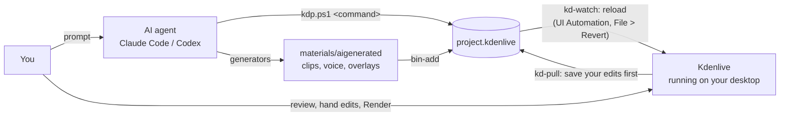

<div align="center">

# Movie Engine

**En AI-agent redigerer videoen din i Kdenlive mens du ser på, og du kan ta over når som helst.**

AI-kodeagenter (Claude Code, Codex) bygger og endrer ekte Kdenlive-prosjekter: filmer, forklaringsvideoer og vertikale shorts. Endringene dukker opp med en gang i editoren du har åpen. Portabelt, Windows, ingen patcher av editoren.


[English](../../README.md) · [简体中文](README.zh-CN.md) · [繁體中文](README.zh-TW.md) · [हिन्दी](README.hi.md) · [Español](README.es.md) · [Français](README.fr.md) · [العربية](README.ar.md) · [বাংলা](README.bn.md) · [Português](README.pt.md) · [Русский](README.ru.md) · [اردو](README.ur.md) · [Bahasa Indonesia](README.id.md) · [Deutsch](README.de.md) · [日本語](README.ja.md) · [Türkçe](README.tr.md) · [한국어](README.ko.md) · [Українська](README.uk.md) · [Italiano](README.it.md) · [Polski](README.pl.md) · [Tiếng Việt](README.vi.md) · [فارسی](README.fa.md) · [ไทย](README.th.md) · [Kiswahili](README.sw.md) · [አማርኛ](README.am.md) · [Avañe'ẽ](README.gn.md) · [Setswana](README.tn.md) · [Shqip](README.sq.md) · [Беларуская](README.be.md) · [Български](README.bg.md) · [Bosanski](README.bs.md) · [Hrvatski](README.hr.md) · [Српски](README.sr.md) · [Crnogorski](README.cnr.md) · [Македонски](README.mk.md) · [Slovenščina](README.sl.md) · [Slovenčina](README.sk.md) · [Čeština](README.cs.md) · [Magyar](README.hu.md) · [Română](README.ro.md) · [Dansk](README.da.md) · **Norsk bokmål** · [Norsk nynorsk](README.nn.md) · [Svenska](README.sv.md) · [Íslenska](README.is.md) · [Suomi](README.fi.md) · [Eesti](README.et.md) · [Latviešu](README.lv.md) · [Lietuvių](README.lt.md) · [Nederlands](README.nl.md) · [Lëtzebuergesch](README.lb.md) · [Rumantsch](README.rm.md) · [Ελληνικά](README.el.md) · [Malti](README.mt.md) · [Gaeilge](README.ga.md) · [Català](README.ca.md) · [ქართული](README.ka.md) · [Հայերեն](README.hy.md) · [Azərbaycanca](README.az.md) · [Afrikaans](README.af.md) · [isiZulu](README.zu.md) · [isiXhosa](README.xh.md) · [Sesotho](README.st.md) · [Sepedi](README.nso.md) · [Xitsonga](README.ts.md) · [Tshivenḓa](README.ve.md) · [siSwati](README.ss.md) · [isiNdebele (South Africa)](README.nr.md) · [isiNdebele (Zimbabwe)](README.nd.md) · [chiShona](README.sn.md) · [Chichewa](README.ny.md) · [Ikinyarwanda](README.rw.md) · [Ikirundi](README.rn.md) · [Malagasy](README.mg.md) · [Soomaali](README.so.md) · [Afaan Oromoo](README.om.md) · [Qafar af](README.aa.md) · [ትግርኛ](README.ti.md) · [Sängö](README.sg.md) · [Kreol Seselwa](README.crs.md) · [TjiKalanga](README.kck.md) · [ChiNdau](README.ndc.md)

*Dette er en oversettelse. Den engelske README-en er referanseversjonen.*

</div>

---

## Innhold

- [Hvorfor](#hvorfor)
- [Slik fungerer det](#slik-fungerer-det)
- [Funksjoner](#funksjoner)
- [Krav](#krav)
- [Installasjon](#installasjon)
- [Kom raskt i gang](#kom-raskt-i-gang)
- [Arbeid med agenten](#arbeid-med-agenten)
- [Kommandolinjen for redigering (`kdp.ps1`)](#kommandolinjen-for-redigering-kdpps1)
- [Live-synkronisering med den åpne editoren](#live-synkronisering-med-den-åpne-editoren)
- [Generatorer: det Kdenlive ikke kan](#generatorer-det-kdenlive-ikke-kan)
- [Speakerstemme og lyd](#speakerstemme-og-lyd)
- [Grensesnittspråk](#grensesnittspråk)
- [Mappestruktur](#mappestruktur)
- [Tester og bevis](#tester-og-bevis)
- [Begrensninger](#begrensninger)
- [Feilsøking](#feilsøking)
- [Ofte stilte spørsmål](#ofte-stilte-spørsmål)
- [Bidra](#bidra)
- [Takk](#takk)
- [Lisens](#lisens)

## Hvorfor

Videoredigeringsprogrammer er laget for en hånd på musa. AI-agenter er gode på struktur, timing og repetisjon: å plassere 300 klipp på takten, å time hver undertekst til stemmen, å gjøre om en scene etter tilbakemelding. Men de kan ikke klikke seg gjennom et grafisk grensesnitt uten å ta over skrivebordet ditt.

Kdenlive er en kraftig editor med åpen kildekode, men på Windows har den **ikke noe API for automatisering**: styring via D-Bus finnes bare i Linux-bygg, og forkene som legger til et, er enten uvedlikeholdte eller utrygge. Movie Engine løser dette uten å patche editoren:

1. Agenten redigerer prosjektfilen `.kdenlive` gjennom en testet kommandolinje (`engine/kdp.ps1`).
2. Den kjørende Kdenlive får beskjed om å laste inn filen på nytt via Windows UI Automation, uten tastetrykk, uten mus og uten å stjele fokus.
3. Dine egne ulagrede endringer lagres først og blir aldri overskrevet.

Så agenten redigerer og du går gjennom, eller du redigerer selv for hånd. Dere jobber begge med det samme prosjektet, i den samme editoren, samtidig.

## Slik fungerer det



Hver redigeringskommando følger den samme trygge syklusen:

1. **Pull.** Hvis Kdenlive har ulagrede endringer, får den beskjed om å lagre dem (Lagre-knappen på verktøylinjen via UI Automation), og lagringen bekreftes.
2. **Redigering.** Kommandoen endrer XML-en under en lås, etter en hashkontroll og med et øyeblikksbilde for angring. Hvis filen er endret i mellomtiden, skrives ingenting.
3. **Ny innlasting.** Overvåkeren ser AI-ens stempel og kjører File > Revert i den åpne editoren. Det regnes bare som vellykket når tidslinje-widgeten faktisk er bygd opp på nytt.
4. **Konflikt.** Hvis du har begynt å redigere i mellomtiden, lastes ingenting inn på nytt, og arbeidet ditt blir værende. AI-versjonen legges til side, og agenten bruker endringen sin på nytt oppå din.

## Funksjoner

- **Full prosjektredigering uten grafisk grensesnitt**: rundt 120 kommandoer som dekker prosjektkurv, tidslinje, effekter, komposisjoner, spor, hjelpelinjer, markører, undertekster, sekvenser, hastighet og tidsomfordeling, lysbildefremvisninger, titler, proxyer, rendering og angre/gjør om. Se [kommandooversikten](#kommandolinjen-for-redigering-kdpps1).
- **Live-synkronisering med den åpne editoren.** AI-endringer vises i den Kdenlive du ser på; dine ulagrede endringer lagres først og går aldri tapt.
- **Forstyrrer aldri skrivebordet ditt.** Ikke noe fokustyveri, ingen tastetrykk eller musebevegelser. Testeditorer kjører på et usynlig Windows-skrivebord.
- **Portabelt.** Editor, innstillinger, Node.js, skrifter og verktøy ligger i én mappe. Kopier den til en annen PC, så virker den; ingenting skrives til Program Files eller Windows-profilen din.
- **Generatorer for det Kdenlive ikke kan**: kinetisk tekst animert bokstav for bokstav, håndtegnede markeringer, 3D-scener av grensesnitt, pekeranimasjoner og lange interaktive forklaringsfilmer. De rendres på GPU-en med ekte bevegelsesuskarphet og plasseres på tidslinjen som vanlige klipp.
- **Speakerstemme med ordtiming** (Microsoft Edge TTS, ingen API-nøkkel). Undertekster og handlinger utløses nøyaktig på riktig ord.
- **Syntetiserte lydeffekter** (whoosh, click, pop, riser, impact og flere), generert i kode.
- **Bevist, ikke antatt.** Hver kommando har en kontroll av resultatet, effekter og komposisjoner gjennomgås én etter én, og råresultatene ligger i `docs/proof/`.
- **Instruksjoner for agenter følger med.** `AGENTS.md` og skillene i `.claude/skills/` lærer Claude Code og Codex arbeidsflyten, filformatet og fallgruvene.

## Krav

| | |
|---|---|
| OS | Windows 10 eller 11, x64 |
| Editor | Kdenlive **26.08.3**, portabelt (standalone) bygg. Andre versjoner er ikke testet. |
| Node.js | 18 eller nyere: Windows x64-`.zip` fra nodejs.org, pakket ut i `engine/node/` |
| Nettleser | Microsoft Edge (en del av Windows); brukes headless av scenerendererne |
| Agent | [Claude Code](https://claude.com/claude-code) eller Codex. Valgfritt: alle verktøy kan også kjøres for hånd. |
| Disk | rundt 1 GB til editoren og verktøyene, pluss mediefilene dine |
| GPU | ethvert skjermkort med maskinvarekoding av H.264 gjør `film-render.mjs` raskere (ellers brukes programvarekoding) |

## Installasjon

Alt installeres **inne i mappen**. Ingenting krever administratorrettigheter.

```powershell
git clone https://github.com/vladtarrow/movie-engine.git
cd movie-engine
```

**1. Node.js.** Last ned Windows x64-`.zip` med Node.js 18 eller nyere fra <https://nodejs.org/en/download>, og pakk ut innholdet i `engine\node\`, slik at `engine\node\node.exe` og `engine\node\npm.cmd` ligger der. Verken installasjonsprogram eller en Node installert i systemet trengs. Alle skript kjøres gjennom `engine\node.cmd`, aldri gjennom systemets Node.

**2. Node-pakker** for stemmeverktøyet og rendererne (versjonene er låst i `engine/voice/package.json`):

```powershell
engine\node\npm.cmd install --prefix engine\voice
```

**3. Portabel Kdenlive 26.08.3.** Last ned `kdenlive-26.08.3_standalone.exe` fra <https://download.kde.org/stable/kdenlive/26.08/windows/> til `engine\installer\`, kontroller den og pakk den ut:

```powershell
(Get-FileHash engine\installer\kdenlive-26.08.3_standalone.exe -Algorithm SHA256).Hash
# expected: A25427B1DFF2C17E3B0386E991BB1A719382BB3176D1A90E441CDAEB6E0A967D
engine\installer\kdenlive-26.08.3_standalone.exe -o"engine\Kdenlive" -y
```

Editoren havner i `engine\Kdenlive\kdenlive-26.08.3_standalone\bin\`. Den inneholder allerede `melt.exe` og `ffmpeg.exe`.

**4. Første oppstart.**

```powershell
engine\kdenlive.cmd
```

Kdenlive lagrer alle innstillingene sine i `engine\profile-kdenlive\`, ikke i Windows-profilen din. Ved første oppstart viser den en oppsettsveiviser én gang.

## Kom raskt i gang

### Med en agent

Åpne mappen i Claude Code (eller Codex), og spør med vanlige ord:

> Lag et nytt vertikalt prosjekt «launch-teaser» med 30 fps. Legg de tre skjermbildene fra `materials/designers/launch/` på tidslinjen, 2,5 s hver med en kort krysstoning, legg til en speakerstemme fra `script.txt` og time en kinetisk bildetekst til hver linje.

> Åpne det i Kdenlive for meg.

> Det andre bildet er for langt. Kutt det ned til 1,8 s og flytt logoen litt opp.

Agenten følger `AGENTS.md`: den redigerer gjennom `kdp.ps1`, rendrer bare klippene klippingen trenger, og holder den åpne editoren synkronisert. Du går gjennom i Kdenlive, redigerer for hånd når du vil, og trykker på Render når du er fornøyd.

### For hånd

```powershell
# a new 1080x1920 30 fps project with 2 video and 2 audio tracks
powershell -NoProfile -ExecutionPolicy Bypass -File engine\kdp.ps1 new -Project projects\hello\hello.kdenlive -Profile vertical_hd_30

# a 3-second title and a colour background
powershell -NoProfile -ExecutionPolicy Bypass -File engine\kdp.ps1 bin-color -Project projects\hello\hello.kdenlive -Color '#203060' -Seconds 3 -Name bg
powershell -NoProfile -ExecutionPolicy Bypass -File engine\kdp.ps1 title -Project projects\hello\hello.kdenlive -Text "Hello" -Seconds 3 -Name hi

# place them: background on V1, title above it on V2
powershell -NoProfile -ExecutionPolicy Bypass -File engine\kdp.ps1 add -Project projects\hello\hello.kdenlive -Bin bg -Track V1 -At 0
powershell -NoProfile -ExecutionPolicy Bypass -File engine\kdp.ps1 add -Project projects\hello\hello.kdenlive -Bin hi -Track V2 -At 0

# a check frame, then open it in the editor
powershell -NoProfile -ExecutionPolicy Bypass -File engine\kdp.ps1 frame -Project projects\hello\hello.kdenlive -At 1.5 -Out out\hello\check.png
engine\kdenlive.cmd projects\hello\hello.kdenlive
```

For å åpne det siste prosjektet igjen senere dobbeltklikker du på `open-last-project.cmd`.

## Arbeid med agenten

Agenten leser `AGENTS.md` (Codex) eller `CLAUDE.md`, som importerer den (Claude Code), pluss to skills:

| Skill | Lærer bort |
|---|---|
| `.claude/skills/kdenlive-project-file` | formatet `.kdenlive` / MLT XML, `kdp.ps1`, kontroll med `melt` |
| `.claude/skills/kdenlive-live` | trygg styring av den kjørende editoren: oppstart, pull, ny innlasting, opptak av vinduet dens |

Regler agenten følger, og som du kan stole på:

- Den tar aldri musa, tastaturet eller fokuset ditt, og tar aldri skjermbilder av skrivebordet ditt (bare av editorens eget vindu).
- Den utfører selv stegene i grensesnittet (lagre, åpne, laste inn på nytt) i stedet for å be deg klikke.
- Den spør før den laster ned noe og før den sletter noe.
- Den rendrer bare det arbeidet krever (sceneklipp, kontrollbilder). Den ferdige filmen rendrer den bare når du ber om det.
- Når Kdenlive ikke får til noe godt, bygger agenten det utenfor med kode og setter inn resultatet som et klipp. Den vanner ikke ut effekten.

## Kommandolinjen for redigering (`kdp.ps1`)

```powershell
powershell -NoProfile -ExecutionPolicy Bypass -File engine\kdp.ps1 <command> -Project <file.kdenlive> [options]
```

Tider oppgis i sekunder med punktum (`2.5`). Spor heter `V1 V2 …` (V1 nederst) og `A1 A2 …`. Et klipp angis med `-Track` pluss et hvilket som helst tidspunkt `-At` inne i det. Effektparametere oppgis i `-Params "name=value||name=value"`. Den fullstendige listen med alle valg står i toppen av `engine/kdp.ps1`.

| Gruppe | Kommandoer |
|---|---|
| Prosjekt | `new`, `profiles`, `info`, `validate`, `fonts`, `profile-set`, `profile-from-clip`, `zone`, `archive`, `backups`, `rebase`, `otio-export`, `otio-import` |
| Prosjektkurv | `bin-add`, `bin-color`, `title`, `title-text`, `title-save`, `title-template`, `bin-rename`, `bin-remove`, `bin-info`, `bin-set`, `bin-duplicate`, `bin-replace-file`, `bin-reload`, `folder`, `bin-folder`, `relink`, `clean`, `generator`, `playlist-clip`, `extract-audio`, `transcode` |
| Tidslinje | `add`, `add-av`, `move`, `copy`, `trim`, `ripple-trim`, `slip`, `split`, `remove`, `speed`, `remap`, `disable`, `enable`, `group`, `ungroup`, `mix`, `unmix`, `space-insert`, `space-remove`, `spaces-remove-all`, `track-clear`, `replace-in-timeline` |
| Effekter | `effects`, `effect-info`, `effect-add`, `effect-list`, `effect-set`, `effect-remove`, `effect-copy`, `effect-clear`, `effects-all`, `bin-effect`, `effect-templates`, `effect-template` |
| Komposisjoner | `compositions`, `comp-info`, `comp-add`, `comp-list`, `comp-set`, `comp-remove` |
| Spor | `track-add`, `track-remove`, `track-set` |
| Hjelpelinjer og markører | `guide-add`, `guide-list`, `guide-remove`, `guide-set`, `guide-clear`, `guide-export`, `guide-category`, `marker`, `marker-list`, `marker-set`, `marker-remove` |
| Undertekster | `sub-add`, `sub-import`, `sub-export`, `sub-state` |
| Sekvenser | `sequence-add`, `sequences`, `copy-to-sequence`, `expand`; enhver kommando med `-Sequence <name>` virker inne i den sekvensen |
| Spesielle | `slideshow`, Lottie- / Glaxnimate-animasjoner via `bin-add`, `proxy`, `stabilize`, `scene-split`, `speed-job`, `subclip` |
| Utdata | `frame` (én PNG), `preview` (rask rendering med melt), `render` (Kdenlives egen renderer eller en forhåndsinnstilling), `presets` |
| Historikk | `undo`, `redo`, `clear-history` (øyeblikksbilder i `projects/<name>/.kdp-history`) |

Oppførsel som er verdt å kjenne til:

- Koblede lyd- og videohalvdeler flyttes, trimmes, deles og fjernes sammen (`-Alone` for bare den ene halvdelen).
- En kommando som feiler, avslutter med kode 1 og skriver ingenting.
- Effekter som Windows-bygget ikke kan kjøre, avvises i stedet for å bli ignorert i stillhet (liste: `docs/proof/assets.txt`).
- Hver menyhandling i Kdenlive er knyttet til en kommando, en annen vei eller «bare visning» i `engine/tools/data/kdenlive-actions.csv`. Se `docs/kdenlive-coverage.md`.

## Live-synkronisering med den åpne editoren

| Skript | Hva det gjør | Avslutningskoder |
|---|---|---|
| `engine\kd-pull.ps1 -Project <f>` | får Kdenlive til å lagre endringene dine og bekrefter det | 0 filen er oppdatert, 3 kjører ikke, 4 ikke bekreftet |
| `engine\kd-reload.ps1 -Project <f>` | File > Revert, bekreftet av den gjenoppbygde tidslinjen | 0 bekreftet, 2 du har ulagrede endringer (ingenting forkastet), 3 kjører ikke, 4 mislyktes |
| `engine\kd-watch.ps1 -Project <f>` | overvåker i bakgrunnen: laster inn på nytt etter hver AI-skriving, logger konflikter | logg i `engine\kd-watch.log`; slett `engine\kd-watch.run` for å stoppe |
| `engine\kdenlive-bg.ps1 [project]` | starter Kdenlive minimert for en agent | 0 lastet inn, 4 ikke bekreftet |
| `engine\kdenlive.cmd [project]` | starter Kdenlive for deg | |

Start overvåkeren én gang per økt:

```powershell
Start-Process powershell -WindowStyle Hidden -ArgumentList '-NoProfile','-ExecutionPolicy','Bypass','-File','engine\kd-watch.ps1','-Project','projects\hello\hello.kdenlive'
```

Store prosjekter: å laste inn et prosjekt med 1000 klipp på nytt tar minutter, og verktøyene venter på det i stedet for å melde for tidlig. Prosjekter åpnes via *File > Open Recent* i en tom editor, fordi direkte åpning av en fil får Qt til å gå gjennom hvert element på tidslinjen for tilgjengelighet og var rundt 10 minutter tregere.

## Generatorer: det Kdenlive ikke kan

Kdenlive/MLT har ingen tekstanimasjon bokstav for bokstav, ingen uttrykk (expressions) og lite 3D, og tunge effekter gjør avspillingen treg. Movie Engine rendrer slike deler utenfor og legger dem på tidslinjen som vanlige klipp, som regel med alfakanal, på et spor over bildene. Generatorskriptet og inndataene blir liggende i prosjektmappen, så et klipp kan genereres på nytt når teksten, skriften eller timingen endres.

| Verktøy | Lager |
|---|---|
| `engine/tools/kinetic-text.ps1` | kinetiske bildetekster bokstav for bokstav, hvert ord timet fra `voice.json`, uthevingsboks |
| `engine/tools/annotate.ps1` | håndtegnede sirkler, bokser, understrekinger og piler som tegner seg selv oppå et skjermbilde |
| `engine/tools/card-entrance.ps1` | et kort med et skjermbilde som glir opp og skaleres inn med en myk skygge |
| `engine/tools/pdf-to-png.ps1` | lysbilder fra en PDF-eksport |
| `engine/tools/html-render.mjs` | enhver HTML/CSS/canvas-scene til video: grensesnittanimasjon, pekere, 3D, masker |
| `engine/tools/film-render.mjs` + `film/` | lange, interaktive forklaringsfilmer på et canvas: ett klipp per replikk, handlinger utløses på de uttalte ordene, bevegelsesuskarphet på GPU-en med rundt 45 fps |

Begge rendererne styrer Microsoft Edge som følger med Windows, headless, med en engangsprofil og uten nettverkstilgang.

### Demoer

```powershell
# a 3-second 3D title card with a cursor click
engine\node.cmd engine\tools\html-render.mjs examples\demo\scene\scene.html examples\demo\out --frames 0,30,60,89
engine\node.cmd engine\tools\html-render.mjs examples\demo\scene\scene.html examples\demo\out\scene.mp4

# a 4-shot interactive film timed to two voice lines
engine\node.cmd engine\tools\film-render.mjs examples\demo\film\film.html examples\demo\out --check
engine\node.cmd engine\tools\film-render.mjs examples\demo\film\film.html examples\demo\out --shots all --width 640
engine\node.cmd engine\tools\film-render.mjs examples\demo\film\film.html examples\demo\out\clips --suffix -v01
```

En film består av tre små filer. `data.js` inneholder bildene (shots) og tidene for ordene. `direction.js` har én linje per bilde:

```text
1 | hover 192 108 @brand | tag 300 60 Your brand @deserves | confetti 192 90 @film
2 say=A film that/*explains* it
3 | click 116 108 @before | click 268 108 @after | chips Before~After @after
4 scene=counter | count 0 120 % @count
```

`scenes.js` inneholder bildene som tegnes fra bunnen av. `@word` utløser en handling når stemmen sier det ordet. Handlingene omfatter click, hover, drag, zoom, lens, ring, arrow, chips, toggle, slider, toast, type, count og confetti; den fullstendige syntaksen står øverst i `engine/tools/film/film-kit.js`.

## Speakerstemme og lyd

```powershell
engine\node.cmd engine\voice\voice.mjs lines.json materials\aigenerated\hello\voice en-US-AndrewMultilingualNeural +0%
```

`lines.json` er en liste med replikker. Verktøyet skriver én mp3 per replikk pluss `voice.json`, med varigheten og start og slutt for hvert ord. Replikkene mellomlagres, så endrer du én replikk, genereres bare den på nytt. Det bruker Microsoft Edges nettbaserte tekst-til-tale via pakken `msedge-tts`: ingen nøkkel trengs, men tjenesten er uoffisiell og krever internett.

```powershell
engine\node.cmd engine\audio\sfx.mjs materials\aigenerated\sfx
```

Dette syntetiserer whoosh, whoosh-long, swipe, click, pop, tick, riser, impact, ding og reveal i kode; et ferdig sett ligger i `materials/aigenerated/sfx/`. Fyll ut lyder som er kortere enn én ramme, med stillhet før du plasserer dem (`-af apad=whole_dur=0.0667`).

## Grensesnittspråk

Oppstartsskriptene starter Kdenlive på **engelsk** som standard. Sett `MOVIE_ENGINE_UI_LANG` før oppstart for å bruke et annet språk:

```powershell
$env:MOVIE_ENGINE_UI_LANG = 'ru'; engine\kdenlive.cmd
```

UI Automation finner menypunkter etter de synlige navnene deres. Navn for 31 grensesnittspråk er innebygd (`engine/tools/kd-ui.ps1`, `$KdNames`). For ethvert annet språk legger du til navnene der og kontrollerer med:

```powershell
powershell -NoProfile -ExecutionPolicy Bypass -File engine\tools\kd-langcheck.ps1
```

## Mappestruktur

```text
movie-engine/
├─ AGENTS.md, CLAUDE.md          instructions for AI agents
├─ .claude/skills/               agent skills: project file format, live editor
├─ engine/
│  ├─ kdp.ps1                    the editing command line
│  ├─ kd-pull / kd-reload / kd-watch .ps1, kdenlive.cmd, kdenlive-bg.ps1
│  ├─ tools/                     internals, generators, tests, data (action map)
│  ├─ voice/  audio/  fonts/     TTS, synthesized SFX, Poppins (OFL)
│  ├─ Kdenlive/  node/           portable editor and Node.js (not in git)
│  └─ profile-kdenlive/          the editor's settings (not in git)
├─ projects/<name>/<name>.kdenlive
├─ materials/
│  ├─ download/                  stock and downloaded files (not in git)
│  ├─ aigenerated/               everything the AI made (sfx/ and test-kit/ ship with the engine)
│  ├─ designers/  brand/         files from your team, brand assets
├─ examples/demo/                demos of the scene and film renderers
├─ out/                          renders (not in git)
└─ docs/                         proofs, coverage, translations of this README
```

Mediestier inne i prosjektene er relative. Hvis du flytter eller kopierer mappen, skriver `kdp.ps1 rebase` (som også kjøres automatisk av `kdenlive.cmd`) den nye plasseringen inn i prosjektet.

## Tester og bevis

Påstander om hva som virker, er underbygd av kontroller av resultatet, ikke av at «funksjonen kjørte». Sammendraget står i [`docs/kdenlive-proof.md`](../../docs/kdenlive-proof.md), og rådataene ligger i `docs/proof/`.

| Test | Kontrollerer |
|---|---|
| `engine\tools\kdp-clitest.ps1` | hver `kdp.ps1`-kommando gjennom kommandolinjen, ved å sammenligne prosjektet som blir resultatet |
| `engine\tools\kd-livetest.ps1` | pull, ny innlasting, overvåker, konflikter og kappløp mot en ekte Kdenlive på et usynlig skrivebord |
| `engine\tools\kdp-assetsweep.ps1` | hver effekt og komposisjon: rendrer og sammenligner bilder |
| `engine\tools\kdp-portabletest.ps1` | kopierer mappen et annet sted og jobber fra kopien |
| `engine\tools\kd-langcheck.ps1` | grensesnittspråket og at UI Automation finner menyen |
| `engine\tools\kdp-coverage-check.ps1` | at hver menyhandling er knyttet til noe, og at ingen bevis er eldre enn koden |

```powershell
powershell -NoProfile -ExecutionPolicy Bypass -File engine\tools\kdp-clitest.ps1 -Report docs\proof\clitest.txt
powershell -NoProfile -ExecutionPolicy Bypass -File engine\tools\kd-livetest.ps1 -Report docs\proof\live-en.txt
```

Testeditorer kjører bare på et skjult skrivebord med sin egen profil, så testene rører aldri den åpne Kdenlive-en din eller fokuset ditt.

## Begrensninger

- **Bare Windows**, bare Kdenlive **26.08.3**. Linux har D-Bus og ville trengt en annen bro.
- Når editoren starter, tar den tastaturfokuset i rundt 3 sekunder mens det tomme vinduet dukker opp. Agenter spør før de starter den mens du jobber. Ny innlasting og redigering tar ikke fokus.
- Windows-bygget mangler MLT-modulene sox, ladspa og movit og noen frei0r/avfilter-effekter; `kdp.ps1` avviser dem (`docs/proof/assets.txt`).
- Eksport og import med OpenTimelineIO overfører bare klipp og mellomrom. Multicam har ingen live veksling mellom vinkler (kutt gjøres med split/remove/hide).
- «Lagre som …» via UI Automation i et minimert vindu åpner ingen dialog; agenten bruker i stedet `archive` eller filkopier.
- Talegjenkjenning (automatiske undertekster) krever Whisper eller Vosk, som ikke følger med.
- Titler laget med Kdenlives tittelverktøy bruker skrifter som er installert i Windows. For garantert typografi rendrer du teksten med generatorene, som laster inn skrifter fra `engine/fonts/`.
- Edge TTS er en uoffisiell nettjeneste og kan endre seg eller slutte å virke.

## Feilsøking

| Symptom | Årsak og løsning |
|---|---|
| Kdenlive kjører, men et klikk på den i oppgavelinjen viser ingenting | Den lagrede vindusposisjonen ligger utenfor skjermen. Lukk den og slett `kdockLayout`-oppføringene i `engine\profile-kdenlive\AppData\Local\kdenliverc`, eller flytt vinduet med `SetWindowPos` (se `AGENTS.md`). |
| `kd-reload.ps1` avslutter med 2 | Du har ulagrede endringer. Ingenting ble forkastet. Kjør `kd-pull.ps1`, og bruk så endringen på nytt (`kdp.ps1` gjør dette selv). |
| `CONFLICT` i `engine\kd-watch.log` | Du og agenten redigerte i samme øyeblikk. Din versjon blir værende i editoren, og AI-versjonen ligger i `projects\<name>\.kdp-history\<name>\conflict\`. Be agenten bruke endringen sin på nytt. |
| En kommando avslutter med 1 og «pull not confirmed» | Kdenlive er opptatt eller viser en dialog. Lukk dialogen eller vent til innlastingen er ferdig, og prøv så igjen. |
| Et PowerShell-skript kan ikke tolkes | Skript med tekst utenfor ASCII må lagres som UTF-8 **med BOM** for Windows PowerShell 5.1. |
| `voice.mjs` stopper med «Stream closed before the synthesis completed» | Som regel et nettverksproblem, eller SSML uten escaping i eldre kopier. `voice.mjs` escaper selv `& < >`. |
| Det tar mange minutter å åpne et stort prosjekt | Åpne det gjennom `kdenlive.cmd` / `kdenlive-bg.ps1`, aldri som `kdenlive.exe project.kdenlive`. |

## Ofte stilte spørsmål

**Trenger jeg Claude Code eller Codex?**
Nei. Hvert verktøy er et vanlig skript du kan kjøre for hånd. Det er agenten som gjør det raskt: den planlegger klippingen, kjører verktøyene og holder editoren synkronisert.

**Kommer agenten til å overskrive de manuelle endringene mine?**
Nei. Før hver skriving lagres og bekreftes de ulagrede endringene dine. Hvis du redigerer mens agenten skriver, blir skrivingen avvist eller lagt til side som en konflikt, men aldri brukt oppå arbeidet ditt.

**Kan jeg fortsatt bruke Kdenlive som vanlig?**
Ja. Det er den vanlige Kdenlive med sin egen innstillingsmappe. Rediger, forhåndsvis og rendre som vanlig.

**Fungerer det med en Kdenlive jeg allerede har installert?**
Det bruker sin egen portable kopi i `engine\Kdenlive\`, så den installerte Kdenlive-en din og innstillingene dens forblir urørt.

**Hvorfor ikke en Kdenlive-fork med et API, eller en annen editor?**
På Windows finnes det ingen vedlikeholdt og trygg fork (undersøkelse fra november 2026). OpenShot, Blender VSE, DaVinci Resolve, Shotcut og nettbaserte editorer ble vurdert; Kdenlive ga størst redigeringsdybde. Et forslag om et REST API i oppstrømsprosjektet (merge request !902) følges med på.

**Kan den rendre den ferdige videoen?**
Ja, med `kdp.ps1 render` (Kdenlives egen renderer, skjult), eller så trykker du selv på Render i editoren.

**Blir mediene mine lastet opp noe sted?**
Nei. Bare teksten til speakerstemmen sendes til Edge TTS-tjenesten når du genererer stemme. Scenerendererne kjører med nettverket slått av.

## Bidra

Bidrag er velkomne. Se [CONTRIBUTING.md](../../CONTRIBUTING.md). Kort fortalt:

- Hver ny eller endret `kdp.ps1`-operasjon trenger en kontroll av resultatet i `kdp-clitest.ps1`, en oppføring i handlingskartet og en ny kjøring av `kdp-coverage-check.ps1`.
- Start aldri en test-Kdenlive på det synlige skrivebordet; bruk `engine/tools/kd-hidden.ps1`.
- Hold alt portabelt: ingen installasjoner utenfor mappen, ingen absolutte stier i prosjekter.
- Skriv ned verifiserte særheter i `AGENTS.md` eller i den tilhørende skillen.

## Takk

- [Kdenlive](https://kdenlive.org) og [MLT](https://www.mltframework.org): editoren og motoren under den.
- [FFmpeg](https://ffmpeg.org), som følger med Kdenlive.
- [msedge-tts](https://www.npmjs.com/package/msedge-tts) for speakerstemmen.
- [Poppins](https://fonts.google.com/specimen/Poppins) fra Indian Type Foundry, SIL Open Font License (`engine/fonts/OFL.txt`).
- `engine/tools/data/kdenliveui-26.08.3.rc`: menyfilen til Kdenlive, hentet fra kildekoden til Kdenlive 26.08.3; brukes bare av dekningskontrollen. Den forblir under Kdenlives GPL-lisens, ikke under MIT License.

## Lisens

Movie Engines egen kode er utgitt under [MIT-lisensen](../../LICENSE). Kdenlive, MLT, FFmpeg, Node.js-pakker og skriften Poppins beholder sine egne lisenser.
