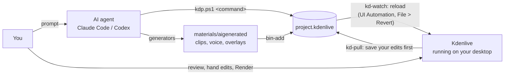

<div align="center">

# Movie Engine

**I-agent ye-AI ihlela ividiyo yakho ku-Kdenlive ubukele, njalo ungathatha umsebenzi loba nini.**

Ama-agent e-AI abhala ikhodi (Claude Code, Codex) akha njalo aguqule amaphrojekthi eqiniso e-Kdenlive: amafilimu, amavidiyo achazayo lamavidiyo amafitshane ame ngobude (vertical shorts). Izinguquko zibonakala khonokho kumhleli (editor) ovulileyo. Kuyathwalwa (portable), Windows, umhleli kawuguqulwa.


[English](../../README.md) · [简体中文](README.zh-CN.md) · [繁體中文](README.zh-TW.md) · [हिन्दी](README.hi.md) · [Español](README.es.md) · [Français](README.fr.md) · [العربية](README.ar.md) · [বাংলা](README.bn.md) · [Português](README.pt.md) · [Русский](README.ru.md) · [اردو](README.ur.md) · [Bahasa Indonesia](README.id.md) · [Deutsch](README.de.md) · [日本語](README.ja.md) · [Türkçe](README.tr.md) · [한국어](README.ko.md) · [Українська](README.uk.md) · [Italiano](README.it.md) · [Polski](README.pl.md) · [Tiếng Việt](README.vi.md) · [فارسی](README.fa.md) · [ไทย](README.th.md) · [Kiswahili](README.sw.md) · [አማርኛ](README.am.md) · [Avañe'ẽ](README.gn.md) · [Setswana](README.tn.md) · [Shqip](README.sq.md) · [Беларуская](README.be.md) · [Български](README.bg.md) · [Bosanski](README.bs.md) · [Hrvatski](README.hr.md) · [Српски](README.sr.md) · [Crnogorski](README.cnr.md) · [Македонски](README.mk.md) · [Slovenščina](README.sl.md) · [Slovenčina](README.sk.md) · [Čeština](README.cs.md) · [Magyar](README.hu.md) · [Română](README.ro.md) · [Dansk](README.da.md) · [Norsk bokmål](README.nb.md) · [Norsk nynorsk](README.nn.md) · [Svenska](README.sv.md) · [Íslenska](README.is.md) · [Suomi](README.fi.md) · [Eesti](README.et.md) · [Latviešu](README.lv.md) · [Lietuvių](README.lt.md) · [Nederlands](README.nl.md) · [Lëtzebuergesch](README.lb.md) · [Rumantsch](README.rm.md) · [Ελληνικά](README.el.md) · [Malti](README.mt.md) · [Gaeilge](README.ga.md) · [Català](README.ca.md) · [ქართული](README.ka.md) · [Հայերեն](README.hy.md) · [Azərbaycanca](README.az.md) · [Afrikaans](README.af.md) · [isiZulu](README.zu.md) · [isiXhosa](README.xh.md) · [Sesotho](README.st.md) · [Sepedi](README.nso.md) · [Xitsonga](README.ts.md) · [Tshivenḓa](README.ve.md) · [siSwati](README.ss.md) · [isiNdebele (South Africa)](README.nr.md) · **isiNdebele (Zimbabwe)** · [chiShona](README.sn.md) · [Chichewa](README.ny.md) · [Ikinyarwanda](README.rw.md) · [Ikirundi](README.rn.md) · [Malagasy](README.mg.md) · [Soomaali](README.so.md) · [Afaan Oromoo](README.om.md) · [Qafar af](README.aa.md) · [ትግርኛ](README.ti.md) · [Sängö](README.sg.md) · [Kreol Seselwa](README.crs.md) · [TjiKalanga](README.kck.md) · [ChiNdau](README.ndc.md)

*Lokhu kuyinguqulo. I-README yesiNgisi yiyo eyinhloko.*

</div>

---

## Okuqukethweyo

- [Kungani](#kungani)
- [Isebenza njani](#isebenza-njani)
- [Izici](#izici)
- [Okudingekayo](#okudingekayo)
- [Ukufaka](#ukufaka)
- [Ukuqalisa ngokuphangisa](#ukuqalisa-ngokuphangisa)
- [Ukusebenza le-agent](#ukusebenza-le-agent)
- [Umugqa wemilayo yokuhlela (`kdp.ps1`)](#umugqa-wemilayo-yokuhlela-kdpps1)
- [Ukuvumelanisa khonokho lomhleli ovuliweyo](#ukuvumelanisa-khonokho-lomhleli-ovuliweyo)
- [Ama-generator: okwehlula i-Kdenlive](#ama-generator-okwehlula-i-kdenlive)
- [Ilizwi lokulandisa lomsindo](#ilizwi-lokulandisa-lomsindo)
- [Ulimi lwe-interface](#ulimi-lwe-interface)
- [Ukuhlelwa kwamafolda](#ukuhlelwa-kwamafolda)
- [Izivivinyo lobufakazi](#izivivinyo-lobufakazi)
- [Imikhawulo](#imikhawulo)
- [Ukuxazulula izinkinga](#ukuxazulula-izinkinga)
- [Imibuzo evame ukubuzwa](#imibuzo-evame-ukubuzwa)
- [Ukufaka isandla](#ukufaka-isandla)
- [Ukubonga](#ukubonga)
- [Ilayisensi](#ilayisensi)

## Kungani

Abahleli bevidiyo bakhelwe izandla eziphezu kwemawusi (mouse). Ama-agent e-AI alungile ekuhleleni isakhiwo, isikhathi lemisebenzi ephindaphindwayo: ukubeka ama-clip angu-300 esigqini somculo, ukuvumelanisa i-caption ngayinye lelizwi elikhulumayo, ukwenza kabutsha isigcawu (scene) ngemva kokuphawulwa. Kodwa kawenelisi ukuchofoza ku-GUI ngaphandle kokuthatha i-desktop yakho.

I-Kdenlive ngumhleli olamandla we-open-source, kodwa ku-Windows **kayilayo i-API yokuzenzakalela (automation API)**: ukulawula nge-D-Bus kukhona kuphela kuma-build e-Linux, njalo ama-fork ayengezayo kawasanakekelwa kumbe kawaphephanga. I-Movie Engine ixazulula lokhu ngaphandle kokuguqula umhleli:

1. I-agent ihlela ifayela lephrojekthi `.kdenlive` ngomugqa wemilayo ohloliweyo (`engine/kdp.ps1`).
2. I-Kdenlive esebenzayo iyatshelwa ukuthi iphinde ifunde ifayela nge-Windows UI Automation, kungacindezelwa amakhiye, kungasetshenziswa imawusi njalo kungathathwa i-focus.
3. Izinguquko zakho ezingakagcinwa zigcinwa kuqala njalo kazilokothi zibhalwe phezu kwazo.

Ngakho i-agent iyahlela wena uhlola, kumbe uzihlelela ngezandla. Lina lobabili lisebenza kuphrojekthi enye, kumhleli munye, ngesikhathi esisodwa.

## Isebenza njani



Umlayo wonke wokuhlela ulandela umjikelezo ofanayo ophephileyo:

1. **Pull.** Nxa i-Kdenlive ilezinguquko ezingakagcinwa, iyatshelwa ukuthi izigcine (inkinobho ethi Save ku-toolbar nge-UI Automation), njalo ukugcina kuyaqinisekiswa.
2. **Ukuhlela.** Umlayo uguqula i-XML ngaphansi kwe-lock, ngemva kokuhlola i-hash, lange-snapshot yokubuyisela emuva (undo). Nxa ifayela liguqukile phakathi kwalokho, kakulalutho olubhalwayo.
3. **Ukuphinda ufunde.** Umqaphi (watcher) ubona uphawu lwe-AI aqhube File > Revert kumhleli ovuliweyo. Kuthathwa njengempumelelo kuphela nxa i-widget ye-timeline isakhiwe kabutsha sibili.
4. **Ukungqubuzana.** Nxa uqalise ukuhlela phakathi kwalokho, kakulalutho oluphinda lufundwe njalo umsebenzi wakho uyahlala. Inguqulo ye-AI igcinwa eceleni, njalo i-agent iphinda ifake inguquko yayo phezu kweyakho.

## Izici

- **Ukuhlela iphrojekthi yonke ngaphandle kwe-GUI**: imilayo engaba ngu-120 ehlanganisa i-bin, i-timeline, ama-effect, ama-composition, ama-track, ama-guide, ama-marker, ama-subtitle, ama-sequence, isivinini lokuhlela kabutsha isikhathi (time remap), ama-slideshow, izihloko (titles), ama-proxy, ukwenza i-render lo-undo/redo. Bona [uhlu lwemilayo](#umugqa-wemilayo-yokuhlela-kdpps1).
- **Ukuvumelanisa khonokho lomhleli ovuliweyo.** Izinguquko ze-AI zibonakala ku-Kdenlive oyikhangeleyo; izinguquko zakho ezingakagcinwa zigcinwa kuqala njalo kazilahleki.
- **Kayilokothi iphazamise i-desktop yakho.** Kayithathi i-focus, kayicindezeli amakhiye, kayisebenzisi imawusi. Abahleli bokuhlola basebenza ku-desktop ye-Windows engabonakaliyo.
- **Kuyathwalwa.** Umhleli, izilungiselelo (settings), i-Node.js, ama-font lamathuluzi kuhlala efolda eyodwa. Yikhophele kwenye i-PC njalo iyasebenza; kakulalutho olubhalwa ku-Program Files kumbe ku-profile yakho ye-Windows.
- **Ama-generator alokho okwehlula i-Kdenlive**: umbhalo onyakazayo uhlamvu ngohlamvu (per-letter kinetic text), izimpawu ezidwetshwe ngesandla, izigcawu ze-3D ze-interface, ukunyakaza kwe-cursor lamafilimu amade "achazayo" (explainer) asebenzisanayo. Enziwa i-render ku-GPU ngokufiphala kokunyakaza (motion blur) kweqiniso njalo afakwa ku-timeline njengama-clip ajwayelekileyo.
- **Ilizwi lokulandisa (voice-over) elilezikhathi zelizwi ngalinye** (Microsoft Edge TTS, kakudingeki API key). Ama-caption lezenzo kwenzeka ngqo ngelizwi elifaneleyo.
- **Imisindo eyakhiweyo (synthesized sound effects)** (whoosh, click, pop, riser, impact lokunye), eyenziwa ngekhodi.
- **Kufakazelwe, kakucatshangwa.** Umlayo ngamunye ulokuhlolwa komphumela, ama-effect lama-composition ahlolwa ngamunye ngamunye, njalo imiphumela engahlelwanga iku-`docs/proof/`.
- **Imilayo ye-agent ifakiwe.** `AGENTS.md` lama-skill aku-`.claude/skills/` afundisa i-Claude Code le-Codex indlela yokusebenza, uhlobo lwefayela lezingibe okumele zigwenywe.

## Okudingekayo

| | |
|---|---|
| OS | Windows 10 kumbe 11, x64 |
| Umhleli | Kdenlive **26.08.3** ethwalwayo (standalone build). Ezinye izinguqulo kazihlolwanga. |
| Node.js | 18 kumbe entsha: i-`.zip` ye-Windows x64 evela ku-nodejs.org, evulelwe ku-`engine/node/` |
| I-browser | Microsoft Edge (iyingxenye ye-Windows); isetshenziswa ingelawindi (headless) ngamathuluzi enza i-render yezigcawu |
| I-agent | [Claude Code](https://claude.com/claude-code) kumbe Codex. Kakuphoqwa: ithuluzi ngalinye lingaqhutshwa ngesandla. |
| I-disk | cishe 1 GB yomhleli lamathuluzi, kanye lemidiya yakho |
| I-GPU | loba yiphi i-GPU elokwenza i-H.264 encoding nge-hardware iphangisa `film-render.mjs` (nxa ingekho, kusetshenziswa i-software) |

## Ukufaka

Konke kufakwa **phakathi kwefolda**. Kakulalutho oludinga amalungelo e-admin.

```powershell
git clone https://github.com/vladtarrow/movie-engine.git
cd movie-engine
```

**1. Node.js.** Dawuniloda i-`.zip` ye-Windows x64 ye-Node.js 18 kumbe entsha ku-<https://nodejs.org/en/download> uvule okuphakathi kwayo ku-`engine\node\`, ukuze `engine\node\node.exe` le-`engine\node\npm.cmd` kube khona. Kakudingeki installer kumbe i-Node yesistimu. Wonke ama-script aqhutshwa nge-`engine\node.cmd`, hatshi nge-Node yesistimu.

**2. Amaphakheji e-Node** ethuluzi lelizwi lamathuluzi enza i-render (izinguqulo zibotshelwe ku-`engine/voice/package.json`):

```powershell
engine\node\npm.cmd install --prefix engine\voice
```

**3. Kdenlive 26.08.3 ethwalwayo.** Dawuniloda `kdenlive-26.08.3_standalone.exe` ku-<https://download.kde.org/stable/kdenlive/26.08/windows/> ulifake ku-`engine\installer\`, ulihlole njalo ulivule:

```powershell
(Get-FileHash engine\installer\kdenlive-26.08.3_standalone.exe -Algorithm SHA256).Hash
# expected: A25427B1DFF2C17E3B0386E991BB1A719382BB3176D1A90E441CDAEB6E0A967D
engine\installer\kdenlive-26.08.3_standalone.exe -o"engine\Kdenlive" -y
```

Umhleli ucina usuku-`engine\Kdenlive\kdenlive-26.08.3_standalone\bin\`. Usuvele ulayo i-`melt.exe` le-`ffmpeg.exe`.

**4. Ukuqalisa kokuqala.**

```powershell
engine\kdenlive.cmd
```

I-Kdenlive igcina zonke izilungiselelo zayo ku-`engine\profile-kdenlive\`, hatshi ku-profile yakho ye-Windows. Ekuqaliseni kokuqala ikhombisa i-wizard yokulungisa kanye kuphela.

## Ukuqalisa ngokuphangisa

### Nge-agent

Vula ifolda ku-Claude Code (kumbe Codex) ucele ngamazwi ajwayelekileyo:

> Yenza iphrojekthi entsha emi ngobude ye-30 fps ethiwa "launch-teaser". Beka ama-screenshot amathathu avela ku-`materials/designers/launch/` ku-timeline, ngalinye 2.5 s lele-cross-fade emfitshane, wengeze ilizwi lokulandisa elivela ku-`script.txt` njalo uvumelanise i-caption enyakazayo lomugqa ngamunye.

> Ngivulela yona ku-Kdenlive.

> I-shot yesibili inde kakhulu. Yinqume ibe ngu-1.8 s njalo uphakamise i-logo kancane.

I-agent ilandela `AGENTS.md`: ihlela nge-`kdp.ps1`, yenza i-render yama-clip adingwa yi-cut kuphela, njalo igcina umhleli ovuliweyo uvumelana. Wena uhlola ku-Kdenlive, uhlela ngesandla loba nini lapho ufuna khona, njalo ucindezela u-Render nxa usuthokoza.

### Ngezandla

```powershell
# a new 1080x1920 30 fps project with 2 video and 2 audio tracks
powershell -NoProfile -ExecutionPolicy Bypass -File engine\kdp.ps1 new -Project projects\hello\hello.kdenlive -Profile vertical_hd_30

# a 3-second title and a colour background
powershell -NoProfile -ExecutionPolicy Bypass -File engine\kdp.ps1 bin-color -Project projects\hello\hello.kdenlive -Color '#203060' -Seconds 3 -Name bg
powershell -NoProfile -ExecutionPolicy Bypass -File engine\kdp.ps1 title -Project projects\hello\hello.kdenlive -Text "Hello" -Seconds 3 -Name hi

# place them: background on V1, title above it on V2
powershell -NoProfile -ExecutionPolicy Bypass -File engine\kdp.ps1 add -Project projects\hello\hello.kdenlive -Bin bg -Track V1 -At 0
powershell -NoProfile -ExecutionPolicy Bypass -File engine\kdp.ps1 add -Project projects\hello\hello.kdenlive -Bin hi -Track V2 -At 0

# a check frame, then open it in the editor
powershell -NoProfile -ExecutionPolicy Bypass -File engine\kdp.ps1 frame -Project projects\hello\hello.kdenlive -At 1.5 -Out out\hello\check.png
engine\kdenlive.cmd projects\hello\hello.kdenlive
```

Ukuze uphinde uvule iphrojekthi yokucina ngemva kwalokho, chofoza kabili `open-last-project.cmd`.

## Ukusebenza le-agent

I-agent ifunda `AGENTS.md` (Codex) kumbe `CLAUDE.md`, eyingenisayo (Claude Code), kanye lama-skill amabili:

| I-skill | Ekufundisayo |
|---|---|
| `.claude/skills/kdenlive-project-file` | uhlobo lwe-`.kdenlive` / MLT XML, `kdp.ps1`, ukuhlola nge-`melt` |
| `.claude/skills/kdenlive-live` | ukuqhuba umhleli osebenzayo ngokuphepha: ukuwuqalisa, pull, ukuphinda ufunde, ukuthwebula iwindi lawo |

Imithetho elandelwa yi-agent, ongayethemba:

- Kayilokothi ithathe imawusi yakho, ikhibhodi kumbe i-focus, njalo kayilokothi ithwebule i-desktop yakho (iwindi lomhleli kuphela).
- Yenza izinyathelo ze-GUI ngokwayo (ukugcina, ukuvula, ukuphinda ufunde) kulokuthi ikucele ukuthi uchofoze.
- Iyabuza ingakadawunilodi lutho njalo ingakasusi lutho.
- Yenza i-render yalokho okudingwa ngumsebenzi kuphela (ama-clip ezigcawu, ama-frame okuhlola). Yenza i-render yefilimu yokucina kuphela nxa uyicelile.
- Nxa i-Kdenlive ingenelisi ukwenza okuthile kahle, i-agent ikwakha ngaphandle ngekhodi ibe isifaka umphumela njenge-clip. Kayenzi i-effect ibe buthakathaka.

## Umugqa wemilayo yokuhlela (`kdp.ps1`)

```powershell
powershell -NoProfile -ExecutionPolicy Bypass -File engine\kdp.ps1 <command> -Project <file.kdenlive> [options]
```

Izikhathi zingemizuzwana, ngechashazi (`2.5`). Ama-track ngu-`V1 V2 …` (V1 ngaphansi kakhulu) lo-`A1 A2 …`. I-clip ikhonjwa nge-`-Track` kanye laloba yisiphi isikhathi `-At` esiphakathi kwayo. Amapharamitha e-effect afakwa ku-`-Params "name=value||name=value"`. Uhlu olupheleleyo lalo lonke ukhetho lusenhloko ye-`engine/kdp.ps1`.

| Iqembu | Imilayo |
|---|---|
| Iphrojekthi | `new`, `profiles`, `info`, `validate`, `fonts`, `profile-set`, `profile-from-clip`, `zone`, `archive`, `backups`, `rebase`, `otio-export`, `otio-import` |
| Bin | `bin-add`, `bin-color`, `title`, `title-text`, `title-save`, `title-template`, `bin-rename`, `bin-remove`, `bin-info`, `bin-set`, `bin-duplicate`, `bin-replace-file`, `bin-reload`, `folder`, `bin-folder`, `relink`, `clean`, `generator`, `playlist-clip`, `extract-audio`, `transcode` |
| Timeline | `add`, `add-av`, `move`, `copy`, `trim`, `ripple-trim`, `slip`, `split`, `remove`, `speed`, `remap`, `disable`, `enable`, `group`, `ungroup`, `mix`, `unmix`, `space-insert`, `space-remove`, `spaces-remove-all`, `track-clear`, `replace-in-timeline` |
| Ama-effect | `effects`, `effect-info`, `effect-add`, `effect-list`, `effect-set`, `effect-remove`, `effect-copy`, `effect-clear`, `effects-all`, `bin-effect`, `effect-templates`, `effect-template` |
| Ama-composition | `compositions`, `comp-info`, `comp-add`, `comp-list`, `comp-set`, `comp-remove` |
| Ama-track | `track-add`, `track-remove`, `track-set` |
| Ama-guide lama-marker | `guide-add`, `guide-list`, `guide-remove`, `guide-set`, `guide-clear`, `guide-export`, `guide-category`, `marker`, `marker-list`, `marker-set`, `marker-remove` |
| Ama-subtitle | `sub-add`, `sub-import`, `sub-export`, `sub-state` |
| Ama-sequence | `sequence-add`, `sequences`, `copy-to-sequence`, `expand`; loba yiwuphi umlayo ole-`-Sequence <name>` usebenza phakathi kwaleyo sequence |
| Okukhethekileyo | `slideshow`, ama-animation e-Lottie / Glaxnimate nge-`bin-add`, `proxy`, `stabilize`, `scene-split`, `speed-job`, `subclip` |
| Okuphumayo | `frame` (i-PNG eyodwa), `preview` (i-render esheshayo nge-melt), `render` (i-renderer ye-Kdenlive uqobo kumbe i-preset), `presets` |
| Umlando | `undo`, `redo`, `clear-history` (ama-snapshot aku-`projects/<name>/.kdp-history`) |

Okumele ukwazi ngokuziphatha kwayo:

- Izingxenye ze-audio le-video ezixhumeneyo ziyanyakaziswa, zinqunywe (trim), zehlukaniswe njalo zisuswe ndawonye (`-Alone` ukuze kube yingxenye eyodwa).
- Umlayo owehlulekayo uphuma ngekhodi 1 njalo kawubhali lutho.
- Ama-effect i-build ye-Windows engenelisi ukuwaqhuba ayaliwa, kawazitshwa nje buthule (uhlu: `docs/proof/assets.txt`).
- Isenzo ngasinye semenyu ye-Kdenlive sixhunywe lomlayo, lenye indlela, kumbe sibhalwe ngokuthi "ukukhangela kuphela" ku-`engine/tools/data/kdenlive-actions.csv`. Bona `docs/kdenlive-coverage.md`.

## Ukuvumelanisa khonokho lomhleli ovuliweyo

| I-script | Ekwenzayo | Amakhodi okuphuma |
|---|---|---|
| `engine\kd-pull.ps1 -Project <f>` | yenza i-Kdenlive igcine izinguquko zakho njalo ikuqinisekise | 0 ifayela lisesikhathini, 3 kayisebenzi, 4 kakuqinisekiswanga |
| `engine\kd-reload.ps1 -Project <f>` | File > Revert, kuqinisekiswa yi-timeline eyakhiwe kabutsha | 0 kuqinisekisiwe, 2 ulezinguquko ezingakagcinwa (kakulalutho olulahliweyo), 3 kayisebenzi, 4 kwehlulekile |
| `engine\kd-watch.ps1 -Project <f>` | umqaphi osebenza ngemuva: uphinda afunde ngemva kokubhala ngakunye kwe-AI, ubhala ukungqubuzana ku-log | i-log iku-`engine\kd-watch.log`; susa `engine\kd-watch.run` ukuze ume |
| `engine\kdenlive-bg.ps1 [project]` | iqalisa i-Kdenlive inciphisiwe (minimized) ye-agent | 0 ilayishiwe, 4 kakuqinisekiswanga |
| `engine\kdenlive.cmd [project]` | ikuqalisela i-Kdenlive | |

Qalisa umqaphi kanye ngeseshini ngayinye:

```powershell
Start-Process powershell -WindowStyle Hidden -ArgumentList '-NoProfile','-ExecutionPolicy','Bypass','-File','engine\kd-watch.ps1','-Project','projects\hello\hello.kdenlive'
```

Amaphrojekthi amakhulu: ukuphinda ufunde iphrojekthi elama-clip angu-1000 kuthatha imizuzu, njalo amathuluzi ayalinda kulokuthi abike kungakapheli. Amaphrojekthi avulwa nge-*File > Open Recent* kumhleli ongelalutho, ngoba ukuvula ifayela ngqo kwenza i-Qt idlule kuzo zonke izinto ze-timeline ngenxa ye-accessibility, njalo lokho kwakuthatha cishe imizuzu engu-10 ngaphezulu.

## Ama-generator: okwehlula i-Kdenlive

I-Kdenlive/MLT kayilayo i-animation yombhalo uhlamvu ngohlamvu, kayilawo ama-expression njalo ile-3D encane, njalo ama-effect anzima ehlisa ijubane lokudlala. I-Movie Engine yenza i-render yezingxenye ezinjalo ngaphandle ibe isizibeka ku-timeline njengama-clip ajwayelekileyo, kanengi ele-alpha, ku-track ephezu kwezithombe. I-script ye-generator lokungenayo kwayo kuhlala efolda yephrojekthi, ngakho i-clip ingenziwa kabutsha nxa umbhalo, i-font kumbe isikhathi kuguqukile.

| Ithuluzi | Elikwenzayo |
|---|---|
| `engine/tools/kinetic-text.ps1` | ama-caption anyakazayo uhlamvu ngohlamvu, ilizwi ngalinye lihlelwe ngesikhathi esivela ku-`voice.json`, ibhokisi lokugqamisa (highlight box) |
| `engine/tools/annotate.ps1` | imibuthano, amabhokisi, imigqa engaphansi lemicibitshelo edwetshwe ngesandla ezizidwebayo phezu kwe-screenshot |
| `engine/tools/card-entrance.ps1` | ikhadi le-screenshot elikhuphukayo likhule lingena, lelithunzi elithambileyo |
| `engine/tools/pdf-to-png.ps1` | ama-slide avela ku-PDF export |
| `engine/tools/html-render.mjs` | loba yisiphi isigcawu se-HTML/CSS/canvas siye kuvidiyo: i-animation ye-interface, ama-cursor, 3D, ama-mask |
| `engine/tools/film-render.mjs` + `film/` | amafilimu amade achazayo asebenzisanayo ku-canvas: i-clip eyodwa ngomugqa ngamunye welizwi lokulandisa, izenzo zenzeka emazwini akhulunywayo, i-motion blur ye-GPU ngesivinini esingaba ngu-45 fps |

Womabili ama-renderer aqhuba i-Microsoft Edge eza le-Windows, ingelawindi (headless), lele-profile elahlwayo njalo ingela-network.

### Imiboniso

```powershell
# a 3-second 3D title card with a cursor click
engine\node.cmd engine\tools\html-render.mjs examples\demo\scene\scene.html examples\demo\out --frames 0,30,60,89
engine\node.cmd engine\tools\html-render.mjs examples\demo\scene\scene.html examples\demo\out\scene.mp4

# a 4-shot interactive film timed to two voice lines
engine\node.cmd engine\tools\film-render.mjs examples\demo\film\film.html examples\demo\out --check
engine\node.cmd engine\tools\film-render.mjs examples\demo\film\film.html examples\demo\out --shots all --width 640
engine\node.cmd engine\tools\film-render.mjs examples\demo\film\film.html examples\demo\out\clips --suffix -v01
```

Ifilimu yakhiwa ngamafayela amathathu amancane. `data.js` iphethe ama-shot lezikhathi zamazwi. `direction.js` ilomugqa owodwa nge-shot ngayinye:

```text
1 | hover 192 108 @brand | tag 300 60 Your brand @deserves | confetti 192 90 @film
2 say=A film that/*explains* it
3 | click 116 108 @before | click 268 108 @after | chips Before~After @after
4 scene=counter | count 0 120 % @count
```

`scenes.js` iphethe ama-shot adwetshwa kusukela ekuqaleni. `@word` iqalisa isenzo nxa ilizwi lokulandisa lisitsho lelo lizwi. Izenzo zihlanganisa click, hover, drag, zoom, lens, ring, arrow, chips, toggle, slider, toast, type, count lo-confetti; i-syntax epheleleyo iphezulu ku-`engine/tools/film/film-kit.js`.

## Ilizwi lokulandisa lomsindo

```powershell
engine\node.cmd engine\voice\voice.mjs lines.json materials\aigenerated\hello\voice en-US-AndrewMultilingualNeural +0%
```

`lines.json` luhlu lwemigqa. Ithuluzi libhala i-mp3 eyodwa ngomugqa ngamunye kanye le-`voice.json`, elobude besikhathi, lokuqala lokucina kwelizwi ngalinye. Imigqa igcinwa (cache), ngakho ukuguqula umugqa owodwa kwenza kabutsha lowo mugqa kuphela. Isebenzisa i-text-to-speech ye-inthanethi ye-Microsoft Edge ngephakheji `msedge-tts`: kakudingeki khiye, kodwa insiza le kayisiyo esemthethweni njalo idinga i-inthanethi.

```powershell
engine\node.cmd engine\audio\sfx.mjs materials\aigenerated\sfx
```

Lokhu kwakha ngekhodi whoosh, whoosh-long, swipe, click, pop, tick, riser, impact, ding lo-reveal; iqoqo eselilungile likhona ku-`materials/aigenerated/sfx/`. Imisindo emifitshane kune-frame eyodwa yengezele ukuthula ungakayibeki (`-af apad=whole_dur=0.0667`).

## Ulimi lwe-interface

Ama-launcher aqalisa i-Kdenlive **ngesiNgisi** ngokwejwayelekileyo. Ukusebenzisa olunye ulimi, setha `MOVIE_ENGINE_UI_LANG` ungakaqalisi:

```powershell
$env:MOVIE_ENGINE_UI_LANG = 'ru'; engine\kdenlive.cmd
```

I-UI Automation ithola izinto zemenyu ngamabizo azo abonakalayo. Amabizo ezilimi ze-interface ezingu-31 asefakiwe (`engine/tools/kd-ui.ps1`, `$KdNames`). Kolunye ulimi loba yiluphi, engeza amabizo alo lapho ubusuhlola nge:

```powershell
powershell -NoProfile -ExecutionPolicy Bypass -File engine\tools\kd-langcheck.ps1
```

## Ukuhlelwa kwamafolda

```text
movie-engine/
├─ AGENTS.md, CLAUDE.md          instructions for AI agents
├─ .claude/skills/               agent skills: project file format, live editor
├─ engine/
│  ├─ kdp.ps1                    the editing command line
│  ├─ kd-pull / kd-reload / kd-watch .ps1, kdenlive.cmd, kdenlive-bg.ps1
│  ├─ tools/                     internals, generators, tests, data (action map)
│  ├─ voice/  audio/  fonts/     TTS, synthesized SFX, Poppins (OFL)
│  ├─ Kdenlive/  node/           portable editor and Node.js (not in git)
│  └─ profile-kdenlive/          the editor's settings (not in git)
├─ projects/<name>/<name>.kdenlive
├─ materials/
│  ├─ download/                  stock and downloaded files (not in git)
│  ├─ aigenerated/               everything the AI made (sfx/ and test-kit/ ship with the engine)
│  ├─ designers/  brand/         files from your team, brand assets
├─ examples/demo/                demos of the scene and film renderers
├─ out/                          renders (not in git)
└─ docs/                         proofs, coverage, translations of this README
```

Izindlela zemidiya phakathi kwamaphrojekthi zihlobene lefolda (relative). Nxa uhambisa kumbe ukhophe ifolda, `kdp.ps1 rebase` (ephinde iqhutshwe ngokwayo yi-`kdenlive.cmd`) ibhala indawo entsha kuphrojekthi.

## Izivivinyo lobufakazi

Lokho okutshiwo mayelana lokusebenzayo kusekelwa yikuhlolwa kwemiphumela, hatshi ngokuthi "i-function isebenzile". Isifinyezo siku-[`docs/kdenlive-proof.md`](../../docs/kdenlive-proof.md), njalo okuphume kungahlelwanga kuku-`docs/proof/`.

| Isivivinyo | Ekuhlolayo |
|---|---|
| `engine\tools\kdp-clitest.ps1` | umlayo ngamunye we-`kdp.ps1`, ngomugqa wemilayo, kuqhathaniswa iphrojekthi ephumayo |
| `engine\tools\kd-livetest.ps1` | pull, ukuphinda ufunde, umqaphi, ukungqubuzana lemijaho (races) ku-Kdenlive yeqiniso ku-desktop engabonakaliyo |
| `engine\tools\kdp-assetsweep.ps1` | i-effect ngayinye le-composition ngayinye: yenza i-render iqhathanise ama-frame |
| `engine\tools\kdp-portabletest.ps1` | ikhophela ifolda kwenye indawo isebenze ngekhophi |
| `engine\tools\kd-langcheck.ps1` | ulimi lwe-interface lokuthi i-UI Automation iyayithola imenyu |
| `engine\tools\kdp-coverage-check.ps1` | ukuthi isenzo ngasinye semenyu sixhunyiwe, lokuthi kakulabufakazi obudala kulekhodi |

```powershell
powershell -NoProfile -ExecutionPolicy Bypass -File engine\tools\kdp-clitest.ps1 -Report docs\proof\clitest.txt
powershell -NoProfile -ExecutionPolicy Bypass -File engine\tools\kd-livetest.ps1 -Report docs\proof\live-en.txt
```

Abahleli bokuhlola basebenza kuphela ku-desktop efihlekileyo lele-profile yabo, ngakho izivivinyo kazilokothi zithinte i-Kdenlive yakho evuliweyo kumbe i-focus yakho.

## Imikhawulo

- **Windows kuphela**, Kdenlive **26.08.3** kuphela. I-Linux ile-D-Bus njalo ibizadinga ibhuloho elitshiyeneyo.
- Ukuqalisa umhleli kuthatha i-focus yekhibhodi okwemizuzwana engaba ngu-3 ngesikhathi iwindi elingelalutho livela. Ama-agent ayabuza angakawuqalisi nxa usebenza. Ukuphinda ufunde lokuhlela kakuthathi i-focus.
- I-build ye-Windows kayilawo ama-module e-MLT sox, ladspa lo-movit kanye lamanye ama-effect e-frei0r/avfilter; `kdp.ps1` iyawala (`docs/proof/assets.txt`).
- I-OpenTimelineIO export le-import kuthwala ama-clip lezikhala (gaps) kuphela. I-multicam kayilakho ukutshintsha ama-angle khonokho (ama-cut enziwa nge-split/remove/hide).
- "Save As…" nge-UI Automation kuwindi elinciphisiweyo kakuvuli i-dialog; i-agent isebenzisa `archive` kumbe ukukhophela amafayela esikhundleni salokho.
- Ukuqonda inkulumo (speech recognition, auto-subtitles) kudinga i-Whisper kumbe i-Vosk, ezingafakwanga.
- Izihloko (titles) ezenziwe ngethuluzi lezihloko le-Kdenlive zisebenzisa ama-font afakwe ku-Windows. Ukuze uqiniseke nge-typography, yenza i-render yombhalo ngama-generator, alayisha ama-font ku-`engine/fonts/`.
- I-Edge TTS yinsiza ye-inthanethi engasiyo esemthethweni njalo ingaguquka kumbe iyeke ukusebenza.

## Ukuxazulula izinkinga

| Uphawu | Imbangela lokulungisa |
|---|---|
| I-Kdenlive iyasebenza, kodwa ukuyichofoza ku-taskbar kakubonisi lutho | Indawo yewindi layo egciniweyo ingaphandle kwesikrini. Yivale ususe okubhalwe ku-`kdockLayout` ku-`engine\profile-kdenlive\AppData\Local\kdenliverc`, kumbe uhambise iwindi nge-`SetWindowPos` (bona `AGENTS.md`). |
| `kd-reload.ps1` iphuma ngo-2 | Ulezinguquko ezingakagcinwa. Kakulalutho olulahliweyo. Qhuba `kd-pull.ps1`, ubusuphinda ufake inguquko (`kdp.ps1` ikwenza lokhu ngokwayo). |
| `CONFLICT` ku-`engine\kd-watch.log` | Wena le-agent lihlele ngesikhathi esisodwa. Inguqulo yakho isala kumhleli, njalo inguqulo ye-AI iku-`projects\<name>\.kdp-history\<name>\conflict\`. Cela i-agent iphinde ifake inguquko yayo. |
| Umlayo uphuma ngo-1 ulokuthi "pull not confirmed" | I-Kdenlive imatasa kumbe ikhombisa i-dialog. Vala i-dialog kumbe ulinde ukulayisha kuphele, ubusuphinda. |
| I-script ye-PowerShell yehluleka ukuhlaziywa (parse) | Ama-script alombhalo ongasiwo we-ASCII kumele agcinwe njenge-UTF-8 **ele-BOM** ku-Windows PowerShell 5.1. |
| `voice.mjs` iyama ngokuthi "Stream closed before the synthesis completed" | Kanengi yinkinga ye-network, kumbe i-SSML engavikelwanga (unescaped) kumakhophi amadala. `voice.mjs` ivikela `& < >` ngokwayo. |
| Ukuvula iphrojekthi enkulu kuthatha imizuzu eminengi | Yivule nge-`kdenlive.cmd` / `kdenlive-bg.ps1`, hatshi njenge-`kdenlive.exe project.kdenlive`. |

## Imibuzo evame ukubuzwa

**Ngiyayidinga i-Claude Code kumbe i-Codex?**
Hatshi. Ithuluzi ngalinye liyi-script ejwayelekileyo ongayiqhuba ngesandla. I-agent yiyo ephangisa umsebenzi: ihlela i-cut, iqhuba amathuluzi njalo igcina umhleli uvumelana.

**I-agent izabhala phezu kwezinguquko zami zesandla yini?**
Hatshi. Ingakabhali lutho, izinguquko zakho ezingakagcinwa ziyagcinwa njalo kuyaqinisekiswa. Nxa uhlela i-agent ibhala, ukubhala kuyaliwa kumbe kugcinwe eceleni njengokungqubuzana (conflict), kakulokothi kufakwe phezu komsebenzi wakho.

**Ngingaqhubeka ngisebenzisa i-Kdenlive njengokwejwayelekileyo?**
Yebo. Yi-Kdenlive ejwayelekileyo elefolda yayo yezilungiselelo. Hlela, ukhangele (preview) njalo wenze i-render njengokwejwayelekileyo.

**Iyasebenza le-Kdenlive esengiyifakile yini?**
Isebenzisa ikhophi yayo ethwalwayo ku-`engine\Kdenlive\`, ngakho i-Kdenlive yakho efakiweyo lezilungiselelo zayo kazithintwa.

**Kungani kungasi-fork ye-Kdenlive ele-API, kumbe omunye umhleli?**
Ku-Windows, kakulayo i-fork enakekelwayo njalo ephephileyo (uhlolo lukaLwezi 2026). I-OpenShot, i-Blender VSE, i-DaVinci Resolve, i-Shotcut labahleli be-web bahlolwa; i-Kdenlive yanika ubunzulu bokuhlela obungcono kakhulu. Isiphakamiso se-REST API ku-Kdenlive uqobo (merge request !902) siyaqaphelwa.

**Ingayenza i-render yevidiyo yokucina?**
Yebo, nge-`kdp.ps1 render` (i-renderer ye-Kdenlive uqobo, efihlekileyo), kumbe wena ngokwakho ucindezele u-Render kumhleli.

**Imidiya yami ithunyelwa kwenye indawo yini?**
Hatshi. Ngumbhalo welizwi lokulandisa kuphela othunyelwa ensizeni ye-Edge TTS nxa usenza ilizwi. Ama-renderer ezigcawu asebenza i-network ivaliwe.

## Ukufaka isandla

Ukufaka isandla kuyamukelwa. Bona [CONTRIBUTING.md](../../CONTRIBUTING.md). Ngamafitshane:

- Umsebenzi (operation) omutsha kumbe oguquliweyo we-`kdp.ps1` udinga ukuhlolwa komphumela ku-`kdp-clitest.ps1`, okubhaliweyo ebalazweni lezenzo (action map), lokuqhutshwa okutsha kwe-`kdp-coverage-check.ps1`.
- Ungalokothi uqalise i-Kdenlive yokuhlola ku-desktop ebonakalayo; sebenzisa `engine/tools/kd-hidden.ps1`.
- Gcina konke kuthwalwa: kungabi lokufaka ngaphandle kwefolda, kungabi lezindlela ezipheleleyo (absolute paths) kumaphrojekthi.
- Bhala izimo ezingajwayelekanga eziqinisekisiweyo (quirks) ku-`AGENTS.md` kumbe ku-skill efaneleyo.

## Ukubonga

- [Kdenlive](https://kdenlive.org) le-[MLT](https://www.mltframework.org): umhleli lenjini engaphansi kwawo.
- [FFmpeg](https://ffmpeg.org), eza le-Kdenlive.
- [msedge-tts](https://www.npmjs.com/package/msedge-tts) yelizwi lokulandisa.
- [Poppins](https://fonts.google.com/specimen/Poppins) ka-Indian Type Foundry, SIL Open Font License (`engine/fonts/OFL.txt`).
- `engine/tools/data/kdenliveui-26.08.3.rc`: ifayela lemenyu ye-Kdenlive, elithathwe ku-source ye-Kdenlive 26.08.3; lisetshenziswa kuphela ngukuhlolwa kokugcwala (coverage check). Lihlala ngaphansi kwelayisensi ye-GPL ye-Kdenlive, hatshi i-MIT License.

## Ilayisensi

Ikhodi ye-Movie Engine uqobo ikhutshwa ngaphansi kwe-[MIT License](../../LICENSE). I-Kdenlive, i-MLT, i-FFmpeg, amaphakheji e-Node.js le-font ye-Poppins kugcina amalayisensi akho.
