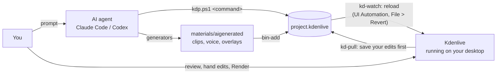

<div align="center">

# Movie Engine

**Agent ye AI inogadzirisa vhidhiyo yako mu Kdenlive iwe uchiona, uye unogona kutora basa iri nguva ipi zvayo.**

Ma agent e AI anonyora code (Claude Code, Codex) anogadzira nokushandura mapurojekiti chaiwo e Kdenlive: mafirimu, mavhidhiyo okutsanangura nema shorts akamira (vertical). Zvinoshandurwa zvinobva zvaoneka pakarepo mu editor yaunayo yakavhurwa. Portable, Windows, pasina kushandura editor (no patches).


[English](../../README.md) · [简体中文](README.zh-CN.md) · [繁體中文](README.zh-TW.md) · [हिन्दी](README.hi.md) · [Español](README.es.md) · [Français](README.fr.md) · [العربية](README.ar.md) · [বাংলা](README.bn.md) · [Português](README.pt.md) · [Русский](README.ru.md) · [اردو](README.ur.md) · [Bahasa Indonesia](README.id.md) · [Deutsch](README.de.md) · [日本語](README.ja.md) · [Türkçe](README.tr.md) · [한국어](README.ko.md) · [Українська](README.uk.md) · [Italiano](README.it.md) · [Polski](README.pl.md) · [Tiếng Việt](README.vi.md) · [فارسی](README.fa.md) · [ไทย](README.th.md) · [Kiswahili](README.sw.md) · [አማርኛ](README.am.md) · [Avañe'ẽ](README.gn.md) · [Setswana](README.tn.md) · [Shqip](README.sq.md) · [Беларуская](README.be.md) · [Български](README.bg.md) · [Bosanski](README.bs.md) · [Hrvatski](README.hr.md) · [Српски](README.sr.md) · [Crnogorski](README.cnr.md) · [Македонски](README.mk.md) · [Slovenščina](README.sl.md) · [Slovenčina](README.sk.md) · [Čeština](README.cs.md) · [Magyar](README.hu.md) · [Română](README.ro.md) · [Dansk](README.da.md) · [Norsk bokmål](README.nb.md) · [Norsk nynorsk](README.nn.md) · [Svenska](README.sv.md) · [Íslenska](README.is.md) · [Suomi](README.fi.md) · [Eesti](README.et.md) · [Latviešu](README.lv.md) · [Lietuvių](README.lt.md) · [Nederlands](README.nl.md) · [Lëtzebuergesch](README.lb.md) · [Rumantsch](README.rm.md) · [Ελληνικά](README.el.md) · [Malti](README.mt.md) · [Gaeilge](README.ga.md) · [Català](README.ca.md) · [ქართული](README.ka.md) · [Հայերեն](README.hy.md) · [Azərbaycanca](README.az.md) · [Afrikaans](README.af.md) · [isiZulu](README.zu.md) · [isiXhosa](README.xh.md) · [Sesotho](README.st.md) · [Sepedi](README.nso.md) · [Xitsonga](README.ts.md) · [Tshivenḓa](README.ve.md) · [siSwati](README.ss.md) · [isiNdebele (South Africa)](README.nr.md) · [isiNdebele (Zimbabwe)](README.nd.md) · [chiShona](README.sn.md) · [Chichewa](README.ny.md) · [Ikinyarwanda](README.rw.md) · [Ikirundi](README.rn.md) · [Malagasy](README.mg.md) · [Soomaali](README.so.md) · [Afaan Oromoo](README.om.md) · [Qafar af](README.aa.md) · [ትግርኛ](README.ti.md) · [Sängö](README.sg.md) · [Kreol Seselwa](README.crs.md) · [TjiKalanga](README.kck.md) · **ChiNdau**

*Iyi ishanduro. README yeChiRungu ndiyo inoteverwa (reference version).*

</div>

---

## Zviri mukati

- [Chikonzero](#chikonzero)
- [Zvinoshanda kudini](#zvinoshanda-kudini)
- [Zvinogona kuitwa](#zvinogona-kuitwa)
- [Zvinodikana](#zvinodikana)
- [Kuisa](#kuisa)
- [Kutanga nokukasira](#kutanga-nokukasira)
- [Kushanda ne agent](#kushanda-ne-agent)
- [Command line yokugadzirisa (`kdp.ps1`)](#command-line-yokugadzirisa-kdpps1)
- [Kuwirirana ne editor yakavhurwa](#kuwirirana-ne-editor-yakavhurwa)
- [Ma generator: zvinotadza Kdenlive](#ma-generator-zvinotadza-kdenlive)
- [Voice-over nemanzwi](#voice-over-nemanzwi)
- [Mutauro we interface](#mutauro-we-interface)
- [Marongerwo ema folder](#marongerwo-ema-folder)
- [Ma test noumboo](#ma-test-noumboo)
- [Miganhu](#miganhu)
- [Kugadzirisa matambudziko](#kugadzirisa-matambudziko)
- [Mibvunzo inowanzobvunzwa](#mibvunzo-inowanzobvunzwa)
- [Kubatsira](#kubatsira)
- [Masvita](#masvita)
- [License](#license)

## Chikonzero

Ma editor e vhidhiyo akagadzirirwa maoko ari pa mouse. Ma agent e AI anogona zvikuru marongerwo, nguva (timing) nebasa rinodzokororwa: kuisa ma clip 300 pa beat, kuenzanisa caption yega yega nezwi, kugadzirazve scene pashure pokunge vanhu vataura zvavanofunga. Asi aagoni kudzvanya-dzvanya mu GUI vasina kutora desktop yako.

Kdenlive i editor yakasimba ye open-source, asi pa Windows **aina automation API**: kudzora ne D-Bus kunowanikwa chete pa ma build e Linux, uye ma fork anoiwedzera angave asisachengetwi kana kuti ane njodzi. Movie Engine inogadzirisa izvi isingashanduri editor:

1. Agent inoshandura faira re purojekiti `.kdenlive` ichishandisa command line yakaedzwa (`engine/kdp.ps1`).
2. Kdenlive iri kushanda inoudzwa kuverengazve faira ichishandisa Windows UI Automation, pasina kudzvanya makiyi, pasina mouse uye pasina kutora focus.
3. Zvawashandura iwe usati wa-save zvinotanga kuchengetwa uye azvimbonyorerwi pamusoro.

Saka agent inogadzirisa iwe uchiongorora, kana kuti iwe unogadzirisa nemaoko. Mese muri vaviri munoshanda pa purojekiti imwe chete, mu editor imwe chete, panguva imwe chete.

## Zvinoshanda kudini



Command yega yega yokugadzirisa inotevera denderedzwa rimwe chete rakachengeteka:

1. **Pull.** Kana Kdenlive ine zvakashandurwa zvisati zva-save-wa, inoudzwa kuzvi-save (Save iri pa toolbar, ne UI Automation), uye kuchengetwa uku kunosimbiswa.
2. **Kugadzirisa.** Command inoshandura XML iri pasi pe lock, pashure pokuongorora hash uye ichigadzira undo snapshot. Kana faira rashanduka panguva iyoyo, apana chinonyorwa.
3. **Reload.** Watcher inoona chiratidzo (stamp) che AI yobva yaita File > Revert mu editor yakavhurwa. Zvinonzi zvabudirira chete kana widget ye timeline yavakwazve chaizvo.
4. **Kupesana (conflict).** Kana iwe watanga kugadzirisa panguva iyoyo, apana chinoitwa reload uye basa rako rinosara. Version ye AI inochengetwa parutivi, uye agent inoisazve shanduko yayo pamusoro pe yako.

## Zvinogona kuitwa

- **Kugadzirisa purojekiti yose pasina GUI**: ma command anenge 120 anobata bin, timeline, ma effect, ma composition, ma track, ma guide, ma marker, ma subtitle, ma sequence, speed ne time remap, ma slideshow, ma title, ma proxy, kurenda (rendering) ne undo/redo. Ona [reference ye ma command](#command-line-yokugadzirisa-kdpps1).
- **Kuwirirana ne editor yakavhurwa.** Zvinoshandurwa ne AI zvinooneka mu Kdenlive yauri kutarisa; zvawashandura usati wa-save zvinotanga kuchengetwa uye azvimborasika.
- **Aimbokanganisa desktop yako.** Ainotora focus, aidzvanyi makiyi uye aishandisi mouse. Ma editor okuedza anoshanda pa desktop ye Windows isingaoneki.
- **Portable.** Editor, ma setting, Node.js, ma font nezvishandiso zvose zviri mu folder imwe. Iteedzere (copy) pa PC imwe inoshanda; apana chinonyorwa mu Program Files kana mu profile yako ye Windows.
- **Ma generator ezvinotadza Kdenlive**: kinetic text ine animation yebhii nebhii (per-letter), zviratidzo zvakadhirowewa nemaoko, ma scene e UI e 3D, animation ye cursor nemafirimu marefu okutsanangura (interactive "explainer"). Anorendwa pa GPU ane motion blur chaiyo uye anoiswa pa timeline sema clip akajairika.
- **Voice-over ine nguva yezwi rimwe nerimwe** (Microsoft Edge TTS, pasina API key). Ma caption nezviito zvinoitika pazwi chairo.
- **Manzwi (sound effects) akagadzirwa ne code** (whoosh, click, pop, riser, impact nemamwe), anogadzirwa mu code.
- **Zvakaratidzwa, azvifungidzirwi.** Command yega yega ine kuongororwa kwemhedzisiro, ma effect nema composition anoedzwa rimwe nerimwe, uye mhedzisiro yakasvibirira iri mu `docs/proof/`.
- **Mirairo ye agent irimo.** `AGENTS.md` nema skill ari mu `.claude/skills/` anodzidzisa Claude Code ne Codex nzira yokushanda, marongerwo e faira nezvinokanganisa.

## Zvinodikana

| | |
|---|---|
| OS | Windows 10 kana 11, x64 |
| Editor | Kdenlive **26.08.3**, build iri portable (standalone). Mamwe ma version aana kuedzwa. |
| Node.js | 18 kana itsva kupfuura: `.zip` ye Windows x64 kubva ku nodejs.org, yakavhurwa mu `engine/node/` |
| Browser | Microsoft Edge (iri mu Windows); inoshandiswa isingaoneki (headless) ne ma renderer e scene |
| Agent | [Claude Code](https://claude.com/claude-code) kana Codex. Azvimanikidzwi: chishandiso chimwe nechimwe chinoshandawo nemaoko. |
| Disk | anenge 1 GB ye editor nezvishandiso, pamwe chete ne media yako |
| GPU | GPU ipi zvayo ine hardware H.264 encoding inokurumidzisa `film-render.mjs` (isipo inoshandisa software) |

## Kuisa

Zvese zvinoiswa **mukati me folder**. Apana chinoda kodzero dze admin.

```powershell
git clone https://github.com/vladtarrow/movie-engine.git
cd movie-engine
```

**1. Node.js.** Dhaunirodha `.zip` ye Windows x64 ye Node.js 18 kana itsva kupfuura kubva ku <https://nodejs.org/en/download> wovhura zviri mukati mayo mu `engine\node\`, kuti `engine\node\node.exe` ne `engine\node\npm.cmd` zvivepo. Aupi kuda installer kana Node ye system. Ma script ose anoshanda ne `engine\node.cmd`, kwete ne Node ye system.

**2. Ma package e Node** e chishandiso che izwi nema renderer (ma version akasungwa mu `engine/voice/package.json`):

```powershell
engine\node\npm.cmd install --prefix engine\voice
```

**3. Kdenlive 26.08.3 portable.** Dhaunirodha `kdenlive-26.08.3_standalone.exe` kubva ku <https://download.kde.org/stable/kdenlive/26.08/windows/> uiise mu `engine\installer\`, uiongorore woivhura:

```powershell
(Get-FileHash engine\installer\kdenlive-26.08.3_standalone.exe -Algorithm SHA256).Hash
# expected: A25427B1DFF2C17E3B0386E991BB1A719382BB3176D1A90E441CDAEB6E0A967D
engine\installer\kdenlive-26.08.3_standalone.exe -o"engine\Kdenlive" -y
```

Editor inopedzisira iri mu `engine\Kdenlive\kdenlive-26.08.3_standalone\bin\`. Inotova ne `melt.exe` ne `ffmpeg.exe`.

**4. Kutanga kokutanga.**

```powershell
engine\kdenlive.cmd
```

Kdenlive inochengeta ma setting ayo ose mu `engine\profile-kdenlive\`, kwete mu profile yako ye Windows. Painotanga kokutanga inoratidza setup wizard kamwe chete.

## Kutanga nokukasira

### Ne agent

Vhura folder mu Claude Code (kana Codex) ukumbire nemazwi akajairika:

> Gadzira purojekiti itsva yakamira (vertical) ye 30 fps inonzi "launch-teaser". Isa ma screenshot matatu ari mu `materials/designers/launch/` pa timeline, rimwe nerimwe 2.5 s rine cross-fade pfupi, wedzera voice-over kubva ku `script.txt` uye uenzanise kinetic caption nemutsetse mumwe nemumwe.

> Ndivhurire mu Kdenlive.

> Shot yechipiri yakarebesa. Ichekerere kusvika 1.8 s uye usimudze logo zvishoma.

Agent inotevera `AGENTS.md`: inogadzirisa ichishandisa `kdp.ps1`, inorenda chete ma clip anodiwa ne cut, uye inochengeta editor yakavhurwa ichiwirirana. Iwe unoongorora mu Kdenlive, unogadzirisa nemaoko chero paunoda, uye unodzvanya Render kana wafara.

### Nemaoko

```powershell
# a new 1080x1920 30 fps project with 2 video and 2 audio tracks
powershell -NoProfile -ExecutionPolicy Bypass -File engine\kdp.ps1 new -Project projects\hello\hello.kdenlive -Profile vertical_hd_30

# a 3-second title and a colour background
powershell -NoProfile -ExecutionPolicy Bypass -File engine\kdp.ps1 bin-color -Project projects\hello\hello.kdenlive -Color '#203060' -Seconds 3 -Name bg
powershell -NoProfile -ExecutionPolicy Bypass -File engine\kdp.ps1 title -Project projects\hello\hello.kdenlive -Text "Hello" -Seconds 3 -Name hi

# place them: background on V1, title above it on V2
powershell -NoProfile -ExecutionPolicy Bypass -File engine\kdp.ps1 add -Project projects\hello\hello.kdenlive -Bin bg -Track V1 -At 0
powershell -NoProfile -ExecutionPolicy Bypass -File engine\kdp.ps1 add -Project projects\hello\hello.kdenlive -Bin hi -Track V2 -At 0

# a check frame, then open it in the editor
powershell -NoProfile -ExecutionPolicy Bypass -File engine\kdp.ps1 frame -Project projects\hello\hello.kdenlive -At 1.5 -Out out\hello\check.png
engine\kdenlive.cmd projects\hello\hello.kdenlive
```

Kuti uvhurezve purojekiti yokupedzisira gare gare, dzvanya kaviri pa `open-last-project.cmd`.

## Kushanda ne agent

Agent inoverenga `AGENTS.md` (Codex) kana `CLAUDE.md`, inoipinza (Claude Code), pamwe chete nema skill maviri:

| Skill | Zvainodzidzisa |
|---|---|
| `.claude/skills/kdenlive-project-file` | marongerwo e `.kdenlive` / MLT XML, `kdp.ps1`, kuongorora ne `melt` |
| `.claude/skills/kdenlive-live` | kudzora editor iri kushanda zvakachengeteka: kutanga, pull, reload, kutora mufananidzo we window rayo |

Mitemo inoteverwa ne agent, yaunogona kuvimba nayo:

- Aimbotora mouse yako, keyboard kana focus, uye aimbotora mufananidzo we desktop yako (window re editor chete).
- Inoita yoga matanho e GUI (save, open, reload) pachinzvimbo chokukukumbira kuti udzvanye.
- Inobvunza isati yadhaunirodha chero chinhu uye isati yadzima chero chinhu.
- Inorenda chete zvinodiwa nebasa (ma clip e scene, ma frame okuongorora). Inorenda firimu rokupedzisira chete kana wakumbira.
- Kana Kdenlive ichitadza kuita chimwe chinhu zvakanaka, agent inochivaka kunze ne code yoisa mhedzisiro sema clip. Aiderederi effect.

## Command line yokugadzirisa (`kdp.ps1`)

```powershell
powershell -NoProfile -ExecutionPolicy Bypass -File engine\kdp.ps1 <command> -Project <file.kdenlive> [options]
```

Nguva dziri mu ma second, ne dot (`2.5`). Ma track ndi `V1 V2 …` (V1 ndiyo yezasi) ne `A1 A2 …`. Clip inonongedzwa ne `-Track` pamwe nenguva ipi zvayo `-At` iri mukati mayo. Ma parameter e effect anoiswa mu `-Params "name=value||name=value"`. Rondedzero yose ine option imwe neimwe iri mu header ye `engine/kdp.ps1`.

| Boka | Ma command |
|---|---|
| Purojekiti | `new`, `profiles`, `info`, `validate`, `fonts`, `profile-set`, `profile-from-clip`, `zone`, `archive`, `backups`, `rebase`, `otio-export`, `otio-import` |
| Bin | `bin-add`, `bin-color`, `title`, `title-text`, `title-save`, `title-template`, `bin-rename`, `bin-remove`, `bin-info`, `bin-set`, `bin-duplicate`, `bin-replace-file`, `bin-reload`, `folder`, `bin-folder`, `relink`, `clean`, `generator`, `playlist-clip`, `extract-audio`, `transcode` |
| Timeline | `add`, `add-av`, `move`, `copy`, `trim`, `ripple-trim`, `slip`, `split`, `remove`, `speed`, `remap`, `disable`, `enable`, `group`, `ungroup`, `mix`, `unmix`, `space-insert`, `space-remove`, `spaces-remove-all`, `track-clear`, `replace-in-timeline` |
| Ma effect | `effects`, `effect-info`, `effect-add`, `effect-list`, `effect-set`, `effect-remove`, `effect-copy`, `effect-clear`, `effects-all`, `bin-effect`, `effect-templates`, `effect-template` |
| Ma composition | `compositions`, `comp-info`, `comp-add`, `comp-list`, `comp-set`, `comp-remove` |
| Ma track | `track-add`, `track-remove`, `track-set` |
| Ma guide nema marker | `guide-add`, `guide-list`, `guide-remove`, `guide-set`, `guide-clear`, `guide-export`, `guide-category`, `marker`, `marker-list`, `marker-set`, `marker-remove` |
| Ma subtitle | `sub-add`, `sub-import`, `sub-export`, `sub-state` |
| Ma sequence | `sequence-add`, `sequences`, `copy-to-sequence`, `expand`; command ipi zvayo ine `-Sequence <name>` inoshanda mukati me sequence iyoyo |
| Zvakasiyana | `slideshow`, ma animation e Lottie / Glaxnimate kuburikidza ne `bin-add`, `proxy`, `stabilize`, `scene-split`, `speed-job`, `subclip` |
| Zvinobuda (output) | `frame` (PNG imwe), `preview` (kurenda nokukasira ne melt), `render` (renderer ye Kdenlive pachayo kana preset), `presets` |
| Nhoroondo | `undo`, `redo`, `clear-history` (ma snapshot ari mu `projects/<name>/.kdp-history`) |

Maitiro akanaka kuziva:

- Hafu dze audio ne video dzakabatanidzwa dzinofamba, dzinochekwa (trim), dzinoparadzaniswa (split) uye dzinobviswa pamwe chete (`-Alone` kuti ibate hafu imwe chete).
- Command inokundikana inobuda ne code 1 uye ainyori chinhu.
- Ma effect asingagoni kushanda pa build ye Windows anorambwa, azvisiyiwi chinyararire (rondedzero: `docs/proof/assets.txt`).
- Chiito chimwe nechimwe che menu ye Kdenlive chakabatanidzwa ne command, imwe nzira, kana kuti "view only" mu `engine/tools/data/kdenlive-actions.csv`. Ona `docs/kdenlive-coverage.md`.

## Kuwirirana ne editor yakavhurwa

| Script | Zvainoita | Ma exit code |
|---|---|---|
| `engine\kd-pull.ps1 -Project <f>` | inoita kuti Kdenlive i-save zvawashandura yosimbisa | 0 faira nderazvino, 3 aisi kushanda, 4 azvina kusimbiswa |
| `engine\kd-reload.ps1 -Project <f>` | File > Revert, zvinosimbiswa ne timeline yavakwazve | 0 zvasimbiswa, 2 une zvawashandura usati wa-save (apana chakaraswa), 3 aisi kushanda, 4 zvakundikana |
| `engine\kd-watch.ps1 -Project <f>` | watcher iri kumashure: inoita reload pashure pokunyora kwega kwega kwe AI, inonyora ma conflict mu log | log iri mu `engine\kd-watch.log`; dzima `engine\kd-watch.run` kuti imire |
| `engine\kdenlive-bg.ps1 [project]` | inotanga Kdenlive yakaderedzwa (minimized) ye agent | 0 yapinda, 4 azvina kusimbiswa |
| `engine\kdenlive.cmd [project]` | inotangira iwe Kdenlive | |

Tanga watcher kamwe chete pa session imwe neimwe:

```powershell
Start-Process powershell -WindowStyle Hidden -ArgumentList '-NoProfile','-ExecutionPolicy','Bypass','-File','engine\kd-watch.ps1','-Project','projects\hello\hello.kdenlive'
```

Mapurojekiti makuru: reload ye purojekiti ine ma clip 1000 inotora maminitsi, uye zvishandiso zvinoimirira pachinzvimbo chokupa mhinduro nokukurumidza. Mapurojekiti anovhurwa ne *File > Open Recent* mu editor isina chinhu, nokuti kuvhura faira zvakananga kunoita kuti Qt ifambe pa chinhu chimwe nechimwe che timeline che accessibility, uye zvaitora maminitsi anenge 10 akawanda.

## Ma generator: zvinotadza Kdenlive

Kdenlive/MLT aina animation ye text yebhii nebhii, aina ma expression uye ine 3D shoma, uye ma effect anorema anononotsa playback. Movie Engine inorenda zvikamu zvakadaro kunze yozviisa pa timeline sema clip akajairika, kazhinji ane alpha, pa track iri pamusoro pe mifananidzo. Script ye generator nezvainopinza zvinosara mu folder ye purojekiti, saka clip inogona kugadzirwazve kana text, font kana nguva zvashanduka.

| Chishandiso | Zvachinogadzira |
|---|---|
| `engine/tools/kinetic-text.ps1` | kinetic caption dzebhii nebhii, zwi rimwe nerimwe rine nguva kubva ku `voice.json`, highlight box |
| `engine/tools/annotate.ps1` | madenderedzwa, mabhokisi, mitsetse yepasi nemiseve zvakadhirowewa nemaoko zvinozvidhirowa pamusoro pe screenshot |
| `engine/tools/card-entrance.ps1` | card ye screenshot inokwira yokura ine mumvuri wakapfava |
| `engine/tools/pdf-to-png.ps1` | ma slide kubva ku PDF export |
| `engine/tools/html-render.mjs` | scene ipi zvayo ye HTML/CSS/canvas kuita vhidhiyo: animation ye interface, ma cursor, 3D, ma mask |
| `engine/tools/film-render.mjs` + `film/` | mafirimu marefu e interactive okutsanangura pa canvas: clip imwe pa mutsetse wezwi, zviito zvinoitika pamazwi anotaurwa, GPU motion blur pa anenge 45 fps |

Ma renderer ose ari maviri anodzora Microsoft Edge inouya ne Windows, isingaoneki (headless), ine profile inoraswa uye isina network.

### Mienzaniso

```powershell
# a 3-second 3D title card with a cursor click
engine\node.cmd engine\tools\html-render.mjs examples\demo\scene\scene.html examples\demo\out --frames 0,30,60,89
engine\node.cmd engine\tools\html-render.mjs examples\demo\scene\scene.html examples\demo\out\scene.mp4

# a 4-shot interactive film timed to two voice lines
engine\node.cmd engine\tools\film-render.mjs examples\demo\film\film.html examples\demo\out --check
engine\node.cmd engine\tools\film-render.mjs examples\demo\film\film.html examples\demo\out --shots all --width 640
engine\node.cmd engine\tools\film-render.mjs examples\demo\film\film.html examples\demo\out\clips --suffix -v01
```

Firimu rimwe rinova nemafaira matatu madiki. `data.js` rine ma shot nenguva dzemazwi. `direction.js` rine mutsetse mumwe pa shot imwe neimwe:

```text
1 | hover 192 108 @brand | tag 300 60 Your brand @deserves | confetti 192 90 @film
2 say=A film that/*explains* it
3 | click 116 108 @before | click 268 108 @after | chips Before~After @after
4 scene=counter | count 0 120 % @count
```

`scenes.js` rine ma shot anodhirowewa kubva pasina. `@word` inoita chiito kana izwi rataura zwi iroro. Zviito zvinosanganisira click, hover, drag, zoom, lens, ring, arrow, chips, toggle, slider, toast, type, count ne confetti; mitemo yose (syntax) iri pamusoro pe `engine/tools/film/film-kit.js`.

## Voice-over nemanzwi

```powershell
engine\node.cmd engine\voice\voice.mjs lines.json materials\aigenerated\hello\voice en-US-AndrewMultilingualNeural +0%
```

`lines.json` rondedzero yemitsetse. Chishandiso chinonyora mp3 imwe pa mutsetse mumwe nemumwe pamwe ne `voice.json`, rine kureba kwenguva pamwe nekutanga nokupera kwezwi rimwe nerimwe. Mitsetse inochengetwa (cache), saka kushandura mutsetse mumwe kunogadzirazve mutsetse iwoyo chete. Inoshandisa text-to-speech ye Microsoft Edge iri pa internet kuburikidza ne package `msedge-tts`: apana key inodiwa, asi service iyi aisi yepamutemo uye inoda internet.

```powershell
engine\node.cmd engine\audio\sfx.mjs materials\aigenerated\sfx
```

Izvi zvinogadzira mu code whoosh, whoosh-long, swipe, click, pop, tick, riser, impact, ding ne reveal; seti yakagadzirwa kare iri mu `materials/aigenerated/sfx/`. Manzwi mapfupi kupfuura frame imwe wedzera kunyarara (silence) usati waaisa (`-af apad=whole_dur=0.0667`).

## Mutauro we interface

Ma launcher anotanga Kdenlive ne **ChiRungu** (English) kazhinji. Kuti ushandise umwe mutauro, isa `MOVIE_ENGINE_UI_LANG` usati watanga:

```powershell
$env:MOVIE_ENGINE_UI_LANG = 'ru'; engine\kdenlive.cmd
```

UI Automation inowana zvinhu zve menu nemazita azvo anooneka. Mazita e mitauro 31 ye interface akatoiswa mukati (`engine/tools/kd-ui.ps1`, `$KdNames`). Pa umwe mutauro upi zvawo, wedzera mazita awo ipapo woongorora ne:

```powershell
powershell -NoProfile -ExecutionPolicy Bypass -File engine\tools\kd-langcheck.ps1
```

## Marongerwo ema folder

```text
movie-engine/
├─ AGENTS.md, CLAUDE.md          instructions for AI agents
├─ .claude/skills/               agent skills: project file format, live editor
├─ engine/
│  ├─ kdp.ps1                    the editing command line
│  ├─ kd-pull / kd-reload / kd-watch .ps1, kdenlive.cmd, kdenlive-bg.ps1
│  ├─ tools/                     internals, generators, tests, data (action map)
│  ├─ voice/  audio/  fonts/     TTS, synthesized SFX, Poppins (OFL)
│  ├─ Kdenlive/  node/           portable editor and Node.js (not in git)
│  └─ profile-kdenlive/          the editor's settings (not in git)
├─ projects/<name>/<name>.kdenlive
├─ materials/
│  ├─ download/                  stock and downloaded files (not in git)
│  ├─ aigenerated/               everything the AI made (sfx/ and test-kit/ ship with the engine)
│  ├─ designers/  brand/         files from your team, brand assets
├─ examples/demo/                demos of the scene and film renderers
├─ out/                          renders (not in git)
└─ docs/                         proofs, coverage, translations of this README
```

Nzira dze media mukati me mapurojekiti dzinoenderana ne folder (relative). Kana ukatama kana kuteedzera folder, `kdp.ps1 rebase` (inoitwawo yoga ne `kdenlive.cmd`) inonyora nzvimbo itsva mu purojekiti.

## Ma test noumboo

Zvinotaurwa pamusoro pezvinoshanda zvinotsigirwa nokuongororwa kwemhedzisiro, kwete nokuti "function yakashanda". Pfupiso iri mu [`docs/kdenlive-proof.md`](../../docs/kdenlive-proof.md), uye zvakabuda zvakasvibirira zviri mu `docs/proof/`.

| Test | Zvainoongorora |
|---|---|
| `engine\tools\kdp-clitest.ps1` | command imwe neimwe ye `kdp.ps1`, kuburikidza ne command line, ichienzanisa purojekiti inobuda |
| `engine\tools\kd-livetest.ps1` | pull, reload, watcher, ma conflict nemakwikwi enguva (races) pa Kdenlive chaiyo pa desktop isingaoneki |
| `engine\tools\kdp-assetsweep.ps1` | effect imwe neimwe ne composition imwe neimwe: inorenda yoenzanisa ma frame |
| `engine\tools\kdp-portabletest.ps1` | inoteedzera folder kune imwe nzvimbo yoshanda kubva pa copy |
| `engine\tools\kd-langcheck.ps1` | mutauro we interface uye kuti UI Automation inowana menu |
| `engine\tools\kdp-coverage-check.ps1` | kuti chiito chimwe nechimwe che menu chakabatanidzwa, uye kuti apana umboo hwakakwegura kupfuura code |

```powershell
powershell -NoProfile -ExecutionPolicy Bypass -File engine\tools\kdp-clitest.ps1 -Report docs\proof\clitest.txt
powershell -NoProfile -ExecutionPolicy Bypass -File engine\tools\kd-livetest.ps1 -Report docs\proof\live-en.txt
```

Ma editor okuedza anoshanda chete pa desktop yakavanzika ine profile yawo, saka ma test aambobata Kdenlive yako yakavhurwa kana focus yako.

## Miganhu

- **Windows chete**, Kdenlive **26.08.3** chete. Linux ine D-Bus uye yaizoda bhiriji rakasiyana.
- Kutanga editor kunotora focus ye keyboard kwe ma second anenge 3 apo window isina chinhu richioneka. Ma agent anobvunza asati aitanga iwe uchishanda. Ma reload nezvinoshandurwa azvitori focus.
- Build ye Windows aina ma module e MLT sox, ladspa ne movit uye mamwe ma effect e frei0r/avfilter; `kdp.ps1` inoaramba (`docs/proof/assets.txt`).
- Kuburitsa nokupinza OpenTimelineIO kunotakura ma clip nenzvimbo dzisina chinhu (gaps) chete. Multicam aina kuchinja ma angle pakarepo (ma cut anoitwa ne split/remove/hide).
- "Save As…" kuburikidza ne UI Automation pa window rakaderedzwa (minimized) arivhuri dialog; agent inoshandisa `archive` kana kuteedzera mafaira pachinzvimbo.
- Kuziva kutaura (auto-subtitles) kunoda Whisper kana Vosk, zvisina kuiswa mukati.
- Ma title anogadzirwa ne title tool ye Kdenlive anoshandisa ma font akaiswa mu Windows. Kuti typography ivimbike, renda text ne ma generator, anopinza ma font kubva mu `engine/fonts/`.
- Edge TTS i service iri pa internet isiri yepamutemo uye inogona kushanduka kana kumira kushanda.

## Kugadzirisa matambudziko

| Chiratidzo | Chikonzero nemagadzirisiro |
|---|---|
| Kdenlive iri kushanda, asi kuidzvanya pa taskbar akuratidzi chinhu | Nzvimbo ye window yayo yakachengetwa iri kunze kwe screen. Ivhare wodzima zvinyorwa zve `kdockLayout` mu `engine\profile-kdenlive\AppData\Local\kdenliverc`, kana kufambisa window ne `SetWindowPos` (ona `AGENTS.md`). |
| `kd-reload.ps1` inobuda ne 2 | Une zvawashandura usati wa-save. Apana chakaraswa. Mhanyisa `kd-pull.ps1`, wozoisazve shanduko (`kdp.ps1` inozviita yoga). |
| `CONFLICT` mu `engine\kd-watch.log` | Iwe ne agent makagadzirisa panguva imwe chete. Version yako inosara mu editor, uye version ye AI iri mu `projects\<name>\.kdp-history\<name>\conflict\`. Kumbira agent kuti iisezve shanduko yayo. |
| Command inobuda ne 1 ine "pull not confirmed" | Kdenlive ine basa kana kuti iri kuratidza dialog. Vhara dialog kana mirira kuti kupinda kupere, wozodzokorora. |
| Script ye PowerShell aiverengeki (fails to parse) | Ma script ane text isiri ASCII anofanira kuchengetwa se UTF-8 **ine BOM** ye Windows PowerShell 5.1. |
| `voice.mjs` inomira ne "Stream closed before the synthesis completed" | Kazhinji idambudziko re network, kana SSML isina kunzi escape mu ma copy ekare. `voice.mjs` inozviita escape yoga `& < >`. |
| Kuvhura purojekiti huru kunotora maminitsi mazhinji | Ivhure ne `kdenlive.cmd` / `kdenlive-bg.ps1`, kwete se `kdenlive.exe project.kdenlive`. |

## Mibvunzo inowanzobvunzwa

**Ndinoda Claude Code kana Codex here?**
Aiwa. Chishandiso chimwe nechimwe i script yakajairika yaunogona kumhanyisa nemaoko. Agent ndiyo inozvikurumidzisa: inoronga cut, inomhanyisa zvishandiso uye inochengeta editor ichiwirirana.

**Agent ichanyora pamusoro pezvandakagadzirisa nemaoko here?**
Aiwa. Isati yanyora chero chinhu, zvawashandura usati wa-save zvinochengetwa zvosimbiswa. Kana ukagadzirisa agent ichinyora, kunyora uku kunorambwa kana kuchengetwa parutivi se conflict, akumboiswi pamusoro pebasa rako.

**Ndinogona kuramba ndichishandisa Kdenlive sezvandakajaira here?**
Hongu. I Kdenlive yakajairika (stock) ine folder yayo ye ma setting. Gadzirisa, ona preview uye renda sezvawakajaira.

**Inoshanda ne Kdenlive yandakatoisa here?**
Inoshandisa copy yayo portable iri mu `engine\Kdenlive\`, saka Kdenlive yawakaisa nema setting ayo azvibatwi.

**Ngenyi kusashandisa fork ye Kdenlive ine API, kana imwe editor?**
Pa Windows apana fork inochengetwa uye yakachengeteka (ongororo ya 2026-11). OpenShot, Blender VSE, DaVinci Resolve, Shotcut nema editor e pa web zvakaongororwa; Kdenlive yakapa kudzika kwakanyanya kwokugadzirisa. Chirongwa che REST API ku upstream (merge request !902) chiri kutariswa.

**Inogona kurenda vhidhiyo yokupedzisira here?**
Hongu, ne `kdp.ps1 render` (renderer ye Kdenlive pachayo, yakavanzika), kana iwe pachako unodzvanya Render mu editor.

**Media yangu inotumirwa kumwe kunhu here?**
Aiwa. Text ye voice-over chete ndiyo inotumirwa ku service ye Edge TTS paunogadzira izwi. Ma renderer e scene anoshanda network yakadzimwa.

## Kubatsira

Kubatsira kunogamuchirwa. Ona [CONTRIBUTING.md](../../CONTRIBUTING.md). Muchidimbu:

- Basa (operation) idzva kana rakashandurwa re `kdp.ps1` rinoda kuongororwa kwemhedzisiro mu `kdp-clitest.ps1`, chinyorwa mu action map, uye kumhanyisazve `kdp-coverage-check.ps1`.
- Usambotanga Kdenlive yokuedza pa desktop inooneka; shandisa `engine/tools/kd-hidden.ps1`.
- Chengeta zvese zviri portable: apana kuisa kunze kwe folder, apana nzira dzakazara (absolute paths) mu mapurojekiti.
- Nyora maitiro asinganzwisisike akasimbiswa mu `AGENTS.md` kana mu skill inoenderana.

## Masvita

- [Kdenlive](https://kdenlive.org) ne [MLT](https://www.mltframework.org): editor ne engine iri pasi payo.
- [FFmpeg](https://ffmpeg.org), inouya ne Kdenlive.
- [msedge-tts](https://www.npmjs.com/package/msedge-tts) ye voice-over.
- [Poppins](https://fonts.google.com/specimen/Poppins) ne Indian Type Foundry, SIL Open Font License (`engine/fonts/OFL.txt`).
- `engine/tools/data/kdenliveui-26.08.3.rc`: faira re menu re Kdenlive, rakatorwa kubva ku source ye Kdenlive 26.08.3; rinoshandiswa chete ne coverage check. Rinosara pasi pe license ye GPL ye Kdenlive, kwete pasi pe MIT License.

## License

Code ye Movie Engine pachayo inoburitswa pasi pe [MIT License](../../LICENSE). Kdenlive, MLT, FFmpeg, ma package e Node.js ne font ye Poppins zvinochengeta ma license azvo.
