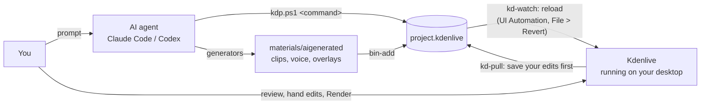

<div align="center">

# Movie Engine

**Een AI-agent monteert je video in Kdenlive terwijl je meekijkt, en je kunt het op elk moment overnemen.**

AI-codeeragents (Claude Code, Codex) bouwen en wijzigen echte Kdenlive-projecten: films, uitlegvideo's en verticale shorts. De bewerkingen verschijnen live in de editor die je open hebt. Portable, Windows, geen aanpassingen aan de editor.


[English](../../README.md) · [简体中文](README.zh-CN.md) · [繁體中文](README.zh-TW.md) · [हिन्दी](README.hi.md) · [Español](README.es.md) · [Français](README.fr.md) · [العربية](README.ar.md) · [বাংলা](README.bn.md) · [Português](README.pt.md) · [Русский](README.ru.md) · [اردو](README.ur.md) · [Bahasa Indonesia](README.id.md) · [Deutsch](README.de.md) · [日本語](README.ja.md) · [Türkçe](README.tr.md) · [한국어](README.ko.md) · [Українська](README.uk.md) · [Italiano](README.it.md) · [Polski](README.pl.md) · [Tiếng Việt](README.vi.md) · [فارسی](README.fa.md) · [ไทย](README.th.md) · [Kiswahili](README.sw.md) · [አማርኛ](README.am.md) · [Avañe'ẽ](README.gn.md) · [Setswana](README.tn.md) · [Shqip](README.sq.md) · [Беларуская](README.be.md) · [Български](README.bg.md) · [Bosanski](README.bs.md) · [Hrvatski](README.hr.md) · [Српски](README.sr.md) · [Crnogorski](README.cnr.md) · [Македонски](README.mk.md) · [Slovenščina](README.sl.md) · [Slovenčina](README.sk.md) · [Čeština](README.cs.md) · [Magyar](README.hu.md) · [Română](README.ro.md) · [Dansk](README.da.md) · [Norsk bokmål](README.nb.md) · [Norsk nynorsk](README.nn.md) · [Svenska](README.sv.md) · [Íslenska](README.is.md) · [Suomi](README.fi.md) · [Eesti](README.et.md) · [Latviešu](README.lv.md) · [Lietuvių](README.lt.md) · **Nederlands** · [Lëtzebuergesch](README.lb.md) · [Rumantsch](README.rm.md) · [Ελληνικά](README.el.md) · [Malti](README.mt.md) · [Gaeilge](README.ga.md) · [Català](README.ca.md) · [ქართული](README.ka.md) · [Հայերեն](README.hy.md) · [Azərbaycanca](README.az.md) · [Afrikaans](README.af.md) · [isiZulu](README.zu.md) · [isiXhosa](README.xh.md) · [Sesotho](README.st.md) · [Sepedi](README.nso.md) · [Xitsonga](README.ts.md) · [Tshivenḓa](README.ve.md) · [siSwati](README.ss.md) · [isiNdebele (South Africa)](README.nr.md) · [isiNdebele (Zimbabwe)](README.nd.md) · [chiShona](README.sn.md) · [Chichewa](README.ny.md) · [Ikinyarwanda](README.rw.md) · [Ikirundi](README.rn.md) · [Malagasy](README.mg.md) · [Soomaali](README.so.md) · [Afaan Oromoo](README.om.md) · [Qafar af](README.aa.md) · [ትግርኛ](README.ti.md) · [Sängö](README.sg.md) · [Kreol Seselwa](README.crs.md) · [TjiKalanga](README.kck.md) · [ChiNdau](README.ndc.md)

*Dit is een vertaling; de Engelse README is de referentieversie.*

</div>

---

## Inhoud

- [Waarom](#waarom)
- [Hoe het werkt](#hoe-het-werkt)
- [Functies](#functies)
- [Vereisten](#vereisten)
- [Installatie](#installatie)
- [Snel aan de slag](#snel-aan-de-slag)
- [Werken met de agent](#werken-met-de-agent)
- [De bewerkingsopdrachtregel (`kdp.ps1`)](#de-bewerkingsopdrachtregel-kdpps1)
- [Live synchronisatie met de geopende editor](#live-synchronisatie-met-de-geopende-editor)
- [Generatoren: wat Kdenlive niet kan](#generatoren-wat-kdenlive-niet-kan)
- [Voice-over en geluid](#voice-over-en-geluid)
- [Interfacetaal](#interfacetaal)
- [Mappenstructuur](#mappenstructuur)
- [Tests en bewijzen](#tests-en-bewijzen)
- [Beperkingen](#beperkingen)
- [Probleemoplossing](#probleemoplossing)
- [Veelgestelde vragen](#veelgestelde-vragen)
- [Bijdragen](#bijdragen)
- [Dankwoord](#dankwoord)
- [Licentie](#licentie)

## Waarom

Video-editors zijn gemaakt voor een hand op de muis. AI-agents zijn goed in structuur, timing en herhaling: 300 clips op de beat plaatsen, elk ondertitelregeltje op de stem afstemmen, een scène opnieuw doen na feedback. Ze kunnen niet door een grafische interface klikken zonder je bureaublad over te nemen.

Kdenlive is een sterke opensource-editor, maar onder Windows heeft hij **geen automatiserings-API**: besturing via D-Bus bestaat alleen in de Linux-builds, en de forks die er een toevoegen zijn ofwel niet onderhouden ofwel onveilig. Movie Engine lost dit op zonder de editor aan te passen:

1. De agent bewerkt het projectbestand `.kdenlive` via een geteste opdrachtregel (`engine/kdp.ps1`).
2. De draaiende Kdenlive krijgt via Windows UI Automation de opdracht het bestand opnieuw in te lezen, zonder toetsaanslagen, zonder muis en zonder de focus te stelen.
3. Je eigen niet-opgeslagen bewerkingen worden eerst opgeslagen en nooit overschreven.

Dus de agent monteert en jij beoordeelt, of je bewerkt zelf met de hand. Jullie werken allebei aan hetzelfde project, in dezelfde editor, op hetzelfde moment.

## Hoe het werkt



Elke bewerkingsopdracht volgt dezelfde veilige cyclus:

1. **Pull.** Als Kdenlive niet-opgeslagen wijzigingen heeft, krijgt hij de opdracht ze op te slaan (de knop Opslaan in de werkbalk via UI Automation), en het opslaan wordt bevestigd.
2. **Bewerken.** De opdracht wijzigt de XML onder een vergrendeling, na een hashcontrole en met een snapshot om ongedaan te maken. Als het bestand intussen is veranderd, wordt er niets geschreven.
3. **Herladen.** De watcher ziet het stempel van de AI en voert in de geopende editor File > Revert uit. Het telt pas als geslaagd wanneer de tijdlijnwidget echt opnieuw is opgebouwd.
4. **Conflict.** Als je intussen bent begonnen met bewerken, wordt er niets herladen en blijft je werk staan. De AI-versie wordt apart bewaard, en de agent past zijn wijziging opnieuw toe bovenop de jouwe.

## Functies

- **Volledige projectbewerking zonder grafische interface**: ongeveer 120 opdrachten voor bin, tijdlijn, effecten, composities, sporen, hulplijnen, markeringen, ondertitels, sequenties, snelheid en time remap, diavoorstellingen, titels, proxy's, renderen en ongedaan maken/opnieuw. Zie de [opdrachtenreferentie](#de-bewerkingsopdrachtregel-kdpps1).
- **Live synchronisatie met de geopende editor.** AI-bewerkingen verschijnen in de Kdenlive waar je naar kijkt; je niet-opgeslagen bewerkingen worden eerst opgeslagen en gaan nooit verloren.
- **Stoort je bureaublad nooit.** Geen focusdiefstal, toetsaanslagen of muisinvoer. Test-editors draaien op een onzichtbaar Windows-bureaublad.
- **Portable.** Editor, instellingen, Node.js, lettertypen en tools staan in één map. Kopieer die naar een andere pc en het werkt; er wordt niets naar Program Files of je Windows-profiel geschreven.
- **Generatoren voor wat Kdenlive niet kan**: kinetische tekst per letter, met de hand getekende annotaties, 3D-interfacescènes, cursoranimaties en lange interactieve uitlegfilms. Ze renderen op de GPU met echte bewegingsonscherpte en worden als gewone clips op de tijdlijn gezet.
- **Voice-over met woordtimings** (Microsoft Edge TTS, geen API-sleutel). Bijschriften en acties starten precies op het juiste woord.
- **Gesynthetiseerde geluidseffecten** (whoosh, click, pop, riser, impact en meer), gegenereerd in code.
- **Bewezen, niet aangenomen.** Elke opdracht heeft een resultaatcontrole, effecten en composities worden één voor één doorgelopen, en de ruwe resultaten staan in `docs/proof/`.
- **Instructies voor agents inbegrepen.** `AGENTS.md` en de skills in `.claude/skills/` leren Claude Code en Codex de werkwijze, het bestandsformaat en de valkuilen.

## Vereisten

| | |
|---|---|
| Besturingssysteem | Windows 10 of 11, x64 |
| Editor | Kdenlive **26.08.3**, portable build (standalone). Andere versies zijn niet getest. |
| Node.js | 18 of nieuwer: de Windows x64-`.zip` van nodejs.org, uitgepakt in `engine/node/` |
| Browser | Microsoft Edge (onderdeel van Windows); headless gebruikt door de scène-renderers |
| Agent | [Claude Code](https://claude.com/claude-code) of Codex. Optioneel: elke tool werkt ook met de hand. |
| Schijf | ongeveer 1 GB voor de editor en de tools, plus je media |
| GPU | elke GPU met hardwarematige H.264-codering versnelt `film-render.mjs` (anders valt hij terug op software) |

## Installatie

Alles wordt **binnen de map** geïnstalleerd. Er zijn geen beheerdersrechten nodig.

```powershell
git clone https://github.com/vladtarrow/movie-engine.git
cd movie-engine
```

**1. Node.js.** Download de Windows x64-`.zip` van Node.js 18 of nieuwer van <https://nodejs.org/en/download> en pak de inhoud uit in `engine\node\`, zodat `engine\node\node.exe` en `engine\node\npm.cmd` daar staan. Er is geen installatieprogramma en geen systeem-Node nodig. Alle scripts draaien via `engine\node.cmd`, nooit via een systeem-Node.

**2. Node-pakketten** voor de stemtool en de renderers (de versies liggen vast in `engine/voice/package.json`):

```powershell
engine\node\npm.cmd install --prefix engine\voice
```

**3. Kdenlive 26.08.3 portable.** Download `kdenlive-26.08.3_standalone.exe` van <https://download.kde.org/stable/kdenlive/26.08/windows/> naar `engine\installer\`, controleer het en pak het uit:

```powershell
(Get-FileHash engine\installer\kdenlive-26.08.3_standalone.exe -Algorithm SHA256).Hash
# expected: A25427B1DFF2C17E3B0386E991BB1A719382BB3176D1A90E441CDAEB6E0A967D
engine\installer\kdenlive-26.08.3_standalone.exe -o"engine\Kdenlive" -y
```

De editor komt terecht in `engine\Kdenlive\kdenlive-26.08.3_standalone\bin\`. Daar zitten `melt.exe` en `ffmpeg.exe` al bij.

**4. Eerste start.**

```powershell
engine\kdenlive.cmd
```

Kdenlive bewaart al zijn instellingen in `engine\profile-kdenlive\`, niet in je Windows-profiel. Bij de eerste start toont hij eenmalig een installatiewizard.

## Snel aan de slag

### Met een agent

Open de map in Claude Code (of Codex) en vraag het in gewone woorden:

> Maak een nieuw verticaal project "launch-teaser" op 30 fps. Zet de drie screenshots uit `materials/designers/launch/` op de tijdlijn, elk 2,5 s met een korte overvloeier, voeg een voice-over toe uit `script.txt` en stem op elke regel een kinetisch bijschrift af.

> Open het voor me in Kdenlive.

> Het tweede shot is te lang. Kort het in tot 1,8 s en zet het logo iets hoger.

De agent volgt `AGENTS.md`: hij bewerkt via `kdp.ps1`, rendert alleen de clips die de montage nodig heeft en houdt de geopende editor synchroon. Jij beoordeelt in Kdenlive, bewerkt met de hand wanneer je wilt en drukt op Render als je tevreden bent.

### Met de hand

```powershell
# a new 1080x1920 30 fps project with 2 video and 2 audio tracks
powershell -NoProfile -ExecutionPolicy Bypass -File engine\kdp.ps1 new -Project projects\hello\hello.kdenlive -Profile vertical_hd_30

# a 3-second title and a colour background
powershell -NoProfile -ExecutionPolicy Bypass -File engine\kdp.ps1 bin-color -Project projects\hello\hello.kdenlive -Color '#203060' -Seconds 3 -Name bg
powershell -NoProfile -ExecutionPolicy Bypass -File engine\kdp.ps1 title -Project projects\hello\hello.kdenlive -Text "Hello" -Seconds 3 -Name hi

# place them: background on V1, title above it on V2
powershell -NoProfile -ExecutionPolicy Bypass -File engine\kdp.ps1 add -Project projects\hello\hello.kdenlive -Bin bg -Track V1 -At 0
powershell -NoProfile -ExecutionPolicy Bypass -File engine\kdp.ps1 add -Project projects\hello\hello.kdenlive -Bin hi -Track V2 -At 0

# a check frame, then open it in the editor
powershell -NoProfile -ExecutionPolicy Bypass -File engine\kdp.ps1 frame -Project projects\hello\hello.kdenlive -At 1.5 -Out out\hello\check.png
engine\kdenlive.cmd projects\hello\hello.kdenlive
```

Om het laatste project later opnieuw te openen, dubbelklik je op `open-last-project.cmd`.

## Werken met de agent

De agent leest `AGENTS.md` (Codex) of `CLAUDE.md`, dat het importeert (Claude Code), plus twee skills:

| Skill | Leert |
|---|---|
| `.claude/skills/kdenlive-project-file` | het formaat `.kdenlive` / MLT XML, `kdp.ps1`, controleren met `melt` |
| `.claude/skills/kdenlive-live` | de draaiende editor veilig aansturen: starten, pull, herladen, het eigen venster vastleggen |

Regels die de agent volgt en waarop je kunt vertrouwen:

- Hij neemt nooit je muis, toetsenbord of focus over en maakt nooit schermafbeeldingen van je bureaublad (alleen van het eigen venster van de editor).
- Hij voert de stappen in de interface zelf uit (opslaan, openen, herladen) in plaats van jou te vragen te klikken.
- Hij vraagt het voordat hij iets downloadt en voordat hij iets verwijdert.
- Hij rendert alleen wat het werk nodig heeft (scèneclips, controleframes). De uiteindelijke film rendert hij alleen als je erom vraagt.
- Als Kdenlive iets niet goed kan, bouwt de agent het buiten de editor met code en zet hij het resultaat erin als clip. Hij zwakt het effect niet af.

## De bewerkingsopdrachtregel (`kdp.ps1`)

```powershell
powershell -NoProfile -ExecutionPolicy Bypass -File engine\kdp.ps1 <command> -Project <file.kdenlive> [options]
```

Tijden zijn in seconden, met een punt (`2.5`). Sporen heten `V1 V2 …` (V1 is het onderste) en `A1 A2 …`. Een clip wordt aangewezen met `-Track` plus een willekeurig tijdstip `-At` erbinnen. Effectparameters gaan in `-Params "name=value||name=value"`. De volledige lijst met alle opties staat in de kop van `engine/kdp.ps1`.

| Groep | Opdrachten |
|---|---|
| Project | `new`, `profiles`, `info`, `validate`, `fonts`, `profile-set`, `profile-from-clip`, `zone`, `archive`, `backups`, `rebase`, `otio-export`, `otio-import` |
| Bin | `bin-add`, `bin-color`, `title`, `title-text`, `title-save`, `title-template`, `bin-rename`, `bin-remove`, `bin-info`, `bin-set`, `bin-duplicate`, `bin-replace-file`, `bin-reload`, `folder`, `bin-folder`, `relink`, `clean`, `generator`, `playlist-clip`, `extract-audio`, `transcode` |
| Tijdlijn | `add`, `add-av`, `move`, `copy`, `trim`, `ripple-trim`, `slip`, `split`, `remove`, `speed`, `remap`, `disable`, `enable`, `group`, `ungroup`, `mix`, `unmix`, `space-insert`, `space-remove`, `spaces-remove-all`, `track-clear`, `replace-in-timeline` |
| Effecten | `effects`, `effect-info`, `effect-add`, `effect-list`, `effect-set`, `effect-remove`, `effect-copy`, `effect-clear`, `effects-all`, `bin-effect`, `effect-templates`, `effect-template` |
| Composities | `compositions`, `comp-info`, `comp-add`, `comp-list`, `comp-set`, `comp-remove` |
| Sporen | `track-add`, `track-remove`, `track-set` |
| Hulplijnen en markeringen | `guide-add`, `guide-list`, `guide-remove`, `guide-set`, `guide-clear`, `guide-export`, `guide-category`, `marker`, `marker-list`, `marker-set`, `marker-remove` |
| Ondertitels | `sub-add`, `sub-import`, `sub-export`, `sub-state` |
| Sequenties | `sequence-add`, `sequences`, `copy-to-sequence`, `expand`; elke opdracht met `-Sequence <name>` werkt binnen die sequentie |
| Speciaal | `slideshow`, Lottie- / Glaxnimate-animaties via `bin-add`, `proxy`, `stabilize`, `scene-split`, `speed-job`, `subclip` |
| Uitvoer | `frame` (één PNG), `preview` (snelle melt-render), `render` (de eigen renderer van Kdenlive of een preset), `presets` |
| Geschiedenis | `undo`, `redo`, `clear-history` (snapshots in `projects/<name>/.kdp-history`) |

Gedrag dat goed is om te weten:

- Gekoppelde audio- en videohelften worden samen verplaatst, ingekort, gesplitst en verwijderd (`-Alone` voor één helft).
- Een mislukte opdracht eindigt met code 1 en schrijft niets.
- Effecten die de Windows-build niet kan uitvoeren worden geweigerd, niet stilzwijgend genegeerd (lijst: `docs/proof/assets.txt`).
- Elke menuactie van Kdenlive is in `engine/tools/data/kdenlive-actions.csv` gekoppeld aan een opdracht, een andere route of "alleen weergave". Zie `docs/kdenlive-coverage.md`.

## Live synchronisatie met de geopende editor

| Script | Wat het doet | Exitcodes |
|---|---|---|
| `engine\kd-pull.ps1 -Project <f>` | laat Kdenlive je bewerkingen opslaan en bevestigt dat | 0 bestand actueel, 3 draait niet, 4 niet bevestigd |
| `engine\kd-reload.ps1 -Project <f>` | File > Revert, bevestigd door de opnieuw opgebouwde tijdlijn | 0 bevestigd, 2 je hebt niet-opgeslagen bewerkingen (niets weggegooid), 3 draait niet, 4 mislukt |
| `engine\kd-watch.ps1 -Project <f>` | watcher op de achtergrond: herlaadt na elke schrijfactie van de AI, logt conflicten | log in `engine\kd-watch.log`; verwijder `engine\kd-watch.run` om te stoppen |
| `engine\kdenlive-bg.ps1 [project]` | start Kdenlive geminimaliseerd voor een agent | 0 geladen, 4 niet bevestigd |
| `engine\kdenlive.cmd [project]` | start Kdenlive voor jou | |

Start de watcher één keer per sessie:

```powershell
Start-Process powershell -WindowStyle Hidden -ArgumentList '-NoProfile','-ExecutionPolicy','Bypass','-File','engine\kd-watch.ps1','-Project','projects\hello\hello.kdenlive'
```

Grote projecten: het herladen van een project met 1000 clips duurt minuten, en de tools wachten daarop in plaats van te vroeg te rapporteren. Projecten worden geopend via *File > Open Recent* in een lege editor, omdat Qt bij het direct openen van een bestand elk tijdlijnelement doorloopt voor toegankelijkheid, en dat was ongeveer 10 minuten trager.

## Generatoren: wat Kdenlive niet kan

Kdenlive/MLT heeft geen tekstanimatie per letter, geen expressies en weinig 3D, en zware effecten vertragen het afspelen. Movie Engine rendert zulke onderdelen buiten de editor en zet ze als gewone clips op de tijdlijn, meestal met alfakanaal, op een spoor boven de beelden. Het generatorscript en de invoer ervan blijven in de projectmap, zodat een clip opnieuw kan worden gegenereerd als de tekst, het lettertype of de timing verandert.

| Tool | Maakt |
|---|---|
| `engine/tools/kinetic-text.ps1` | kinetische bijschriften per letter, elk woord getimed vanuit `voice.json`, markeerkader |
| `engine/tools/annotate.ps1` | met de hand getekende cirkels, kaders, onderstrepingen en pijlen die zich over een screenshot tekenen |
| `engine/tools/card-entrance.ps1` | een screenshotkaart die omhoogkomt en inzoomt met een zachte schaduw |
| `engine/tools/pdf-to-png.ps1` | dia's uit een PDF-export |
| `engine/tools/html-render.mjs` | elke HTML/CSS/canvas-scène naar video: interface-animatie, cursors, 3D, maskers |
| `engine/tools/film-render.mjs` + `film/` | lange, interactieve uitlegfilms op een canvas: één clip per voice-overregel, acties starten op uitgesproken woorden, bewegingsonscherpte op de GPU bij ongeveer 45 fps |

Beide renderers sturen de Microsoft Edge aan die met Windows wordt meegeleverd, headless, met een wegwerpprofiel en zonder netwerktoegang.

### Demo's

```powershell
# a 3-second 3D title card with a cursor click
engine\node.cmd engine\tools\html-render.mjs examples\demo\scene\scene.html examples\demo\out --frames 0,30,60,89
engine\node.cmd engine\tools\html-render.mjs examples\demo\scene\scene.html examples\demo\out\scene.mp4

# a 4-shot interactive film timed to two voice lines
engine\node.cmd engine\tools\film-render.mjs examples\demo\film\film.html examples\demo\out --check
engine\node.cmd engine\tools\film-render.mjs examples\demo\film\film.html examples\demo\out --shots all --width 640
engine\node.cmd engine\tools\film-render.mjs examples\demo\film\film.html examples\demo\out\clips --suffix -v01
```

Een film bestaat uit drie kleine bestanden. `data.js` bevat de shots en de woordtijden. `direction.js` heeft één regel per shot:

```text
1 | hover 192 108 @brand | tag 300 60 Your brand @deserves | confetti 192 90 @film
2 say=A film that/*explains* it
3 | click 116 108 @before | click 268 108 @after | chips Before~After @after
4 scene=counter | count 0 120 % @count
```

`scenes.js` bevat de shots die vanaf nul worden getekend. `@word` start een actie wanneer de stem dat woord uitspreekt. De acties omvatten click, hover, drag, zoom, lens, ring, arrow, chips, toggle, slider, toast, type, count en confetti; de volledige syntaxis staat bovenaan `engine/tools/film/film-kit.js`.

## Voice-over en geluid

```powershell
engine\node.cmd engine\voice\voice.mjs lines.json materials\aigenerated\hello\voice en-US-AndrewMultilingualNeural +0%
```

`lines.json` is een lijst met regels. De tool schrijft één mp3 per regel plus `voice.json`, met de duur en het begin en einde van elk woord. Regels worden gecachet, dus als je één regel wijzigt, wordt alleen die regel opnieuw gegenereerd. De tool gebruikt de online tekst-naar-spraak van Microsoft Edge via het pakket `msedge-tts`: er is geen sleutel nodig, maar de dienst is onofficieel en heeft internet nodig.

```powershell
engine\node.cmd engine\audio\sfx.mjs materials\aigenerated\sfx
```

Dit synthetiseert whoosh, whoosh-long, swipe, click, pop, tick, riser, impact, ding en reveal in code; een kant-en-klare set staat in `materials/aigenerated/sfx/`. Vul geluiden die korter zijn dan één frame aan met stilte voordat je ze plaatst (`-af apad=whole_dur=0.0667`).

## Interfacetaal

De starters openen Kdenlive standaard in het **Engels**. Wil je een andere taal, stel dan `MOVIE_ENGINE_UI_LANG` in voordat je start:

```powershell
$env:MOVIE_ENGINE_UI_LANG = 'ru'; engine\kdenlive.cmd
```

UI Automation vindt menu-items aan hun zichtbare namen. Namen voor 31 interfacetalen zijn ingebouwd (`engine/tools/kd-ui.ps1`, `$KdNames`). Voeg voor elke andere taal de namen daar toe en controleer met:

```powershell
powershell -NoProfile -ExecutionPolicy Bypass -File engine\tools\kd-langcheck.ps1
```

## Mappenstructuur

```text
movie-engine/
├─ AGENTS.md, CLAUDE.md          instructions for AI agents
├─ .claude/skills/               agent skills: project file format, live editor
├─ engine/
│  ├─ kdp.ps1                    the editing command line
│  ├─ kd-pull / kd-reload / kd-watch .ps1, kdenlive.cmd, kdenlive-bg.ps1
│  ├─ tools/                     internals, generators, tests, data (action map)
│  ├─ voice/  audio/  fonts/     TTS, synthesized SFX, Poppins (OFL)
│  ├─ Kdenlive/  node/           portable editor and Node.js (not in git)
│  └─ profile-kdenlive/          the editor's settings (not in git)
├─ projects/<name>/<name>.kdenlive
├─ materials/
│  ├─ download/                  stock and downloaded files (not in git)
│  ├─ aigenerated/               everything the AI made (sfx/ and test-kit/ ship with the engine)
│  ├─ designers/  brand/         files from your team, brand assets
├─ examples/demo/                demos of the scene and film renderers
├─ out/                          renders (not in git)
└─ docs/                         proofs, coverage, translations of this README
```

Mediapaden binnen projecten zijn relatief. Als je de map verplaatst of kopieert, schrijft `kdp.ps1 rebase` (ook automatisch uitgevoerd door `kdenlive.cmd`) de nieuwe locatie in het project.

## Tests en bewijzen

Beweringen over wat werkt worden gestaafd door resultaatcontroles, niet door "de functie is uitgevoerd". De samenvatting staat in [`docs/kdenlive-proof.md`](../../docs/kdenlive-proof.md), en de ruwe uitvoer in `docs/proof/`.

| Test | Controleert |
|---|---|
| `engine\tools\kdp-clitest.ps1` | elke `kdp.ps1`-opdracht, via de opdrachtregel, door het resulterende project te vergelijken |
| `engine\tools\kd-livetest.ps1` | pull, herladen, watcher, conflicten en racecondities tegen een echte Kdenlive op een onzichtbaar bureaublad |
| `engine\tools\kdp-assetsweep.ps1` | elk effect en elke compositie: rendert en vergelijkt frames |
| `engine\tools\kdp-portabletest.ps1` | kopieert de map naar een andere plek en werkt vanuit de kopie |
| `engine\tools\kd-langcheck.ps1` | de interfacetaal en dat UI Automation het menu vindt |
| `engine\tools\kdp-coverage-check.ps1` | dat elke menuactie is gekoppeld en dat geen bewijs ouder is dan de code |

```powershell
powershell -NoProfile -ExecutionPolicy Bypass -File engine\tools\kdp-clitest.ps1 -Report docs\proof\clitest.txt
powershell -NoProfile -ExecutionPolicy Bypass -File engine\tools\kd-livetest.ps1 -Report docs\proof\live-en.txt
```

Test-editors draaien alleen op een verborgen bureaublad met een eigen profiel, dus tests raken je geopende Kdenlive en je focus nooit aan.

## Beperkingen

- **Alleen Windows**, alleen Kdenlive **26.08.3**. Linux heeft D-Bus en zou een andere brug nodig hebben.
- Bij het starten neemt de editor ongeveer 3 seconden de toetsenbordfocus, terwijl het lege venster verschijnt. Agents vragen het eerst voordat ze hem starten terwijl jij aan het werk bent. Herladen en bewerkingen nemen de focus niet.
- De Windows-build mist de MLT-modules sox, ladspa en movit en enkele frei0r/avfilter-effecten; `kdp.ps1` weigert ze (`docs/proof/assets.txt`).
- Export en import van OpenTimelineIO nemen alleen clips en gaten mee. Multicam heeft geen live wisselen van camerahoek (knippen gebeurt met split/remove/hide).
- "Opslaan als…" via UI Automation in een geminimaliseerd venster opent geen dialoogvenster; de agent gebruikt in plaats daarvan `archive` of bestandskopieën.
- Spraakherkenning (automatische ondertitels) vereist Whisper of Vosk, die niet zijn meegeleverd.
- Titels die met de titeltool van Kdenlive zijn gemaakt, gebruiken lettertypen die in Windows zijn geïnstalleerd. Voor gegarandeerde typografie render je tekst met de generatoren, die lettertypen laden uit `engine/fonts/`.
- Edge TTS is een onofficiële onlinedienst en kan veranderen of ophouden te werken.

## Probleemoplossing

| Symptoom | Oorzaak en oplossing |
|---|---|
| Kdenlive draait, maar klikken op het taakbalkpictogram toont niets | De opgeslagen vensterpositie ligt buiten het scherm. Sluit hem en verwijder de `kdockLayout`-items in `engine\profile-kdenlive\AppData\Local\kdenliverc`, of verplaats het venster met `SetWindowPos` (zie `AGENTS.md`). |
| `kd-reload.ps1` eindigt met code 2 | Je hebt niet-opgeslagen bewerkingen. Er is niets weggegooid. Voer `kd-pull.ps1` uit en pas de wijziging opnieuw toe (`kdp.ps1` doet dit zelf). |
| `CONFLICT` in `engine\kd-watch.log` | Jij en de agent bewerkten op hetzelfde moment. Jouw versie blijft in de editor, en de AI-versie staat in `projects\<name>\.kdp-history\<name>\conflict\`. Vraag de agent zijn wijziging opnieuw toe te passen. |
| Een opdracht eindigt met code 1 en "pull not confirmed" | Kdenlive is bezig of toont een dialoogvenster. Sluit het dialoogvenster of wacht tot het laden klaar is, en probeer het dan opnieuw. |
| Een PowerShell-script kan niet worden geparseerd | Scripts met niet-ASCII-tekst moeten voor Windows PowerShell 5.1 worden opgeslagen als UTF-8 **met BOM**. |
| `voice.mjs` stopt met "Stream closed before the synthesis completed" | Meestal een netwerkprobleem, of niet-geëscapete SSML in oudere kopieën. `voice.mjs` escapet `& < >` zelf. |
| Een groot project openen duurt vele minuten | Open het via `kdenlive.cmd` / `kdenlive-bg.ps1`, nooit als `kdenlive.exe project.kdenlive`. |

## Veelgestelde vragen

**Heb ik Claude Code of Codex nodig?**
Nee. Elke tool is een gewoon script dat je met de hand kunt uitvoeren. De agent maakt het snel: hij plant de montage, voert de tools uit en houdt de editor synchroon.

**Overschrijft de agent mijn handmatige bewerkingen?**
Nee. Vóór elke schrijfactie worden je niet-opgeslagen bewerkingen opgeslagen en bevestigd. Als je bewerkt terwijl de agent schrijft, wordt de schrijfactie geweigerd of als conflict apart bewaard, en nooit over je werk heen toegepast.

**Kan ik Kdenlive gewoon blijven gebruiken?**
Ja. Het is de standaard-Kdenlive met een eigen instellingenmap. Bewerk, bekijk en render zoals gewoonlijk.

**Werkt het met een Kdenlive die ik al heb geïnstalleerd?**
Het gebruikt een eigen portable kopie in `engine\Kdenlive\`, dus je geïnstalleerde Kdenlive en de instellingen daarvan blijven onaangeroerd.

**Waarom geen Kdenlive-fork met een API, of een andere editor?**
Voor Windows bestaat er geen onderhouden en veilige fork (onderzoek van november 2026). OpenShot, Blender VSE, DaVinci Resolve, Shotcut en webeditors zijn geëvalueerd; Kdenlive bood de meeste montagediepgang. Een REST API-voorstel in het hoofdproject (merge request !902) wordt in de gaten gehouden.

**Kan het de uiteindelijke video renderen?**
Ja, met `kdp.ps1 render` (de eigen renderer van Kdenlive, verborgen), of je drukt zelf op Render in de editor.

**Worden mijn media ergens geüpload?**
Nee. Alleen de tekst van de voice-over wordt naar de Edge TTS-dienst gestuurd wanneer je een stem genereert. De scène-renderers draaien met uitgeschakeld netwerk.

## Bijdragen

Bijdragen zijn welkom. Zie [CONTRIBUTING.md](../../CONTRIBUTING.md). Kort samengevat:

- Elke nieuwe of gewijzigde `kdp.ps1`-bewerking heeft een resultaatcontrole in `kdp-clitest.ps1` nodig, een vermelding in de actiekaart en een nieuwe run van `kdp-coverage-check.ps1`.
- Start nooit een test-Kdenlive op het zichtbare bureaublad; gebruik `engine/tools/kd-hidden.ps1`.
- Houd alles portable: geen installaties buiten de map, geen absolute paden in projecten.
- Leg geverifieerde eigenaardigheden vast in `AGENTS.md` of in de bijbehorende skill.

## Dankwoord

- [Kdenlive](https://kdenlive.org) en [MLT](https://www.mltframework.org): de editor en de engine eronder.
- [FFmpeg](https://ffmpeg.org), meegeleverd met Kdenlive.
- [msedge-tts](https://www.npmjs.com/package/msedge-tts) voor de voice-over.
- [Poppins](https://fonts.google.com/specimen/Poppins) van Indian Type Foundry, SIL Open Font License (`engine/fonts/OFL.txt`).
- `engine/tools/data/kdenliveui-26.08.3.rc`: het menubestand van Kdenlive, overgenomen uit de broncode van Kdenlive 26.08.3; alleen gebruikt door de dekkingscontrole. Het blijft onder de GPL-licentie van Kdenlive vallen, niet onder de MIT License.

## Licentie

De eigen code van Movie Engine is uitgebracht onder de [MIT-licentie](../../LICENSE). Kdenlive, MLT, FFmpeg, Node.js-pakketten en het lettertype Poppins behouden hun eigen licenties.
