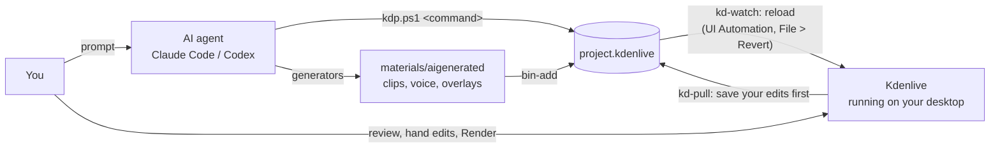

<div align="center">

# Movie Engine

**Ein AI-agent redigerer videoen din i Kdenlive medan du ser på, og du kan ta over når som helst.**

AI-kodeagentar (Claude Code, Codex) byggjer og endrar ekte Kdenlive-prosjekt: filmar, forklaringsvideoar og vertikale shorts. Endringane dukkar opp med ein gong i editoren du har open. Portabelt, Windows, ingen patchar av editoren.


[English](../../README.md) · [简体中文](README.zh-CN.md) · [繁體中文](README.zh-TW.md) · [हिन्दी](README.hi.md) · [Español](README.es.md) · [Français](README.fr.md) · [العربية](README.ar.md) · [বাংলা](README.bn.md) · [Português](README.pt.md) · [Русский](README.ru.md) · [اردو](README.ur.md) · [Bahasa Indonesia](README.id.md) · [Deutsch](README.de.md) · [日本語](README.ja.md) · [Türkçe](README.tr.md) · [한국어](README.ko.md) · [Українська](README.uk.md) · [Italiano](README.it.md) · [Polski](README.pl.md) · [Tiếng Việt](README.vi.md) · [فارسی](README.fa.md) · [ไทย](README.th.md) · [Kiswahili](README.sw.md) · [አማርኛ](README.am.md) · [Avañe'ẽ](README.gn.md) · [Setswana](README.tn.md) · [Shqip](README.sq.md) · [Беларуская](README.be.md) · [Български](README.bg.md) · [Bosanski](README.bs.md) · [Hrvatski](README.hr.md) · [Српски](README.sr.md) · [Crnogorski](README.cnr.md) · [Македонски](README.mk.md) · [Slovenščina](README.sl.md) · [Slovenčina](README.sk.md) · [Čeština](README.cs.md) · [Magyar](README.hu.md) · [Română](README.ro.md) · [Dansk](README.da.md) · [Norsk bokmål](README.nb.md) · **Norsk nynorsk** · [Svenska](README.sv.md) · [Íslenska](README.is.md) · [Suomi](README.fi.md) · [Eesti](README.et.md) · [Latviešu](README.lv.md) · [Lietuvių](README.lt.md) · [Nederlands](README.nl.md) · [Lëtzebuergesch](README.lb.md) · [Rumantsch](README.rm.md) · [Ελληνικά](README.el.md) · [Malti](README.mt.md) · [Gaeilge](README.ga.md) · [Català](README.ca.md) · [ქართული](README.ka.md) · [Հայերեն](README.hy.md) · [Azərbaycanca](README.az.md) · [Afrikaans](README.af.md) · [isiZulu](README.zu.md) · [isiXhosa](README.xh.md) · [Sesotho](README.st.md) · [Sepedi](README.nso.md) · [Xitsonga](README.ts.md) · [Tshivenḓa](README.ve.md) · [siSwati](README.ss.md) · [isiNdebele (South Africa)](README.nr.md) · [isiNdebele (Zimbabwe)](README.nd.md) · [chiShona](README.sn.md) · [Chichewa](README.ny.md) · [Ikinyarwanda](README.rw.md) · [Ikirundi](README.rn.md) · [Malagasy](README.mg.md) · [Soomaali](README.so.md) · [Afaan Oromoo](README.om.md) · [Qafar af](README.aa.md) · [ትግርኛ](README.ti.md) · [Sängö](README.sg.md) · [Kreol Seselwa](README.crs.md) · [TjiKalanga](README.kck.md) · [ChiNdau](README.ndc.md)

*Dette er ei omsetjing. Den engelske README-en er referanseversjonen.*

</div>

---

## Innhald

- [Kvifor](#kvifor)
- [Korleis det verkar](#korleis-det-verkar)
- [Funksjonar](#funksjonar)
- [Krav](#krav)
- [Installering](#installering)
- [Kom raskt i gang](#kom-raskt-i-gang)
- [Arbeid med agenten](#arbeid-med-agenten)
- [Kommandolinja for redigering (`kdp.ps1`)](#kommandolinja-for-redigering-kdpps1)
- [Live-synkronisering med den opne editoren](#live-synkronisering-med-den-opne-editoren)
- [Generatorar: det Kdenlive ikkje kan](#generatorar-det-kdenlive-ikkje-kan)
- [Forteljarstemme og lyd](#forteljarstemme-og-lyd)
- [Språk i grensesnittet](#språk-i-grensesnittet)
- [Mappestruktur](#mappestruktur)
- [Testar og prov](#testar-og-prov)
- [Avgrensingar](#avgrensingar)
- [Feilsøking](#feilsøking)
- [Ofte stilte spørsmål](#ofte-stilte-spørsmål)
- [Bidra](#bidra)
- [Takk](#takk)
- [Lisens](#lisens)

## Kvifor

Videoredigeringsprogram er laga for ei hand på musa. AI-agentar er gode på struktur, timing og repetisjon: å plassere 300 klipp på takta, å time kvar undertekst til stemma, å gjere om ein scene etter tilbakemelding. Men dei kan ikkje klikke seg gjennom eit grafisk grensesnitt utan å ta over skrivebordet ditt.

Kdenlive er ein kraftig editor med open kjeldekode, men på Windows har han **ikkje noko API for automatisering**: styring via D-Bus finst berre i Linux-bygg, og forkane som legg til eit, er anten utan vedlikehald eller utrygge. Movie Engine løyser dette utan å patche editoren:

1. Agenten redigerer prosjektfila `.kdenlive` gjennom ei testa kommandolinje (`engine/kdp.ps1`).
2. Den køyrande Kdenlive får beskjed om å lese inn fila på nytt via Windows UI Automation, utan tastetrykk, utan mus og utan å stele fokus.
3. Dei ulagra endringane dine blir lagra først og blir aldri skrivne over.

Så agenten redigerer og du går gjennom, eller du redigerer sjølv for hand. De arbeider begge med det same prosjektet, i den same editoren, på same tid.

## Korleis det verkar



Kvar redigeringskommando følgjer den same trygge syklusen:

1. **Pull.** Dersom Kdenlive har ulagra endringar, får han beskjed om å lagre dei (Lagre-knappen på verktøylinja via UI Automation), og lagringa blir stadfesta.
2. **Redigering.** Kommandoen endrar XML-en under ein lås, etter ein hashkontroll og med eit augneblinksbilete for angring. Dersom fila er endra i mellomtida, blir ingenting skrive.
3. **Ny innlesing.** Overvakaren ser stempelet til AI-en og køyrer File > Revert i den opne editoren. Det tel berre som vellukka når tidslinje-widgeten faktisk er bygd opp på nytt.
4. **Konflikt.** Dersom du har byrja å redigere i mellomtida, blir ingenting lese inn på nytt, og arbeidet ditt blir verande. AI-versjonen blir lagd til side, og agenten bruker endringa si på nytt oppå di.

## Funksjonar

- **Full prosjektredigering utan grafisk grensesnitt**: rundt 120 kommandoar som dekkjer prosjektkorga, tidslinja, effektar, komposisjonar, spor, hjelpelinjer, markørar, undertekstar, sekvensar, fart og tidsomfordeling, lysbiletframsyningar, titlar, proxyar, rendering og angre/gjer om. Sjå [kommandooversikta](#kommandolinja-for-redigering-kdpps1).
- **Live-synkronisering med den opne editoren.** AI-endringar blir viste i den Kdenlive du ser på; dei ulagra endringane dine blir lagra først og går aldri tapt.
- **Forstyrrar aldri skrivebordet ditt.** Ikkje noko fokustjuveri, ingen tastetrykk eller muserørsler. Testeditorar køyrer på eit usynleg Windows-skrivebord.
- **Portabelt.** Editor, innstillingar, Node.js, skrifter og verktøy ligg i éi mappe. Kopier ho til ein annan PC, så verkar ho; ingenting blir skrive til Program Files eller Windows-profilen din.
- **Generatorar for det Kdenlive ikkje kan**: kinetisk tekst animert bokstav for bokstav, handteikna markeringar, 3D-scener av grensesnitt, peikaranimasjonar og lange interaktive forklaringsfilmar. Dei blir rendra på GPU-en med ekte rørsleuskarpleik og plasserte på tidslinja som vanlege klipp.
- **Forteljarstemme med ordtiming** (Microsoft Edge TTS, ingen API-nøkkel). Undertekstar og handlingar blir utløyste nøyaktig på rett ord.
- **Syntetiserte lydeffektar** (whoosh, click, pop, riser, impact og fleire), genererte i kode.
- **Prova, ikkje anteke.** Kvar kommando har ein kontroll av resultatet, effektar og komposisjonar blir gjennomgått éin etter éin, og råresultata ligg i `docs/proof/`.
- **Instruksjonar for agentar følgjer med.** `AGENTS.md` og skilla i `.claude/skills/` lærer Claude Code og Codex arbeidsflyten, filformatet og fallgruvene.

## Krav

| | |
|---|---|
| OS | Windows 10 eller 11, x64 |
| Editor | Kdenlive **26.08.3**, portabelt (standalone) bygg. Andre versjonar er ikkje testa. |
| Node.js | 18 eller nyare: Windows x64-`.zip` frå nodejs.org, pakka ut i `engine/node/` |
| Nettlesar | Microsoft Edge (ein del av Windows); blir brukt headless av scenerenderarane |
| Agent | [Claude Code](https://claude.com/claude-code) eller Codex. Valfritt: alle verktøya kan òg køyrast for hand. |
| Disk | rundt 1 GB til editoren og verktøya, pluss mediefilene dine |
| GPU | kva skjermkort som helst med maskinvarekoding av H.264 gjer `film-render.mjs` raskare (elles blir programvarekoding brukt) |

## Installering

Alt blir installert **inne i mappa**. Ingenting krev administratorrettar.

```powershell
git clone https://github.com/vladtarrow/movie-engine.git
cd movie-engine
```

**1. Node.js.** Last ned Windows x64-`.zip` med Node.js 18 eller nyare frå <https://nodejs.org/en/download>, og pakk ut innhaldet i `engine\node\`, slik at `engine\node\node.exe` og `engine\node\npm.cmd` ligg der. Du treng verken installasjonsprogram eller ein Node som er installert i systemet. Alle skript blir køyrde gjennom `engine\node.cmd`, aldri gjennom Node-en til systemet.

**2. Node-pakkar** for stemmeverktøyet og renderarane (versjonane er låste i `engine/voice/package.json`):

```powershell
engine\node\npm.cmd install --prefix engine\voice
```

**3. Portabel Kdenlive 26.08.3.** Last ned `kdenlive-26.08.3_standalone.exe` frå <https://download.kde.org/stable/kdenlive/26.08/windows/> til `engine\installer\`, kontroller fila og pakk ho ut:

```powershell
(Get-FileHash engine\installer\kdenlive-26.08.3_standalone.exe -Algorithm SHA256).Hash
# expected: A25427B1DFF2C17E3B0386E991BB1A719382BB3176D1A90E441CDAEB6E0A967D
engine\installer\kdenlive-26.08.3_standalone.exe -o"engine\Kdenlive" -y
```

Editoren endar opp i `engine\Kdenlive\kdenlive-26.08.3_standalone\bin\`. Han inneheld alt `melt.exe` og `ffmpeg.exe`.

**4. Første oppstart.**

```powershell
engine\kdenlive.cmd
```

Kdenlive lagrar alle innstillingane sine i `engine\profile-kdenlive\`, ikkje i Windows-profilen din. Ved første oppstart viser han ein oppsettsvegvisar éin gong.

## Kom raskt i gang

### Med ein agent

Opne mappa i Claude Code (eller Codex), og spør med vanlege ord:

> Lag eit nytt vertikalt prosjekt «launch-teaser» med 30 fps. Legg dei tre skjermbileta frå `materials/designers/launch/` på tidslinja, 2,5 s kvart med ei kort krysstoning, legg til ei forteljarstemme frå `script.txt` og time ein kinetisk bilettekst til kvar linje.

> Opne det i Kdenlive for meg.

> Det andre biletet er for langt. Kort det ned til 1,8 s og flytt logoen litt opp.

Agenten følgjer `AGENTS.md`: han redigerer gjennom `kdp.ps1`, rendrar berre dei klippa som klippinga treng, og held den opne editoren synkronisert. Du går gjennom i Kdenlive, redigerer for hand når du vil, og trykkjer på Render når du er nøgd.

### For hand

```powershell
# a new 1080x1920 30 fps project with 2 video and 2 audio tracks
powershell -NoProfile -ExecutionPolicy Bypass -File engine\kdp.ps1 new -Project projects\hello\hello.kdenlive -Profile vertical_hd_30

# a 3-second title and a colour background
powershell -NoProfile -ExecutionPolicy Bypass -File engine\kdp.ps1 bin-color -Project projects\hello\hello.kdenlive -Color '#203060' -Seconds 3 -Name bg
powershell -NoProfile -ExecutionPolicy Bypass -File engine\kdp.ps1 title -Project projects\hello\hello.kdenlive -Text "Hello" -Seconds 3 -Name hi

# place them: background on V1, title above it on V2
powershell -NoProfile -ExecutionPolicy Bypass -File engine\kdp.ps1 add -Project projects\hello\hello.kdenlive -Bin bg -Track V1 -At 0
powershell -NoProfile -ExecutionPolicy Bypass -File engine\kdp.ps1 add -Project projects\hello\hello.kdenlive -Bin hi -Track V2 -At 0

# a check frame, then open it in the editor
powershell -NoProfile -ExecutionPolicy Bypass -File engine\kdp.ps1 frame -Project projects\hello\hello.kdenlive -At 1.5 -Out out\hello\check.png
engine\kdenlive.cmd projects\hello\hello.kdenlive
```

For å opne det siste prosjektet igjen seinare dobbeltklikkar du på `open-last-project.cmd`.

## Arbeid med agenten

Agenten les `AGENTS.md` (Codex) eller `CLAUDE.md`, som importerer han (Claude Code), pluss to skills:

| Skill | Lærer bort |
|---|---|
| `.claude/skills/kdenlive-project-file` | formatet `.kdenlive` / MLT XML, `kdp.ps1`, kontroll med `melt` |
| `.claude/skills/kdenlive-live` | trygg styring av den køyrande editoren: oppstart, pull, ny innlesing, opptak av vindauget hans |

Reglar som agenten følgjer, og som du kan lite på:

- Han tek aldri musa, tastaturet eller fokuset ditt, og tek aldri skjermbilete av skrivebordet ditt (berre av vindauget til sjølve editoren).
- Han utfører sjølv stega i grensesnittet (lagre, opne, lese inn på nytt) i staden for å be deg klikke.
- Han spør før han lastar ned noko og før han slettar noko.
- Han rendrar berre det arbeidet krev (sceneklipp, kontrollbilete). Den ferdige filmen rendrar han berre når du ber om det.
- Når Kdenlive ikkje får til noko godt, byggjer agenten det utanfor med kode og set inn resultatet som eit klipp. Han vatnar ikkje ut effekten.

## Kommandolinja for redigering (`kdp.ps1`)

```powershell
powershell -NoProfile -ExecutionPolicy Bypass -File engine\kdp.ps1 <command> -Project <file.kdenlive> [options]
```

Tider blir oppgitt i sekund med punktum (`2.5`). Spor heiter `V1 V2 …` (V1 nedst) og `A1 A2 …`. Eit klipp blir peika ut med `-Track` pluss eit kva som helst tidspunkt `-At` inne i det. Effektparametrar blir oppgitt i `-Params "name=value||name=value"`. Den fullstendige lista med alle vala står øvst i `engine/kdp.ps1`.

| Gruppe | Kommandoar |
|---|---|
| Prosjekt | `new`, `profiles`, `info`, `validate`, `fonts`, `profile-set`, `profile-from-clip`, `zone`, `archive`, `backups`, `rebase`, `otio-export`, `otio-import` |
| Prosjektkorg | `bin-add`, `bin-color`, `title`, `title-text`, `title-save`, `title-template`, `bin-rename`, `bin-remove`, `bin-info`, `bin-set`, `bin-duplicate`, `bin-replace-file`, `bin-reload`, `folder`, `bin-folder`, `relink`, `clean`, `generator`, `playlist-clip`, `extract-audio`, `transcode` |
| Tidslinje | `add`, `add-av`, `move`, `copy`, `trim`, `ripple-trim`, `slip`, `split`, `remove`, `speed`, `remap`, `disable`, `enable`, `group`, `ungroup`, `mix`, `unmix`, `space-insert`, `space-remove`, `spaces-remove-all`, `track-clear`, `replace-in-timeline` |
| Effektar | `effects`, `effect-info`, `effect-add`, `effect-list`, `effect-set`, `effect-remove`, `effect-copy`, `effect-clear`, `effects-all`, `bin-effect`, `effect-templates`, `effect-template` |
| Komposisjonar | `compositions`, `comp-info`, `comp-add`, `comp-list`, `comp-set`, `comp-remove` |
| Spor | `track-add`, `track-remove`, `track-set` |
| Hjelpelinjer og markørar | `guide-add`, `guide-list`, `guide-remove`, `guide-set`, `guide-clear`, `guide-export`, `guide-category`, `marker`, `marker-list`, `marker-set`, `marker-remove` |
| Undertekstar | `sub-add`, `sub-import`, `sub-export`, `sub-state` |
| Sekvensar | `sequence-add`, `sequences`, `copy-to-sequence`, `expand`; kva kommando som helst med `-Sequence <name>` verkar inne i den sekvensen |
| Spesielle | `slideshow`, Lottie- / Glaxnimate-animasjonar via `bin-add`, `proxy`, `stabilize`, `scene-split`, `speed-job`, `subclip` |
| Utdata | `frame` (éin PNG), `preview` (rask rendering med melt), `render` (den eigne renderaren til Kdenlive eller ei førehandsinnstilling), `presets` |
| Historikk | `undo`, `redo`, `clear-history` (augneblinksbilete i `projects/<name>/.kdp-history`) |

Åtferd som er verd å kjenne til:

- Kopla lyd- og videohalvdelar blir flytta, trimma, delte og fjerna saman (`-Alone` for berre den eine halvdelen).
- Ein kommando som feilar, avsluttar med kode 1 og skriv ingenting.
- Effektar som Windows-bygget ikkje kan køyre, blir avviste i staden for å bli ignorerte i det stille (liste: `docs/proof/assets.txt`).
- Kvar menyhandling i Kdenlive er knytt til ein kommando, ein annan veg eller «berre vising» i `engine/tools/data/kdenlive-actions.csv`. Sjå `docs/kdenlive-coverage.md`.

## Live-synkronisering med den opne editoren

| Skript | Kva det gjer | Avslutningskodar |
|---|---|---|
| `engine\kd-pull.ps1 -Project <f>` | får Kdenlive til å lagre endringane dine og stadfestar det | 0 fila er oppdatert, 3 køyrer ikkje, 4 ikkje stadfesta |
| `engine\kd-reload.ps1 -Project <f>` | File > Revert, stadfesta av den oppattbygde tidslinja | 0 stadfesta, 2 du har ulagra endringar (ingenting forkasta), 3 køyrer ikkje, 4 mislukka |
| `engine\kd-watch.ps1 -Project <f>` | overvakar i bakgrunnen: les inn på nytt etter kvar AI-skriving, loggfører konfliktar | logg i `engine\kd-watch.log`; slett `engine\kd-watch.run` for å stoppe |
| `engine\kdenlive-bg.ps1 [project]` | startar Kdenlive minimert for ein agent | 0 lesen inn, 4 ikkje stadfesta |
| `engine\kdenlive.cmd [project]` | startar Kdenlive for deg | |

Start overvakaren éin gong per økt:

```powershell
Start-Process powershell -WindowStyle Hidden -ArgumentList '-NoProfile','-ExecutionPolicy','Bypass','-File','engine\kd-watch.ps1','-Project','projects\hello\hello.kdenlive'
```

Store prosjekt: å lese inn att eit prosjekt med 1000 klipp tek minutt, og verktøya ventar på det i staden for å melde for tidleg. Prosjekt blir opna via *File > Open Recent* i ein tom editor, fordi direkte opning av ei fil får Qt til å gå gjennom kvart element på tidslinja for tilgjenge og var rundt 10 minutt seinare.

## Generatorar: det Kdenlive ikkje kan

Kdenlive/MLT har ingen tekstanimasjon bokstav for bokstav, ingen uttrykk (expressions) og lite 3D, og tunge effektar gjer avspelinga treg. Movie Engine rendrar slike delar utanfor og legg dei på tidslinja som vanlege klipp, som regel med alfakanal, på eit spor over bileta. Generatorskriptet og inndataa blir liggjande i prosjektmappa, så eit klipp kan genererast på nytt når teksten, skrifta eller timinga blir endra.

| Verktøy | Lagar |
|---|---|
| `engine/tools/kinetic-text.ps1` | kinetiske bilettekstar bokstav for bokstav, kvart ord tima frå `voice.json`, uthevingsboks |
| `engine/tools/annotate.ps1` | handteikna sirklar, boksar, understrekingar og piler som teiknar seg sjølve oppå eit skjermbilete |
| `engine/tools/card-entrance.ps1` | eit kort med eit skjermbilete som glir opp og blir skalert inn med ein mjuk skugge |
| `engine/tools/pdf-to-png.ps1` | lysbilete frå ein PDF-eksport |
| `engine/tools/html-render.mjs` | kva HTML/CSS/canvas-scene som helst til video: grensesnittanimasjon, peikarar, 3D, masker |
| `engine/tools/film-render.mjs` + `film/` | lange, interaktive forklaringsfilmar på eit canvas: eitt klipp per replikk, handlingar blir utløyste på dei uttala orda, rørsleuskarpleik på GPU-en med rundt 45 fps |

Begge renderarane styrer Microsoft Edge som følgjer med Windows, headless, med ein eingongsprofil og utan nettverkstilgang.

### Demoar

```powershell
# a 3-second 3D title card with a cursor click
engine\node.cmd engine\tools\html-render.mjs examples\demo\scene\scene.html examples\demo\out --frames 0,30,60,89
engine\node.cmd engine\tools\html-render.mjs examples\demo\scene\scene.html examples\demo\out\scene.mp4

# a 4-shot interactive film timed to two voice lines
engine\node.cmd engine\tools\film-render.mjs examples\demo\film\film.html examples\demo\out --check
engine\node.cmd engine\tools\film-render.mjs examples\demo\film\film.html examples\demo\out --shots all --width 640
engine\node.cmd engine\tools\film-render.mjs examples\demo\film\film.html examples\demo\out\clips --suffix -v01
```

Ein film er tre små filer. `data.js` inneheld bileta (shots) og tidene for orda. `direction.js` har éi linje per bilete:

```text
1 | hover 192 108 @brand | tag 300 60 Your brand @deserves | confetti 192 90 @film
2 say=A film that/*explains* it
3 | click 116 108 @before | click 268 108 @after | chips Before~After @after
4 scene=counter | count 0 120 % @count
```

`scenes.js` inneheld dei bileta som blir teikna frå botnen av. `@word` løyser ut ei handling når stemma seier det ordet. Handlingane omfattar click, hover, drag, zoom, lens, ring, arrow, chips, toggle, slider, toast, type, count og confetti; den fullstendige syntaksen står øvst i `engine/tools/film/film-kit.js`.

## Forteljarstemme og lyd

```powershell
engine\node.cmd engine\voice\voice.mjs lines.json materials\aigenerated\hello\voice en-US-AndrewMultilingualNeural +0%
```

`lines.json` er ei liste med replikkar. Verktøyet skriv éin mp3 per replikk pluss `voice.json`, med lengda og start og slutt for kvart ord. Replikkane blir mellomlagra, så endrar du éin replikk, blir berre han generert på nytt. Det bruker den nettbaserte tekst-til-tale-tenesta til Microsoft Edge via pakken `msedge-tts`: du treng ingen nøkkel, men tenesta er uoffisiell og krev internett.

```powershell
engine\node.cmd engine\audio\sfx.mjs materials\aigenerated\sfx
```

Dette syntetiserer whoosh, whoosh-long, swipe, click, pop, tick, riser, impact, ding og reveal i kode; eit ferdig sett ligg i `materials/aigenerated/sfx/`. Fyll ut lydar som er kortare enn éin ramme, med stille før du plasserer dei (`-af apad=whole_dur=0.0667`).

## Språk i grensesnittet

Oppstartsskripta startar Kdenlive på **engelsk** som standard. Set `MOVIE_ENGINE_UI_LANG` før oppstart for å bruke eit anna språk:

```powershell
$env:MOVIE_ENGINE_UI_LANG = 'ru'; engine\kdenlive.cmd
```

UI Automation finn menypunkt etter dei synlege namna deira. Namn for 31 grensesnittspråk er innebygde (`engine/tools/kd-ui.ps1`, `$KdNames`). For kva anna språk som helst legg du til namna der og kontrollerer med:

```powershell
powershell -NoProfile -ExecutionPolicy Bypass -File engine\tools\kd-langcheck.ps1
```

## Mappestruktur

```text
movie-engine/
├─ AGENTS.md, CLAUDE.md          instructions for AI agents
├─ .claude/skills/               agent skills: project file format, live editor
├─ engine/
│  ├─ kdp.ps1                    the editing command line
│  ├─ kd-pull / kd-reload / kd-watch .ps1, kdenlive.cmd, kdenlive-bg.ps1
│  ├─ tools/                     internals, generators, tests, data (action map)
│  ├─ voice/  audio/  fonts/     TTS, synthesized SFX, Poppins (OFL)
│  ├─ Kdenlive/  node/           portable editor and Node.js (not in git)
│  └─ profile-kdenlive/          the editor's settings (not in git)
├─ projects/<name>/<name>.kdenlive
├─ materials/
│  ├─ download/                  stock and downloaded files (not in git)
│  ├─ aigenerated/               everything the AI made (sfx/ and test-kit/ ship with the engine)
│  ├─ designers/  brand/         files from your team, brand assets
├─ examples/demo/                demos of the scene and film renderers
├─ out/                          renders (not in git)
└─ docs/                         proofs, coverage, translations of this README
```

Mediestiar inne i prosjekta er relative. Dersom du flyttar eller kopierer mappa, skriv `kdp.ps1 rebase` (som òg blir køyrd automatisk av `kdenlive.cmd`) den nye plasseringa inn i prosjektet.

## Testar og prov

Påstandar om kva som verkar, er underbygde av kontrollar av resultatet, ikkje av at «funksjonen køyrde». Samandraget står i [`docs/kdenlive-proof.md`](../../docs/kdenlive-proof.md), og rådataa ligg i `docs/proof/`.

| Test | Kontrollerer |
|---|---|
| `engine\tools\kdp-clitest.ps1` | kvar `kdp.ps1`-kommando gjennom kommandolinja, ved å samanlikne prosjektet som blir resultatet |
| `engine\tools\kd-livetest.ps1` | pull, ny innlesing, overvakar, konfliktar og kappløp mot ein ekte Kdenlive på eit usynleg skrivebord |
| `engine\tools\kdp-assetsweep.ps1` | kvar effekt og komposisjon: rendrar og samanliknar bilete |
| `engine\tools\kdp-portabletest.ps1` | kopierer mappa ein annan stad og arbeider frå kopien |
| `engine\tools\kd-langcheck.ps1` | språket i grensesnittet og at UI Automation finn menyen |
| `engine\tools\kdp-coverage-check.ps1` | at kvar menyhandling er knytt til noko, og at ingen prov er eldre enn koden |

```powershell
powershell -NoProfile -ExecutionPolicy Bypass -File engine\tools\kdp-clitest.ps1 -Report docs\proof\clitest.txt
powershell -NoProfile -ExecutionPolicy Bypass -File engine\tools\kd-livetest.ps1 -Report docs\proof\live-en.txt
```

Testeditorar køyrer berre på eit gøymt skrivebord med sin eigen profil, så testane rører aldri den opne Kdenlive-en din eller fokuset ditt.

## Avgrensingar

- **Berre Windows**, berre Kdenlive **26.08.3**. Linux har D-Bus og ville trengt ei anna bru.
- Når editoren startar, tek han tastaturfokuset i rundt 3 sekund medan det tomme vindauget dukkar opp. Agentar spør før dei startar han medan du arbeider. Ny innlesing og redigering tek ikkje fokus.
- Windows-bygget manglar MLT-modulane sox, ladspa og movit og nokre frei0r/avfilter-effektar; `kdp.ps1` avviser dei (`docs/proof/assets.txt`).
- Eksport og import med OpenTimelineIO overfører berre klipp og mellomrom. Multicam har inga live veksling mellom vinklar (kutt blir gjorde med split/remove/hide).
- «Lagre som …» via UI Automation i eit minimert vindauge opnar ingen dialog; agenten bruker i staden `archive` eller filkopiar.
- Talegjenkjenning (automatiske undertekstar) krev Whisper eller Vosk, som ikkje følgjer med.
- Titlar som er laga med tittelverktøyet i Kdenlive, bruker skrifter som er installerte i Windows. For garantert typografi rendrar du teksten med generatorane, som les inn skrifter frå `engine/fonts/`.
- Edge TTS er ei uoffisiell nettteneste og kan endre seg eller slutte å verke.

## Feilsøking

| Symptom | Årsak og løysing |
|---|---|
| Kdenlive køyrer, men eit klikk på han i oppgåvelinja viser ingenting | Den lagra vindaugsposisjonen ligg utanfor skjermen. Lukk han og slett `kdockLayout`-oppføringane i `engine\profile-kdenlive\AppData\Local\kdenliverc`, eller flytt vindauget med `SetWindowPos` (sjå `AGENTS.md`). |
| `kd-reload.ps1` avsluttar med 2 | Du har ulagra endringar. Ingenting vart forkasta. Køyr `kd-pull.ps1`, og bruk så endringa på nytt (`kdp.ps1` gjer dette sjølv). |
| `CONFLICT` i `engine\kd-watch.log` | Du og agenten redigerte i same augneblinken. Versjonen din blir verande i editoren, og AI-versjonen ligg i `projects\<name>\.kdp-history\<name>\conflict\`. Be agenten bruke endringa si på nytt. |
| Ein kommando avsluttar med 1 og «pull not confirmed» | Kdenlive er oppteken eller viser ein dialog. Lukk dialogen eller vent til innlesinga er ferdig, og prøv så igjen. |
| Eit PowerShell-skript kan ikkje tolkast | Skript med tekst utanfor ASCII må lagrast som UTF-8 **med BOM** for Windows PowerShell 5.1. |
| `voice.mjs` stoppar med «Stream closed before the synthesis completed» | Som regel eit nettverksproblem, eller SSML utan escaping i eldre kopiar. `voice.mjs` escaper sjølv `& < >`. |
| Det tek mange minutt å opne eit stort prosjekt | Opne det gjennom `kdenlive.cmd` / `kdenlive-bg.ps1`, aldri som `kdenlive.exe project.kdenlive`. |

## Ofte stilte spørsmål

**Treng eg Claude Code eller Codex?**
Nei. Kvart verktøy er eit vanleg skript du kan køyre for hand. Det er agenten som gjer det raskt: han planlegg klippinga, køyrer verktøya og held editoren synkronisert.

**Kjem agenten til å skrive over dei manuelle endringane mine?**
Nei. Før kvar skriving blir dei ulagra endringane dine lagra og stadfesta. Dersom du redigerer medan agenten skriv, blir skrivinga avvist eller lagd til side som ein konflikt, men aldri brukt oppå arbeidet ditt.

**Kan eg framleis bruke Kdenlive som vanleg?**
Ja. Det er den vanlege Kdenlive med si eiga innstillingsmappe. Rediger, førehandsvis og render som vanleg.

**Verkar det med ein Kdenlive eg alt har installert?**
Det bruker sin eigen portable kopi i `engine\Kdenlive\`, så den installerte Kdenlive-en din og innstillingane hans blir ikkje rørte.

**Kvifor ikkje ein Kdenlive-fork med eit API, eller ein annan editor?**
På Windows finst det ingen vedlikehalden og trygg fork (undersøking frå november 2026). OpenShot, Blender VSE, DaVinci Resolve, Shotcut og nettbaserte editorar vart vurderte; Kdenlive gav størst redigeringsdjupn. Eit framlegg om eit REST API i oppstraumsprosjektet (merge request !902) blir følgt med på.

**Kan det rendre den ferdige videoen?**
Ja, med `kdp.ps1 render` (den eigne renderaren til Kdenlive, gøymd), eller så trykkjer du sjølv på Render i editoren.

**Blir media mine lasta opp nokon stad?**
Nei. Berre teksten til forteljarstemma blir send til Edge TTS-tenesta når du genererer stemme. Scenerenderarane køyrer med nettverket slått av.

## Bidra

Bidrag er velkomne. Sjå [CONTRIBUTING.md](../../CONTRIBUTING.md). Kort fortalt:

- Kvar ny eller endra `kdp.ps1`-operasjon treng ein kontroll av resultatet i `kdp-clitest.ps1`, ei oppføring i handlingskartet og ei ny køyring av `kdp-coverage-check.ps1`.
- Start aldri ein test-Kdenlive på det synlege skrivebordet; bruk `engine/tools/kd-hidden.ps1`.
- Hald alt portabelt: ingen installasjonar utanfor mappa, ingen absolutte stiar i prosjekt.
- Skriv ned stadfesta særheiter i `AGENTS.md` eller i den tilhøyrande skillen.

## Takk

- [Kdenlive](https://kdenlive.org) og [MLT](https://www.mltframework.org): editoren og motoren under han.
- [FFmpeg](https://ffmpeg.org), som følgjer med Kdenlive.
- [msedge-tts](https://www.npmjs.com/package/msedge-tts) for forteljarstemma.
- [Poppins](https://fonts.google.com/specimen/Poppins) frå Indian Type Foundry, SIL Open Font License (`engine/fonts/OFL.txt`).
- `engine/tools/data/kdenliveui-26.08.3.rc`: menyfila til Kdenlive, henta frå kjeldekoden til Kdenlive 26.08.3; blir berre brukt av dekningskontrollen. Ho er framleis under GPL-lisensen til Kdenlive, ikkje under MIT License.

## Lisens

Den eigne koden til Movie Engine er gjeven ut under [MIT-lisensen](../../LICENSE). Kdenlive, MLT, FFmpeg, Node.js-pakkar og skrifta Poppins held på sine eigne lisensar.
