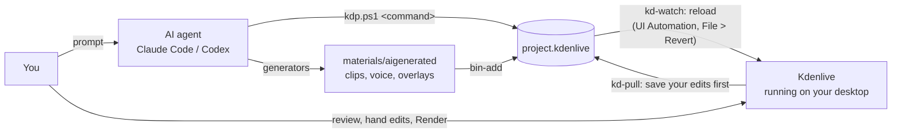

<div align="center">

# Movie Engine

**I-agent ye-AI ihlela ividiyo yakho ku-Kdenlive uqalile, begodu ungathatha umsebenzi nanyana kunini.**

Ama-agent we-AI (ubuhlakani obenziweko) atlola ikhowudi (Claude Code, Codex) akha begodu atjhugulula amaphrojekthi wamambala we-Kdenlive: amafilimu, amavidiyo ahlathululako namavidiyo amafitjhani ama ngobude (vertical shorts). Okuhlelwako kuvela khona nje ku-editor oyivulileko. Iyaphatheka (portable), ngeye-Windows, begodu ayitjhugululi i-editor ngokwayo.


[English](../../README.md) · [简体中文](README.zh-CN.md) · [繁體中文](README.zh-TW.md) · [हिन्दी](README.hi.md) · [Español](README.es.md) · [Français](README.fr.md) · [العربية](README.ar.md) · [বাংলা](README.bn.md) · [Português](README.pt.md) · [Русский](README.ru.md) · [اردو](README.ur.md) · [Bahasa Indonesia](README.id.md) · [Deutsch](README.de.md) · [日本語](README.ja.md) · [Türkçe](README.tr.md) · [한국어](README.ko.md) · [Українська](README.uk.md) · [Italiano](README.it.md) · [Polski](README.pl.md) · [Tiếng Việt](README.vi.md) · [فارسی](README.fa.md) · [ไทย](README.th.md) · [Kiswahili](README.sw.md) · [አማርኛ](README.am.md) · [Avañe'ẽ](README.gn.md) · [Setswana](README.tn.md) · [Shqip](README.sq.md) · [Беларуская](README.be.md) · [Български](README.bg.md) · [Bosanski](README.bs.md) · [Hrvatski](README.hr.md) · [Српски](README.sr.md) · [Crnogorski](README.cnr.md) · [Македонски](README.mk.md) · [Slovenščina](README.sl.md) · [Slovenčina](README.sk.md) · [Čeština](README.cs.md) · [Magyar](README.hu.md) · [Română](README.ro.md) · [Dansk](README.da.md) · [Norsk bokmål](README.nb.md) · [Norsk nynorsk](README.nn.md) · [Svenska](README.sv.md) · [Íslenska](README.is.md) · [Suomi](README.fi.md) · [Eesti](README.et.md) · [Latviešu](README.lv.md) · [Lietuvių](README.lt.md) · [Nederlands](README.nl.md) · [Lëtzebuergesch](README.lb.md) · [Rumantsch](README.rm.md) · [Ελληνικά](README.el.md) · [Malti](README.mt.md) · [Gaeilge](README.ga.md) · [Català](README.ca.md) · [ქართული](README.ka.md) · [Հայերեն](README.hy.md) · [Azərbaycanca](README.az.md) · [Afrikaans](README.af.md) · [isiZulu](README.zu.md) · [isiXhosa](README.xh.md) · [Sesotho](README.st.md) · [Sepedi](README.nso.md) · [Xitsonga](README.ts.md) · [Tshivenḓa](README.ve.md) · [siSwati](README.ss.md) · **isiNdebele (South Africa)** · [isiNdebele (Zimbabwe)](README.nd.md) · [chiShona](README.sn.md) · [Chichewa](README.ny.md) · [Ikinyarwanda](README.rw.md) · [Ikirundi](README.rn.md) · [Malagasy](README.mg.md) · [Soomaali](README.so.md) · [Afaan Oromoo](README.om.md) · [Qafar af](README.aa.md) · [ትግርኛ](README.ti.md) · [Sängö](README.sg.md) · [Kreol Seselwa](README.crs.md) · [TjiKalanga](README.kck.md) · [ChiNdau](README.ndc.md)

*Leli litjhugululo. I-README yesiNgisi yiyo esisekelo.*

</div>

---

## Okuqukethweko

- [Kubayini](#kubayini)
- [Kusebenza njani](#kusebenza-njani)
- [Okungenziwa](#okungenziwa)
- [Iimfuneko](#iimfuneko)
- [Ukufaka](#ukufaka)
- [Ukuthoma msinyana](#ukuthoma-msinyana)
- [Ukusebenza ne-agent](#ukusebenza-ne-agent)
- [Umugqa wemiyalo yokuhlela (`kdp.ps1`)](#umugqa-wemiyalo-yokuhlela-kdpps1)
- [Ukuvumelanisa khona nje ne-editor evulekileko](#ukuvumelanisa-khona-nje-ne-editor-evulekileko)
- [Ama-generator: lokho i-Kdenlive engakghoni ukukwenza](#ama-generator-lokho-i-kdenlive-engakghoni-ukukwenza)
- [Ilizwi elikhulumako nomsindo](#ilizwi-elikhulumako-nomsindo)
- [Ilimi le-interface](#ilimi-le-interface)
- [Ukuhlelwa kwamafolda](#ukuhlelwa-kwamafolda)
- [Iinlingo nobufakazi](#iinlingo-nobufakazi)
- [Imikhawulo](#imikhawulo)
- [Ukulungisa imiraro](#ukulungisa-imiraro)
- [Imibuzo ebuzwa kanengi](#imibuzo-ebuzwa-kanengi)
- [Ukuba nesandla](#ukuba-nesandla)
- [Ukuthokoza](#ukuthokoza)
- [Ilayisensi](#ilayisensi)

## Kubayini

Ama-editor wamavidiyo akhelwe izandla ezise-mouse. Ama-agent we-AI alungile ekuhleleni, esikhathini nemsebenzini ophindwako: ukubeka ama-clip ama-300 ngokwesigqi somculo, ukuvumelanisa yoke i-caption nelizwi, ukwenza kabutjha isiqephe ngemva kwemibono yabantu. Kodwana awakghoni ukuqhwarhaza ku-GUI (i-interface yeenthombe) ngaphandle kokuthatha i-desktop yakho.

I-Kdenlive yi-editor enamandla ye-open-source (ikhowudi evulekileko), kodwana ku-Windows **ayinayo i-API yokwenza izinto ngokuzenzakalela (automation)**: ukulawula nge-D-Bus kukhona kwaphela kuma-build we-Linux, begodu ama-fork afaka lokho kungaba awasanakekelwa namkha awaphephi. I-Movie Engine ilungisa lokhu ngaphandle kokutjhugulula i-editor:

1. I-agent ihlela ifayili yephrojekthi ye-`.kdenlive` ngomugqa wemiyalo olingiweko (`engine/kdp.ps1`).
2. I-Kdenlive esebenzako itjelwa bona iphinde ifunde ifayili nge-Windows UI Automation, ngaphandle kokugandelela ikhibhodi, ngaphandle kwe-mouse begodu ngaphandle kokuthatha i-focus.
3. Amatjhugululo wakho angakabulungwa (save) athoma abulungwe, begodu awatlolelwa ngaphezulu.

Ngalokho-ke i-agent iyahlela wena uqale, namkha uhlele ngesandla. Noke nobabili nisebenza ephrojekthini yinye, ku-editor yinye, ngesikhathi sinye.

## Kusebenza njani



Yoke imiyalo yokuhlela ilandela umjikelezo ofanako ophephileko:

1. **Pull (ukudosa).** Nange i-Kdenlive inamatjhugululo angakabulungwa, iyatjelwa bona iwabulunge (i-Save ku-toolbar nge-UI Automation), begodu ukubulunga kuyaqinisekiswa.
2. **Ukuhlela.** Umyalo utjhugulula i-XML ivaliwe (lock), ngemva kokuhlola i-hash begodu kune-snapshot yokubuyisela (undo). Nange ifayili litjhugulukile ngaleso sikhathi, akukho okutlolwako.
3. **Ukuphinda uvule.** Umqaleli (watcher) ubona itshwayo le-AI begodu wenza i-File > Revert ku-editor evulekileko. Ukuphumelela kubalwa kwaphela nange i-widget ye-timeline yakhiwe kabutjha ngamambala.
4. **Ukungavumelani.** Nange uthome ukuhlela phakathi, akukho okuvulwa kabutjha begodu umsebenzi wakho uyasala. Ihlelo le-AI libekwa eqadi, begodu i-agent iphinda yenze itjhugululo layo ngaphezu kwelakho.

## Okungenziwa

- **Ukuhlela okuphelele kwephrojekthi ngaphandle kwe-GUI**: imiyalo ecishe ibe ngu-120 ehlanganisa i-bin, i-timeline, ama-effect, ama-composition, ama-track, ama-guide, ama-marker, ama-subtitle, ama-sequence, ibelo ne-time remap, ama-slideshow, ama-title, ama-proxy, ukwenza i-render (rendering) ne-undo/redo. Qala [ireferensi yemiyalo](#umugqa-wemiyalo-yokuhlela-kdpps1).
- **Ukuvumelanisa khona nje ne-editor evulekileko.** Amatjhugululo we-AI avela ku-Kdenlive oyiqalileko; amatjhugululo wakho angakabulungwa athoma abulungwe begodu awalahleki.
- **Ayikuphazamisi ku-desktop yakho.** Akukho ukuthatha i-focus, ukugandelela ikhibhodi namkha ukusebenzisa i-mouse. Ama-editor wokulinga asebenza ku-desktop ye-Windows engabonakaliko.
- **Iyaphatheka.** I-editor, ama-setting, i-Node.js, ama-font namathulusi kuhlala efolda yinye. Yikophe ku-PC enye begodu iyasebenza; akukho okutlolwa ku-Program Files namkha ku-profile yakho ye-Windows.
- **Ama-generator walokho i-Kdenlive engakghoni ukukwenza**: umbhalo onyakazako ngonobumba ngamunye (kinetic text), amatshwayo adwetjwe ngesandla, iinthombe ze-interface ze-3D, ukunyakaza kwe-cursor namafilimu amade ahlathululako asebenzisanako nomuntu (interactive "explainer"). Enziwa i-render ku-GPU nge-motion blur yamambala begodu abekwa ku-timeline njengama-clip ajayelekileko.
- **Ilizwi elikhulumako (voice-over) elinesikhathi selinye nelinye igama** (Microsoft Edge TTS, ayitlhogi i-API key). Ama-caption nezenzo kwenzeka egameni kanye lelo.
- **Imisindo yama-effect ehlanganiswe ngekhowudi** (whoosh, click, pop, riser, impact nokunye), eyenziwe ngekhowudi.
- **Kufakazelwe, akusi kuqagela.** Yoke imiyalo inokuhlola kwepumelelo, ama-effect nama-composition alingwa munye ngamunye, begodu imiphumela yamambala iku-`docs/proof/`.
- **Iinqophiso ze-agent zifakiwe.** `AGENTS.md` nama-skill aku-`.claude/skills/` afundisa i-Claude Code ne-Codex indlela yokusebenza, i-format yefayili neenlibe.

## Iimfuneko

| | |
|---|---|
| OS | Windows 10 namkha 11, x64 |
| I-editor | Kdenlive **26.08.3**, i-build ephathekako (standalone). Amanye amahlelo awakalingwa. |
| Node.js | 18 namkha etjha: i-`.zip` ye-Windows x64 evela ku-nodejs.org, evulelwe ku-`engine/node/` |
| I-browser | Microsoft Edge (yingcenye ye-Windows); isetjenziswa ingabonakali (headless) ngama-renderer weenkundla |
| I-agent | [Claude Code](https://claude.com/claude-code) namkha Codex. Akusi kukateleleka: ithulusi ngalinye liyasebenza nangesandla. |
| I-disk | cishe 1 GB ye-editor namathulusi, kunye nemidiya yakho |
| GPU | nanyana yiyiphi i-GPU ekghona ukwenza i-encode ye-H.264 nge-hardware irhabisa i-`film-render.mjs` (nange ingekho, isebenzisa i-software) |

## Ukufaka

Koke kufakwa **ngaphakathi kwefolda**. Akukho okutlhoga amalungelo we-admin.

```powershell
git clone https://github.com/vladtarrow/movie-engine.git
cd movie-engine
```

**1. Node.js.** Dawunilowuda i-`.zip` ye-Windows x64 ye-Node.js 18 namkha etjha ku-<https://nodejs.org/en/download> begodu uvulele okungaphakathi kwayo ku-`engine\node\`, bona i-`engine\node\node.exe` ne-`engine\node\npm.cmd` zibe lapho. Akutlhogeki i-installer namkha i-Node yesistimu. Woke ama-script asebenza nge-`engine\node.cmd`, ingasi nge-Node yesistimu.

**2. Amaphakheji we-Node** wethulusi lelizwi nama-renderer (amahlelo abekwe ku-`engine/voice/package.json`):

```powershell
engine\node\npm.cmd install --prefix engine\voice
```

**3. Kdenlive 26.08.3 ephathekako.** Dawunilowuda i-`kdenlive-26.08.3_standalone.exe` ku-<https://download.kde.org/stable/kdenlive/26.08/windows/> uyifake ku-`engine\installer\`, uyihlole begodu uyivule:

```powershell
(Get-FileHash engine\installer\kdenlive-26.08.3_standalone.exe -Algorithm SHA256).Hash
# expected: A25427B1DFF2C17E3B0386E991BB1A719382BB3176D1A90E441CDAEB6E0A967D
engine\installer\kdenlive-26.08.3_standalone.exe -o"engine\Kdenlive" -y
```

I-editor igcina iku-`engine\Kdenlive\kdenlive-26.08.3_standalone\bin\`. Seyivele ine-`melt.exe` ne-`ffmpeg.exe`.

**4. Ukuthoma kokuthoma.**

```powershell
engine\kdenlive.cmd
```

I-Kdenlive ibulunga woke ama-setting wayo ku-`engine\profile-kdenlive\`, ingasi ku-profile yakho ye-Windows. Ekuthomeni kokuthoma itjengisa i-wizard yokuhlela kanye kwaphela.

## Ukuthoma msinyana

### Ne-agent

Vula ifolda ku-Claude Code (namkha Codex) begodu ubawe ngamagama ajayelekileko:

> Yenza iphrojekthi etjha ema ngobude ye-30 fps ebizwa bona "launch-teaser". Beka iinthombe zesikrini ezintathu ezivela ku-`materials/designers/launch/` ku-timeline, ngayinye 2.5 s ne-cross-fade efitjhani, ungezelele i-voice-over evela ku-`script.txt` begodu uvumelanise i-caption enyakazako nawo woke umugqa.

> Ngivulele yona ku-Kdenlive.

> Isithombe sesibili side khulu. Sifitjhaze sibe ngu-1.8 s begodu uphakamise i-logo kancani.

I-agent ilandela `AGENTS.md`: ihlela nge-`kdp.ps1`, yenza i-render kwaphela yama-clip atlhogwa kuhlela, begodu igcina i-editor evulekileko ivumelana. Wena uqala ku-Kdenlive, uhlela ngesandla nanyana kunini nawuthanda, begodu ugandelela i-Render nawanelisekile.

### Ngesandla

```powershell
# a new 1080x1920 30 fps project with 2 video and 2 audio tracks
powershell -NoProfile -ExecutionPolicy Bypass -File engine\kdp.ps1 new -Project projects\hello\hello.kdenlive -Profile vertical_hd_30

# a 3-second title and a colour background
powershell -NoProfile -ExecutionPolicy Bypass -File engine\kdp.ps1 bin-color -Project projects\hello\hello.kdenlive -Color '#203060' -Seconds 3 -Name bg
powershell -NoProfile -ExecutionPolicy Bypass -File engine\kdp.ps1 title -Project projects\hello\hello.kdenlive -Text "Hello" -Seconds 3 -Name hi

# place them: background on V1, title above it on V2
powershell -NoProfile -ExecutionPolicy Bypass -File engine\kdp.ps1 add -Project projects\hello\hello.kdenlive -Bin bg -Track V1 -At 0
powershell -NoProfile -ExecutionPolicy Bypass -File engine\kdp.ps1 add -Project projects\hello\hello.kdenlive -Bin hi -Track V2 -At 0

# a check frame, then open it in the editor
powershell -NoProfile -ExecutionPolicy Bypass -File engine\kdp.ps1 frame -Project projects\hello\hello.kdenlive -At 1.5 -Out out\hello\check.png
engine\kdenlive.cmd projects\hello\hello.kdenlive
```

Bona uphinde uvule iphrojekthi yokugcina ngemva kwesikhatjhana, qhwarhaza kabili ku-`open-last-project.cmd`.

## Ukusebenza ne-agent

I-agent ifunda `AGENTS.md` (Codex) namkha `CLAUDE.md`, eyingenisako (Claude Code), kunye nama-skill amabili:

| I-skill | Ifundisa |
|---|---|
| `.claude/skills/kdenlive-project-file` | i-format ye-`.kdenlive` / MLT XML, `kdp.ps1`, ukuhlola nge-`melt` |
| `.claude/skills/kdenlive-live` | ukulawula i-editor esebenzako ngokuphepha: ukuyithoma, pull, ukuphinda uvule, ukuthatha isithombe sefesititjhi layo |

Imithetho i-agent eyilandelako, ongayithemba:

- Ayikhe ithathe i-mouse, ikhibhodi namkha i-focus yakho, begodu ayikhe ithathe isithombe se-desktop yakho (kwaphela ifesititjhi le-editor ngokwayo).
- Yenza yona ngokwayo amagadango we-GUI (ukubulunga, ukuvula, ukuphinda uvule) kunokobana ikubawe bona uqhwarhaze.
- Iyabuza ingakadawunilowudi litho nangaphambi kokususa litho.
- Yenza i-render kwaphela yalokho okutlhogwa msebenzi (ama-clip weenkundla, ama-frame wokuhlola). Yenza i-render yefilimu ephelileko kwaphela nawuyibawa.
- Nange i-Kdenlive ingakghoni ukwenza okuthileko kuhle, i-agent iyakwakha ngaphandle ngekhowudi begodu ifake umphumela njenge-clip. Ayiyenzi ibe buthakathaka i-effect.

## Umugqa wemiyalo yokuhlela (`kdp.ps1`)

```powershell
powershell -NoProfile -ExecutionPolicy Bypass -File engine\kdp.ps1 <command> -Project <file.kdenlive> [options]
```

Isikhathi singemizuzwana, ngechaphazi (`2.5`). Ama-track ngu-`V1 V2 …` (V1 ngophasi) ne-`A1 A2 …`. I-clip itjengiswa nge-`-Track` kunye nanyana ngisiphi isikhathi `-At` ngaphakathi kwayo. Ama-parameter we-effect angena ku-`-Params "name=value||name=value"`. Irhelo elipheleleko elinayo yoke i-option liphezulu ku-`engine/kdp.ps1`.

| Isiqhema | Imiyalo |
|---|---|
| Iphrojekthi | `new`, `profiles`, `info`, `validate`, `fonts`, `profile-set`, `profile-from-clip`, `zone`, `archive`, `backups`, `rebase`, `otio-export`, `otio-import` |
| Bin | `bin-add`, `bin-color`, `title`, `title-text`, `title-save`, `title-template`, `bin-rename`, `bin-remove`, `bin-info`, `bin-set`, `bin-duplicate`, `bin-replace-file`, `bin-reload`, `folder`, `bin-folder`, `relink`, `clean`, `generator`, `playlist-clip`, `extract-audio`, `transcode` |
| Timeline | `add`, `add-av`, `move`, `copy`, `trim`, `ripple-trim`, `slip`, `split`, `remove`, `speed`, `remap`, `disable`, `enable`, `group`, `ungroup`, `mix`, `unmix`, `space-insert`, `space-remove`, `spaces-remove-all`, `track-clear`, `replace-in-timeline` |
| Ama-effect | `effects`, `effect-info`, `effect-add`, `effect-list`, `effect-set`, `effect-remove`, `effect-copy`, `effect-clear`, `effects-all`, `bin-effect`, `effect-templates`, `effect-template` |
| Ama-composition | `compositions`, `comp-info`, `comp-add`, `comp-list`, `comp-set`, `comp-remove` |
| Ama-track | `track-add`, `track-remove`, `track-set` |
| Ama-guide nama-marker | `guide-add`, `guide-list`, `guide-remove`, `guide-set`, `guide-clear`, `guide-export`, `guide-category`, `marker`, `marker-list`, `marker-set`, `marker-remove` |
| Ama-subtitle | `sub-add`, `sub-import`, `sub-export`, `sub-state` |
| Ama-sequence | `sequence-add`, `sequences`, `copy-to-sequence`, `expand`; nanyana ngimuphi umyalo one-`-Sequence <name>` usebenza ngaphakathi kwaleyo sequence |
| Okukhethekileko | `slideshow`, ama-animation we-Lottie / Glaxnimate nge-`bin-add`, `proxy`, `stabilize`, `scene-split`, `speed-job`, `subclip` |
| Okuphumako | `frame` (i-PNG yinye), `preview` (i-render erhabako nge-melt), `render` (i-renderer ye-Kdenlive ngokwayo namkha i-preset), `presets` |
| Umlando | `undo`, `redo`, `clear-history` (ama-snapshot ku-`projects/<name>/.kdp-history`) |

Okufanele ukwazi ngendlela esebenza ngayo:

- Iingcenye ze-audio nevidiyo ezihlanganisiweko ziyanyakaza, ziyafitjhazwa, ziyahlukaniswa begodu zisuswa ndawonye (`-Alone` engcenyeni yinye kwaphela).
- Umyalo ohlulekako uphuma nekhowudi 1 begodu awutloli litho.
- Ama-effect i-build ye-Windows engakghoni ukuwasebenzisa ayalelwa, awatjhiywa ngokuthula (irhelo: `docs/proof/assets.txt`).
- Isenzo ngasinye se-menu ye-Kdenlive sihlanganiswe nomyalo, nendlela enye, namkha "ukuqala kwaphela" ku-`engine/tools/data/kdenlive-actions.csv`. Qala `docs/kdenlive-coverage.md`.

## Ukuvumelanisa khona nje ne-editor evulekileko

| I-script | Ekwenzako | Amakhowudi wokuphuma |
|---|---|---|
| `engine\kd-pull.ps1 -Project <f>` | yenza i-Kdenlive ibulunge amatjhugululo wakho begodu ikuqinisekise | 0 ifayili litjha, 3 ayisebenzi, 4 akukaqinisekiswa |
| `engine\kd-reload.ps1 -Project <f>` | File > Revert, kuqinisekiswa yi-timeline eyakhiwe kabutjha | 0 kuqinisekisiwe, 2 unamatjhugululo angakabulungwa (akukho okulahliweko), 3 ayisebenzi, 4 kuhlulekile |
| `engine\kd-watch.ps1 -Project <f>` | umqaleli wangemva: uphinda uvule ngemva kwakho koke ukutlola kwe-AI, utlola ukungavumelani ku-log | i-log iku-`engine\kd-watch.log`; susa `engine\kd-watch.run` bona uyijamise |
| `engine\kdenlive-bg.ps1 [project]` | ithoma i-Kdenlive incitjhisiwe (minimized) ye-agent | 0 ivulekile, 4 akukaqinisekiswa |
| `engine\kdenlive.cmd [project]` | ithoma i-Kdenlive yakho | |

Thoma umqaleli kanye nge-session ngayinye:

```powershell
Start-Process powershell -WindowStyle Hidden -ArgumentList '-NoProfile','-ExecutionPolicy','Bypass','-File','engine\kd-watch.ps1','-Project','projects\hello\hello.kdenlive'
```

Amaphrojekthi amakhulu: ukuphinda uvule iphrojekthi enama-clip ayi-1000 kuthatha imizuzu, begodu amathulusi ayalinda kunokobana abike msinyana. Amaphrojekthi avulwa nge-*File > Open Recent* ku-editor engenalitho, ngombana ukuvula ifayili ngqo kwenza i-Qt ikhambe kiyo yoke into ye-timeline ngebanga le-accessibility, begodu bekuthatha cishe imizuzu eli-10 eyengeziweko.

## Ama-generator: lokho i-Kdenlive engakghoni ukukwenza

I-Kdenlive/MLT ayinayo i-animation yombhalo ngonobumba ngamunye, ayinawo ama-expression begodu ine-3D encani, begodu ama-effect azikako enza ukudlala kukhambe kancani. I-Movie Engine yenza i-render yeengcenye ezinjalo ngaphandle begodu izibeke ku-timeline njengama-clip ajayelekileko, kanengi ne-alpha, ku-track engaphezu kweenthombe. I-script ye-generator nalokho ekusebenzisako kuhlala efolda yephrojekthi, bona i-clip iphinde yenziwe nange umbhalo, i-font namkha isikhathi kutjhuguluka.

| Ithulusi | Lenza |
|---|---|
| `engine/tools/kinetic-text.ps1` | ama-caption anyakazako ngonobumba ngamunye, igama ngalinye livumelaniswe ne-`voice.json`, ibhoksi lokugqamisa |
| `engine/tools/annotate.ps1` | iindingilizi, amabhoksi, imigqa ngaphasi nemitjhoko edwetjwe ngesandla ezizidwebako ngaphezu kwesithombe sesikrini |
| `engine/tools/card-entrance.ps1` | ikarada yesithombe sesikrini ekhuphukako ikhule nesithunzi esithambileko |
| `engine/tools/pdf-to-png.ps1` | ama-slide avela ku-PDF ekhutjhiweko |
| `engine/tools/html-render.mjs` | nanyana ngiyiphi inkundla ye-HTML/CSS/canvas ibe yividiyo: i-animation ye-interface, ama-cursor, 3D, ama-mask |
| `engine/tools/film-render.mjs` + `film/` | amafilimu amade ahlathululako asebenzisanako nomuntu ku-canvas: i-clip yinye ngomugqa ngamunye welizwi, izenzo zenzeka emagameni akhulunywako, i-motion blur ye-GPU ngebelo elicishe libe ngu-45 fps |

Woke ama-renderer amabili alawula i-Microsoft Edge eza ne-Windows, ingabonakali (headless), ne-profile elahlwako begodu ngaphandle kwe-network.

### Ama-demo

```powershell
# a 3-second 3D title card with a cursor click
engine\node.cmd engine\tools\html-render.mjs examples\demo\scene\scene.html examples\demo\out --frames 0,30,60,89
engine\node.cmd engine\tools\html-render.mjs examples\demo\scene\scene.html examples\demo\out\scene.mp4

# a 4-shot interactive film timed to two voice lines
engine\node.cmd engine\tools\film-render.mjs examples\demo\film\film.html examples\demo\out --check
engine\node.cmd engine\tools\film-render.mjs examples\demo\film\film.html examples\demo\out --shots all --width 640
engine\node.cmd engine\tools\film-render.mjs examples\demo\film\film.html examples\demo\out\clips --suffix -v01
```

Ifilimu ngamafayili amancani amathathu. `data.js` igcina ama-shot nesikhathi samagama. `direction.js` inomugqa munye nge-shot ngayinye:

```text
1 | hover 192 108 @brand | tag 300 60 Your brand @deserves | confetti 192 90 @film
2 say=A film that/*explains* it
3 | click 116 108 @before | click 268 108 @after | chips Before~After @after
4 scene=counter | count 0 120 % @count
```

`scenes.js` igcina ama-shot adwetjwa kusukela ekuthomeni. `@word` ithoma isenzo nange ilizwi lithi lelo gama. Izenzo zifaka phakathi i-click, hover, drag, zoom, lens, ring, arrow, chips, toggle, slider, toast, type, count ne-confetti; indlela epheleleko yokutlola iphezulu ku-`engine/tools/film/film-kit.js`.

## Ilizwi elikhulumako nomsindo

```powershell
engine\node.cmd engine\voice\voice.mjs lines.json materials\aigenerated\hello\voice en-US-AndrewMultilingualNeural +0%
```

`lines.json` lirhelo lemigqa. Ithulusi litlola i-mp3 yinye ngomugqa ngamunye kunye ne-`voice.json`, nesikhathi soke kunye nokuthoma nokuphela kwalo loke igama. Imigqa iyabulungwa (cache), ngalokho ukutjhugulula umugqa munye kwenza kabutjha lowo mugqa kwaphela. Isebenzisa i-text-to-speech ye-Microsoft Edge ese-inthanethi ngephakheji ye-`msedge-tts`: akutlhogeki i-key, kodwana ipheko le ayisiyo esemthethweni begodu litlhoga i-inthanethi.

```powershell
engine\node.cmd engine\audio\sfx.mjs materials\aigenerated\sfx
```

Lokhu kwenza i-whoosh, whoosh-long, swipe, click, pop, tick, riser, impact, ding ne-reveal ngekhowudi; isethi elungileko iku-`materials/aigenerated/sfx/`. Imisindo efitjhani kune-frame yinye yengezelele ngokuthula ngaphambi kokuyibeka (`-af apad=whole_dur=0.0667`).

## Ilimi le-interface

Ama-launcher athoma i-Kdenlive **ngesiNgisi** ngokujayelekileko. Bona usebenzise elinye ilimi, setha `MOVIE_ENGINE_UI_LANG` ngaphambi kokuthoma:

```powershell
$env:MOVIE_ENGINE_UI_LANG = 'ru'; engine\kdenlive.cmd
```

I-UI Automation ifumana izinto ze-menu ngamabizo wazo abonakalako. Amabizo wamalimi we-interface ama-31 sele akhona (`engine/tools/kd-ui.ps1`, `$KdNames`). Kwelinye ilimi, ngezelela amabizo walo lapho begodu uhlole nga:

```powershell
powershell -NoProfile -ExecutionPolicy Bypass -File engine\tools\kd-langcheck.ps1
```

## Ukuhlelwa kwamafolda

```text
movie-engine/
├─ AGENTS.md, CLAUDE.md          instructions for AI agents
├─ .claude/skills/               agent skills: project file format, live editor
├─ engine/
│  ├─ kdp.ps1                    the editing command line
│  ├─ kd-pull / kd-reload / kd-watch .ps1, kdenlive.cmd, kdenlive-bg.ps1
│  ├─ tools/                     internals, generators, tests, data (action map)
│  ├─ voice/  audio/  fonts/     TTS, synthesized SFX, Poppins (OFL)
│  ├─ Kdenlive/  node/           portable editor and Node.js (not in git)
│  └─ profile-kdenlive/          the editor's settings (not in git)
├─ projects/<name>/<name>.kdenlive
├─ materials/
│  ├─ download/                  stock and downloaded files (not in git)
│  ├─ aigenerated/               everything the AI made (sfx/ and test-kit/ ship with the engine)
│  ├─ designers/  brand/         files from your team, brand assets
├─ examples/demo/                demos of the scene and film renderers
├─ out/                          renders (not in git)
└─ docs/                         proofs, coverage, translations of this README
```

Iindlela zemidiya ngaphakathi kwamaphrojekthi zi-relative (zihlobene nefolda). Nawususa namkha ukopa ifolda, `kdp.ps1 rebase` (ephinde isebenze ngokuzenzakalela nge-`kdenlive.cmd`) itlola indawo etjha ephrojekthini.

## Iinlingo nobufakazi

Lokho okuthiwa kuyasebenza kusekelwa kuhlola kwepumelelo, ingasi ngokuthi "i-function isebenzile". Isifinyezo siku-[`docs/kdenlive-proof.md`](../../docs/kdenlive-proof.md), begodu okuphume ngamambala kuku-`docs/proof/`.

| Ukulinga | Kuhlola |
|---|---|
| `engine\tools\kdp-clitest.ps1` | yoke imiyalo ye-`kdp.ps1`, ngomugqa wemiyalo, imadanisa iphrojekthi ephumako |
| `engine\tools\kd-livetest.ps1` | pull, ukuphinda uvule, umqaleli, ukungavumelani nemijaho (races) ku-Kdenlive yamambala ku-desktop engabonakaliko |
| `engine\tools\kdp-assetsweep.ps1` | yoke i-effect nayo yoke i-composition: yenza i-render begodu imadanise ama-frame |
| `engine\tools\kdp-portabletest.ps1` | ikopa ifolda kwenye indawo begodu isebenze kusuka kileyo khophi |
| `engine\tools\kd-langcheck.ps1` | ilimi le-interface nokuthi i-UI Automation iyayifumana i-menu |
| `engine\tools\kdp-coverage-check.ps1` | soke isenzo se-menu sihlanganisiwe, begodu abukho ubufakazi obudala ukudlula ikhowudi |

```powershell
powershell -NoProfile -ExecutionPolicy Bypass -File engine\tools\kdp-clitest.ps1 -Report docs\proof\clitest.txt
powershell -NoProfile -ExecutionPolicy Bypass -File engine\tools\kd-livetest.ps1 -Report docs\proof\live-en.txt
```

Ama-editor wokulinga asebenza kwaphela ku-desktop efihlekileko anama-profile wawo, ngalokho iinlingo azikhe zithinte i-Kdenlive yakho evulekileko namkha i-focus yakho.

## Imikhawulo

- **Windows kwaphela**, Kdenlive **26.08.3** kwaphela. I-Linux ine-D-Bus begodu bekungatlhoga ibhrorho ehlukileko.
- Ukuthoma i-editor kuthatha i-focus yekhibhodi cishe imizuzwana emithathu ngesikhathi ifesititjhi elingenalitho livela. Ama-agent ayabuza angakayithomi ngesikhathi usebenza. Ukuphinda uvule nokuhlela akuyithathi i-focus.
- I-build ye-Windows ayinawo ama-module we-MLT we-sox, ladspa ne-movit kunye namanye ama-effect we-frei0r/avfilter; `kdp.ps1` iyawalela (`docs/proof/assets.txt`).
- Ukwenza i-export ne-import ye-OpenTimelineIO kuthwala ama-clip nezikhala kwaphela. I-multicam ayinakho ukutjhentjha ama-angle khona nje (ukusika kwenziwa nge-split/remove/hide).
- "Save As…" nge-UI Automation efesititjhini elincitjhisiweko ayivuli i-dialog; i-agent isebenzisa `archive` namkha ukukopa amafayili kunalokho.
- Ukubona ikulumo (auto-subtitles) kutlhoga i-Whisper namkha i-Vosk, ezingakafakwa.
- Ama-title enziwe ngethulusi le-title le-Kdenlive asebenzisa ama-font afakwe ku-Windows. Bona uqiniseke ngokutlolwa kweenhlamvu (typography), yenza i-render yombhalo ngama-generator, alayisha ama-font avela ku-`engine/fonts/`.
- I-Edge TTS lipheko ese-inthanethi elingasi lesemthethweni begodu lingatjhuguluka namkha lijame ukusebenza.

## Ukulungisa imiraro

| Itshwayo | Isizathu nokulungisa |
|---|---|
| I-Kdenlive iyasebenza, kodwana ukuyiqhwarhaza ku-taskbar akutjengisi litho | Indawo yefesititjhi layo ebulungiweko ingaphandle kwesikrini. Yivale begodu ususe okutloliweko kwe-`kdockLayout` ku-`engine\profile-kdenlive\AppData\Local\kdenliverc`, namkha ususe ifesititjhi nge-`SetWindowPos` (qala `AGENTS.md`). |
| `kd-reload.ps1` iphuma nge-2 | Unamatjhugululo angakabulungwa. Akukho okulahliweko. Sebenzisa `kd-pull.ps1`, begodu uphinde wenze itjhugululo (`kdp.ps1` ikwenza lokhu ngokwayo). |
| `CONFLICT` ku-`engine\kd-watch.log` | Wena ne-agent nihlele ngesikhathi sinye. Ihlelo lakho lisala ku-editor, begodu ihlelo le-AI liku-`projects\<name>\.kdp-history\<name>\conflict\`. Bawa i-agent bona iphinde yenze itjhugululo layo. |
| Umyalo uphuma nge-1 kunye no-"pull not confirmed" | I-Kdenlive imatasa namkha itjengisa i-dialog. Vala i-dialog namkha ulinde ukuvula kuphele, begodu uphinde. |
| I-script ye-PowerShell ayikghoni ukufundwa (parse) | Ama-script anombhalo ongasi we-ASCII kufanele abulungwe njenge-UTF-8 **ne-BOM** ku-Windows PowerShell 5.1. |
| `voice.mjs` iyajama no-"Stream closed before the synthesis completed" | Kanengi mraro we-network, namkha i-SSML engakavikelwa (unescaped) kumakhophi amadala. `voice.mjs` ivikela `& < >` ngokwayo. |
| Ukuvula iphrojekthi ekulu kuthatha imizuzu eminengi | Yivule nge-`kdenlive.cmd` / `kdenlive-bg.ps1`, ungayivuli njenge-`kdenlive.exe project.kdenlive`. |

## Imibuzo ebuzwa kanengi

**Kghani ngiyayitlhoga i-Claude Code namkha i-Codex?**
Awa. Ithulusi ngalinye yi-script ejayelekileko ongayisebenzisa ngesandla. I-agent yiyo ekwenza kurhabe: ihlela ukusika, isebenzisa amathulusi begodu igcina i-editor ivumelana.

**Kghani i-agent izokutlola ngaphezu kwamatjhugululo wami wesandla?**
Awa. Ngaphambi kwanoma ngikuphi ukutlola, amatjhugululo wakho angakabulungwa ayabulungwa begodu kuqinisekiswe. Nange uhlela i-agent itlola, ukutlola kuyalelwa namkha kubekwe eqadi njengokungavumelani, akukhe kwenziwe ngaphezu komsebenzi wakho.

**Kghani ngingaragela phambili ngisebenzisa i-Kdenlive njengokujayelekileko?**
Iye. Yi-Kdenlive ejayelekileko enefolda yayo yama-setting. Hlela, qala (preview) begodu wenze i-render njengokujayelekileko.

**Kghani iyasebenza ne-Kdenlive engivele ngiyifakile?**
Isebenzisa ikhophi yayo ephathekako ku-`engine\Kdenlive\`, ngalokho i-Kdenlive yakho efakiweko nama-setting wayo akuthintwa.

**Kubayini kungasi yi-fork ye-Kdenlive ene-API, namkha enye i-editor?**
Ku-Windows, ayikho i-fork enakekelwako begodu ephephileko (ihlolo lango-2026-11). I-OpenShot, Blender VSE, DaVinci Resolve, Shotcut nama-editor we-web ahlolwa; i-Kdenlive inikele ubudephi obukhulu bokuhlela. Isiphakamiso se-REST API ephrojekthini ekulu (merge request !902) siyaqalwa.

**Kghani ingayenza i-render yevidiyo ephelileko?**
Iye, nge-`kdp.ps1 render` (i-renderer ye-Kdenlive ngokwayo, efihlekileko), namkha wena ngokwakho ugandelela i-Render ku-editor.

**Kghani imidiya yami ilayishwa kwenye indawo?**
Awa. Kuthunyelwa kwaphela umbhalo we-voice-over epheko le-Edge TTS nawenza ilizwi. Ama-renderer weenkundla asebenza i-network icinyiwe.

## Ukuba nesandla

Ukuba nesandla kuyamukelwa. Qala [CONTRIBUTING.md](../../CONTRIBUTING.md). Ngokufitjhani:

- Yoke imisebenzi emitjha namkha etjhugululiweko ye-`kdp.ps1` itlhoga ukuhlola kwepumelelo ku-`kdp-clitest.ps1`, okutlolwa emephini yezenzo, nokuphinda usebenzise `kdp-coverage-check.ps1`.
- Ungathomi i-Kdenlive yokulinga ku-desktop ebonakalako; sebenzisa `engine/tools/kd-hidden.ps1`.
- Gcina koke kuphatheka: akukho ukufaka ngaphandle kwefolda, azikho iindlela eziyi-absolute ephrojekthini.
- Tlola phasi izinto ezingajayelekileko ezifakazelweko ku-`AGENTS.md` namkha ku-skill efaneleko.

## Ukuthokoza

- [Kdenlive](https://kdenlive.org) ne-[MLT](https://www.mltframework.org): i-editor ne-injini engaphasi kwayo.
- [FFmpeg](https://ffmpeg.org), eza ne-Kdenlive.
- [msedge-tts](https://www.npmjs.com/package/msedge-tts) ye-voice-over.
- [Poppins](https://fonts.google.com/specimen/Poppins) ngu-Indian Type Foundry, SIL Open Font License (`engine/fonts/OFL.txt`).
- `engine/tools/data/kdenliveui-26.08.3.rc`: ifayili le-menu le-Kdenlive, elithethwe ekhowudini yomthombo ye-Kdenlive 26.08.3; lisetjenziswa kwaphela kuhlola kwe-coverage. Lihlala ngaphasi kwelayisensi ye-GPL ye-Kdenlive, ingasi ngaphasi kwe-MIT License.

## Ilayisensi

Ikhowudi ye-Movie Engine ngokwayo ikhutjhwa ngaphasi kwe-[MIT License](../../LICENSE). I-Kdenlive, MLT, FFmpeg, amaphakheji we-Node.js ne-font ye-Poppins kugcina amalayisensi wakho.
