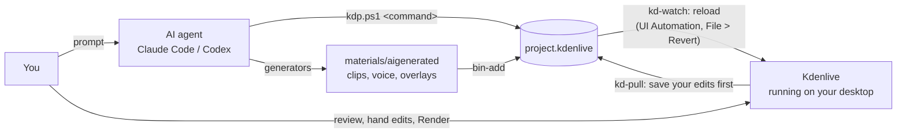

<div align="center">

# Movie Engine

**Moemedi wa AI o rulaganya bidio ya gago ka Kdenlive o ntše o lebeletše, gomme o ka tšea taolo nako efe goba efe.**

Baemedi ba AI ba go ngwala khoutu (Claude Code, Codex) ba aga le go fetoša diprotšeke tša nnete tša Kdenlive: difilimi, dibidio tša tlhalošo le dibidio tše kopana tše di emego (vertical shorts). Diphetošo di bonagala gona fao ka morulaganyi wo o o butšego. E a rwalega (portable), ke ya Windows, ga go diphetošo khoutung ya morulaganyi.


[English](../../README.md) · [简体中文](README.zh-CN.md) · [繁體中文](README.zh-TW.md) · [हिन्दी](README.hi.md) · [Español](README.es.md) · [Français](README.fr.md) · [العربية](README.ar.md) · [বাংলা](README.bn.md) · [Português](README.pt.md) · [Русский](README.ru.md) · [اردو](README.ur.md) · [Bahasa Indonesia](README.id.md) · [Deutsch](README.de.md) · [日本語](README.ja.md) · [Türkçe](README.tr.md) · [한국어](README.ko.md) · [Українська](README.uk.md) · [Italiano](README.it.md) · [Polski](README.pl.md) · [Tiếng Việt](README.vi.md) · [فارسی](README.fa.md) · [ไทย](README.th.md) · [Kiswahili](README.sw.md) · [አማርኛ](README.am.md) · [Avañe'ẽ](README.gn.md) · [Setswana](README.tn.md) · [Shqip](README.sq.md) · [Беларуская](README.be.md) · [Български](README.bg.md) · [Bosanski](README.bs.md) · [Hrvatski](README.hr.md) · [Српски](README.sr.md) · [Crnogorski](README.cnr.md) · [Македонски](README.mk.md) · [Slovenščina](README.sl.md) · [Slovenčina](README.sk.md) · [Čeština](README.cs.md) · [Magyar](README.hu.md) · [Română](README.ro.md) · [Dansk](README.da.md) · [Norsk bokmål](README.nb.md) · [Norsk nynorsk](README.nn.md) · [Svenska](README.sv.md) · [Íslenska](README.is.md) · [Suomi](README.fi.md) · [Eesti](README.et.md) · [Latviešu](README.lv.md) · [Lietuvių](README.lt.md) · [Nederlands](README.nl.md) · [Lëtzebuergesch](README.lb.md) · [Rumantsch](README.rm.md) · [Ελληνικά](README.el.md) · [Malti](README.mt.md) · [Gaeilge](README.ga.md) · [Català](README.ca.md) · [ქართული](README.ka.md) · [Հայերեն](README.hy.md) · [Azərbaycanca](README.az.md) · [Afrikaans](README.af.md) · [isiZulu](README.zu.md) · [isiXhosa](README.xh.md) · [Sesotho](README.st.md) · **Sepedi** · [Xitsonga](README.ts.md) · [Tshivenḓa](README.ve.md) · [siSwati](README.ss.md) · [isiNdebele (South Africa)](README.nr.md) · [isiNdebele (Zimbabwe)](README.nd.md) · [chiShona](README.sn.md) · [Chichewa](README.ny.md) · [Ikinyarwanda](README.rw.md) · [Ikirundi](README.rn.md) · [Malagasy](README.mg.md) · [Soomaali](README.so.md) · [Afaan Oromoo](README.om.md) · [Qafar af](README.aa.md) · [ትግርኛ](README.ti.md) · [Sängö](README.sg.md) · [Kreol Seselwa](README.crs.md) · [TjiKalanga](README.kck.md) · [ChiNdau](README.ndc.md)

*Ye ke phetolelo; README ya Seisemane ke yona ya semmušo yeo go lebelelwago go yona.*

</div>

---

## Diteng

- [Ka lebaka la eng](#ka-lebaka-la-eng)
- [Se šoma bjang](#se-šoma-bjang)
- [Bokgoni](#bokgoni)
- [Dinyakwa](#dinyakwa)
- [Go tsenya](#go-tsenya)
- [Go thoma ka pela](#go-thoma-ka-pela)
- [Go šoma le moemedi](#go-šoma-le-moemedi)
- [Mothaladi wa ditaelo wa go rulaganya (`kdp.ps1`)](#mothaladi-wa-ditaelo-wa-go-rulaganya-kdpps1)
- [Go sepedišana le morulaganyi wo o bulegilego](#go-sepedišana-le-morulaganyi-wo-o-bulegilego)
- [Dijenereitara: seo Kdenlive e sa kgonego go se dira](#dijenereitara-seo-kdenlive-e-sa-kgonego-go-se-dira)
- [Kanego ka lentšu le modumo](#kanego-ka-lentšu-le-modumo)
- [Polelo ya interface](#polelo-ya-interface)
- [Peakanyo ya difoltara](#peakanyo-ya-difoltara)
- [Diteko le bohlatse](#diteko-le-bohlatse)
- [Mellwane](#mellwane)
- [Go rarolla mathata](#go-rarolla-mathata)
- [Dipotšišo tšeo di botšišwago kudu](#dipotšišo-tšeo-di-botšišwago-kudu)
- [Go tsenya letsogo](#go-tsenya-letsogo)
- [Ditebogo](#ditebogo)
- [Laesense](#laesense)

## Ka lebaka la eng

Barulaganyi ba dibidio ba diretšwe seatla seo se swerego mouse. Baemedi ba AI (bohlale bja maitirelo) ba na le bokgoni sebopegong, go lekanyeng nako le mošomong wo o ipoeletšago: go bea dikliphi tše 300 go ya ka morethetho, go lekanya mongwalo wo mongwe le wo mongwe wa ka fase (caption) le lentšu la moanegi, go dira lefelo (scene) leswa ka morago ga maikutlo. Eupša ga ba kgone go kgotla GUI (sebopego sa diswantšho) ntle le go tšea desktop ya gago.

Kdenlive ke morulaganyi wo maatla wa open-source (khoutu ye e bulegilego), eupša go Windows **ga e na API ya go itiragalela (automation)**: taolo ka D-Bus e gona feela diphetolelong tša Linux, gomme di-fork (dikopi tše di arogilego tša protšeke) tšeo di e okeletšago di ka ba di sa hlokomelwe goba di sa bolokega. Movie Engine e rarolla se ntle le go fetoša morulaganyi:

1. Moemedi o fetoša faele ya protšeke ya `.kdenlive` ka mothaladi wa ditaelo wo o lekilwego (`engine/kdp.ps1`).
2. Kdenlive ye e šomago e botšwa go bala faele gape ka Windows UI Automation, ntle le go kgotla dinotlelo, ntle le mouse gomme ntle le go utswa focus (tlhokomelo ya lefesetere).
3. Diphetošo tša gago tšeo di sego tša bolokwa di bolokwa pele gomme ga di ngwalelwe godimo le ka mohla.

Ka gona moemedi o a rulaganya gomme wena o a hlahloba, goba o rulaganya ka seatla. Le ba babedi le šoma protšekeng e tee, ka morulaganyi o tee, ka nako e tee.

## Se šoma bjang



Taelo ye nngwe le ye nngwe ya go rulaganya e latela modikologo o tee wo o bolokegilego:

1. **Pull (go goga).** Ge Kdenlive e na le diphetošo tšeo di sego tša bolokwa, e botšwa go di boloka (konopo ya Save go toolbar ka UI Automation), gomme poloko yeo e a tiišetšwa.
2. **Go rulaganya.** Taelo e fetoša XML e notletšwe (lock), ka morago ga tekolo ya hash le ka snapshot ya undo (go boela morago). Ge faele e fetogile nakong yeo, ga go selo seo se ngwalwago.
3. **Go bala gape (reload).** Mohlokomedi (watcher) o bona leswao la AI gomme o diriša File > Revert ka morulaganyi wo o bulegilego. Katlego e balwa feela ge widget ya timeline e agilwe leswa ka nnete.
4. **Thulano.** Ge o thomile go rulaganya nakong yeo, ga go selo seo se balwago gape gomme mošomo wa gago o a šala. Kopi ya AI e beelwa ka thoko, gomme moemedi o tsenya phetošo ya gagwe gape godimo ga ya gago.

## Bokgoni

- **Go rulaganya protšeke ka botlalo ntle le GUI**: ditaelo tše e ka bago 120 tšeo di akaretšago bin, timeline, di-effect, di-composition, di-track, di-guide, di-marker, mengwalo ya ka fase (subtitles), di-sequence, lebelo le time remap, di-slideshow, dihlogo (titles), di-proxy, go render le undo/redo. Bona [tšhupetšo ya ditaelo](#mothaladi-wa-ditaelo-wa-go-rulaganya-kdpps1).
- **Go sepedišana gateetee le morulaganyi wo o bulegilego.** Diphetošo tša AI di bonagala ka Kdenlive yeo o e lebeletšego; diphetošo tša gago tšeo di sego tša bolokwa di bolokwa pele gomme ga di lahlege le ka mohla.
- **Ga e tshwenye desktop ya gago.** Ga go focus yeo e utswiwago, ga go dinotlelo tšeo di kgotlwago goba mouse yeo e šomišwago. Barulaganyi ba diteko ba šoma go desktop ya Windows yeo e sa bonagalego.
- **E a rwalega.** Morulaganyi, dipeakanyo (settings), Node.js, difonte le didirišwa di foltareng e tee. E kopiše go PC ye nngwe gomme e a šoma; ga go selo seo se ngwalwago go Program Files goba profaeleng ya gago ya Windows.
- **Dijenereitara tša seo Kdenlive e sa kgonego go se dira**: mongwalo wo o šikinyegago tlhaka ka tlhaka (kinetic text), matšhwao ao a thadilwego ka seatla, mafelo a UI a 3D, motsamao wa cursor le difilimi tše telele tša "tlhalošo" tšeo di šomišanago le mošomiši (interactive). Di render go GPU ka motion blur ya nnete gomme di bewa go timeline bjalo ka dikliphi tša tlwaelo.
- **Kanego ka lentšu ye e nago le dinako tša mantšu** (Microsoft Edge TTS, ga go nyakege API key). Mengwalo ya ka fase le ditiro di direga lentšung leo le nepagetšego.
- **Medumo ye e dirilwego ka khoutu** (whoosh, click, pop, riser, impact le ye mengwe).
- **E tiišeditšwe, ga e no akanywa.** Taelo ye nngwe le ye nngwe e na le tekolo ya sephetho, di-effect le di-composition di lekwa e tee ka e tee, gomme dipoelo tše tala di go `docs/proof/`.
- **Ditaelo tša moemedi di akareditšwe.** `AGENTS.md` le di-skill tšeo di lego go `.claude/skills/` di ruta Claude Code le Codex mokgwa wa go šoma, sebopego sa faele le mathata ao a ka tšwelelago.

## Dinyakwa

| | |
|---|---|
| OS | Windows 10 goba 11, x64 |
| Morulaganyi | Kdenlive **26.08.3** ya portable (standalone). Diphetolelo tše dingwe ga se tša lekwa. |
| Node.js | 18 goba ye mpsha go feta: `.zip` ya Windows x64 go tšwa go nodejs.org, e phuthollotšwe go `engine/node/` |
| Sefetleki (browser) | Microsoft Edge (karolo ya Windows); e šomišwa ntle le lefesetere (headless) ke di-renderer tša mafelo |
| Moemedi | [Claude Code](https://claude.com/claude-code) goba Codex. Ga se kgapeletšo: sedirišwa se sengwe le se sengwe se ka šomišwa le ka seatla. |
| Disiki | e ka ba 1 GB ya morulaganyi le didirišwa, gotee le media ya gago |
| GPU | GPU efe goba efe ye e nago le H.264 encoding ya hardware e akgofiša `film-render.mjs` (ge e se gona e šomiša software) |

## Go tsenya

Se sengwe le se sengwe se tsenywa **ka gare ga foltara**. Ga go selo seo se nyakago ditokelo tša admin.

```powershell
git clone https://github.com/vladtarrow/movie-engine.git
cd movie-engine
```

**1. Node.js.** Laolla `.zip` ya Windows x64 ya Node.js 18 goba ye mpsha go tšwa go <https://nodejs.org/en/download> gomme o phuthollele dikagare tša yona go `engine\node\`, gore `engine\node\node.exe` le `engine\node\npm.cmd` di be gona. Ga go nyakege installer goba Node ya tshepedišo. Diskripte ka moka di šoma ka `engine\node.cmd`, e sego ka Node ya tshepedišo le ka mohla.

**2. Diphuthelwana tša Node** bakeng sa sedirišwa sa lentšu le di-renderer (diphetolelo di tiišitšwe go `engine/voice/package.json`):

```powershell
engine\node\npm.cmd install --prefix engine\voice
```

**3. Kdenlive 26.08.3 portable.** Laolla `kdenlive-26.08.3_standalone.exe` go tšwa go <https://download.kde.org/stable/kdenlive/26.08/windows/> o e tsenye go `engine\installer\`, e hlahlobe gomme o e phuthollole:

```powershell
(Get-FileHash engine\installer\kdenlive-26.08.3_standalone.exe -Algorithm SHA256).Hash
# expected: A25427B1DFF2C17E3B0386E991BB1A719382BB3176D1A90E441CDAEB6E0A967D
engine\installer\kdenlive-26.08.3_standalone.exe -o"engine\Kdenlive" -y
```

Morulaganyi o fela a le go `engine\Kdenlive\kdenlive-26.08.3_standalone\bin\`. O šetše a akaretša `melt.exe` le `ffmpeg.exe`.

**4. Thomo ya mathomo.**

```powershell
engine\kdenlive.cmd
```

Kdenlive e boloka dipeakanyo tša yona ka moka go `engine\profile-kdenlive\`, e sego profaeleng ya gago ya Windows. Ge e thoma la mathomo e bontšha wizard ya go beakanya (thušo ya go hlama) gatee feela.

## Go thoma ka pela

### Le moemedi

Bula foltara ka Claude Code (goba Codex) gomme o kgopele ka mantšu a tlwaelo:

> Dira protšeke ye mpsha ye e emego ya 30 fps yeo e bitšwago "launch-teaser". Bea di-screenshot tše tharo tšeo di lego go `materials/designers/launch/` go timeline, e nngwe le e nngwe metsotswana ye 2.5 ka cross-fade ye kopana, tsenya kanego ka lentšu go tšwa go `script.txt` gomme o lekanye hlogo ye e šikinyegago (kinetic caption) le mothaladi wo mongwe le wo mongwe.

> Mpulele yona ka Kdenlive.

> Shot ya bobedi e telele kudu. E kopanye go 1.8 s gomme o godiše logo ganyane.

Moemedi o latela `AGENTS.md`: o rulaganya ka `kdp.ps1`, o render feela dikliphi tšeo go sega (cut) go di nyakago, gomme o boloka morulaganyi wo o bulegilego a sepelelana. O hlahloba ka Kdenlive, o rulaganya ka seatla nako efe goba efe ge o nyaka, gomme o kgotla Render ge o kgotsofetše.

### Ka seatla

```powershell
# a new 1080x1920 30 fps project with 2 video and 2 audio tracks
powershell -NoProfile -ExecutionPolicy Bypass -File engine\kdp.ps1 new -Project projects\hello\hello.kdenlive -Profile vertical_hd_30

# a 3-second title and a colour background
powershell -NoProfile -ExecutionPolicy Bypass -File engine\kdp.ps1 bin-color -Project projects\hello\hello.kdenlive -Color '#203060' -Seconds 3 -Name bg
powershell -NoProfile -ExecutionPolicy Bypass -File engine\kdp.ps1 title -Project projects\hello\hello.kdenlive -Text "Hello" -Seconds 3 -Name hi

# place them: background on V1, title above it on V2
powershell -NoProfile -ExecutionPolicy Bypass -File engine\kdp.ps1 add -Project projects\hello\hello.kdenlive -Bin bg -Track V1 -At 0
powershell -NoProfile -ExecutionPolicy Bypass -File engine\kdp.ps1 add -Project projects\hello\hello.kdenlive -Bin hi -Track V2 -At 0

# a check frame, then open it in the editor
powershell -NoProfile -ExecutionPolicy Bypass -File engine\kdp.ps1 frame -Project projects\hello\hello.kdenlive -At 1.5 -Out out\hello\check.png
engine\kdenlive.cmd projects\hello\hello.kdenlive
```

Go bula protšeke ya mafelelo gape ka morago, kgotla `open-last-project.cmd` gabedi.

## Go šoma le moemedi

Moemedi o bala `AGENTS.md` (Codex) goba `CLAUDE.md`, yeo e e tsenyago (Claude Code), gotee le di-skill tše pedi:

| Skill | E ruta |
|---|---|
| `.claude/skills/kdenlive-project-file` | sebopego sa `.kdenlive` / MLT XML, `kdp.ps1`, go hlahloba ka `melt` |
| `.claude/skills/kdenlive-live` | go laola morulaganyi wo o šomago ka polokego: go o thoma, pull, reload, go tšea seswantšho sa lefesetere la ona |

Melao yeo moemedi a e latelago, yeo o ka ithekgago ka yona:

- Ga a tšee mouse, keyboard goba focus ya gago le ka mohla, ebile ga a tšee seswantšho sa sekirini sa desktop ya gago (feela sa lefesetere la morulaganyi ka bolona).
- O dira megato ya GUI ka boyena (save, open, reload) go e na le go go kgopela gore o kgotle.
- O a botšiša pele a laolla selo sefe goba sefe le pele a phumola selo sefe goba sefe.
- O render feela seo mošomo o se nyakago (dikliphi tša mafelo, diforeime tša tekolo). O render filimi ya mafelelo feela ge o kgopela.
- Ge Kdenlive e sa kgone go dira selo gabotse, moemedi o se aga ka ntle ka khoutu gomme o tsenya sephetho bjalo ka kliphi. Ga a fokotše boleng bja effect.

## Mothaladi wa ditaelo wa go rulaganya (`kdp.ps1`)

```powershell
powershell -NoProfile -ExecutionPolicy Bypass -File engine\kdp.ps1 <command> -Project <file.kdenlive> [options]
```

Dinako di ka metsotswana, ka ntlha (`2.5`). Di-track ke `V1 V2 …` (V1 ke ya fase kudu) le `A1 A2 …`. Kliphi e šupša ka `-Track` gotee le nako efe goba efe `-At` ka gare ga yona. Dipharametha tša effect di tsena go `-Params "name=value||name=value"`. Lenaneo le le feletšego le kgetho ye nngwe le ye nngwe le hlogong ya `engine/kdp.ps1`.

| Sehlopha | Ditaelo |
|---|---|
| Protšeke | `new`, `profiles`, `info`, `validate`, `fonts`, `profile-set`, `profile-from-clip`, `zone`, `archive`, `backups`, `rebase`, `otio-export`, `otio-import` |
| Bin | `bin-add`, `bin-color`, `title`, `title-text`, `title-save`, `title-template`, `bin-rename`, `bin-remove`, `bin-info`, `bin-set`, `bin-duplicate`, `bin-replace-file`, `bin-reload`, `folder`, `bin-folder`, `relink`, `clean`, `generator`, `playlist-clip`, `extract-audio`, `transcode` |
| Timeline | `add`, `add-av`, `move`, `copy`, `trim`, `ripple-trim`, `slip`, `split`, `remove`, `speed`, `remap`, `disable`, `enable`, `group`, `ungroup`, `mix`, `unmix`, `space-insert`, `space-remove`, `spaces-remove-all`, `track-clear`, `replace-in-timeline` |
| Di-effect | `effects`, `effect-info`, `effect-add`, `effect-list`, `effect-set`, `effect-remove`, `effect-copy`, `effect-clear`, `effects-all`, `bin-effect`, `effect-templates`, `effect-template` |
| Di-composition | `compositions`, `comp-info`, `comp-add`, `comp-list`, `comp-set`, `comp-remove` |
| Di-track | `track-add`, `track-remove`, `track-set` |
| Di-guide le di-marker | `guide-add`, `guide-list`, `guide-remove`, `guide-set`, `guide-clear`, `guide-export`, `guide-category`, `marker`, `marker-list`, `marker-set`, `marker-remove` |
| Mengwalo ya ka fase (subtitles) | `sub-add`, `sub-import`, `sub-export`, `sub-state` |
| Di-sequence | `sequence-add`, `sequences`, `copy-to-sequence`, `expand`; taelo efe goba efe ye e nago le `-Sequence <name>` e šoma ka gare ga sequence yeo |
| Tše di kgethegilego | `slideshow`, di-animation tša Lottie / Glaxnimate ka `bin-add`, `proxy`, `stabilize`, `scene-split`, `speed-job`, `subclip` |
| Sephetho (output) | `frame` (PNG e tee), `preview` (render ye e akgofilego ya melt), `render` (renderer ya Kdenlive ka boyona goba preset), `presets` |
| Histori | `undo`, `redo`, `clear-history` (di-snapshot go `projects/<name>/.kdp-history`) |

Maitshwaro ao go lego bohlokwa go a tseba:

- Dikarolo tša audio le video tšeo di kopantšwego di šuthišwa, di ripša (trim), di arolwa (split) gomme di tlošwa gotee (`-Alone` bakeng sa karolo e tee).
- Taelo ye e palelwago e tšwa ka khoutu 1 gomme ga e ngwale selo.
- Di-effect tšeo build ya Windows e sa kgonego go di šomiša di a ganwa, ga di hlokomologwe ka setu (lenaneo: `docs/proof/assets.txt`).
- Tiro ye nngwe le ye nngwe ya menu ya Kdenlive e kopantšwe le taelo, tsela ye nngwe, goba "go lebelela feela" go `engine/tools/data/kdenlive-actions.csv`. Bona `docs/kdenlive-coverage.md`.

## Go sepedišana le morulaganyi wo o bulegilego

| Skripte | Seo e se dirago | Dikhoutu tša go tšwa |
|---|---|---|
| `engine\kd-pull.ps1 -Project <f>` | e dira gore Kdenlive e boloke diphetošo tša gago gomme e a tiišetša | 0 faele e mpshafaditšwe, 3 ga e šome, 4 ga se ya tiišetšwa |
| `engine\kd-reload.ps1 -Project <f>` | File > Revert, e tiišetšwa ke timeline ye e agilwego leswa | 0 e tiišeditšwe, 2 o na le diphetošo tšeo di sego tša bolokwa (ga go selo seo se lahlilwego), 3 ga e šome, 4 e paletšwe |
| `engine\kd-watch.ps1 -Project <f>` | mohlokomedi wa ka morago (background): o bala gape ka morago ga go ngwala go gongwe le go gongwe ga AI, o ngwala dithulano go log | log e go `engine\kd-watch.log`; phumola `engine\kd-watch.run` go e emiša |
| `engine\kdenlive-bg.ps1 [project]` | e thoma Kdenlive e fokoditšwe (minimized) bakeng sa moemedi | 0 e badilwe (loaded), 4 ga se ya tiišetšwa |
| `engine\kdenlive.cmd [project]` | e go thomela Kdenlive | |

Thoma mohlokomedi gatee ka seshene (session):

```powershell
Start-Process powershell -WindowStyle Hidden -ArgumentList '-NoProfile','-ExecutionPolicy','Bypass','-File','engine\kd-watch.ps1','-Project','projects\hello\hello.kdenlive'
```

Diprotšeke tše kgolo: go bala gape protšeke ya dikliphi tše 1000 go tšea metsotso, gomme didirišwa di a e letela go e na le go bega ka pela. Diprotšeke di bulwa ka *File > Open Recent* ka morulaganyi wo o se nago selo, ka gobane go bula faele thwii go dira gore Qt e fete go selo se sengwe le se sengwe sa timeline bakeng sa accessibility (phihlelelo), gomme seo se be se diega ka metsotso ye e ka bago 10.

## Dijenereitara: seo Kdenlive e sa kgonego go se dira

Kdenlive/MLT ga e na animation ya mongwalo tlhaka ka tlhaka, ga e na expressions gomme e na le 3D ye nnyane, gomme di-effect tše boima di diegiša go bapala. Movie Engine e render dikarolo tše bjalo ka ntle gomme e di bea go timeline bjalo ka dikliphi tša tlwaelo, gantši di na le alpha (ponagalo), go track ye e lego godimo ga diswantšho. Skripte ya jenereitara le dilo tšeo e di tsenyago di šala foltareng ya protšeke, ka gona kliphi e ka dirwa leswa ge mongwalo, fonte goba nako di fetoga.

| Sedirišwa | Se dira |
|---|---|
| `engine/tools/kinetic-text.ps1` | dihlogo tše di šikinyegago tlhaka ka tlhaka, lentšu le lengwe le le lengwe le lekantšwe go tšwa go `voice.json`, lepokisi la go gatelela |
| `engine/tools/annotate.ps1` | didikologo, mapokisi, methaladi ka fase ga mongwalo le mesebe ye e thadilwego ka seatla yeo e itshwantšhago godimo ga screenshot |
| `engine/tools/card-entrance.ps1` | karata ya screenshot yeo e rotogago gomme e golela ka moriti o boleta |
| `engine/tools/pdf-to-png.ps1` | di-slide go tšwa go export ya PDF |
| `engine/tools/html-render.mjs` | lefelo lefe goba lefe la HTML/CSS/canvas go ba bidio: animation ya interface, di-cursor, 3D, di-mask |
| `engine/tools/film-render.mjs` + `film/` | difilimi tše telele tša tlhalošo tšeo di šomišanago le mošomiši godimo ga canvas: kliphi e tee bakeng sa mothaladi o mongwe le o mongwe wa kanego, ditiro di direga ge mantšu a bolelwa, motion blur ya GPU ka e ka bago 45 fps |

Di-renderer tše ka bobedi di laola Microsoft Edge yeo e tlago le Windows, ntle le lefesetere (headless), ka profaele ya nakwana gomme ntle le phihlelelo ya netweke.

### Dipontšho

```powershell
# a 3-second 3D title card with a cursor click
engine\node.cmd engine\tools\html-render.mjs examples\demo\scene\scene.html examples\demo\out --frames 0,30,60,89
engine\node.cmd engine\tools\html-render.mjs examples\demo\scene\scene.html examples\demo\out\scene.mp4

# a 4-shot interactive film timed to two voice lines
engine\node.cmd engine\tools\film-render.mjs examples\demo\film\film.html examples\demo\out --check
engine\node.cmd engine\tools\film-render.mjs examples\demo\film\film.html examples\demo\out --shots all --width 640
engine\node.cmd engine\tools\film-render.mjs examples\demo\film\film.html examples\demo\out\clips --suffix -v01
```

Filimi ke difaele tše tharo tše nnyane. `data.js` e na le di-shot le dinako tša mantšu. `direction.js` e na le mothaladi o tee bakeng sa shot ye nngwe le ye nngwe:

```text
1 | hover 192 108 @brand | tag 300 60 Your brand @deserves | confetti 192 90 @film
2 say=A film that/*explains* it
3 | click 116 108 @before | click 268 108 @after | chips Before~After @after
4 scene=counter | count 0 120 % @count
```

`scenes.js` e na le di-shot tšeo di thalwago go tloga mathomong. `@word` e thoma tiro ge moanegi a bolela lentšu leo. Ditiro di akaretša click, hover, drag, zoom, lens, ring, arrow, chips, toggle, slider, toast, type, count le confetti; syntax ye e feletšego e mathomong a `engine/tools/film/film-kit.js`.

## Kanego ka lentšu le modumo

```powershell
engine\node.cmd engine\voice\voice.mjs lines.json materials\aigenerated\hello\voice en-US-AndrewMultilingualNeural +0%
```

`lines.json` ke lenaneo la methaladi. Sedirišwa se ngwala mp3 e tee bakeng sa mothaladi o mongwe le o mongwe gotee le `voice.json`, ye e nago le botelele bja nako le mathomo le mafelelo a lentšu le lengwe le le lengwe. Methaladi e bolokwa go cache, ka gona go fetoša mothaladi o tee go dira leswa feela mothaladi woo. E šomiša text-to-speech ya inthanete ya Microsoft Edge ka sephuthelwana sa `msedge-tts`: ga go nyakege key, eupša tirelo ye ga se ya semmušo gomme e nyaka inthanete.

```powershell
engine\node.cmd engine\audio\sfx.mjs materials\aigenerated\sfx
```

Se se dira ka khoutu whoosh, whoosh-long, swipe, click, pop, tick, riser, impact, ding le reveal; sete ye e šetšego e lokile e go `materials/aigenerated/sfx/`. Medumo ye e kopana go feta foreime e tee e tlaleletše ka setu pele o e bea (`-af apad=whole_dur=0.0667`).

## Polelo ya interface

Di-launcher di thoma Kdenlive ka **Seisemane** ka tlwaelo. Go šomiša polelo ye nngwe, beakanya `MOVIE_ENGINE_UI_LANG` pele o thoma:

```powershell
$env:MOVIE_ENGINE_UI_LANG = 'ru'; engine\kdenlive.cmd
```

UI Automation e hwetša dilo tša menu ka maina a tšona ao a bonagalago. Maina a dipolelo tše 31 tša interface a šetše a tsentšwe (`engine/tools/kd-ui.ps1`, `$KdNames`). Bakeng sa polelo efe goba efe ye nngwe, tsenya maina a yona moo gomme o hlahlobe ka:

```powershell
powershell -NoProfile -ExecutionPolicy Bypass -File engine\tools\kd-langcheck.ps1
```

## Peakanyo ya difoltara

```text
movie-engine/
├─ AGENTS.md, CLAUDE.md          instructions for AI agents
├─ .claude/skills/               agent skills: project file format, live editor
├─ engine/
│  ├─ kdp.ps1                    the editing command line
│  ├─ kd-pull / kd-reload / kd-watch .ps1, kdenlive.cmd, kdenlive-bg.ps1
│  ├─ tools/                     internals, generators, tests, data (action map)
│  ├─ voice/  audio/  fonts/     TTS, synthesized SFX, Poppins (OFL)
│  ├─ Kdenlive/  node/           portable editor and Node.js (not in git)
│  └─ profile-kdenlive/          the editor's settings (not in git)
├─ projects/<name>/<name>.kdenlive
├─ materials/
│  ├─ download/                  stock and downloaded files (not in git)
│  ├─ aigenerated/               everything the AI made (sfx/ and test-kit/ ship with the engine)
│  ├─ designers/  brand/         files from your team, brand assets
├─ examples/demo/                demos of the scene and film renderers
├─ out/                          renders (not in git)
└─ docs/                         proofs, coverage, translations of this README
```

Ditsela tša media ka gare ga diprotšeke ke tše di amanago (relative). Ge o šuthiša goba o kopiša foltara, `kdp.ps1 rebase` (yeo gape e šomišwago ka boyona ke `kdenlive.cmd`) e ngwala lefelo le leswa ka gare ga protšeke.

## Diteko le bohlatse

Dipolelo mabapi le seo se šomago di thekgwa ke ditekolo tša sephetho, e sego ke gore "function e šomile". Kakaretšo e go [`docs/kdenlive-proof.md`](../../docs/kdenlive-proof.md), gomme dipoelo tše tala di go `docs/proof/`.

| Teko | E hlahloba |
|---|---|
| `engine\tools\kdp-clitest.ps1` | taelo ye nngwe le ye nngwe ya `kdp.ps1`, ka mothaladi wa ditaelo, e bapetša protšeke ye e tšwago |
| `engine\tools\kd-livetest.ps1` | pull, reload, mohlokomedi, dithulano le dipeiso (races) kgahlanong le Kdenlive ya nnete go desktop yeo e sa bonagalego |
| `engine\tools\kdp-assetsweep.ps1` | effect ye nngwe le ye nngwe le composition ye nngwe le ye nngwe: e a render gomme e bapetša diforeime |
| `engine\tools\kdp-portabletest.ps1` | e kopiša foltara lefelong le lengwe gomme e šoma go tšwa koping |
| `engine\tools\kd-langcheck.ps1` | polelo ya interface le gore UI Automation e hwetša menu |
| `engine\tools\kdp-coverage-check.ps1` | tiro ye nngwe le ye nngwe ya menu e kopantšwe, gomme ga go bohlatse bjo bo tšofetšego go feta khoutu |

```powershell
powershell -NoProfile -ExecutionPolicy Bypass -File engine\tools\kdp-clitest.ps1 -Report docs\proof\clitest.txt
powershell -NoProfile -ExecutionPolicy Bypass -File engine\tools\kd-livetest.ps1 -Report docs\proof\live-en.txt
```

Barulaganyi ba diteko ba šoma feela go desktop ye e utilwego ye e nago le profaele ya bona, ka gona diteko ga di ame Kdenlive ya gago ye e bulegilego goba focus ya gago le ka mohla.

## Mellwane

- **Windows feela**, Kdenlive **26.08.3** feela. Linux e na le D-Bus gomme e ka nyaka leporogo le lengwe.
- Go thoma morulaganyi go tšea focus ya keyboard metsotswana ye e ka bago 3 ge lefesetere leo le se nago selo le tšwelela. Baemedi ba botšiša pele ba o thoma ge o ntše o šoma. Go bala gape le go rulaganya ga go tšee focus.
- Build ya Windows ga e na di-module tša MLT sox, ladspa le movit le di-effect tše dingwe tša frei0r/avfilter; `kdp.ps1` e a di gana (`docs/proof/assets.txt`).
- Export le import ya OpenTimelineIO di rwala dikliphi le dikgoba feela. Multicam ga e na go fetoša di-angle gateetee (go sega go dirwa ka split/remove/hide).
- "Save As…" ka UI Automation lefesetereng leo le fokoditšwego ga e bule dialog; moemedi o šomiša `archive` goba dikopi tša difaele go e na le moo.
- Temogo ya polelo (speech recognition, di-subtitle tše di itirago) e nyaka Whisper goba Vosk, tšeo di sa akaretšwago.
- Dihlogo tše di dirilwego ka sedirišwa sa dihlogo sa Kdenlive di šomiša difonte tše di tsentšwego go Windows. Bakeng sa typography ye e tiišeditšwego, render mongwalo ka dijenereitara, tšeo di šomišago difonte tša `engine/fonts/`.
- Edge TTS ke tirelo ya inthanete yeo e sego ya semmušo gomme e ka fetoga goba ya emiša go šoma.

## Go rarolla mathata

| Seka | Sebaki le tharollo |
|---|---|
| Kdenlive e a šoma, eupša go e kgotla go taskbar ga go bontšhe selo | Lefelo leo le bolokilwego la lefesetere la yona le ka ntle ga sekirini. E tswalele gomme o phumole dintlha tša `kdockLayout` go `engine\profile-kdenlive\AppData\Local\kdenliverc`, goba o šuthiše lefesetere ka `SetWindowPos` (bona `AGENTS.md`). |
| `kd-reload.ps1` e tšwa ka 2 | O na le diphetošo tšeo di sego tša bolokwa. Ga go selo seo se lahlilwego. Šomiša `kd-pull.ps1`, ke moka o tsenye phetošo gape (`kdp.ps1` e dira se ka boyona). |
| `CONFLICT` go `engine\kd-watch.log` | Wena le moemedi le rulagantše ka nako e tee. Kopi ya gago e šala ka morulaganyi, gomme kopi ya AI e go `projects\<name>\.kdp-history\<name>\conflict\`. Kgopela moemedi gore a tsenye phetošo ya gagwe gape. |
| Taelo e tšwa ka 1 ka "pull not confirmed" | Kdenlive e swaregile goba e bontšha dialog. Tswalela dialog goba o letele gore go bula go fele, ke moka o boeletše. |
| Skripte ya PowerShell e palelwa ke go parse (go balwa) | Diskripte tše di nago le mongwalo wo e sego wa ASCII di swanetše go bolokwa bjalo ka UTF-8 **le BOM** bakeng sa Windows PowerShell 5.1. |
| `voice.mjs` e ema ka "Stream closed before the synthesis completed" | Gantši ke bothata bja netweke, goba SSML ye e sa escape-wago dikoping tša kgale. `voice.mjs` e escape `& < >` ka boyona. |
| Go bula protšeke ye kgolo go tšea metsotso ye mentši | E bule ka `kdenlive.cmd` / `kdenlive-bg.ps1`, e sego bjalo ka `kdenlive.exe project.kdenlive` le ka mohla. |

## Dipotšišo tšeo di botšišwago kudu

**Na ke nyaka Claude Code goba Codex?**
Aowa. Sedirišwa se sengwe le se sengwe ke skripte ya tlwaelo yeo o ka e šomišago ka seatla. Moemedi ke yena a dirago gore go akgofe: o rulaganya go sega, o šomiša didirišwa gomme o boloka morulaganyi a sepelelana.

**Na moemedi o tla ngwala godimo ga diphetošo tšeo ke di dirilego ka seatla?**
Aowa. Pele ga go ngwala selo, diphetošo tša gago tšeo di sego tša bolokwa di a bolokwa gomme di a tiišetšwa. Ge o rulaganya mola moemedi a ngwala, go ngwala moo go a ganwa goba go beelwa ka thoko bjalo ka thulano, ga go tsenywe godimo ga mošomo wa gago le ka mohla.

**Na nka tšwela pele go šomiša Kdenlive ka tlwaelo?**
Ee. Ke Kdenlive ya tlwaelo ye e nago le foltara ya yona ya dipeakanyo. Rulaganya, lebelela pele (preview) gomme o render bjalo ka tlwaelo.

**Na e šoma le Kdenlive yeo ke šetšego ke e tsentše?**
E šomiša kopi ya yona ye e rwalegago go `engine\Kdenlive\`, ka gona Kdenlive ya gago ye e tsentšwego le dipeakanyo tša yona ga di amege.

**Ke ka lebaka la eng e se fork ya Kdenlive ye e nago le API, goba morulaganyi o mongwe?**
Go Windows, ga go fork ye e hlokomelwago le ye e bolokegilego (nyakišišo ya 2026-11). OpenShot, Blender VSE, DaVinci Resolve, Shotcut le barulaganyi ba web ba ile ba hlahlobja; Kdenlive e file botebo bjo bokaone kudu bja go rulaganya. Tšhišinyo ya REST API protšekeng ya motheo (merge request !902) e sa lebeletšwe.

**Na e ka render bidio ya mafelelo?**
Ee, ka `kdp.ps1 render` (renderer ya Kdenlive ka boyona, e utilwe), goba o kgotla Render ka morulaganyi ka bowena.

**Na media ya ka e romelwa kae goba kae?**
Aowa. Ke mongwalo wa kanego feela wo o romelwago go tirelo ya Edge TTS ge o dira lentšu. Di-renderer tša mafelo di šoma netweke e thibilwe.

## Go tsenya letsogo

Diabe di a amogelwa. Bona [CONTRIBUTING.md](../../CONTRIBUTING.md). Ka boripana:

- Tiro ye nngwe le ye nngwe ye mpsha goba ye e fetošitšwego ya `kdp.ps1` e nyaka tekolo ya sephetho go `kdp-clitest.ps1`, tsenyo mmapeng wa ditiro, le go šomiša `kdp-coverage-check.ps1` leswa.
- O se ke wa thoma Kdenlive ya teko go desktop ye e bonagalago; šomiša `engine/tools/kd-hidden.ps1`.
- Boloka se sengwe le se sengwe se rwalega: ga go go tsenya ka ntle ga foltara, ga go ditsela tše di feletšego (absolute) ka gare ga diprotšeke.
- Ngwala mekgwa ye e sa tlwaelegago ye e tiišeditšwego go `AGENTS.md` goba go skill ye e sepelelanago.

## Ditebogo

- [Kdenlive](https://kdenlive.org) le [MLT](https://www.mltframework.org): morulaganyi le enjene ye e lego ka fase ga wona.
- [FFmpeg](https://ffmpeg.org), yeo e tlago le Kdenlive.
- [msedge-tts](https://www.npmjs.com/package/msedge-tts) bakeng sa kanego ka lentšu.
- [Poppins](https://fonts.google.com/specimen/Poppins) ya Indian Type Foundry, SIL Open Font License (`engine/fonts/OFL.txt`).
- `engine/tools/data/kdenliveui-26.08.3.rc`: faele ya menu ya Kdenlive, ye e tšerwego khoutung ya mothopo ya Kdenlive 26.08.3; e šomišwa feela ke tekolo ya coverage (khupetšo). E šala ka fase ga laesense ya GPL ya Kdenlive, e sego MIT License.

## Laesense

Khoutu ya Movie Engine ka boyona e lokolotšwe ka fase ga [MIT License](../../LICENSE). Kdenlive, MLT, FFmpeg, diphuthelwana tša Node.js le fonte ya Poppins di boloka dilaesense tša tšona.
