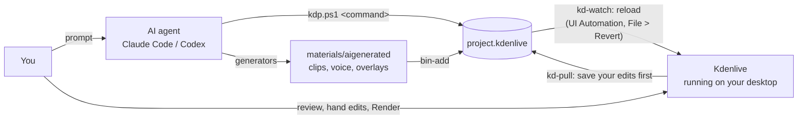

<div align="center">

# Movie Engine

**Agent ya AI imakonza vidiyo yanu mu Kdenlive inu mukuonera, ndipo mutha kulanda ntchitoyo nthawi iliyonse.**

Ma-agent a AI olemba khodi (Claude Code, Codex) amapanga ndi kusintha mapulojekiti enieni a Kdenlive: mafilimu, mavidiyo ofotokozera ndi mavidiyo afupiafupi oima (vertical shorts). Zosintha zimaonekera nthawi yomweyo mu mkonzi (editor) umene mwatsegula. Yonyamulika (portable), Windows, popanda kusintha mkonzi.


[English](../../README.md) · [简体中文](README.zh-CN.md) · [繁體中文](README.zh-TW.md) · [हिन्दी](README.hi.md) · [Español](README.es.md) · [Français](README.fr.md) · [العربية](README.ar.md) · [বাংলা](README.bn.md) · [Português](README.pt.md) · [Русский](README.ru.md) · [اردو](README.ur.md) · [Bahasa Indonesia](README.id.md) · [Deutsch](README.de.md) · [日本語](README.ja.md) · [Türkçe](README.tr.md) · [한국어](README.ko.md) · [Українська](README.uk.md) · [Italiano](README.it.md) · [Polski](README.pl.md) · [Tiếng Việt](README.vi.md) · [فارسی](README.fa.md) · [ไทย](README.th.md) · [Kiswahili](README.sw.md) · [አማርኛ](README.am.md) · [Avañe'ẽ](README.gn.md) · [Setswana](README.tn.md) · [Shqip](README.sq.md) · [Беларуская](README.be.md) · [Български](README.bg.md) · [Bosanski](README.bs.md) · [Hrvatski](README.hr.md) · [Српски](README.sr.md) · [Crnogorski](README.cnr.md) · [Македонски](README.mk.md) · [Slovenščina](README.sl.md) · [Slovenčina](README.sk.md) · [Čeština](README.cs.md) · [Magyar](README.hu.md) · [Română](README.ro.md) · [Dansk](README.da.md) · [Norsk bokmål](README.nb.md) · [Norsk nynorsk](README.nn.md) · [Svenska](README.sv.md) · [Íslenska](README.is.md) · [Suomi](README.fi.md) · [Eesti](README.et.md) · [Latviešu](README.lv.md) · [Lietuvių](README.lt.md) · [Nederlands](README.nl.md) · [Lëtzebuergesch](README.lb.md) · [Rumantsch](README.rm.md) · [Ελληνικά](README.el.md) · [Malti](README.mt.md) · [Gaeilge](README.ga.md) · [Català](README.ca.md) · [ქართული](README.ka.md) · [Հայերեն](README.hy.md) · [Azərbaycanca](README.az.md) · [Afrikaans](README.af.md) · [isiZulu](README.zu.md) · [isiXhosa](README.xh.md) · [Sesotho](README.st.md) · [Sepedi](README.nso.md) · [Xitsonga](README.ts.md) · [Tshivenḓa](README.ve.md) · [siSwati](README.ss.md) · [isiNdebele (South Africa)](README.nr.md) · [isiNdebele (Zimbabwe)](README.nd.md) · [chiShona](README.sn.md) · **Chichewa** · [Ikinyarwanda](README.rw.md) · [Ikirundi](README.rn.md) · [Malagasy](README.mg.md) · [Soomaali](README.so.md) · [Afaan Oromoo](README.om.md) · [Qafar af](README.aa.md) · [ትግርኛ](README.ti.md) · [Sängö](README.sg.md) · [Kreol Seselwa](README.crs.md) · [TjiKalanga](README.kck.md) · [ChiNdau](README.ndc.md)

*Uku ndi kumasulira. README ya Chingerezi ndiyo mtundu woyambirira wodalirika.*

</div>

---

## Zamkatimu

- [Chifukwa chiyani](#chifukwa-chiyani)
- [Momwe imagwirira ntchito](#momwe-imagwirira-ntchito)
- [Zomwe imachita](#zomwe-imachita)
- [Zofunikira](#zofunikira)
- [Kukhazikitsa](#kukhazikitsa)
- [Kuyamba mwachangu](#kuyamba-mwachangu)
- [Kugwira ntchito ndi agent](#kugwira-ntchito-ndi-agent)
- [Mzere wa malamulo okonza (`kdp.ps1`)](#mzere-wa-malamulo-okonza-kdpps1)
- [Kugwirizana pompopompo ndi mkonzi wotsegulidwa](#kugwirizana-pompopompo-ndi-mkonzi-wotsegulidwa)
- [Ma-generator: zomwe Kdenlive singathe kuchita](#ma-generator-zomwe-kdenlive-singathe-kuchita)
- [Mawu ofotokozera ndi phokoso](#mawu-ofotokozera-ndi-phokoso)
- [Chilankhulo cha interface](#chilankhulo-cha-interface)
- [Kakonzedwe ka mafoda](#kakonzedwe-ka-mafoda)
- [Mayeso ndi umboni](#mayeso-ndi-umboni)
- [Malire](#malire)
- [Kuthetsa mavuto](#kuthetsa-mavuto)
- [Mafunso ofunsidwa kawirikawiri](#mafunso-ofunsidwa-kawirikawiri)
- [Kuthandizira](#kuthandizira)
- [Mayamiko](#mayamiko)
- [Layisensi](#layisensi)

## Chifukwa chiyani

Mapulogalamu okonza vidiyo amapangidwira manja ali pa mbewa (mouse). Ma-agent a AI ndi abwino pa kalongosoledwe, nthawi ndi ntchito yobwerezabwereza: kuika ma-clip 300 motsatira kugunda kwa nyimbo, kugwirizanitsa caption iliyonse ndi mawu, kukonzanso chochitika (scene) pambuyo pa ndemanga. Koma sangathe kudina-dina mu GUI popanda kulanda desktop yanu.

Kdenlive ndi mkonzi wamphamvu wa open-source, koma pa Windows **ilibe API yochitira zinthu zokha (automation API)**: kuwongolera kudzera mu D-Bus kumapezeka pa ma-build a Linux okha, ndipo ma-fork omwe amaiwonjezera mwina sasamaliridwanso kapena si otetezeka. Movie Engine imathetsa vutoli popanda kusintha mkonzi:

1. Agent imakonza fayilo ya pulojekiti `.kdenlive` kudzera mu mzere wa malamulo woyesedwa (`engine/kdp.ps1`).
2. Kdenlive yomwe ikuthamanga imauzidwa kuwerenganso fayiloyo kudzera mu Windows UI Automation, popanda kudina makiyi, popanda mbewa komanso popanda kulanda focus.
3. Zosintha zanu zomwe sizinasungidwe zimasungidwa kaye ndipo sizilembedwa pamwamba pake.

Choncho agent imakonza inu mukuunika, kapena inu mumakonza ndi manja. Nonse awiri mumagwira ntchito pa pulojekiti imodzi, mu mkonzi umodzi, nthawi imodzi.

## Momwe imagwirira ntchito



Lamulo lililonse lokonza limatsatira njira imodzimodzi yotetezeka:

1. **Pull.** Ngati Kdenlive ili ndi zosintha zomwe sizinasungidwe, imauzidwa kuzisunga (batani la Save pa toolbar kudzera mu UI Automation), ndipo kusungako kumatsimikiziridwa.
2. **Kukonza.** Lamulo limasintha XML pansi pa loko (lock), pambuyo poyang'ana hash komanso ndi snapshot yobwezera (undo). Ngati fayilo yasintha pakadali pano, palibe chomwe chimalembedwa.
3. **Kuwerenganso.** Woyang'anira (watcher) amaona chizindikiro cha AI ndipo amathamangitsa File > Revert mu mkonzi wotsegulidwa. Zimaonedwa kuti zapambana pokhapokha widget ya timeline itamangidwanso kwenikweni.
4. **Kusemphana.** Ngati mwayamba kukonza pakati pake, palibe chomwe chimawerengedwanso ndipo ntchito yanu imakhalabe. Mtundu wa AI umasungidwa padera, ndipo agent imaikanso kusintha kwake pamwamba pa kwanu.

## Zomwe imachita

- **Kukonza pulojekiti yonse popanda GUI**: malamulo pafupifupi 120 okhudza bin, timeline, ma-effect, ma-composition, ma-track, ma-guide, ma-marker, ma-subtitle, ma-sequence, liwiro ndi kusintha nthawi (time remap), ma-slideshow, mitu (titles), ma-proxy, kupanga render ndi undo/redo. Onani [mndandanda wa malamulo](#mzere-wa-malamulo-okonza-kdpps1).
- **Kugwirizana pompopompo ndi mkonzi wotsegulidwa.** Zosintha za AI zimaonekera mu Kdenlive yomwe mukuyang'ana; zosintha zanu zomwe sizinasungidwe zimasungidwa kaye ndipo sizitayika.
- **Siisokoneza desktop yanu.** Palibe kulanda focus, kudina makiyi kapena kusuntha mbewa. Akonzi oyesera amathamanga pa desktop ya Windows yosaoneka.
- **Yonyamulika.** Mkonzi, makonda (settings), Node.js, ma-font ndi zida zonse zili mu foda imodzi. Ikopereni ku PC ina ndipo imagwira ntchito; palibe chomwe chimalembedwa mu Program Files kapena mu profile yanu ya Windows.
- **Ma-generator a zomwe Kdenlive singathe kuchita**: malemba oyenda chilembo ndi chilembo (per-letter kinetic text), zizindikiro zojambulidwa ndi manja, zochitika za 3D za interface, kayendedwe ka cursor ndi mafilimu aatali "ofotokozera" (explainer) ochitirana. Amapangidwa render pa GPU ndi motion blur yeniyeni ndipo amaikidwa pa timeline ngati ma-clip wamba.
- **Mawu ofotokozera (voice-over) okhala ndi nthawi ya liwu lililonse** (Microsoft Edge TTS, palibe API key). Ma-caption ndi zochita zimachitika pa liwu lenilenilo.
- **Zomveka zopangidwa (synthesized sound effects)** (whoosh, click, pop, riser, impact ndi zina), zopangidwa ndi khodi.
- **Zatsimikiziridwa, osati kungoganiziridwa.** Lamulo lililonse lili ndi kuyesa zotsatira zake, ma-effect ndi ma-composition amayesedwa limodzi limodzi, ndipo zotsatira zosakonzedwa zili mu `docs/proof/`.
- **Malangizo a agent aphatikizidwa.** `AGENTS.md` ndi ma-skill omwe ali mu `.claude/skills/` amaphunzitsa Claude Code ndi Codex kayendetsedwe ka ntchito, kapangidwe ka fayilo ndi misampha yopewa.

## Zofunikira

| | |
|---|---|
| OS | Windows 10 kapena 11, x64 |
| Mkonzi | Kdenlive **26.08.3** yonyamulika (standalone build). Mitundu ina sinayesedwe. |
| Node.js | 18 kapena yatsopano: `.zip` ya Windows x64 yochokera ku nodejs.org, yotsegulidwa mu `engine/node/` |
| Browser | Microsoft Edge (ili kale mu Windows); imagwiritsidwa ntchito popanda zenera (headless) ndi zida zopanga render ya zochitika |
| Agent | [Claude Code](https://claude.com/claude-code) kapena Codex. Sikokakamiza: chida chilichonse chimathanso kuthamangitsidwa ndi manja. |
| Disk | pafupifupi 1 GB ya mkonzi ndi zida, kuphatikiza ma-media anu |
| GPU | GPU iliyonse yokhala ndi hardware H.264 encoding imafulumizitsa `film-render.mjs` (ngati palibe, imagwiritsa ntchito software) |

## Kukhazikitsa

Zonse zimaikidwa **mkati mwa foda**. Palibe chomwe chimafuna ufulu wa admin.

```powershell
git clone https://github.com/vladtarrow/movie-engine.git
cd movie-engine
```

**1. Node.js.** Tsitsani `.zip` ya Windows x64 ya Node.js 18 kapena yatsopano kuchokera ku <https://nodejs.org/en/download> ndipo tsegulani zomwe zili mkati mwake mu `engine\node\`, kuti `engine\node\node.exe` ndi `engine\node\npm.cmd` zikhale pamenepo. Palibe installer kapena Node ya system yomwe ikufunika. Ma-script onse amathamanga kudzera mu `engine\node.cmd`, osati ndi Node ya system.

**2. Ma-package a Node** a chida cha mawu ndi zida zopanga render (mitundu yake yakhazikitsidwa mu `engine/voice/package.json`):

```powershell
engine\node\npm.cmd install --prefix engine\voice
```

**3. Kdenlive 26.08.3 yonyamulika.** Tsitsani `kdenlive-26.08.3_standalone.exe` kuchokera ku <https://download.kde.org/stable/kdenlive/26.08/windows/> muiike mu `engine\installer\`, muiyang'ane ndipo muitsegule:

```powershell
(Get-FileHash engine\installer\kdenlive-26.08.3_standalone.exe -Algorithm SHA256).Hash
# expected: A25427B1DFF2C17E3B0386E991BB1A719382BB3176D1A90E441CDAEB6E0A967D
engine\installer\kdenlive-26.08.3_standalone.exe -o"engine\Kdenlive" -y
```

Mkonzi umakhala mu `engine\Kdenlive\kdenlive-26.08.3_standalone\bin\`. Uli kale ndi `melt.exe` ndi `ffmpeg.exe`.

**4. Kuyamba koyamba.**

```powershell
engine\kdenlive.cmd
```

Kdenlive imasunga makonda ake onse mu `engine\profile-kdenlive\`, osati mu profile yanu ya Windows. Pa kuyamba koyamba imaonetsa wizard yokhazikitsa kamodzi kokha.

## Kuyamba mwachangu

### Ndi agent

Tsegulani foda mu Claude Code (kapena Codex) ndipo pemphani m'mawu wamba:

> Pangani pulojekiti yatsopano yoima ya 30 fps yotchedwa "launch-teaser". Ikani ma-screenshot atatu ochokera mu `materials/designers/launch/` pa timeline, lililonse 2.5 s ndi cross-fade yaifupi, onjezani mawu ofotokozera kuchokera mu `script.txt` ndipo gwirizanitsani kinetic caption ndi mzere uliwonse.

> Nditsegulireni mu Kdenlive.

> Shot yachiwiri ndi yaitali kwambiri. Ifupikitseni kufika 1.8 s ndipo kwezani logo pang'ono.

Agent imatsatira `AGENTS.md`: imakonza kudzera mu `kdp.ps1`, imapanga render ya ma-clip okhawo omwe cut ikufuna, ndipo imasunga mkonzi wotsegulidwa ukugwirizana. Inu mumaunika mu Kdenlive, mumakonza ndi manja nthawi iliyonse yomwe mukufuna, ndipo mumadina Render mukakhutira.

### Pamanja

```powershell
# a new 1080x1920 30 fps project with 2 video and 2 audio tracks
powershell -NoProfile -ExecutionPolicy Bypass -File engine\kdp.ps1 new -Project projects\hello\hello.kdenlive -Profile vertical_hd_30

# a 3-second title and a colour background
powershell -NoProfile -ExecutionPolicy Bypass -File engine\kdp.ps1 bin-color -Project projects\hello\hello.kdenlive -Color '#203060' -Seconds 3 -Name bg
powershell -NoProfile -ExecutionPolicy Bypass -File engine\kdp.ps1 title -Project projects\hello\hello.kdenlive -Text "Hello" -Seconds 3 -Name hi

# place them: background on V1, title above it on V2
powershell -NoProfile -ExecutionPolicy Bypass -File engine\kdp.ps1 add -Project projects\hello\hello.kdenlive -Bin bg -Track V1 -At 0
powershell -NoProfile -ExecutionPolicy Bypass -File engine\kdp.ps1 add -Project projects\hello\hello.kdenlive -Bin hi -Track V2 -At 0

# a check frame, then open it in the editor
powershell -NoProfile -ExecutionPolicy Bypass -File engine\kdp.ps1 frame -Project projects\hello\hello.kdenlive -At 1.5 -Out out\hello\check.png
engine\kdenlive.cmd projects\hello\hello.kdenlive
```

Kuti mutsegulenso pulojekiti yomaliza pambuyo pake, dinani kawiri `open-last-project.cmd`.

## Kugwira ntchito ndi agent

Agent imawerenga `AGENTS.md` (Codex) kapena `CLAUDE.md`, yomwe imaiitanitsa (Claude Code), kuphatikiza ma-skill awiri:

| Skill | Zomwe limaphunzitsa |
|---|---|
| `.claude/skills/kdenlive-project-file` | kapangidwe ka `.kdenlive` / MLT XML, `kdp.ps1`, kuyang'ana ndi `melt` |
| `.claude/skills/kdenlive-live` | kuyendetsa mkonzi womwe ukuthamanga motetezeka: kuuyambitsa, pull, kuwerenganso, kujambula zenera lake |

Malamulo omwe agent imatsatira, omwe mungadalire:

- Siilanda mbewa yanu, keyboard kapena focus, ndipo sijambula screenshot ya desktop yanu (zenera la mkonzi lokha).
- Imachita yokha masitepe a GUI (kusunga, kutsegula, kuwerenganso) m'malo mokupemphani kuti mudine.
- Imafunsa isanatsitse chilichonse komanso isanachotse chilichonse.
- Imapanga render ya zomwe ntchitoyo ikufuna zokha (ma-clip a zochitika, ma-frame oyang'anira). Imapanga render ya filimu yomaliza pokhapokha mutapempha.
- Kdenlive ikalephera kuchita chinthu bwino, agent imachimanga kunja ndi khodi ndipo imaika zotsatira zake ngati clip. Siifooketsa effect.

## Mzere wa malamulo okonza (`kdp.ps1`)

```powershell
powershell -NoProfile -ExecutionPolicy Bypass -File engine\kdp.ps1 <command> -Project <file.kdenlive> [options]
```

Nthawi zili mu masekondi, ndi kadontho (`2.5`). Ma-track ndi `V1 V2 …` (V1 ndi yapansi kwambiri) ndi `A1 A2 …`. Clip imadziwika ndi `-Track` kuphatikiza nthawi iliyonse `-At` yomwe ili mkati mwake. Ma-parameter a effect amapita mu `-Params "name=value||name=value"`. Mndandanda wonse ndi zosankha zonse uli kumutu kwa `engine/kdp.ps1`.

| Gulu | Malamulo |
|---|---|
| Pulojekiti | `new`, `profiles`, `info`, `validate`, `fonts`, `profile-set`, `profile-from-clip`, `zone`, `archive`, `backups`, `rebase`, `otio-export`, `otio-import` |
| Bin | `bin-add`, `bin-color`, `title`, `title-text`, `title-save`, `title-template`, `bin-rename`, `bin-remove`, `bin-info`, `bin-set`, `bin-duplicate`, `bin-replace-file`, `bin-reload`, `folder`, `bin-folder`, `relink`, `clean`, `generator`, `playlist-clip`, `extract-audio`, `transcode` |
| Timeline | `add`, `add-av`, `move`, `copy`, `trim`, `ripple-trim`, `slip`, `split`, `remove`, `speed`, `remap`, `disable`, `enable`, `group`, `ungroup`, `mix`, `unmix`, `space-insert`, `space-remove`, `spaces-remove-all`, `track-clear`, `replace-in-timeline` |
| Ma-effect | `effects`, `effect-info`, `effect-add`, `effect-list`, `effect-set`, `effect-remove`, `effect-copy`, `effect-clear`, `effects-all`, `bin-effect`, `effect-templates`, `effect-template` |
| Ma-composition | `compositions`, `comp-info`, `comp-add`, `comp-list`, `comp-set`, `comp-remove` |
| Ma-track | `track-add`, `track-remove`, `track-set` |
| Ma-guide ndi ma-marker | `guide-add`, `guide-list`, `guide-remove`, `guide-set`, `guide-clear`, `guide-export`, `guide-category`, `marker`, `marker-list`, `marker-set`, `marker-remove` |
| Ma-subtitle | `sub-add`, `sub-import`, `sub-export`, `sub-state` |
| Ma-sequence | `sequence-add`, `sequences`, `copy-to-sequence`, `expand`; lamulo lililonse lokhala ndi `-Sequence <name>` limagwira ntchito mkati mwa sequence imeneyo |
| Zapadera | `slideshow`, ma-animation a Lottie / Glaxnimate kudzera mu `bin-add`, `proxy`, `stabilize`, `scene-split`, `speed-job`, `subclip` |
| Zotuluka | `frame` (PNG imodzi), `preview` (render yachangu ndi melt), `render` (renderer ya Kdenlive yeniyeni kapena preset), `presets` |
| Mbiri | `undo`, `redo`, `clear-history` (ma-snapshot ali mu `projects/<name>/.kdp-history`) |

Khalidwe loyenera kudziwa:

- Magawo a audio ndi vidiyo olumikizana amasunthidwa, kudulidwa m'mbali (trim), kugawidwa ndi kuchotsedwa pamodzi (`-Alone` kuti likhale gawo limodzi lokha).
- Lamulo lolephera limatuluka ndi khodi 1 ndipo silemba kalikonse.
- Ma-effect omwe build ya Windows singawathamangitse amakanidwa, osati kunyalanyazidwa mwakachetechete (mndandanda: `docs/proof/assets.txt`).
- Chochita chilichonse cha menyu ya Kdenlive chili ndi lamulo lake, njira ina, kapena "kuonera kokha" mu `engine/tools/data/kdenlive-actions.csv`. Onani `docs/kdenlive-coverage.md`.

## Kugwirizana pompopompo ndi mkonzi wotsegulidwa

| Script | Zomwe imachita | Makhodi otuluka |
|---|---|---|
| `engine\kd-pull.ps1 -Project <f>` | imapangitsa Kdenlive kusunga zosintha zanu ndipo imatsimikizira | 0 fayilo ndi yaposachedwa, 3 sikuthamanga, 4 sizinatsimikizidwe |
| `engine\kd-reload.ps1 -Project <f>` | File > Revert, kutsimikiziridwa ndi timeline yomangidwanso | 0 zatsimikiziridwa, 2 muli ndi zosintha zomwe sizinasungidwe (palibe chomwe chatayidwa), 3 sikuthamanga, 4 zalephera |
| `engine\kd-watch.ps1 -Project <f>` | woyang'anira wa kumbuyo: amawerenganso pambuyo pa kulemba kulikonse kwa AI, amalemba kusemphana mu log | log ili mu `engine\kd-watch.log`; chotsani `engine\kd-watch.run` kuti muimitse |
| `engine\kdenlive-bg.ps1 [project]` | imayambitsa Kdenlive yochepetsedwa (minimized) ya agent | 0 yatsegulidwa, 4 sizinatsimikizidwe |
| `engine\kdenlive.cmd [project]` | imakuyambitsirani Kdenlive | |

Yambitsani woyang'anira kamodzi pa session iliyonse:

```powershell
Start-Process powershell -WindowStyle Hidden -ArgumentList '-NoProfile','-ExecutionPolicy','Bypass','-File','engine\kd-watch.ps1','-Project','projects\hello\hello.kdenlive'
```

Mapulojekiti akuluakulu: kuwerenganso pulojekiti ya ma-clip 1000 kumatenga mphindi zingapo, ndipo zida zimadikira m'malo monena msanga. Mapulojekiti amatsegulidwa kudzera mu *File > Open Recent* mu mkonzi wopanda kanthu, chifukwa kutsegula fayilo mwachindunji kumapangitsa Qt kudutsa chinthu chilichonse cha timeline chifukwa cha accessibility, ndipo kunkatenga pafupifupi mphindi 10 kuposa.

## Ma-generator: zomwe Kdenlive singathe kuchita

Kdenlive/MLT ilibe animation ya malemba chilembo ndi chilembo, ilibe ma-expression ndipo ili ndi 3D yochepa, ndipo ma-effect olemera amachedwetsa kusewera. Movie Engine imapanga render ya zigawo zotere kunja ndipo imaziika pa timeline ngati ma-clip wamba, kawirikawiri ndi alpha, pa track yomwe ili pamwamba pa zithunzi. Script ya generator ndi zolowetsa zake zimakhalabe mu foda ya pulojekiti, choncho clip ingapangidwenso ngati malemba, font kapena nthawi zasintha.

| Chida | Zomwe chimapanga |
|---|---|
| `engine/tools/kinetic-text.ps1` | ma-caption oyenda chilembo ndi chilembo, liwu lililonse logwirizana ndi nthawi ya `voice.json`, bokosi lowunikira (highlight box) |
| `engine/tools/annotate.ps1` | mabwalo, mabokosi, mizere ya pansi ndi mivi zojambulidwa ndi manja zomwe zimadzijambula pamwamba pa screenshot |
| `engine/tools/card-entrance.ps1` | khadi la screenshot lomwe limakwera ndi kukula likulowa, lokhala ndi mthunzi wofewa |
| `engine/tools/pdf-to-png.ps1` | ma-slide ochokera ku PDF export |
| `engine/tools/html-render.mjs` | chochitika chilichonse cha HTML/CSS/canvas kukhala vidiyo: animation ya interface, ma-cursor, 3D, ma-mask |
| `engine/tools/film-render.mjs` + `film/` | mafilimu aatali ofotokozera ochitirana pa canvas: clip imodzi pa mzere uliwonse wa mawu, zochita zimachitika pa mawu otchulidwa, motion blur ya GPU pa liwiro la pafupifupi 45 fps |

Ma-renderer onse awiri amayendetsa Microsoft Edge yomwe imabwera ndi Windows, popanda zenera (headless), ndi profile yotaya komanso popanda network.

### Zitsanzo

```powershell
# a 3-second 3D title card with a cursor click
engine\node.cmd engine\tools\html-render.mjs examples\demo\scene\scene.html examples\demo\out --frames 0,30,60,89
engine\node.cmd engine\tools\html-render.mjs examples\demo\scene\scene.html examples\demo\out\scene.mp4

# a 4-shot interactive film timed to two voice lines
engine\node.cmd engine\tools\film-render.mjs examples\demo\film\film.html examples\demo\out --check
engine\node.cmd engine\tools\film-render.mjs examples\demo\film\film.html examples\demo\out --shots all --width 640
engine\node.cmd engine\tools\film-render.mjs examples\demo\film\film.html examples\demo\out\clips --suffix -v01
```

Filimu ndi mafayilo ang'onoang'ono atatu. `data.js` ili ndi ma-shot ndi nthawi za mawu. `direction.js` ili ndi mzere umodzi pa shot iliyonse:

```text
1 | hover 192 108 @brand | tag 300 60 Your brand @deserves | confetti 192 90 @film
2 say=A film that/*explains* it
3 | click 116 108 @before | click 268 108 @after | chips Before~After @after
4 scene=counter | count 0 120 % @count
```

`scenes.js` ili ndi ma-shot omwe amajambulidwa kuyambira pachiyambi. `@word` imayambitsa chochita pamene mawu atchula liwu limenelo. Zochita zikuphatikizapo click, hover, drag, zoom, lens, ring, arrow, chips, toggle, slider, toast, type, count ndi confetti; kalembedwe konse (syntax) kali pamwamba pa `engine/tools/film/film-kit.js`.

## Mawu ofotokozera ndi phokoso

```powershell
engine\node.cmd engine\voice\voice.mjs lines.json materials\aigenerated\hello\voice en-US-AndrewMultilingualNeural +0%
```

`lines.json` ndi mndandanda wa mizere. Chida chimalemba mp3 imodzi pa mzere uliwonse kuphatikiza `voice.json`, yokhala ndi kutalika kwa nthawi komanso poyambira ndi pothera pa liwu lililonse. Mizere imasungidwa (cache), choncho kusintha mzere umodzi kumapanganso mzere umenewo wokha. Imagwiritsa ntchito text-to-speech ya pa intaneti ya Microsoft Edge kudzera mu package `msedge-tts`: palibe kiyi yomwe ikufunika, koma ntchitoyi si yovomerezeka (unofficial) ndipo imafuna intaneti.

```powershell
engine\node.cmd engine\audio\sfx.mjs materials\aigenerated\sfx
```

Izi zimapanga ndi khodi whoosh, whoosh-long, swipe, click, pop, tick, riser, impact, ding ndi reveal; seti yokonzeka ili mu `materials/aigenerated/sfx/`. Zomveka zazifupi kuposa frame imodzi zionjezereni chete musanaziike (`-af apad=whole_dur=0.0667`).

## Chilankhulo cha interface

Ma-launcher amayambitsa Kdenlive mu **Chingerezi** mwachisawawa. Kuti mugwiritse ntchito chilankhulo china, ikani `MOVIE_ENGINE_UI_LANG` musanayambitse:

```powershell
$env:MOVIE_ENGINE_UI_LANG = 'ru'; engine\kdenlive.cmd
```

UI Automation imapeza zinthu za menyu kudzera m'maina awo oonekera. Maina a zilankhulo 31 za interface ali kale mkati (`engine/tools/kd-ui.ps1`, `$KdNames`). Pa chilankhulo china chilichonse, onjezani maina ake pamenepo ndipo yang'anani ndi:

```powershell
powershell -NoProfile -ExecutionPolicy Bypass -File engine\tools\kd-langcheck.ps1
```

## Kakonzedwe ka mafoda

```text
movie-engine/
├─ AGENTS.md, CLAUDE.md          instructions for AI agents
├─ .claude/skills/               agent skills: project file format, live editor
├─ engine/
│  ├─ kdp.ps1                    the editing command line
│  ├─ kd-pull / kd-reload / kd-watch .ps1, kdenlive.cmd, kdenlive-bg.ps1
│  ├─ tools/                     internals, generators, tests, data (action map)
│  ├─ voice/  audio/  fonts/     TTS, synthesized SFX, Poppins (OFL)
│  ├─ Kdenlive/  node/           portable editor and Node.js (not in git)
│  └─ profile-kdenlive/          the editor's settings (not in git)
├─ projects/<name>/<name>.kdenlive
├─ materials/
│  ├─ download/                  stock and downloaded files (not in git)
│  ├─ aigenerated/               everything the AI made (sfx/ and test-kit/ ship with the engine)
│  ├─ designers/  brand/         files from your team, brand assets
├─ examples/demo/                demos of the scene and film renderers
├─ out/                          renders (not in git)
└─ docs/                         proofs, coverage, translations of this README
```

Njira za ma-media mkati mwa mapulojekiti ndi zogwirizana ndi foda (relative). Mukasuntha kapena kukopera foda, `kdp.ps1 rebase` (yomwe imathamangitsidwanso yokha ndi `kdenlive.cmd`) imalemba malo atsopano mu pulojekiti.

## Mayeso ndi umboni

Zonena za zomwe zimagwira ntchito zimachirikizidwa ndi kuyesa zotsatira, osati ndi "function yathamanga". Chidule chili mu [`docs/kdenlive-proof.md`](../../docs/kdenlive-proof.md), ndipo zotuluka zosakonzedwa zili mu `docs/proof/`.

| Mayeso | Zomwe amayang'ana |
|---|---|
| `engine\tools\kdp-clitest.ps1` | lamulo lililonse la `kdp.ps1`, kudzera mu mzere wa malamulo, kuyerekeza pulojekiti yotuluka |
| `engine\tools\kd-livetest.ps1` | pull, kuwerenganso, woyang'anira, kusemphana ndi mipikisano (races) ndi Kdenlive yeniyeni pa desktop yosaoneka |
| `engine\tools\kdp-assetsweep.ps1` | effect iliyonse ndi composition iliyonse: amapanga render ndi kuyerekeza ma-frame |
| `engine\tools\kdp-portabletest.ps1` | amakopera foda kumalo ena ndipo amagwira ntchito kuchokera ku kopiyo |
| `engine\tools\kd-langcheck.ps1` | chilankhulo cha interface komanso kuti UI Automation imapeza menyu |
| `engine\tools\kdp-coverage-check.ps1` | kuti chochita chilichonse cha menyu chili ndi njira yake, ndipo palibe umboni wakale kuposa khodi |

```powershell
powershell -NoProfile -ExecutionPolicy Bypass -File engine\tools\kdp-clitest.ps1 -Report docs\proof\clitest.txt
powershell -NoProfile -ExecutionPolicy Bypass -File engine\tools\kd-livetest.ps1 -Report docs\proof\live-en.txt
```

Akonzi oyesera amathamanga pa desktop yobisika yokha ndi profile yawo, choncho mayeso sakhudza Kdenlive yanu yotsegulidwa kapena focus yanu.

## Malire

- **Windows yokha**, Kdenlive **26.08.3** yokha. Linux ili ndi D-Bus ndipo ingafune mlatho wina.
- Kuyambitsa mkonzi kumatenga focus ya keyboard kwa masekondi pafupifupi 3 pamene zenera lopanda kanthu likuonekera. Ma-agent amafunsa asanauyambitse inu mukugwira ntchito. Kuwerenganso ndi kukonza sizitenga focus.
- Build ya Windows ilibe ma-module a MLT sox, ladspa ndi movit komanso ma-effect ena a frei0r/avfilter; `kdp.ps1` imawakana (`docs/proof/assets.txt`).
- OpenTimelineIO export ndi import zimanyamula ma-clip ndi mipata (gaps) yokha. Multicam ilibe kusintha ma-angle pompopompo (ma-cut amapangidwa ndi split/remove/hide).
- "Save As…" kudzera mu UI Automation pa zenera lochepetsedwa sitsegula dialog; agent imagwiritsa ntchito `archive` kapena kukopera mafayilo m'malo mwake.
- Kuzindikira mawu olankhulidwa (speech recognition, auto-subtitles) kumafuna Whisper kapena Vosk, zomwe sizinaphatikizidwe.
- Mitu (titles) yopangidwa ndi chida cha mitu cha Kdenlive imagwiritsa ntchito ma-font oikidwa mu Windows. Kuti typography ikhale yotsimikizika, pangani render ya malemba ndi ma-generator, omwe amatenga ma-font kuchokera mu `engine/fonts/`.
- Edge TTS ndi ntchito ya pa intaneti yosavomerezeka ndipo ingasinthe kapena kusiya kugwira ntchito.

## Kuthetsa mavuto

| Chizindikiro | Chifukwa ndi njira yothetsera |
|---|---|
| Kdenlive ikuthamanga, koma kuidina pa taskbar sikuonetsa kalikonse | Malo ake osungidwa a zenera ali kunja kwa sikirini. Itsekeni ndipo chotsani zolemba za `kdockLayout` mu `engine\profile-kdenlive\AppData\Local\kdenliverc`, kapena sunthani zenera ndi `SetWindowPos` (onani `AGENTS.md`). |
| `kd-reload.ps1` imatuluka ndi 2 | Muli ndi zosintha zomwe sizinasungidwe. Palibe chomwe chatayidwa. Thamangitsani `kd-pull.ps1`, kenako ikaninso kusinthako (`kdp.ps1` imachita izi yokha). |
| `CONFLICT` mu `engine\kd-watch.log` | Inu ndi agent munakonza nthawi imodzi. Mtundu wanu umakhalabe mu mkonzi, ndipo mtundu wa AI uli mu `projects\<name>\.kdp-history\<name>\conflict\`. Pemphani agent kuti iikenso kusintha kwake. |
| Lamulo limatuluka ndi 1 ndi "pull not confirmed" | Kdenlive ili yotanganidwa kapena ikuonetsa dialog. Tsekani dialog kapena dikirani kuti kutsegula kuthe, kenako bwerezani. |
| Script ya PowerShell ikulephera kuwerengedwa (parse) | Ma-script okhala ndi malemba omwe si a ASCII ayenera kusungidwa ngati UTF-8 **yokhala ndi BOM** pa Windows PowerShell 5.1. |
| `voice.mjs` imaima ndi "Stream closed before the synthesis completed" | Nthawi zambiri ndi vuto la network, kapena SSML yosatetezedwa (unescaped) m'makope akale. `voice.mjs` imateteza `& < >` yokha. |
| Kutsegula pulojekiti yaikulu kumatenga mphindi zambiri | Itsegulani kudzera mu `kdenlive.cmd` / `kdenlive-bg.ps1`, osati ngati `kdenlive.exe project.kdenlive`. |

## Mafunso ofunsidwa kawirikawiri

**Kodi ndikufunika Claude Code kapena Codex?**
Ayi. Chida chilichonse ndi script wamba yomwe mungathe kuthamangitsa ndi manja. Agent ndiyo imafulumizitsa ntchito: imakonza dongosolo la cut, imathamangitsa zida ndipo imasunga mkonzi ukugwirizana.

**Kodi agent idzalemba pamwamba pa zosintha zanga za manja?**
Ayi. Isanalembe chilichonse, zosintha zanu zomwe sizinasungidwe zimasungidwa ndipo zimatsimikiziridwa. Ngati mukonza agent ikulemba, kulembako kumakanidwa kapena kumasungidwa padera ngati kusemphana (conflict), sikumaikidwa pamwamba pa ntchito yanu.

**Kodi ndingapitirize kugwiritsa ntchito Kdenlive monga mwa nthawi zonse?**
Inde. Ndi Kdenlive wamba yokhala ndi foda yake ya makonda. Konzani, onerani (preview) ndi kupanga render monga mwa nthawi zonse.

**Kodi imagwira ntchito ndi Kdenlive yomwe ndayiika kale?**
Imagwiritsa ntchito kopi yake yonyamulika mu `engine\Kdenlive\`, choncho Kdenlive yanu yoikidwa ndi makonda ake sizikhudzidwa.

**Bwanji osagwiritsa ntchito fork ya Kdenlive yokhala ndi API, kapena mkonzi wina?**
Pa Windows, palibe fork yosamaliridwa komanso yotetezeka (kafukufuku wa Novembala 2026). OpenShot, Blender VSE, DaVinci Resolve, Shotcut ndi akonzi a pa web zinaunikidwa; Kdenlive inapereka kuya kwakukulu kwa kukonza. Pempho la REST API ku Kdenlive yeniyeni (merge request !902) likuyang'aniridwa.

**Kodi ingapange render ya vidiyo yomaliza?**
Inde, ndi `kdp.ps1 render` (renderer ya Kdenlive yeniyeni, yobisika), kapena inu nokha mumadina Render mu mkonzi.

**Kodi ma-media anga amatumizidwa kwina kulikonse?**
Ayi. Malemba a mawu ofotokozera okha ndi omwe amatumizidwa ku ntchito ya Edge TTS mukamapanga mawu. Ma-renderer a zochitika amathamanga network itazimitsidwa.

## Kuthandizira

Thandizo ndi lolandiridwa. Onani [CONTRIBUTING.md](../../CONTRIBUTING.md). Mwachidule:

- Ntchito (operation) iliyonse yatsopano kapena yosinthidwa ya `kdp.ps1` imafuna kuyesa zotsatira mu `kdp-clitest.ps1`, cholembedwa mu mapu a zochita (action map), ndi kuthamangitsanso `kdp-coverage-check.ps1`.
- Musayambitse Kdenlive yoyesera pa desktop yooneka; gwiritsani ntchito `engine/tools/kd-hidden.ps1`.
- Sungani zonse zonyamulika: palibe kuika kunja kwa foda, palibe njira zonse (absolute paths) mu mapulojekiti.
- Lembani makhalidwe achilendo otsimikiziridwa (quirks) mu `AGENTS.md` kapena mu skill yoyenerana nawo.

## Mayamiko

- [Kdenlive](https://kdenlive.org) ndi [MLT](https://www.mltframework.org): mkonzi ndi injini yomwe ili pansi pake.
- [FFmpeg](https://ffmpeg.org), yomwe imabwera ndi Kdenlive.
- [msedge-tts](https://www.npmjs.com/package/msedge-tts) ya mawu ofotokozera.
- [Poppins](https://fonts.google.com/specimen/Poppins) ya Indian Type Foundry, SIL Open Font License (`engine/fonts/OFL.txt`).
- `engine/tools/data/kdenliveui-26.08.3.rc`: fayilo ya menyu ya Kdenlive, yotengedwa ku source ya Kdenlive 26.08.3; imagwiritsidwa ntchito ndi coverage check yokha. Imakhalabe pansi pa layisensi ya GPL ya Kdenlive, osati MIT License.

## Layisensi

Khodi ya Movie Engine yeniyeni imatulutsidwa pansi pa [MIT License](../../LICENSE). Kdenlive, MLT, FFmpeg, ma-package a Node.js ndi font ya Poppins zimasunga malayisensi awo.
