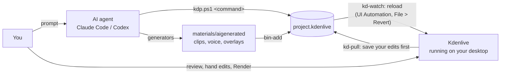

<div align="center">

# Movie Engine

**Ergamaan AI (AI agent) viidiyoo kee Kdenlive keessatti otuma ati ilaaltuu gulaala, ati immoo yeroo barbaadde hojicha harkatti fudhachuu dandeessa.**

Ergamtoonni AI koodii barreessan (Claude Code, Codex) pirojektoota Kdenlive dhugaa ijaaru, ni jijjiiru: fiilmii, viidiyoo ibsaa fi shorts dheerinaan dhaabbatan (vertical). Gulaalliin isaanii yeruma sanatti gulaalaa (editor) ati banatte keessatti mul'ata. Kan baatamu (portable), Windows, gulaalaan hin jijjiiramu (patch malee).


[English](../../README.md) · [简体中文](README.zh-CN.md) · [繁體中文](README.zh-TW.md) · [हिन्दी](README.hi.md) · [Español](README.es.md) · [Français](README.fr.md) · [العربية](README.ar.md) · [বাংলা](README.bn.md) · [Português](README.pt.md) · [Русский](README.ru.md) · [اردو](README.ur.md) · [Bahasa Indonesia](README.id.md) · [Deutsch](README.de.md) · [日本語](README.ja.md) · [Türkçe](README.tr.md) · [한국어](README.ko.md) · [Українська](README.uk.md) · [Italiano](README.it.md) · [Polski](README.pl.md) · [Tiếng Việt](README.vi.md) · [فارسی](README.fa.md) · [ไทย](README.th.md) · [Kiswahili](README.sw.md) · [አማርኛ](README.am.md) · [Avañe'ẽ](README.gn.md) · [Setswana](README.tn.md) · [Shqip](README.sq.md) · [Беларуская](README.be.md) · [Български](README.bg.md) · [Bosanski](README.bs.md) · [Hrvatski](README.hr.md) · [Српски](README.sr.md) · [Crnogorski](README.cnr.md) · [Македонски](README.mk.md) · [Slovenščina](README.sl.md) · [Slovenčina](README.sk.md) · [Čeština](README.cs.md) · [Magyar](README.hu.md) · [Română](README.ro.md) · [Dansk](README.da.md) · [Norsk bokmål](README.nb.md) · [Norsk nynorsk](README.nn.md) · [Svenska](README.sv.md) · [Íslenska](README.is.md) · [Suomi](README.fi.md) · [Eesti](README.et.md) · [Latviešu](README.lv.md) · [Lietuvių](README.lt.md) · [Nederlands](README.nl.md) · [Lëtzebuergesch](README.lb.md) · [Rumantsch](README.rm.md) · [Ελληνικά](README.el.md) · [Malti](README.mt.md) · [Gaeilge](README.ga.md) · [Català](README.ca.md) · [ქართული](README.ka.md) · [Հայերեն](README.hy.md) · [Azərbaycanca](README.az.md) · [Afrikaans](README.af.md) · [isiZulu](README.zu.md) · [isiXhosa](README.xh.md) · [Sesotho](README.st.md) · [Sepedi](README.nso.md) · [Xitsonga](README.ts.md) · [Tshivenḓa](README.ve.md) · [siSwati](README.ss.md) · [isiNdebele (South Africa)](README.nr.md) · [isiNdebele (Zimbabwe)](README.nd.md) · [chiShona](README.sn.md) · [Chichewa](README.ny.md) · [Ikinyarwanda](README.rw.md) · [Ikirundi](README.rn.md) · [Malagasy](README.mg.md) · [Soomaali](README.so.md) · **Afaan Oromoo** · [Qafar af](README.aa.md) · [ትግርኛ](README.ti.md) · [Sängö](README.sg.md) · [Kreol Seselwa](README.crs.md) · [TjiKalanga](README.kck.md) · [ChiNdau](README.ndc.md)

*Kun hiika. README Afaan Ingiliffaa jiru isa wabii ta'edha.*

</div>

---

## Qabiyyee

- [Maaliif](#maaliif)
- [Akkamitti akka hojjetu](#akkamitti-akka-hojjetu)
- [Amaloota](#amaloota)
- [Wantoota barbaachisan](#wantoota-barbaachisan)
- [Fe'iinsa](#feiinsa)
- [Jalqaba ariifataa](#jalqaba-ariifataa)
- [Ergamaa waliin hojjechuu](#ergamaa-waliin-hojjechuu)
- [Sarara ajajaa gulaallii (`kdp.ps1`)](#sarara-ajajaa-gulaallii-kdpps1)
- [Gulaalaa banaa ta'e waliin walsimsiisa kallattii](#gulaalaa-banaa-tae-waliin-walsimsiisa-kallattii)
- [Uumtoota: waan Kdenlive gochuu hin dandeenye](#uumtoota-waan-kdenlive-gochuu-hin-dandeenye)
- [Sagalee ibsaa fi sagaleewwan](#sagalee-ibsaa-fi-sagaleewwan)
- [Afaan fuula fayyadamaa](#afaan-fuula-fayyadamaa)
- [Qindaa'ina kuusaalee](#qindaaina-kuusaalee)
- [Qormaatota fi ragaalee](#qormaatota-fi-ragaalee)
- [Daangeffamoota](#daangeffamoota)
- [Rakkoolee furuu](#rakkoolee-furuu)
- [Gaaffilee yeroo baay'ee gaafataman](#gaaffilee-yeroo-baayee-gaafataman)
- [Gumaachuu](#gumaachuu)
- [Galateeffannaa](#galateeffannaa)
- [Hayyama](#hayyama)

## Maaliif

Gulaaltonni viidiyoo harka maawusii (mouse) qabateef ijaaramaniiru. Ergamtoonni AI caasaa, yeroo qindeessuu fi hojii irra deddeebi'amu irratti cimoodha: kilippii (clip) 300 rukuttaa muuziqaa waliin kaa'uu, barreeffama jalaa (caption) hunda sagalee waliin yeroo isaa qindeessuu, yaada booda waltajjii (scene) tokko irra deebiin hojjechuu. Garuu desktop kee osoo hin qabatin GUI (fuula fayyadamaa giraafikii) irratti cuqaasuu hin danda'an.

Kdenlive gulaalaa madda banaa (open-source) cimaa dha, garuu Windows irratti **API ofumaan hojjechiisuu (automation API) hin qabu**: to'annoon D-Bus build Linux qofa keessa jira, fork-oonni isa dabalan immoo yookaan hin kunuunfaman yookaan nageenya hin qaban. Movie Engine gulaalaa osoo hin jijjiirin rakkoo kana fura:

1. Ergamaan faayilii pirojektii `.kdenlive` sarara ajajaa (command line) qoratame (`engine/kdp.ps1`) fayyadamee gulaala.
2. Kdenlive hojii irra jiru Windows UI Automation fayyadamuun faayilicha irra deebiin akka dubbisu ajajama; qabduun kiiboordii hin tuqamu, maawusiin hin fayyadamu, focus-iinis hin butamu.
3. Gulaallii kee kan hin olkaa'amin dura olkaa'ama, gonkumaa irratti hin barreeffamu.

Kanaafuu ergamaan ni gulaala ati immoo ni ilaalta, yookaan ati harkaan gulaalta. Lamaanuu pirojektii tokko irratti, gulaalaa tokko keessatti, yeroo tokkotti hojjettu.

## Akkamitti akka hojjetu



Ajajni gulaallii hundi marsaa nageenya qabu tokkicha hordofa:

1. **Pull (harkisuu).** Kdenlive jijjiirama hin olkaa'amin yoo qabaate, akka olkaa'u ajajama (qabduu Save kan toolbar irra jiru UI Automation fayyadamuun), olkaa'uunis ni mirkanaa'a.
2. **Gulaaluu.** Ajajichi XML cufaa (lock) jalatti jijjiira, hash erga mirkaneessee booda, undo'f suuraa haalaa (snapshot) qabachuun. Gidduutti faayiliin yoo jijjiirame, homtuu hin barreeffamu.
3. **Irra deebiin fe'uu (reload).** Eegduun (watcher) mallattoo AI arga, gulaalaa banaa ta'e keessatti File > Revert raawwata. Milkaa'inni kan lakkaa'amu widget timeline dhugumaan irra deebiin yoo ijaarame qofa.
4. **Walitti bu'iinsa (conflict).** Gidduutti gulaaluu yoo jalqabde, homtuu irra deebiin hin fe'amu, hojiin kee ni hafa. Versiyoonni AI gama tokkotti kaa'ama, ergamaan immoo jijjiirama isaa kan kee irratti irra deebiin raawwata.

## Amaloota

- **GUI malee pirojektii guutummaatti gulaaluu**: ajajoota 120 gaha kan bin (kuusaa kilippii), timeline, effect-oota, walitti makuu (compositions), track-oota, qajeelchituu (guides), mallattoolee (markers), barreeffama jalaa (subtitles), tartiiba (sequences), saffisa fi yeroo irra deebiin qooduu (time remap), slideshow, mata-dureewwan (titles), proxy, render fi undo/redo of keessatti qabatan. [Wabii ajajootaa](#sarara-ajajaa-gulaallii-kdpps1) ilaali.
- **Gulaalaa banaa ta'e waliin walsimsiisa kallattii.** Gulaalliin AI Kdenlive ati ilaalaa jirtu keessatti mul'ata; gulaallii kee kan hin olkaa'amin dura olkaa'ama, gonkumaa hin badu.
- **Desktop kee gonkumaa hin jeequ.** Focus butuun, qabduu tuquun yookaan maawusii socho'suun hin jiru. Gulaaltonni qormaataa desktop Windows hin mul'anne irratti hojjetu.
- **Kan baatamu.** Gulaalaan, qindaa'inni (settings), Node.js, font-oonni fi meeshaaleen kuusaa (folder) tokko keessa jiraatu. Kompiitara biraatti garagalchi, ni hojjeta; Program Files ykn profile Windows kee keessatti homtuu hin barreeffamu.
- **Uumtoota (generators) waan Kdenlive gochuu hin dandeenyeef**: barreeffama qubee qubeedhaan sochoo'u (kinetic text), ibsa harkaan kaafame, waltajjii UI 3D, sochii cursor fi fiilmii "ibsaa" (explainer) dheeraa fi walqunnamtii qaban. GPU irratti motion blur dhugaa wajjin render ta'u, timeline irras akka kilippii idileetti kaa'amu.
- **Sagalee ibsaa (voice-over) yeroo jechootaa wajjin** (Microsoft Edge TTS, furtuu API malee). Barreeffamni jalaa fi gochoonni jecha sirrii irratti raawwatamu.
- **Effect sagalee uumaman** (whoosh, click, pop, riser, impact fi kan biroo), koodiidhaan kan hojjetaman.
- **Kan mirkanaa'e malee kan tilmaamame miti.** Ajajni hundi mirkaneessa bu'aa qaba, effect-oonni fi walitti makuun tokko tokkoon qoratamaniiru, bu'aaleen dheedhii `docs/proof/` keessa jiru.
- **Qajeelfamni ergamaa ni dabalama.** `AGENTS.md` fi dandeettiiwwan (skills) `.claude/skills/` keessa jiran Claude Code fi Codex adeemsa hojii, bifa faayilii fi kiyyoo of eeggachuu qaban barsiisu.

## Wantoota barbaachisan

| | |
|---|---|
| Sirna hojii (OS) | Windows 10 yookaan 11, x64 |
| Gulaalaa | Kdenlive **26.08.3**, build baatamu (standalone). Versiyoonni biroo hin qoratamne. |
| Node.js | 18 yookaan kan isaa ol: `.zip` Windows x64 nodejs.org irraa, `engine/node/` keessatti kan baname |
| Browser | Microsoft Edge (kutaa Windows); render-oonni waltajjii headless (foddaa malee) fayyadamu |
| Ergamaa | [Claude Code](https://claude.com/claude-code) yookaan Codex. Dirqama miti: meeshaan hundi harkaanis ni hojjeta. |
| Disk | gulaalaa fi meeshaaleef GB 1 gaha, miidiyaa (media) kee dabalatee |
| GPU | GPU kamiyyuu kan encoding H.264 hardware qabu `film-render.mjs` ariifachiisa (yoo hin jiraanne software fayyadama) |

## Fe'iinsa

Wanti hundi **kuusaa keessatti** fe'ama (install). Mirgi bulchaa (admin) homaaf hin barbaachisu.

```powershell
git clone https://github.com/vladtarrow/movie-engine.git
cd movie-engine
```

**1. Node.js.** `.zip` Windows x64 kan Node.js 18 yookaan isaa ol <https://nodejs.org/en/download> irraa buufadhuutii qabiyyee isaa `engine\node\` keessatti bani, akka `engine\node\node.exe` fi `engine\node\npm.cmd` achi jiraataniif. Installer-iis ta'e Node sirnaa hin barbaachisu. Iskiriptiin (scripts) hundi `engine\node.cmd` fayyadamuun hojjetu, gonkumaa Node sirnaatiin miti.

**2. Paakeejiiwwan Node** meeshaa sagalee fi render-ootaaf (versiyoonni `engine/voice/package.json` keessatti murtaa'aniiru):

```powershell
engine\node\npm.cmd install --prefix engine\voice
```

**3. Kdenlive 26.08.3 baatamu.** `kdenlive-26.08.3_standalone.exe` <https://download.kde.org/stable/kdenlive/26.08/windows/> irraa gara `engine\installer\` buufadhu, mirkaneessiitii bani:

```powershell
(Get-FileHash engine\installer\kdenlive-26.08.3_standalone.exe -Algorithm SHA256).Hash
# expected: A25427B1DFF2C17E3B0386E991BB1A719382BB3176D1A90E441CDAEB6E0A967D
engine\installer\kdenlive-26.08.3_standalone.exe -o"engine\Kdenlive" -y
```

Gulaalaan `engine\Kdenlive\kdenlive-26.08.3_standalone\bin\` keessa ga'a. Duraanuu `melt.exe` fi `ffmpeg.exe` of keessaa qaba.

**4. Jalqabbii jalqabaa.**

```powershell
engine\kdenlive.cmd
```

Kdenlive qindaa'ina isaa hunda `engine\profile-kdenlive\` keessatti kuusa, profile Windows kee keessatti miti. Jalqabbii jalqabaa irratti al tokko qajeelchaa qindaa'inaa (setup wizard) agarsiisa.

## Jalqaba ariifataa

### Ergamaa waliin

Kuusicha Claude Code (yookaan Codex) keessatti banii jechoota salphaa ta'aniin gaafadhu:

> Pirojektii haaraa dheerinaan dhaabbatu (vertical) 30 fps "launch-teaser" jedhamu hojjedhu. Suuraa iskiriinii (screenshots) sadan `materials/designers/launch/` keessa jiran timeline irra kaa'i, tokkoon tokkoon isaanii 2.5 s, cross-fade gabaabaa wajjin, `script.txt` irraa sagalee ibsaa dabali, sarara hundaaf caption kinetic yeroo isaa qindeessi.

> Kdenlive keessatti naaf bani.

> Suuraan lammaffaan baay'ee dheeraa dha. Gara 1.8 s gabaabsi, loogoo immoo xiqqoo ol kaasi.

Ergamaan `AGENTS.md` hordofa: `kdp.ps1` fayyadamee gulaala, kilippii muraan (cut) barbaachisu qofa render godha, gulaalaa banaa ta'e walsimsiisee (sync) qabata. Ati Kdenlive keessatti ilaalta, yeroo barbaadde harkaan gulaalta, yeroo itti quuftu Render tuqxa.

### Harkaan

```powershell
# a new 1080x1920 30 fps project with 2 video and 2 audio tracks
powershell -NoProfile -ExecutionPolicy Bypass -File engine\kdp.ps1 new -Project projects\hello\hello.kdenlive -Profile vertical_hd_30

# a 3-second title and a colour background
powershell -NoProfile -ExecutionPolicy Bypass -File engine\kdp.ps1 bin-color -Project projects\hello\hello.kdenlive -Color '#203060' -Seconds 3 -Name bg
powershell -NoProfile -ExecutionPolicy Bypass -File engine\kdp.ps1 title -Project projects\hello\hello.kdenlive -Text "Hello" -Seconds 3 -Name hi

# place them: background on V1, title above it on V2
powershell -NoProfile -ExecutionPolicy Bypass -File engine\kdp.ps1 add -Project projects\hello\hello.kdenlive -Bin bg -Track V1 -At 0
powershell -NoProfile -ExecutionPolicy Bypass -File engine\kdp.ps1 add -Project projects\hello\hello.kdenlive -Bin hi -Track V2 -At 0

# a check frame, then open it in the editor
powershell -NoProfile -ExecutionPolicy Bypass -File engine\kdp.ps1 frame -Project projects\hello\hello.kdenlive -At 1.5 -Out out\hello\check.png
engine\kdenlive.cmd projects\hello\hello.kdenlive
```

Booda pirojektii dhumaa irra deebiin banuuf, `open-last-project.cmd` irratti al lama cuqaasi.

## Ergamaa waliin hojjechuu

Ergamaan `AGENTS.md` (Codex) yookaan `CLAUDE.md`, kan isa galchu (Claude Code), akkasumas dandeettiiwwan (skills) lama dubbisa:

| Dandeettii | Kan barsiisu |
|---|---|
| `.claude/skills/kdenlive-project-file` | bifa `.kdenlive` / MLT XML, `kdp.ps1`, `melt` fayyadamuun mirkaneessuu |
| `.claude/skills/kdenlive-live` | gulaalaa hojii irra jiru nageenyaan oofuu: jalqabsiisuu, pull, irra deebiin fe'uu, foddaa isaa suuraa kaasuu |

Seerota ergamaan hordofu, kanneen irratti hirkachuu dandeessu:

- Maawusii, kiiboordii yookaan focus kee gonkumaa hin fudhatu, desktop kees gonkumaa suuraa hin kaasu (foddaa gulaalaa qofa).
- Tarkaanfiiwwan GUI (olkaa'uu, banuu, irra deebiin fe'uu) akka ati cuqaaftu si gaafachuu mannaa ofii isaatii raawwata.
- Waan tokko buufachuu fi haquu dura si gaafata.
- Waan hojiin barbaachisu qofa render godha (kilippii waltajjii, fireemii mirkaneessaa). Fiilmii xumuraa kan render godhu yoo ati gaafatte qofa.
- Kdenlive waan tokko sirriitti gochuu yoo hin dandeenye, ergamaan koodiidhaan alatti ijaaree bu'aa isaa akka kilippiitti galcha. Effect sana hin laaffisu.

## Sarara ajajaa gulaallii (`kdp.ps1`)

```powershell
powershell -NoProfile -ExecutionPolicy Bypass -File engine\kdp.ps1 <command> -Project <file.kdenlive> [options]
```

Yeroon sekondiidhaan, tuqaa wajjin (`2.5`). Track-oonni `V1 V2 …` (V1 isa gadii) fi `A1 A2 …` dha. Kilippiin `-Track` fi yeroo `-At` kamiyyuu isa keessa jiruun ibsama. Paaraameetaroonni effect `-Params "name=value||name=value"` keessa galu. Tarreeffamni guutuun filannoo hunda wajjin mata (header) `engine/kdp.ps1` keessa jira.

| Garee | Ajajoota |
|---|---|
| Pirojektii | `new`, `profiles`, `info`, `validate`, `fonts`, `profile-set`, `profile-from-clip`, `zone`, `archive`, `backups`, `rebase`, `otio-export`, `otio-import` |
| Bin | `bin-add`, `bin-color`, `title`, `title-text`, `title-save`, `title-template`, `bin-rename`, `bin-remove`, `bin-info`, `bin-set`, `bin-duplicate`, `bin-replace-file`, `bin-reload`, `folder`, `bin-folder`, `relink`, `clean`, `generator`, `playlist-clip`, `extract-audio`, `transcode` |
| Timeline | `add`, `add-av`, `move`, `copy`, `trim`, `ripple-trim`, `slip`, `split`, `remove`, `speed`, `remap`, `disable`, `enable`, `group`, `ungroup`, `mix`, `unmix`, `space-insert`, `space-remove`, `spaces-remove-all`, `track-clear`, `replace-in-timeline` |
| Effect-oota | `effects`, `effect-info`, `effect-add`, `effect-list`, `effect-set`, `effect-remove`, `effect-copy`, `effect-clear`, `effects-all`, `bin-effect`, `effect-templates`, `effect-template` |
| Walitti makuu (compositions) | `compositions`, `comp-info`, `comp-add`, `comp-list`, `comp-set`, `comp-remove` |
| Track-oota | `track-add`, `track-remove`, `track-set` |
| Qajeelchituu fi mallattoolee | `guide-add`, `guide-list`, `guide-remove`, `guide-set`, `guide-clear`, `guide-export`, `guide-category`, `marker`, `marker-list`, `marker-set`, `marker-remove` |
| Barreeffama jalaa | `sub-add`, `sub-import`, `sub-export`, `sub-state` |
| Tartiiba (sequences) | `sequence-add`, `sequences`, `copy-to-sequence`, `expand`; ajajni kamiyyuu `-Sequence <name>` wajjin tartiiba sana keessatti hojjeta |
| Addaa | `slideshow`, animeeshinii Lottie / Glaxnimate `bin-add` fayyadamuun, `proxy`, `stabilize`, `scene-split`, `speed-job`, `subclip` |
| Bu'aa (output) | `frame` (PNG tokko), `preview` (render melt ariifataa), `render` (render-ii Kdenlive mataa isaa yookaan preset), `presets` |
| Seenaa | `undo`, `redo`, `clear-history` (suuraa haalaa `projects/<name>/.kdp-history` keessa jiru) |

Amala beekuun gaarii ta'e:

- Walakkaan sagalee fi viidiyoo walitti hidhaman waliin socho'u, waliin muramu (trim), waliin addaan cicciitu (split), waliinis haqamu (`-Alone` walakkaa tokko qofaaf).
- Ajajni kufe koodii 1n ba'a, homaas hin barreessu.
- Effect-oonni build Windows hojjechiisuu hin dandeenye ni didamu, calliseen bira hin darbaman (tarreeffama: `docs/proof/assets.txt`).
- Gochi menu Kdenlive hundi ajaja tokkoon, karaa biraatiin, yookaan "ilaaluu qofa" jedhamee `engine/tools/data/kdenlive-actions.csv` keessatti walqabsiifameera. `docs/kdenlive-coverage.md` ilaali.

## Gulaalaa banaa ta'e waliin walsimsiisa kallattii

| Iskiriptii | Waan hojjetu | Koodii ba'uu (exit codes) |
|---|---|---|
| `engine\kd-pull.ps1 -Project <f>` | Kdenlive gulaallii kee akka olkaa'u godha, ni mirkaneessas | 0 faayiliin haaraa dha, 3 hin hojjetu, 4 hin mirkanoofne |
| `engine\kd-reload.ps1 -Project <f>` | File > Revert, timeline irra deebiin ijaarameen mirkanaa'a | 0 mirkanaa'e, 2 gulaallii hin olkaa'amin qabda (homtuu hin gatamne), 3 hin hojjetu, 4 kufe |
| `engine\kd-watch.ps1 -Project <f>` | eegduu duubaan hojjetu: barreeffama AI hunda booda irra deebiin fe'a, walitti bu'iinsa galmeessa | log `engine\kd-watch.log` keessa jira; dhaabuuf `engine\kd-watch.run` haqi |
| `engine\kdenlive-bg.ps1 [project]` | ergamaaf Kdenlive xiqqeessee (minimized) jalqabsiisa | 0 fe'ame, 4 hin mirkanoofne |
| `engine\kdenlive.cmd [project]` | Kdenlive siif jalqabsiisa | |

Eegduu kana al tokko marsaa hojii (session) tokkoon jalqabsiisi:

```powershell
Start-Process powershell -WindowStyle Hidden -ArgumentList '-NoProfile','-ExecutionPolicy','Bypass','-File','engine\kd-watch.ps1','-Project','projects\hello\hello.kdenlive'
```

Pirojektoota gurguddoo: pirojektii kilippii 1000 qabu irra deebiin fe'uun daqiiqaa hedduu fudhata, meeshaaleen immoo dafanii gabaasuu mannaa isa eegu. Pirojektoonni gulaalaa duwwaa irratti *File > Open Recent* fayyadamuun banamu, sababni isaas faayilii kallattiin banuun Qt akka wanta timeline hunda accessibility'f (dhaqqabummaaf) keessa darbu godha, kunis daqiiqaa 10 gaha caalaa suuta ture.

## Uumtoota: waan Kdenlive gochuu hin dandeenye

Kdenlive/MLT animeeshinii barreeffamaa qubee qubeedhaan, expressions hin qabu, 3D-iin isaas xiqqoo dha, effect-oonni ulfaatoon immoo taphachiisuu (playback) suuta godhu. Movie Engine kutaalee akkasii alatti render godhee timeline irratti akka kilippii idileetti kaa'a, yeroo baay'ee alpha (iftoomina) wajjin, track suuraalee ol jiru irratti. Iskiriptiin uumtuu fi galchiin isaa kuusaa pirojektii keessa hafu, kanaafuu barreeffamni, font-iin yookaan yeroon yoo jijjiirame kilippiin irra deebiin uumamuu danda'a.

| Meeshaa | Kan hojjetu |
|---|---|
| `engine/tools/kinetic-text.ps1` | caption kinetic qubee qubeedhaan, jechi hundi `voice.json` irraa yeroo isaa qindaa'e, saanduqa calaqqisiisaa (highlight) |
| `engine/tools/annotate.ps1` | geengoo, saanduqa, sarara jalaa fi xiyya harkaan kaafaman kan suuraa iskiriinii (screenshot) irratti of kaasan |
| `engine/tools/card-entrance.ps1` | kaardii suuraa iskiriinii kan ol ka'ee guddatu, gaaddidduu laafaa wajjin |
| `engine/tools/pdf-to-png.ps1` | islaayidii PDF alatti ergame (export) irraa |
| `engine/tools/html-render.mjs` | waltajjii HTML/CSS/canvas kamiyyuu gara viidiyootti: animeeshinii interface, cursor, 3D, maaskii (masks) |
| `engine/tools/film-render.mjs` + `film/` | fiilmii ibsaa dheeraa fi walqunnamtii qaban canvas irratti: sarara sagalee tokkoof kilippii tokko, gochoonni jechoota dubbataman irratti raawwatamu, GPU motion blur 45 fps gahaan |

Render-oonni lamaanuu Microsoft Edge Windows waliin dhufu headless, profile itti fayyadamanii gatamu fi dhaqqabbii neetworkii malee oofu.

### Agarsiisota

```powershell
# a 3-second 3D title card with a cursor click
engine\node.cmd engine\tools\html-render.mjs examples\demo\scene\scene.html examples\demo\out --frames 0,30,60,89
engine\node.cmd engine\tools\html-render.mjs examples\demo\scene\scene.html examples\demo\out\scene.mp4

# a 4-shot interactive film timed to two voice lines
engine\node.cmd engine\tools\film-render.mjs examples\demo\film\film.html examples\demo\out --check
engine\node.cmd engine\tools\film-render.mjs examples\demo\film\film.html examples\demo\out --shots all --width 640
engine\node.cmd engine\tools\film-render.mjs examples\demo\film\film.html examples\demo\out\clips --suffix -v01
```

Fiilmiin tokko faayilii xixiqqaa sadi. `data.js` suuraalee (shots) fi yeroo jechootaa qabata. `direction.js` suuraa tokkoof sarara tokko qaba:

```text
1 | hover 192 108 @brand | tag 300 60 Your brand @deserves | confetti 192 90 @film
2 say=A film that/*explains* it
3 | click 116 108 @before | click 268 108 @after | chips Before~After @after
4 scene=counter | count 0 120 % @count
```

`scenes.js` suuraalee zeeroo irraa kaafaman qabata. `@word` yeroo sagaleen jecha sana jedhu gocha tokko kakaasa. Gochoota keessaa click, hover, drag, zoom, lens, ring, arrow, chips, toggle, slider, toast, type, count fi confetti jiru; caasaan barreeffamaa (syntax) guutuun jalqaba `engine/tools/film/film-kit.js` irra jira.

## Sagalee ibsaa fi sagaleewwan

```powershell
engine\node.cmd engine\voice\voice.mjs lines.json materials\aigenerated\hello\voice en-US-AndrewMultilingualNeural +0%
```

`lines.json` tarreeffama sararootaa ti. Meeshichi sarara tokkoof mp3 tokko fi `voice.json` barreessa, kunis turtii fi jalqabaa fi dhuma jecha hundaa qaba. Sararoonni ni kuufamu (cache), kanaafuu sarara tokko jijjiiruun sarara sana qofa irra deebiin uuma. Barreeffama gara sagaleetti (text-to-speech) online Microsoft Edge paakeejii `msedge-tts` fayyadamuun hojjeta: furtuun hin barbaachisu, garuu tajaajilli sun kan seeraan beekame miti, interneetiis barbaada.

```powershell
engine\node.cmd engine\audio\sfx.mjs materials\aigenerated\sfx
```

Kun whoosh, whoosh-long, swipe, click, pop, tick, riser, impact, ding fi reveal koodiidhaan uuma; tuutni qophaa'e `materials/aigenerated/sfx/` keessa jira. Sagaleewwan fireemii tokko gadi gabaabatan osoo hin kaa'in dura callisaan guuti (`-af apad=whole_dur=0.0667`).

## Afaan fuula fayyadamaa

Jalqabsiistonni (launchers) durtiidhaan Kdenlive **Afaan Ingiliffaatiin** jalqabsiisu. Afaan biraa fayyadamuuf, osoo hin jalqabsiisin dura `MOVIE_ENGINE_UI_LANG` qindeessi:

```powershell
$env:MOVIE_ENGINE_UI_LANG = 'ru'; engine\kdenlive.cmd
```

UI Automation wantoota menu maqaa isaanii mul'atuun argata. Maqaaleen afaanota fuula fayyadamaa 31f duraanuu keessa jiru (`engine/tools/kd-ui.ps1`, `$KdNames`). Afaan biraa kamiifuu, maqaalee isaa achitti dabaliitii kanaan mirkaneessi:

```powershell
powershell -NoProfile -ExecutionPolicy Bypass -File engine\tools\kd-langcheck.ps1
```

## Qindaa'ina kuusaalee

```text
movie-engine/
├─ AGENTS.md, CLAUDE.md          instructions for AI agents
├─ .claude/skills/               agent skills: project file format, live editor
├─ engine/
│  ├─ kdp.ps1                    the editing command line
│  ├─ kd-pull / kd-reload / kd-watch .ps1, kdenlive.cmd, kdenlive-bg.ps1
│  ├─ tools/                     internals, generators, tests, data (action map)
│  ├─ voice/  audio/  fonts/     TTS, synthesized SFX, Poppins (OFL)
│  ├─ Kdenlive/  node/           portable editor and Node.js (not in git)
│  └─ profile-kdenlive/          the editor's settings (not in git)
├─ projects/<name>/<name>.kdenlive
├─ materials/
│  ├─ download/                  stock and downloaded files (not in git)
│  ├─ aigenerated/               everything the AI made (sfx/ and test-kit/ ship with the engine)
│  ├─ designers/  brand/         files from your team, brand assets
├─ examples/demo/                demos of the scene and film renderers
├─ out/                          renders (not in git)
└─ docs/                         proofs, coverage, translations of this README
```

Karaan (paths) miidiyaa pirojektoota keessaa walfakkeenyaan (relative) kan ibsamu dha. Kuusicha yoo sochoosite yookaan garagalchite, `kdp.ps1 rebase` (kan `kdenlive.cmd` ofumaan hojjechiisus) iddoo haaraa pirojektii keessatti barreessa.

## Qormaatota fi ragaalee

Waan hojjetu ilaalchisee himni kamiyyuu mirkaneessa bu'aatiin deeggarama, "faankishiniin hojjete" jechuun miti. Cuunfaan [`docs/kdenlive-proof.md`](../../docs/kdenlive-proof.md) keessa, bu'aan dheedhiin immoo `docs/proof/` keessa jira.

| Qormaata | Kan mirkaneessu |
|---|---|
| `engine\tools\kdp-clitest.ps1` | ajaja `kdp.ps1` hunda, sarara ajajaa fayyadamuun, pirojektii bu'aa ta'e wal bira qabuun |
| `engine\tools\kd-livetest.ps1` | pull, irra deebiin fe'uu, eegduu, walitti bu'iinsa fi dorgommii (races) Kdenlive dhugaa desktop hin mul'anne irra jiru irratti |
| `engine\tools\kdp-assetsweep.ps1` | effect fi walitti makuu hunda: render godhee fireemii wal bira qaba |
| `engine\tools\kdp-portabletest.ps1` | kuusicha iddoo biraatti garagalchee garagalcha sana irraa hojjeta |
| `engine\tools\kd-langcheck.ps1` | afaan fuula fayyadamaa fi akka UI Automation menu argatu |
| `engine\tools\kdp-coverage-check.ps1` | gochi menu hundi akka walqabsiifame, ragaan tokkollee koodii caalaa akka hin dullomne |

```powershell
powershell -NoProfile -ExecutionPolicy Bypass -File engine\tools\kdp-clitest.ps1 -Report docs\proof\clitest.txt
powershell -NoProfile -ExecutionPolicy Bypass -File engine\tools\kd-livetest.ps1 -Report docs\proof\live-en.txt
```

Gulaaltonni qormaataa desktop dhokataa profile mataa isaanii qabu irratti qofa hojjetu, kanaafuu qormaatonni Kdenlive kee banaa ta'e yookaan focus kee gonkumaa hin tuqan.

## Daangeffamoota

- **Windows qofa**, Kdenlive **26.08.3** qofa. Linux D-Bus qaba, riqicha (bridge) biraas ni barbaachisa ture.
- Gulaalaa jalqabsiisuun yeroo foddaan duwwaan mul'atu sekondii 3 gahaaf focus kiiboordii fudhata. Ergamtoonni otuma ati hojjechaa jirtuu isa jalqabsiisuu dura si gaafatu. Irra deebiin fe'uu fi gulaalliin focus hin fudhatan.
- Build Windows moojuloota (modules) MLT sox, ladspa fi movit akkasumas effect-oota frei0r/avfilter tokko tokko hin qabu; `kdp.ps1` isaan dida (`docs/proof/assets.txt`).
- Ergiin alaa (export) fi galchiin (import) OpenTimelineIO kilippii fi bakka duwwaa (gaps) qofa baatu. Multicam jijjiirraa kofa (angle) kallattii hin qabu (muraan split/remove/hide fayyadamuun hojjetama).
- "Save As…" UI Automation fayyadamuun foddaa xiqqeeffame irratti marii (dialog) hin banu; ergamaan bakka isaa `archive` yookaan faayilii garagalchuu fayyadama.
- Beekamtiin dubbii (barreeffama jalaa ofumaan uumamu) Whisper yookaan Vosk barbaada, isaanis hin dabalamne.
- Mata-dureewwan meeshaa mata-duree Kdenlive'tiin hojjetaman font Windows keessatti fe'aman fayyadamu. Bifa barreeffamaa (typography) mirkanaa'aaf, barreeffama uumtootaan render godhi; isaan font `engine/fonts/` irraa fe'u.
- Edge TTS tajaajila online seeraan hin beekamne dha, jijjiiramuu yookaan hojii dhaabuu danda'a.

## Rakkoolee furuu

| Mallattoo | Sababa fi furmaata |
|---|---|
| Kdenlive hojii irra jira, garuu taskbar irratti cuqaasuun homaa hin agarsiisu | Iddoon foddaa isaa kan olkaa'ame iskiriinii ala jira. Cufiitii galmee `kdockLayout` kan `engine\profile-kdenlive\AppData\Local\kdenliverc` keessa jiru haqi, yookaan `SetWindowPos` fayyadamuun foddaa sochoosi (`AGENTS.md` ilaali). |
| `kd-reload.ps1` 2n ba'a | Gulaallii hin olkaa'amin qabda. Homtuu hin gatamne. `kd-pull.ps1` hojjechiisi, achiis jijjiirama sana irra deebiin raawwadhu (`kdp.ps1` kana ofumaan godha). |
| `CONFLICT` `engine\kd-watch.log` keessatti | Atii fi ergamaan yeroo tokkotti gulaaltaniittu. Versiyoonni kee gulaalaa keessatti hafa, kan AI immoo `projects\<name>\.kdp-history\<name>\conflict\` keessa jira. Ergamaan jijjiirama isaa irra deebiin akka raawwatu gaafadhu. |
| Ajajni "pull not confirmed" jedhee 1n ba'a | Kdenlive qabameera yookaan marii (dialog) agarsiisaa jira. Marii sana cufi yookaan hanga fe'uun xumuramutti eegi, achiis irra deebi'i. |
| Iskiriptiin PowerShell hiikamuu (parse) dadhabe | Iskiriptiin barreeffama ASCII hin taane qabu Windows PowerShell 5.1'f UTF-8 **BOM wajjin** olkaa'amuu qaba. |
| `voice.mjs` "Stream closed before the synthesis completed" jedhee dhaabbata | Yeroo baay'ee rakkoo neetworkii, yookaan SSML hin miliqsamne (unescaped) garagalchoota durii keessatti. `voice.mjs` `& < >` ofumaan miliqsa. |
| Pirojektii guddaa banuun daqiiqaa hedduu fudhata | `kdenlive.cmd` / `kdenlive-bg.ps1` fayyadamuun bani, gonkumaa akka `kdenlive.exe project.kdenlive` hin banin. |

## Gaaffilee yeroo baay'ee gaafataman

**Claude Code yookaan Codex na barbaachisaa?**
Lakki. Meeshaan hundi iskiriptii salphaa harkaan hojjechiisuu dandeessu dha. Ergamaan isa ariifachiisu dha: muraa karoorsa, meeshaalee hojjechiisa, gulaalaa walsimsiisee qabata.

**Ergamaan gulaallii harkaan godhe irratti barreessaa?**
Lakki. Barreeffama kamiyyuu dura, gulaallii kee kan hin olkaa'amin olkaa'amee mirkanaa'a. Otuma ergamaan barreessaa jiruu yoo gulaalte, barreeffamni ni didama yookaan akka walitti bu'iinsaatti gama tokkotti kaa'ama, gonkumaa hojii kee irratti hin raawwatamu.

**Kdenlive akkuma duraatti fayyadamuu itti fufuu nan danda'aa?**
Eeyyee. Kdenlive idilee kuusaa qindaa'inaa mataa isaa qabu dha. Akkuma yeroo hundaa gulaali, ilaali (preview), render godhi.

**Kdenlive duraan fe'ee qabu waliin ni hojjetaa?**
Garagalcha baatamu mataa isaa `engine\Kdenlive\` keessa jiru fayyadama, kanaafuu Kdenlive kee fe'ame fi qindaa'inni isaa hin tuqaman.

**Maaliif fork Kdenlive API qabu yookaan gulaalaa biraa hin taane?**
Windows irratti fork kunuunfamaa fi nageenya qabu hin jiru (qorannoo 2026-11). OpenShot, Blender VSE, DaVinci Resolve, Shotcut fi gulaaltonni weebii madaalamaniiru; Kdenlive gadi fageenya gulaallii isa caalu kenne. Yaadni REST API pirojektii madda (upstream) keessatti dhiyaate (merge request !902) hordofamaa jira.

**Viidiyoo xumuraa render gochuu ni danda'aa?**
Eeyyee, `kdp.ps1 render` (render-ii Kdenlive mataa isaa, dhokataan), yookaan ati ofii keetii gulaalaa keessatti Render tuqxa.

**Miidiyaan koo bakka tokkotti ni ol-ergamaa?**
Lakki. Yeroo sagalee uumtu barreeffama sagalee ibsaa qofatu tajaajila Edge TTS'tti ergama. Render-oonni waltajjii neetworkii cufameen hojjetu.

## Gumaachuu

Gumaachi simatamaa dha. [CONTRIBUTING.md](../../CONTRIBUTING.md) ilaali. Gabaabumatti:

- Hojiin `kdp.ps1` haaraa yookaan jijjiirame kamiyyuu mirkaneessa bu'aa `kdp-clitest.ps1` keessatti, galmee kaartaa gochootaa (action map) keessatti, akkasumas `kdp-coverage-check.ps1` haaraatti hojjechiisuu barbaada.
- Kdenlive qormaataa gonkumaa desktop mul'atu irratti hin jalqabsiisin; `engine/tools/kd-hidden.ps1` fayyadami.
- Wanta hunda kan baatamu godhi: kuusaa ala fe'uun hin jiru, karaan guutuun (absolute paths) pirojektoota keessatti hin jiru.
- Amaloota addaa mirkanaa'an (quirks) `AGENTS.md` yookaan dandeettii walsimu keessatti barreessi.

## Galateeffannaa

- [Kdenlive](https://kdenlive.org) fi [MLT](https://www.mltframework.org): gulaalaa fi maashinii (engine) isa jala jiru.
- [FFmpeg](https://ffmpeg.org), Kdenlive waliin kan dhufu.
- [msedge-tts](https://www.npmjs.com/package/msedge-tts) sagalee ibsaaf.
- [Poppins](https://fonts.google.com/specimen/Poppins) Indian Type Foundry'n kan hojjetame, SIL Open Font License (`engine/fonts/OFL.txt`).
- `engine/tools/data/kdenliveui-26.08.3.rc`: faayilii menu Kdenlive, koodii madda (source code) Kdenlive 26.08.3 irraa kan fudhatame; mirkaneessa haguuggii (coverage check) qofaan fayyada. Hayyama GPL Kdenlive jala hafa, MIT License jala miti.

## Hayyama

Koodiin Movie Engine mataa isaa [MIT License](../../LICENSE) jalatti gadi lakkifame. Kdenlive, MLT, FFmpeg, paakeejiiwwan Node.js fi font Poppins hayyama mataa isaanii qabu.
