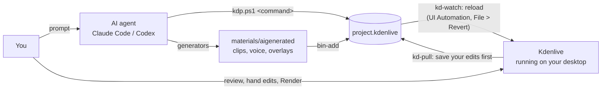

<div align="center">

# Movie Engine

**Agent AI montuje twoje wideo w Kdenlive na twoich oczach, a ty możesz w każdej chwili przejąć stery.**

Agenty AI do programowania (Claude Code, Codex) tworzą i zmieniają prawdziwe projekty Kdenlive: filmy, filmy objaśniające i pionowe shortsy. Zmiany pojawiają się na żywo w otwartym edytorze. Przenośnie, Windows, bez łatania edytora.


[English](../../README.md) · [简体中文](README.zh-CN.md) · [繁體中文](README.zh-TW.md) · [हिन्दी](README.hi.md) · [Español](README.es.md) · [Français](README.fr.md) · [العربية](README.ar.md) · [বাংলা](README.bn.md) · [Português](README.pt.md) · [Русский](README.ru.md) · [اردو](README.ur.md) · [Bahasa Indonesia](README.id.md) · [Deutsch](README.de.md) · [日本語](README.ja.md) · [Türkçe](README.tr.md) · [한국어](README.ko.md) · [Українська](README.uk.md) · [Italiano](README.it.md) · **Polski** · [Tiếng Việt](README.vi.md) · [فارسی](README.fa.md) · [ไทย](README.th.md) · [Kiswahili](README.sw.md) · [አማርኛ](README.am.md) · [Avañe'ẽ](README.gn.md) · [Setswana](README.tn.md) · [Shqip](README.sq.md) · [Беларуская](README.be.md) · [Български](README.bg.md) · [Bosanski](README.bs.md) · [Hrvatski](README.hr.md) · [Српски](README.sr.md) · [Crnogorski](README.cnr.md) · [Македонски](README.mk.md) · [Slovenščina](README.sl.md) · [Slovenčina](README.sk.md) · [Čeština](README.cs.md) · [Magyar](README.hu.md) · [Română](README.ro.md) · [Dansk](README.da.md) · [Norsk bokmål](README.nb.md) · [Norsk nynorsk](README.nn.md) · [Svenska](README.sv.md) · [Íslenska](README.is.md) · [Suomi](README.fi.md) · [Eesti](README.et.md) · [Latviešu](README.lv.md) · [Lietuvių](README.lt.md) · [Nederlands](README.nl.md) · [Lëtzebuergesch](README.lb.md) · [Rumantsch](README.rm.md) · [Ελληνικά](README.el.md) · [Malti](README.mt.md) · [Gaeilge](README.ga.md) · [Català](README.ca.md) · [ქართული](README.ka.md) · [Հայերեն](README.hy.md) · [Azərbaycanca](README.az.md) · [Afrikaans](README.af.md) · [isiZulu](README.zu.md) · [isiXhosa](README.xh.md) · [Sesotho](README.st.md) · [Sepedi](README.nso.md) · [Xitsonga](README.ts.md) · [Tshivenḓa](README.ve.md) · [siSwati](README.ss.md) · [isiNdebele (South Africa)](README.nr.md) · [isiNdebele (Zimbabwe)](README.nd.md) · [chiShona](README.sn.md) · [Chichewa](README.ny.md) · [Ikinyarwanda](README.rw.md) · [Ikirundi](README.rn.md) · [Malagasy](README.mg.md) · [Soomaali](README.so.md) · [Afaan Oromoo](README.om.md) · [Qafar af](README.aa.md) · [ትግርኛ](README.ti.md) · [Sängö](README.sg.md) · [Kreol Seselwa](README.crs.md) · [TjiKalanga](README.kck.md) · [ChiNdau](README.ndc.md)

*To jest tłumaczenie. Wersją wiążącą jest angielskie README.*

</div>

---

## Spis treści

- [Dlaczego](#dlaczego)
- [Jak to działa](#jak-to-działa)
- [Funkcje](#funkcje)
- [Wymagania](#wymagania)
- [Instalacja](#instalacja)
- [Szybki start](#szybki-start)
- [Praca z agentem](#praca-z-agentem)
- [Wiersz poleceń do edycji (`kdp.ps1`)](#wiersz-poleceń-do-edycji-kdpps1)
- [Synchronizacja z otwartym edytorem](#synchronizacja-z-otwartym-edytorem)
- [Generatory: czego nie potrafi Kdenlive](#generatory-czego-nie-potrafi-kdenlive)
- [Lektor i dźwięk](#lektor-i-dźwięk)
- [Język interfejsu](#język-interfejsu)
- [Struktura folderów](#struktura-folderów)
- [Testy i dowody](#testy-i-dowody)
- [Ograniczenia](#ograniczenia)
- [Rozwiązywanie problemów](#rozwiązywanie-problemów)
- [FAQ](#faq)
- [Współtworzenie](#współtworzenie)
- [Podziękowania](#podziękowania)
- [Licencja](#licencja)

## Dlaczego

Edytory wideo są stworzone dla ręki na myszce. Agenty AI dobrze radzą sobie ze strukturą, timingiem i powtarzalną pracą: ustawić 300 klipów w rytm muzyki, zsynchronizować każdy napis z głosem, przerobić scenę po uwagach. Nie potrafią jednak klikać po interfejsie, nie przejmując twojego pulpitu.

Kdenlive to mocny edytor open source, ale na Windows **nie ma API do automatyzacji**: sterowanie przez D-Bus istnieje tylko w kompilacjach dla Linuksa, a forki, które je dodają, są albo porzucone, albo niebezpieczne. Movie Engine rozwiązuje ten problem bez łatania edytora:

1. Agent edytuje plik projektu `.kdenlive` przez przetestowany wiersz poleceń (`engine/kdp.ps1`).
2. Uruchomiony Kdenlive dostaje przez Windows UI Automation polecenie ponownego wczytania pliku — bez naciśnięć klawiszy, bez myszy i bez przejmowania fokusu.
3. Twoje niezapisane zmiany są najpierw zapisywane i nigdy nie zostają nadpisane.

Agent montuje, a ty oceniasz — albo edytujesz sam. Oboje pracujecie nad tym samym projektem, w tym samym edytorze, w tym samym czasie.

## Jak to działa



Każde polecenie edycji przechodzi ten sam bezpieczny cykl:

1. **Pull.** Jeśli Kdenlive ma niezapisane zmiany, dostaje polecenie ich zapisania (przycisk Zapisz na pasku narzędzi przez UI Automation), a zapis zostaje potwierdzony.
2. **Edycja.** Polecenie zmienia XML pod blokadą, po sprawdzeniu skrótu (hash) i z migawką do cofnięcia. Jeśli plik w międzyczasie się zmienił, nic nie zostaje zapisane.
3. **Przeładowanie.** Obserwator widzi znacznik AI i wykonuje w otwartym edytorze File > Revert. Za sukces uznaje się tylko faktyczną przebudowę widżetu osi czasu.
4. **Konflikt.** Jeśli w międzyczasie zacząłeś edytować, nic nie zostaje przeładowane, a twoja praca zostaje. Wersja AI jest odkładana na bok, a agent ponownie nakłada swoją zmianę na twoją.

## Funkcje

- **Pełna edycja projektu bez GUI**: około 120 poleceń obejmujących kosz projektu, oś czasu, efekty, kompozycje, ścieżki, prowadnice, znaczniki, napisy, sekwencje, prędkość i remapowanie czasu, pokazy slajdów, tytuły, proxy, renderowanie oraz cofanie/ponawianie. Zobacz [opis poleceń](#wiersz-poleceń-do-edycji-kdpps1).
- **Synchronizacja z otwartym edytorem na żywo.** Zmiany AI pojawiają się w Kdenlive, na które patrzysz; twoje niezapisane zmiany są najpierw zapisywane i nigdy nie giną.
- **Nigdy nie przeszkadza na pulpicie.** Żadnego przejmowania fokusu, naciśnięć klawiszy ani ruchów myszy. Testowe edytory działają na niewidocznym pulpicie Windows.
- **Przenośność.** Edytor, ustawienia, Node.js, czcionki i narzędzia mieszczą się w jednym folderze. Skopiuj go na inny komputer i wszystko działa; nic nie jest zapisywane w Program Files ani w twoim profilu Windows.
- **Generatory do tego, czego nie potrafi Kdenlive**: kinetyczny tekst animowany litera po literze, odręczne adnotacje, sceny 3D interfejsu, animacje kursora i długie interaktywne filmy objaśniające. Renderują się na GPU z prawdziwym rozmyciem ruchu i trafiają na oś czasu jako zwykłe klipy.
- **Lektor z czasami słów** (Microsoft Edge TTS, bez klucza API). Napisy i akcje uruchamiają się dokładnie na właściwym słowie.
- **Syntezowane efekty dźwiękowe** (whoosh, click, pop, riser, impact i inne), generowane w kodzie.
- **Sprawdzone, nie założone.** Każde polecenie ma kontrolę wyniku, efekty i kompozycje są testowane po kolei, a surowe wyniki leżą w `docs/proof/`.
- **Instrukcje dla agentów w zestawie.** `AGENTS.md` i umiejętności w `.claude/skills/` uczą Claude Code i Codex sposobu pracy, formatu pliku i pułapek.

## Wymagania

| | |
|---|---|
| System | Windows 10 lub 11, x64 |
| Edytor | Kdenlive **26.08.3**, kompilacja przenośna (standalone). Inne wersje nie były testowane. |
| Node.js | 18 lub nowszy: `.zip` dla Windows x64 z nodejs.org, rozpakowany do `engine/node/` |
| Przeglądarka | Microsoft Edge (część Windows); renderery scen używają go w trybie headless |
| Agent | [Claude Code](https://claude.com/claude-code) lub Codex. Opcjonalnie: każde narzędzie da się też uruchomić ręcznie. |
| Dysk | około 1 GB na edytor i narzędzia plus twoje multimedia |
| GPU | każdy GPU ze sprzętowym kodowaniem H.264 przyspiesza `film-render.mjs` (bez niego używane jest kodowanie programowe) |

## Instalacja

Wszystko instaluje się **wewnątrz folderu**. Nic nie wymaga uprawnień administratora.

```powershell
git clone https://github.com/vladtarrow/movie-engine.git
cd movie-engine
```

**1. Node.js.** Pobierz `.zip` dla Windows x64 z Node.js 18 lub nowszym ze strony <https://nodejs.org/en/download> i rozpakuj jego zawartość do `engine\node\`, tak aby znalazły się tam `engine\node\node.exe` i `engine\node\npm.cmd`. Nie potrzeba ani instalatora, ani systemowego Node. Wszystkie skrypty działają przez `engine\node.cmd`, nigdy przez systemowy Node.

**2. Pakiety Node** dla narzędzia lektora i rendererów (wersje są przypięte w `engine/voice/package.json`):

```powershell
engine\node\npm.cmd install --prefix engine\voice
```

**3. Przenośny Kdenlive 26.08.3.** Pobierz `kdenlive-26.08.3_standalone.exe` ze strony <https://download.kde.org/stable/kdenlive/26.08/windows/> do `engine\installer\`, sprawdź go i rozpakuj:

```powershell
(Get-FileHash engine\installer\kdenlive-26.08.3_standalone.exe -Algorithm SHA256).Hash
# expected: A25427B1DFF2C17E3B0386E991BB1A719382BB3176D1A90E441CDAEB6E0A967D
engine\installer\kdenlive-26.08.3_standalone.exe -o"engine\Kdenlive" -y
```

Edytor trafi do `engine\Kdenlive\kdenlive-26.08.3_standalone\bin\`. Zawiera już `melt.exe` i `ffmpeg.exe`.

**4. Pierwsze uruchomienie.**

```powershell
engine\kdenlive.cmd
```

Kdenlive przechowuje wszystkie ustawienia w `engine\profile-kdenlive\`, a nie w twoim profilu Windows. Przy pierwszym uruchomieniu jednorazowo pokazuje kreator konfiguracji.

## Szybki start

### Z agentem

Otwórz folder w Claude Code (lub Codex) i poproś zwykłymi słowami:

> Zrób nowy pionowy projekt „launch-teaser” w 30 fps. Umieść na osi czasu trzy zrzuty ekranu z `materials/designers/launch/`, każdy po 2,5 s z krótkim przenikaniem, dodaj lektora z `script.txt` i dopasuj kinetyczny napis do każdej kwestii.

> Otwórz mi to w Kdenlive.

> Drugie ujęcie jest za długie. Skróć je do 1,8 s i przesuń logo trochę wyżej.

Agent stosuje się do `AGENTS.md`: edytuje przez `kdp.ps1`, renderuje tylko te klipy, których potrzebuje montaż, i utrzymuje otwarty edytor w synchronizacji. Ty oceniasz wynik w Kdenlive, edytujesz ręcznie, kiedy chcesz, i klikasz Renderuj, gdy wszystko ci pasuje.

### Ręcznie

```powershell
# a new 1080x1920 30 fps project with 2 video and 2 audio tracks
powershell -NoProfile -ExecutionPolicy Bypass -File engine\kdp.ps1 new -Project projects\hello\hello.kdenlive -Profile vertical_hd_30

# a 3-second title and a colour background
powershell -NoProfile -ExecutionPolicy Bypass -File engine\kdp.ps1 bin-color -Project projects\hello\hello.kdenlive -Color '#203060' -Seconds 3 -Name bg
powershell -NoProfile -ExecutionPolicy Bypass -File engine\kdp.ps1 title -Project projects\hello\hello.kdenlive -Text "Hello" -Seconds 3 -Name hi

# place them: background on V1, title above it on V2
powershell -NoProfile -ExecutionPolicy Bypass -File engine\kdp.ps1 add -Project projects\hello\hello.kdenlive -Bin bg -Track V1 -At 0
powershell -NoProfile -ExecutionPolicy Bypass -File engine\kdp.ps1 add -Project projects\hello\hello.kdenlive -Bin hi -Track V2 -At 0

# a check frame, then open it in the editor
powershell -NoProfile -ExecutionPolicy Bypass -File engine\kdp.ps1 frame -Project projects\hello\hello.kdenlive -At 1.5 -Out out\hello\check.png
engine\kdenlive.cmd projects\hello\hello.kdenlive
```

Aby później ponownie otworzyć ostatni projekt, kliknij dwukrotnie `open-last-project.cmd`.

## Praca z agentem

Agent czyta `AGENTS.md` (Codex) lub `CLAUDE.md`, który go importuje (Claude Code), oraz dwie umiejętności:

| Umiejętność | Czego uczy |
|---|---|
| `.claude/skills/kdenlive-project-file` | formatu `.kdenlive` / MLT XML, `kdp.ps1`, sprawdzania przez `melt` |
| `.claude/skills/kdenlive-live` | bezpiecznego sterowania uruchomionym edytorem: start, pull, przeładowanie, zrzut jego okna |

Zasady, których przestrzega agent i na których możesz polegać:

- Nigdy nie przejmuje twojej myszy, klawiatury ani fokusu i nigdy nie robi zrzutów twojego pulpitu (tylko własnego okna edytora).
- Kroki w GUI (zapis, otwarcie, przeładowanie) wykonuje sam, zamiast prosić cię o kliknięcie.
- Pyta przed pobraniem czegokolwiek i przed usunięciem czegokolwiek.
- Renderuje tylko to, czego wymaga praca (klipy scen, klatki kontrolne). Gotowy film renderuje tylko na twoją prośbę.
- Gdy Kdenlive czegoś nie potrafi zrobić dobrze, agent buduje to na zewnątrz w kodzie i wstawia wynik jako klip. Nie rozwadnia efektu.

## Wiersz poleceń do edycji (`kdp.ps1`)

```powershell
powershell -NoProfile -ExecutionPolicy Bypass -File engine\kdp.ps1 <command> -Project <file.kdenlive> [options]
```

Czasy podaje się w sekundach, z kropką (`2.5`). Ścieżki to `V1 V2 …` (V1 najniżej) i `A1 A2 …`. Klip wskazuje się przez `-Track` oraz dowolny moment `-At` wewnątrz niego. Parametry efektów trafiają do `-Params "name=value||name=value"`. Pełna lista ze wszystkimi opcjami jest w nagłówku `engine/kdp.ps1`.

| Grupa | Polecenia |
|---|---|
| Projekt | `new`, `profiles`, `info`, `validate`, `fonts`, `profile-set`, `profile-from-clip`, `zone`, `archive`, `backups`, `rebase`, `otio-export`, `otio-import` |
| Kosz projektu | `bin-add`, `bin-color`, `title`, `title-text`, `title-save`, `title-template`, `bin-rename`, `bin-remove`, `bin-info`, `bin-set`, `bin-duplicate`, `bin-replace-file`, `bin-reload`, `folder`, `bin-folder`, `relink`, `clean`, `generator`, `playlist-clip`, `extract-audio`, `transcode` |
| Oś czasu | `add`, `add-av`, `move`, `copy`, `trim`, `ripple-trim`, `slip`, `split`, `remove`, `speed`, `remap`, `disable`, `enable`, `group`, `ungroup`, `mix`, `unmix`, `space-insert`, `space-remove`, `spaces-remove-all`, `track-clear`, `replace-in-timeline` |
| Efekty | `effects`, `effect-info`, `effect-add`, `effect-list`, `effect-set`, `effect-remove`, `effect-copy`, `effect-clear`, `effects-all`, `bin-effect`, `effect-templates`, `effect-template` |
| Kompozycje | `compositions`, `comp-info`, `comp-add`, `comp-list`, `comp-set`, `comp-remove` |
| Ścieżki | `track-add`, `track-remove`, `track-set` |
| Prowadnice i znaczniki | `guide-add`, `guide-list`, `guide-remove`, `guide-set`, `guide-clear`, `guide-export`, `guide-category`, `marker`, `marker-list`, `marker-set`, `marker-remove` |
| Napisy | `sub-add`, `sub-import`, `sub-export`, `sub-state` |
| Sekwencje | `sequence-add`, `sequences`, `copy-to-sequence`, `expand`; każde polecenie z `-Sequence <name>` działa wewnątrz tej sekwencji |
| Specjalne | `slideshow`, animacje Lottie / Glaxnimate przez `bin-add`, `proxy`, `stabilize`, `scene-split`, `speed-job`, `subclip` |
| Wyjście | `frame` (jeden PNG), `preview` (szybki render przez melt), `render` (własny renderer Kdenlive lub preset), `presets` |
| Historia | `undo`, `redo`, `clear-history` (migawki w `projects/<name>/.kdp-history`) |

Co warto wiedzieć o działaniu:

- Połączone połówki audio i wideo są razem przesuwane, przycinane, dzielone i usuwane (`-Alone` dla jednej połówki).
- Polecenie zakończone błędem zwraca kod 1 i niczego nie zapisuje.
- Efekty, których kompilacja dla Windows nie potrafi uruchomić, są odrzucane, a nie po cichu pomijane (lista: `docs/proof/assets.txt`).
- Każda akcja z menu Kdenlive jest przypisana do polecenia, innej drogi lub oznaczenia „tylko widok” w `engine/tools/data/kdenlive-actions.csv`. Zobacz `docs/kdenlive-coverage.md`.

## Synchronizacja z otwartym edytorem

| Skrypt | Co robi | Kody wyjścia |
|---|---|---|
| `engine\kd-pull.ps1 -Project <f>` | każe Kdenlive zapisać twoje zmiany i potwierdza to | 0 plik aktualny, 3 nie działa, 4 niepotwierdzone |
| `engine\kd-reload.ps1 -Project <f>` | File > Revert, potwierdzone przebudowaną osią czasu | 0 potwierdzone, 2 masz niezapisane zmiany (nic nie odrzucono), 3 nie działa, 4 niepowodzenie |
| `engine\kd-watch.ps1 -Project <f>` | obserwator w tle: przeładowuje po każdym zapisie AI, zapisuje konflikty w logu | log w `engine\kd-watch.log`; aby zatrzymać, usuń `engine\kd-watch.run` |
| `engine\kdenlive-bg.ps1 [project]` | uruchamia Kdenlive zminimalizowany dla agenta | 0 wczytany, 4 niepotwierdzone |
| `engine\kdenlive.cmd [project]` | uruchamia Kdenlive dla ciebie | |

Uruchom obserwatora raz na sesję:

```powershell
Start-Process powershell -WindowStyle Hidden -ArgumentList '-NoProfile','-ExecutionPolicy','Bypass','-File','engine\kd-watch.ps1','-Project','projects\hello\hello.kdenlive'
```

Duże projekty: przeładowanie projektu z 1000 klipów trwa minuty, a narzędzia czekają na nie, zamiast zgłaszać wynik przedwcześnie. Projekty otwierane są przez *File > Open Recent* w pustym edytorze, ponieważ przy bezpośrednim otwarciu pliku Qt przechodzi przez każdy element osi czasu na potrzeby ułatwień dostępu, co trwało około 10 minut dłużej.

## Generatory: czego nie potrafi Kdenlive

Kdenlive/MLT nie ma animacji tekstu litera po literze, nie ma wyrażeń (expressions) i ma niewiele 3D, a ciężkie efekty spowalniają odtwarzanie. Movie Engine renderuje takie elementy na zewnątrz i umieszcza je na osi czasu jako zwykłe klipy, zwykle z kanałem alfa, na ścieżce nad obrazem. Skrypt generatora i jego dane wejściowe zostają w folderze projektu, więc klip można wygenerować ponownie, gdy zmieni się tekst, czcionka lub timing.

| Narzędzie | Tworzy |
|---|---|
| `engine/tools/kinetic-text.ps1` | kinetyczne napisy animowane litera po literze, każde słowo zsynchronizowane z `voice.json`, ramka wyróżnienia |
| `engine/tools/annotate.ps1` | odręczne koła, ramki, podkreślenia i strzałki, które rysują się na zrzucie ekranu |
| `engine/tools/card-entrance.ps1` | karta ze zrzutem ekranu, która unosi się i powiększa z miękkim cieniem |
| `engine/tools/pdf-to-png.ps1` | slajdy z eksportu do PDF |
| `engine/tools/html-render.mjs` | dowolna scena HTML/CSS/canvas jako wideo: animacja interfejsu, kursory, 3D, maski |
| `engine/tools/film-render.mjs` + `film/` | długie, interaktywne filmy objaśniające na canvas: jeden klip na kwestię lektora, akcje uruchamiają się na wypowiadanych słowach, rozmycie ruchu na GPU przy około 45 fps |

Oba renderery sterują dostarczanym z Windows Microsoft Edge w trybie headless, z jednorazowym profilem i bez dostępu do sieci.

### Dema

```powershell
# a 3-second 3D title card with a cursor click
engine\node.cmd engine\tools\html-render.mjs examples\demo\scene\scene.html examples\demo\out --frames 0,30,60,89
engine\node.cmd engine\tools\html-render.mjs examples\demo\scene\scene.html examples\demo\out\scene.mp4

# a 4-shot interactive film timed to two voice lines
engine\node.cmd engine\tools\film-render.mjs examples\demo\film\film.html examples\demo\out --check
engine\node.cmd engine\tools\film-render.mjs examples\demo\film\film.html examples\demo\out --shots all --width 640
engine\node.cmd engine\tools\film-render.mjs examples\demo\film\film.html examples\demo\out\clips --suffix -v01
```

Film to trzy małe pliki. `data.js` zawiera ujęcia i czasy słów. `direction.js` ma jedną linię na ujęcie:

```text
1 | hover 192 108 @brand | tag 300 60 Your brand @deserves | confetti 192 90 @film
2 say=A film that/*explains* it
3 | click 116 108 @before | click 268 108 @after | chips Before~After @after
4 scene=counter | count 0 120 % @count
```

`scenes.js` zawiera ujęcia rysowane od zera. `@word` uruchamia akcję, gdy głos wypowiada to słowo. Wśród akcji są click, hover, drag, zoom, lens, ring, arrow, chips, toggle, slider, toast, type, count i confetti; pełna składnia jest na początku `engine/tools/film/film-kit.js`.

## Lektor i dźwięk

```powershell
engine\node.cmd engine\voice\voice.mjs lines.json materials\aigenerated\hello\voice en-US-AndrewMultilingualNeural +0%
```

`lines.json` to lista kwestii. Narzędzie zapisuje jeden plik mp3 na kwestię oraz `voice.json` z czasem trwania oraz początkiem i końcem każdego słowa. Kwestie są buforowane, więc po zmianie jednej kwestii ponownie generowana jest tylko ona. Używa internetowej syntezy mowy Microsoft Edge przez pakiet `msedge-tts`: klucz nie jest potrzebny, ale usługa jest nieoficjalna i wymaga internetu.

```powershell
engine\node.cmd engine\audio\sfx.mjs materials\aigenerated\sfx
```

To polecenie syntezuje w kodzie whoosh, whoosh-long, swipe, click, pop, tick, riser, impact, ding i reveal; gotowy zestaw jest w `materials/aigenerated/sfx/`. Dźwięki krótsze niż jedna klatka przed umieszczeniem uzupełnij ciszą (`-af apad=whole_dur=0.0667`).

## Język interfejsu

Programy startowe domyślnie uruchamiają Kdenlive po **angielsku**. Aby użyć innego języka, ustaw przed uruchomieniem `MOVIE_ENGINE_UI_LANG`:

```powershell
$env:MOVIE_ENGINE_UI_LANG = 'ru'; engine\kdenlive.cmd
```

UI Automation znajduje pozycje menu po ich widocznych nazwach. Nazwy dla 31 języków interfejsu są wbudowane (`engine/tools/kd-ui.ps1`, `$KdNames`). Dla każdego innego języka dodaj tam jego nazwy i sprawdź poleceniem:

```powershell
powershell -NoProfile -ExecutionPolicy Bypass -File engine\tools\kd-langcheck.ps1
```

## Struktura folderów

```text
movie-engine/
├─ AGENTS.md, CLAUDE.md          instructions for AI agents
├─ .claude/skills/               agent skills: project file format, live editor
├─ engine/
│  ├─ kdp.ps1                    the editing command line
│  ├─ kd-pull / kd-reload / kd-watch .ps1, kdenlive.cmd, kdenlive-bg.ps1
│  ├─ tools/                     internals, generators, tests, data (action map)
│  ├─ voice/  audio/  fonts/     TTS, synthesized SFX, Poppins (OFL)
│  ├─ Kdenlive/  node/           portable editor and Node.js (not in git)
│  └─ profile-kdenlive/          the editor's settings (not in git)
├─ projects/<name>/<name>.kdenlive
├─ materials/
│  ├─ download/                  stock and downloaded files (not in git)
│  ├─ aigenerated/               everything the AI made (sfx/ and test-kit/ ship with the engine)
│  ├─ designers/  brand/         files from your team, brand assets
├─ examples/demo/                demos of the scene and film renderers
├─ out/                          renders (not in git)
└─ docs/                         proofs, coverage, translations of this README
```

Ścieżki do multimediów w projektach są względne. Jeśli przeniesiesz lub skopiujesz folder, `kdp.ps1 rebase` (uruchamiany też automatycznie przez `kdenlive.cmd`) zapisze w projekcie nową lokalizację.

## Testy i dowody

Twierdzenia o tym, co działa, opierają się na kontrolach wyniku, a nie na tym, że „funkcja się wykonała”. Podsumowanie jest w [`docs/kdenlive-proof.md`](../../docs/kdenlive-proof.md), a surowe wyniki w `docs/proof/`.

| Test | Sprawdza |
|---|---|
| `engine\tools\kdp-clitest.ps1` | każde polecenie `kdp.ps1` przez wiersz poleceń, porównując wynikowy projekt |
| `engine\tools\kd-livetest.ps1` | pull, przeładowanie, obserwatora, konflikty i wyścigi na prawdziwym Kdenlive na niewidocznym pulpicie |
| `engine\tools\kdp-assetsweep.ps1` | każdy efekt i każdą kompozycję: renderuje i porównuje klatki |
| `engine\tools\kdp-portabletest.ps1` | kopiuje folder w inne miejsce i pracuje na kopii |
| `engine\tools\kd-langcheck.ps1` | język interfejsu i to, czy UI Automation znajduje menu |
| `engine\tools\kdp-coverage-check.ps1` | czy każda akcja menu jest przypisana i czy żaden dowód nie jest starszy niż kod |

```powershell
powershell -NoProfile -ExecutionPolicy Bypass -File engine\tools\kdp-clitest.ps1 -Report docs\proof\clitest.txt
powershell -NoProfile -ExecutionPolicy Bypass -File engine\tools\kd-livetest.ps1 -Report docs\proof\live-en.txt
```

Testowe edytory działają tylko na ukrytym pulpicie z własnym profilem, więc testy nigdy nie dotykają twojego otwartego Kdenlive ani twojego fokusu.

## Ograniczenia

- **Tylko Windows**, tylko Kdenlive **26.08.3**. Linux ma D-Bus i wymagałby innego mostu.
- Uruchomienie edytora zabiera fokus klawiatury na około 3 sekundy, gdy pojawia się puste okno. Agenty pytają, zanim go uruchomią, gdy pracujesz. Przeładowania i edycje nie zabierają fokusu.
- W kompilacji dla Windows brakuje modułów MLT sox, ladspa i movit oraz części efektów frei0r/avfilter; `kdp.ps1` je odrzuca (`docs/proof/assets.txt`).
- Eksport i import OpenTimelineIO przenoszą tylko klipy i przerwy. Multicam nie ma przełączania ujęć na żywo (cięcia robi się przez split/remove/hide).
- „Zapisz jako…” przez UI Automation w zminimalizowanym oknie nie otwiera okna dialogowego; agent używa zamiast tego `archive` lub kopii plików.
- Rozpoznawanie mowy (automatyczne napisy) wymaga Whisper lub Vosk, które nie są dołączone.
- Tytuły tworzone narzędziem tytułów Kdenlive używają czcionek zainstalowanych w Windows. Aby mieć gwarantowaną typografię, renderuj tekst generatorami, które wczytują czcionki z `engine/fonts/`.
- Edge TTS to nieoficjalna usługa internetowa i może się zmienić lub przestać działać.

## Rozwiązywanie problemów

| Objaw | Przyczyna i rozwiązanie |
|---|---|
| Kdenlive działa, ale kliknięcie go na pasku zadań niczego nie pokazuje | Zapisana pozycja okna jest poza ekranem. Zamknij go i usuń wpisy `kdockLayout` w `engine\profile-kdenlive\AppData\Local\kdenliverc` albo przesuń okno przez `SetWindowPos` (zobacz `AGENTS.md`). |
| `kd-reload.ps1` kończy się kodem 2 | Masz niezapisane zmiany. Nic nie zostało odrzucone. Uruchom `kd-pull.ps1`, a potem ponownie zastosuj zmianę (`kdp.ps1` robi to sam). |
| `CONFLICT` w `engine\kd-watch.log` | Ty i agent edytowaliście w tej samej chwili. Twoja wersja zostaje w edytorze, a wersja AI jest w `projects\<name>\.kdp-history\<name>\conflict\`. Poproś agenta, aby ponownie nałożył swoją zmianę. |
| Polecenie kończy się kodem 1 z komunikatem „pull not confirmed” | Kdenlive jest zajęty lub pokazuje okno dialogowe. Zamknij okno dialogowe lub poczekaj na koniec wczytywania, a potem powtórz. |
| Skrypt PowerShell nie daje się sparsować | Skrypty z tekstem spoza ASCII muszą być zapisane jako UTF-8 **z BOM** dla Windows PowerShell 5.1. |
| `voice.mjs` zatrzymuje się z „Stream closed before the synthesis completed” | Zwykle problem z siecią albo nieescapowany SSML w starszych kopiach. `voice.mjs` sam escapuje `& < >`. |
| Otwieranie dużego projektu trwa wiele minut | Otwieraj go przez `kdenlive.cmd` / `kdenlive-bg.ps1`, nigdy jako `kdenlive.exe project.kdenlive`. |

## FAQ

**Czy potrzebuję Claude Code lub Codex?**
Nie. Każde narzędzie to zwykły skrypt, który możesz uruchomić ręcznie. Agent sprawia, że praca idzie szybko: planuje montaż, uruchamia narzędzia i utrzymuje edytor w synchronizacji.

**Czy agent nadpisze moje ręczne zmiany?**
Nie. Przed każdym zapisem twoje niezapisane zmiany są zapisywane i potwierdzane. Jeśli edytujesz, gdy agent zapisuje, zapis zostaje odrzucony lub odłożony jako konflikt, ale nigdy nie jest nakładany na twoją pracę.

**Czy mogę dalej normalnie używać Kdenlive?**
Tak. To standardowy Kdenlive z własnym folderem ustawień. Montuj, oglądaj podgląd i renderuj jak zwykle.

**Czy to działa z Kdenlive, który już mam zainstalowany?**
Używana jest własna przenośna kopia w `engine\Kdenlive\`, więc twój zainstalowany Kdenlive i jego ustawienia pozostają nietknięte.

**Dlaczego nie fork Kdenlive z API albo inny edytor?**
Na Windows nie istnieje utrzymywany i bezpieczny fork (przegląd z listopada 2026). Oceniono OpenShot, Blender VSE, DaVinci Resolve, Shotcut i edytory webowe; Kdenlive dał największe możliwości montażowe. Śledzimy propozycję REST API w głównym projekcie (merge request !902).

**Czy może wyrenderować gotowe wideo?**
Tak, poleceniem `kdp.ps1 render` (własny renderer Kdenlive, w ukryciu), albo sam klikasz Renderuj w edytorze.

**Czy moje multimedia są gdzieś wysyłane?**
Nie. Do usługi Edge TTS wysyłany jest tylko tekst lektora, gdy generujesz głos. Renderery scen działają z wyłączoną siecią.

## Współtworzenie

Wkład jest mile widziany. Zobacz [CONTRIBUTING.md](../../CONTRIBUTING.md). W skrócie:

- Każda nowa lub zmieniona operacja `kdp.ps1` wymaga kontroli wyniku w `kdp-clitest.ps1`, wpisu w mapie akcji i świeżego przebiegu `kdp-coverage-check.ps1`.
- Nigdy nie uruchamiaj testowego Kdenlive na widocznym pulpicie; używaj `engine/tools/kd-hidden.ps1`.
- Zachowaj przenośność: żadnych instalacji poza folderem, żadnych ścieżek bezwzględnych w projektach.
- Zapisuj sprawdzone osobliwości w `AGENTS.md` lub w odpowiedniej umiejętności.

## Podziękowania

- [Kdenlive](https://kdenlive.org) i [MLT](https://www.mltframework.org): edytor i silnik pod nim.
- [FFmpeg](https://ffmpeg.org), dołączony do Kdenlive.
- [msedge-tts](https://www.npmjs.com/package/msedge-tts) do lektora.
- [Poppins](https://fonts.google.com/specimen/Poppins) od Indian Type Foundry, SIL Open Font License (`engine/fonts/OFL.txt`).
- `engine/tools/data/kdenliveui-26.08.3.rc`: plik menu Kdenlive, pobrany z kodu źródłowego Kdenlive 26.08.3; używany tylko przez kontrolę pokrycia. Pozostaje na licencji GPL Kdenlive, a nie na MIT License.

## Licencja

Własny kod Movie Engine jest udostępniany na [licencji MIT](../../LICENSE). Kdenlive, MLT, FFmpeg, pakiety Node.js i czcionka Poppins zachowują własne licencje.
